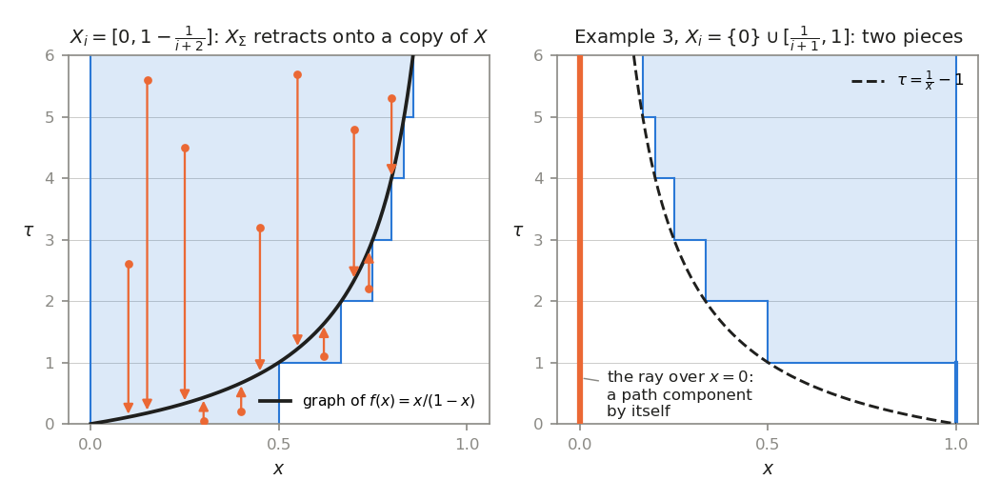

# Appendix. A flood without end: the homotopy type of a monotone union

*Milnor, "Morse Theory", Appendix, rewritten for a first-year graduate student who wants to know
what the theorem is for. Every proof is complete; Whitehead's theorem and standard facts about
CW-complexes are quoted with references.*

---

## 0. A flood that never stops rising

Let water rise slowly over a landscape. At level $a$ the flooded region is $M^a$, the points of
height at most $a$, and Chapter 2 (Milnor §3) describes what happens when the level passes a
critical height: a cell is attached for each pass. With finitely many passes, the shape of the
flooded land is known once the water is above the highest one. In the landscape that matters most
in this book there are infinitely many passes. The landscape is the space $\Omega=\Omega(M;p,q)$ of
paths from $p$ to $q$ in a complete Riemannian manifold, the height is the energy $E$, and the
passes are the geodesics from $p$ to $q$. On a sphere there are infinitely many of them, with
energies tending to infinity (Chapter 7, §6): the water never stops rising. Chapter 10 shows that
each flooded region $\Omega^a$ has the homotopy type of a finite CW-complex, with one cell for each
geodesic of energy below $a$. The question of this appendix is:

*If we know the shape, up to homotopy, of the flooded region at every finite level, do we know the
shape of the whole space?*

The answer is yes when every point is under water *with some margin* at some finite level.
Milnor's Example 3 shows how it fails otherwise: a point that the water reaches only at the edge can
come apart from the rest. The tool is the *telescope*, which records the whole history of the flood
at once, and the main result, Theorem A, says that maps which are homotopy equivalences level by
level give a homotopy equivalence of the whole. The application (§7) assembles the space of paths
on a sphere from its energy levels and reads off its homology.

---

## 1. Telescopes (Milnor p. 149)

Milnor's purpose is an alternative to the last step in the proof of Theorem 17.3: given
$\Omega^{a_0}\subseteq\Omega^{a_1}\subseteq\cdots$ in $\Omega$, each of the homotopy type of a
CW-complex, to show that the union $\Omega$ has the homotopy type of a CW-complex. More generally,
let $X$ be a topological space and $X_0\subseteq X_1\subseteq X_2\subseteq\cdots$ subspaces. To what
extent is the homotopy type of $X$ determined by those of the $X_i$?

**Definition.** The *telescope* of the sequence is
$$X_\Sigma=X_0\times[0,1]\cup X_1\times[1,2]\cup X_2\times[2,3]\cup\cdots\subseteq X\times\mathbb R,$$
with the subspace topology. $X$ is the *homotopy direct limit* of $\{X_i\}$ if the projection
$p:X_\Sigma\to X$, $p(x,\tau)=x$, is a homotopy equivalence.

Since $X_{n-1}\subseteq X_n$, a pair $(x,\tau)$ with $\tau\ge0$ lies in $X_\Sigma$ exactly when
$x\in X_{\lfloor\tau\rfloor}$. Three elementary facts are used throughout, by Milnor without
comment.

(T1) *Upward closure.* If $(x,\tau)\in X_\Sigma$ and $\tau'\ge\tau$, then $(x,\tau')\in X_\Sigma$.
So a homotopy that only increases the second coordinate stays in $X_\Sigma$.

(T2) *Truncations.* The truncation $X^n_\Sigma=\{(x,\tau)\in X_\Sigma:\tau\le n\}=X_0\times[0,1]\cup
\dots\cup X_{n-1}\times[n-1,n]\cup X_n\times\{n\}$ deformation retracts onto $X_n\times\{n\}$ by
$(x,\tau)\mapsto(x,\tau+s(n-\tau))$, $0\le s\le1$, by (T1) and $X_{\lfloor\tau\rfloor}\subseteq X_n$.
Hence $x\mapsto(x,n)$ is a homotopy equivalence $X_n\to X^n_\Sigma$.

(T3) *Pasting.* If every $X_i$ is closed in $X$, the strips $X_n\times[n,n+1]$ are closed in
$X_\Sigma$ and form a locally finite family (the open set $\{|\tau-\tau_0|<\frac12\}$ meets at most
two). So a map on $X_\Sigma$, or on $X_\Sigma\times[0,1]$, is continuous as soon as it is continuous
on each strip (times $[0,1]$).

> **A hidden hypothesis.** Milnor's proof of Theorem A defines maps strip by strip, and (T3) is
> what makes such a map continuous. Case 1 of his proof (§4), as written, needs the $X_i$ closed.
> Take $X=[0,1]$, $X_0=(0,1]$, $X_n=X$ for $n\ge1$, $f=\mathrm{id}$, and for the homotopy $h^0_u$
> of §4 from the identity of $(0,1]$ to itself choose
> $h^0_u(x)=x+(1-x)\max\big(0,1-|u-1+\frac x2|/\frac x2\big)$, which pushes $x$ all the way to $1$
> at the time $u=1-\frac x2$. Then the map $g$ of §4 is discontinuous at $(0,1)$. Case 2 (§5)
> applies Case 1 only to truncations of telescopes, which are always closed, and the one map it
> defines strip by strip on a telescope of the original subspaces is $G:Y_\Sigma\to X_\Sigma$; so
> Milnor's proof of Theorem A needs only the $Y_i$ closed. In his application they are
> subcomplexes, hence closed. Theorem A itself needs no closedness at all: at the end of §5
> Milnor's proof is run on mapping telescopes, where a map given block by block is always
> continuous.

---

## 2. Milnor's three examples (Milnor pp. 149–150)

**Example 1.** Suppose that each point of $X$ lies in the interior of some $X_i$, and that $X$ is
paracompact. Then $X$ is the homotopy direct limit of $\{X_i\}$.

Milnor's proof: a partition of unity gives a map $f:X\to\mathbb R$ with $f\ge0$ and $f(x)\ge i+1$
for $x\notin X_i$, and $x\mapsto(x,f(x))$ embeds $X$ in $X_\Sigma$ as a subset that is "clearly a
deformation retract".

*Construction of $f$.* A paracompact (Hausdorff) space has a partition of unity subordinate to any
open cover (Munkres, *Topology*, 2nd ed., Theorem 41.7). Take $\{\varphi_i\}_{i\ge0}$ with
$\operatorname{supp}\varphi_i\subseteq\operatorname{int}X_i$ and put $f=\sum_ii\,\varphi_i$,
continuous as a locally finite sum, with $f\ge0$. If $x\notin X_i$ then $x\notin X_j$ for $j\le i$,
so $\varphi_j(x)=0$ for $j\le i$ and $f(x)=\sum_{j>i}j\,\varphi_j(x)\ge i+1$. The rest is the
following lemma.

**Lemma 2.1.** If $f:X\to[0,\infty)$ is continuous and $f(x)\ge i+1$ whenever $x\notin X_i$, then
$p:X_\Sigma\to X$ is a homotopy equivalence.

*Proof.* For $x\in X$ let $m=\lfloor f(x)\rfloor$. As $f(x)<m+1$, $x\in X_m$, so
$\sigma(x)=(x,f(x))\in X_\Sigma$. The map $\sigma:X\to X_\Sigma$ is continuous with
$p\sigma=\mathrm{id}_X$, hence a homeomorphism onto the graph $\Gamma$ of $f$. The homotopy
$$H_s(x,\tau)=\big(x,(1-s)\tau+sf(x)\big),\qquad0\le s\le1,$$
stays in $X_\Sigma$: if $\tau\le f(x)$ the second coordinate only increases (T1); if $\tau\ge f(x)$
it stays $\ge f(x)$, and $(x,\tau')\in X_\Sigma$ for $\tau'\ge f(x)$ by (T1) applied to $\sigma(x)$.
Since $H_0=\mathrm{id}$, $H_1=\sigma p$ and each $H_s$ fixes $\Gamma$, this is a deformation
retraction onto $\Gamma$, and $\sigma p\simeq\mathrm{id}$, $p\sigma=\mathrm{id}$. $\square$

Lemma 2.1 needs no paracompactness once such an $f$ is at hand. In particular:

**Lemma 2.2.** $X_\Sigma$ is the homotopy direct limit of its truncations $\{X^n_\Sigma\}$.

*Proof.* Take $f(x,\tau)=\tau+1$: if $(x,\tau)\notin X^n_\Sigma$, then $\tau>n$ and $f>n+1$.
$\square$

Milnor needs Lemma 2.2, without saying so, at the end of Case 2 (§5).

**Example 2.** Let $X$ be a CW-complex and the $X_i$ subcomplexes with union $X$. Then $X$ is the
homotopy direct limit of $\{X_i\}$.

Milnor's proof: $p$ induces isomorphisms of homotopy groups in all dimensions, so Whitehead's
theorem applies. Both halves rest on facts from outside the book.

**Facts (CW-complexes).** (a) A compact subset of a CW-complex lies in a finite subcomplex (Hatcher,
*Algebraic Topology*, Proposition A.1). (b) If $X$ and $Y$ are CW-complexes and $Y$ is locally
compact, or both have countably many cells, the product topology on $X\times Y$ is the CW topology
of the product cell structure (Hatcher, Theorem A.6); a subcomplex is closed and is a CW-complex in
the subspace topology. (c) *Whitehead's theorem*: a map between connected CW-complexes inducing
isomorphisms on all homotopy groups $\pi_k$, $k\ge1$, is a homotopy equivalence (J. H. C. Whitehead,
*Combinatorial homotopy I*, Bull. Amer. Math. Soc. 55 (1949), 213–245; Hatcher, Theorem 4.5).
Applied to each path component, it says that a *weak homotopy equivalence* between CW-complexes (a
bijection on path components and isomorphisms on every $\pi_k$ at every base point) is a homotopy
equivalence. Milnor (p. 24) quotes the version for spaces dominated by CW-complexes. (d) *Cellular
approximation*: every map between CW-complexes is homotopic to a cellular map (Hatcher, Theorem
4.8). (e) *CW approximation*: for every space $Z$ there are a CW-complex $Z'$ and a weak homotopy
equivalence $Z'\to Z$ (Hatcher, Proposition 4.13).

**Lemma 2.3.** If every compact subset of $X$ lies in some $X_n$, then $p:X_\Sigma\to X$ is a weak
homotopy equivalence.

*Proof.* A compact subset of $X_\Sigma$ has bounded second coordinate. *Base points.* For
$(x_0,\tau_0)\in X_\Sigma$ and an integer $m\ge\tau_0$, the path $\tau\mapsto(x_0,\tau)$,
$\tau_0\le\tau\le m$, lies in $X_\Sigma$ (T1) and projects to a constant path, so changing base
point along it commutes with $p_*$; we may take base points $(x_0,m)$ with $x_0\in X_m$.
*Surjectivity on $\pi_k$.* A map $\alpha:(S^k,*)\to(X,x_0)$ has compact image, inside some $X_N$
with $N\ge m$. Then $(\alpha,N)$ maps into $X_N\times\{N\}\subseteq X_\Sigma$, is based at
$(x_0,N)$ and lies over $\alpha$; move its base point back to $(x_0,m)$ along $\tau\mapsto
(x_0,\tau)$. *Injectivity.* Let $\beta=(\beta_1,\beta_2):(S^k,*)\to(X_\Sigma,(x_0,m))$ and let
$G:S^k\times[0,1]\to X$ be a null-homotopy of $p\beta=\beta_1$ relative to the base point. Choose
$N\ge m$ with $G(S^k\times[0,1])\subseteq X_N$ and $N\ge\max\beta_2$. The homotopy
$(\beta_1,\beta_2+s(N-\beta_2))$ stays in $X_\Sigma$ (T1), moves the base point along
$\tau\mapsto(x_0,\tau)$, and ends at $(\beta_1,N)$, which is null-homotopic relative to the base
point through $(G,N)$. So $[\beta]$ corresponds to the trivial class under a change of base point,
and is trivial. Path components ($k=0$) are handled in the same way. $\square$

*Proof of Example 2.* Every cell of $X$ lies in some $X_i$, and the $X_i$ increase, so by Fact (a)
every compact subset of $X$ lies in some $X_n$, and $p$ is a weak homotopy equivalence by Lemma
2.3. Give $\mathbb R$ the cell structure with vertices at the integers. By Fact (b), $X\times\mathbb
R$ is a CW-complex in the product topology, and $X_\Sigma$, the union of the subcomplexes
$X_n\times[n,n+1]$, is a subcomplex, hence a CW-complex in the subspace topology. Whitehead's
theorem (Fact (c)) finishes the proof. $\square$

**Example 3.** The unit interval $[0,1]$ is not the homotopy direct limit of the closed subsets
$X_i=\{0\}\cup[\frac1{i+1},1]$. (Milnor writes $[0]\cup[1/i,1]$, indexing from $i=1$.)

*Proof.* A homotopy equivalence induces a bijection on path components, and $[0,1]$ is path
connected; we show that $X_\Sigma$ is not. Let $c(s)=(x(s),\tau(s))$, $0\le s\le1$, be a path in
$X_\Sigma$ with $x(0)=0$, and suppose $x(s_1)>0$ for some $s_1$. Let $s^*$ be the last $s\le s_1$
with $x(s)=0$, and $T=\max\tau$. For $s^*<s\le s_1$, $x(s)>0$, so
$x(s)\in[\frac1{\lfloor\tau(s)\rfloor+1},1]$ and $x(s)\ge\frac1{T+1}$; letting $s\downarrow s^*$
gives $x(s^*)\ge\frac1{T+1}>0$, a contradiction. So the ray $\{0\}\times[0,\infty)$ is a path
component of $X_\Sigma$, and $X_\Sigma$ has at least two. $\square$

Here $0$ lies in every $X_i$ but in the interior of none: the hypothesis of Example 1 fails at a
single point, and the telescope remembers it.

### An interactive look at the telescope

The figure draws telescopes of subsets of an interval in the plane, with $x$ horizontal and $\tau$
vertical. In the first example $X=[0,1)$ and $X_i=[0,1-\frac1{i+2}]$: every point is interior to
some $X_i$, and $X_\Sigma$ is the shaded staircase. The curve is the graph of $f(x)=x/(1-x)$, which
satisfies $f\ge i+1$ off $X_i$, so Lemma 2.1 applies. Drag the slider $s$ to run the deformation
$H_s$: the sample points of $X_\Sigma$ slide vertically onto the graph, a copy of $X$. In the second
example (Example 3), $X=[0,1]$ and $X_i=\{0\}\cup[\frac1{i+1},1]$. The ray over $x=0$ never touches
the staircase. A function whose graph lay in $X_\Sigma$ would need $f(x)\ge\frac1x-1$ for $x>0$
(dashed curve), so it cannot be continuous at $0$. Here the slider runs the push-up deformation of
(T2) instead, and the gap never closes. The buttons switch examples; the second slider sets the
number of levels drawn.

*(In the printed version this figure is a still image; the interactive version is in the web
edition.)*

---

## 3. Theorem A and the alternative proof of Theorem 17.3 (Milnor p. 150)

**Theorem A.** Suppose that $X$ is the homotopy direct limit of $\{X_i\}$ and $Y$ is the homotopy
direct limit of $\{Y_i\}$. Let $f:X\to Y$ be a map which carries each $X_i$ into $Y_i$ by a
homotopy equivalence $f_i=f|X_i:X_i\to Y_i$. Then $f$ itself is a homotopy equivalence.

No closedness is assumed. Milnor's proof (§§4–5) uses closed $Y_i$, and the general case is reduced
to it at the end of §5.

*The alternative final step of Theorem 17.3.* In the proof of Theorem 17.3 (Chapter 10) one has
non-critical values $a_0<a_1<\cdots$ of $E$, CW-complexes $K_0\subseteq K_1\subseteq\cdots$, each a
subcomplex of the next, and homotopy equivalences $f_i:\Omega^{a_i}\to K_i$, each extending the
previous one (Milnor p. 23). Let $K=\bigcup_iK_i$, a CW-complex with the direct limit topology. To
apply Theorem A one needs the following.

* $\Omega=\bigcup_i\Omega^{a_i}$, that is, $a_i\to\infty$. This is automatic if $E$ has infinitely
  many critical values, since each $\Omega^a$ contains only finitely many geodesics (Milnor §16);
  otherwise the sequence must be continued beyond the last critical value.
* Each $\omega\in\Omega$ lies in the interior of some $\Omega^{a_i}$. The energy is continuous for
  Milnor's metric on $\Omega$ (§16: he adds the term $[\int_0^1(\frac{ds}{dt}-\frac{ds'}{dt})^2dt]^
  {1/2}$ to the metric for exactly this purpose), so $E^{-1}[0,a_i)$ is an open neighbourhood of
  $\omega$ in $\Omega^{a_i}$ once $a_i>E(\omega)$. The same continuity makes each $\Omega^{a_i}$
  closed.
* $\Omega$ is paracompact, being a metric space (A. H. Stone's theorem; Munkres, Theorem 41.4).
* The union map $f:\Omega\to K$, $f|\Omega^{a_i}=f_i$, is well defined because each $f_{i+1}$
  extends $f_i$, and continuous because it agrees with the continuous $f_i$ on the open sets
  $E^{-1}[0,a_i)$, which cover $\Omega$.

Then $\Omega$ is the homotopy direct limit of $\{\Omega^{a_i}\}$ (Example 1), $K$ is that of
$\{K_i\}$ (Example 2), and Theorem A says that $f:\Omega\to K$ is a homotopy equivalence. Milnor's
first proof (p. 95) instead uses that $\Omega$ has the homotopy type of a CW-complex (his Corollary
17.2, resting on his paper *On spaces having the homotopy type of a CW-complex*, Trans. Amer. Math.
Soc. 90 (1959), 272–280), because Whitehead's theorem upgrades the weak equivalence $\Omega\to K$ to
a homotopy equivalence only for such spaces. Being weakly equivalent to a CW-complex is no help by
itself: by CW approximation (Fact (e)) every space is. Theorem A uses Whitehead's theorem only for
CW-complexes, inside Example 2.

*Reduction to the telescopes.* Define $f_\Sigma:X_\Sigma\to Y_\Sigma$ by $f_\Sigma(x,\tau)=
(f(x),\tau)$; it lands in $Y_\Sigma$ because $f(X_{\lfloor\tau\rfloor})\subseteq Y_{\lfloor\tau
\rfloor}$. Milnor calls it "clearly sufficient" to prove that $f_\Sigma$ is a homotopy
equivalence. Indeed $p_Yf_\Sigma=fp_X$; if $s_X$ is a homotopy inverse of $p_X$, then $f\simeq fp_Xs_X=
p_Yf_\Sigma s_X$, a composite of homotopy equivalences, and a map homotopic to a homotopy
equivalence is one.

---

## 4. Case 1: maps homotopic to the identity on every level (Milnor pp. 150–152)

*Case 1.* Suppose $X_i=Y_i$ for all $i$ and each $f_i:X_i\to X_i$ is homotopic to the identity of
$X_i$. We prove that $f_\Sigma$ is a homotopy equivalence. (This part does not use that $X$ is a
homotopy direct limit.) Throughout this section the $X_i$ are closed: every map below is defined
strip by strip, and (T3) makes it continuous. The blockquote in §1 shows what goes wrong
otherwise; §5 needs Case 1 only for closed sets.

**Remark (Milnor).** Under these conditions one might conjecture that $f_\Sigma$ is actually
homotopic to the identity; Milnor says that "counterexamples can be given".

Milnor gives none. Here is one; in later language it is built from a *phantom map*, one that is
null-homotopic on every finite subcomplex but not null-homotopic.

*A counterexample.* Let $T$ be the telescope of $S^1\xrightarrow{z^2}S^1\xrightarrow{z^2}\cdots$:
cylinders $S^1\times[n,n+1]$, $n\ge0$, with the top circle of the $n$-th glued to the bottom circle
of the $(n+1)$-st by $z\mapsto z^2$. Its cells are the vertices $v_n=(1,n)$, the edges $a_n$ (the
circle at level $n$) and $c_n=\{1\}\times(n,n+1)$, and the 2-cells $D_n=(S^1\setminus1)\times
(n,n+1)$, with $\partial D_n=a_n-2a_{n+1}$: the bottom of the square runs once around $a_n$, the top
twice around $a_{n+1}$, and the two sides cancel. Let $T_n$ be the subcomplex made of the first $n$
cylinders; it deformation retracts onto a circle.

(i) $H^2(T;\mathbb Z)\ne0$. There are no 3-cells, so $H^2(T;\mathbb Z)$ is the group of integer
sequences $(b_n)$ (one value per $D_n$) modulo those of the form $b_n=\varphi_n-2\varphi_{n+1}$. For
$b=(1,0,1,0,\dots)$ such integers would satisfy $\varphi_0=\sum_{k<N}b_k2^k+2^N\varphi_N$ for every
$N$; for even $N$, $3\sum_{k<N}b_k2^k=4^{N/2}-1$, so $3\varphi_0+1$ would be divisible by every
power of $2$, impossible as $3\varphi_0+1\ne0$.

(ii) Let $\mathbb{CP}^n$ be the nonzero complex polynomials of degree $\le n$ in one variable, up to
scalars, and $\mathbb{CP}^\infty=\bigcup_n\mathbb{CP}^n$ with its usual cells. Multiplication of
polynomials makes $\mathbb{CP}^\infty$ a commutative monoid with unit $e=[1]$ (a $0$-cell),
continuous because the product topology on $\mathbb{CP}^\infty\times\mathbb{CP}^\infty$ is the CW
topology (Fact (b)). It is simply connected, and its 2-skeleton $\mathbb{CP}^1$ is a 2-sphere.
Collapse the 1-skeleton of $T$ to get $T\to\bigvee_nS^2_n$, and follow it by the map that is a
homeomorphism $S^2_n\to\mathbb{CP}^1$ (wedge point to $e$) when $b_n=1$ and constant when $b_n=0$.
The resulting $g:T\to\mathbb{CP}^\infty$ pulls a generator of $H^2(\mathbb{CP}^\infty;\mathbb Z)$
back to the class of the cellular cocycle $b$ (cellular cohomology and its naturality: Hatcher,
§3.1), which is nonzero, so $g$ is not null-homotopic. But each $g|T_n$ is, because $T_n$ retracts by
deformation onto a circle and $\pi_1(\mathbb{CP}^\infty)=0$.

(iii) Let $W=T\times\mathbb{CP}^\infty$ (a CW-complex by Fact (b)), $W_n=T_n\times\mathbb{CP}^\infty$,
and $f(x,z)=(x,\,g(x)z)$. Then $f(W_n)\subseteq W_n$, and if $g_u$ is a null-homotopy of $g|T_n$
ending at $e$, $(x,z)\mapsto(x,g_u(x)z)$ is a homotopy in $W_n$ from $f|W_n$ to the identity: Case 1
applies. But $f\not\simeq\mathrm{id}_W$: restricting a homotopy from $f$ to $\mathrm{id}$ to
$T\times\{e\}$ and projecting to $\mathbb{CP}^\infty$ would give a homotopy from $g$ to the constant
map $e$. Hence $f_\Sigma\not\simeq\mathrm{id}$: $W$ is a homotopy direct limit (Example 2), and if
$f_\Sigma\simeq\mathrm{id}$, then $f\simeq fps=pf_\Sigma s\simeq ps\simeq\mathrm{id}$ for a homotopy
inverse $s$ of $p$.

*Milnor's proof of Case 1.* For each $n$ let $h^n_u:X_n\to X_n$, $0\le u\le1$, be a homotopy with
$h^n_0=f_n$ and $h^n_1=\mathrm{id}$. On the strip $X_n\times[n,n+1]$ define
$$h_u(x,n+t)=\begin{cases}(h^n_u(x),\,n+2t)&0\le t\le\frac12,\\(h^n_{(3-4t)u}(x),\,n+1)&
\frac12\le t\le\frac34,\\(h^{n+1}_{(4t-3)u}(x),\,n+1)&\frac34\le t\le1.\end{cases}$$

> **Milnor's text skips…** the correct index in the third line: it prints
> $h^{n+1}_{(4-3t)u}$, which at $t=\frac34$ would be $h^{n+1}_{7u/4}$. It must be
> $h^{n+1}_{(4t-3)u}$, running from $h^{n+1}_0=f_{n+1}$ to $h^{n+1}_u$.

*Well defined and continuous.* At $t=\frac12$ both lines give $(h^n_u(x),n+1)$. At $t=\frac34$ both
give $(f(x),n+1)$, since $h^n_0=f_n$, $h^{n+1}_0=f_{n+1}$ and $f_{n+1}|X_n=f_n$. At $t=1$ the third
line gives $(h^{n+1}_u(x),n+1)$, the value of the first line on the next strip at $t=0$. The values
lie in $X_\Sigma$, each formula is continuous in $(x,t,u)$, and (T3) gives continuity of
$(z,u)\mapsto h_u(z)$.

*$h_0\simeq f_\Sigma$* (Milnor: "clearly"). $h_0(x,n+t)=(f(x),n+\min(2t,1))=f_\Sigma(r(x,n+t))$ with
$r(x,n+t)=(x,n+\min(2t,1))$, and $r\simeq\mathrm{id}$ through $(x,n+(1-s)t+s\min(2t,1))$, which only
raises $\tau$ inside the strip.

*The map $h_1$.* It satisfies
$$h_1(x,n+t)=(x,n+2t)\ \ (0\le t\le\tfrac12),\qquad h_1(x,n+t)\in X_{n+1}\times\{n+1\}\ \
(\tfrac12\le t\le1),$$
and $h_1(y,m)=(h^m_1(y),m)=(y,m)$ at every integer level $m$. Milnor shows that any such map is a
homotopy equivalence, with homotopy inverse
$$g(x,n+t)=\begin{cases}(x,n+2t)&0\le t\le\frac12,\\h_1(x,n+\frac32-t)&\frac12\le t\le1,
\end{cases}$$
well defined since $h_1(x,n+\frac12)=h_1(x,n+1)=(x,n+1)$, continuous by (T3). Like $h_1$, $g$ fixes
the points at integer levels.

*$h_1g\simeq\mathrm{id}$.* Since $h_1$ fixes the integer levels and maps $(x,n+s)$, $s\ge\frac12$,
to level $n+1$,
$$h_1g(x,n+t)=\begin{cases}(x,n+4t)&0\le t\le\frac14,\\h_1(x,n+2t)&\frac14\le t\le\frac12,\\
h_1(x,n+\frac32-t)&\frac12\le t\le1.\end{cases}$$
On $[\frac14,1]$ this runs forwards and then backwards along the loop $s\mapsto h_1(x,n+s)$,
$\frac12\le s\le1$, which starts and ends at $(x,n+1)$. Milnor's homotopy cuts the excursion short:
for $0\le u\le\frac12$,
$$H_u(x,n+t)=\begin{cases}h_1g(x,n+t)&0\le t\le\frac{1-u}2\ \text{ or }\ \frac12+u\le t\le1,\\
h_1(x,n+1-u)&\frac{1-u}2\le t\le\frac12+u,\end{cases}$$
well defined because $h_1g(x,n+\frac{1-u}2)=h_1g(x,n+\frac12+u)=h_1(x,n+1-u)$. Then $H_0=h_1g$, and
$H_{1/2}(x,n+t)=(x,n+\min(4t,1))$ because $h_1(x,n+\frac12)=(x,n+1)$; this is homotopic to the
identity by raising $\tau$ as before.

*$gh_1\simeq\mathrm{id}$* (Milnor: "a completely analogous argument"). Since $g$ fixes the integer
levels,
$$gh_1(x,n+t)=\begin{cases}(x,n+4t)&0\le t\le\frac14,\\h_1(x,n+\frac32-2t)&\frac14\le t\le\frac12,
\\h_1(x,n+t)&\frac12\le t\le1,\end{cases}$$
which runs backwards along the same loop and then forwards. With $\psi(t)=\frac32-2t$ on
$[\frac14,\frac12]$ and $\psi(t)=t$ on $[\frac12,1]$, the homotopy
$$K_u(x,n+t)=\begin{cases}(x,n+4t)&0\le t\le\frac14,\\h_1\big(x,n+\max(\psi(t),\frac12+u)\big)&
\frac14\le t\le1,\end{cases}\qquad0\le u\le\tfrac12,$$
is well defined ($\psi=1$ at $t=\frac14$ and at $t=1$) and joins $K_0=gh_1$ to
$K_{1/2}(x,n+t)=(x,n+\min(4t,1))\simeq\mathrm{id}$.

So $h_1$ is a homotopy equivalence, $f_\Sigma\simeq h_0\simeq h_1$ through the $h_u$, and $f_\Sigma$
is a homotopy equivalence. $\square$

---

## 5. Case 2: the general case (Milnor pp. 152–153)

Let $X,Y$ be as in Theorem A, and suppose first that the $Y_i$ are closed; this assumption is
removed at the end of the section. For each $n$ let $g_n:Y_n\to X_n$ be a homotopy inverse of $f_n$, and
$i_n:X_n\subseteq X_{n+1}$, $j_n:Y_n\subseteq Y_{n+1}$ the inclusions. The square formed by
$g_n,g_{n+1},i_n,j_n$ commutes up to homotopy:
$$i_ng_n\simeq g_{n+1}f_{n+1}i_ng_n=g_{n+1}j_nf_ng_n\simeq g_{n+1}j_n,$$
using $g_{n+1}f_{n+1}\simeq\mathrm{id}$, $f_{n+1}i_n=j_nf_n$ and $f_ng_n\simeq\mathrm{id}$. Choose
homotopies $h^n_u:Y_n\to X_{n+1}$ with $h^n_0=i_ng_n$ and $h^n_1=g_{n+1}j_n$, and define
$G:Y_\Sigma\to X_\Sigma$ by
$$G(y,n+t)=\begin{cases}(g_n(y),\,n+2t)&0\le t\le\frac12,\\(h^n_{2t-1}(y),\,n+1)&\frac12\le t\le1.
\end{cases}$$
It is well defined ($h^n_0=g_n$ at $t=\frac12$; at $t=1$, $h^n_1=g_{n+1}$ matches the next strip),
takes values in $X_\Sigma$, and is continuous by (T3).

*$Gf_\Sigma$ is a homotopy equivalence.* $Gf_\Sigma(x,n+t)$ is $(g_nf_n(x),n+2t)$ or
$(h^n_{2t-1}(f(x)),n+1)$, so $Gf_\Sigma$ maps each truncation $X^m_\Sigma$ into itself, and on
$X_m\times\{m\}$ it is $(x,m)\mapsto(g_mf_m(x),m)$, homotopic in $X_m\times\{m\}$ to the identity.
Let $\varphi$ be the restriction of $Gf_\Sigma$ to $X^m_\Sigma$, $r:X^m_\Sigma\to X_m\times\{m\}$ the
retraction of (T2) and $\iota$ the inclusion. With all homotopies inside $X^m_\Sigma$,
$$\varphi\simeq\varphi\,\iota r=(\varphi|_{X_m\times\{m\}})\,r\simeq\iota r\simeq\mathrm{id}.$$
So $Gf_\Sigma$ satisfies the hypotheses of Case 1 for the space $X_\Sigma$ and its subsets
$X^m_\Sigma$, which are closed whether or not the $X_i$ are (they are cut out by $\tau\le m$), and
Case 1 says that the induced map $(Gf_\Sigma)_\Sigma$ of the telescope of
$\{X^m_\Sigma\}$ is a homotopy equivalence. As $X_\Sigma$ is the homotopy direct limit of
$\{X^m_\Sigma\}$ (Lemma 2.2), the reduction in §3 shows that $Gf_\Sigma$ itself is a homotopy
equivalence.

> **Milnor's text skips…** this last step. Case 1 is about the induced map of telescopes; to come
> back to $Gf_\Sigma$ one needs $X_\Sigma$ to be the homotopy direct limit of its truncations.
> Example 1 does not give this ($X_\Sigma$ need not be paracompact), but Lemma 2.2 does.

*Conclusion.* If $k$ is a homotopy inverse of $Gf_\Sigma$, then $(kG)f_\Sigma\simeq\mathrm{id}$:
$f_\Sigma$ has a left homotopy inverse. Symmetrically, $f_\Sigma G:Y_\Sigma\to Y_\Sigma$, given by
$(f_ng_n(y),n+2t)$ and $(f(h^n_{2t-1}(y)),n+1)$, preserves the truncations $Y^m_\Sigma$ and is
$f_mg_m\simeq\mathrm{id}$ on $Y_m\times\{m\}$; so it is a homotopy equivalence, with inverse $k'$
say, and $f_\Sigma(Gk')\simeq\mathrm{id}$: $f_\Sigma$ has a right homotopy inverse. By the Assertion
on Milnor's p. 22 (Chapter 2: a map with a left and a right homotopy inverse is a homotopy
equivalence), $f_\Sigma$ is a homotopy equivalence, and by §3 so is $f$. This proves Theorem A when
the $Y_i$ are closed. $\square$

*Theorem A in general.* Now let the $X_i$ and $Y_i$ be arbitrary. Give the set $X_\Sigma$ the finest
topology in which every strip $X_n\times[n,n+1]\to X_\Sigma$ is continuous, and call the result
$T_X$: it is the *mapping telescope* of the inclusions $X_n\subseteq X_{n+1}$, the strips glued
along their common levels. A map out of $T_X$ is continuous as soon as it is continuous on every
strip, and so is a map out of $[0,1]\times T_X$, since the product of a quotient map with the
compact space $[0,1]$ is a quotient map: this is (T3) without its hypothesis. The identity
$T_X\to X_\Sigma$ is continuous, and a homeomorphism when the $X_i$ are closed, by (T3). The
truncations $T^n_X=\{\tau\le n\}$ are closed in $T_X$, and $T_X$ is their homotopy direct limit, by
Lemma 2.1 with $f(x,\tau)=\tau+1$. (T2) holds in $T_X$ with the same deformation
$(x,\tau)\mapsto(x,\tau+s(n-\tau))$: on $[0,1]$ times a strip, the moving point crosses finitely
many strips, on closed pieces, so the deformation is continuous; and $(x,\tau)\mapsto x$ is
continuous from $T^n_X$ to $X_n$, which carries the topology of $X$. So $\kappa^X_n:x\mapsto(x,n)$
is a homotopy equivalence $X_n\to T^n_X$, with homotopy inverse $q^X_n(x,\tau)=x$.

The identity $c_X:T_X\to X_\Sigma$ carries $T^n_X$ into the closed set $X^n_\Sigma$, and there it is
homotopic to $c_X\kappa^X_nq^X_n$, a composite of homotopy equivalences by (T2). By Theorem A for
closed $Y_i$, with Lemmas 2.1 and 2.2, $c_X$ is a homotopy equivalence, and so is $p_Xc_X:T_X\to X$,
$(x,\tau)\mapsto x$, since $X$ is the homotopy direct limit of $\{X_i\}$; likewise for $Y$. The map
$f_T:T_X\to T_Y$, $f_T(x,\tau)=(f(x),\tau)$, is continuous on every strip, carries $T^n_X$ into the
closed set $T^n_Y$, and there it is homotopic to $f_T\kappa^X_nq^X_n=\kappa^Y_nf_nq^X_n$, a
homotopy equivalence. By Theorem A for closed $Y_i$ again, $f_T$ is a homotopy equivalence. Since
$f(p_Xc_X)=(p_Yc_Y)f_T$, the argument of §3 shows that $f$ is a homotopy equivalence. This proves
Theorem A as Milnor states it. $\square$

So the closedness that Milnor's proof needs is a feature of the telescope $X_\Sigma$, not of the
theorem: the proof is the same, run on the telescopes $T_X$ and $T_Y$, where pasting is automatic,
and on their truncations, which are closed.

---

## 6. The Corollary (Milnor p. 153)

**Corollary.** Suppose that $X$ is the homotopy direct limit of $\{X_i\}$. If each $X_i$ has the
homotopy type of a CW-complex, then $X$ itself has the homotopy type of a CW-complex.

"The proof is not difficult," says Milnor, and gives none. One cannot just take a union of
CW-complexes $K_i\simeq X_i$, since nothing makes $K_i$ a subcomplex of $K_{i+1}$; a telescope of
the $K_i$ does the job.

*Proof.* Choose CW-complexes $K_i$ and homotopy equivalences $e_i:X_i\to K_i$ with homotopy inverses
$e_i'$. By cellular approximation (Fact (d)) the maps $e_{i+1}\iota_ie_i':K_i\to K_{i+1}$, with
$\iota_i:X_i\subseteq X_{i+1}$ the inclusion, are homotopic to cellular maps $c_i$. Let $T$ be the
mapping telescope
$$T=\Big(\bigsqcup_iK_i\times[i,i+1]\Big)\Big/\big((k,i+1)\sim(c_i(k),i+1)\big),$$
a CW-complex because the $c_i$ are cellular (Hatcher, §3.F), with subcomplexes $T_n$ (the first $n$
blocks together with $K_n\times\{n\}$) whose union is $T$. Collapsing the blocks one at a time,
$(k,s)\mapsto(k,s+u(i+1-s))$ on the $i$-th, deforms $T_n$ onto $K_n\times\{n\}$, so the inclusion
$\kappa_n:K_n\to T_n$ at level $n$ is a homotopy equivalence; and $T$ is the homotopy direct limit
of $\{T_n\}$ by Example 2. Since $c_ie_i\simeq e_{i+1}\iota_ie_i'e_i\simeq e_{i+1}\iota_i$, there are
homotopies $H^i_u:X_i\to K_{i+1}$ from $c_ie_i$ to $e_{i+1}\iota_i$. On the mapping telescope $T_X$
of the inclusions (§5: the set $X_\Sigma$, with the topology in which a map is continuous as soon
as it is continuous on every strip) define $F:T_X\to T$ as $G$ was defined in Case 2, writing
$[k,\tau]$ for the class of $(k,\tau)$ in $T$:
$$F(x,n+t)=\begin{cases}[e_n(x),\,n+2t]&0\le t\le\frac12,\\ {}[H^n_{2t-1}(x),\,n+1]&\frac12\le t
\le1.\end{cases}$$
At $t=\frac12$, $[e_n(x),n+1]=[c_ne_n(x),n+1]=[H^n_0(x),n+1]$; at $t=1$ the value
$[e_{n+1}(x),n+1]$ matches the next strip. So $F$ is continuous, with no closedness needed; it maps
$T^n_X$ into $T_n$, and $F(x,n)=\kappa_ne_n(x)$. With $\kappa^X_n$ and $q^X_n$ as in §5,
$F|T^n_X\simeq F\kappa^X_nq^X_n=\kappa_ne_nq^X_n$, a composite of homotopy equivalences. So $F$
carries each $T^n_X$ into $T_n$ by a homotopy equivalence. As $T_X$ is the homotopy direct limit of
$\{T^n_X\}$ (§5) and $T$ that of its subcomplexes $T_n$, which are closed, Theorem A shows that $F$
is a homotopy equivalence. Hence $X\simeq T_X\simeq T$ (§5). $\square$

---

## 7. Application: the path space of a sphere, level by level

Let $p,q\in S^n$, $n\ge3$, be at angle $\theta=\frac\pi2$; they are not conjugate (the conjugate
points of $p$ along geodesics of the unit sphere are $\pm p$, Chapter 9). By Chapter 7, §6, the
geodesics from $p$ to $q$ are the arcs $\gamma_0,\gamma_1,\gamma_2,\dots$ of the great circle
through them, of lengths $(2k+1)\frac\pi2$, where $\gamma_k$ passes $k$ times through $p$ or its
antipode. Milnor's energy $\int_0^1\|\omega'\|^2dt$ of a constant-speed path is the square of its
length, so
$$E(\gamma_k)=(2k+1)^2\frac{\pi^2}4:\qquad2.47,\ \ 22.21,\ \ 61.69,\ \ 120.90,\ \ 199.86,\ \dots$$
By Milnor §17 (Chapter 10), $\gamma_k$ has index $k(n-1)$. Take $a_i=(i+1)^2\pi^2$, that is
$9.87,\ 39.48,\ 88.83,\ 157.91,\dots$, which lies strictly between $E(\gamma_i)$ and
$E(\gamma_{i+1})$ because $(2i+1)^2<(2i+2)^2<(2i+3)^2$. Then $\Omega^{a_i}$ contains exactly the
geodesics $\gamma_0,\dots,\gamma_i$, and the proof of Theorem 17.3 gives $\Omega^{a_i}\simeq K_i$, a
CW-complex with one cell in each dimension $0,n-1,2(n-1),\dots,i(n-1)$. For $n\ge3$, consecutive
cells differ in dimension by $n-1\ge2$, so all cellular boundary maps vanish and
$H_k(\Omega^{a_i};\mathbb Z)\cong\mathbb Z$ for $k=0,n-1,\dots,i(n-1)$, and $0$ otherwise.

This is where Theorem A enters: with Examples 1 and 2, it gives $\Omega(S^n;p,q)\simeq
K=\bigcup_iK_i$, a CW-complex with one cell in each dimension divisible by $n-1$, hence
$$H_k\big(\Omega(S^n;p,q);\mathbb Z\big)\cong\begin{cases}\mathbb Z&(n-1)\mid k,\\0&\text{otherwise,}
\end{cases}\qquad\sum_k\operatorname{rank}H_k\,t^k=\frac1{1-t^{n-1}}.$$
For $S^3$: one generator in each even degree.

The finite levels also say something quantitative. A singular cycle representing a generator of
$H_{k(n-1)}(\Omega)$ must contain a path of energy at least $E(\gamma_k)$: otherwise, its image
being compact, it would lie in $\Omega^{a}$ for some $a\in(E(\gamma_{k-1}),E(\gamma_k))$, which is
homotopy equivalent to a complex with no cells above dimension $(k-1)(n-1)$, so the cycle would
bound there. On $S^3$ with $\theta=\frac\pi2$, any family of paths representing the generator of
$H_4$ contains a path of energy at least $\frac{25\pi^2}4\approx61.7$, the energy of the geodesic
$\gamma_2$ that wraps once past $p$ and once past its antipode.

---

## 8. Summary of what was silently assumed, now made explicit

| Where | Milnor says | What is actually needed |
|---|---|---|
| p. 149 | $X_\Sigma$, "topologized as a subset of $X\times\mathbb R$" | $(x,\tau)\in X_\Sigma\iff x\in X_{\lfloor\tau\rfloor}$; upward closure (T1); truncations (T2) |
| p. 149 | Example 1: "using a partition of unity" | $f=\sum_ii\,\varphi_i$; paracompact includes Hausdorff |
| p. 149 | "which is clearly a deformation retract" | the straight-line homotopy in $\tau$ stays in $X_\Sigma$ (Lemma 2.1) |
| p. 149 | Example 2: "$p$ induces isomorphisms of homotopy groups" | compact sets lie in finite subcomplexes; base points (Lemma 2.3) |
| p. 149 | "it follows from Whitehead's theorem" | $X_\Sigma$ is a CW-complex, as $X\times\mathbb R$ has the CW topology |
| p. 150 | Example 3 (no proof) | $X_\Sigma$ has two path components |
| p. 150 | Theorem A | true as stated; the proof pastes maps strip by strip (T3), so Case 1 needs the $X_i$ closed and the proof the $Y_i$; mapping telescopes remove both (§5) |
| p. 150 | the alternative proof of 17.3 | $a_i\to\infty$; $E$ continuous; $\Omega$ metric, so paracompact; $f_{i+1}$ extends $f_i$ |
| p. 150 | reducing to $f_\Sigma$ is "clearly sufficient" | $p_Yf_\Sigma=fp_X$ |
| p. 150 | "counterexamples can be given" | none given; a phantom-map example in §4 |
| p. 151 | third line of $h_u$: $h^{n+1}_{(4-3t)u}$ | possible misprint for $h^{n+1}_{(4t-3)u}$ |
| p. 151 | $h_0$ "clearly homotopic to $f_\Sigma$" | $h_0=f_\Sigma\circ r$, $r$ a reparametrization of $\tau$ |
| p. 151 | $h_1g(x,n+t)=h_1(x,n+\frac32-t)$ for $t\ge\frac12$ | $h_1$ is the identity at integer levels |
| p. 152 | "$gh_1$ is homotopic to the identity" by "a completely analogous argument" | the homotopy $K_u$ |
| p. 152 | "apply Case 1 to the sequence $\{X^n_\Sigma\}$" | the truncations are closed, and $X_\Sigma$ is their homotopy direct limit (Lemma 2.2) |
| p. 153 | "compare page 22" | left and right homotopy inverses give a homotopy equivalence |
| p. 153 | Corollary: "The proof is not difficult" | mapping telescope of cellular maps, and Theorem A (§6) |

**Checked by machine.** The Appendix has been verified in the Lean proof assistant, for arbitrary
topological spaces: telescopes, homotopy direct limits, (T1)–(T3) and Lemmas 2.1–2.2; Example 1,
and its form for the sublevel sets of a continuous function, which needs no paracompactness;
Example 3; the reduction to $f_\Sigma$; and both cases of Milnor's proof of Theorem A, with the
corrected $(4t-3)u$. The machine also settled the question of closedness: Case 1 as written needs
the $X_i$ closed, Milnor's proof of Theorem A needs only the $Y_i$ closed, and Theorem A holds as
Milnor states it, by his proof run on mapping telescopes. The Corollary is checked with a mapping
telescope of the $K_i$ in place of a CW-complex, and so is the topological part of Theorem 17.3, for
a space exhausted by sublevel sets with compatible towers of cells. Not checked: Example 2, which
needs Whitehead's theorem, and Lemma 2.3; a counterexample for the Remark; the CW structure of a
mapping telescope, which needs cellular approximation; and the application. See the verified
edition.
