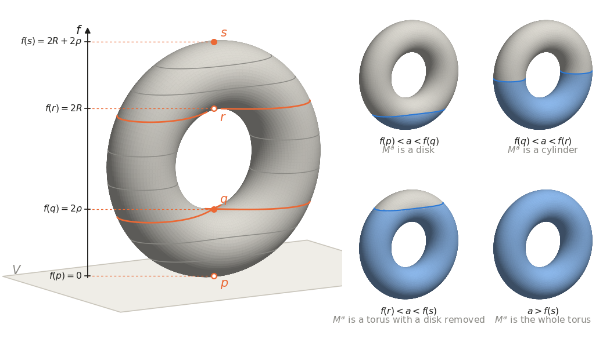
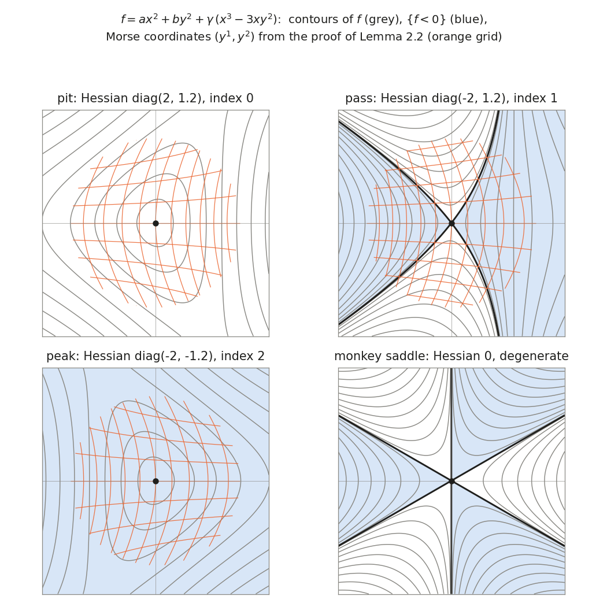

# Chapter 1. Pits, passes and peaks: critical points and the lemma of Morse

*Milnor, "Morse Theory", §1–§2, rewritten for a first-year graduate student who wants to know what
the theorem is for. Every proof is complete, except that the existence and smooth-dependence theorem
for ordinary differential equations is quoted, as Milnor quotes it.*

---

## 0. In how many ways can a double pendulum fall?

A double pendulum is a rod hinged at a fixed pivot, with a second rod hinged to its free end, each
rod carrying a mass at its tip, the whole free to swing in a vertical plane. Its position is given
by two angles $\theta_1, \theta_2$, each measured from the downward vertical, so the space of all
positions is a torus $S^1 \times S^1$. There are exactly four positions in which it can rest: both
rods down, both rods up, and the two mixed positions. Only the first is stable, but the other three
are unstable in different ways. Balanced with the inner rod down and the outer rod up, the pendulum
has essentially one way to fall: the outer rod tips over, to one side or the other. Balanced with
both rods up, it has two independent ways to fall.

The number of independent ways to fall is what Morse called the *index* of the equilibrium. It can
be read off from the second derivatives of the potential energy $V(\theta_1, \theta_2)$: it is the
number of negative eigenvalues of the Hessian matrix. The point of this chapter is that, as long as
no eigenvalue is zero, the index tells the whole local story. The lemma of Morse says that in
suitable curvilinear coordinates $y^1, y^2$ centred at the equilibrium,
$$V = V(\text{equilibrium}) \pm (y^1)^2 \pm (y^2)^2$$
*exactly*, not up to higher-order terms, with as many minus signs as the index. Near a
non-degenerate equilibrium nothing survives a change of coordinates except the signs.

This is the local half of Morse theory. The global half (Chapter 2) says that the same critical
points control how the regions $\{V \le a\}$ change as $a$ grows, and through them the shape of the
whole space. Milnor explains both halves with a torus standing on a table, whose height function has
one minimum, two saddles and one maximum. So does the double pendulum: the same picture, different
physics.

Milnor's §2 ends with a more technical tool, the flow of a vector field (a one-parameter group of
diffeomorphisms). It is what will slide one region $\{f \le b\}$ down onto another in Chapter 2. We
prove his Lemma 2.4 completely, quoting only the existence and smooth-dependence theorem for
differential equations, which we state precisely.

The application at the end computes the four indices of the double pendulum, and the frequencies and
growth rates of its small motions near each equilibrium. The index turns out to be the number of
exponentially growing modes, which chemists call imaginary frequencies; a transition state of a
chemical reaction is, by definition, an equilibrium of index one.

---

## 1. A torus standing on a table (Milnor pp. 1–3)

Stand a torus $M$ upright on a horizontal plane $V$, touching it at one point, and let
$f : M \to \mathbb{R}$ be the height above $V$ ($\mathbb{R}$ always denotes the real numbers). For
$a \in \mathbb{R}$ put
$$M^a = f^{-1}(-\infty, a] = \{x \in M : f(x) \le a\},$$
the part of the torus that would be under water if the room were flooded to depth $a$. There are
four points where the tangent plane is horizontal; call them $p, q, r, s$ from the bottom up. Milnor
reads the following off the picture:

1. if $a < 0 = f(p)$, then $M^a$ is empty;
2. if $f(p) < a < f(q)$, then $M^a$ is homeomorphic to a 2-cell (a closed disk);
3. if $f(q) < a < f(r)$, then $M^a$ is homeomorphic to a cylinder $S^1 \times [0,1]$;
4. if $f(r) < a < f(s)$, then $M^a$ is homeomorphic to a compact surface of genus one with a circle
   as boundary;
5. if $f(s) < a$, then $M^a$ is the whole torus.

To have something to compute with, take the torus of revolution with tube radius $\rho$ and core
radius $R > \rho$, with its axis horizontal at height $R + \rho$:
$$(u, v) \longmapsto \big((R + \rho\cos v)\cos u,\ \rho \sin v,\ R + \rho + (R + \rho\cos v)\sin u\big),
\qquad u, v \in \mathbb{R}/2\pi\mathbb{Z}.$$
In the angular coordinates, $f(u,v) = R + \rho + (R + \rho\cos v)\sin u$, and $p, q, r, s$ are
$(u,v) = (-\tfrac\pi2, 0),\ (-\tfrac\pi2, \pi),\ (\tfrac\pi2, \pi),\ (\tfrac\pi2, 0)$, at heights
$0,\ 2\rho,\ 2R,\ 2R + 2\rho$. (That these are the only critical points is checked in §3.)

The figure is Milnor's Diagram 1 for this torus, with $R = 2.5\rho$. On the left, the torus stands
on $V$, and level curves $f = a$ are drawn at several heights. At $a = f(q)$ and $a = f(r)$ the level
curve is a figure eight crossing itself at $q$, resp. $r$ (in colour; its back half is hidden).
A hollow dot is a critical point on the far side. On the right, $M^a$ is shaded as water for one $a$
in each of the ranges (2)–(5). In the web edition the water level $a$ is a slider, and the figure
says what $M^a$ is at each height.

*(In the printed version this figure is a still image; the interactive version is in the web
edition.)*

As $a$ increases the homeomorphism type of $M^a$ jumps in complicated ways; its *homotopy type*
changes in a simple way. Recall that a continuous map $h : X \to Y$ is a *homotopy equivalence* if
there is a continuous $k : Y \to X$ with $k \circ h$ and $h \circ k$ homotopic to the identity maps;
$X$ and $Y$ then have the *same homotopy type*, written $X \simeq Y$. In these terms:

* (1) $\to$ (2) is the operation of attaching a 0-cell: as far as homotopy type is concerned, the
  disk $M^a$, $f(p) < a < f(q)$, cannot be distinguished from a point;
* (2) $\to$ (3) is attaching a 1-cell: the cylinder $\simeq$ the disk with an arc attached at its
  two ends;
* (3) $\to$ (4) is again attaching a 1-cell;
* (4) $\to$ (5) is attaching a 2-cell.

**Definition (attaching a cell).** Let $e^k = \{x \in \mathbb{R}^k : \|x\| \le 1\}$, the *$k$-cell*,
and let $\dot e^k = \{x \in \mathbb{R}^k : \|x\| = 1\}$, its boundary, be denoted $S^{k-1}$. If $Y$ is a
topological space and $g : S^{k-1} \to Y$ is continuous, then $Y \cup_g e^k$, *$Y$ with a $k$-cell
attached by $g$*, is the quotient of the disjoint union $Y \sqcup e^k$ by the equivalence relation
generated by $x \sim g(x)$ for $x \in S^{k-1}$. For $k = 0$, $e^0$ is a point and
$\dot e^0 = S^{-1} = \emptyset$, so $Y$ with a 0-cell attached is $Y$ together with a disjoint point.

The points $p, q, r, s$ at which the homotopy type of $M^a$ changes are the *critical points* of $f$:
in any coordinates $(x, y)$ near them, $\partial f/\partial x = \partial f/\partial y = 0$. Moreover
there are coordinates in which
$$f = x^2 + y^2 \ \text{ near } p, \qquad f = \text{const} + x^2 - y^2 \ \text{ near } q \text{ and } r,
\qquad f = \text{const} - x^2 - y^2 \ \text{ near } s.$$
The number of minus signs at each point is the dimension of the cell that must be attached to pass
from $M^a$ to $M^b$ when $a < f(\text{point}) < b$. Milnor's first theorems generalize this to any
smooth function on any manifold. The normal forms are the lemma of Morse (§4 below); the cell
attachments are Theorems 3.1 and 3.2 of Chapter 2, where the homotopy-theoretic content of (1)–(5)
is proved rather than read off a picture.

---

## 2. Critical points and sublevel sets (Milnor p. 4)

"Smooth" and "differentiable" both mean $C^\infty$. A *manifold* is a smooth manifold of dimension
$n$, without boundary, whose topology is Hausdorff and has a countable basis. Milnor does not list
these conditions; we point out where each is used. The tangent space of $M$ at $p$ is $TM_p$, and a
smooth $g : M \to N$ with $g(p) = q$ induces the linear map $g_* : TM_p \to TN_q$.

**Definition.** Let $f : M \to \mathbb{R}$ be smooth. A point $p \in M$ is a *critical point* of $f$
if $f_* : TM_p \to T\mathbb{R}_{f(p)}$ is zero; $f(p)$ is then a *critical value*. Any other real
number, including one that is not a value of $f$, is a *regular value*.

In a coordinate system $(x^1, \dots, x^n)$ on a neighbourhood $U$ of $p$, $f_*$ sends
$\partial/\partial x^i|_p$ to $\frac{\partial f}{\partial x^i}(p)\,\frac{d}{dt}$, so $p$ is critical
if and only if
$$\frac{\partial f}{\partial x^1}(p) = \dots = \frac{\partial f}{\partial x^n}(p) = 0.$$
This agrees with the definition in the companion volume (*Topology from the Differentiable
Viewpoint*, rewritten; Chapter 2, §1), where a critical point is one at which the derivative is not
surjective: a linear map to $\mathbb{R}$ is surjective exactly when it is nonzero. That volume works
with manifolds lying in some $\mathbb{R}^k$; every result we cite from it is local and carries over
to the abstract manifolds used here by working in a chart (for Proposition A the chart argument is
written out below).

**Proposition A** (Milnor: "it follows from the implicit function theorem"). If $a$ is a regular
value of $f$, then $M^a$ is a smooth $n$-manifold with boundary $f^{-1}(a)$, and $f^{-1}(a)$ is a
smooth $(n-1)$-dimensional submanifold of $M$ (possibly empty).

*Proof.* This is Lemma 3.2 of Chapter 2 of the companion volume (Milnor's Lemma 3 there), applied to
$g = a - f$, for which $0$ is a regular value; the statement about $f^{-1}(a)$ is Lemma 2.1 of the
same chapter. In the present setting the proof reads: near $q$ with $f(q) < a$, the open set
$f^{-1}(-\infty, a)$ lies in $M^a$; near $q$ with $f(q) = a$, choose a chart $(x^1, \dots, x^n)$ with
$\partial f/\partial x^n(q) \ne 0$. Then $y = (x^1, \dots, x^{n-1}, a - f)$ has Jacobian determinant
$-\partial f/\partial x^n(q) \ne 0$ at $q$, so by the inverse function theorem (companion volume,
Chapter 1, Theorem 4.1) it is a coordinate system on a neighbourhood $W$ of $q$, in which
$M^a \cap W = \{y^n \ge 0\}$ and $f^{-1}(a) \cap W = \{y^n = 0\}$. $\square$

---

## 3. The Hessian, the index and the nullity (Milnor pp. 4–5)

Let $p$ be a critical point of $f$. For $v, w \in TM_p$ choose vector fields $\tilde v, \tilde w$
defined near $p$ with $\tilde v_p = v$, $\tilde w_p = w$ (in a chart, if
$v = \sum a_i\, \partial/\partial x^i|_p$, the constant-coefficient field
$\sum a_i\, \partial/\partial x^i$ will do). Milnor defines the *Hessian*
$$f_{**}(v, w) = \tilde v_p(\tilde w(f)),$$
where $\tilde w(f)$ is the directional derivative of $f$ along $\tilde w$, a smooth function near
$p$, and $\tilde v_p(\cdot) = v(\cdot)$ is its derivative in the direction $v$.

**Lemma B.** $f_{**}$ is a well-defined symmetric bilinear form on $TM_p$. In a chart, if
$v = \sum a_i\, \partial/\partial x^i|_p$ and $w = \sum b_j\, \partial/\partial x^j|_p$, then
$$f_{**}(v, w) = \sum_{i,j} a_i b_j \frac{\partial^2 f}{\partial x^i \partial x^j}(p),$$
so the matrix $\big(\partial^2 f/\partial x^i\partial x^j(p)\big)$ represents $f_{**}$ in the basis
$\partial/\partial x^1|_p, \dots, \partial/\partial x^n|_p$.

*Proof.* Milnor's argument: $\tilde v_p(\tilde w(f)) - \tilde w_p(\tilde v(f)) = [\tilde v, \tilde
w]_p(f) = 0$, because the bracket $[\tilde v, \tilde w]_p$ is a tangent vector at $p$ and $f_*$
vanishes at $p$. So the expression is symmetric; it depends on $\tilde v$ only through $\tilde v_p =
v$, and, being equal to $\tilde w_p(\tilde v(f))$, on $\tilde w$ only through $w$. The coordinate
computation gives all of this at once. Write $\tilde v = \sum \alpha_i \partial_i$ and $\tilde w =
\sum \beta_j \partial_j$ with smooth coefficients, $\alpha_i(p) = a_i$, $\beta_j(p) = b_j$. Then
$$\tilde v(\tilde w(f)) = \sum_{i,j} \alpha_i\, (\partial_i \beta_j)\, \partial_j f + \sum_{i,j}
\alpha_i \beta_j\, \partial_i \partial_j f .$$
At $p$ every $\partial_j f$ vanishes, so $\tilde v_p(\tilde w(f)) = \sum a_i b_j\,
\partial_i\partial_j f(p)$. This depends only on $v, w$, is bilinear, and is symmetric because mixed
partial derivatives commute. $\square$

The vanishing of the first sum is the only place where criticality enters: at a non-critical point
the same recipe depends on the extensions, and there is no invariant Hessian.

**Definition.** A critical point $p$ is *non-degenerate* if the matrix $\big(\partial^2 f/\partial
x^i \partial x^j(p)\big)$ is non-singular. This does not depend on the chart: by Lemma B two charts
give matrices $S$ and $S'$ representing the same form in two bases, so $S' = J^{\mathsf T} S J$ with
$J$ the invertible change-of-basis matrix. (The direct check Milnor alludes to is the chain rule
$\frac{\partial^2 f}{\partial y^k \partial y^l} = \sum_{i,j} \frac{\partial x^i}{\partial y^k}
\frac{\partial x^j}{\partial y^l} \frac{\partial^2 f}{\partial x^i \partial x^j} + \sum_i
\frac{\partial^2 x^i}{\partial y^k \partial y^l} \frac{\partial f}{\partial x^i}$, whose last sum
vanishes at a critical point.)

**Definition.** The *index* of a symmetric bilinear form $H$ on a vector space $V$ is the maximal
dimension of a subspace of $V$ on which $H$ is negative definite. The *nullity* is the dimension of
the *null space* $\{v \in V : H(v, w) = 0 \text{ for all } w \in V\}$. The index of $f_{**}$ on
$TM_p$ is called the *index of $f$ at $p$*.

If $S$ represents $H$ in a basis, $v$ lies in the null space exactly when its coordinate vector lies
in the kernel of $S$. Hence $p$ is a non-degenerate critical point if and only if $f_{**}$ has
nullity $0$. To compute indices we need one piece of linear algebra, which Milnor uses inside the
proof of Lemma 2.2.

**Lemma C.** Let $H$ be a symmetric bilinear form on an $n$-dimensional real vector space $V$, and
suppose $V = A \oplus B$ where $H$ is negative definite on $A$ and $H(b, b) \ge 0$ for all $b \in B$.
Then the index of $H$ is $\dim A$. Consequently, if $H$ has the diagonal matrix
$\mathrm{diag}(d_1, \dots, d_n)$ in some basis, its index is $\#\{i : d_i < 0\}$ and its nullity is
$\#\{i : d_i = 0\}$; and for any matrix $S$ representing $H$, the index and the nullity are the
numbers of negative and of zero eigenvalues of $S$, counted with multiplicity.

*Proof.* The index is at least $\dim A$ by definition. If $L$ were a subspace with $\dim L > \dim A$
on which $H$ is negative definite, then $\dim L + \dim B > n$, so $L \cap B$ contains some $v \ne 0$,
and $H(v,v) < 0 \le H(v, v)$, a contradiction. For a diagonal matrix take $A$ spanned by the basis
vectors with $d_i < 0$ and $B$ by the others. The null space consists of the $\sum c_i e_i$ with
$c_j d_j = H(\sum c_i e_i, e_j) = 0$ for all $j$, i.e. it is spanned by the $e_j$ with $d_j = 0$.
Finally, by the spectral theorem $S = QDQ^{\mathsf T}$ with $Q$ orthogonal and $D$ diagonal with the
eigenvalues of $S$ on the diagonal; in the basis formed by the columns of $Q$ (read as coordinate
vectors) $H$ has matrix $Q^{\mathsf T} S Q = D$. $\square$

**The torus, computed.** With $f(u,v) = R + \rho + (R + \rho\cos v)\sin u$,
$$f_u = (R + \rho\cos v)\cos u, \qquad f_v = -\rho\sin v \sin u.$$
Since $R + \rho\cos v \ge R - \rho > 0$, $f_u = 0$ forces $\cos u = 0$, so $\sin u = \pm 1$, and then
$f_v = 0$ forces $\sin v = 0$: the critical points are exactly $p, q, r, s$. The second derivatives
are $f_{uu} = -(R + \rho\cos v)\sin u$, $f_{uv} = -\rho \sin v \cos u$ (zero at the critical points)
and $f_{vv} = -\rho\cos v\sin u$. The Hessian matrices are
$$p:\ \mathrm{diag}(R + \rho,\ \rho), \quad q:\ \mathrm{diag}(R - \rho,\ -\rho), \quad
r:\ \mathrm{diag}(-(R - \rho),\ \rho), \quad s:\ \mathrm{diag}(-(R + \rho),\ -\rho).$$
All four are non-degenerate, of indices $0, 1, 1, 2$: the dimensions of the cells in §1.

---

## 4. Hadamard's lemma and the lemma of Morse (Milnor pp. 5–8)

**Lemma 2.1 (Hadamard).** If $f$ is $C^\infty$ on a convex neighbourhood $V$ of $0$ in
$\mathbb{R}^n$ and $f(0) = 0$, then there are $C^\infty$ functions $g_1, \dots, g_n$ on $V$ with
$g_i(0) = \dfrac{\partial f}{\partial x_i}(0)$ and
$$f(x_1, \dots, x_n) = \sum_{i=1}^n x_i\, g_i(x_1, \dots, x_n) \qquad \text{on } V.$$

This is the Hadamard lemma of the companion volume (Chapter 6, proof of Lemma 1.1, for maps defined
on all of $\mathbb{R}^m$). We need it on a convex neighbourhood, and the proof is two lines, so here
it is.

*Proof.* For $x \in V$ the segment $\{tx : 0 \le t \le 1\}$ lies in $V$. The function $t \mapsto
f(tx)$ is smooth on $[0,1]$ with derivative $\sum_i x_i\, \partial_i f(tx)$, so by the fundamental
theorem of calculus
$$f(x) = f(x) - f(0) = \int_0^1 \frac{d f(tx)}{dt}\,dt = \sum_{i=1}^n x_i \int_0^1 \frac{\partial
f}{\partial x_i}(tx)\,dt .$$
Put $g_i(x) = \int_0^1 \partial_i f(tx)\,dt$; then $g_i(0) = \int_0^1 \partial_i f(0)\,dt =
\partial_i f(0)$. The integrand is a $C^\infty$ function of $(t, x)$ on the open set
$\{(t,x) : tx \in V\} \supseteq [0,1] \times V$. By
the theorem on differentiation under the integral sign (on a compact neighbourhood $K$ of a point of
$V$, each $x$-derivative of the integrand is uniformly continuous on $[0,1] \times K$, which lets the
difference quotients pass under the integral; induct on the order), $g_i$ is $C^\infty$ with
$\partial^\alpha g_i(x) = \int_0^1 \partial_x^\alpha [\partial_i f(tx)]\,dt$. $\square$

Only the segments from $0$ were used: "star-shaped about $0$" suffices for "convex".

**Lemma 2.2 (Lemma of Morse).** If $p$ is a non-degenerate critical point of $f$, of index
$\lambda$, then $p$ has a neighbourhood $U$ with coordinates $(y^1, \dots, y^n)$, all vanishing at
$p$, in which
$$f = f(p) - (y^1)^2 - \dots - (y^\lambda)^2 + (y^{\lambda+1})^2 + \dots + (y^n)^2$$
at every point of $U$.

*Proof.* **Part 1: in any such expression, $\lambda$ is the index.** Suppose coordinates
$(z^1, \dots, z^n)$ centred at $p$ satisfy $f(q) = f(p) - \sum_{i \le \lambda} (z^i(q))^2 +
\sum_{i > \lambda} (z^i(q))^2$. Then
$$\frac{\partial^2 f}{\partial z^i \partial z^j}(p) = \begin{cases} -2 & i = j \le \lambda,\\ \ \ 2 &
i = j > \lambda,\\ \ \ 0 & \text{otherwise,}\end{cases}$$
so by Lemma B the matrix of $f_{**}$ in the basis $\partial/\partial z^1|_p, \dots,
\partial/\partial z^n|_p$ is $\mathrm{diag}(-2, \dots, -2, 2, \dots, 2)$ with $\lambda$ entries
$-2$. By Lemma C (this is Milnor's argument: a negative definite subspace of dimension greater than
$\lambda$ would meet the positive definite span of the last $n - \lambda$ basis vectors), $\lambda$
is the index of $f_{**}$.

**Part 2: existence.** *Step 1 (reduction).* Take a chart around $p$, translate it so that $p$
becomes $0 \in \mathbb{R}^n$, restrict it to an open ball $U_0$ about $0$, and replace $f$ by
$f - f(p)$. So $f$ is smooth on $U_0$, $f(0) = 0$, and $0$ is a non-degenerate critical point.

*Step 2 (a quadratic form with variable coefficients).* By Lemma 2.1, $f = \sum_j x_j g_j$ on $U_0$
with $g_j(0) = \partial_j f(0) = 0$. Applying Lemma 2.1 to each $g_j$ gives $g_j = \sum_i x_i
h_{ij}$ with smooth $h_{ij}$, so $f = \sum_{i,j} x_i x_j h_{ij}$. Put $H_{ij} = \tfrac12(h_{ij} +
h_{ji})$; then $H_{ij} = H_{ji}$ and $f = \sum_{i,j} x_i x_j H_{ij}$. Differentiating twice at $0$:
in $\partial_k \partial_l (x_i x_j H_{ij})(0)$ every term in which a factor $x_i$ or $x_j$ survives
undifferentiated vanishes, leaving $(\delta_{ik}\delta_{jl} + \delta_{il}\delta_{jk}) H_{ij}(0)$.
Summing, $\partial_k\partial_l f(0) = 2 H_{kl}(0)$. So $(H_{ij}(0)) = \tfrac12\big(\partial^2
f/\partial x_i \partial x_j(0)\big)$ is non-singular. (Writing out the two integrals and changing
variables shows $h_{ij}(x) = \int_0^1 (1 - t)\, \partial_i \partial_j f(tx)\,dt$, already symmetric;
we will not need this, but the interactive figure uses it.)

*Step 3 (the induction).* For $r = 1, \dots, n+1$ consider the statement:

> $(P_r)$ On some neighbourhood $U_r$ of $0$ there are coordinates $u_1, \dots, u_n$ with $u(0) = 0$,
> signs $\epsilon_1, \dots, \epsilon_{r-1} \in \{\pm 1\}$, and smooth functions $H_{ij} = H_{ji}$
> ($i, j \ge r$) on $U_r$, such that
> $$f = \epsilon_1 u_1^2 + \dots + \epsilon_{r-1} u_{r-1}^2 + \sum_{i,j \ge r} u_i u_j H_{ij}
> \quad\text{throughout } U_r,$$
> and the matrix $\big(H_{ij}(0)\big)_{i,j \ge r}$ is non-singular.

Step 2 is $(P_1)$. We show $(P_r) \Rightarrow (P_{r+1})$ for $r \le n$.

(a) *Making $H_{rr}(0) \ne 0$.* An invertible linear substitution $u_{\ge r} = T w_{\ge r}$ of the
last $n - r + 1$ coordinates keeps the form of $(P_r)$: $\sum_{i,j \ge r} u_i u_j H_{ij} = \sum_{a,b
\ge r} w_a w_b \tilde H_{ab}$ with $\tilde H = T^{\mathsf T} H T$, still symmetric and smooth, with
$\tilde H(0) = T^{\mathsf T} H(0) T$ non-singular, and $w(0) = 0$. The block $\big(H_{ij}(0)\big)_{i,
j\ge r}$ is non-singular, hence not zero. If some diagonal entry $H_{kk}(0)$, $k \ge r$, is nonzero,
interchange $u_r$ and $u_k$. Otherwise pick $k \ne l$ (both $\ge r$) with $H_{kl}(0) \ne 0$, first
interchange so that $k = r$, then substitute $u_r = w_r + w_l$, $u_l = w_r - w_l$: the new entry is
$\tilde H_{rr}(0) = H_{rr}(0) + 2H_{rl}(0) + H_{ll}(0) = 2H_{rl}(0) \ne 0$.

(b) *Completing the square.* Let $\sigma \in \{\pm 1\}$ be the sign of $H_{rr}(0)$. By continuity
there is a neighbourhood $U' \subseteq U_r$ of $0$ on which $H_{rr}$ has the sign $\sigma$ at every
point; put $g = \sqrt{|H_{rr}|} = \sqrt{\sigma H_{rr}}$, smooth and positive on $U'$. Define new
functions
$$v_i = u_i \ (i \ne r), \qquad v_r = g\,\Big[u_r + \sum_{i > r} u_i\, H_{ir}/H_{rr}\Big].$$

(c) *They are coordinates.* $v(0) = 0$. At $0$, every term of $v_r$ is a product with a factor
$u_i$ vanishing at $0$, so $\partial v_r/\partial u_j(0)$ comes only from differentiating that
factor: it is $0$ for $j < r$, $g(0)$ for $j = r$, and $g(0) H_{jr}(0)/H_{rr}(0)$ for $j > r$. The
Jacobian matrix of $v$ with respect to $u$ at $0$ is therefore the identity except for row $r$,
which is $(0, \dots, 0, g(0), *, \dots, *)$: it is upper triangular with determinant $g(0) \ne 0$. By
the inverse function theorem (companion volume, Chapter 1, §1), $v_1, \dots, v_n$ are coordinates on
some neighbourhood $U_{r+1} \subseteq U'$ of $0$.

(d) *The identity.* Since $\sigma g^2 = H_{rr}$,
$$\sigma v_r^2 = H_{rr} u_r^2 + 2 u_r \sum_{i>r} u_i H_{ir} + \frac{\big(\sum_{i>r} u_i
H_{ir}\big)^2}{H_{rr}},$$
and therefore
$$\sum_{i,j \ge r} u_i u_j H_{ij} = \sigma v_r^2 + \sum_{i,j > r} u_i u_j H'_{ij}, \qquad H'_{ij} =
H_{ij} - \frac{H_{ir} H_{jr}}{H_{rr}}.$$
As $u_i = v_i$ for $i \ne r$, this is
$f = \sum_{i \le r} \epsilon_i v_i^2 + \sum_{i,j > r} v_i v_j H'_{ij}$ with $\epsilon_r = \sigma$, the
$H'_{ij}$ smooth and symmetric.

(e) *Non-singularity persists.* $\big(H'_{ij}(0)\big)_{i,j>r}$ is the Schur complement of the entry
$H_{rr}(0)$ in $\big(H_{ij}(0)\big)_{i,j \ge r}$, and $\det\big(H_{ij}(0)\big)_{i,j\ge r} = H_{rr}(0)
\det\big(H'_{ij}(0)\big)_{i,j>r}$ (subtract multiples of the first row to clear the first column).
So $(P_{r+1})$ holds.

*Step 4 (conclusion).* $(P_{n+1})$ says $f = \sum_{i=1}^n \epsilon_i v_i^2$ near $0$. Renumber the
coordinates so that the negative signs come first and call them $y^1, \dots, y^n$; restoring the
constant and the original chart, $f = f(p) - \sum_{i \le \lambda'}(y^i)^2 + \sum_{i > \lambda'}
(y^i)^2$ near $p$. By Part 1, $\lambda' = \lambda$. $\square$

> **Milnor's text skips…** the reason why, "after a linear change in the last $n - r + 1$
> coordinates", one may assume $H_{rr}(0) \ne 0$. It needs the block $\big(H_{ij}(0)\big)_{i,j\ge r}$ to be
> nonzero, which is why the induction must carry its non-singularity along (step (e)); and when all
> its diagonal entries vanish, a coordinate interchange is not enough, and the substitution $u_r =
> w_r + w_l$, $u_l = w_r - w_l$ is needed. Also unstated: each new coordinate system must again vanish
> at $0$, which the completed square does, and the Jacobian in (c) is triangular.

**Corollary 2.3.** Non-degenerate critical points are isolated.

*Proof.* In the coordinates of Lemma 2.2, $df = \sum_i \pm 2y^i\,dy^i$, which vanishes only where all
$y^i = 0$, that is, at $p$. So $p$ is the only critical point in $U$. $\square$

### An interactive look at the lemma of Morse

The figure shows the contour lines of
$$f(x,y) = a\,x^2 + b\,y^2 + \gamma\,(x^3 - 3xy^2)$$
near the critical point at the origin, with the region $\{f < 0\}$ shaded. The Hessian matrix at $0$
is $\mathrm{diag}(2a, 2b)$; the panel reports the index and the nullity. When $a$ and $b$ are both
nonzero, the figure also draws the Morse coordinates $(y^1, y^2)$ produced by the proof above, as a
curved grid: here $H_{11} = a + \gamma x$, $H_{12} = -\gamma y$, $H_{22} = b - \gamma x$, and
step (b) gives $y^1 = \sqrt{|H_{11}|}\,(x + y H_{12}/H_{11})$, $y^2 = \sqrt{|D/H_{11}|}\;y$ with
$D = H_{11} H_{22} - H_{12}^2$ (when $|b| > |a|$ the figure takes $H_{22}$ as the pivot instead,
exchanging the roles of $x$ and $y$). Wherever the grid is drawn, the contour lines of $f$ are exactly the
circles or hyperbolas of $\pm (y^1)^2 \pm (y^2)^2$ in it; the cubic term only bends the grid.

Drag $a$ and $b$ through zero to move between a pit (index 0), a pass (index 1) and a peak (index 2).
Shrink the window (slider $R$): for a non-degenerate point the picture converges to that of the
quadratic part. Set $a = b = 0$ and the cubic term wins: the contours form Milnor's monkey saddle,
with three valleys, which no change of coordinates can turn into a quadratic form.

*(In the printed version this figure is a still image; the interactive version is in the web
edition.)*

---

## 5. Degenerate critical points (Milnor pp. 8–9)

Milnor's examples, with the verifications he leaves to the pictures:

(a) $f(x) = x^3$ on $\mathbb{R}$: $f'(0) = f''(0) = 0$, so $0$ is a degenerate critical point. It is
isolated: $f'(x) = 3x^2 \ne 0$ for $x \ne 0$. Degenerate points need not be extrema.

(b) $F(x) = e^{-1/x^2}\sin^2(1/x)$ for $x \ne 0$, $F(0) = 0$. Every derivative of $F$ on $x \ne 0$ is a
finite sum of terms (polynomial in $1/x$)$\,\cdot e^{-1/x^2}\cdot$(product of $\sin$ and $\cos$ of
$1/x$), bounded by $C|x|^{-N}e^{-1/x^2} \to 0$ as $x \to 0$; by induction and the mean value theorem
$F$ is $C^\infty$ with all derivatives $0$ at $0$. So $0$ is a degenerate critical point. It is not
isolated: $F \ge 0$ and $F(1/k\pi) = 0$, so each $1/k\pi$ is a minimum, hence critical, and
$1/k\pi \to 0$. (By Corollary 2.3, a non-isolated critical point is necessarily degenerate.)

(c) $f(x,y) = x^3 - 3xy^2 = \mathrm{Re}\,(x + iy)^3$, the *monkey saddle*: $\nabla f = (3x^2 - 3y^2,
-6xy)$ vanishes only at $0$, and all second derivatives $6x, -6y, -6x$ vanish there. An isolated
degenerate critical point, with three descending valleys.

(d) $f(x,y) = x^2$: $\nabla f = (2x, 0)$ vanishes exactly on the line $x = 0$, where the Hessian is
$\mathrm{diag}(2, 0)$, of nullity $1$. Every critical point is degenerate, and the critical set is a
submanifold of $\mathbb{R}^2$. (Milnor calls it "the $x$ axis"; for $f = x^2$ it is the $y$ axis.)

(e) $f(x,y) = x^2y^2$: $\nabla f = (2xy^2, 2x^2y)$ vanishes exactly where $xy = 0$, the union of the
two axes. The Hessian $\begin{pmatrix} 2y^2 & 4xy \\ 4xy & 2x^2 \end{pmatrix}$ has determinant
$4x^2y^2 - 16x^2y^2 = -12x^2y^2 = 0$ there, so every critical point is degenerate. The critical set
is not a submanifold: it is neither discrete nor open in $\mathbb{R}^2$, so near the origin it would
have to be a curve; but removing the origin from a small connected neighbourhood of it in the cross
leaves four components, while removing a point from an arc leaves two.

---

## 6. One-parameter groups of diffeomorphisms (Milnor pp. 9–11)

**Definition.** A *1-parameter group of diffeomorphisms* of $M$ is a $C^\infty$ map
$\varphi : \mathbb{R} \times M \to M$ such that

1. for each $t \in \mathbb{R}$ the map $\varphi_t : M \to M$, $\varphi_t(q) = \varphi(t, q)$, is a
   diffeomorphism of $M$ onto itself;
2. for all $t, s \in \mathbb{R}$, $\varphi_{t+s} = \varphi_t \circ \varphi_s$.

(Then $\varphi_0 = \mathrm{id}$, since $\varphi_0 \circ \varphi_0 = \varphi_0$ and $\varphi_0$ is
bijective.)

For a smooth curve $t \mapsto c(t) \in M$ the *velocity vector* $\frac{dc}{dt} \in TM_{c(t)}$ is
defined by $\frac{dc}{dt}(f) = \lim_{h \to 0} \frac{f(c(t+h)) - f(c(t))}{h}$; in coordinates
$\frac{dc}{dt} = \sum_i \frac{d(x^i \circ c)}{dt}\, \frac{\partial}{\partial x^i}$. Given a
1-parameter group $\varphi$, the vector field $X$ with
$$X_q(f) = \lim_{h \to 0} \frac{f(\varphi_h(q)) - f(q)}{h}$$
is said to *generate* $\varphi$. It is smooth: its components $X^i(q) = \partial_t (x^i \circ
\varphi)(0, q)$ are smooth because $\varphi$ is. For each fixed $q$ the curve $t \mapsto
\varphi_t(q)$ satisfies
$$\frac{d\varphi_t(q)}{dt} = X_{\varphi_t(q)}, \qquad \varphi_0(q) = q,$$
because, with $p = \varphi_t(q)$ and $\varphi_{t+h} = \varphi_h \circ \varphi_t$,
$$\frac{d\varphi_t(q)}{dt}(f) = \lim_{h \to 0}\frac{f(\varphi_{t+h}(q)) - f(\varphi_t(q))}{h} =
\lim_{h \to 0}\frac{f(\varphi_h(p)) - f(p)}{h} = X_p(f).$$
A curve $c$ with $\frac{dc}{dt} = X_{c(t)}$ for all $t$ in an interval is an *integral curve* of $X$.
In local coordinates $u^1, \dots, u^n$, with $X = \sum X^i \partial/\partial u^i$, this is the
familiar system $du^i/dt = X^i(u^1, \dots, u^n)$, $i = 1, \dots, n$. What Milnor calls "well known"
is the following.

**Theorem D (ordinary differential equations).** Let $W \subseteq \mathbb{R}^n$ be open and $F : W \to
\mathbb{R}^n$ smooth.

(a) *Uniqueness.* If $u_1, u_2 : J \to W$ are differentiable solutions of $u' = F(u)$ on an interval
$J$ (open, closed or half-open) and $u_1(t_0) = u_2(t_0)$ for one $t_0 \in J$, then $u_1 = u_2$ on $J$.

(b) *Existence and smooth dependence.* Every $x_0 \in W$ has an open neighbourhood $W_0 \subseteq W$,
and there are $\epsilon > 0$ and a $C^\infty$ map $\Phi : (-\epsilon, \epsilon) \times W_0 \to W$,
such that $\partial_t \Phi(t, x) = F(\Phi(t, x))$ and $\Phi(0, x) = x$.

Part (b) is the Picard–Lindelöf theorem together with the smooth dependence of solutions on initial
conditions; Milnor cites Graves, *The Theory of Functions of Real Variables*, p. 166. Complete proofs
are in Lang, *Fundamentals of Differential Geometry*, Ch. IV, §1, and in Lee, *Introduction to Smooth
Manifolds* (2nd ed.), Appendix D. Part (a) is short:

*Proof of (a).* The set $S = \{t \in J : u_1(t) = u_2(t)\}$ contains $t_0$ and is closed in $J$. It
is also open in $J$. Let $s \in S$ and let $B \subseteq W$ be a closed ball about $u_1(s)$. On $B$,
$F$ is Lipschitz with constant $L = \max_B \|DF\|$ (mean value inequality on the convex set $B$). By
continuity there is $\delta > 0$ with $L\delta \le \frac12$ and $u_1(t), u_2(t) \in B$ for $t \in I =
J \cap [s - \delta, s + \delta]$. Let $m = \sup_I \|u_1 - u_2\|$, finite as both curves stay in $B$
($I$ need not be compact when $J$ is open). For $t \in I$,
$$\|u_1(t) - u_2(t)\| = \Big\|\int_s^t \big(F(u_1) - F(u_2)\big)\Big\| \le L\,|t - s|\, m \le
\tfrac12 m,$$
so $m \le \frac12 m$, $m = 0$, and $I \subseteq S$. An interval is connected, so $S = J$. $\square$

**Lemma E (uniqueness on a manifold).** Let $X$ be a smooth vector field on the Hausdorff manifold
$M$. Two integral curves $\gamma_1, \gamma_2 : J \to M$ of $X$ on the same interval $J$ (of any kind)
that agree at one time agree on all of $J$.

*Proof.* $S = \{t \in J : \gamma_1(t) = \gamma_2(t)\}$ is nonempty. It is closed in $J$ because $M$ is
Hausdorff (the diagonal of $M \times M$ is closed, and $S$ is its preimage under $t \mapsto
(\gamma_1(t), \gamma_2(t))$). It is open in $J$: if $s \in S$, take a chart around $\gamma_1(s)$; for
$t \in J$ near $s$ both curves lie in the chart and solve the same coordinate system of equations
with the same value at $s$, so they agree near $s$ by Theorem D(a). Hence $S = J$. $\square$

> **A hidden hypothesis.** The Hausdorff condition is needed. On the line with two origins, the
> field $d/dx$ has two different integral curves starting at the point $-1$: they agree except at
> the time $t = 1$, when each passes through a different origin.

**Lemma 2.4.** Every smooth vector field on $M$ that vanishes outside some compact set $K \subset M$
generates a 1-parameter group of diffeomorphisms of $M$, and only one.

*Proof.* *Step 1 (local flows).* For each $x \in M$, Theorem D(b) applied in a chart around $x$
gives an open neighbourhood $U_x$ of $x$, a number $\epsilon_x > 0$ and a smooth map
$\Phi^x : (-\epsilon_x, \epsilon_x) \times U_x \to M$ such that $t \mapsto \Phi^x(t, q)$ is an
integral curve of $X$ starting at $q$.

*Step 2 (a uniform time).* $K$ is covered by finitely many of the $U_x$, say $U_{x_1}, \dots,
U_{x_m}$; let $\epsilon_0 = \min_k \epsilon_{x_k} > 0$. For $|t| < \epsilon_0$ define
$\varphi(t, q) = \Phi^{x_k}(t, q)$ if $q \in U_{x_k}$, and $\varphi(t, q) = q$ if $q \notin K$. This
is consistent: if $q \notin K$ then $X_q = 0$, so the constant curve is an integral curve, and any two
integral curves on $(-\epsilon_0, \epsilon_0)$ starting at $q$ coincide by Lemma E. It is smooth on
$(-\epsilon_0, \epsilon_0) \times M$, because it equals $\Phi^{x_k}$ on $(-\epsilon_0, \epsilon_0)
\times U_{x_k}$ and the projection to $M$ on $(-\epsilon_0, \epsilon_0) \times (M \setminus K)$; the
set $M \setminus K$ is open since $K$ is compact and $M$ is Hausdorff, and these open sets cover.

*Step 3 (the group law for small times).* If $|s|, |t|, |s + t| < \epsilon_0$, then
$\varphi_{t+s} = \varphi_t \circ \varphi_s$. Indeed, for fixed $s$ and $q$, the curves $\tau \mapsto
\varphi_{\tau + s}(q)$ and $\tau \mapsto \varphi_\tau(\varphi_s(q))$ are integral curves on the
interval $\{\tau : |\tau| < \epsilon_0, |\tau + s| < \epsilon_0\}$, which contains $0$ and $t$, with
the same value $\varphi_s(q)$ at $\tau = 0$; Lemma E. In particular $\varphi_t \circ \varphi_{-t} =
\varphi_0 = \mathrm{id}$, so each $\varphi_t$, $|t| < \epsilon_0$, is a diffeomorphism.

*Step 4 (all times: Milnor's definition).* Put $\delta = \epsilon_0/2$ and $\psi = \varphi_\delta$, a
diffeomorphism with inverse $\varphi_{-\delta}$. Every $t \in \mathbb{R}$ can be written as $t =
k\delta + r$ with $k \in \mathbb{Z}$ and $|r| < \delta$; set
$$\varphi_t = \psi^k \circ \varphi_r ,$$
where $\psi^k$ is the $k$-fold composite of $\psi$ (of $\psi^{-1} = \varphi_{-\delta}$ if $k < 0$).

*Well defined.* The decomposition is not unique ($\delta/2 = 0\cdot\delta + \delta/2 = 1\cdot\delta -
\delta/2$). If $t = k\delta + r = k'\delta + r'$, then $|k - k'|\delta = |r' - r| < 2\delta$, so
$k' \in \{k-1, k, k+1\}$; if $k' = k + 1$ then $r = r' + \delta$ and Step 3 gives $\varphi_r =
\psi \circ \varphi_{r'}$, whence $\psi^k \circ \varphi_r = \psi^{k+1} \circ \varphi_{r'}$. The case
$k' = k - 1$ is symmetric. By Step 3 the new $\varphi_t$ agrees with the old one for $|t| <
\epsilon_0$ (if $\delta \le t < \epsilon_0$, $\psi \circ \varphi_{t - \delta} = \varphi_t$).

*Smooth.* Given $t_0 = k\delta + r_0$ with $|r_0| < \delta$, for $|t - t_0| < \delta - |r_0|$ we may
use the same $k$, so $\varphi(t, q) = \psi^k(\varphi(t - k\delta, q))$ there: a composite of smooth
maps.

*Integral curves.* For $|u| < \delta$, Step 3 gives $\psi \circ \varphi_u = \varphi_{\delta + u} =
\varphi_u \circ \psi$, and likewise for $\psi^{-1}$; so $\psi^k$ commutes with $\varphi_u$. Hence,
for $|t - t_0| < \delta - |r_0|$,
$$\varphi_t(q) = \psi^k\big(\varphi_{t - t_0}(\varphi_{r_0}(q))\big) = \varphi_{t - t_0}\big(\psi^k
(\varphi_{r_0}(q))\big) = \varphi_{t - t_0}(\varphi_{t_0}(q)),$$
using Step 3 for the first equality. The right side, as a function of $t$, is an integral curve of
$X$ near $t_0$. So $t \mapsto \varphi_t(q)$ is an integral curve of $X$ on all of $\mathbb{R}$.

*Step 5 (the group law; uniqueness).* For fixed $s$ and $q$, both $t \mapsto \varphi_{t+s}(q)$ and
$t \mapsto \varphi_t(\varphi_s(q))$ are integral curves on $\mathbb{R}$ with the same value at $t = 0$,
so $\varphi_{t+s} = \varphi_t \circ \varphi_s$ by Lemma E. Then $\varphi_{-t}$ is a smooth inverse of
$\varphi_t$, so $\varphi$ is a 1-parameter group, and its generator is $X$ (the integral-curve
property at $t = 0$). If $\varphi'$ is another 1-parameter group generated by $X$, then each $t
\mapsto \varphi'_t(q)$ is an integral curve starting at $q$, as computed above, so $\varphi' =
\varphi$ by Lemma E. $\square$

> **Milnor's text skips…** three verifications behind his "it is not difficult to verify" that
> $\varphi_t$ is well defined, smooth, and satisfies $\varphi_{t+s} = \varphi_t \circ \varphi_s$: the
> decomposition $t = k(\epsilon_0/2) + r$ is not unique, so independence of the choice has to be
> checked; the group law for all times is most easily obtained by first showing that $t \mapsto
> \varphi_t(q)$ is an integral curve, which needs $\varphi_{\epsilon_0/2}$ to commute with the small
> $\varphi_u$; and the uniqueness of integral curves on a manifold uses the Hausdorff property.

**Remark (Milnor p. 11).** The hypothesis that $X$ vanishes outside a compact set cannot be omitted.
Let $M = (0,1)$ and $X = d/dt$. If a 1-parameter group $\varphi$ were generated by $X$, then for
$q \in (0,1)$ the curve $\gamma(t) = \varphi_t(q)$ would satisfy $\gamma'(t) = 1$ for all $t \in
\mathbb{R}$, hence $\gamma(t) = q + t$, which leaves $(0,1)$ at $t = 1 - q$. So $X$ generates no
1-parameter group.

---

## 7. Application: the four equilibria of a double pendulum

**The model.** Rods of lengths $l_1, l_2$, point masses $m_1, m_2$ at their tips, gravity $g$, angles
$\theta_1, \theta_2$ from the downward vertical. The heights of the masses are $-l_1\cos\theta_1$ and
$-l_1\cos\theta_1 - l_2\cos\theta_2$, so the potential energy is the smooth function on the torus
$$V(\theta_1, \theta_2) = -(m_1 + m_2)\,g\,l_1 \cos\theta_1 - m_2\, g\, l_2 \cos\theta_2 .$$
The kinetic energy is $T = \tfrac12 \dot\theta^{\mathsf T} K(\theta)\, \dot\theta$ with the mass
matrix
$$K(\theta) = \begin{pmatrix} (m_1 + m_2) l_1^2 & m_2 l_1 l_2 \cos(\theta_1 - \theta_2) \\
m_2 l_1 l_2 \cos(\theta_1 - \theta_2) & m_2 l_2^2 \end{pmatrix},$$
positive definite (its determinant is $m_2 l_1^2 l_2^2 (m_1 + m_2\sin^2(\theta_1 - \theta_2)) > 0$).

**The critical points and their indices.** $\partial V/\partial\theta_1 = (m_1 + m_2) g l_1
\sin\theta_1$ and $\partial V/\partial\theta_2 = m_2 g l_2 \sin\theta_2$ vanish exactly when
$\theta_1, \theta_2 \in \{0, \pi\}$: the four equilibria. The Hessian is diagonal,
$\mathrm{diag}\big((m_1 + m_2) g l_1 \cos\theta_1,\ m_2 g l_2 \cos\theta_2\big)$, so by Lemma C:

| equilibrium $(\theta_1, \theta_2)$ | $V$ | Hessian signs | index |
|---|---|---|---|
| $(0, 0)$, both down | $-(m_1 + m_2) g l_1 - m_2 g l_2$ | $(+, +)$ | 0 |
| $(0, \pi)$, outer rod up | $-(m_1 + m_2) g l_1 + m_2 g l_2$ | $(+, -)$ | 1 |
| $(\pi, 0)$, inner rod up | $(m_1 + m_2) g l_1 - m_2 g l_2$ | $(-, +)$ | 1 |
| $(\pi, \pi)$, both up | $(m_1 + m_2) g l_1 + m_2 g l_2$ | $(-, -)$ | 2 |

All four are non-degenerate: $V$ is a Morse function on the torus with one pit, two passes and one
peak, the pattern of Milnor's torus.

**The Morse charts, explicitly.** Here the lemma of Morse can be seen with the naked eye. From
$-\cos\theta = -1 + 2\sin^2(\theta/2) = 1 - 2\cos^2(\theta/2)$, put $k_1 = \sqrt{2(m_1 + m_2)gl_1}$,
$k_2 = \sqrt{2 m_2 g l_2}$. Near the pass $(0, \pi)$, the functions $y^1 = k_1\sin(\theta_1/2)$ and
$y^2 = k_2\cos(\theta_2/2)$ are coordinates on $\{|\theta_1| < \pi,\ 0 < \theta_2 < 2\pi\}$
(their Jacobian is $\mathrm{diag}(\tfrac{k_1}{2}\cos\tfrac{\theta_1}2, -\tfrac{k_2}{2}\sin
\tfrac{\theta_2}2)$, invertible there), and on that whole region
$$V = V(0, \pi) + (y^1)^2 - (y^2)^2 .$$
Consequently, near the pass the set $\{V \le V(0,\pi)\}$ is $\{|y^1| \le |y^2|\}$: two opposite
sectors, the outer rod tipped to the left or to the right, meeting only at the equilibrium. This is
what a mountain pass is, and it is the local picture behind the attachment of a 1-cell in Chapter 2.

**Small motions and the index.** Linearizing Lagrange's equations at an equilibrium $\theta^*$
(the terms quadratic in $\dot\theta$ drop out) gives $K\ddot\xi + H\xi = 0$, with $K = K(\theta^*)$
and $H$ the Hessian of $V$ at $\theta^*$. Since $K$ is positive definite, $\langle a, b\rangle_K =
a^{\mathsf T} K b$ is an inner product, and $K^{-1}H$ is self-adjoint for it. By the spectral theorem
there is a $K$-orthonormal basis $e_1, e_2$ with $H e_i = \nu_i K e_i$; in it the form $H$ has matrix
$\mathrm{diag}(\nu_1, \nu_2)$, so by Lemma C
$$\text{index of } V \text{ at } \theta^* = \#\{i : \nu_i < 0\}.$$
Writing $\xi = c_1 e_1 + c_2 e_2$ decouples the equations into $\ddot c_i + \nu_i c_i = 0$: a mode
with $\nu_i > 0$ oscillates with angular frequency $\sqrt{\nu_i}$; a mode with $\nu_i < 0$ has
solutions $e^{\pm\sqrt{-\nu_i}\,t}$ and grows exponentially (its "frequency" $\sqrt{\nu_i}$ is
imaginary). So the index is the number of unstable modes, whatever the masses and lengths. The
$\nu_i$ are the roots of $\det(H - \nu K) = 0$.

**Numbers.** Take $m_1 = m_2 = 1\ \mathrm{kg}$, $l_1 = l_2 = 1\ \mathrm{m}$, $g = 9.81\
\mathrm{m/s^2}$, and write $G = g/l = 9.81\ \mathrm{s^{-2}}$. Dividing by $ml^2$, $K = \begin{pmatrix}
2 & \cos(\theta_1 - \theta_2) \\ \cos(\theta_1 - \theta_2) & 1\end{pmatrix}$ and $H =
\mathrm{diag}(2G\cos\theta_1, G\cos\theta_2)$.

* $(0,0)$: $\det(H - \nu K) = 2(G - \nu)^2 - \nu^2$, so $\nu = (2 \mp \sqrt2)G = 5.747$ and $33.49\
  \mathrm{s^{-2}}$: two oscillations, $\omega = 2.397$ and $5.787\ \mathrm{rad/s}$, periods $2.62\
  \mathrm s$ and $1.09\ \mathrm s$. (These are the textbook normal modes $\omega^2 = (2 \mp \sqrt
  2)\,g/l$ of the equal double pendulum.)
* $(0, \pi)$ and $(\pi, 0)$: now $\cos(\theta_1 - \theta_2) = -1$, and in both cases $\det(H - \nu
  K) = \nu^2 - 2G^2$, so $\nu = \pm\sqrt2\, G = \pm 13.87\ \mathrm{s^{-2}}$: one oscillation at
  $3.725\ \mathrm{rad/s}$ and one unstable mode growing like $e^{3.725\,t}$ (amplitude $\times e$
  every $0.27\ \mathrm s$). Index $1$.
* $(\pi, \pi)$: $\det(H - \nu K) = 2(G + \nu)^2 - \nu^2$, so $\nu = -(2 \mp \sqrt2)G$: two unstable
  modes, growth rates $2.397$ and $5.787\ \mathrm{s^{-1}}$. Index $2$.

In each case the count of negative $\nu$ agrees with the index in the table, as Lemma C guarantees.
The same bookkeeping is standard in chemistry, where the potential energy of a nonlinear molecule
of $N$ atoms is a function of its $3N - 6$ internal coordinates: a stable conformer is a critical
point of index $0$, and a *transition state* is defined as a critical point of index $1$, recognized
in a normal-mode calculation by exactly one imaginary frequency. Its unique unstable direction is the reaction
coordinate, and by the lemma of Morse the energy surface near it is, in suitable coordinates,
exactly the saddle $E_0 - (y^1)^2 + (y^2)^2 + \dots + (y^{3N-6})^2$.

---

## 8. Summary of what was silently assumed, now made explicit

| Where | Milnor says | What is actually needed |
|---|---|---|
| p. 1 | (1) "If $a < 0 < f(p)$", as reproduced in the scan | $f(p) = 0$, as the torus touches $V$ at $p$: the condition is $a < 0 = f(p)$ |
| p. 2 | $e^k$ "with length $\le 1$" (the display in the scan reads $\lVert x \rVert < 1$) | the closed disk, so that $\dot e^k$ is its boundary |
| p. 4 | "$M^a$ is a smooth manifold-with-boundary" | companion volume, Chapter 2, Lemma 3.2, applied to $a - f$: the chart $(x^1, \dots, x^{n-1}, a - f)$ (Proposition A) |
| p. 4 | "$v$ and $w$ have extensions" to vector fields | local fields suffice; constant coefficients in a chart |
| p. 4 | "It can be checked directly" that non-degeneracy does not depend on the chart | the second-order chain rule; its first-order term vanishes at a critical point (§3) |
| p. 5 | "clearly well-defined" | criticality kills the first-order terms (Lemma B) |
| p. 5 | Lemma 2.1 for "a convex neighborhood" | the Hadamard lemma of the companion volume (Chapter 6), on a domain star-shaped about $0$; differentiation under the integral sign |
| p. 6 | "a subspace ... would intersect $V$, which is clearly impossible" | dimension count $\dim L + \dim B > n$ (Lemma C) |
| p. 7 | "After a linear change in the last $n - r + 1$ coordinates" one may assume $H_{rr}(0) \ne 0$ | non-singularity of the remaining block carried through the induction (Schur complement); the substitution $u_r = w_r + w_l$, $u_l = w_r - w_l$ when all diagonal entries vanish |
| p. 7 | "$v_1, \dots, v_n$ will serve as coordinate functions" | the Jacobian at $0$ is triangular with diagonal entry $g(0) \ne 0$ |
| p. 9 | (d) "the set of critical points ... is the $x$ axis" | for $f = x^2$ it is the $y$ axis $\{x = 0\}$ |
| p. 10 | it is "well known" that the equation has, locally, a unique solution depending smoothly on the initial condition | Theorem D; uniqueness on a manifold needs $M$ Hausdorff (Lemma E) |
| p. 11 | "Setting $\varphi_t(q) = q$ for $q \notin K$ ... smooth" | $M \setminus K$ is open because a compact set in a Hausdorff space is closed |
| p. 11 | "It is not difficult to verify" that $\varphi_t$ is well defined, smooth, and satisfies $\varphi_{t+s} = \varphi_t \circ \varphi_s$ | independence of the decomposition $t = k\epsilon_0/2 + r$; commutation of $\varphi_{\epsilon_0/2}$ with small $\varphi_u$; group law via uniqueness of integral curves (Lemma 2.4, Steps 4–5) |
| p. 11 | the Remark on $(0,1)$ | integral curves of $d/dt$ are $q + t$, which leave $(0,1)$ |
| throughout | "manifold" | Hausdorff, second countable, without boundary |

**Checked by machine.** Milnor's §2 has been verified in the Lean proof assistant. Lemma 2.1,
examples (a), (c), (d) and (e), and Lemma 2.4 are checked in a finite-dimensional real vector space;
Lemma B and the independence of the chart (only $C^2$ at $p$ is used), the lemma of Morse with
$\lambda$ the index, and Corollary 2.3 are checked there and on an arbitrary smooth manifold, with
no Hausdorff hypothesis. The lemma of Morse is proved by a single application of the inverse
function theorem instead of the induction, and the smooth dependence on the initial point (the
substance of Theorem D(b)) by the inverse function theorem on a space of curves rather than quoted.
On the upright torus of §1 the height function is checked to have exactly four critical points,
non-degenerate of indices $0, 1, 1, 2$, so that $C_0 - C_1 + C_2 = 0$ for every Morse function
on it (Chapter 3). Not checked: the
shapes of the torus's sublevel sets, example (b), Lemma 2.4 on a manifold, and the application;
Proposition A is checked as part of the companion volume. See the verified edition.
