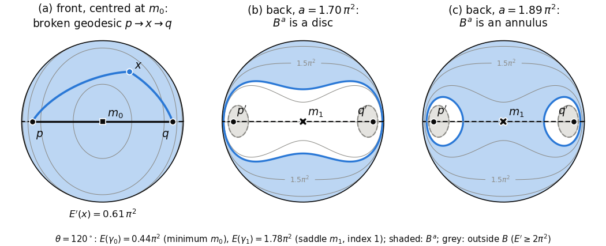

# Chapter 10. Echoes around the globe: broken geodesics and the full path space

*Milnor, "Morse Theory", §16–§17, rewritten for a first-year graduate student who wants to know what
the theorem is for. Every proof is complete. A few facts from outside the book (Whitehead's theorem
on weak equivalences, the CW type of loop spaces, cellular homology, the Serre spectral sequence) are
quoted; each is stated precisely, with a reference.*

---

## 0. Why does a great earthquake ring several times?

After a large earthquake, seismometers all over the Earth record the long-period surface waves
several times: first the train that came the short way along the great circle (seismologists call
it R1), then the one that came the long way (R2), then the short way plus one full circuit (R3), and
so on, each roughly three hours after the train two places before it. At high frequency the trains
travel along geodesics, so R1, R2, R3, … is the list of geodesics from the epicentre $p$ to the
station $q$.

The list is infinite: is that an accident of the round model, or forced by the topology of the
planet? And each arrival carries an integer: R$k$ has passed $k-1$ times through the epicentre or
its antipode, where all geodesics from $p$ refocus, and each passage leaves a visible mark on the
waveform. In the language of Chapter 9 that integer is the index of the geodesic.

This chapter proves the theorem behind both observations: the space $\Omega(M;p,q)$ of all paths
from $p$ to $q$ has the homotopy type of a CW complex with one cell of dimension $\lambda$ for each
geodesic of index $\lambda$ (Theorem 17.3). That homotopy type depends only on the homotopy type of
$M$, so denting the planet cannot change it, and it forces geodesics to exist (Corollary 17.5). §16
replaces the paths of energy less than $c$ by a finite-dimensional manifold of broken geodesics,
where the Morse theory of Chapter 2 applies; §17 compares piecewise smooth with continuous paths and
assembles the pieces. One step of Milnor's §17 does not go through as we read it, and we give a modified argument. The
application returns to the seismograms.

---

## 1. Two metrics on paths (Milnor pp. 88, 93)

In §§1–4, $M$ is a connected Riemannian manifold with distance $\rho$ (§10), $p, q \in M$, and
$\Omega = \Omega(M;p,q)$ is the set of piecewise smooth paths $\omega : [0,1] \to M$ from $p$ to $q$
(§11). Let $s(t) = L_0^t(\omega)$ be the arc length; the speed $\dot s = \|d\omega/dt\|$ is defined
except at finitely many break points.

**Definition.** For $\omega, \omega' \in \Omega$ put
$$d^*(\omega,\omega') = \max_{0 \le t \le 1} \rho(\omega(t),\omega'(t)), \qquad
d(\omega,\omega') = d^*(\omega,\omega') + \Big[\int_0^1 (\dot s - \dot s')^2\,dt\Big]^{1/2}.$$

The second term is the $L^2$ norm of $\dot s - \dot s'$, so $d$ is a metric, and $d \ge d^*$.

**Lemma 16.A.** For $0 \le a < b \le 1$, $\omega \mapsto \sqrt{E_a^b(\omega)}$ is $1$-Lipschitz on
$(\Omega, d)$. In particular $E = E_0^1$ is continuous.

*Proof.* $\sqrt{E_a^b(\omega)} = \|\dot s\|_{L^2[a,b]}$, and by the triangle inequality in $L^2$,
$\big|\|\dot s\|_{L^2[a,b]} - \|\dot s'\|_{L^2[a,b]}\big| \le \|\dot s - \dot s'\|_{L^2[0,1]} \le
d(\omega,\omega')$. $\square$

This is why Milnor adds the second term. With the uniform metric alone, a normal wiggle of amplitude
$1/m$ and frequency $m^2$ added to a geodesic gives paths converging uniformly whose energies grow
like $m^2$. For $c > 0$, $\Omega^c = E^{-1}[0,c]$ is closed and $\operatorname{Int}\Omega^c =
E^{-1}[0,c)$ is open.

**Lemma 16.B (no energy in short intervals).** If $\omega_m \to \omega$ in $(\Omega,d)$, then for
every $\eta > 0$ there is $\delta > 0$ with $E_a^b(\omega_m) < \eta$ for all $m$ whenever
$b - a < \delta$.

*Proof.* Choose $m_0$ with $d(\omega_m,\omega) < \sqrt\eta/2$ for $m \ge m_0$. The finitely many
bounded functions $\dot s^2, \dot s_1^2, \dots, \dot s_{m_0}^2$ have integrals $< \eta/4$ over all
intervals shorter than some $\delta$. For $m \ge m_0$, Lemma 16.A gives
$\sqrt{E_a^b(\omega_m)} < \sqrt\eta/2 + \sqrt\eta/2$. $\square$

**Broken geodesics.** For a subdivision $0 = t_0 < t_1 < \dots < t_k = 1$, $\Omega(t_0,\dots,t_k)$ is
the set of $\omega \in \Omega$ that are geodesic on each $[t_{i-1},t_i]$, and
$\Omega(t_0,\dots,t_k)^c = \Omega^c \cap \Omega(t_0,\dots,t_k)$,
$\operatorname{Int}\Omega(t_0,\dots,t_k)^c = (\operatorname{Int}\Omega^c) \cap \Omega(t_0,\dots,t_k)$.

---

## 2. The manifold of broken geodesics (Milnor pp. 88–89)

**Lemma 16.1.** Let $M$ be complete and $c > 0$. For every sufficiently fine subdivision, the map
$\Phi(\omega) = (\omega(t_1),\dots,\omega(t_{k-1}))$ is a homeomorphism of
$\operatorname{Int}\Omega(t_0,\dots,t_k)^c$ (with the metric $d$) onto the open set
$$U = \Big\{(x_1,\dots,x_{k-1}) \in M^{k-1} : \sum_{i=1}^k \frac{\rho(x_{i-1},x_i)^2}{t_i - t_{i-1}}
< c\Big\}, \qquad x_0 = p,\ x_k = q .$$
So $\operatorname{Int}\Omega(t_0,\dots,t_k)^c$ inherits the structure of a smooth manifold of
dimension $n(k-1)$. (Milnor assumes $\Omega^c \neq \emptyset$; this is not needed.)

*Proof.* *Step 1: where the paths live.* Let $S = \{x : \rho(x,p) \le \sqrt c\}$. By Schwarz's
inequality (§12), $(L_a^b\omega)^2 \le (b-a)E_a^b(\omega)$, so for $\omega \in \Omega^c$,
$\rho(p,\omega(t))^2 \le (L_0^t\omega)^2 \le t\,E_0^t(\omega) \le c$, and $\omega([0,1]) \subset S$.
As $M$ is complete, $S$ is compact (Corollary 10.10).

*Step 2: the scale $\varepsilon$.* By Corollary 10.8 for $K = S$ there is $\varepsilon > 0$ such that
any $x, y \in S$ with $\rho(x,y) < \varepsilon$ are joined by a unique geodesic
$\sigma_{xy} : [0,1] \to M$ of length $< \varepsilon$; it is minimal and depends smoothly on $(x,y)$.
Concretely, the proof of 10.8 puts $x, y$ in a set $W$ of Lemma 10.3, where
$\sigma_{xy}(s) = \exp_x(s\,v(x,y))$ with $v$ smooth on $W \times W$ and $\rho(x,y) = \|v(x,y)\|$.

*Step 3: broken geodesics are determined by their vertices.* Take all $t_i - t_{i-1} <
\varepsilon^2/c$. For $\omega \in \Omega(t_0,\dots,t_k)^c$, the piece on $[t_{i-1},t_i]$ is a
geodesic between points of $S$ of length $L_i$ with
$L_i^2 \le (t_i - t_{i-1})E_{t_{i-1}}^{t_i}(\omega) < \varepsilon^2$. So, reparametrized, it is
$\sigma_{\omega(t_{i-1})\omega(t_i)}$, with $L_i = \rho(\omega(t_{i-1}),\omega(t_i))$ and constant
speed, and
$$E(\omega) = \sum_{i=1}^k \frac{\rho(\omega(t_{i-1}),\omega(t_i))^2}{t_i - t_{i-1}}. \qquad (\ast)$$
In particular $\Phi$ is injective and maps into $U$.

*Step 4: the inverse.* Let $x \in U$. By Cauchy–Schwarz,
$$\rho(p,x_i) \le \sum_{j=1}^k \rho(x_{j-1},x_j) \le \Big(\sum_j (t_j - t_{j-1})\Big)^{1/2}
\Big(\sum_j \frac{\rho(x_{j-1},x_j)^2}{t_j - t_{j-1}}\Big)^{1/2} < \sqrt c,$$
so each $x_i \in S$, and $\rho(x_{j-1},x_j)^2 < c\,(t_j - t_{j-1}) < \varepsilon^2$. So the broken
geodesic $\Psi(x)$, equal on $[t_{i-1},t_i]$ to
$t \mapsto \sigma_{x_{i-1}x_i}\big((t - t_{i-1})/(t_i - t_{i-1})\big)$, is defined, with energy
$< c$ by $(\ast)$. Clearly $\Phi\Psi = \mathrm{id}$, and Step 3 gives $\Psi\Phi = \mathrm{id}$.

*Step 5: continuity.* $\rho(\omega(t_i),\omega'(t_i)) \le d^*(\omega,\omega') \le d(\omega,\omega')$, so
$\Phi$ is continuous. If $x^m \to x$, the pieces of $\Psi(x^m)$ converge uniformly ($\sigma$ is
continuous) and their constant speeds $\rho(x^m_{i-1},x^m_i)/(t_i - t_{i-1})$ converge, so
$\Psi(x^m) \to \Psi(x)$ in $d$. $U$ is open because $\rho$ is continuous. $\square$

---

## 3. The energy on the manifold of broken geodesics (Milnor pp. 90–92)

Fix $c$ and a subdivision as in 16.1, and write $B = \operatorname{Int}\Omega(t_0,\dots,t_k)^c$,
$E' = E|_B$, $B^a = (E')^{-1}[0,a]$.

**Theorem 16.2.** $E' : B \to \mathbb{R}$ is smooth. For each $a < c$ the set $B^a$ is compact and is a
deformation retract of $\Omega^a$; likewise $B$ is a deformation retract of $\operatorname{Int}\Omega^c$.
The critical points of $E'$ are exactly the critical points of $E$ in $\operatorname{Int}\Omega^c$,
namely the unbroken geodesics from $p$ to $q$ of length less than $\sqrt c$. At each such geodesic
the index (or nullity) of the Hessian $E'_{**}$ equals the index (or nullity) of $E_{**}$.

*Proof.* *(a) Smoothness.* In the chart $\Phi$, $(\ast)$ reads
$E'(x) = \sum_i \|v(x_{i-1},x_i)\|^2/(t_i - t_{i-1})$.

*(b) Compactness.* By Step 4, $C = \{x \in M^{k-1} : \sum_i \rho(x_{i-1},x_i)^2/(t_i - t_{i-1}) \le
a\}$ is a closed subset of the compact set $S^{k-1}$; it lies in $U$ since $a < c$, and
$B^a = \Psi(C)$.

> **Milnor's text skips…** the correct exponent in the description of $B^a$ on p. 91. As reproduced
> in the scan, the condition reads $\rho(p_{i-1},p_i)^c/(t_i - t_{i-1}) \le a$, with exponent $c$ and
> no visible summation sign (this scan drops some symbols from displayed formulas, so the $\Sigma$ may
> have been lost in reproduction). The correct condition is
> $\sum_i \rho(p_{i-1},p_i)^2/(t_i - t_{i-1}) \le a$, the energy $(\ast)$.

*(c) The deformation.* For $\omega \in \operatorname{Int}\Omega^c$ let
$r(\omega) = \Psi(\omega(t_1),\dots,\omega(t_{k-1}))$. It is defined, since $\omega([0,1]) \subset S$
and, using $\rho(\omega(a),\omega(b))^2 \le (b-a)E_a^b(\omega)$,
$$\sum_i \frac{\rho(\omega(t_{i-1}),\omega(t_i))^2}{t_i - t_{i-1}} \le \sum_i
E_{t_{i-1}}^{t_i}(\omega) = E(\omega) < c;$$
the same inequality, term by term, gives $E(r(\omega)) \le E(\omega)$. Milnor's deformation $r_u$:
for $t_{i-1} \le u \le t_i$, $r_u(\omega)$ equals $r(\omega)$ on $[0,t_{i-1}]$, the geodesic
$\sigma_{\omega(t_{i-1})\omega(u)}$ (reparametrized linearly) on $[t_{i-1},u]$, and $\omega$ on
$[u,1]$. It is defined since $\rho(\omega(t_{i-1}),\omega(u))^2 \le (u - t_{i-1})E(\omega) <
\varepsilon^2$; the formulas for neighbouring intervals agree at $u = t_i$; $r_0 = \mathrm{id}$ and
$r_1 = r$. Each modified piece is replaced by a short geodesic with the same ends over the same time
interval, so $E(r_u(\omega)) \le E(\omega)$ and $r_u$ preserves each $\Omega^a$. And $r_u = \mathrm{id}$
on $B$, since a sub-arc of a geodesic of length $< \varepsilon$ is the short geodesic between its ends.

Milnor says the joint continuity "is easily verified". It needs Lemma 16.B.

**Lemma 16.C.** $(u,\omega) \mapsto r_u(\omega)$ is continuous from
$[0,1] \times \operatorname{Int}\Omega^c$ to $\operatorname{Int}\Omega^c$, for the metric $d$.

*Proof.* Let $(u_m,\omega_m) \to (u,\omega)$; passing to subsequences, all $u_m$ lie in one interval
$[t_{i-1},t_i]$ containing $u$. Put $c_m = r_{u_m}(\omega_m)$, $c = r_u(\omega)$. On $[0,t_{i-1}]$
these are broken geodesics through converging vertices, which converge as in Step 5. On
$[t_{i-1},1]$, $c_m$ is $\sigma_m = \sigma_{\omega_m(t_{i-1})\omega_m(u_m)}$ on $[t_{i-1},u_m]$ followed
by $\omega_m$.

*Uniform convergence.* A uniformly convergent sequence of maps on $[0,1]$ is equicontinuous, so
$\omega_m(u_m) \to \omega(u)$. If $u > t_{i-1}$, $\sigma_m$ (reparametrized on $[0,1]$) converges
uniformly to $\sigma_{\omega(t_{i-1})\omega(u)}$. If $u = t_{i-1}$, $\sigma_m$ stays within
$\rho(\omega_m(t_{i-1}),\omega_m(u_m)) \to 0$ of $\omega_m(t_{i-1})$. So $d^*(c_m,c) \to 0$.

*Speeds.* The speed of $c_m$ is a converging piecewise constant on $[0,t_{i-1}]$, the constant
$\rho_m/(u_m - t_{i-1})$ on $[t_{i-1},u_m]$ (with $\rho_m = \rho(\omega_m(t_{i-1}),\omega_m(u_m))$),
and $\dot s_m$ on $[u_m,1]$. If $u > t_{i-1}$ the constants converge and the intervals
$[t_{i-1},u_m]$ converge to $[t_{i-1},u]$, so the middle pieces converge in $L^2$. If
$u = t_{i-1}$, the middle piece has squared $L^2$ norm $\rho_m^2/(u_m - t_{i-1}) \le
E_{t_{i-1}}^{u_m}(\omega_m) \to 0$, again by Lemma 16.B. Finally
$\|\dot s_m 1_{[u_m,1]} - \dot s\,1_{[u,1]}\|_{L^2} \le \|\dot s_m - \dot s\|_{L^2} +
\|\dot s\,(1_{[u_m,1]} - 1_{[u,1]})\|_{L^2} \to 0$. So $d(c_m,c) \to 0$. $\square$

So $r_u$ is a deformation retraction of $\operatorname{Int}\Omega^c$ onto $B$, and, preserving each
$\Omega^a$ and fixing $B^a$, of $\Omega^a$ onto $B^a$ for $a < c$.

*(d) Critical points.* By Corollary 12.3 the critical points of $E$ are the unbroken geodesics; those
in $\operatorname{Int}\Omega^c$ have length $\sqrt E < \sqrt c$ and lie in $B$. Conversely let
$\gamma \in B$, with velocity $V$, be critical for $E'$. Fix $i$ and $w \in TM_{\gamma(t_i)}$, and let
$x(u)$ be a curve in $U$ moving only the $i$-th vertex, with velocity $w$ at $u = 0$. Then
$\Psi(x(u))$ is a variation of $\gamma$ (§11) through broken geodesics, with $W(t_i) = w$ and
$W(t_j) = 0$ for $j \neq i$, so the first variation formula (Theorem 12.2) gives
$$\tfrac12\,\frac{d}{du}E'(x(u))\Big|_{u=0} = -\sum_j \langle W(t_j), \Delta_{t_j}V\rangle =
-\langle w, \Delta_{t_i}V\rangle = 0 .$$
So $\Delta_{t_i}V = 0$ for all $i$, and a broken geodesic without velocity jumps is unbroken
(uniqueness of geodesics, Theorem 10.1). Conversely, an unbroken geodesic is critical for $E$, hence
for $E'$.

*(e) Index and nullity.* Let $\gamma \in B$ be an unbroken geodesic and $x(u)$ a curve in $U$ through
it. The variation $\Psi(x(u))$ moves each piece through geodesics, so its variation field is a
broken Jacobi field (Lemma 14.3), an element of the space $T\Omega_\gamma(t_0,\dots,t_k)$ of §15, with
values $x_i'(0)$ at the $t_i$. The resulting linear map $TB_\gamma \to T\Omega_\gamma(t_0,\dots,t_k)$
is an isomorphism, because a broken Jacobi field is determined by arbitrary values at
$t_1,\dots,t_{k-1}$: on each $[t_{i-1},t_i]$, moving the ends of $\sigma$ along arbitrary curves gives
Jacobi fields with arbitrary endpoint values (Lemma 14.3), so on the $2n$-dimensional space of Jacobi
fields along $\gamma|[t_{i-1},t_i]$ the map $J \mapsto (J(t_{i-1}),J(t_i))$ is onto, hence bijective
(the argument of Lemma 14.4).

For a two-parameter family $x(u_1,u_2)$ in $U$ through $\gamma$, the number
$\partial^2 E'(x(u_1,u_2))/\partial u_1\partial u_2$ at $0$ is $E'_{**}$ of the two tangent vectors
(§13; well defined at a critical point). It is also $\partial^2 E(\bar\alpha)/\partial u_1\partial u_2$
for the variation $\bar\alpha = \Psi\circ x$, which is $E_{**}(W_1,W_2)$ by Corollary 13.4. So
$E'_{**}$ is the restriction of $E_{**}$ to $T\Omega_\gamma(t_0,\dots,t_k)$, which has the same index
and nullity as $E_{**}$ by Lemma 15.4. $\square$

> **A hidden hypothesis.** Lemma 15.4 is proved for the subdivision chosen in §15, and its proof uses
> two properties: each segment $\gamma|[t_{i-1},t_i]$ is minimal, and on each segment the Jacobi
> boundary value problem is uniquely solvable. For the §16 subdivision the first holds by
> Corollary 10.8 and the second was checked in (e).

**Remark (minimal geodesics, Milnor p. 92).** This gives a second proof of Hopf–Rinow (10.9). Pick
$a$ with $\Omega^a \neq \emptyset$ ($M$ is connected), then $c > a$ and a subdivision. The compact
set $B^a \supset r(\Omega^a)$ is non-empty, so $E'$ has a minimum on it at some $\gamma$. Since
$E(\omega) \ge E(r(\omega)) \ge E(\gamma)$ for $\omega \in \Omega^a$ and $E(\omega) > a$ otherwise,
$\gamma$ minimizes $E$ on $\Omega$; so it is critical (§11, Example) and a geodesic (12.3).

Minimality of length needs one more step, because Lemma 12.1 assumed a minimal geodesic exists. Cut
any $\omega \in \Omega$, of length $\ell$, into pieces so short that Corollary 10.8 (for the compact
set $\omega([0,1])$) joins the ends of each piece by a minimal geodesic of length
$\rho_j \le \ell_j$. Running through these geodesics at constant speed $\sum\rho_j$ gives
$\beta \in \Omega$ with $E(\beta) = (\sum\rho_j)^2 \le \ell^2$. Hence
$L(\gamma)^2 \le E(\gamma) \le E(\beta) \le L(\omega)^2$.

---

## 4. Finitely many cells below each energy level (Milnor p. 90)

**Theorem 16.3.** Let $M$ be complete, and let $p, q$ be non-conjugate along every geodesic of length
at most $\sqrt a$. Then $\Omega^a$ has the homotopy type of a finite CW complex with one cell of
dimension $\lambda$ for each geodesic in $\Omega^a$ at which $E_{**}$ has index $\lambda$. In
particular $\Omega^a$ contains only finitely many geodesics.

*Proof.* Milnor writes only "16.2 together with §3.5". Choose $c > a$ and a subdivision; by 16.2,
$\Omega^a \simeq B^a$. A critical point $\gamma$ of $E'$ in $B^a$ is a geodesic of length
$\le \sqrt a$, so by Theorem 14.1 the nullity of $E_{**}$ at $\gamma$ is the multiplicity of $q$ as a
conjugate point, $0$, and by 16.2 $\gamma$ is non-degenerate for $E'$. Non-degenerate critical points
are isolated (Corollary 2.3), so the compact $B^a$ contains finitely many.

There is $a' \in (a,c)$ with no critical value of $E'$ in $(a,a']$. Otherwise critical points
$\gamma_m$ with $E'(\gamma_m) \downarrow a$ lie in the compact $B^{(a+c)/2}$, and a subsequence
converges to a critical point $\gamma$ (the critical set is closed) with $E'(\gamma) = a$, which is
non-degenerate, hence isolated: a contradiction.

On the open manifold $N = \{x \in B : E'(x) < a'\}$ put $f = \varphi\circ E'$, with
$\varphi(s) = s + 1/(a' - s)$ an increasing diffeomorphism of $(-\infty,a')$ onto $\mathbb{R}$. Then
$f$ has the same critical points as $E'|_N$, non-degenerate with the same indices (at a critical
point the Hessian of $\varphi\circ E'$ is $\varphi'\cdot E'_{**}$), and
$f^{-1}(-\infty,b] = B^{\varphi^{-1}(b)}$ is compact for every $b$. By Theorem 3.5 and the Remark
after its proof, $N^{\varphi(a)} = B^a$ has the homotopy type of a finite CW complex with one
$\lambda$-cell for each critical point of index $\lambda$ in $B^a$, that is (16.2), for each geodesic
in $\Omega^a$ of index $\lambda$. $\square$

In Milnor's words, the finite dimensional manifold $B$ is "a faithful model" for the infinite
dimensional path space $\operatorname{Int}\Omega^c$.

### An interactive look at the manifold of broken geodesics

The figure shows Theorems 16.2 and 16.3 on the round unit sphere $S^2$ with one break point,
$k = 2$ and $t_1 = \tfrac12$. Points at distance less than $\pi$ are joined by a unique geodesic of
length less than $\pi$, depending smoothly on them, so $\varepsilon = \pi$ works in Lemma 16.1 and
any $c < 2\pi^2$ is allowed. A broken geodesic is determined by its break point
$x = \omega(\tfrac12)$, and as $c \uparrow 2\pi^2$, $B$ fills the region of the sphere where
$$E'(x) = 2\rho(p,x)^2 + 2\rho(x,q)^2 < 2\pi^2 .$$
Let $\theta$ be the angle between $p$ and $q$. Away from the antipodes $p'$ and $q'$, $E'$ is smooth
with exactly two critical points, where the arcs from $x$ to $p$ and to $q$ leave in opposite
directions: the midpoint $m_0$ of the short arc $\gamma_0$, a minimum with value $\theta^2$, and the
midpoint $m_1$ of the long arc $\gamma_1$, a saddle with value $(2\pi - \theta)^2$. The long arc passes
the antipode $p'$, conjugate to $p$, so its index is $1$, as 16.2 predicts. The saddle lies in $B$
when $(2\pi - \theta)^2 < 2\pi^2$, that is, when $\theta > (2-\sqrt2)\pi \approx 105.4^\circ$.

The shaded set is $B^a$. Drag to turn the globe; click to move the break point $x$ and see the
broken geodesic $p \to x \to q$ with its energy. As the slider $a$ rises, $B^a$ is empty below
$\theta^2$, a disc (one $0$-cell) up to $(2\pi - \theta)^2$, and above that an annulus with holes
around $p'$ and $q'$: a $0$-cell with a $1$-cell attached, a circle, the bottom of the path space of
the sphere (§6). Push $\theta$ below $105^\circ$ and the saddle leaves $B$: one break point no
longer sees $\gamma_1$, and Theorem 16.2 needs a finer subdivision.

*(In the printed version this figure is a still image; the interactive version is in the web
edition.)*

---

## 5. Continuous paths: Theorem 17.1 (Milnor pp. 93–94)

From now on $M$ is any Riemannian manifold; completeness returns in §6. $\Omega^* = \Omega^*(M;p,q)$
is the space of continuous paths from $p$ to $q$ with the compact-open topology, which for a compact
domain and a metric target is the topology of the uniform metric $d^*$ (Munkres, *Topology*,
Theorem 46.8). Since $d \ge d^*$, the inclusion $i : \Omega \to \Omega^*$ is continuous.

**Theorem 17.1.** The natural map $i : \Omega \to \Omega^*$ is a homotopy equivalence.

### Milnor's construction

Let $f : M \to [0,\infty)$ be continuous with every $f^{-1}[0,r]$ compact (an exhaustion function;
for complete $M$, $f = \rho(p,\cdot)$). Let $\varepsilon_1(r) \le \infty$ be the supremum of the $e$
such that any two points of $f^{-1}[0,r]$ at distance $< e$ are joined by a unique minimal geodesic
depending smoothly on its ends. By Corollary 10.8, $\varepsilon_1 > 0$, and it is non-increasing.
Milnor asserts that a continuous $\varepsilon_2$ with $0 < \varepsilon_2 < \varepsilon_1$ exists; for
instance $\varepsilon_2(r) = \tfrac12\int_r^{r+1}\min(1,\varepsilon_1(s))\,ds$, which by monotonicity
lies between $\tfrac12\min(1,\varepsilon_1(r+1)) > 0$ and $\tfrac12\min(1,\varepsilon_1(r))$. Put
$\varepsilon(\omega) = \varepsilon_2(\max_t f(\omega(t)))$ and
$$F(\omega,\alpha) = (\alpha - 1)\,\varepsilon(\omega) + m_\omega(\alpha), \qquad
m_\omega(\alpha) = \max_{|t-t'| \le \alpha}\rho(\omega(t),\omega(t')).$$

**Lemma 17.A.** $F$ is continuous on $\Omega^* \times [0,1]$, strictly increasing in $\alpha$, and
$F(\omega,0) < 0 \le F(\omega,1)$. Its unique zero $2A(\omega)$ defines a continuous
$A : \Omega^* \to (0,\tfrac12]$, and if $|t - t'| \le 2A(\omega)$ then
$\rho(\omega(t),\omega(t')) \le \varepsilon(\omega)$, so $\omega(t), \omega(t')$ are joined by a
unique minimal geodesic depending smoothly on them.

*Proof.* $|m_\omega(\alpha) - m_{\omega'}(\alpha)| \le 2d^*(\omega,\omega')$, and for
$\alpha \le \beta$, moving one of two times by at most $\beta - \alpha$ shows
$m_\omega(\beta) \le m_\omega(\alpha) + m_\omega(\beta - \alpha)$, where $m_\omega(\delta) \to 0$ by
uniform continuity. Also $\varepsilon$ is continuous: if $\omega' \to \omega$ uniformly, then
$f\circ\omega' \to f\circ\omega$ uniformly, as $f$ is uniformly continuous on a compact neighbourhood of
$\omega([0,1])$. So $F$ is continuous. It is strictly increasing since $\varepsilon(\omega) > 0$;
$F(\omega,0) = -\varepsilon(\omega)$ and $F(\omega,1) = m_\omega(1) \ge 0$. If $\omega_m \to \omega$,
every limit point $\alpha^*$ of $2A(\omega_m)$ satisfies $F(\omega,\alpha^*) = 0$, so
$A(\omega_m) \to A(\omega)$. Finally $m_\omega(2A) = (1 - 2A)\varepsilon(\omega)$ and
$\varepsilon(\omega) < \varepsilon_1(\max f\circ\omega)$. $\square$

(Milnor writes $A : \Omega^* \to (0,1]$; the values lie in $(0,\tfrac12]$.) He then lets $h(\omega)$
be the path agreeing with $\omega$ at $t = 0, A, 2A, \dots, kA$ and $1$, where $A = A(\omega)$ and
$k = \lfloor 1/A\rfloor$, and minimal geodesic in between. He says "Clearly $h$ is continuous", and
that arguments as in §16 give $h\circ i \simeq \mathrm{id}$ and $i\circ h \simeq \mathrm{id}$.

> **Milnor's text skips…** a real difficulty: $h$ is continuous for $d^*$ but not for the metric $d$
> of $\Omega$. Take $M = \mathbb{R}$, $p = q = 0$, $f(x) = |x|$ (so $\varepsilon_1 \equiv \infty$) and
> $\varepsilon_2 \equiv 1$; then $\alpha = 2A(\omega)$ solves $\alpha + m_\omega(\alpha) = 1$. Let
> $\omega_\lambda = \lambda g$ with $g(t) = (1-t)^{1/3} - (1-t)$. As $\lambda$ increases from $0$,
> $2A(\omega_\lambda)$ decreases continuously from $1$; pick $\lambda_*$ with
> $2A(\omega_{\lambda_*}) = \tfrac23$, so $A = \tfrac13$, $k = 3$ and the last break point is $1$.
> For $\lambda \downarrow \lambda_*$, $F(\omega_\lambda,\tfrac23) = -\tfrac13 + \lambda m_g(\tfrac23) > 0$,
> so $A(\omega_\lambda) < \tfrac13$, still $k = 3$, and $h(\omega_\lambda)$ has an extra break point at
> $3A(\omega_\lambda) = 1 - \delta_\lambda$, $\delta_\lambda \downarrow 0$. Its last segment runs from
> $\lambda(\delta_\lambda^{1/3} - \delta_\lambda)$ to $0$ in time $\delta_\lambda$, with energy
> $\sim \lambda^2\delta_\lambda^{-1/3} \to \infty$. (Numerically, $\lambda_* = \sqrt3/2 \approx 0.866$,
> $E(h(\omega_{\lambda_*})) \approx 0.44$, and $E(h(\omega_\lambda)) > 9$ when $\lambda/\lambda_* - 1 =
> 10^{-3}$.) So $\omega_\lambda \to \omega_{\lambda_*}$ uniformly while $E(h(\omega_\lambda)) \to
> \infty$, and by Lemma 16.A, $h(\omega_\lambda)$ does not converge in $\Omega$. When $1/A(\omega)$
> crosses an integer from below, a new last segment is born with duration $\delta \to 0$ and length
> $\ell \to 0$, but its energy $\ell^2/\delta$ need not tend to $0$. For a piecewise smooth path it is at
> most the energy of the path over the last $\delta$ of time, which is small by Lemma 16.B; for a path
> that is merely continuous it can blow up, as here, and $h$ must be defined on all of $\Omega^*$.

### A proof that works

Keep the subdivision fixed on large open sets, and glue with Milnor's own Appendix, whose main
theorem is recalled first.

*Theorem A of the Appendix* (Milnor pp. 149–153; pure topology, independent of §§16–17). For
subspaces $X_0 \subset X_1 \subset \cdots$ with union $X$, the *telescope* is $X_\Sigma = X_0 \times
[0,1] \cup X_1 \times [1,2] \cup \cdots \subset X \times \mathbb{R}$, and $X$ is the *homotopy direct
limit* of $\{X_i\}$ if the projection $p : X_\Sigma \to X$ is a homotopy equivalence; by *Example 1*
this holds when $X$ is paracompact and each point lies in the interior of some $X_i$. *Theorem A:* if
$X, Y$ are homotopy direct limits of $\{X_i\}, \{Y_i\}$, all $X_i$ and $Y_i$ closed, and $f : X \to Y$
carries each $X_i$ into $Y_i$ by a homotopy equivalence, then $f$ is a homotopy equivalence. (Milnor
does not say "closed"; the Appendix chapter shows that his proof needs it.)

**Lemma 17.B (good balls).** Call an open ball $B \subset M$ *good* if any two points $y, y'$ of $B$
are joined by a unique minimal geodesic $\sigma_{yy'} : [0,1] \to M$, this geodesic lies in $B$, and
$(y,y',s) \mapsto \sigma_{yy'}(s)$ is smooth on $B \times B \times [0,1]$. Every point of $M$ is the
centre of a good ball.

*Proof.* Given $z$, take $W, \varepsilon$ as in Lemma 10.3 for $z$, and let $B = \mathcal B_s(z)
\subset W$ be the convex normal ball (a metric ball) of the Remark after Lemma 10.3, Whitehead's
theorem, proved in Chapter 7, §4: for $y, y' \in B$ the geodesic $\sigma_{yy'}(s) =
\exp_y(s\,v(y,y'))$ of length $< \varepsilon$ lies in $B$. It depends smoothly on $(y,y',s)$ by
10.3(2), and it is minimal by Theorem 10.4. Any minimal geodesic from $y$ to $y'$ has length
$\rho(y,y') = L(\sigma_{yy'}) < \varepsilon$, so it equals $\sigma_{yy'}$ by 10.3(1). $\square$

So $\sigma_{yy'}$ does not depend on the good ball containing $y$ and $y'$, and it is smooth on the open
set of pairs that lie in a common good ball.

For $k \ge 0$ let $I_{k,j} = [(j-1)2^{-k}, j\,2^{-k}]$, $j = 1,\dots,2^k$, and
$$Y_k = \{\omega \in \Omega^* : \text{each } \omega(I_{k,j}) \text{ lies in some good ball}\}, \qquad
X_k = Y_k \cap \Omega.$$

**Lemma 17.C.** (i) The $Y_k$ are open in $\Omega^*$, $Y_k \subset Y_{k+1}$, and
$\bigcup_k Y_k = \Omega^*$; likewise for the $X_k$ in $\Omega$. (ii) $i : X_k \to Y_k$ is a homotopy
equivalence.

*Proof.* *(i)* A compact $\omega(I_{k,j})$ inside an open ball $B$ has positive distance from
$M \setminus B$, so uniformly nearby paths still map $I_{k,j}$ into $B$. Dyadic intervals of
level $k+1$ lie in intervals of level $k$, so $Y_k \subset Y_{k+1}$. Given $\omega$, let $\delta > 0$
be a Lebesgue number of the cover of the compact metric space $\omega([0,1])$ by good balls (17.B); if
$\rho(\omega(t),\omega(t')) < \delta/2$ whenever $|t - t'| \le 2^{-k}$, each $\omega(I_{k,j})$ has
diameter $< \delta$, hence lies in a good ball, and $\omega \in Y_k$. Finally $X_k = i^{-1}(Y_k)$.

*(ii)* Let $t_j = j\,2^{-k}$. For $\omega \in Y_k$ and $u \in I_{k,j}$, the points $\omega(t_{j-1})$ and
$\omega(u)$ lie in a common good ball, so the unique minimal geodesic
$\sigma_{\omega(t_{j-1})\omega(u)}$ is defined. Define $D(\omega,u) = r_u(\omega)$ by Milnor's
formulas of §3 with this subdivision and these geodesics, and $b(\omega) = D(\omega,1)$, the broken
geodesic with vertices $\omega(t_j)$.

* $D(\omega,u) \in Y_k$: on $I_{k,j}$ it consists of pieces of $\omega$ and of minimal geodesics
  between points of $\omega(I_{k,j}) \subset B$, $B$ a good ball, and these geodesics stay in $B$.
* $D(\omega,0) = \omega$, and $D(\omega,u) \in \Omega$ when $\omega \in \Omega$, so $D$ maps
  $X_k \times [0,1]$ into $X_k$.
* $D$ is continuous on $Y_k \times [0,1]$ for $d^*$ and on $X_k \times [0,1]$ for $d$: the proof of
  Lemma 16.C applies word for word (for $d^*$, its first half). And $b$ is continuous from
  $(Y_k,d^*)$ to $(X_k,d)$, since it depends only on the vertices, through the smooth map of 17.B.

Hence $i \circ b = D(\cdot,1) \simeq \mathrm{id}_{Y_k}$ and $b \circ i \simeq \mathrm{id}_{X_k}$, both
through $D$. $\square$

*Proof of Theorem 17.1.* Metric spaces are paracompact (A. H. Stone), and each point of $\Omega$
(resp. $\Omega^*$) lies in some open $X_k$ (resp. $Y_k$). By Example 1, $\Omega$ and $\Omega^*$ are the
homotopy direct limits of $\{X_k\}$ and $\{Y_k\}$. These sets are open, not closed, so Theorem A is
applied to the telescopes instead. Let $i_\Sigma : X_\Sigma \to Y_\Sigma$, $i_\Sigma(\omega,\tau) =
(\omega,\tau)$, and let $X_\Sigma^n = \{(\omega,\tau) \in X_\Sigma : \tau \le n\}$ and $Y_\Sigma^n$ be
the truncations, which are closed. Raising $\tau$ to $n$, $(\omega,\tau) \mapsto (\omega,\tau +
s(n-\tau))$, deforms $X_\Sigma^n$ into $X_n \times \{n\}$ and $Y_\Sigma^n$ into $Y_n \times \{n\}$
(Appendix, (T2)), so the inclusions $\omega \mapsto (\omega,n)$ of $X_n$ and $Y_n$ are homotopy
equivalences; they commute with $i$ and $i_\Sigma$, so by Lemma 17.C(ii) $i_\Sigma$ carries each
$X_\Sigma^n$ into $Y_\Sigma^n$ by a homotopy equivalence. A telescope is the homotopy direct limit of
its truncations (Appendix, Lemma 2.2), so Theorem A shows that $i_\Sigma$ is a homotopy equivalence.
Finally the projections satisfy $p\,i_\Sigma = i\,p$, so if $s$ is a homotopy inverse of $p : X_\Sigma
\to \Omega$, then $i \simeq i\,p\,s = p\,i_\Sigma\,s$, a composite of homotopy equivalences. $\square$

Even without the Appendix, Lemma 17.C shows that $i$ is a *weak* homotopy equivalence (a bijection on
path components and isomorphisms of all homotopy groups at all base points): every compact subset of
$\Omega^*$, such as the image of a sphere or of a homotopy, lies in a single member of the increasing
open cover $\{Y_k\}$. Theorem 19.2 needs only this weaker statement; 19.6 and the remark after 18.2
(Chapter 11) use 17.1 itself.

**Lemma 17.D (moving an endpoint).** If $\sigma$ is a path from $q$ to $q'$, then
$\omega \mapsto \omega\cdot\sigma$ ($\omega$ on $[0,\tfrac12]$, then $\sigma$) is a homotopy
equivalence $\Omega^*(M;p,q) \to \Omega^*(M;p,q')$.

*Proof.* The inverse is $\omega' \mapsto \omega'\cdot\bar\sigma$, with $\bar\sigma$ the reversed path.
The standard homotopies $(\omega\cdot\sigma)\cdot\bar\sigma \simeq \omega\cdot(\sigma\cdot\bar\sigma)
\simeq \omega$ (reparametrizations, and the shrinking $s \mapsto
\omega\cdot\sigma|_{[0,1-s]}\cdot\overline{\sigma|_{[0,1-s]}}$) are given by formulas continuous in
$\omega$, so they are homotopies of maps of $\Omega^*$; likewise for the other composite. $\square$

**Corollary 17.2.** $\Omega$ has the homotopy type of a CW complex.

*Proof.* Milnor quotes his paper *On spaces having the homotopy type of a CW-complex* (Trans. Amer.
Math. Soc. 90 (1959), 272–280): the loop space of a space of CW homotopy type has CW homotopy type,
and so do absolute neighbourhood retracts such as manifolds (alternatively, triangulate $M$). By
Lemma 17.D, $\Omega^*(M;p,q) \simeq \Omega^*(M;p,p)$, a loop space. Now apply 17.1. $\square$

---

## 6. The fundamental theorem (Milnor pp. 95–96)

**Theorem 17.3 (fundamental theorem of Morse theory).** Let $M$ be complete, and let $p, q \in M$ be
non-conjugate along every geodesic. Then $\Omega(M;p,q)$, and also $\Omega^*(M;p,q)$, has the
homotopy type of a countable CW complex with one cell of dimension $\lambda$ for each geodesic from
$p$ to $q$ of index $\lambda$.

*Proof.* By 16.3 each $\Omega^a$ contains finitely many geodesics, so the critical values of $E$ are
discrete. Choose $a_0 < 0 < a_1 < a_2 < \cdots$, $a_i \to \infty$, none a critical value, with at
most one critical value in each $(a_{i-1},a_i)$. Then $\Omega^{a_0} = \emptyset$.

> **Milnor's text skips…** two points. The $a_i$ must tend to infinity, or the $\Omega^{a_i}$ do not
> exhaust $\Omega$. And Milnor's "precisely one" critical value per interval is impossible when there
> are finitely many geodesics (in Theorem 19.2 there is one); "at most one" is what is needed.

**Lemma 17.E (the tower).** There are CW complexes $\emptyset = K_0 \subset K_1 \subset \cdots$, $K_i$
obtained from $K_{i-1}$ by attaching one $\lambda$-cell for each geodesic of index $\lambda$ with
energy in $(a_{i-1},a_i)$, and homotopy equivalences $g_i : \Omega^{a_i} \to K_i$ with
$g_i|_{\Omega^{a_{i-1}}} = g_{i-1}$.

Milnor says only "just as in the proof of 3.5". The difficulty is that each level needs its own,
finer subdivision, while the maps must agree on the nose.

*Proof.* Choose $c_1 < c_2 < \cdots$ with $c_i > a_i$, and subdivisions $S_1 \subset S_2 \subset \cdots$
with $S_i$ fine enough for $c_i$ (refinements of fine enough subdivisions are fine enough). Let $B_i$
be the manifold of broken geodesics for $S_i$ and $c_i$, $r_i$ the retraction of 16.2, and
$B_i^a = B_i \cap \Omega^a$.

1. $r_{i-1}\circ r_i = r_{i-1}$ on $\operatorname{Int}\Omega^{c_{i-1}}$: $r_{i-1}$ uses only the values
   of a path at points of $S_{i-1} \subset S_i$, which $r_i$ does not change.
2. $\pi_i = r_{i-1}|_{B_i^{a_{i-1}}} : B_i^{a_{i-1}} \to B_{i-1}^{a_{i-1}}$ is a homotopy equivalence:
   it is the inclusion $B_i^{a_{i-1}} \subset \Omega^{a_{i-1}}$ followed by $r_{i-1}$, both homotopy
   equivalences by 16.2.

Suppose $h_{i-1} : B_{i-1}^{a_{i-1}} \to K_{i-1}$ is a homotopy equivalence with
$g_{i-1} = h_{i-1}\circ r_{i-1}$ (for $i = 1$ everything is empty). In $B_i$ the critical points of $E'$
with values in $[a_{i-1},a_i]$ are the geodesics with energy in $(a_{i-1},a_i)$, at one critical value
$c$ (if any), all non-degenerate (16.2, 14.1), and $B_i^{a_i}$ is compact. Theorems 3.1, 3.2 with
Remark 3.3, and 3.1 again give a homotopy equivalence
$$\Theta : B_i^{a_i} \to B_i^{a_{i-1}} \cup_\phi e^{\lambda_1} \cup \dots \cup e^{\lambda_m}$$
that is the identity on $B_i^{a_{i-1}}$: the 3.1-retraction of $B_i^{a_i}$ onto
$B_i^{c+\varepsilon}$, then the retraction onto $B_i^{c-\varepsilon} \cup e$'s from the proof of 3.2,
then the extension over the cells (Lemma 3.7) of the 3.1-retraction of $B_i^{c-\varepsilon}$ onto
$B_i^{a_{i-1}}$.

$f = h_{i-1}\circ\pi_i$ is a homotopy equivalence; by Lemma 3.7, one cell at a time, it extends to a
homotopy equivalence $F : B_i^{a_{i-1}} \cup_\phi e\text{'s} \to K_{i-1} \cup_{f\phi} e\text{'s}$. By
cellular approximation (Hatcher, *Algebraic Topology*, Theorem 4.8) each $f\phi_j$ is homotopic to a
map $\psi_j$ into the $(\lambda_j - 1)$-skeleton, and Lemma 3.6 gives a homotopy equivalence
$\kappa : K_{i-1} \cup_{f\phi} e\text{'s} \to K_i = K_{i-1} \cup_\psi e\text{'s}$, the identity on
$K_{i-1}$. Put $h_i = \kappa F\Theta$ and $g_i = h_i\circ r_i$. Since
$h_i|_{B_i^{a_{i-1}}} = h_{i-1}\circ\pi_i$, observation 1 gives, for $\omega \in \Omega^{a_{i-1}}$,
$$g_i(\omega) = h_{i-1}(r_{i-1}(r_i(\omega))) = h_{i-1}(r_{i-1}(\omega)) = g_{i-1}(\omega). \qquad
\square$$

*End of the proof of 17.3.* $K = \bigcup K_i$ is a countable CW complex, and $g : \Omega \to K$, equal
to $g_i$ on $\Omega^{a_i}$, is continuous on each open set $\operatorname{Int}\Omega^{a_i}$. It is a
weak homotopy equivalence: a compact subset of $\Omega$ lies in some $\Omega^{a_i}$ ($E$ is bounded on
it), and a compact subset of $K$ lies in a finite subcomplex (Hatcher, Proposition A.1), hence in some
$K_i$; so every sphere and every homotopy lives at a finite stage, where $g_i$ is a homotopy
equivalence. By *Whitehead's theorem* (J. H. C. Whitehead, *Combinatorial homotopy I*, Bull. AMS 55
(1949), Theorem 1; Hatcher, Theorem 4.5), a weak homotopy equivalence between spaces of CW homotopy
type is a homotopy equivalence; $\Omega$ has CW type by 17.2. For $\Omega^*$ use 17.1. $\square$

Milnor's second route (p. 149): by Examples 1 and 2 of the Appendix, $\Omega$ and $K$ are the homotopy
direct limits of $\{\Omega^{a_i}\}$ and $\{K_i\}$, and Theorem A applies to $g$ directly, without
17.1 or 17.2.

### The path space of the sphere (Milnor pp. 95–96)

Let $S^n \subset \mathbb{R}^{n+1}$ be the unit sphere, $p' = -p$, and $q \neq p, p'$ at angle
$\theta \in (0,\pi)$ from $p$. Geodesics are great circles (§10), and only the great circle $C$
through $p$ and $q$ contains both, so the geodesics from $p$ to $q$ run along $C$ in either direction,
possibly several times around: $\gamma_0$ is the short arc; $\gamma_1$ the long arc $pq'p'q$;
$\gamma_2 = pqp'q'pq$; in general
$$L(\gamma_{2j}) = 2\pi j + \theta, \qquad L(\gamma_{2j+1}) = 2\pi(j+1) - \theta .$$
Since $k\pi < L(\gamma_k) < (k+1)\pi$, the interior of $\gamma_k$ meets $\{p,p'\}$ exactly $k$ times.

*Conjugate points along a great circle* $c(t) = \cos t\,p + \sin t\,v$ ($v \perp p$ a unit vector).
For a unit $e \perp p, v$, the rotations $c_u(t) = \cos t\,p + \sin t(\cos u\,v + \sin u\,e)$ are
geodesics, with variation field $\sin t\cdot e$; the constant vector $e$ is tangent to $S^n$ along $c$
and parallel (its derivative $0$ has zero tangential part). The variation $c((1+u)t)$ gives
$t\,c'(t)$. By Lemma 14.3 these are $n$ independent Jacobi fields vanishing at $0$, so they span that
$n$-dimensional space (§14). As the $e_i$ and $c'$ are orthonormal, $\sum a_i\sin t\,e_i + b\,t\,c'$
vanishes at $t_0 > 0$ only if $b = 0$ and all $a_i = 0$ or $\sin t_0 = 0$. So the conjugate points of
$p$ along $c$ are $c(m\pi)$, that is $p'$ and $p$, each of multiplicity $n - 1$; in particular $p, q$
are not conjugate along any geodesic. By the index theorem (15.1), $\lambda(\gamma_k) = k(n-1)$.

**Corollary 17.4.** The loop space $\Omega(S^n)$ has the homotopy type of a CW complex with one cell in
each of the dimensions $0, n-1, 2(n-1), 3(n-1), \dots$.

*Proof.* 17.3 gives this for $\Omega(S^n;p,q)$, $q \neq \pm p$, and by 17.1 and 17.D,
$\Omega(S^n;p,q) \simeq \Omega^*(S^n;p,q) \simeq \Omega^*(S^n;p,p) \simeq \Omega(S^n;p,p)$. $\square$

> **A hidden hypothesis.** Milnor states 17.4 for "the loop space" but proves it for non-conjugate
> endpoints, and $p$ is conjugate to itself along every great circle. The passage to loops is
> Lemma 17.D with 17.1.

*Homology for $n \ge 3$.* In cellular homology (Hatcher, §2.2) the chain group $C_j$ is $\mathbb{Z}$
if $(n-1) \mid j$ and $0$ otherwise; consecutive integers are never both multiples of $n - 1 \ge 2$,
so all boundary maps vanish and
$$H_j(\Omega S^n;\mathbb{Z}) \cong \begin{cases}\mathbb{Z} & j = 0, n-1, 2(n-1), \dots\\ 0 &
\text{otherwise.}\end{cases}$$
For $n = 2$ there is a cell in every dimension and this argument says nothing about the boundary
maps; in fact $H_j(\Omega S^2) \cong \mathbb{Z}$ for all $j$, since $\Omega S^2 \simeq S^1 \times
\Omega S^3$ (Hopf fibration), a separate fact. Hence Milnor's $n > 2$ below.

**Corollary 17.5.** Let $M$ be a *complete* Riemannian manifold with the homotopy type of $S^n$,
$n \ge 3$. Then any two non-conjugate points of $M$ are joined by infinitely many geodesics, with at
least one of index $k(n-1)$ for every $k \ge 0$.

*Proof.* A homotopy equivalence $\phi : M \to S^n$ induces
$\Omega\phi : \Omega^*(M;p,p) \to \Omega^*(S^n;\phi(p),\phi(p))$, which under the natural isomorphism
$\pi_k(\Omega^*X) \cong \pi_{k+1}(X)$ induces the isomorphism $\pi_{k+1}(\phi)$. Both loop spaces are
path-connected ($\pi_0 \cong \pi_1 = 0$), so $\Omega\phi$ is a weak homotopy equivalence and an
isomorphism on singular homology (Hatcher, Proposition 4.21). With 17.1 and 17.D,
$H_j(\Omega(M;p,q)) \cong H_j(\Omega S^n) \neq 0$ for $j = k(n-1)$. By 17.3, $\Omega(M;p,q) \simeq K$
with $j$-cells corresponding to geodesics of index $j$; if $K$ had no $j$-cell, then $C_j(K) = 0$ and
$H_j(K) = 0$. $\square$

> **A hidden hypothesis.** Milnor omits completeness, which 17.3 needs, and it cannot be dropped:
> $\mathbb{R}^{n+1} \setminus \{0\}$ with the flat metric has the homotopy type of $S^n$, no conjugate
> points, and two points whose segment misses the origin are joined by exactly one geodesic.

**Remark (Serre).** Milnor adds that any two non-conjugate points of *any* complete, non-contractible
manifold are joined by infinitely many geodesics, citing p. 484 of J.-P. Serre, *Homologie singulière
des espaces fibrés*, Ann. of Math. 54 (1951). The input is Serre's theorem: *if $X$ is simply
connected, $F$ a field, $\tilde H_*(X;F) \neq 0$ and $H_i(X;F) = 0$ for large $i$, then
$H_i(\Omega X;F) \neq 0$ for infinitely many $i$.* Proof: otherwise let $m$ and $n > 0$ be the top
degrees with $H_m(\Omega X;F) \neq 0$ and $H_n(X;F) \neq 0$. In the Serre spectral sequence of the
path fibration $\Omega X \to PX \to X$, the term $E^2_{n,m} = H_n(X;F) \otimes H_m(\Omega X;F) \neq 0$
receives differentials only from columns beyond $n$ and sends them only to rows above $m$, so it
survives, contradicting $H_{n+m}(PX) = 0$ ($PX$ is contractible).

If $\pi_1(M)$ is infinite, $\Omega(M;p,q)$ has infinitely many components, each containing a cell of
$K$, that is, a geodesic. If $\pi_1(M)$ is finite, pass to the universal cover $\tilde M$ (complete
for the lifted metric). It is not contractible, since an aspherical manifold with finite non-trivial
fundamental group is impossible (the argument of Corollary 19.3, Chapter 11). By the Hurewicz and
Whitehead theorems it has non-zero reduced homology over $\mathbb{Q}$ or some $\mathbb{F}_p$, and
none above its dimension, so Serre's theorem and 17.3 give infinitely many geodesics from $\tilde p$
to a lift $\tilde q$; they project to distinct geodesics of $M$.

As another application of 17.4, Milnor mentions the Freudenthal suspension theorem; it is his
Corollary 22.3, treated in Chapter 13.

---

## 7. Application: the polar phase shift of seismic surface waves

Model the Earth as a sphere of radius $a = 6371$ km, with a station at angular distance
$\Delta = 60^\circ$ from the epicentre. The surface-wave trains R1, R2, … travel along the geodesics
$\gamma_0, \gamma_1, \dots$ of §6, and since $n = 2$, $\gamma_k$ has index $k$. Arrival times are for
a round group velocity of $4$ km/s, typical of long-period Rayleigh waves.

| Train | Geodesic | Angle travelled | Length (km) | Arrival at 4 km/s | Passages through $p$ or $p'$ | Index $\lambda$ |
|---|---|---|---|---|---|---|
| R1 | $\gamma_0$ | $60^\circ$ | 6,672 | 0.46 h | 0 | 0 |
| R2 | $\gamma_1$ | $300^\circ$ | 33,358 | 2.32 h | 1 | 1 |
| R3 | $\gamma_2$ | $420^\circ$ | 46,702 | 3.24 h | 2 | 2 |
| R4 | $\gamma_3$ | $660^\circ$ | 73,389 | 5.10 h | 3 | 3 |
| R5 | $\gamma_4$ | $780^\circ$ | 86,732 | 6.02 h | 4 | 4 |
| R6 | $\gamma_5$ | $1020^\circ$ | 113,419 | 7.88 h | 5 | 5 |

R1, R3, R5 (and R2, R4, R6) are separated by one circumference, 40,030 km, about 2.8 hours at this
speed: the "roughly three hours" of §0.

**The index is observable.** In the high-frequency (geometric optics) description of a wave, a ray
passing through a focal point of multiplicity $\mu$ has its phase shifted by $\mu\pi/2$. Along a ray
the focal points are the conjugate points, so the total shift is $\tfrac{\pi}{2}$ times the index (by
the index theorem). On the sphere every passage through the epicentre or its antipode is a conjugate
point of multiplicity $n - 1 = 1$, so R$(k+1)$ is shifted by $k\pi/2$ relative to R1. Seismologists
call this the *polar phase shift* and correct for it when measuring phase velocities (J. N. Brune,
J. E. Nafe and L. E. Alsop, "The polar phase shift of surface waves on a sphere", Bull. Seismol.
Soc. Amer. 51 (1961), 247–257). The dimension of the cell that R$(k+1)$ contributes to the path
space can be read off a seismogram.

**What survives on a real Earth.** On the real Earth the rays are geodesics of the travel-time
metric $ds/c$ (Fermat's principle), where $c$ is the local wave speed, and they are no longer great
circles. The topology does not change. For a station off the caustics (a non-conjugate pair, the
typical case by Corollary 18.2 of Chapter 11), Theorem 17.3 makes $\Omega(M;p,q)$ a CW complex with
one $\lambda$-cell per ray of index $\lambda$, and $H_j(\Omega S^2) \cong \mathbb{Z}$ for every $j$
(quoted in §6) forces at least one ray of each index $0, 1, 2, \dots$. Infinitely many arrivals, with
every phase shift $k\pi/2$ represented, is a theorem about every metric on the sphere.

---

## 8. Summary of what was silently assumed, now made explicit

| Where | Milnor says | What is actually needed |
|----|--------------|------------------|
| p. 88 | "this metric induces the required topology" | $\sqrt{E_a^b}$ is 1-Lipschitz for $d$ (Lemma 16.A) |
| p. 88 | Lemma 16.1 assumes $\Omega^c \neq \emptyset$ | not needed; completeness gives compactness of $S$ |
| p. 89 | "Evidently this correspondence defines a homeomorphism" | image is the open set $U$; vertices lie in $S$ by Cauchy–Schwarz; $\Psi$ continuous for $d$ |
| p. 91 | $B^a$ described by $\rho(p_{i-1},p_i)^c/(t_i - t_{i-1}) \le a$ (as reproduced in the scan) | $\sum_i \rho(p_{i-1},p_i)^2/(t_i - t_{i-1}) \le a$ |
| p. 91 | "$r_u(\omega)$ is continuous … easily verified" | $L^2$ control of speed on shrinking intervals (Lemmas 16.B, 16.C) |
| p. 91 | critical points of $E'$ "clear" from first variation | vary one vertex at a time |
| p. 92 | index and nullity "an immediate consequence of Lemma 15.4" | the §16 subdivision has minimal segments and solvable Jacobi boundary problems |
| p. 92 | the minimum of $E'$ "will be the required minimal geodesic" | it minimizes $E$ on $\Omega$; length minimality by reparametrization |
| p. 90 | 16.3 "follows from 16.2 together with §3.5" | a level $a' > a$ without critical values in $(a,a']$; reparametrize $E'$ to apply 3.5 |
| p. 93 | "we can choose $\varepsilon_2$" | explicit continuous minorant of the monotone $\varepsilon_1$ |
| p. 94 | "Clearly $h$ is continuous" | does not hold for $d$ as we read it (counterexample on $\mathbb{R}$); proved here with dyadic subdivisions, convex balls (Chapter 7), Appendix Theorem A applied to telescopes |
| p. 94 | $A : \Omega^* \to (0,1]$ | values in $(0,\tfrac12]$ |
| p. 95 | $a_0 < a_1 < \cdots$, "precisely one" critical value between | $a_i \to \infty$, "at most one" |
| p. 95 | "just as in the proof of 3.5" | nested subdivisions and $r_{i-1}r_i = r_{i-1}$ (Lemma 17.E) |
| p. 96 | 17.4 for "the loop space" | moving the endpoint (Lemma 17.D) and 17.1 |
| p. 96 | 17.5 for $M$ of the homotopy type of $S^n$ | $M$ complete (counterexample $\mathbb{R}^{n+1}\setminus 0$); loop spaces weakly equivalent |
| p. 97 | Serre's remark | Serre's theorem on loop space homology; the case of finite $\pi_1$ |

**Checked by machine.** Milnor's §§16–17 have been verified in the Lean proof assistant for
submanifolds of Euclidean space with the induced metric; completeness is used only to make the balls
about $p$ compact. In §16: Milnor's metric, a pseudometric here since paths are functions on the
real line, with Lemmas 16.A and 16.B; Lemma 16.1; all of Theorem 16.2, with $r_u$ continuous in both
variables (Lemma 16.C) and Lemma 15.4 proved anew for the subdivision of §16; Theorem 16.3, for $a$
not the energy of a geodesic; and the remark on minimal geodesics, for the energy. In §17: Theorem
17.1, by the modified proof of §5, since Milnor's $h$ is not continuous; Theorem 17.3 for $\Omega$
and $M$ closed in Euclidean space, by the Appendix route; Corollary 17.4 for $\Omega(S^n;p,q)$,
$q\neq\pm p$, with its homology over fields for $n\ge3$; and the example showing that 17.5 needs
completeness. Also checked, by moving the end point to a non-conjugate one (Lemma 17.D with Theorem
17.1): Corollary 17.2 for $M$ closed in Euclidean space, and Corollary 17.4 for the loop space of
$S^n$, with its homology over fields for $n\ge3$. Not checked: Milnor's own route to Corollary 17.2,
17.3 for $\Omega^*$, the homology for $n=2$, Corollary 17.5 itself and Serre's remark. See the
verified edition.
