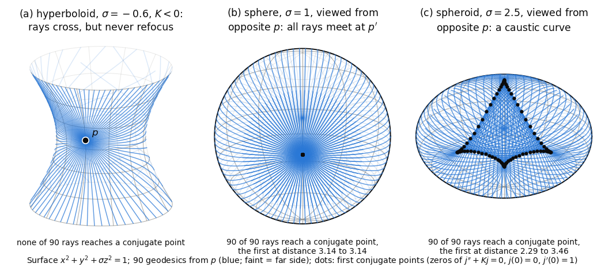

# Chapter 11. Focusing light: non-conjugate points and the sign of curvature

*Milnor, "Morse Theory", §18–§19, rewritten for a first-year graduate student who wants to know what
the theorem is for. Every proof is complete. Sard's theorem and the inverse function theorem are
quoted from the companion volume; a few facts from outside both books (the Gauss equation,
covering spaces, the homology of lens spaces, existence of shortest closed geodesics) are stated
precisely, with references.*

---

## 0. Do two light rays from a star meet again?

Send light out from a point in every direction and follow the rays. In flat space they separate
forever. On a round planet they separate more and more slowly, then come together again and all
meet at the antipode. On a saddle-shaped surface they separate faster than in the plane. The
points where nearby rays meet again are the conjugate points of Chapter 9. Where conjugate points
pile up, light is concentrated; these are the caustics, the bright curves on the floor of a
swimming pool.

This chapter asks what focusing says about the shape of the whole space, and gives three answers.

* Conjugate points are rare. They are the critical values of the exponential map, so by Sard's
  theorem almost no pair of points is conjugate (§18). This is what makes the fundamental theorem
  of Chapter 10 applicable.
* If every sectional curvature is $\le 0$, rays never refocus. The path space then has the homotopy
  type of a discrete set, which forces the universal cover to be $\mathbb{R}^n$ (Cartan–Hadamard) and
  the fundamental group to have no elements of finite order.
* If the Ricci curvature is at least $(n-1)/r^2 > 0$, every geodesic longer than $\pi r$ refocuses.
  So the space is compact, with diameter at most $\pi r$ (Myers): local curvature bounds the size of
  the world. The Lorentzian version of this focusing argument, with the Ricci curvature of spacetime,
  is the core of the singularity theorems of Hawking and Penrose.

Milnor also describes what an observer sees: in positive curvature objects look larger than they
are, in negative curvature smaller. The application at the end measures the Earth. Its curvature
alone bounds the length of every shortest route by 20,105 km, about half a percent above the
pole-to-pole distance of 20,004 km.

---

## 1. Conjugate points are critical values of the exponential map (Milnor pp. 98–99)

A smooth map $f : N \to M$ between manifolds of the same dimension is *critical* at $x \in N$ if
$f_* : TN_x \to TM_{f(x)}$ is not one-to-one. Milnor applies this to $\exp = \exp_p : TM_p \to M$,
regarding $TM_p$ as a manifold, with $T(TM_p)_v$ identified with $TM_p$ in the usual way. He assumes
$M$ complete, so that $\exp$ is defined everywhere. For $v \in TM_p$, let $\gamma_v$ be the geodesic
$t \mapsto \exp tv$, $0 \le t \le 1$.

**Theorem 18.1.** The point $\exp v$ is conjugate to $p$ along $\gamma_v$ if and only if $\exp$ is
critical at $v$. More precisely, the multiplicity of $\exp v$ as a conjugate point equals
$\dim\ker(\exp_*)_v$.

*Proof.* For $X \in TM_p$, consider the variation $\alpha(u,t) = \exp t(v + uX)$ of $\gamma_v$
through geodesics and its variation field $W_X(t) = \partial\alpha/\partial u\,(0,t)$. (Milnor uses
any path $v(u)$ with $v(0) = v$ and $dv/du(0) = X$; the straight line suffices.)

1. $W_X$ is a Jacobi field (Lemma 14.3), and $W_X(0) = 0$ because $\alpha(u,0) = p$ for all $u$.
2. $W_X(1) = \frac{\partial}{\partial u}\exp(v + uX)\big|_{u=0} = \exp_*(X)$.
3. $\dfrac{DW_X}{dt}(0) = X$. By the symmetry lemma 8.7,
   $\frac{D}{\partial t}\frac{\partial\alpha}{\partial u} = \frac{D}{\partial u}\frac{\partial\alpha}{\partial t}$.
   At $t = 0$, $\frac{\partial\alpha}{\partial t}(u,0) = v + uX$ is the initial velocity of the
   geodesic $t \mapsto \exp t(v+uX)$. This is a curve in the fixed vector space $TM_p$ along the
   *constant* curve $u \mapsto \alpha(u,0) = p$. Along a constant curve the covariant derivative is
   the ordinary derivative: in coordinates the Christoffel term carries the factor
   $d\alpha^i(u,0)/du = 0$. So $\frac{D}{\partial u}(v + uX) = X$.

Since $W_X(t) = (\exp)_{*,tv}(tX)$, the map $X \mapsto W_X$ is linear, and by 3 it is injective. Its
values lie in the space $\mathcal J_0$ of Jacobi fields along $\gamma_v$ vanishing at $t = 0$. A
Jacobi field is determined by $J(0)$ and $DJ/dt(0)$ (§14), so $\dim\mathcal J_0 = n$, and
$X \mapsto W_X$ is an isomorphism $TM_p \to \mathcal J_0$. By 2 it carries $\ker(\exp_*)_v$ onto the
Jacobi fields vanishing at both $t = 0$ and $t = 1$, whose dimension is by definition the
multiplicity of $\exp v$ as a conjugate point (§14). $\square$

Milnor proves the two directions separately, and both are contained in this argument. If $\exp$ is
critical at $v$, a non-zero $X$ in the kernel gives a non-trivial Jacobi field $W_X$ vanishing at
both ends. If $\exp$ is non-singular at $v$, the fields $W_{X_1},\dots,W_{X_n}$ for a basis $X_i$
span $\mathcal J_0$, and their values $\exp_*(X_i)$ at $t = 1$ are independent, so no non-zero
element of $\mathcal J_0$ vanishes at $t = 1$. The step Milnor passes over is item 3, the
identification of $\frac{D}{\partial u}$ with an ordinary derivative.

**Completeness is not needed** ("although this assumption could easily be eliminated", Milnor
p. 98). By smooth dependence of solutions of ordinary differential equations on their initial
conditions (Theorem 10.1), the set $\mathcal D_p \subset TM_p$ of vectors $v$ for which $\gamma_v$ is
defined on $[0,1]$ is open, and it is star-shaped about $0$. The proof above works verbatim for
$v \in \mathcal D_p$.

**Sard's theorem** (Milnor's 6.1, in the form needed). Let $f : N \to M$ be a smooth map between
manifolds of the same dimension, each with a countable basis. Then the set of critical values of
$f$ has measure zero in $M$: its image under every chart has Lebesgue measure zero. Milnor states it
for maps of class $C^1$ and refers to de Rham. For smooth maps it is proved in Chapter 3 of the
companion volume (*Topology from the Differentiable Viewpoint*, rewritten): Theorem 1.1 there treats
open subsets of Euclidean spaces, and Steps 3–5 of the proof of Theorem 2.1 there pass to manifolds
through countably many charts.

**Corollary 18.2.** Let $p \in M$. Then for almost all $q \in M$, $p$ is not conjugate to $q$ along
any geodesic.

*Proof.* A geodesic $\gamma : [0,1] \to M$ starting at $p$ equals $\gamma_v$ for $v = \gamma'(0)$,
by uniqueness of geodesics, and it ends at $\exp v$. So $q$ is conjugate to $p$ along some geodesic
exactly when $q = \exp v$ for some $v$ at which $\exp v$ is conjugate to $p$ along $\gamma_v$, that
is, by 18.1, exactly when $q$ is a critical value of $\exp_p$ (on $\mathcal D_p$ if $M$ is not
complete). $TM_p \cong \mathbb{R}^n$ has a countable basis, so Sard's theorem applies. $\square$

In particular the regular values of $\exp_p$ are dense (Brown's theorem, companion volume,
Chapter 3, Theorem 2.1). So for every $p$ the points $q$ that are non-conjugate to $p$ along every
geodesic are dense. For them Theorem 17.3 describes $\Omega(M;p,q)$, and by Lemma 17.D and
Theorem 17.1 (Chapter 10) this determines the homotopy type of $\Omega(M;p,q')$ for every $q'$.
This is how Milnor's §18 "justifies" §17.

---

## 2. Non-positive curvature: no conjugate points (Milnor pp. 100–102)

Recall Milnor's sign convention (§9): $R(X,Y)Z = -\nabla_X\nabla_Y Z + \nabla_Y\nabla_X Z +
\nabla_{[X,Y]}Z$, and the Jacobi equation reads $D^2J/dt^2 + R(V,J)V = 0$. For orthonormal $A, B$,
the number $\langle R(A,B)A,B\rangle$ is the *sectional curvature* of the plane they span (it depends
only on the plane; Chapter 6). It equals $+1$ on the unit sphere.

**Lemma 19.1.** Suppose $\langle R(A,B)A,B\rangle \le 0$ for all $A, B \in TM_p$ and all $p \in M$.
Then no two points of $M$ are conjugate along any geodesic.

*Proof.* Let $\gamma$ be a geodesic with velocity $V$ and $J$ a Jacobi field along it. Then
$\langle D^2J/dt^2, J\rangle = -\langle R(V,J)V,J\rangle \ge 0$, by the hypothesis with $A = V$,
$B = J$. Put $g(t) = \langle DJ/dt, J\rangle$. Compatibility of the connection with the metric gives
$$g'(t) = \Big\langle \frac{D^2J}{dt^2}, J\Big\rangle + \Big\|\frac{DJ}{dt}\Big\|^2 \ \ge\
\Big\|\frac{DJ}{dt}\Big\|^2 \ \ge\ 0 .$$
This is Milnor's "monotonically increasing, and strictly so if $DJ/dt \neq 0$". Suppose
$J(0) = J(t_0) = 0$ with $t_0 > 0$. Then $g(0) = g(t_0) = 0$, and $g$ is non-decreasing, so
$g \equiv 0$ on $[0,t_0]$. Hence $g' \equiv 0$, and by the display $DJ/dt \equiv 0$ there. So
$J(0) = DJ/dt(0) = 0$, and $J \equiv 0$, since a Jacobi field is determined by these two values
(§14). $\square$

Neither completeness nor compactness is used: the lemma is local along each geodesic.

**Remark (Milnor p. 100).** The sectional curvature determined by orthonormal $A, B$ equals the
Gaussian curvature at $p$ of the surface $S = \{\exp_p(u_1A + u_2B)\}$, $u$ small, swept out by the
geodesics through $p$ tangent to the plane of $A$ and $B$. Milnor refers to Laugwitz. Here is the
argument. $S$ is an embedded surface near $p$, because $\exp_p$ is a diffeomorphism near $0$
(Lemma 10.3). *Gauss's equation* (do Carmo, *Riemannian Geometry*, Ch. 6, Theorem 2.5, whose sign
convention agrees with Milnor's) says that for orthonormal $X, Y \in TS_p$,
$$K_S(p) = \langle R(X,Y)X,Y\rangle + \langle \mathrm{II}(X,X),\mathrm{II}(Y,Y)\rangle -
\|\mathrm{II}(X,Y)\|^2 ,$$
where $\mathrm{II}$ is the second fundamental form of $S$ in $M$. For $X$ in the plane, the curve
$t \mapsto \exp_p(tX)$ is a geodesic of $M$ lying in $S$. Its acceleration in $M$ is $0$, and the
normal part of that acceleration is $\mathrm{II}(X,X)$. So $\mathrm{II}(X,X) = 0$ for all
$X \in TS_p$; $\mathrm{II}$ is symmetric and bilinear, so polarization gives $\mathrm{II} = 0$ at
$p$, and $K_S(p) = \langle R(A,B)A,B\rangle$.

### What an observer sees (Milnor p. 101)

Milnor's bracketed paragraph says that curvature can be read off as "optics", with geodesics as
light rays. Here is the computation behind it. Let $U, W \in TM_p$ be orthonormal, let
$\gamma(t) = \exp tU$, and let $q = \gamma(r)$. The Jacobi field with $J(0) = 0$ and
$DJ/dt(0) = W$ is $J(t) = (\exp)_{*,tU}(tW)$ (proof of 18.1). Write $J$ in a parallel orthonormal
frame along $\gamma$; then derivatives of the components are covariant derivatives. From the
Jacobi equation, $J''(0) = -R(U,J(0))U = 0$, and differentiating $R(V,J)V$ once more,
$J'''(0) = -R(U,W)U$. (The term containing the covariant derivative of $R$ is multiplied by
$J(0) = 0$.) So, transported back to $p$,
$$J(t) = tW - \frac{t^3}{6}R(U,W)U + O(t^4), \qquad \|J(t)\| = t\Big(1 - \frac{t^2}{6}\langle
R(U,W)U,W\rangle + O(t^3)\Big).$$
An observer at $p$ sees the point $\exp r(U + \delta W)$, which is displaced from $q$ by
approximately $\delta J(r)$, in the direction $U + \delta W$, at angle $\delta$ from $q$. Thinking in flat terms, he assigns length $r\delta$ to
anything at distance $r$ subtending the angle $\delta$. A short segment at $q$ of true length $L$ in
the direction of $W$ subtends the angle $L/\|J(r)\|$, so it appears to have length
$$\frac{rL}{\|J(r)\|} = L\Big(1 + \frac{r^2}{6}\langle R(U,W)U,W\rangle + \cdots\Big),$$
which is Milnor's formula. If sectional curvatures are negative, every object looks shorter than it
is.

More generally, in the parallel frame the map $W \mapsto J_W(r)/r$ is
$I - \frac{r^2}{6}R_U + O(r^3)$, where $R_U(W) = R(U,W)U$. This $R_U$ is self-adjoint by
Lemma 9.3(4), and $R_U U = 0$. So a small sphere of radius $\varepsilon$ at $q$ looks like an
ellipsoid with principal radii $\varepsilon(1 + r^2K_i/6 + \cdots)$, where the $K_i$ are the
eigenvalues of $R_U$. The eigenvalue belonging to the line of sight $U$ is $0$, so that axis is
unchanged to this order. A small volume $v$ looks like
$v\big(1 + \frac{r^2}{6}(K_1 + \cdots + K_n) + \cdots\big)$, where $K_1 + \cdots + K_n$ is the trace of
$R_U$, the Ricci curvature $K(U,U)$ of §4.

### Examples (Milnor pp. 101–102)

Milnor lists complete surfaces with curvature $\le 0$:

1. Euclidean space, curvature $0$.
2. The saddle $z = x^2 - y^2$. For a graph $z = f(x,y)$,
   $K = (f_{xx}f_{yy} - f_{xy}^2)/(1 + f_x^2 + f_y^2)^2$, which here is
   $K = -4/(1 + 4x^2 + 4y^2)^2 < 0$.
3. The hyperboloid of one sheet $x^2 + y^2 - z^2 = 1$. For a quadric $x^{\mathsf T}Ax = 1$ one has
   $K = \det A/\|Ax\|^4$, so $K = -1/(1 + 2z^2)^2 < 0$.
4. The helicoid $x\cos z + y\sin z = 0$. Parametrized as $(-u\sin v, u\cos v, v)$, its metric is
   $du^2 + (1+u^2)\,dv^2$, so $K = -(\sqrt{1+u^2})_{uu}/\sqrt{1+u^2} = -1/(1+u^2)^2 < 0$.

Each of these surfaces is a closed subset of $\mathbb{R}^3$. A set that is bounded for the intrinsic
distance is bounded in $\mathbb{R}^3$, since the intrinsic distance dominates the Euclidean one; and
it is closed in $\mathbb{R}^3$, hence compact. So closed bounded sets are compact, the surface is
complete as a metric space, and by Hopf–Rinow (Chapter 7) it is geodesically complete.

In all of these examples the curvature tends to $0$ at infinity. Milnor remarks that it was not
known whether a complete surface in $\mathbb{R}^3$ can have curvature negative and bounded away from
$0$. N. V. Efimov answered this in 1964: it cannot.

**The pseudosphere.** This is the surface of revolution of the tractrix,
$z = -\sqrt{1 - x^2 - y^2} + \operatorname{sech}^{-1}\sqrt{x^2+y^2}$, $z > 0$, with the metric induced
from $\mathbb{R}^3$. Its Gaussian curvature is constantly $-1$. By Lemma 19.1, which needs no
completeness, no geodesic on it has conjugate points, although two geodesics winding around the
axis can meet more than once (Milnor's figure on p. 102). It is a model of non-Euclidean geometry:
for a geodesic triangle bounding a disc $D$, the Gauss–Bonnet formula gives angle sum
$\pi + \int_D K\,dA = \pi - \operatorname{area}(D) < \pi$. It is not complete, because a meridian
running down to the rim $z = 0$ has finite length and cannot be continued. Hilbert's theorem (1901)
says that no complete surface of constant negative curvature can be isometrically embedded in
$\mathbb{R}^3$ (Willmore, *Differential Geometry*, p. 137). Complete ones do exist abstractly:
hyperbolic space itself, and compact ones such as the surfaces of genus $\ge 2$ with constant
curvature $-1$ (Hilbert and Cohn-Vossen, *Anschauliche Geometrie*, p. 228).

---

## 3. The theorem of Cartan and Hadamard (Milnor pp. 102–103)

**Theorem 19.2 (Cartan).** Let $M$ be a simply connected, complete Riemannian manifold with
sectional curvature $\langle R(A,B)A,B\rangle \le 0$ everywhere. Then any two points of $M$ are joined
by a unique geodesic, and $\exp_p : TM_p \to M$ is a diffeomorphism for every $p$. In particular $M$
is diffeomorphic to $\mathbb{R}^n$.

*Proof.* By Lemma 19.1 no two points are conjugate along any geodesic. So for every $p, q$, the index
theorem (15.1) gives index $\lambda = 0$ for every geodesic from $p$ to $q$, and Theorem 17.3 applies:
$\Omega(M;p,q)$ has the homotopy type of a CW complex $K$ with one $0$-cell for each geodesic and no
other cells. $K$ is a discrete set of points.

$\Omega(M;p,q)$ is connected. This is where Theorem 17.1 enters, in a step Milnor leaves unstated.
The path components of $\Omega^*(M;p,q)$ are the homotopy classes of paths from $p$ to $q$ relative
to the endpoints: a path in $\Omega^*$ is a map $[0,1] \to \Omega^*$, which by the exponential law
for the compact-open topology is a homotopy $[0,1]\times[0,1] \to M$. Since $M$ is simply connected
there is one class. By 17.1 (already by its weak form, Chapter 10, §5) $\Omega$ has the same path
components as $\Omega^*$.

A connected discrete space is a point, so there is exactly one geodesic from $p$ to $q$. Therefore
$\exp_p$ is one-to-one: two different vectors $v \neq w$ with $\exp v = \exp w = q$ would give two
different geodesics $\gamma_v \neq \gamma_w$ from $p$ to $q$. It is onto, by Hopf–Rinow (10.9), or by
the existence half of what was just proved. By 18.1 and Lemma 19.1, $\exp_p$ is non-critical
everywhere, so by the inverse function theorem on manifolds (companion volume, Chapter 1,
Theorem 4.1) it is a local diffeomorphism. A bijective local diffeomorphism is a diffeomorphism,
since its inverse agrees near each point with a smooth local inverse. $\square$

The proof is a striking use of the machinery: an analytic statement about one linear map at a time
(no conjugate points) is turned into a global statement through the topology of the path space.

**The non-simply-connected case.** Let $M$ be complete with sectional curvature $\le 0$, for example
a flat torus $S^1 \times S^1$ or a compact surface of genus $\ge 2$ with constant negative curvature.
Let $\pi : \tilde M \to M$ be the universal covering, with the metric pulled back by $\pi$. Then $\pi$
is a local isometry, so $\tilde M$ has the same sectional curvatures, $\le 0$, and geodesics of
$\tilde M$ map to geodesics of $M$. $\tilde M$ is complete (Milnor: "it is clear"): a geodesic of
$\tilde M$ maps to a geodesic of $M$, which extends to all of $\mathbb{R}$, and the lift of the
extension starting at the same point is a geodesic extending the original one. So Theorem 19.2
applies to $\tilde M$, and $\tilde M \cong \mathbb{R}^n$.

**Each homotopy class of paths from $p$ to $q$ in $M$ contains exactly one geodesic.** Fix a lift
$\tilde p$. Lifting paths from $\tilde p$ gives a bijection between homotopy classes of paths from
$p$ to $q$ (relative to the endpoints) and points $\tilde q \in \pi^{-1}(q)$, because $\tilde M$ is
simply connected (Hatcher, *Algebraic Topology*, §1.3). Geodesics from $p$ to $q$ in a given class correspond, by
lifting, to geodesics from $\tilde p$ to the corresponding $\tilde q$, and there is exactly one.

**Corollary 19.3.** If $M$ is complete with $\langle R(A,B)A,B\rangle \le 0$, then $\pi_i(M) = 0$ for
$i > 1$, and $\pi_1(M)$ has no element of finite order other than the identity.

*Proof.* A covering map induces isomorphisms on $\pi_i$ for $i \ge 2$ (Hatcher, Proposition 4.1), and
$\tilde M \cong \mathbb{R}^n$ is contractible, so $\pi_i(M) = \pi_i(\tilde M) = 0$ for $i > 1$.

Suppose $\pi_1(M)$ contains an element $g \neq 1$ of finite order $m$, and let $G = \langle g\rangle
\cong \mathbb{Z}/m$. By covering space theory (Hatcher, Proposition 1.36) there is a covering
$\hat M \to M$ with $\pi_1(\hat M) \cong G$. Its universal cover is $\tilde M$, which is contractible,
so $\hat M$ is an $n$-manifold with $\pi_i(\hat M) = 0$ for $i \ge 2$: a $K(G,1)$. Milnor
concludes by group cohomology, $H^k(G) \cong H^k(\hat M) = 0$ for $k > n$ (citing Hu,
*Homotopy Theory*, pp. 200–202), while the cohomology of a finite cyclic group is non-zero in
arbitrarily high dimensions. In homology the same argument reads as follows. The infinite lens
space $L = S^\infty/(\mathbb{Z}/m)$ is a CW complex $K(\mathbb{Z}/m,1)$ with
$H_{2j-1}(L;\mathbb{Z}) \cong \mathbb{Z}/m$ for all $j \ge 1$ (Hatcher, Example 2.43). Two
$K(G,1)$'s of CW homotopy type are homotopy equivalent (Hatcher, Theorem 1B.8), and a manifold has
CW homotopy type, so $H_{2j-1}(\hat M;\mathbb{Z}) \cong \mathbb{Z}/m \neq 0$ for all $j$. But an
$n$-manifold has $H_k(\hat M;\mathbb{Z}) = 0$ for $k > n$ (Hatcher, Theorem 3.26 for closed and
Proposition 3.29 for open manifolds), a contradiction. $\square$

A theorem of Preissman goes one step further, and is not in Milnor: if $M$ is compact with sectional
curvature $< 0$, every non-trivial abelian subgroup of $\pi_1(M)$ is infinite cyclic (do Carmo,
Ch. 12). For the torus, curvature $0$, $\pi_1 = \mathbb{Z}^2$ shows that strict negativity is needed.

---

## 4. Ricci curvature and Myers's theorem (Milnor pp. 103–105)

For positive curvature Milnor turns from the sectional curvature to the Ricci tensor, which gives
"sharper results".

**Definition.** The *Ricci tensor* at $p$ is the bilinear form $K : TM_p \times TM_p \to \mathbb{R}$,
$K(U_1,U_2) = \operatorname{trace}\big(W \mapsto R(U_1,W)U_2\big)$.

It is symmetric: for an orthonormal basis $E_j$,
$K(U_1,U_2) = \sum_j\langle R(U_1,E_j)U_2,E_j\rangle$, and the pair symmetry of Lemma 9.3(4),
$\langle R(X,Y)Z,W\rangle = \langle R(Z,W)X,Y\rangle$, turns each term into
$\langle R(U_2,E_j)U_1,E_j\rangle$.

**Assertion.** If $U_1,\dots,U_n$ is an orthonormal basis of $TM_p$, then $K(U_n,U_n)$ is the sum
of the sectional curvatures $\langle R(U_n,U_i)U_n,U_i\rangle$, $i = 1,\dots,n-1$.

*Proof.* $K(U_n,U_n)$ is the trace of the matrix $\big(\langle R(U_n,U_i)U_n,U_j\rangle\big)$ of
$W \mapsto R(U_n,W)U_n$, and its $n$-th diagonal entry is $0$ because $R(U_n,U_n) = 0$
(Lemma 9.3(1)). $\square$

**Theorem 19.4 (Myers).** Suppose $n \ge 2$ and $K(U,U) \ge (n-1)/r^2$ for every unit vector $U$ at
every point of $M$, where $r > 0$ is a constant. Then every geodesic on $M$ of length $> \pi r$
contains conjugate points, and hence is not minimal.

> **A hidden hypothesis.** Milnor does not say $n \ge 2$. For $n = 1$ the Ricci tensor is $0$, the
> hypothesis $0 \ge 0$ holds, and the conclusion fails on the line and on long arcs of a circle.

*Proof.* Let $\gamma : [0,1] \to M$ be a geodesic of length $L$. Choose parallel fields
$P_1,\dots,P_n$ along $\gamma$ that are orthonormal at one point, hence everywhere (parallel transport
preserves inner products), with $P_n$ pointing along $\gamma$. Then $V = d\gamma/dt = LP_n$ and
$DP_i/dt = 0$. Let $W_i(t) = (\sin\pi t)P_i(t)$, $i = 1,\dots,n-1$; these are smooth and vanish at
$t = 0, 1$. The second variation formula (Theorem 13.1, with no break points) gives
$$\tfrac12 E_{**}(W_i,W_i) = -\int_0^1\Big\langle W_i, \frac{D^2W_i}{dt^2} + R(V,W_i)V\Big\rangle dt
= \int_0^1 (\sin\pi t)^2\big(\pi^2 - L^2\langle R(P_n,P_i)P_n,P_i\rangle\big)\,dt ,$$
since $D^2W_i/dt^2 = -\pi^2(\sin\pi t)P_i$ and $R(V,W_i)V = L^2\sin\pi t\,R(P_n,P_i)P_n$. Summing over
$i = 1,\dots,n-1$ and using the Assertion at each $\gamma(t)$,
$$\tfrac12\sum_{i=1}^{n-1}E_{**}(W_i,W_i) = \int_0^1(\sin\pi t)^2\big((n-1)\pi^2 - L^2K(P_n,P_n)\big)\,dt
\le (n-1)\Big(\pi^2 - \frac{L^2}{r^2}\Big)\int_0^1(\sin\pi t)^2\,dt .$$
If $L > \pi r$ the right side is negative, so $E_{**}(W_i,W_i) < 0$ for some $i$. The index of
$\gamma$ is then positive, and by the index theorem (15.1) $\gamma$ contains a point
$\gamma(t)$, $0 < t < 1$, conjugate to $\gamma(0)$.

$\gamma$ is not minimal either. Let $\bar\alpha$ be a variation of $\gamma$ with variation field
$W_i$, for instance $\bar\alpha(u)(t) = \exp_{\gamma(t)}(uW_i(t))$, which is defined for small $u$ even
if $M$ is not complete. Then $dE(\bar\alpha(u))/du = 0$ at $u = 0$, because $\gamma$ is a geodesic,
and $d^2E(\bar\alpha(u))/du^2 = E_{**}(W_i,W_i) < 0$ (Remark 13.5). So $E(\bar\alpha(u)) < E(\gamma)$
for small $u \neq 0$, and then
$L(\bar\alpha(u))^2 \le E(\bar\alpha(u)) < E(\gamma) = L^2$: a shorter path with the same
endpoints. $\square$

**Example.** On a sphere of radius $r$ every sectional curvature is $1/r^2$, so $K(U,U) = (n-1)/r^2$.
By 19.4 every geodesic longer than $\pi r$ contains conjugate points. This is best possible: a half
great circle has length exactly $\pi r$, its endpoints are conjugate, and it has no conjugate point
inside.

**Corollary 19.5.** If $M$ is complete and $K(U,U) \ge (n-1)/r^2 > 0$ for all unit vectors $U$, then
$M$ is compact with diameter $\le \pi r$.

(The hypothesis "$(n-1)/r^2 > 0$" forces $n \ge 2$.)

*Proof.* Let $p, q \in M$ and let $\gamma$ be a minimal geodesic from $p$ to $q$ (Hopf–Rinow, 10.9).
By 19.4 its length is at most $\pi r$, so $\rho(p,q) \le \pi r$. Closed bounded subsets of a complete
manifold are compact (10.10), so $M$ itself is compact. $\square$

**$\pi_1(M)$ is finite.** The corollary applies also to the universal covering $\tilde M$, with the
pulled-back metric. It is complete, as shown in §3, and has the same Ricci curvature, because $\pi$
is a local isometry. So $\tilde M$ is compact. The fibre $\pi^{-1}(p)$ is a closed discrete subset
of $\tilde M$, hence finite, and it is in bijection with $\pi_1(M,p)$.

### An interactive look at focusing

The figure fires geodesics from a point $p$ of the surface $x^2 + y^2 + \sigma z^2 = 1$ and marks the
first conjugate point on each. It integrates the geodesic equation in $\mathbb{R}^3$ together with
the Jacobi equation $j'' + Kj = 0$, $j(0) = 0$, $j'(0) = 1$, for the normal Jacobi field; on a surface
$R(V,J)V = KJ$ for a unit $V$ and $J \perp V$. A zero of $j$ is a conjugate point. The slider $\sigma$
deforms the surface: $\sigma < 0$ gives a hyperboloid of one sheet ($K < 0$), $\sigma = 0$ a cylinder
($K = 0$), $0 < \sigma < 1$ a prolate spheroid, $\sigma = 1$ the round sphere, and $\sigma > 1$ an
oblate spheroid.

For $\sigma \le 0$ no conjugate point ever appears, however long the rays (Lemma 19.1). Rays winding
round the neck of the hyperboloid still cross one another: geodesics may meet twice without being
conjugate, as Milnor says of the pseudosphere. At $\sigma = 1$ every ray stops at the antipode, at
distance exactly $\pi$; the whole fan focuses at one point. For other positive $\sigma$ the
conjugate points spread into a curve with four cusps. This curve is the set of critical values of
$\exp_p$ met by the rays: a curve, of measure zero, as Corollary 18.2 requires. The readout compares
the first conjugate distances with Myers's bound $\pi/\sqrt{\min K}$. Use the second slider to move
$p$ and the third to lengthen the rays; drag to turn the surface, or use the buttons to look at $p$
or at the far side.

*(In the printed version this figure is a still image; the interactive version is in the web
edition.)*

---

## 5. Positive Ricci curvature and the path space (Milnor pp. 106–107)

**Theorem 19.6.** If $M$ is compact and its Ricci tensor is everywhere positive definite, then for
all $p, q$ the path space $\Omega(M;p,q)$ has the homotopy type of a CW complex with only finitely
many cells in each dimension.

*Proof.* The unit vectors of $M$ form a compact set (the unit tangent bundle), so the continuous
positive function $K(U,U)$ attains a minimum. Write it as $(n-1)/r^2 > 0$; positive definiteness
forces $n \ge 2$.

*Long geodesics have large index.* Let $\gamma \in \Omega(M;p,q)$ be a geodesic of length
$L > k\pi r$. For $i = 1,\dots,k$, the restriction of $\gamma$ to $[\frac{i-1}{k},\frac ik]$ is a
geodesic segment of length $L/k > \pi r$. With the parallel frame of 19.4, put
$$X_i(t) = \sin\big(\pi k(t - \tfrac{i-1}{k})\big)\,P_{j}(t) \ \text{ on }
\big[\tfrac{i-1}{k},\tfrac ik\big], \qquad X_i = 0 \ \text{ elsewhere},$$
a piecewise smooth field vanishing at $0$ and $1$. In the second variation formula (13.1), the break
terms of $\tfrac12E_{**}(X_i,X_i)$ vanish, because $X_i$ is zero at its break points
$\frac{i-1}{k}, \frac ik$. The integral is the computation of 19.4 on the subinterval, with
$\pi k$ in place of $\pi$. Summed over $j = 1,\dots,n-1$ it equals
$\int\sin^2(\cdots)\big((n-1)\pi^2k^2 - L^2K(P_n,P_n)\big)dt \le
(n-1)(\pi^2k^2 - L^2/r^2)\int\sin^2(\cdots)\,dt < 0$. So for a suitable $j = j(i)$,
$E_{**}(X_i,X_i) < 0$.

Milnor says "clearly $E_{**}(X_i,X_j) = 0$ for $i \neq j$". In 13.1, the integrand
$\langle X_j, D^2X_i/dt^2 + R(V,X_i)V\rangle$ vanishes except where both supports meet, which is at
most one point. The jumps of $DX_i/dt$ occur only at $\frac{i-1}{k}$ and $\frac ik$, where every
$X_j$ vanishes. The $X_i$ have disjoint supports and are non-zero, so they are linearly
independent. For a combination, $E_{**}(\sum c_iX_i,\sum c_iX_i) = \sum c_i^2E_{**}(X_i,X_i) < 0$
unless all $c_i = 0$. So $E_{**}$ is negative definite on a $k$-dimensional subspace of
$T\Omega_\gamma$, and the index of $\gamma$ is at least $k$. Contrapositively, a geodesic of index
less than $k$ has length at most $k\pi r$.

*The cells.* Suppose first that $p$ and $q$ are not conjugate along any geodesic. A compact manifold
is complete, so by Theorem 16.3, with $a = (k\pi r)^2$, there are only finitely many geodesics from
$p$ to $q$ of length $\le k\pi r$. So only finitely many geodesics have index $< k$. By Theorem 17.3,
$\Omega(M;p,q)$ has the homotopy type of a CW complex whose $\lambda$-cells correspond to the
geodesics of index $\lambda$, and there are finitely many of them for each $\lambda$.

*Arbitrary $p, q$.* Here Milnor's proof stops; it assumed non-conjugate endpoints. By
Corollary 18.2 there is $q'$ non-conjugate to $p$ along every geodesic. $M$ is connected, so by
Theorem 17.1 and Lemma 17.D,
$\Omega(M;p,q) \simeq \Omega^*(M;p,q) \simeq \Omega^*(M;p,q') \simeq \Omega(M;p,q')$, and the property
"homotopy equivalent to a CW complex with finitely many cells in each dimension" passes along
homotopy equivalences. $\square$

**Remark (Milnor p. 106).** Milnor did not know whether 19.6 remains true for complete non-compact
$M$. The proof breaks down because on a manifold such as the paraboloid $z = x^2 + y^2$, where
$K = 4/(1 + 4x^2 + 4y^2)^2$, the curvature is positive but not bounded away from $0$. The answer
turned out to be negative. J.-P. Sha and D. Yang (J. Differential Geom. 29, 1989) constructed
complete metrics of positive Ricci curvature on open manifolds of infinite topological type, with
infinitely generated second homology. For a simply connected such $M$, the loop space is connected
and $H_1(\Omega M) \cong \pi_1(\Omega M) \cong \pi_2(M) \cong H_2(M)$ (Hurewicz), which is infinitely
generated, so no CW model of $\Omega M$ has finitely many $1$-cells.

**Positive sectional curvature.** It would be interesting to know which manifolds carry a metric
with all sectional curvatures positive. An instructive example is $S^m \times S^k$, $m, k \ge 2$,
with the product of round metrics. For a unit vector $U = (U_1,U_2)$,
$K(U,U) = (m-1)\|U_1\|^2 + (k-1)\|U_2\|^2 \ge \min(m,k) - 1 > 0$, so the Ricci tensor is positive
definite. But the plane spanned by $(X,0)$ and $(0,Y)$ has sectional curvature $0$: it is tangent to a
flat totally geodesic torus $S^1 \times S^1$ (a product of great circles). Whether
$S^m \times S^k$ admits a metric of positive sectional curvature was unknown to Milnor and is still
unknown; for $S^2 \times S^2$ this is the Hopf conjecture. Milnor records the partial result: such a
metric cannot be invariant under the involution $\tau(x,y) = (-x,-y)$. It follows from Synge's
theorem, which he cites (J. L. Synge, Quart. J. Math. 7 (1936)). Here are its statement and a proof
using only the tools of this book, plus one quoted existence result.

**Synge's theorem.** Let $M$ be compact with all sectional curvatures positive. (a) If $\dim M$ is
even and $M$ is orientable, then $M$ is simply connected. (b) If $\dim M$ is odd, then $M$ is
orientable.

*Proof.* Suppose not. In case (a), take a non-trivial free homotopy class of loops. In case (b), $M$
is non-orientable, so take the free homotopy class of a loop along which the orientation is reversed.
*Quoted fact:* on a compact manifold every free homotopy class of loops other than the class of
constant loops contains a loop of least length, which is a smooth closed geodesic
$\gamma : [0,1] \to M$, $\gamma(0) = \gamma(1)$, $\gamma'(0) = \gamma'(1)$ (do Carmo, Ch. 12, §2; the
proof is a broken-geodesic argument like that of §16).

Parallel transport $P$ around $\gamma$ is an orthogonal map of $TM_{\gamma(0)}$ fixing the velocity
$V(0) = V(1)$, so it preserves the orthogonal complement $V^\perp$, of dimension $n - 1$. In case (a),
$M$ is orientable, so $\det P = 1$, and $P|_{V^\perp} \in SO(n-1)$ with $n - 1$ odd. In case (b),
$\gamma$ reverses orientation, so $\det P = -1$, and $P|_{V^\perp}$ has determinant $-1$ with $n - 1$
even. In both cases $P|_{V^\perp}$ has the eigenvalue $1$: for $Q$ orthogonal on an $m$-dimensional
space, $\det(Q - I) = \det Q\,\det(I - Q^{\mathsf T}) = (-1)^m\det Q\,\det(Q - I)$, and
$(-1)^m\det Q = -1$ in both cases. Let $W_0 \perp V(0)$ be a fixed unit vector and $W(t)$ its
parallel transport; then $W(1) = W(0)$, and $W \perp V$ everywhere.

Consider the closed curves $\alpha_u(t) = \exp_{\gamma(t)}(uW(t))$, freely homotopic to $\gamma$. Each
$u \mapsto \alpha_u(t)$ is a geodesic. Using Lemma 8.7, Lemma 9.2 and the vanishing of
$\frac{D}{\partial u}\frac{\partial\alpha}{\partial u}$, a direct computation at $u = 0$ gives
$$\frac12\frac{d^2}{du^2}E(\alpha_u)\Big|_{u=0} = \int_0^1\Big(\Big\|\frac{DW}{dt}\Big\|^2 -
\langle R(V,W)V,W\rangle\Big)dt = -\int_0^1 \langle R(V,W)V,W\rangle\,dt < 0 .$$
No boundary terms appear: the integrand is differentiated under the integral sign, without
integration by parts. The first derivative vanishes because $\gamma$ is a closed geodesic and $W$ is
periodic. So nearby closed curves in the same free homotopy class have
$L(\alpha_u)^2 \le E(\alpha_u) < E(\gamma) = L(\gamma)^2$, contradicting minimality. $\square$

*Milnor's partial result.* Suppose a metric of positive sectional curvature on $S^m \times S^k$,
$m, k \ge 2$, is invariant under $\tau$. Since $\tau$ is a free isometric involution, the quotient
$N = (S^m \times S^k)/\tau$ is a compact manifold whose metric has positive sectional curvature, and
$\pi_1(N) = \mathbb{Z}/2$ ($S^m \times S^k$ is simply connected). The antipodal map of $S^m$ has degree
$(-1)^{m+1}$, so $\tau$ preserves orientation exactly when $m + k$ is even. If $m + k$ is even, $N$
is orientable, even-dimensional and not simply connected, contradicting (a). If $m + k$ is odd, $N$
is non-orientable and odd-dimensional, contradicting (b).

Milnor closes with references for further theorems relating topology and curvature: Yano and
Bochner, *Curvature and Betti Numbers* (1953); Chern (1955); Berger (1958); Goldberg, *Curvature and
Homology* (1962).

---

## 6. Application: how long can a shortest route on the Earth be?

Geodesists model the Earth by the WGS84 ellipsoid of revolution, with equatorial radius
$a = 6378.137$ km and polar radius $b = 6356.752$ km. On a surface the Ricci curvature of a unit vector
is the Gaussian curvature $K$ ($n = 2$), so Theorem 19.4 and Corollary 19.5 apply with
$1/r^2 = \min K$.

**The curvature.** At geodetic latitude $\varphi$ the principal radii of curvature are
$R_1 = a(1-e^2)/(1 - e^2\sin^2\varphi)^{3/2}$ along the meridian and
$R_2 = a/(1 - e^2\sin^2\varphi)^{1/2}$ across it, with $e^2 = 1 - b^2/a^2$. So
$$K = \frac1{R_1R_2} = \frac{(1 - e^2\sin^2\varphi)^2}{a^2(1 - e^2)},$$
which decreases from $K = 1/b^2$ at the equator to $K = b^2/a^4$ at the poles. So
$r = a^2/b = 6399.594$ km.

**Myers's bound.** By Theorem 19.4, every geodesic longer than $\pi a^2/b = 20{,}104.9$ km contains a
conjugate point and is not a shortest route. By Corollary 19.5, no two points of the Earth are more
than $20{,}104.9$ km apart.

**How good is it?** Every geodesic from the North Pole is a meridian (Clairaut's relation
$\varrho\sin\psi = \text{const}$, where $\varrho$ is the distance to the axis and $\psi$ the angle
with the meridian, has constant $0$ at the pole). All meridians reach the South Pole after half a
meridian, $20{,}003.9$ km, so that is the distance between the poles, and the South Pole is
conjugate to the North Pole along each meridian (the rotations about the axis give a Jacobi field
vanishing at both poles). Therefore
$$20{,}003.9 \text{ km} \ \le\ \operatorname{diam}(\text{Earth}) \ \le\ 20{,}104.9 \text{ km},$$
and the purely local curvature bound overshoots the diameter by at most about $0.5\%$.

**The equator is not a shortest route between antipodes.** Along the equator $K = 1/b^2$ is constant,
and the normal Jacobi field satisfies $j'' + j/b^2 = 0$, $j(0) = 0$, so $j(s) = b\sin(s/b)$. The first
conjugate point comes at $s = \pi b = 19{,}970.3$ km, before the antipodal point at
$\pi a = 20{,}037.5$ km. By the index theorem the equatorial arc between antipodal points has index
$1$, so it is not minimal (Lemma 13.6). Indeed the route over a pole, $20{,}003.9$ km, is shorter.

**Generic pairs.** By Corollary 18.2, for a fixed point $p$ the destinations $q$ conjugate to $p$
along some geodesic form a set of measure zero. On the ellipsoid, for $p$ not a pole, the first
conjugate points form a small curve with four cusps near the antipode of $p$, the caustic of the
figure. For all other $q$ the geodesics from $p$ to $q$
are non-degenerate critical points of the energy and, below any given length, finite in number
(Theorem 16.3). This is the setting in which modern geodesic software finds all short geodesics
between nearly antipodal points (C. F. F. Karney, "Algorithms for geodesics", J. Geodesy 87 (2013)).

---

## 7. Summary of what was silently assumed, now made explicit

| Where | Milnor says | What is actually needed |
|----|--------------|------------------|
| p. 98 | $\exp$ "critical" means $\exp_*$ not one-to-one; $M$ complete "could easily be eliminated" | the domain of $\exp_p$ is open and star-shaped (ODE dependence); 18.1 holds there |
| p. 98 | $\frac{DW}{dt}(0) = \frac{D}{\partial u}v(u)\big|_{u=0} \neq 0$ | symmetry lemma 8.7; covariant derivative along a constant curve is the ordinary derivative |
| p. 99 | "clearly no non-trivial Jacobi field … vanishes at both $p$ and $\exp v$" | $X \mapsto W_X$ is an isomorphism onto the $n$-dimensional space of Jacobi fields vanishing at $p$; multiplicity $= \dim\ker\exp_*$ |
| p. 99 | 18.2 "follows immediately from 18.1 together with Sard's theorem" | Sard for smooth maps (companion volume, Chapter 3); every geodesic from $p$ is some $\gamma_v$ |
| p. 100 | $\langle DJ/dt, J\rangle$ "is monotonically increasing, and strictly so if $DJ/dt \neq 0$" | $g' \ge \|DJ/dt\|^2$; $g \equiv 0$ forces $DJ/dt \equiv 0$ |
| p. 100 | sectional curvature equals the Gaussian curvature of $\exp_p$ of the plane | Gauss equation; the second fundamental form vanishes at $p$ |
| p. 101 | the optics formulas | Taylor expansion $J(t) = tW - \frac{t^3}{6}R(U,W)U + O(t^4)$ |
| p. 101 | the examples are complete with curvature $< 0$ | curvature formulas; closed surfaces in $\mathbb{R}^3$ are complete |
| p. 102 | "$M$ simply connected implies $\Omega(M;p,q)$ is connected" | $\pi_0\Omega^*$ is the set of homotopy classes of paths; Theorem 17.1 (its weak form suffices) |
| p. 103 | $\exp_p$ non-critical, "so … locally a diffeomorphism" | inverse function theorem (companion volume, Chapter 1, Theorem 4.1) |
| p. 103 | "it is clear that $\tilde M$ inherits a … geodesically complete" metric | lifting extended geodesics through the covering |
| p. 103 | $H^k(M) \cong H^k(\pi_1 M)$; cohomology of finite cyclic groups | $\hat M$ is a $K(\mathbb{Z}/m,1)$; lens space homology; $H_k = 0$ above the dimension |
| p. 104 | $K$ is symmetric, which "follows easily" from 9.3 | pair symmetry 9.3(4) |
| p. 104 | Theorem 19.4 for every $M$ | $n \ge 2$ |
| p. 105 | "$\tilde M$ is compact, it follows that $\pi_1(M)$ is finite" | the fibre of the covering is closed and discrete in a compact space |
| p. 106 | "$E_{**}(X_i,X_j) = 0$ for $i \neq j$" | supports meet in one point; break terms vanish where all $X_j$ vanish |
| p. 106 | 19.6 for all $p, q$, proved for non-conjugate $p, q$ | move the endpoint: 18.2, 17.1 and Lemma 17.D |
| p. 107 | Synge's theorem implies the $S^m \times S^k$ statement | both halves of Synge's theorem, according to the parity of $m + k$ |

**Checked by machine.** Milnor's §§18–19 have been verified in the Lean proof assistant for
submanifolds of Euclidean space with the induced metric. Checked: that $\exp$ is smooth on its whole
domain, which is open, without completeness; Theorem 18.1 with the multiplicity, the step
$DW_X/dt(0)=X$ coming directly from the fact that the derivative of $\exp_p$ at $0$ is the identity;
Corollary 18.2, with measure zero read in charts, and the density of the non-conjugate points; Lemma
19.1, together with index $0$, a positive definite $E_{**}$ at every geodesic and $\exp_p$ nowhere
critical; then, with §17, that $\exp_p$ is a covering map, Theorem 19.2, the path space in curvature
$\le 0$ (exactly one geodesic in each homotopy class of paths), and the first half of Corollary
19.3, $\pi_i(M) = 0$ for $i > 1$; the Ricci tensor, its symmetry and the Assertion; Theorem 19.4 and
Corollary 19.5 for $n \ge 2$, and the unit sphere; and Theorem 19.6, for all end points, with the
finiteness of the homology of the path space. Not checked: the second half of Corollary 19.3 (no
torsion in $\pi_1$); the finiteness of $\pi_1$; the sectional curvature as a Gaussian curvature; the
optics paragraph, the examples, the remarks and the application. See the verified edition.
