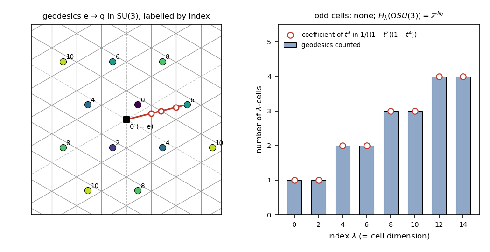

# Chapter 12. Every full turn counts twice: symmetric spaces and Lie groups

*Milnor, "Morse Theory", §20–§21, rewritten for a first-year graduate student who wants to know what
the theorem is for. Every proof is complete. The standard facts of Lie theory that Milnor quotes are
listed in §3, with references, and are used exactly as stated there.*

---

## 0. A ball spinning in space

A perfectly balanced ball floats in space, far from any torque: a rigid body whose three principal
moments of inertia are equal, a *spherical top*. Its configuration is an orientation $R \in SO(3)$.
In how many ways can the ball, moving freely, turn from a prescribed orientation $A$ to a prescribed
orientation $B$ in one second? And how stable is each of these motions?

A spherical top moves freely by turning at constant angular speed about a fixed axis. If $BA^{-1}$ is
the rotation through $\varphi_0$ about the axis $n$, $0 < \varphi_0 < \pi$, the ball can turn through
$\varphi_0$ about $n$, through $2\pi - \varphi_0$ the other way, through $2\pi + \varphi_0$, through
$4\pi - \varphi_0$ the other way, and so on. Each motion is a critical point of the action
$\int_0^1 T\,dt$, $T$ the kinetic energy, and its stability is measured by its Morse index: the
largest number of independent perturbations, with fixed ends and fixed travel time, that lower the
action to second order. We will prove (§6) that the motion turning through the total angle $\varphi$
has index
$$\lambda = 2\left\lfloor \frac{\varphi}{2\pi}\right\rfloor .$$
Each full turn adds $2$ to the index. It never adds $1$.

The pairing is not peculiar to balls. The kinetic energy of a spherical top is a Riemannian metric on
the rotation group unchanged by rotating the body and by rotating the laboratory, a *bi-invariant*
metric, and the free motions are its geodesics. On every Lie group with a bi-invariant metric the
curvature is given by brackets, $R(X,Y)Z = \frac14[[X,Y],Z]$, and the Jacobi equation along a
geodesic has constant coefficients, with coefficient matrix $-\frac14(\operatorname{ad}V)^2$ and
$\operatorname{ad}V$ skew-symmetric. The nonzero eigenvalues of such a matrix come in equal pairs, so
conjugate points have even multiplicity and geodesics have even index. The fundamental theorem of
Chapter 10 (Milnor's 17.3) turns this into Bott's theorem: *the loop space of a compact, simply
connected Lie group has the homotopy type of a CW complex with only even-dimensional cells, finitely
many in each dimension.*

The natural setting is that of *symmetric spaces*, Riemannian manifolds with a reflection through
every point, where Jacobi fields can be written down explicitly (§1–§2); Lie groups are the main
example (§3–§5). In §6 we count the free motions of the ball and their indices, and then do the same
for $SU(3)$, where the indices give the homology of the loop space, free of ranks
$1, 1, 2, 2, 3, 3, 4, 4$ in degrees $0, 2, \dots, 14$, and as a by-product $\pi_2(SU(3)) = 0$ and
$\pi_3(SU(3)) \cong \mathbb Z$.

---

## 1. Symmetric spaces (Milnor pp. 109–110)

$M$ is a Riemannian manifold with its Levi-Civita connection; Milnor writes $X \vdash Y$ for
$\nabla_XY$. We keep his sign for the curvature (Chapter 6, §9),
$$R(X,Y)Z = -\nabla_X\nabla_YZ + \nabla_Y\nabla_XZ + \nabla_{[X,Y]}Z ,$$
so that the Jacobi equation along a geodesic with velocity $V$ is $\frac{D^2J}{dt^2} + R(V,J)V = 0$
(Chapter 9, §14) and $\langle R(X,Y)X,Y\rangle$ is the sectional curvature of an orthonormal pair.
"Complete" means that every geodesic extends to $\mathbb R$; by Hopf–Rinow (Chapter 7, Milnor's 10.9
and 10.10) this is metric completeness, and any two points of a connected complete manifold are
joined by a minimal geodesic.

**Lemma A (isometries).** Let $\varphi : M \to M$ be an isometry. Then
$\varphi_*(\nabla_XY) = \nabla_{\varphi_*X}\varphi_*Y$. Hence $\varphi$ carries geodesics to
geodesics, parallel fields along $c$ to parallel fields along $\varphi\circ c$, Jacobi fields to
Jacobi fields (so conjugate points to conjugate points, with multiplicity), and
$R(\varphi_*X,\varphi_*Y)\varphi_*Z = \varphi_*R(X,Y)Z$.

*Proof.* $\nabla'_XY := \varphi_*^{-1}(\nabla_{\varphi_*X}\varphi_*Y)$ is a connection, symmetric
because $\varphi_*[X,Y] = [\varphi_*X,\varphi_*Y]$ and compatible with the metric because $\varphi$
preserves inner products. By uniqueness (Milnor's 8.6) $\nabla' = \nabla$; everything else is defined
from $\nabla$. $\square$

**Definition (Milnor).** A *symmetric space* is a connected Riemannian manifold $M$ such that for each
$p \in M$ there is an isometry $I_p : M \to M$ which leaves $p$ fixed and reverses geodesics through
$p$: if $\gamma$ is a geodesic with $\gamma(0) = p$ then $I_p(\gamma(t)) = \gamma(-t)$.

The domain of $\gamma$ is not specified; we read the condition as "whenever both sides are defined".
This costs nothing:

**Lemma B (reflections extend geodesics).** Let $M$ be a symmetric space and $p \in M$.
(a) $(dI_p)_p = -\mathrm{id}$. Conversely, an isometry $I$ with $I(p) = p$ and $dI_p = -\mathrm{id}$
reverses all geodesics through $p$.
(b) A geodesic $\gamma : J \to M$ with $0 \in J$, $\gamma(0) = p$, extends to a geodesic on
$J\cup(-J)$, on which $I_p(\gamma(t)) = \gamma(-t)$.
(c) Every geodesic is defined on all of $\mathbb R$.

*Proof.* (a) Differentiate $I_p(\gamma_v(t)) = \gamma_v(-t)$ at $t = 0$, $\gamma_v$ the geodesic with
initial velocity $v$ (Milnor's 10.1). Conversely, $I\circ\gamma$ (on $J$) and $t \mapsto \gamma(-t)$
(on $-J$) are geodesics with the same initial point and velocity $-\gamma'(0)$, so they agree on
$J\cap(-J)$. (b) Put $\hat\gamma = \gamma$ on $J$ and $\hat\gamma(t) = I_p(\gamma(-t))$ on $-J$. By
(a) the two agree on $J\cap(-J)$, so $\hat\gamma$ is a geodesic on $J\cup(-J)$; then
$I_p\circ\hat\gamma$ and $t\mapsto\hat\gamma(-t)$ are geodesics on this symmetric interval with the
same initial data, hence equal. (c) Let $\gamma : (\alpha,\beta) \to M$ admit no extension and let
$s \in (\alpha,\beta)$. Applying (b) at $\gamma(s)$ to $t \mapsto \gamma(s+t)$, defined on
$J = (\alpha-s,\beta-s)$ and admitting no extension, gives $-J \subseteq J$. With $\alpha, \beta$
finite this forces $s = (\alpha+\beta)/2$ for every $s$; with one of them finite it is false. So
$(\alpha,\beta) = \mathbb R$. $\square$

*Examples.* $\mathbb R^n$ with $I_p(x) = 2p - x$. The unit sphere $S^n$ with
$I_p(x) = 2\langle x,p\rangle p - x$, the reflection in the line $\mathbb Rp$, which is $-\mathrm{id}$
on $TS^n_p = p^\perp$ (Lemma B(a)). Flat tori. Lie groups with bi-invariant metrics (§3).

**Lemma 20.1.** Let $\gamma$ be a geodesic in a symmetric space, $p = \gamma(0)$, $q = \gamma(c)$.
Then $I_qI_p(\gamma(t)) = \gamma(t+2c)$. Moreover, if $V$ is a parallel field along $\gamma$ then
$(I_qI_p)_*V(t) = V(t+2c)$.

(Milnor assumes "$\gamma(t)$ and $\gamma(t+2c)$ are defined"; his proof also uses $\gamma(-t)$. By
Lemma B(c) everything is defined.)

*Proof.* With $\beta(s) = \gamma(s+c)$ and Lemma B(b) at $p$ and at $q$:
$I_qI_p(\gamma(t)) = I_q(\beta(-t-c)) = \beta(t+c) = \gamma(t+2c)$. For parallel $V$, the fields
$t \mapsto I_{p*}V(t)$ and $t \mapsto -V(-t)$ are both parallel along $t \mapsto \gamma(-t)$ (Lemma
A, and $\frac{D}{dt}[V(-t)] = -\frac{DV}{dt}(-t)$), and both equal $-V(0)$ at $t = 0$; so
$I_{p*}V(t) = -V(-t)$ (Milnor's 8.2). Likewise $I_{q*}V(c+s) = -V(c-s)$, and
$I_{q*}I_{p*}V(t) = -I_{q*}V(c+(-t-c)) = V(t+2c)$. $\square$

**Corollary 20.2.** A symmetric space is complete. (This is Lemma B(c). Milnor's "20.1 shows that
geodesics can be indefinitely extended" is the same idea: $I_qI_p$ slides $\gamma$ along itself.)

**Corollary 20.3.** $I_p$ is unique.

*Proof.* If $I, I'$ both qualify and $x \in M$, join $p$ to $x$ by a geodesic $\gamma$,
$\gamma(1) = x$ (Hopf–Rinow; $M$ is connected and complete). Then $I(x) = \gamma(-1) = I'(x)$.
$\square$

**Corollary 20.4.** If $U, V, W$ are parallel along a geodesic $\gamma$, so is $R(U,V)W$.

*Proof.* Let $X$ be parallel, $p = \gamma(0)$, $c \in \mathbb R$, and $T = I_{\gamma(c/2)}I_p$. By
20.1, $T(\gamma(t)) = \gamma(t+c)$ and $T_*Y(t) = Y(t+c)$ for parallel $Y$; by Lemma A,
$$\langle R(U,V)W,X\rangle(c) = \langle R(T_*U(0),T_*V(0))T_*W(0),T_*X(0)\rangle =
\langle R(U,V)W,X\rangle(0).$$
Taking for $X$ a parallel frame $E_1,\dots,E_n$, orthonormal everywhere (Milnor's 8.3), the
coefficients of $R(U,V)W = \sum_i\langle R(U,V)W,E_i\rangle E_i$ are constant, which is the step
Milnor calls clear. $\square$

**Definition.** A Riemannian manifold, not necessarily complete, is *locally symmetric* if the
conclusion of 20.4 holds along every geodesic. Since $\frac{D}{dt}(R(U,V)W) = (\nabla_{\gamma'}R)
(U,V)W$ for parallel $U,V,W$, and any vectors at a point extend to parallel fields along a geodesic
with any given velocity, this is the usual condition $\nabla R = 0$.

Milnor quotes, and we never use: *(É. Cartan) a complete, simply connected, locally symmetric
manifold is symmetric* (Helgason, *Differential Geometry, Lie Groups, and Symmetric Spaces*, 1978,
Ch. IV; Cheeger–Ebin, *Comparison Theorems in Riemannian Geometry*, 1975, Ch. 1).

---

## 2. Jacobi fields in a locally symmetric manifold (Milnor pp. 110–111)

Let $\gamma$ be a geodesic in a locally symmetric $n$-manifold, defined on an open interval
$J \ni 0$, with $p = \gamma(0)$, $V = \gamma'(0)$. Define
$$K_V : TM_p \to TM_p, \qquad K_V(W) = R(V,W)V ,$$
(not to be confused with the Ricci tensor $K$ of Chapter 11; $K(V,V) = \operatorname{trace}K_V$), and
let $e_1,\dots,e_n$ be its eigenvalues, with multiplicity.

**Theorem 20.5.** For $t_0 \in J\setminus\{0\}$, the parameters $0$ and $t_0$ are conjugate along
$\gamma$ iff $t_0 = \pi k/\sqrt{e_i}$ for some $e_i > 0$ and some integer $k \neq 0$. The
multiplicity of $\gamma(t_0)$ as a conjugate point is the number of $i$ with $e_i > 0$ and $t_0$ an
integer multiple of $\pi/\sqrt{e_i}$.

*Proof.* By Milnor's Lemma 9.3(4), $\langle R(X,Y)Z,T\rangle = \langle R(Z,T)X,Y\rangle$, so
$\langle K_VW,W'\rangle = \langle R(V,W')V,W\rangle = \langle W,K_VW'\rangle$: $K_V$ is
self-adjoint, and $TM_p$ has an orthonormal basis $U_1,\dots,U_n$ with $K_VU_i = e_iU_i$. Extend the
$U_i$ to parallel fields along $\gamma$. By local symmetry $R(\gamma',U_i)\gamma'$ is parallel, as is
$e_iU_i$, and they agree at $t = 0$; so $R(\gamma',U_i)\gamma' = e_iU_i$ along $\gamma$. Any field
along $\gamma$ is uniquely $W = \sum_iw_iU_i$ with $w_i = \langle W,U_i\rangle$ smooth; then
$\frac{D^2W}{dt^2} = \sum_iw_i''U_i$ and $R(\gamma',W)\gamma' = \sum_ie_iw_iU_i$, so the Jacobi
equation is equivalent to
$$w_i'' + e_iw_i = 0, \qquad i = 1,\dots,n .$$
The solution with $w_i(0) = 0$, $w_i'(0) = c_i$ is $c_is_i$, where $s_i(t) =
\sin(\sqrt{e_i}\,t)/\sqrt{e_i}$ if $e_i > 0$, $s_i(t) = t$ if $e_i = 0$, $s_i(t) =
\sinh(\sqrt{|e_i|}\,t)/\sqrt{|e_i|}$ if $e_i < 0$. So the Jacobi fields vanishing at $0$ are the
$\sum_ic_is_iU_i$, $c \in \mathbb R^n$. Such a field vanishes at $t_0 \neq 0$ iff $c_is_i(t_0) = 0$
for all $i$; $s_i(t_0) \neq 0$ when $e_i \le 0$, and when $e_i > 0$, $s_i(t_0) = 0$ iff
$\sqrt{e_i}\,t_0 \in \pi\mathbb Z$. Hence the Jacobi fields vanishing at $0$ and $t_0$ form a space
whose dimension is the number in the statement; by definition (Chapter 9, §14) this is the
multiplicity. $\square$

*Remarks.* $K_VV = 0$, with Jacobi field $t\gamma'(t)$ (Milnor's 14.2). $K_{aV} = a^2K_V$, as
reparametrization requires. The statement concerns parameter values, not points (Milnor's footnote
on p. 77), and holds on any interval $J$, which matters when $M$ is not complete; Milnor writes
$\gamma : \mathbb R \to M$.

---

## 3. Lie groups with a bi-invariant metric (Milnor pp. 112–113)

$G$ is a Lie group with identity $e$, $L_\tau(\sigma) = \tau\sigma$, $R_\tau(\sigma) = \sigma\tau$
(the subscript distinguishes $R_\tau$ from the curvature). We quote these standard facts (Chevalley,
*Theory of Lie Groups*, 1946; Warner, *Foundations of Differentiable Manifolds and Lie Groups*, 1983,
Ch. 3; Bröcker–tom Dieck, *Representations of Compact Lie Groups*, 1985, Ch. I).

(L1) A vector field $X$ is *left invariant* if $(L_a)_*X_b = X_{ab}$ for all $a, b$. Left-invariant
fields are smooth, $X \mapsto X_e$ identifies the space $\mathfrak g$ of them with $TG_e$, and the
bracket of left-invariant fields is left invariant. With the Jacobi identity
$[[X,Y],Z] + [[Y,Z],X] + [[Z,X],Y] = 0$, valid for all vector fields, $\mathfrak g$ is a Lie
algebra, the *Lie algebra of $G$*. We write $\operatorname{ad}X(Y) = [X,Y]$.

(L2) A *one-parameter subgroup* is a smooth homomorphism $\theta : \mathbb R \to G$. If
$\theta'(0) = X_e$, then $t \mapsto \sigma\theta(t)$ is the integral curve of $X$ through $\sigma$,
since $\frac{d}{dt}\sigma\theta(t) = \frac{d}{ds}|_{s=0}\,\sigma\theta(t)\theta(s) =
(L_{\sigma\theta(t)})_*X_e$. By uniqueness of integral curves, *two one-parameter subgroups with the
same tangent vector at $0$ coincide*. Each $X$ has one, written $t \mapsto \exp(tX)$; for a group of
matrices it is $e^{tX}$. If $[X,Y] = 0$ then $\exp X$ and $\exp Y$ commute and
$\exp(X+Y) = \exp X\exp Y$.

(L3) A compact Lie group has a Borel probability measure $\mu$ (Haar measure) invariant under all
$L_\tau$ and $R_\tau$. (A left-invariant volume form $\omega$ satisfies $R_a^*\omega =
\Delta(a)\omega$ with $\Delta : G \to \mathbb R^\times$ a continuous homomorphism; its compact image
lies in $\{\pm1\}$; normalize $|\omega|$.)

(L4) (i) If $G$ is simply connected and $\mathfrak g = \mathfrak g_1\oplus\mathfrak g_2$ with
$\mathfrak g_i$ ideals, there are simply connected Lie groups $G_i$ with Lie algebras $\mathfrak g_i$
and an isomorphism $G_1\times G_2 \to G$ whose differential at $e$ is the sum of the inclusions
(simply connected groups with isomorphic Lie algebras are isomorphic). (ii) A connected, simply
connected, abelian $k$-dimensional Lie group is isomorphic to $(\mathbb R^k,+)$.

(L5) (É. Cartan) A closed subgroup of a Lie group is an embedded Lie subgroup. A compact connected
abelian Lie group $A$ of dimension $m$ is a torus: $\exp : \mathfrak a \to A$ is a surjective
homomorphism whose kernel is a lattice of rank $m$.

A metric on $G$ is *bi-invariant* if all $L_\tau$ and $R_\tau$ are isometries. Any inner product on
$TG_e$ gives a left-invariant metric $\langle u,v\rangle_\sigma = \langle(L_{\sigma^{-1}})_*u,
(L_{\sigma^{-1}})_*v\rangle_e$; if $G$ is commutative, $L_\tau = R_\tau$ and it is bi-invariant. If
$G$ is compact, Milnor averages:

**Lemma C.** Let $G$ be compact, $\langle\,,\rangle$ any Riemannian metric, $\mu$ the Haar measure.
Then $\langle\!\langle V,W\rangle\!\rangle = \int_{G\times G}\langle(L_\sigma)_*(R_\tau)_*V,
(L_\sigma)_*(R_\tau)_*W\rangle\,d\mu(\sigma)\,d\mu(\tau)$ is a bi-invariant Riemannian metric.

*Proof.* For $V, W \in TG_x$ the integrand $F_{V,W}(\sigma,\tau)$ is continuous on the compact
$G\times G$; in a chart it depends smoothly on $x$ and on $V, W$, so differentiation under the
integral sign gives smoothness. For $V \neq 0$, $F_{V,V}$ has a positive minimum, so the integral is
positive. Since $L_\sigma R_\tau L_a = L_{\sigma a}R_\tau$ and $L_\sigma R_\tau R_a = L_\sigma
R_{a\tau}$, we have $F_{(L_a)_*V,(L_a)_*W}(\sigma,\tau) = F_{V,W}(\sigma a,\tau)$ and
$F_{(R_a)_*V,(R_a)_*W}(\sigma,\tau) = F_{V,W}(\sigma,a\tau)$, and the invariance of $\mu$ gives the
invariance of the integral. $\square$

*A practical test.* Let $\operatorname{Ad}(\tau) = d(c_\tau)_e$, $c_\tau(\sigma) = \tau\sigma
\tau^{-1}$. Since $R_\tau L_\sigma = L_{\sigma\tau}c_{\tau^{-1}}$, a left-invariant metric is
bi-invariant iff $\langle\,,\rangle_e$ is $\operatorname{Ad}$-invariant. For matrix groups
$\operatorname{Ad}(\tau)X = \tau X\tau^{-1}$, so $\langle X,Y\rangle = -\operatorname{trace}(XY)$ is a
bi-invariant metric on $SU(n)$.

**Lemma 21.1.** If $G$ has a bi-invariant metric, then for every $\tau$ the map
$I_\tau(\sigma) = \tau\sigma^{-1}\tau$ is an isometry fixing $\tau$ and reversing geodesics through
$\tau$. If $G$ is connected, it is a symmetric space.

*Proof.* $I_e(\sigma) = \sigma^{-1}$ is a diffeomorphism. Differentiating $\sigma I_e(\sigma) = e$ at
$e$, where multiplication has differential $(u,w) \mapsto u + w$, gives $(dI_e)_e = -\mathrm{id}$. The
identity $I_e = R_{\sigma^{-1}}I_eL_{\sigma^{-1}}$ (indeed $(\sigma^{-1}x)^{-1}\sigma^{-1} = x^{-1}$),
differentiated at $\sigma$, writes $(dI_e)_\sigma$ as the composite of $(L_{\sigma^{-1}})_*$,
$(dI_e)_e$ and $(R_{\sigma^{-1}})_*$, each preserving inner products. So $I_e$ is an isometry with
$(dI_e)_e = -\mathrm{id}$, and it reverses geodesics through $e$ by the converse in Lemma B(a), which
uses only that $I_e$ is an isometry. Finally $I_\tau = R_\tau I_eR_\tau^{-1}$, since
$(\sigma\tau^{-1})^{-1}\tau = \tau\sigma^{-1}\tau$, an isometry fixing $\tau$ with
$(dI_\tau)_\tau = -\mathrm{id}$. $\square$

> **A hidden hypothesis.** "Symmetric space" includes connectedness, so 21.1 needs $G$ connected.
> For disconnected $G$, each component is a translate of the identity component $G_0$, which is
> symmetric, hence complete (20.2); so geodesics of $G$ are defined on $\mathbb R$, and 21.2 and 21.3
> below hold verbatim. Connectedness becomes essential in 21.5.

**Lemma 21.2.** The geodesics $\gamma : \mathbb R \to G$ with $\gamma(0) = e$ are precisely the
one-parameter subgroups of $G$.

*Proof.* Let $\gamma$ be such a geodesic; it lies in the symmetric space $G_0$. By 20.1 with
$p = e$, $q = \gamma(t)$, the map $I_{\gamma(t)}I_e : \sigma \mapsto \gamma(t)\sigma\gamma(t)$ takes
$\gamma(u)$ to $\gamma(u+2t)$:
$$\gamma(t)\gamma(u)\gamma(t) = \gamma(u+2t)\qquad\text{for all } t, u. \tag{*}$$
With $u = -t$: $\gamma(-t) = \gamma(t)^{-1}$. With $u = (n-1)t$: $\gamma((n+1)t) =
\gamma(t)\gamma((n-1)t)\gamma(t)$, so by induction $\gamma(nt) = \gamma(t)^n$ for $n \ge 0$, hence for
all $n \in \mathbb Z$. If $t'' \neq 0$ and $t'/t'' = a/b$ ($a, b \in \mathbb Z$, $b > 0$), put
$t = t''/b$: then $\gamma(t'+t'') = \gamma(t)^{a+b} = \gamma(t')\gamma(t'')$. For fixed $t''$ such
$t'$ are dense and both sides are continuous in $t'$, so $\gamma$ is a homomorphism. Conversely, if
$\theta$ is a one-parameter subgroup and $\gamma$ the geodesic with $\gamma'(0) = \theta'(0)$, then
$\gamma$ is a one-parameter subgroup, so $\gamma = \theta$ by (L2). $\square$

*Consequences.* (i) The Lie-theoretic $\exp$ is the Riemannian $\exp_e$ (Milnor's footnote on p. 57).
(ii) The geodesics through $\sigma$ are $t \mapsto \sigma\exp(tX) = \exp(tY)\sigma$,
$Y = \operatorname{Ad}(\sigma)X$, since $L_\sigma$ and $R_\sigma$ are isometries. (iii) If $G$ is
connected, every element is $\exp X$ for some $X$ (Hopf–Rinow).

Milnor then defines left-invariant fields and the Lie algebra $\mathfrak g$, as in (L1).

---

## 4. The curvature of a bi-invariant metric (Milnor pp. 113–115)

**Theorem 21.3.** Let $G$ have a bi-invariant metric and let $X, Y, Z, W \in \mathfrak g$. Then
(a) $\langle[X,Y],Z\rangle = \langle X,[Y,Z]\rangle$; (b) $R(X,Y)Z = \frac14[[X,Y],Z]$;
(c) $\langle R(X,Y)Z,W\rangle = \frac14\langle[X,Y],[Z,W]\rangle$; and (d) $\nabla_XY =
\frac12[X,Y]$.

(Milnor states (a)–(c); (d) is proved, with that label, inside his proof.)

*Proof.* *$\nabla_XX = 0$.* For $\sigma \in G$, $c(t) = \sigma\exp(tX)$ is the integral curve of $X$
through $\sigma$ (L2) and a geodesic (21.2 and the isometry $L_\sigma$). So
$0 = \frac{D}{dt}c' = \frac{D}{dt}(X\circ c) = (\nabla_XX)(c(t))$ by Milnor's 8.1(c); take $t = 0$.

*(d).* By the above applied to $X$, $Y$, $X+Y$: $\nabla_XY + \nabla_YX = 0$. Symmetry of the
connection (Milnor's 8.5): $\nabla_XY - \nabla_YX = [X,Y]$. Add.

*(a).* $\langle X,Z\rangle_\sigma = \langle X_e,Z_e\rangle$ is constant, so by Milnor's 8.4 and (d),
$0 = Y\langle X,Z\rangle = \frac12\langle[Y,X],Z\rangle + \frac12\langle X,[Y,Z]\rangle$.

*(b).* Brackets of left-invariant fields are left invariant, so by (d)
$$R(X,Y)Z = -\nabla_X\nabla_YZ + \nabla_Y\nabla_XZ + \nabla_{[X,Y]}Z = -\tfrac14[X,[Y,Z]] +
\tfrac14[Y,[X,Z]] + \tfrac12[[X,Y],Z] ,$$
and by the Jacobi identity $[X,[Y,Z]] - [Y,[X,Z]] = -[Z,[X,Y]] = [[X,Y],Z]$, so
$R(X,Y)Z = \frac14[[X,Y],Z]$.

*(c).* By (b), then (a) for the triple $[X,Y], Z, W$. $\square$

Since $R$ is a tensor (Milnor's 9.1) and every vector is the value of a left-invariant field, this
determines $R$ everywhere. *Milnor's footnote:* by (a), $\omega(X,Y,Z) = \langle[X,Y],Z\rangle$
changes sign under $X\leftrightarrow Y$ and under $Y \leftrightarrow Z$
($\langle X,[Y,Z]\rangle = -\langle[X,Z],Y\rangle$), so it is alternating, a left-invariant $3$-form;
Cartan used it to show $H^3(G;\mathbb R) \neq 0$ for compact connected non-abelian $G$ (*La topologie
des espaces représentatifs des groupes de Lie*, 1936). Quoted, not used.

**Corollary 21.4.** The sectional curvature $\langle R(X,Y)X,Y\rangle = \frac14\langle[X,Y],[X,Y]
\rangle$ is always $\ge 0$, with equality iff $[X,Y] = 0$. (Take $Z = X$, $W = Y$ in (c).)

For a unit $X$ and an orthonormal basis $X_1,\dots,X_n$ of $\mathfrak g$, the Ricci curvature is
therefore
$$K(X,X) = \sum_i\langle R(X,X_i)X,X_i\rangle = \tfrac14\sum_i|[X,X_i]|^2 =
-\tfrac14\operatorname{trace}(\operatorname{ad}X)^2 ,$$
using that $\operatorname{ad}X$ is skew-symmetric by (a): $-\frac14$ times the Killing form. The
*centre* $\mathfrak c$ of $\mathfrak g$ is the set of $X$ with $[X,Y] = 0$ for all $Y$.

**Corollary 21.5.** If $G$ is connected, has a bi-invariant metric, and $\mathfrak g$ has trivial
centre, then $G$ is compact with finite fundamental group.

> **A hidden hypothesis.** Milnor omits "connected", which cannot be dropped: $SO(3)\times\mathbb Z$
> ($\mathbb Z$ discrete) has Lie algebra $\mathfrak{so}(3)$, with trivial centre, and a bi-invariant
> metric, but is not compact.

*Proof.* If $\dim G = 0$, $G = \{e\}$. A one-dimensional Lie algebra is its own centre, so
$n = \dim G \ge 2$. For a unit $X$ some $[X,X_i] \neq 0$, since otherwise $X$ would be central; so
$K(X,X) > 0$, and by compactness of the unit sphere $K(X,X) \ge \kappa = (n-1)/r^2 > 0$, at every
point by left invariance. $G$ is symmetric (21.1), hence complete (20.2), so Myers' theorem
(Milnor's 19.5, Chapter 11) makes $G$ compact, of diameter $\le \pi r$. The universal covering
$\tilde G$, with the pulled-back metric, has the same Ricci bound and is complete (geodesics project,
extend, and lift back), so it is compact too; the fibre over $e$ is closed and discrete in
$\tilde G$, hence finite, and its cardinality is $|\pi_1(G)|$. $\square$

**Corollary 21.6.** A simply connected Lie group $G$ with a bi-invariant metric splits as a product
$G'\times\mathbb R^k$, where $G'$ is compact with Lie algebra of trivial centre and $\mathbb R^k$ is a
vector group. Conversely, any such product has a bi-invariant metric.

*Proof.* Let $\mathfrak g'$ be the orthogonal complement of the centre $\mathfrak c$. For
$X \in \mathfrak g'$, $Y \in \mathfrak g$, $C \in \mathfrak c$, by 21.3(a)
$\langle[X,Y],C\rangle = \langle X,[Y,C]\rangle = 0$, so $[X,Y] \in \mathfrak g'$. (Milnor takes
$Y \in \mathfrak g'$, showing $\mathfrak g'$ is a subalgebra; the same line shows it is an ideal.) As
$[\mathfrak g',\mathfrak c] = 0$, $\mathfrak g = \mathfrak g'\oplus\mathfrak c$ is a direct sum of
ideals, and (L4)(i) gives $G \cong G'\times G''$ with $G', G''$ simply connected with Lie algebras
$\mathfrak g'$, $\mathfrak c$. $G''$ is abelian (a connected group is generated by exponentials,
which commute here), so $G'' \cong \mathbb R^k$ by (L4)(ii). The metric of $G$ restricts to a
bi-invariant metric on the closed subgroup $G' = G'\times\{e\}$. The centre of $\mathfrak g'$ is
trivial: an element commuting with $\mathfrak g'$ also commutes with $\mathfrak c$, so lies in
$\mathfrak c\cap\mathfrak g' = 0$. By 21.5, $G'$ is compact. Conversely, Lemma C on $G'$, any inner
product on $\mathbb R^k$, and the product metric. $\square$

> **Milnor's text skips** the Lie theory behind "Hence $G$ splits as a Cartesian product": an ideal
> decomposition of $\mathfrak g$ integrates to a product decomposition of a simply connected group, and
> simply connected abelian groups are vector groups. These are (L4); he refers to Chevalley.

---

## 5. Bott's theorem: only even cells (Milnor pp. 116–117)

$\Omega(M;p,q)$ is Milnor's space of piecewise smooth paths, $\Omega^*(M;p,q)$ the space of continuous
paths (compact-open topology), and $\Omega \to \Omega^*$ is a homotopy equivalence (Theorem 17.1,
Chapter 10). The loop space $\Omega(G)$ is $\Omega(G;e,e)$. Milnor works with other endpoints, so:

**Lemma D (endpoints do not matter).** If $X$ is path connected, $\Omega^*(X;p,q) \simeq
\Omega^*(X;p',q')$.

*Proof.* Move one endpoint at a time. For a path $\beta$ from $q$ to $q'$ put $\Phi(\omega) =
\omega\cdot\beta$ and $\Psi(\omega') = \omega'\cdot\bar\beta$. The standard homotopies proving that
$\pi_1$ is a group (Hatcher, *Algebraic Topology*, §1.1) give $\Psi\Phi(\omega) \simeq \omega$ and
$\Phi\Psi(\omega') \simeq \omega'$ by formulas continuous in $\omega$, $\omega'$. Starting points are
moved by precomposing with a path. $\square$

**Theorem 21.7 (Bott).** Let $G$ be a compact, simply connected Lie group. Then $\Omega(G)$ has the
homotopy type of a CW complex with no odd-dimensional cells and only finitely many $\lambda$-cells for
each even $\lambda$. Thus $H_\lambda(\Omega(G);\mathbb Z)$ is zero for $\lambda$ odd and free abelian
of finite rank for $\lambda$ even.

*Proof.* Give $G$ a bi-invariant metric (Lemma C). If $\dim G = 0$, $\Omega(G)$ is a point; let
$n = \dim G \ge 1$.

*Step 1: trivial centre.* By 21.6, $G \cong G'\times\mathbb R^k$; $G$ is compact, so $k = 0$ and
$\mathfrak g$ has trivial centre. As in 21.5 there is $\kappa > 0$ with
$$\|\operatorname{ad}X\|^2 := \sum_i|[X,X_i]|^2 \ge 4\kappa|X|^2 \qquad (X \in \mathfrak g).
\tag{1}$$

*Step 2: the Morse complex.* Choose $p, q$ not conjugate along any geodesic (Milnor's 18.2,
Chapter 11, which rests on Sard's theorem, proved in Chapter 3 of the companion volume, *Topology from
the Differentiable Viewpoint*, rewritten). By 17.3, $\Omega(G;p,q)$ has the homotopy type of a CW
complex with one $\lambda$-cell for each geodesic from $p$ to $q$ of index $\lambda$.

*Step 3: every index is even.* Let $\gamma$ be a geodesic from $p$ with velocity $V$. The isometry
$L_{p^{-1}}$ takes it to $\gamma_0(t) = \exp(tV_0)$, $V_0 = (L_{p^{-1}})_*V \in \mathfrak g$, with the
same conjugate points (Lemma A). $G$ is locally symmetric (21.1, 20.4), and by 21.3(b)
$$K_{V_0}(W) = \tfrac14[[V_0,W],V_0] = -\tfrac14(\operatorname{ad}V_0)^2W .$$
$A = \operatorname{ad}V_0$ is skew-symmetric by 21.3(a). Milnor uses its normal form without proof:

> *There is an orthonormal basis in which $A$ is block diagonal, with blocks
> $\begin{pmatrix}0 & a_j\\-a_j & 0\end{pmatrix}$, $a_j > 0$ ($j = 1,\dots,s$), and zeros.* Indeed
> $A^2$ is symmetric with $\langle A^2w,w\rangle = -|Aw|^2$, so $\mathfrak g$ is the orthogonal sum
> of its eigenspaces, each $A$-invariant, with eigenvalues $-a^2 \le 0$. On the eigenvalue $0$,
> $A = 0$. On $-a^2 < 0$, a unit $w$ gives the orthonormal pair $(w,-Aw/a)$ spanning an $A$-invariant
> plane with the displayed matrix; its orthogonal complement in the eigenspace is $A$-invariant
> ($A$ is skew); induct.

So $K_{V_0}$ has eigenvalues $a_1^2/4, a_1^2/4, \dots, a_s^2/4, a_s^2/4$ and $0$: *the nonzero
eigenvalues are positive and occur in pairs.* By 20.5 the conjugate points are at $t = 2\pi m/a_j$,
$m \ge 1$, with multiplicity $2\,\#\{j : ta_j \in 2\pi\mathbb Z\}$, and the index theorem (Milnor's
15.1, Chapter 9) gives *Bott's formula*
$$\lambda(\gamma) = 2\sum_{j=1}^s\#\{m \ge 1 : 2\pi m < a_j\} , \tag{2}$$
an even number.

*Step 4: finitely many cells in each dimension.* $\|\operatorname{ad}V_0\|^2 =
\operatorname{trace}(A^{\mathsf T}A) = 2\sum_ja_j^2$, so by (1), with $L = |V|$ the length of
$\gamma$, $2\sum_ja_j^2 \ge 4\kappa L^2$. If $L > 0$ then $s \ge 1$, and as $s \le n/2$,
$a_{\max}^2 \ge 2\kappa L^2/s \ge 4\kappa L^2/n$; by (2)
$$\lambda(\gamma) \ge 2\Big(\frac{a_{\max}}{2\pi} - 1\Big) \ge \frac{2L}{\pi}\sqrt{\frac\kappa n} - 2.$$
So a geodesic of index $\le \lambda$ has length $\le L_\lambda = \frac\pi2(\lambda+2)\sqrt{n/\kappa}$,
and there are only finitely many such geodesics from $p$ to $q$ (Theorem 16.3, Chapter 10).

*Step 5.* So $\Omega(G;p,q)$, and by 17.1 and Lemma D also $\Omega(G)$, has the homotopy type of a CW
complex with only even cells, finitely many in each dimension. Every cellular boundary map goes
between an even and an odd degree, one of which has no cells, so all vanish, and $H_\lambda$ is free
on the $\lambda$-cells. $\square$

> **Milnor's text skips** two points. (i) "By §19.4 there are only finitely many $\lambda$-cells":
> that argument (19.4 and the proof of 19.6, Chapter 11) needs Ricci curvature bounded below by a
> positive constant, i.e. trivial centre, which holds only because $G$ is compact *and simply
> connected* (21.6). For the compact group $SO(2)$ the centre is everything and the Ricci curvature
> vanishes. Step 4 is the same estimate written with (2). (ii) Theorem 17.3 concerns
> $\Omega(G;p,q)$; the passage to the loop space is Lemma D with 17.1.

*Remark 1 (Milnor).* The complex is always infinite dimensional, *unless $G = \{e\}$* (an exception
missing in the text). For $G = S^3$, $H_i\Omega(S^3) \cong \mathbb Z$ for all even $i$ (Corollary
17.4). In general, if $\dim G \ge 1$, take $p = e$ and $q \neq e$ not conjugate to $e$ along any
geodesic (18.2); then $q = \exp X$, $X \neq 0$ (Consequence (iii) of 21.2). The closure $A$ of
$\{\exp(tX)\}$ is a closed, connected, abelian subgroup of $G$, of positive dimension, hence by (L5) a
torus whose exponential has a kernel containing some $Y \neq 0$, and $X$ lies in its Lie algebra. So $\exp(X+jY) = q$ for all
$j \in \mathbb Z$: infinitely many geodesics from $e$ to $q$, with unbounded indices since only
finitely many have index $\le \lambda$ (Step 4). By Step 5, $H_\lambda(\Omega(G)) \neq 0$ for
infinitely many $\lambda$; so the complex is infinite dimensional whatever $p$ and $q$ are chosen in
Step 2.

*Remark 2 (Milnor).* The theorem holds for non-compact $G$ *provided $G$ is connected and simply
connected* (implicit in the text). By Iwasawa (*On some types of topological groups*, Ann. of Math. 50
(1949), Theorem 6), a connected Lie group $G$ contains a compact subgroup $K$ as a deformation retract
($G$ is homeomorphic to $K\times\mathbb R^m$, with $K$ corresponding to $K\times\{0\}$). Then $K$ is
connected, $\pi_1(K) = \pi_1(G) = 0$, and $\Omega(G) \simeq \Omega(K)$, to which 21.7 applies.

### An interactive look at the geodesics of SU(3)

The picture is the plane $\mathfrak t$ of diagonal matrices $\operatorname{diag}(i\theta_1,i\theta_2,
i\theta_3)$, $\sum\theta_j = 0$, in $\mathfrak{su}(3)$, drawn isometrically for
$-\operatorname{trace}(XY)$; the black square is $0$. Each dot is an $X$ with $\exp X = q$ for a fixed
regular $q$ in the diagonal torus; by §6.2 these give all the geodesics $t \mapsto \exp(tX)$ from $e$
to $q$. The grey lines are the *walls* $\theta_j - \theta_k \in 2\pi\mathbb Z$. By Bott's formula (2),
the segment from $0$ to $X$ crosses a wall exactly at a conjugate point of multiplicity $2$, so the
label of each dot, its index, is twice the number of walls crossed (the dashed walls through $0$ are
never crossed). Tap a dot to draw its segment and mark its conjugate points. Drag the picture to move
$q$: the dots and their indices change, but the table of how many geodesics have each index stays
$1, 1, 2, 2, 3, 3, \dots$, with no odd index. If $q$ is dragged onto a wall, every dot lies on a wall:
$q$ is conjugate to $e$ and Theorem 17.3 no longer applies. The slider limits the indices shown.

*(In the printed version this figure is a still image; the interactive version is in the web
edition.)*

---

## 6. Application: the spinning ball, and the loops of SU(3)

### 6.1 Free motions of a spherical top

For a motion $R(t) \in SO(3)$ the angular velocities in the space and body frames,
$\Omega_s = \dot RR^{-1}$ and $\Omega_b = R^{-1}\dot R$, are conjugate, so have equal length, and the
kinetic energy of a spherical top with moment of inertia $I$ is $T = \frac I4\operatorname{trace}
(\Omega_b^{\mathsf T}\Omega_b)$. Rotating the laboratory ($R \mapsto R_1R$) fixes $\Omega_b$ and
rotating the body ($R \mapsto RR_1$) fixes $\Omega_s$: $T$ is a bi-invariant metric. Free motions are
the critical points of $\int_0^1T\,dt$, i.e. geodesics (Milnor's 12.3, Chapter 8), and by 21.2 and
Consequence (ii) they are $R(t) = \exp(t\Omega)R(0)$, uniform rotation about a fixed axis, as
conservation of angular momentum predicts.

To compute indices, use the double covering $\rho : SU(2) \to SO(3)$. Here $SU(2)$ is the unit sphere
$S^3$ of the quaternions, with Lie algebra $\operatorname{Im}\mathbb H = \mathbb R^3$, $\rho(q)$ is
$x \mapsto qxq^{-1}$ on $\operatorname{Im}\mathbb H$, and $\rho(\cos\frac\varphi2 +
u\sin\frac\varphi2)$ is the rotation through $\varphi$ about the unit vector $u$. The round metric of
$S^3$ is bi-invariant ($|axb| = |x|$ for unit $a, b$), and $\rho$ is a local isometry for the metric it
induces on $SO(3)$. Bott's formula involves only the eigenvalues of $\operatorname{ad}$, so the indices
do not depend on which bi-invariant metric is used. For imaginary quaternions $uv = -u\cdot v +
u\times v$, so $[u,v] = 2u\times v$, and for $V = \theta u$ ($|u| = 1$) $\operatorname{ad}V$ is zero on
$u$ and $2\theta$ times a quarter-turn on $u^\perp$: one block, $a_1 = 2\theta$. The geodesic
$\exp(tV) = \cos t\theta + u\sin t\theta$ projects to the rotation through $\varphi = 2\theta$ about
$u$ in unit time, and (2) gives
$$\lambda = 2\,\#\{m \ge 1 : 2\pi m < \varphi\} = 2\left\lfloor\frac{\varphi}{2\pi}\right\rfloor\qquad
(\varphi \notin 2\pi\mathbb Z),$$
as announced in §0. The conjugate points come when the ball has completed whole turns, and their
multiplicity $2$ is visible: a rotation through exactly $2\pi$ about *any* axis returns the ball to its
starting orientation, so tilting the axis in two independent directions gives free motions that leave
and return together, whose variation fields are two independent Jacobi fields vanishing at both ends.

*Numbers.* Let $A = 1$ and let $B$ be the rotation through $90^\circ$ about the vertical axis $u$. The
free motions in one second turn about $u$ through the angles below ($-$ means clockwise from above),
at constant angular speed. The last row is the endpoint of the lift to $SU(2)$ starting at $1$, with
$\tilde q = \cos45^\circ + u\sin45^\circ$:

| total angle | $+90^\circ$ | $-270^\circ$ | $+450^\circ$ | $-630^\circ$ | $+810^\circ$ | $-990^\circ$ | $+1170^\circ$ |
|---|---|---|---|---|---|---|---|
| index $\lambda$ | 0 | 0 | 2 | 2 | 4 | 4 | 6 |
| lift ends at | $\tilde q$ | $-\tilde q$ | $-\tilde q$ | $\tilde q$ | $\tilde q$ | $-\tilde q$ | $-\tilde q$ |

The two classes are the two elements of $\pi_1(SO(3)) = \mathbb Z/2$ (the "belt trick"), and each
class has exactly one motion of each even index: the cells of $\Omega(S^3)$ in dimensions
$0, 2, 4, \dots$, once for each component of $\Omega(SO(3))$. In the semiclassical (Van
Vleck–Gutzwiller) propagator of a quantum rotor each classical path carries the phase factor
$e^{-i\pi\lambda/2}$ (Gutzwiller, *Chaos in Classical and Quantum Mechanics*, 1990); on a group
manifold these are the signs $(-1)^{\lambda/2}$.

### 6.2 The loops of SU(3)

Give $SU(3)$ the metric $-\operatorname{trace}(XY)$ (§3). Its diagonal torus has Lie algebra
$\mathfrak t = \{\operatorname{diag}(i\theta_1,i\theta_2,i\theta_3) : \sum\theta_j = 0\}$. Let
$q = \exp H$, $H = \operatorname{diag}(i\eta_1,i\eta_2,i\eta_3)$, be *regular*: the $\eta_j$ are
distinct modulo $2\pi$.

**Lemma F.** The geodesics from $e$ to $q$ are $t \mapsto \exp(tX)$ with
$X = \operatorname{diag}(i\theta_j)$, $\theta_j = \eta_j + 2\pi n_j$, $n \in \mathbb Z^3$,
$n_1+n_2+n_3 = 0$, distinct $n$ giving distinct geodesics. None ends at a conjugate point, and the
index of the one given by $n$ is $\lambda(n) = 2\sum_{j<k}\lfloor|\theta_j - \theta_k|/2\pi\rfloor$.

*Proof.* By 21.2 the geodesics from $e$ are $t \mapsto e^{tX}$, $X \in \mathfrak{su}(3)$. If
$e^X = q$, $X$ commutes with $q = \sum_kX^k/k!$, so $X_{jk}(q_k - q_j) = 0$ and $X$ is diagonal; then
$e^X = q$ iff $\theta_j - \eta_j \in 2\pi\mathbb Z$, and $\sum\theta_j = \sum\eta_j = 0$ gives
$\sum n_j = 0$. For $j < k$ let $P_{jk} = \operatorname{span}(E_{jk}-E_{kj},\, i(E_{jk}+E_{kj}))$,
$E_{jk}$ the matrix units. Then $[X,E_{jk}-E_{kj}] = (\theta_j-\theta_k)\,i(E_{jk}+E_{kj})$ and
$[X,i(E_{jk}+E_{kj})] = -(\theta_j-\theta_k)(E_{jk}-E_{kj})$, the two spanning vectors are orthogonal
of equal length, $\mathfrak{su}(3) = \mathfrak t\oplus P_{12}\oplus P_{13}\oplus P_{23}$ orthogonally,
and $\operatorname{ad}X = 0$ on $\mathfrak t$. So the $a_j$ of Step 3 are the numbers
$|\theta_j - \theta_k|$, none of which is a multiple of $2\pi$ (as $\theta_j - \theta_k \equiv \eta_j
- \eta_k \not\equiv 0$); $t = 1$ is not conjugate, and (2) is the stated formula. $\square$

So Theorem 17.3 applies directly, without Sard's theorem: $\Omega SU(3)$ has the homotopy type of a CW
complex with one $\lambda(n)$-cell for each $n$. Take $H$ in the *alcove* $\eta_1 > \eta_2 > \eta_3 >
\eta_1 - 2\pi$. Then $(\eta_j - \eta_k)/2\pi \in (0,1)$ for $j < k$, and $\lfloor|\delta+d|\rfloor =
f(d)$ for $\delta \in (0,1)$, $d \in \mathbb Z$, where $f(d) = d$ for $d \ge 0$ and $f(d) = -d-1$ for
$d < 0$. Hence
$$\lambda(n) = 2\big[f(n_1-n_2) + f(n_2-n_3) + f(n_1-n_3)\big],$$
independent of $H$ in the alcove. With $\eta/2\pi = (0.40,-0.05,-0.35)$ the geodesics of index at most
$8$ are:

| $\lambda$ | $n$ | $\theta/2\pi$ |
|---|---|---|
| 0 | $(0,0,0)$ | $(0.40,-0.05,-0.35)$ |
| 2 | $(-1,0,1)$ | $(-0.60,-0.05,0.65)$ |
| 4 | $(-1,1,0)$; $(0,-1,1)$ | $(-0.60,0.95,-0.35)$; $(0.40,-1.05,0.65)$ |
| 6 | $(0,1,-1)$; $(1,-1,0)$ | $(0.40,0.95,-1.35)$; $(1.40,-1.05,-0.35)$ |
| 8 | $(1,0,-1)$; $(-2,1,1)$; $(-1,-1,2)$ | $(1.40,-0.05,-1.35)$; $(-1.60,0.95,0.65)$; $(-0.60,-1.05,1.65)$ |

For $n = (1,-1,0)$, the highlighted segment in the figure, the differences $|\theta_j-\theta_k|/2\pi$
are $2.45, 1.75, 0.70$: conjugate points at $t = 1/2.45,\ 2/2.45,\ 1/1.75$, index $2(2+1+0) = 6$.
Since $f(d) \ge |d|-1$ and $|a|+|b|+|a+b| \ge 2\max(|a|,|b|)$, index $\le 14$ forces
$|n_1-n_2|, |n_2-n_3| \le 5$, so a finite search is exhaustive. It gives the numbers $N_\lambda$ of
geodesics of index $\lambda$:

| $\lambda$ | 0 | 2 | 4 | 6 | 8 | 10 | 12 | 14 | odd |
|---|---|---|---|---|---|---|---|---|---|
| $N_\lambda$ | 1 | 1 | 2 | 2 | 3 | 3 | 4 | 4 | 0 |

Hence $H_\lambda(\Omega SU(3);\mathbb Z) \cong \mathbb Z^{N_\lambda}$ (Step 5), the coefficients of
$1/((1-t^2)(1-t^4))$, in agreement with Bott's description of this homology as a polynomial algebra on
generators of degrees $2$ and $4$ (Bott, *An application of the Morse theory to the topology of Lie
groups*, Bull. Soc. Math. France 84 (1956)). Two homotopy groups come for free. The complex has one
$0$-cell and no $1$-cells, so $\Omega SU(3)$ is connected and simply connected; as
$\pi_i(\Omega G) \cong \pi_{i+1}(G)$ (the path fibration, Chapter 13, §1), $\pi_1(SU(3)) =
\pi_2(SU(3)) = 0$. By Hurewicz, $\pi_3(SU(3)) \cong \pi_2(\Omega SU(3)) \cong H_2(\Omega SU(3)) \cong
\mathbb Z$, coming from the single $2$-cell $n = (-1,0,1)$. The same count for $SU(2)$ (one block,
$a = |\theta_1-\theta_2|$) gives one geodesic of each even index, and $\pi_3(S^3) \cong \mathbb Z$.

---

## 7. Summary of what was silently assumed, now made explicit

| Where | Milnor says | What is actually needed |
|---|---|---|
| p. 109 | "reverses geodesics through $p$" | read "whenever defined"; equivalent to $dI_p = -\mathrm{id}$; geodesics through $p$ extend symmetrically (Lemma B) |
| p. 109 | 20.1 "(assuming $\gamma(t)$ and $\gamma(t+2c)$ are defined)" | the proof uses $\gamma(-t)$ too; Lemma B(c) makes every geodesic defined on $\mathbb R$ |
| p. 109 | 20.2 "geodesics can be indefinitely extended"; 20.3 | the maximal domain is symmetric about each of its points (Lemma B(c)); Hopf–Rinow for 20.3 |
| p. 110 | "It clearly follows that $R(U,V)W$ is parallel" | a parallel orthonormal frame; isometries preserve $R$ (Lemma A) |
| p. 110 | locally symmetric; Theorem 20.5 for $\gamma : \mathbb R \to M$ | equivalent to $\nabla R = 0$; any interval; parameter values; multiplicities with repetition |
| p. 112 | "Then $\langle\!\langle,\rangle\!\rangle$ is left and right invariant" | bi-invariant Haar measure (L3); smoothness and positivity (Lemma C) |
| p. 112 | Lemma 21.1 | $G$ connected; $(dI_e)_e = -\mathrm{id}$ |
| p. 113 | 21.2 "By continuity $\gamma$ is a homomorphism"; 21.3 "integral curves … are geodesics" | $\gamma(-t) = \gamma(t)^{-1}$, density of $\mathbb Qt''$; uniqueness of one-parameter subgroups and integral curves (L2) |
| p. 115 | Corollary 21.5 | $G$ connected (counterexample $SO(3)\times\mathbb Z$); completeness from 20.2; universal cover for $\pi_1$ |
| p. 115 | 21.6 "Hence $G$ splits as a Cartesian product" | $\mathfrak g'$ is an ideal; (L4) |
| p. 116 | 21.7 "By §19.4 there are only finitely many $\lambda$-cells" | trivial centre via 21.6 and compactness; index grows linearly with length (Step 4); Theorem 16.3 |
| p. 116 | "the loop space $\Omega(G)$" | the proof treats $\Omega(G;p,q)$; Lemma D and 17.1 |
| p. 116 | Remark 1, Remark 2 | does not hold for $G = \{e\}$ as read literally, otherwise a torus argument (L5); $G$ connected and simply connected for Remark 2 |
| p. 117 | the normal form of $\operatorname{Ad}V$; "Together with the Index Theorem" | normal form of skew maps (Step 3); multiplicities summed over $0 < t < 1$, Bott's formula (2) |

**Checked by machine.** The algebra of §21 has been verified in the Lean proof assistant, for a real
Lie algebra with an ad-invariant inner product: Theorem 21.3, with $X \vdash Y = \tfrac12[X, Y]$
derived from $X \vdash X = 0$ as in Milnor and also from the Koszul formula; Corollary 21.4; the
algebraic steps of Corollaries 21.5 and 21.6, that the Ricci curvature is positive (the Killing form
is negative definite) when the centre is trivial, and that the orthogonal complement of the centre
is an ideal; and, for the proof of Theorem 21.7, that $K_V = -\tfrac14(\operatorname{ad}V)^2$ is
self-adjoint and positive semidefinite with even-dimensional eigenspaces for its nonzero
eigenvalues, which replaces Milnor's block normal form. For compact groups of matrices, as
submanifolds of the space of matrices with the induced bi-invariant metric, the geometry of §21 has
been verified as well: the geodesics are the translates of the one-parameter subgroups and the group
is complete (Lemma 21.2); the map $\sigma \mapsto \tau\sigma^{-1}\tau$ of Lemma 21.1 is the
restriction of a linear isometry of the space of matrices, carries the group into itself, fixes
$\tau$ and reverses the geodesics through it; Theorem 21.3 and Corollary 21.4 hold for the curvature
of the group, by the Gauss equation; and the Jacobi equation of Theorem 20.5 holds along a
one-parameter subgroup. Not checked: §20 for general symmetric spaces, Lie groups not given as
matrices (left-invariant fields, Lemma C), Myers' theorem and the splitting of the group in
Corollaries 21.5 and 21.6, the topology of Theorem 21.7, and the application. See the verified
edition.
