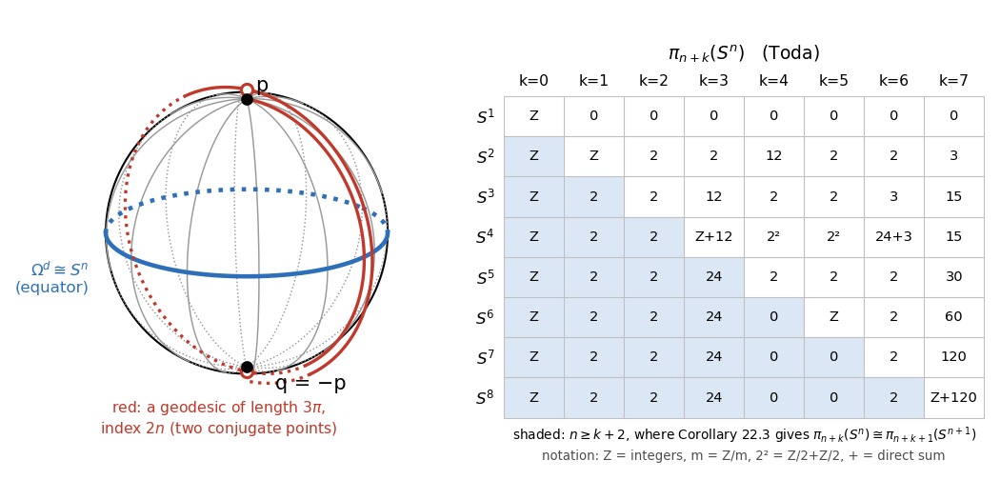

# Chapter 13. All roads to the antipode: whole manifolds of minimal geodesics

*Milnor, "Morse Theory", §22, rewritten for a first-year graduate student who wants to know what the
theorem is for. Every proof is complete. The facts quoted from homotopy theory and from Hanner's
theory of neighbourhood retracts are stated precisely in §1 and §3, with references.*

---

## 0. Waves that meet at the antipode

A large meteorite strikes a planet. Seismic surface waves run out from the impact along great circles,
at the same speed in every direction, and all of them reach the antipode at the same instant. On
Mercury the terrain opposite the Caloris impact basin is broken into hills and troughs, the "hilly and
lineated terrain", which is commonly attributed to this focusing of seismic energy (Schultz and Gault,
*The Moon* 12 (1975)). For the geometry of the sphere this pair of points is as far from "general
position" as possible: the shortest routes from the impact to the antipode are not finitely many but
a whole circle of them, one through each point of the equator, and on the sphere $S^{n+1}$ a whole
$n$-sphere.

So far Morse theory has avoided such pairs: Theorem 17.3 needs endpoints that are not conjugate along
any geodesic. Bott pointed out that special pairs are better. If the minimal geodesics from $p$ to $q$
form a manifold $\Omega^d$, and every other geodesic has index at least $\lambda_0$, then $\Omega^d$
already captures the whole path space in dimensions up to $\lambda_0 - 2$:
$$\pi_i(\Omega^d) \cong \pi_{i+1}(M) \qquad (0 \le i \le \lambda_0 - 2).$$
For antipodal points of $S^{n+1}$ this reads $\pi_i(S^n) \cong \pi_{i+1}(S^{n+1})$ for $i \le 2n-2$,
the Freudenthal suspension theorem. This chapter proves Bott's theorem, by way of two lemmas of
independent interest: a small perturbation of a function cannot lower the index of its critical
points (22.4), and a function whose minimum set is a manifold and whose other critical points have
high index is "highly connected" to its minimum set (22.5). Chapters 14 and 15 apply the same theorem
to the unitary and orthogonal groups to prove the Bott periodicity theorem. In the application (§5) we
compare Corollary 22.3 with the known homotopy groups of spheres, and use it to prove, with no
further input, that every map $S^j \to S^N$ with $j < N$ is null-homotopic.

---

## 1. The theorem and its corollaries (Milnor pp. 118–119)

$M$ is a complete, connected Riemannian manifold, and $p, q \in M$ are points at distance
$\rho(p,q) = \sqrt d$. $\Omega = \Omega(M;p,q)$ is Milnor's space of piecewise smooth paths
$\omega : [0,1] \to M$ from $p$ to $q$, with the metric of Chapter 10 (§16), for which the energy
$E(\omega) = \int_0^1|\dot\omega|^2dt$ is continuous; $\Omega^a = E^{-1}[0,a]$ and
$\operatorname{Int}\Omega^a = E^{-1}[0,a)$. By Milnor's Lemma 12.1 (Chapter 8), $E \ge d$ on $\Omega$,
with equality exactly at the minimal geodesics (parametrized proportionally to arc length). So
$$\Omega^d = \{\text{minimal geodesics from } p \text{ to } q\},$$
which is not empty, by Hopf–Rinow. Milnor's notation $\Omega^{\pi^2}$ on p. 118 is this set for
antipodal points of the unit sphere, where $d = \pi^2$.

We use the following facts from homotopy theory (Hatcher, *Algebraic Topology*, 2002, Ch. 4; Hu,
*Homotopy Theory*, 1959, which Milnor cites).

(H1) *Relative homotopy.* Let $(X,A)$ be a pair and $r \ge 0$ ($I^0$ is a point and
$\partial I^0 = \emptyset$). We write $\pi_r(X,A) = 0$ if every map $h : (I^r,\partial I^r) \to
(X,A)$ is homotopic relative to $\partial I^r$ to a map into $A$. For $r \ge 1$ this holds iff the
relative homotopy groups (pointed sets for $r = 1$) $\pi_r(X,A,a)$ vanish for every $a \in A$, by
the *compression criterion* (Hatcher, §4.1); for $r = 0$ it says that every path component of $X$
meets $A$. (Milnor asks for a homotopy through maps of pairs; the version relative to $\partial I^r$
is stronger, and it is what the proofs below produce.)

(H2) *Exact sequence of a pair* (Hatcher, Theorem 4.3): for $a \in A$,
$\cdots \to \pi_{i+1}(X,A) \to \pi_i(A) \to \pi_i(X) \to \pi_i(X,A) \to \cdots \to \pi_0(X)$ is
exact (of groups, then of pointed sets at the end).

(H3) *Path fibration.* For $M$ path connected, $\pi_i(\Omega^*(M;p,q)) \cong \pi_{i+1}(M)$ for all
$i \ge 0$ (a bijection of sets for $i = 0$), where $\Omega^*$ is the space of continuous paths with the
compact-open topology. (The paths starting at $p$ form a contractible space $P$, and $\omega \mapsto
\omega(1)$ is a fibration $P \to M$ with fibre $\Omega^*(M;p,q)$; apply its exact sequence, Hatcher,
Theorem 4.41.) By Theorem 17.1 (Chapter 10), $\Omega \to \Omega^*$ is a homotopy equivalence, so
$\pi_i(\Omega) \cong \pi_{i+1}(M)$.

(H4) *Hurewicz.* If $\pi_r(X,A) = 0$ for all $r < \lambda$, then $H_r(X,A;\mathbb Z) = 0$ for
$r < \lambda$. (Replace $(X,A)$ by a CW model whose relative cells all have dimension $\ge \lambda$
and use cellular homology; Hatcher, §4.1–4.2, or Whitehead, *Combinatorial Homotopy I*, Theorem 2, as
Milnor cites. No assumption on $\pi_1(A)$ is needed for this vanishing statement.)

**Theorem 22.1.** If the space $\Omega^d$ of minimal geodesics from $p$ to $q$ is a topological
manifold, and if every non-minimal geodesic from $p$ to $q$ has index $\ge \lambda_0$, then
$\pi_i(\Omega,\Omega^d) = 0$ for $0 \le i < \lambda_0$.

The proof occupies §2–§4. First the consequences.

**The inclusion.** *The inclusion $\Omega^d \to \Omega$ induces bijections $\pi_i(\Omega^d,\gamma)
\to \pi_i(\Omega,\gamma)$ for $0 \le i \le \lambda_0 - 2$ and every $\gamma \in \Omega^d$, and a
surjection for $i = \lambda_0 - 1$.*

*Proof.* For $1 \le i \le \lambda_0 - 1$, exactness of $\pi_i(\Omega^d) \to \pi_i(\Omega) \to
\pi_i(\Omega,\Omega^d) = 0$ gives surjectivity. For $1 \le i \le \lambda_0 - 2$, exactness of
$0 = \pi_{i+1}(\Omega,\Omega^d) \to \pi_i(\Omega^d) \to \pi_i(\Omega)$ at the group $\pi_i(\Omega^d)$
gives injectivity. For $i = 0$: $\pi_0(\Omega,\Omega^d) = 0$ says every path component of $\Omega$
meets $\Omega^d$; and if $\lambda_0 \ge 2$ and $\gamma_0, \gamma_1 \in \Omega^d$ are joined by a path
in $\Omega$, this path, as a map $(I,\partial I) \to (\Omega,\Omega^d)$, is homotopic relative to its
ends to a path in $\Omega^d$. $\square$

With (H3) this gives:

**Corollary 22.2.** With the same hypotheses, $\pi_i(\Omega^d)$ is isomorphic to $\pi_{i+1}(M)$ for
$0 \le i \le \lambda_0 - 2$.

Similarly, by (H4) $H_i(\Omega,\Omega^d) = 0$ for $i < \lambda_0$, and the exact homology sequence of
the pair shows that $H_i(\Omega^d) \to H_i(\Omega)$ is an isomorphism for $i \le \lambda_0 - 2$
(Milnor's remark, citing the relative Hurewicz theorem).

**The sphere.** Let $M = S^{n+1} \subset \mathbb R^{n+2}$, $n \ge 1$, with the round metric, $q = -p$,
and let $S^n = \{u \in S^{n+1} : \langle u,p\rangle = 0\}$ be the equator. The geodesics of $S^{n+1}$
are the great circles traversed at constant speed (Milnor p. 65, Chapter 7), so the geodesics
$[0,1] \to S^{n+1}$ starting at $p$ are $\gamma(t) = \cos(Lt)\,p + \sin(Lt)\,u$, with $L \ge 0$ the
length and $u \in S^n$.

**Lemma A.** The geodesics from $p$ to $-p$ are the curves $\gamma_{u,m}(t) = \cos(Lt)p +
\sin(Lt)u$ with $u \in S^n$, $L = (2m+1)\pi$, $m \ge 0$. The minimal ones are those with $m = 0$, so
$d = \pi^2$, and $u \mapsto \gamma_{u,0}$ is a homeomorphism of $S^n$ onto $\Omega^d$.

*Proof.* $\gamma(1) = -p$ iff $\cos L = -1$, i.e. $L = (2m+1)\pi$. A minimal geodesic exists and has
one of these lengths, so $\rho(p,-p) = \pi$ and the minimal geodesics are the $\gamma_{u,0}$. The map
$u \mapsto \gamma_{u,0}$ is a bijection onto $\Omega^d$, with inverse $\omega \mapsto \omega(1/2)$.
Milnor's metric is $d(\omega,\omega') = \max_t\rho(\omega(t),\omega'(t)) + (\int_0^1(\dot s -
\dot s')^2dt)^{1/2}$, $s, s'$ the arc lengths; for $\gamma_{u,0}, \gamma_{v,0}$ the speeds are both
$\pi$, so only the first term remains. On the unit sphere $\rho(x,y)$ is the angle between $x$ and
$y$, which is $2\arcsin(|x-y|/2)$, so
$|x-y| \le \rho(x,y) \le \frac\pi2|x-y|$. Since $|\gamma_{u,0}(t) - \gamma_{v,0}(t)| =
\sin(\pi t)|u-v|$, we get $|u - v| \le d(\gamma_{u,0},\gamma_{v,0}) \le \frac\pi2|u-v|$. $\square$

**Lemma B.** $\gamma_{u,m}$ has index $2mn$. In particular every non-minimal geodesic from $p$ to $-p$
has index $\ge 2n$.

*Proof.* Let $L = (2m+1)\pi$. For a unit vector $w \perp p, u$, the curves
$\alpha_s(t) = \cos(Lt)p + \sin(Lt)(\cos s\,u + \sin s\,w)$ are geodesics, so the variation field
$J_w(t) = \sin(Lt)\,w$ is a Jacobi field (Milnor's 14.3, Chapter 9); so is $J_0(t) = t\gamma'(t)$
(Remark 14.2). For an orthonormal basis $w_1,\dots,w_n$ of the vectors orthogonal to $p$ and $u$, the
$n+1$ fields $J_{w_1},\dots,J_{w_n},J_0$ vanish at $0$ and are independent (their covariant
derivatives at $0$ are $Lw_1,\dots,Lw_n$ and $Lu$), so they span the $(n+1)$-dimensional space of
Jacobi fields vanishing at $0$ (§14). A
combination $c\,t\gamma'(t) + \sin(Lt)\,w$ ($w \perp p,u$) vanishes at $t_0 > 0$ iff both terms do,
since $\gamma'(t_0) \in \operatorname{span}(p,u) \perp w$; that is, iff $c = 0$ and
$\sin(Lt_0)w = 0$. So $\gamma(t_0)$ is conjugate to $p$ iff $Lt_0 \in \pi\mathbb Z$, with multiplicity
$n$. For $0 < t_0 < 1$ this happens at $t_0 = j/(2m+1)$, $j = 1,\dots,2m$: the passages of the
geodesic through $-p$ and $p$. By the index theorem (Milnor's 15.1) the index is $2mn$. $\square$

(Equivalently: $S^{n+1}$ is a symmetric space, Chapter 12, and Theorem 20.5 applies.) Milnor's
"Evidently the hypotheses are satisfied with $\lambda_0 = 2n$" is Lemmas A and B: a non-minimal
geodesic winds one and a half times or more around $S^{n+1}$ and has at least two conjugate points of
multiplicity $n$ in its interior.

**Corollary 22.3 (the Freudenthal suspension theorem).** $\pi_i(S^n) \cong \pi_{i+1}(S^{n+1})$ for
$i \le 2n-2$.

*Proof.* Corollary 22.2 with $M = S^{n+1}$, $\Omega^d \cong S^n$ (Lemma A) and $\lambda_0 = 2n$
(Lemma B). $\square$

The proof also gives the surjectivity of $\pi_{2n-1}(S^n) \to \pi_{2n}(S^{n+1})$, the second half of
Freudenthal's theorem, and $H_i(\Omega S^{n+1}) \cong H_i(S^n)$ for $i \le 2n-2$. (The composite
$\pi_i(S^n) \cong \pi_i(\Omega^d) \to \pi_i(\Omega) \cong \pi_{i+1}(S^{n+1})$ is the suspension
homomorphism; we do not need this. Milnor also notes on p. 97 that Corollary 17.4 leads to a proof.)

---

## 2. Jiggling a function does not lower the index (Milnor pp. 119–121)

The *index* of a critical point $x$ of a smooth $f : U \to \mathbb R$, $U \subseteq \mathbb R^n$ open,
is the largest dimension of a subspace on which the Hessian $(\partial^2f/\partial x_i\partial x_j)(x)$
is negative definite; by the spectral theorem it is the number of negative eigenvalues. This makes
sense for degenerate critical points too, and it does not depend on the coordinates (the Hessian at a
critical point transforms as a quadratic form, Chapter 1). For a real symmetric $n\times n$ matrix $A$
let $e^1(A) \le \dots \le e^n(A)$ be its eigenvalues. Then *a critical point has index
$\ge \lambda$ iff $e^\lambda < 0$* ($1 \le \lambda \le n$).

**Lemma C (eigenvalues move slowly).** (i) $e^\lambda(A) = \min_{\dim V = \lambda}\ \max_{v \in V,
|v| = 1}\langle Av,v\rangle$ (Courant–Fischer). (ii) If $|a_{ij} - b_{ij}| \le \varepsilon$ for all
$i, j$, then $|e^\lambda(A) - e^\lambda(B)| \le n\varepsilon$ for every $\lambda$.

*Proof.* (i) Let $u_1,\dots,u_n$ be orthonormal eigenvectors, $Au_i = e^iu_i$. On
$V_0 = \operatorname{span}(u_1,\dots,u_\lambda)$ the maximum is $e^\lambda$. Any $V$ of dimension
$\lambda$ meets $\operatorname{span}(u_\lambda,\dots,u_n)$ nontrivially (the dimensions add up to
$n+1$), and a unit $v$ in the intersection has $\langle Av,v\rangle = \sum_{i\ge\lambda}e^iv_i^2 \ge
e^\lambda$. (ii) For a unit vector $v$, $|\langle(A-B)v,v\rangle| \le \varepsilon(\sum_i|v_i|)^2 \le
n\varepsilon$ by Cauchy–Schwarz. So $\langle Av,v\rangle \le \langle Bv,v\rangle + n\varepsilon$, and
by (i) $e^\lambda(A) \le e^\lambda(B) + n\varepsilon$; exchange $A$ and $B$. $\square$

This is Milnor's footnote on p. 120; his main text derives continuity of $e^\lambda$ from the continuous
dependence of the roots of a polynomial on its coefficients.

Let $K$ be a compact subset of $\mathbb R^n$, $U$ an open neighbourhood of $K$, and $f : U \to
\mathbb R$ a smooth function all of whose critical points in $K$ have index $\ge \lambda_0$.

**Lemma 22.4.** There is $\varepsilon > 0$ such that every smooth $g : U \to \mathbb R$ with
$$\Big|\frac{\partial g}{\partial x_i} - \frac{\partial f}{\partial x_i}\Big| < \varepsilon,\qquad
\Big|\frac{\partial^2g}{\partial x_i\partial x_j} - \frac{\partial^2f}{\partial x_i\partial
x_j}\Big| < \varepsilon \qquad (i,j = 1,\dots,n)$$
uniformly on $K$ has all its critical points in $K$ of index $\ge \lambda_0$. ($f$ may have degenerate
critical points; in the application $g$ will have none.)

*Proof.* Put $k_g(x) = \sum_i|\partial g/\partial x_i(x)|$, a continuous function vanishing exactly
at the critical points of $g$, and similarly $k_f$. If $\lambda_0 = 0$ there is nothing to prove. If
$\lambda_0 > n$, $f$ has no critical point in $K$; let $\delta = \min_Kk_f > 0$ and
$\varepsilon = \delta/n$; then $k_g > k_f - n\varepsilon \ge 0$ on $K$, and $g$ has no critical point
in $K$. Let $1 \le \lambda_0 \le n$, and put $e_g(x) = e^{\lambda_0}\big((\partial^2g/\partial
x_i\partial x_j)(x)\big)$, continuous by Lemma C(ii); similarly $e_f$. Let $m_f = \max(k_f, -e_f)$.
At a critical point of $f$ in $K$, $k_f = 0$ and the index is $\ge \lambda_0$, so $-e_f > 0$; at other
points $k_f > 0$. So $m_f > 0$ on $K$, and $\delta = \min_Km_f > 0$ by compactness. Let
$\varepsilon = \delta/n$. If $g$ satisfies the inequalities, then on $K$
$$|k_g - k_f| \le \sum_i\Big|\frac{\partial g}{\partial x_i} - \frac{\partial f}{\partial x_i}\Big| <
\delta, \qquad |e_g - e_f| < \delta \tag{*}$$
by Lemma C(ii). At $x \in K$, either $k_f(x) \ge \delta$, and then $k_g(x) > 0$; or $-e_f(x) \ge
\delta$, and then $-e_g(x) > 0$. At a critical point of $g$ in $K$ the first is impossible, so
$e_g < 0$ and the index is $\ge \lambda_0$. $\square$

Milnor leaves the passage from the hypothesis to $(*)$ to "a uniform continuity argument"; Lemma C(ii)
makes it the explicit choice $\varepsilon = \delta/n$.

---

## 3. A Morse theorem for a manifold of minima (Milnor pp. 121–122)

Let $M$ be a smooth manifold and $f : M \to \mathbb R$ a smooth function with minimum $0$ such that
each $M^c = f^{-1}[0,c]$ is compact. The set $M^0 = f^{-1}(0)$ of minimum points is then compact and
non-empty.

**Lemma 22.5.** If $M^0$ is a (topological) manifold, and if every critical point in $M - M^0$ has
index $\ge \lambda_0$, then $\pi_r(M,M^0) = 0$ for $0 \le r < \lambda_0$.

We use five facts.

(T1) *Hanner's theorem.* A topological manifold is an absolute neighbourhood retract for metrizable
spaces; so if a topological manifold $A$ is a closed subset of a metrizable space $X$, some open
neighbourhood of $A$ in $X$ retracts onto $A$ (O. Hanner, *Some theorems on absolute neighborhood
retracts*, Ark. Mat. 1, pp. 389–408, Theorem 3.3, as Milnor cites). If $A$ is a compact *smooth*
submanifold, the retraction can instead be taken from a tubular neighbourhood, as in the
$\varepsilon$-neighbourhood theorem proved in Chapter 6 (Proposition 4.1) of the companion volume,
*Topology from the Differentiable Viewpoint*, rewritten (embed $M$ in a Euclidean space, retract a
neighbourhood there onto $A$, and restrict).

(T2) *Uniformly normal neighbourhoods* (Milnor's 10.8, Chapter 7). For a compact $K$ in a Riemannian
manifold there is $\delta_K > 0$ such that any two points of $K$ at distance $< \delta_K$ are joined by
a unique geodesic of length $< \delta_K$; it is minimal and depends smoothly on its endpoints.

(T3) *Approximation* (Milnor's 6.8, Chapter 4). A bounded smooth function $f$ on a manifold $W$ can
be uniformly approximated by a smooth function $g$ with no degenerate critical points, whose
derivatives of order $\le 2$ also approximate those of $f$ uniformly on a given compact set
(measured in finitely many charts covering it).

(T4) *Handles* (Milnor's 3.1, 3.2 and 3.3, Chapter 2), for a smooth $g : N \to \mathbb R$ and
$N^a = g^{-1}(-\infty,a]$: (i) if $g^{-1}[a,b]$ is compact and contains no critical points, then
$N^a$ is a deformation retract of $N^b$, by a deformation fixing $N^a$ pointwise; (ii) if
$g^{-1}[c-\varepsilon,c+\varepsilon]$ is compact and its only critical points are non-degenerate ones
$x_1,\dots,x_k$ at level $c$, of indices $\lambda_1,\dots,\lambda_k$, then for small $\varepsilon$
there are disjoint closed cells $e^{\lambda_i} \subset N$ with $e^{\lambda_i}\cap N^{c-\varepsilon}
= \partial e^{\lambda_i}$ such that $N^{c-\varepsilon}\cup e^{\lambda_1}\cup\dots\cup e^{\lambda_k}$ is a
deformation retract of $N^{c+\varepsilon}$, again by a deformation fixing it pointwise. (Both
properties are visible in Milnor's formulas for the retractions $r_t$.)

(T5) *Pushing a disc off a cell* (Hatcher, Lemma 4.10, the lemma behind cellular approximation). If
$Y$ is obtained from a subspace $Z$ by attaching a $k$-cell and $r < k$, every map
$(D^r,S^{r-1}) \to (Y,Z)$ is homotopic relative to $S^{r-1}$ to a map into $Z$. (Hatcher's lemma
deforms the map, relative to the preimage of $Z$, so that it misses a point of the open cell; radial
projection from that point then pushes it into $Z$.) In (T4)(ii),
$N^{c-\varepsilon}\cup e^{\lambda_i}$ is obtained from $N^{c-\varepsilon}$ by attaching a cell: the
two pieces are closed and meet in $\partial e^{\lambda_i}$.

**Lemma D (passing critical levels of high index).** Let $g : N \to \mathbb R$ be smooth, $a < b$
regular values, $g^{-1}[a,b]$ compact, and every critical point in $g^{-1}[a,b]$ non-degenerate of
index $\ge \lambda_0$. If $r < \lambda_0$, every map $h : (D^r,S^{r-1}) \to (N^b,N^a)$ is homotopic
relative to $S^{r-1}$, within $N^b$, to a map into $N^a$.

*Proof.* Non-degenerate critical points are isolated (Milnor's 2.3, Chapter 1), so there are
finitely many in the compact $g^{-1}[a,b]$, with critical values $c_1 < \dots < c_m$ in $(a,b)$.
Choose regular values $a = s_0 < c_1 < s_1 < \dots < c_m < s_m = b$; it suffices to push a map from
$N^{s_j}$ into $N^{s_{j-1}}$, relative to $S^{r-1}$ (whose image lies in $N^a$), and repeat. Let
$c = c_j$ and choose $\varepsilon$ as in (T4)(ii) with $[c-\varepsilon,c+\varepsilon] \subset
(s_{j-1},s_j)$. Compose the map with the deformation of $N^{s_j}$ onto $N^{c+\varepsilon}$ (T4(i)),
then with that of $N^{c+\varepsilon}$ onto $N^{c-\varepsilon}\cup\bigcup e^{\lambda_i}$ (T4(ii)); both
fix $N^{s_{j-1}}$, so these are homotopies relative to $S^{r-1}$. Push the result off each cell in turn
by (T5), as $r < \lambda_0 \le \lambda_i$, landing in $N^{c-\varepsilon}$; finally deform
$N^{c-\varepsilon}$ onto $N^{s_{j-1}}$ (T4(i)). $\square$

*Proof of Lemma 22.5.* We may assume $\lambda_0 \ge 1$. Let $0 \le r < \lambda_0$ and
$h : (I^r,\partial I^r) \to (M,M^0)$.

*Step 1: a neighbourhood of $M^0$ deforms into $M^0$.* Give $M$ a Riemannian metric (partition of
unity); it is metrizable. By (T1) there are an open $U_1 \supseteq M^0$ and a retraction
$\rho : U_1 \to M^0$. Let $\delta_1$ be the number of (T2) for the compact set $K = M^1$, and
$$U = \{x \in U_1 : f(x) < 1,\ \operatorname{dist}(x,\rho(x)) < \delta_1\},$$
an open set containing $M^0$. For $x \in U$ the points $x$ and $\rho(x)$ lie in $K$ at distance
$< \delta_1$; let $\sigma_x : [0,1] \to M$ be the geodesic of (T2) from $x$ to $\rho(x)$, and
$D(x,s) = \sigma_x(s)$. Then $D$ is continuous, $D(x,0) = x$, $D(x,1) = \rho(x) \in M^0$, and
$D(a,s) = a$ for $a \in M^0$. This is Milnor's "$U$ can be deformed into $M^0$ within $M$".

*Step 2: a good approximation.* Let $c = \max f\circ h$. If $U = M$, put $h' = h$ and go to the last
sentence of Step 3. Otherwise $f$ has a minimum on the closed set $M - U$ (each $M^C\cap(M-U)$ is compact), which is
positive because $M^0 \subseteq U$; call it $4\delta$. On the open set $W = f^{-1}(-\infty,c+4\delta)$
the function $f$ is bounded. The compact set $K_* = f^{-1}[\delta,c+3\delta] \subset W$ lies in
$M - M^0$; cover it by finitely many compact sets $K_i$, each in a chart domain. By hypothesis the
critical points of $f$ in $K_i$ have index $\ge \lambda_0$; let $\varepsilon_i$ be the number of Lemma
22.4 for $f$ and $K_i$ in that chart. By (T3) there is a smooth $g : W \to \mathbb R$ with no
degenerate critical points, $|g - f| < \delta$ on $W$, and derivatives of order $\le 2$ within
$\varepsilon_i$ of those of $f$ on each $K_i$. By Lemma 22.4, every critical point of $g$ in $K_*$ is
non-degenerate of index $\ge \lambda_0$.

*Step 3: pushing $h$ down.* Write $W^a = \{x \in W : g(x) \le a\}$. Since $|g - f| < \delta$:
$g^{-1}[2\delta, c+2\delta] \subseteq f^{-1}(\delta,c+3\delta) \subseteq K_*$, so this set is compact
and contains finitely many critical points of $g$, all non-degenerate of index $\ge \lambda_0$; choose
regular values $a \in (2\delta,3\delta)$ and $b \in (c+\delta,c+2\delta)$. Then $h(I^r) \subseteq M^c
\subseteq W^b$; $M^0 \subseteq W^a$ (there $g < \delta$); and $W^a \subseteq U$ (there $f < a + \delta
< 4\delta$). By Lemma D, $h$ is homotopic relative to $\partial I^r$, within $W^b$, to a map $h'$ into
$W^a \subseteq U$. Finally $s \mapsto D(h'(\cdot),s)$ is a homotopy relative to $\partial I^r$ (it
fixes $h'(\partial I^r) \subseteq M^0$) from $h'$ to a map $h''$ into $M^0$. $\square$

> **Milnor's text skips** several points in this proof. (i) $M^0$ is compact, since $M^0 \subseteq M^c$,
> and so is its neighbourhood $M^1$; this is what makes a single $\delta_1$ work in Step 1. (ii) He takes $g$ on the compact set
> $M^{c+2\delta}$; a smooth function must live on an open set, here $W$, where $f$ is bounded so that
> 6.8 applies. (iii) That $g^{-1}(-\infty,c+\delta]$ "has the homotopy type of $g^{-1}(-\infty,2\delta]$
> with cells … attached": an abstract homotopy equivalence would not do;
> the argument needs deformations fixing the lower level, which §3 of Milnor provides (T4), and the
> levels should be regular, which requires the extra room built into Step 2. (iv) "Since $r < \lambda_0$
> it follows that $h$ is homotopic …": this is (T5).

---

## 4. Proof of Theorem 22.1 (Milnor pp. 122–123)

Let $0 \le i < \lambda_0$ and $h : (I^i,\partial I^i) \to (\Omega,\Omega^d)$. We show that $h$ is
homotopic relative to $\partial I^i$ to a map into $\Omega^d$.

*Step 1: a finite energy bound.* $E$ is continuous on $\Omega$ and $h(I^i)$ is compact, so
$E\circ h$ is bounded; choose $c > d$ larger than its maximum. Then $h$ maps into
$\operatorname{Int}\Omega^c$, an open set containing $\Omega^d$. This is Milnor's "it is sufficient to
prove that $\pi_i(\operatorname{Int}\Omega^c,\Omega^d) = 0$ for arbitrarily large values of $c$".

*Step 2: the finite-dimensional model.* By Lemma 16.1 and Theorem 16.2 (Chapter 10), for a fine
subdivision $0 = t_0 < \dots < t_k = 1$ the set $B = \operatorname{Int}\Omega^c(t_0,\dots,t_k)$ of
broken geodesics of energy $< c$ is a smooth manifold (an open subset of $M^{k-1}$, via
$\omega \mapsto (\omega(t_1),\dots,\omega(t_{k-1}))$, a homeomorphism for the topology of $\Omega$);
$E' = E|_B$ is smooth; $B^a = E'^{-1}[0,a]$ is compact for $a < c$; and the critical points of $E'$
are the unbroken geodesics from $p$ to $q$ of energy $< c$, the index of $E'_{**}$ being that of
$E_{**}$. Moreover there is a homotopy $r_u : \operatorname{Int}\Omega^c \to
\operatorname{Int}\Omega^c$, $0 \le u \le 1$, with $r_0 = \mathrm{id}$ and $r_1$ a retraction onto
$B$, and each $r_u$ fixes $B$ pointwise (on a broken geodesic, the minimal geodesics used to define
$r_u$ are its own segments). Every minimal geodesic is an unbroken geodesic of energy $d < c$, so
$\Omega^d \subseteq B$ and $r_u$ fixes $\Omega^d$. Hence $h \simeq r_1\circ h$ relative to
$\partial I^i$, and $r_1\circ h$ maps $(I^i,\partial I^i)$ into $(B,\Omega^d)$.

*Step 3: a function with minimum $0$.* As Milnor notes, the only difficulty is that $E$ takes its
values in $[d,c)$ rather than $[0,\infty)$. Let $F : [d,c) \to [0,\infty)$ be a diffeomorphism, e.g. $F(x) = (x-d)/(c-x)$. Any such
$F$ is increasing with $F(d) = 0$ (a homeomorphism matches the endpoints, the only points whose
removal leaves the interval connected) and $F' > 0$. Let $f = F\circ E' : B \to [0,\infty)$. We check
the hypotheses of Lemma 22.5 for $(B, f)$:
- $f$ is smooth with minimum $0$, attained exactly on $\Omega^d$ (Lemma 12.1), which is non-empty;
- $f^{-1}[0,a] = B^{F^{-1}(a)}$ is compact, since $F^{-1}(a) < c$;
- $f^{-1}(0) = \Omega^d$ is a topological manifold, by hypothesis;
- the critical points of $f$ are those of $E'$, as $F' > 0$; those outside $\Omega^d$ are non-minimal
  geodesics, and at such a point the Hessian of $f$ is $F'(E)$ times that of $E'$ (the term
  $F''(E)\,dE'\otimes dE'$ vanishes there), so its index is the index of $E_{**}$, which is
  $\ge \lambda_0$.

By Lemma 22.5, $r_1\circ h$ is homotopic relative to $\partial I^i$, within $B$, to a map into
$\Omega^d$. With Step 2 this proves the theorem. $\square$

### An interactive look at the antipodes

The sphere is $S^2$, the case $n = 1$ of $S^{n+1}$, with $p$ at the top and $q = -p$ at the bottom;
drag it to turn it. The grey meridians are minimal geodesics from $p$ to $q$. Each crosses the blue
equator once, at its midpoint, and this is the homeomorphism $\Omega^d \cong S^n$ of Lemma A. The red
curve leaves $p$ in the direction set by the first slider and makes the number of half-turns set by
the second; it is drawn slightly lifted off the sphere so that its passes can be told apart. The open
circles are its conjugate points, its passages through $p$ and $q$ before the end, each of
multiplicity $n$, and the index $2mn$ of Lemma B is printed below. The third slider sets $n$: the
sphere is then $S^{n+1}$ (the picture shows a great $2$-sphere through $p$), and the text gives
$\lambda_0 = 2n$ and the range of Corollary 22.3. The table lists the groups $\pi_{n+k}(S^n)$ from
Toda's tables; shaded entries are those that Corollary 22.3 forces to equal the entry below them, and
the entries governed by the chosen $n$ are outlined.

*(In the printed version this figure is a still image; the interactive version is in the web
edition.)*

---

## 5. Application: the stable range of the homotopy groups of spheres

**Maps between spheres of different dimensions.** *For $0 \le j < N$, $\pi_j(S^N) = 0$.* By
induction on $N$. For $j = 0$ this says $S^N$ is connected. For $1 \le j < N$ (so $N \ge 2$), apply
Corollary 22.3 with $n = N-1$ and $i = j-1$; the condition $i \le 2n-2$ reads $j \le 2N-3$, which
holds because $j \le N-1 \le 2N-3$. So $\pi_j(S^N) \cong \pi_{j-1}(S^{N-1})$, which is $0$ by
induction since $j - 1 < N - 1$. In words: every map $S^j \to S^N$ with $j < N$ is null-homotopic.
The usual proof smooths the map and uses Sard's theorem (Chapter 3 of the companion volume) to find a
point it misses; here the same fact comes from counting conjugate points: the long geodesics between
antipodes have index at least $2n$.

**The degree.** With $i = n$, Corollary 22.3 gives $\pi_n(S^n) \cong \pi_{n+1}(S^{n+1})$ for
$n \ge 2$, so $\pi_n(S^n) \cong \pi_2(S^2)$ for all $n \ge 2$. Corollary 22.3 does not say what this
group is; Corollary 17.4 (Chapter 10) does. For $n \ge 2$ it gives $\Omega S^{n+1}$ cells only in
dimensions $0, n, 2n, \dots$, so $\Omega S^{n+1}$ is $(n-1)$-connected and, by (H3) and the Hurewicz
theorem, $\pi_{n+1}(S^{n+1}) \cong \pi_n(\Omega S^{n+1}) \cong H_n(\Omega S^{n+1}) \cong \mathbb Z$. The
Hopf degree theorem (Chapter 7, Theorem 6.3, of the companion volume, for smooth maps, to which
continuous maps and homotopies can be reduced) identifies the isomorphism with the degree.

**The stable stems.** Put $i = n + k$. Corollary 22.3 says that $\pi_{n+k}(S^n)$ does not depend on
$n$ once $n \ge k+2$; this common value is the *stable $k$-stem* $\pi_k^s$. Comparing with the
classical computations (H. Toda, *Composition Methods in Homotopy Groups of Spheres*, 1962), for
$k = 0,1,\dots,7$:

| $k$ | 0 | 1 | 2 | 3 | 4 | 5 | 6 | 7 |
|---|---|---|---|---|---|---|---|---|
| $\pi_k^s$ | $\mathbb Z$ | $\mathbb Z/2$ | $\mathbb Z/2$ | $\mathbb Z/24$ | $0$ | $0$ | $\mathbb Z/2$ | $\mathbb Z/240$ |
| stable from $n =$ | 2 | 3 | 4 | 5 | 6 | 7 | 8 | 9 |
| last unstable value | $\pi_1(S^1) = \mathbb Z$ | $\pi_3(S^2) = \mathbb Z$ | $\pi_5(S^3) = \mathbb Z/2$ | $\pi_7(S^4) = \mathbb Z\oplus\mathbb Z/12$ | $\pi_9(S^5) = \mathbb Z/2$ | $\pi_{11}(S^6) = \mathbb Z$ | $\pi_{13}(S^7) = \mathbb Z/2$ | $\pi_{15}(S^8) = \mathbb Z\oplus\mathbb Z/120$ |

The table in the figure shows the whole range $1 \le n \le 8$. Every entry with $n \ge k+2$ equals the
entry below it, as the corollary requires, and the range is sharp in several places: $\pi_3(S^2) =
\mathbb Z$ but $\pi_4(S^3) = \mathbb Z/2$, $\pi_7(S^4) = \mathbb Z\oplus\mathbb Z/12$ but
$\pi_8(S^5) = \mathbb Z/24$, $\pi_{11}(S^6) = \mathbb Z$ but $\pi_{12}(S^7) = 0$. In each of these the
map is still onto, as the surjectivity half of the theorem predicts. (In other places the groups happen
to agree before the stable range, e.g. $\pi_5(S^3) = \pi_6(S^4) = \mathbb Z/2$.)

**Loops on a sphere.** $H_i(\Omega S^{n+1}) \cong H_i(S^n)$ for $i \le 2n-2$: for $n \ge 2$,
$\mathbb Z$ in degrees $0$ and $n$ and zero otherwise in this range. This agrees with Corollary 17.4
(Chapter 10), which gives $\Omega S^{n+1}$ one cell in each of the dimensions $0, n, 2n, \dots$; the
first cell not seen by $\Omega^d$ has dimension $2n = \lambda_0$.

**Back to the seismic waves.** On the $2$-sphere ($n = 1$) the geodesic from $p$ to $-p$ with $2m+1$
half-turns has index $2m$: one for each passage through the epicentre or its antipode before arrival.
Seismologists observe exactly this count. A surface wave picks up a phase shift of $\pi/2$ at each
such passage, the *polar phase shift* (Brune, Nafe and Alsop, Bull. Seismol. Soc. Amer. 51 (1961)),
which is $\pi/2$ times the Morse index, as in the semiclassical rule recalled in Chapter 12, §6.1.

---

## 6. Summary of what was silently assumed, now made explicit

| Where | Milnor says | What is actually needed |
|---|---|---|
| p. 118 | "$\Omega^{\pi^2}$ … can be identified with the equator" | $u \mapsto \gamma_{u,0}$ is bi-Lipschitz for Milnor's metric on $\Omega$ (Lemma A) |
| p. 118 | $\Omega^d$ = the space of minimal geodesics | Lemma 12.1: $E \ge d$, with equality exactly on minimal geodesics |
| p. 118 | "$\pi_i(\Omega,\Omega^d)$ is zero" | the meaning for $i = 0, 1$ (sets); compression relative to $\partial I^i$ for all base points (H1) |
| p. 118 | "the inclusion homomorphism … is an isomorphism for $i \le \lambda_0-2$" | the exact sequence for $i \ge 1$; a direct argument for $i = 0$; onto for $i = \lambda_0 - 1$ |
| p. 118 | "$\pi_i(\Omega)$ is isomorphic to $\pi_{i+1}(M)$" | Theorem 17.1 and the path fibration (H3); $M$ connected |
| p. 119 | "Evidently the hypotheses are satisfied with $\lambda_0 = 2n$" | geodesics from $p$ to $-p$ have length $(2m+1)\pi$; explicit Jacobi fields give index $2mn$ (Lemmas A, B) |
| p. 119 | the relative Hurewicz theorem | only the vanishing of $H_i(\Omega,\Omega^d)$, $i < \lambda_0$, needed; no $\pi_1$ hypothesis (H4) |
| p. 120 | "the λ-th eigenvalue … depends continuously on the matrix" | Courant–Fischer; $\lvert e^\lambda(A) - e^\lambda(B)\rvert \le n\max\lvert a_{ij} - b_{ij}\rvert$ (Lemma C) |
| p. 121 | "a uniform continuity argument which will be left to the reader" | $\varepsilon = \delta/n$; the cases $\lambda_0 = 0$ and $\lambda_0 > n$ |
| p. 121 | "$M^0$ is a retract of some neighborhood $U$" | $M^0$ is compact; Hanner's theorem (or a tubular neighbourhood when $M^0$ is smooth); one $\delta$ from 10.8; a deformation fixing $M^0$ (Step 1) |
| p. 121 | "$g : M^{c+2\delta} \to \mathbb R$ … possible by 6.8" | $g$ on an open set where $f$ is bounded; derivatives controlled in finitely many charts |
| p. 122 | "has the homotopy type of $g^{-1}(-\infty,2\delta]$ with cells … attached" | finitely many critical points; regular levels; deformations fixing the lower level (Lemma D, T4) |
| p. 122 | "Since $r < \lambda_0$ it follows that $h$ is homotopic …" | pushing a disc off a cell of higher dimension (T5) |
| p. 122 | "it is sufficient to prove … for arbitrarily large $c$" | $E$ continuous, compact image, $c > d$ |
| p. 122 | "$\operatorname{Int}\Omega^c$ contains … $\operatorname{Int}\Omega^c(t_0,\dots,t_k)$ as deformation retract" | the deformation fixes $B$, hence $\Omega^d \subseteq B$, pointwise |
| p. 122–123 | "$F$ … any diffeomorphism. Then $F\circ E$ … satisfies the hypothesis of 22.5" | $F$ increasing, $F(d) = 0$, $F' > 0$; the Hessian of $F\circ E$ at a critical point is $F'\cdot E_{**}$; compact sublevel sets from 16.2 |

**Checked by machine.** Milnor's §22 has been verified in the Lean proof assistant, for submanifolds
of Euclidean space with the induced metric. Checked: Theorem 22.1, in a relative form (every map of
a compact space of small dimension into $\Omega$ is homotopic, relative to the part already in
$\Omega^d$, to a map into $\Omega^d$), with the hypothesis that $\Omega^d$ is a topological manifold
replaced by what the proof uses of it, that $\Omega^d$ is a retract of an open neighbourhood in
$\Omega$; the corollary on the inclusion $\Omega^d \to \Omega$, including $\pi_0$; Corollary 22.2,
as a bijection and, for $i \ge 1$, as an isomorphism of groups, with the change of base point it
hides; Lemmas A and B for the sphere, an explicit neighbourhood retraction there, and Corollary 22.3
together with its surjective half; Lemma 22.4 (by an argument that does not need Lemma C), Lemma
22.5 and Lemma D; and the variant of Theorem 22.1 for an open and closed set of paths which Chapter
15 uses. Not checked: Hanner's theorem (for the sphere, for $SU(2m)$ and for the spaces of Chapter
15 the retraction is constructed, so the results there do not depend on it), the homological form of
the corollary, that the isomorphism of Corollary 22.3 is the suspension homomorphism, and the
application. See the verified edition.
