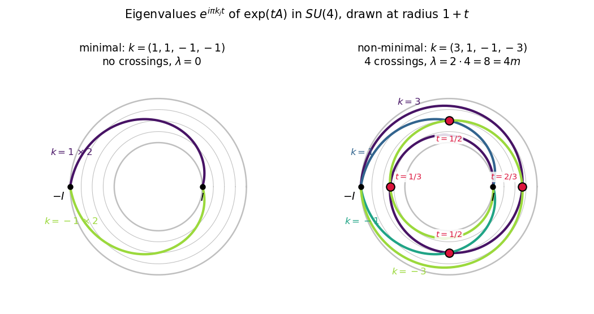

# Chapter 14. Bott periodicity for the unitary group: the Grassmannian of shortest paths

*Milnor, "Morse Theory", §23, rewritten for a first-year graduate student who wants to know what the
theorem is for. Every proof is complete, except that, as in Milnor, two facts of homotopy theory are
quoted: coset spaces of Lie groups are fibre bundles, and fibre bundles have exact homotopy sequences.
The homotopy groups of spheres that are needed are taken from the companion volume. All of this is
stated precisely in §3.*

---

## 0. Why is magnetic charge an integer, and what happens in higher dimensions?

In 1931 Dirac showed that if a magnetic monopole of charge $g$ exists, then every electric charge $e$
satisfies $eg = \tfrac12 N\hbar c$ (Gaussian units) for an integer $N$. In the language of Wu and Yang
(1975), the quantum states of a charged particle on a sphere around the monopole are the sections of a
complex line bundle over $S^2$. Over the northern and over the southern hemisphere the bundle is
trivial; it is determined by how the two trivializations are glued along the equator, that is, by a
map from the equator $S^1$ to the group $U(1)$ of phases. The integer $N$ is the winding number of
this map, an element of $\pi_1 U(1) = \mathbb Z$.

Ask the same question over higher spheres. A bundle of states with $N$ internal components over
$S^n$ is glued from two trivial pieces by a map $S^{n-1} \to U(N)$, so such bundles are classified by
$\pi_{n-1}U(N)$. Over $S^4$ these are the Yang–Mills instantons, labelled by an element of
$\pi_3 SU(2) = \mathbb Z$ (Belavin, Polyakov, Schwarz and Tyupkin, 1975). Over $S^3$ there is
nothing: every bundle is trivial. What happens over $S^{100}$?

Bott's answer: once $N \geq n/2$, the group $\pi_{n-1}U(N)$ no longer depends on $N$, and it is
$\mathbb Z$ for $n$ even and $0$ for $n$ odd. The twisting alternates forever between "an integer's
worth" and "none". This chapter proves it by Milnor's route. On the special unitary group $SU(2m)$
the shortest paths from $I$ to $-I$ form the complex Grassmannian $G_m(\mathbb C^{2m})$, and every
other geodesic from $I$ to $-I$ has index at least $2m+2$. By the theorem of Chapter 13
(Milnor's Theorem 22.1), the Grassmannian then captures the homotopy groups of the path space up to
dimension $2m$, and a little homotopy theory turns this into $\pi_{i-1}U \cong \pi_{i+1}U$. In §5 we
return to monopoles and instantons and list the complex vector bundles over spheres of dimension up to
eight.

---

## 1. The unitary group, its exponential and its metric (Milnor pp. 124–126)

Let $M_n(\mathbb C)$ be the space of complex $n \times n$ matrices, a real vector space of dimension
$2n^2$ with the Euclidean inner product
$$\langle X, Y\rangle = \operatorname{Re}\operatorname{tr}(XY^*) = \operatorname{Re}\sum_{i,j}x_{ij}\bar y_{ij},
\qquad |X| = \langle X, X\rangle^{1/2},$$
where $Y^*$ is the conjugate transpose. Three properties are used throughout: $|XY| \leq |X|\,|Y|$
(Cauchy–Schwarz entry by entry), $|X^*| = |X|$, and $|SXT| = |X|$ for $S, T$ unitary (because
$\operatorname{tr}(SXTT^*X^*S^*) = \operatorname{tr}(XX^*)$).

**Definition.** The *unitary group* is $U(n) = \{S \in M_n(\mathbb C) : SS^* = I\}$, the group of
linear maps of $\mathbb C^n$ preserving the Hermitian inner product. For $A \in M_n(\mathbb C)$,
$\exp A = I + A + A^2/2! + A^3/3! + \cdots$. Since $|A^k| \leq |A|^k$, the series and all its term-wise
derivatives converge uniformly on bounded sets, so $\exp$ is smooth.

**Lemma 1.1 (Milnor's (1)–(4)).** (1) $\exp(A^*) = (\exp A)^*$ and $\exp(TAT^{-1}) = T(\exp A)T^{-1}$.
(2) If $AB = BA$, then $\exp(A+B) = (\exp A)(\exp B)$. (3) $(\exp A)(\exp(-A)) = I$. (4) There is
$\varepsilon > 0$ such that $\exp$ maps the ball $B_\varepsilon = \{|A| < \varepsilon\}$
diffeomorphically onto an open neighbourhood of $I$.

*Proof.* (1) Term by term, since $(A^k)^* = (A^*)^k$, $(TAT^{-1})^k = TA^kT^{-1}$, and both operations
are continuous and linear. (2) The Cauchy product of two absolutely convergent series gives
$(\exp A)(\exp B) = \sum_k \sum_{i+j=k} A^iB^j/(i!\,j!) = \sum_k (A+B)^k/k!$, the binomial theorem being
valid because $A$ and $B$ commute. (3) is (2) with $B = -A$. (4) $\exp A = I + A + R(A)$ with
$|R(A)| \leq \sum_{k \geq 2}|A|^k/k! \leq |A|^2e^{|A|}$, so the derivative of $\exp$ at $0$ is the
identity, and the inverse function theorem (as in Chapter 1 of the companion volume, *Topology from the
Differentiable Viewpoint*, rewritten) applies; shrink the neighbourhood to a ball. $\square$

We fix such an $\varepsilon$, taking also $\varepsilon \leq 2\pi/\sqrt n$. The ball $B_\varepsilon$ is
invariant under $A \mapsto -A$, $A \mapsto A^*$ and $A \mapsto SAS^{-1}$ for $S$ unitary, since these
preserve $|\cdot|$. Let $\mathfrak u(n) = \{A : A + A^* = 0\}$ be the skew-Hermitian matrices, a real
subspace of dimension $n^2$ ($n$ imaginary diagonal entries and $n(n-1)/2$ complex entries above the
diagonal).

**Lemma 1.2.** If $A \in \mathfrak u(n)$, then $\exp A \in U(n)$. If $A \in B_\varepsilon$ and
$\exp A \in U(n)$, then $A \in \mathfrak u(n)$.

*Proof.* $(\exp A)(\exp A)^* = (\exp A)(\exp A^*) = (\exp A)(\exp(-A)) = I$ by (1) and (3). Conversely
$\exp(A^*) = (\exp A)^* = (\exp A)^{-1} = \exp(-A)$, and $A^*, -A \in B_\varepsilon$, where $\exp$ is
injective. $\square$

**Lemma 1.3 (Milnor's (5) and (6)).** $U(n)$ is a compact smooth submanifold of $M_n(\mathbb C)$ of
dimension $n^2$ and a Lie group, and its tangent space at $I$ is $\mathfrak u(n)$.

*Proof.* By Lemma 1.2, $U(n) \cap \exp(B_\varepsilon) = \exp(B_\varepsilon \cap \mathfrak u(n))$. In the
chart $\exp^{-1}$ of $M_n(\mathbb C)$ near $I$, therefore, $U(n)$ is an open piece of the linear subspace
$\mathfrak u(n)$: near $I$ it is a submanifold with tangent space $\mathfrak u(n)$. For
$S_0 \in U(n)$, left multiplication $X \mapsto S_0X$ is a linear automorphism of $M_n(\mathbb C)$
carrying $U(n)$ onto itself and $I$ to $S_0$, so it transports the chart. $U(n)$ is closed and bounded
($|S|^2 = n$), hence compact; multiplication and inversion $S \mapsto S^*$ are restrictions of
polynomial maps. $\square$

**The Lie algebra.** For $A \in \mathfrak u(n)$ the field $X_A(S) = SA$ is left invariant (left
translation $L_T$ is the linear map $X \mapsto TX$, and $T(SA) = (TS)A$), with value $A$ at $I$, and
every left-invariant field is of this form.

**Lemma 1.4 (Milnor's "computation shows").** $[X_A, X_B] = X_{[A,B]}$, where $[A, B] = AB - BA$ and
the bracket of vector fields is $[X,Y]f = X(Yf) - Y(Xf)$ (Milnor 8.5).

*Proof.* On an open subset of a vector space, let $X, Y$ be given by smooth maps $F, G$. Then
$Y\!f(p) = Df_p(G(p))$ and $X(Y\!f)(p) = D^2f_p(F(p), G(p)) + Df_p(DG_p(F(p)))$; subtracting the same
expression with $F, G$ exchanged, the second-derivative terms cancel by symmetry, so $[X,Y]$ is given
by $DG_p(F(p)) - DF_p(G(p))$. For $F(S) = SA$, $G(S) = SB$ on the open set $GL_n(\mathbb C)$ this is
$SAB - SBA$. These fields are tangent to the submanifold $U(n)$, and the bracket of fields tangent to a
submanifold is tangent to it and restricts to the bracket of the restrictions. $\square$

So the Lie algebra $\mathfrak g$ of $U(n)$ is $\mathfrak u(n)$ with the commutator.

**The metric.** On $\mathfrak g$ put $\langle A, B\rangle = \operatorname{Re}\operatorname{tr}(AB^*)$,
which is positive definite: $\langle A, A\rangle = \sum|a_{ij}|^2$. Milnor defines the corresponding
left-invariant metric and checks that it is right invariant by checking invariance under the adjoint
action. Both facts are contained in the following.

**Lemma 1.5.** Give $U(n)$ the Riemannian metric induced from the Euclidean space $M_n(\mathbb C)$.
(a) It is the left-invariant metric determined by $\langle\,,\rangle$ on $\mathfrak g$:
$\langle SA, SB\rangle = \langle A, B\rangle$ on $T U(n)_S = S\mathfrak g$. (b) Left and right
translations, and the inner automorphisms $X \mapsto SXS^{-1}$, are isometries. (c) The derivative of
$X \mapsto SXS^{-1}$ at $I$ is $\operatorname{Ad}(S)A = SAS^{-1}$, and
$\langle \operatorname{Ad}(S)A, \operatorname{Ad}(S)B\rangle = \langle A, B\rangle$.

*Proof.* Multiplication on either side by a unitary matrix is a linear isometry of $M_n(\mathbb C)$
carrying $U(n)$ onto itself, so it restricts to an isometry of $U(n)$; this gives (b), and (a) is
$\operatorname{Re}\operatorname{tr}(SAB^*S^*) = \operatorname{Re}\operatorname{tr}(AB^*)$. In (c) the
inner automorphism is the restriction of a linear map, which is its own derivative; and
$\operatorname{tr}(SAS^{-1}(SBS^{-1})^*) = \operatorname{tr}(SAB^*S^{-1}) = \operatorname{tr}(AB^*)$,
using $(S^{-1})^* = S$, exactly as on Milnor's p. 126. $\square$

For $A, B \in \mathfrak g$ the trace $\operatorname{tr}(AB)$ is real, so
$\langle A, B\rangle = -\operatorname{tr}(AB)$.

**Geodesics.** By Lemma 21.2 (Chapter 12), the geodesics through $I$ of a Lie group with a bi-invariant
metric are its one-parameter subgroups. For $A \in \mathfrak g$, $t \mapsto \exp(tA)$ is a
one-parameter subgroup (by (2), since $sA$ and $tA$ commute) with velocity $A$ at $t = 0$. Conversely,
if $\varphi$ is a one-parameter subgroup with $\varphi'(0) = A$, differentiating
$\varphi(t+s) = \varphi(t)\varphi(s)$ at $s = 0$ gives $\varphi'(t) = \varphi(t)A$, the linear
differential equation that $\exp(tA)$ also solves with the same initial value; so
$\varphi(t) = \exp(tA)$. Hence *the geodesic through $I$ with velocity $A$ is $t \mapsto \exp(tA)$*, and
the Riemannian exponential map of §10 at $I$ is the matrix exponential (Milnor p. 125). By left
translation, the geodesic through $S$ with velocity $SA$ is $t \mapsto S\exp(tA)$, of constant speed
$|A|$.

**Diagonal form; $\exp$ is onto.** We quote the spectral theorem: a normal matrix is unitarily
diagonalizable (e.g. Axler, *Linear Algebra Done Right*, the complex spectral theorem). A
skew-Hermitian matrix has imaginary eigenvalues and a unitary one has eigenvalues of modulus one. So for
$A \in \mathfrak g$ there is $T \in U(n)$ with $TAT^{-1} = \operatorname{diag}(ia_1, \dots, ia_n)$, and
for $S \in U(n)$ there is $T$ with $TST^{-1} = \operatorname{diag}(e^{ia_1}, \dots, e^{ia_n})$, the
$a_j$ real. In the second case $S = \exp(T^{-1}\operatorname{diag}(ia_j)T)$ by (1): $\exp : \mathfrak g
\to U(n)$ is onto, and $U(n)$ is path connected.

**The special unitary group.** For $A \in \mathfrak g$, diagonalizing gives
$\det(\exp A) = e^{\operatorname{tr}A}$. Let $SU(n) = \{S \in U(n) : \det S = 1\}$ and
$\mathfrak{su}(n) = \{A \in \mathfrak g : \operatorname{tr}A = 0\}$, of dimension $n^2 - 1$.

**Lemma 1.6.** $SU(n)$ is a compact connected submanifold and Lie subgroup of $U(n)$ with tangent space
$\mathfrak{su}(n)$ at $I$. With the induced metric it is bi-invariant, its geodesics through $I$ are
$t \mapsto \exp(tA)$, $A \in \mathfrak{su}(n)$, and $\exp : \mathfrak{su}(n) \to SU(n)$ is onto.

*Proof.* For $A \in B_\varepsilon \cap \mathfrak g$, $|\operatorname{tr}A| \leq \sqrt n\,|A| < 2\pi$
(Cauchy–Schwarz on the diagonal), so $\exp A \in SU(n)$ iff $\operatorname{tr}A \in 2\pi i\mathbb Z$ iff
$\operatorname{tr}A = 0$. Thus $SU(n) \cap \exp(B_\varepsilon) = \exp(B_\varepsilon \cap \mathfrak{su}(n))$,
and left translation by elements of $SU(n)$ does the rest, as in Lemma 1.3. Translations by elements of
$SU(n)$ are isometries of $U(n)$ preserving $SU(n)$, so the induced metric is bi-invariant, and
Lemma 21.2 applies to $SU(n)$. If $S = \exp(T^{-1}\operatorname{diag}(ia_j)T) \in SU(n)$, then
$\sum a_j \in 2\pi\mathbb Z$; changing $a_1$ by a multiple of $2\pi$ (which does not change $S$) makes
$\sum a_j = 0$. $\square$

The bracket on $\mathfrak{su}(n)$ is again the commutator. Milnor writes $\mathfrak g'$ for
$\mathfrak{su}(n)$.

---

## 2. Minimal geodesics from $I$ to $-I$ (Milnor pp. 126–128)

All geodesics are parametrized by $[0,1]$. By §1, a geodesic from $I$ to $-I$ in $U(n)$ is
$t \mapsto \exp(tA)$ with $A \in \mathfrak g$ and $\exp A = -I$.

**Lemma 2.1.** For $A \in \mathfrak g$, $\exp A = -I$ iff the eigenvalues of $A$ are
$i\pi k_1, \dots, i\pi k_n$ with every $k_j$ an odd integer. The geodesic $t \mapsto \exp(tA)$,
$0 \leq t \leq 1$, then has length $|A| = \pi(k_1^2 + \cdots + k_n^2)^{1/2}$.

*Proof.* With $TAT^{-1} = \operatorname{diag}(ia_j)$: $\exp A = -I$ iff
$\exp(TAT^{-1}) = \operatorname{diag}(e^{ia_j}) = -I$ iff every $a_j$ is an odd multiple of $\pi$. The
speed is constantly $|A|$, and $|A| = |TAT^{-1}|$. $\square$

**Corollary 2.2.** In $U(n)$ the distance from $I$ to $-I$ is $\pi\sqrt n$, and the minimal geodesics
from $I$ to $-I$ are the $t \mapsto \exp(tA)$ with $A^2 = -\pi^2 I$. For such $A$, let $P$ be the
orthogonal projection onto $E = \operatorname{Eigen}(i\pi) = \{v : Av = i\pi v\}$. Then
$A = i\pi(2P - I)$ and
$$\exp(tA) = e^{i\pi t}P + e^{-i\pi t}(I - P). \tag{2.1}$$
Conversely, for every complex subspace $E \subseteq \mathbb C^n$, with projection $P$, the matrix
$A = i\pi(2P - I)$ lies in $\mathfrak g$ and satisfies $A^2 = -\pi^2I$.

*Proof.* $U(n)$ is compact, hence complete, so by the Hopf–Rinow theorem (Milnor 10.9) some minimal
geodesic from $I$ to $-I$ exists. By Lemma 2.1 every geodesic from $I$ to $-I$ has length
$\pi(\sum k_j^2)^{1/2} \geq \pi\sqrt n$, with equality iff every $k_j = \pm 1$, and equality occurs
($A = i\pi I$). So the distance is $\pi\sqrt n$, and the minimal geodesics are those with all
$k_j = \pm 1$, i.e. with $A$ diagonalizable with eigenvalues $\pm i\pi$, i.e. $A^2 = -\pi^2I$. Then
$\mathbb C^n = E \oplus E^\perp$ with $E^\perp = \operatorname{Eigen}(-i\pi)$, which gives
$A = i\pi P - i\pi(I-P)$ and (2.1). Conversely $iP$ is skew-Hermitian because $P$ is Hermitian, and
$(2P - I)^2 = I$. $\square$

So, as a set, the space of minimal geodesics from $I$ to $-I$ in $U(n)$ is the set of all complex
subspaces of $\mathbb C^n$ (Milnor p. 127). Milnor identifies it with that space; the topology needs a
word. Let $\operatorname{Gr}(\mathbb C^n) = \{P \in M_n(\mathbb C) : P = P^* = P^2\}$, a compact set,
and $G_k(\mathbb C^n) = \{P \in \operatorname{Gr}(\mathbb C^n) : \operatorname{tr}P = k\}$ (projections
of rank $k$). It is standard that $G_k(\mathbb C^n)$ is a compact connected manifold of real dimension
$2k(n-k)$: near a subspace $E_0$, the subspaces of dimension $k$ are the graphs of the linear maps
$E_0 \to E_0^\perp$.

**Lemma 2.3 (the topology).** Let $\Omega = \Omega(U(n); I, -I)$ carry Milnor's metric (§16)
$$d(\omega, \omega') = \max_t \rho(\omega(t), \omega'(t)) + \Bigl(\int_0^1\bigl(\tfrac{ds}{dt} -
\tfrac{ds'}{dt}\bigr)^2dt\Bigr)^{1/2}.$$
Then $\Phi(P)(t) = e^{i\pi t}P + e^{-i\pi t}(I - P)$ is a homeomorphism of $\operatorname{Gr}(\mathbb C^n)$
onto the subspace of minimal geodesics.

*Proof.* $\Phi$ is a bijection onto the minimal geodesics by Corollary 2.2 ($P$ is recovered from
$\Phi(P)'(0) = i\pi(2P - I)$). All the paths $\Phi(P)$ have the same constant speed $\pi\sqrt n$, so the
integral term of $d(\Phi(P), \Phi(Q))$ vanishes. The function
$(t, P, Q) \mapsto \rho(\Phi(P)(t), \Phi(Q)(t))$ is continuous on the compact set
$[0,1] \times \operatorname{Gr} \times \operatorname{Gr}$ (the distance $\rho$ is continuous, §10) and
vanishes for $P = Q$; by uniform continuity its maximum over $t$ tends to $0$ as $Q \to P$. So $\Phi$
is continuous, and a continuous bijection from a compact space to a metric space is a homeomorphism.
$\square$

> **A hidden hypothesis.** Milnor calls the space of all subspaces "rather inconvenient", because its
> components $G_k(\mathbb C^n)$ have different dimensions. The trouble with $U(n)$ is worse: there the
> hypothesis of Theorem 22.1 fails. Take $k = (3, 1, \dots, 1)$. The index formula of Lemma 4.1 below
> holds verbatim on $\mathfrak u(n)$ (the extra direction $iI$ has eigenvalue $0$), and gives index
> $(n-1)(3 - 1 - 2) = 0$ for this non-minimal geodesic, which lies in a component of
> $\Omega(U(n); I, -I)$ that contains no minimal geodesic at all. Indeed, for a path $\omega$ from $I$
> to $-I$ let $\theta_\omega$ be the continuous determination of the argument of $\det\omega(t)$ with
> $\theta_\omega(0) = 0$; then $\theta_\omega(1)/\pi$ is an integer which cannot change along a
> continuous family of paths. On the geodesic $\exp(tA)$, where $\det\exp(tA) = e^{i\pi t\sum k_j}$,
> it equals $\sum k_j$: here $n + 2$, while every minimal geodesic has $|\sum k_j| \leq n$. So the
> hypothesis of Theorem 22.1 (every non-minimal geodesic has index $\geq \lambda_0$) fails in $U(n)$
> for every $\lambda_0 \geq 1$, which is why the argument is run in $SU(2m)$: its geodesics from $I$
> to $-I$ are exactly those of $U(2m)$ with $\sum k_j = 0$.

In $SU(n)$, $\operatorname{tr}A = i\pi\sum k_j$ must vanish, and $-I \in SU(n)$ requires $n$ even. Take
$n = 2m$.

**Lemma 23.1.** The space of minimal geodesics from $I$ to $-I$ in $SU(2m)$ is homeomorphic to the
complex Grassmann manifold $G_m(\mathbb C^{2m})$ of $m$-dimensional subspaces of $\mathbb C^{2m}$.

*Proof.* By Lemma 1.6 the geodesics from $I$ to $-I$ in $SU(2m)$ are the $\exp(tA)$ with
$A \in \mathfrak{su}(2m)$, $\exp A = -I$: by Lemma 2.1, eigenvalues $i\pi k_j$ with $k_j$ odd and
$\sum k_j = 0$, length $\pi(\sum k_j^2)^{1/2} \geq \pi\sqrt{2m}$. A minimal geodesic exists ($SU(2m)$ is
compact), and length $\pi\sqrt{2m}$ is attained by $A = \operatorname{diag}(i\pi I_m, -i\pi I_m)$. So the
minimal geodesics are those with all $k_j = \pm 1$ and $\sum k_j = 0$: $m$ of each sign, i.e. $A = i\pi(2P
- I)$ with $\operatorname{tr}P = m$. Conversely every $P \in G_m(\mathbb C^{2m})$ gives such an $A$, with
$\operatorname{tr}A = i\pi(2m - 2m) = 0$. The topology is handled by Lemma 2.3, with $\rho$ the distance
of $SU(2m)$. $\square$

**Lemma 23.2.** Every non-minimal geodesic from $I$ to $-I$ in $SU(2m)$ has index $\geq 2m + 2$.

This is proved in §4. With Chapter 13 it gives Bott's theorem.

**Theorem 23.3 (Bott).** The inclusion $G_m(\mathbb C^{2m}) \to \Omega(SU(2m); I, -I)$ of Lemma 23.1
induces isomorphisms of homotopy groups in dimensions $\leq 2m$. Hence
$$\pi_i G_m(\mathbb C^{2m}) \cong \pi_{i+1}SU(2m) \qquad (0 \leq i \leq 2m).$$

*Proof.* $SU(2m)$ is compact, hence complete. By Lemma 23.1 the space $\Omega^d$ of minimal geodesics is
a manifold, and by Lemma 23.2 every other geodesic has index $\geq \lambda_0 = 2m+2$. Theorem 22.1
gives $\pi_i(\Omega, \Omega^d) = 0$ for $0 \leq i < 2m+2$. In the exact homotopy sequence of the pair,
$$\pi_{i+1}(\Omega, \Omega^d) \to \pi_i(\Omega^d) \to \pi_i(\Omega) \to \pi_i(\Omega, \Omega^d),$$
both ends vanish for $i \leq 2m$, so the middle map is an isomorphism (for $i = 0$ both spaces are
connected: $G_m$ is, and every component of $\Omega$ meets $\Omega^d$). Finally,
$\pi_i\Omega(M; p, q) \cong \pi_{i+1}M$ for $M$ path connected: by Theorem 17.1, $\Omega$ is homotopy
equivalent to the space of continuous paths from $p$ to $q$; composing with a fixed path from $q$ to $p$
is a homotopy equivalence with the loop space at $p$; and $\pi_i$ of the loop space is $\pi_{i+1}M$
(Hu, *Homotopy Theory*, p. 111, as Milnor cites; or the adjunction between suspension and loops,
$\Sigma S^i = S^{i+1}$). $\square$

For $m = 1$ this is a theorem about the round $3$-sphere $SU(2)$: $G_1(\mathbb C^2) = \mathbb CP^1 = S^2$,
so $\pi_1 S^2 \cong \pi_2 S^3 = 0$ and $\pi_2S^2 \cong \pi_3S^3 \cong \mathbb Z$.

---

## 3. Stable homotopy of the unitary groups and the periodicity theorem (Milnor pp. 128–130)

Milnor now uses "standard methods of homotopy theory". These are the facts quoted.

**(Q1) Coset bundles.** If $H$ is a closed subgroup of a Lie group $G$, then $G/H$ is a manifold and
$G \to G/H$ is a fibre bundle with fibre $H$; if $K \subseteq H \subseteq G$ are closed subgroups, then
$G/K \to G/H$ is a fibre bundle with fibre $H/K$ (Steenrod, *The Topology of Fibre Bundles*, §7). If
$G$ is compact and acts continuously and transitively on a Hausdorff space $X$ with stabilizer $H$ at
$x$, then $gH \mapsto gx$ is a homeomorphism $G/H \to X$ (a continuous bijection from a compact space to
a Hausdorff one).

**(Q2) Exact homotopy sequence.** For a fibre bundle $F \to E \to B$ with $B$ path connected there is an
exact sequence $\cdots \to \pi_iF \to \pi_iE \to \pi_iB \to \pi_{i-1}F \to \cdots \to \pi_0E \to \pi_0B$
(Steenrod §17; Hatcher, *Algebraic Topology*, Theorem 4.41 with Proposition 4.48).

**(Q3) Spheres.** $\pi_iS^N = 0$ for $i < N$: every map of an $i$-manifold into $S^N$ with $i < N$ is
homotopic to a constant, proved in Chapter 8 of the companion volume (*Topology from the Differentiable
Viewpoint*, rewritten), Problem 5 (a free null-homotopy suffices, since $\pi_1$ acts on $\pi_i$ fixing
the zero element). $\pi_NS^N \cong \mathbb Z$ by the degree: Hopf's theorem, proved in Chapter 7 of the
companion volume, Theorem 6.3, with Problem 4 of its Chapter 8 to pass from smooth to continuous maps;
in particular $\pi_1S^1 \cong \pi_3S^3 \cong \mathbb Z$. Finally $\pi_iS^1 = 0$ for $i \geq 2$, because
the covering $\mathbb R \to S^1$ induces isomorphisms on $\pi_i$, $i \geq 2$, and $\mathbb R$ is
contractible (Hatcher, *Algebraic Topology*, Proposition 4.1).

The bundles needed are the following. $U(m+1)$ acts transitively on the unit sphere
$S^{2m+1} \subseteq \mathbb C^{m+1}$ (every unit vector is the last vector of an orthonormal basis), and
the stabilizer of $e_{m+1}$ is $U(m)$, embedded as $S \mapsto \operatorname{diag}(S, 1)$; so
$U(m+1)/U(m) \cong S^{2m+1}$. Embed $U(m) \subseteq U(2m)$ by $S \mapsto \operatorname{diag}(S, I_m)$;
the composite of the embeddings $U(m) \subseteq U(m+1) \subseteq \cdots \subseteq U(2m)$ is this
embedding. $U(2m)$ acts transitively on $m$-dimensional subspaces of $\mathbb C^{2m}$ with stabilizer
$U(m) \times U(m)$ at $\mathbb C^m \oplus 0$; so $G_m(\mathbb C^{2m}) \cong U(2m)/U(m)\times U(m)$
(compare Steenrod §7). The *complex Stiefel manifold* is $V = U(2m)/U(m)$. Finally
$\det : U(m) \to S^1$ is onto with kernel $SU(m)$.

**Lemma 23.4.** For $1 \leq i \leq 2m$, $\pi_iG_m(\mathbb C^{2m}) \cong \pi_{i-1}U(m)$. Furthermore
$\pi_{i-1}U(m) \cong \pi_{i-1}U(m+1) \cong \pi_{i-1}U(m+2) \cong \cdots$ for $i \leq 2m$, the
isomorphisms being induced by the inclusions; and $\pi_jU(m) \cong \pi_jSU(m)$ for $j \neq 1$.

*Proof.* *Stability.* The bundle $U(m) \to U(m+1) \to S^{2m+1}$ gives the exact sequence
$$\pi_{j+1}S^{2m+1} \to \pi_jU(m) \to \pi_jU(m+1) \to \pi_jS^{2m+1}.$$
For $j \leq 2m-1$ both ends vanish by (Q3), so the inclusion induces an isomorphism; for $j = 2m$ the
right end vanishes, so it is onto. Since $j \leq 2m-1$ implies $j \leq 2m'-1$ for every $m' \geq m$,
all the later inclusions are isomorphisms too. (For $j = 0$ these are statements about connected
spaces.)

*The Stiefel manifold.* For $i \leq 2m$, the map $\pi_iU(m) \to \pi_iU(2m)$ is onto (onto at the
first step, isomorphisms afterwards, since $i \leq 2m'-1$ for $m' > m$), and
$\pi_{i-1}U(m) \to \pi_{i-1}U(2m)$ is injective ($i-1 \leq 2m-1$). In the exact sequence of
$U(m) \to U(2m) \to V$,
$$\pi_iU(m) \to \pi_iU(2m) \to \pi_iV \to \pi_{i-1}U(m) \to \pi_{i-1}U(2m),$$
the first map onto makes $\pi_iU(2m) \to \pi_iV$ zero, and the last map injective makes
$\pi_iV \to \pi_{i-1}U(m)$ zero; by exactness $\pi_iV = 0$ for $i \leq 2m$ (and $V$ is connected).

*The Grassmannian.* By (Q1) with $K = U(m) \subseteq H = U(m)\times U(m) \subseteq G = U(2m)$ there is a
bundle $U(m) \to V \to G_m(\mathbb C^{2m})$. Its sequence
$\pi_iV \to \pi_iG_m \to \pi_{i-1}U(m) \to \pi_{i-1}V$ has vanishing ends for $1 \leq i \leq 2m$.

*$SU$ versus $U$.* The bundle $SU(m) \to U(m) \to S^1$ gives
$\pi_{j+1}S^1 \to \pi_jSU(m) \to \pi_jU(m) \to \pi_jS^1$, with vanishing ends for $j \geq 2$; for
$j = 0$ both groups are connected. $\square$

**Definition.** For $j \geq 0$ the mutually isomorphic groups $\pi_jU(m)$, $2m - 1 \geq j$, are the
$j$-th *stable homotopy group of the unitary group*, written $\pi_jU$. The proof also showed (Milnor
p. 129) that $\pi_{2m}U(m) \to \pi_{2m}U(m+1) \cong \pi_{2m}U$ is onto.

**Periodicity theorem.** $\pi_{i-1}U \cong \pi_{i+1}U$ for all $i \geq 1$.

*Proof.* Given $i \geq 1$, choose $m$ with $2m \geq i$. Then
$$\pi_{i-1}U = \pi_{i-1}U(m) \cong \pi_iG_m(\mathbb C^{2m}) \cong \pi_{i+1}SU(2m) \cong \pi_{i+1}U(2m)
= \pi_{i+1}U,$$
by Lemma 23.4, Theorem 23.3, Lemma 23.4 again ($i+1 \geq 2$), and stability ($i + 1 \leq 2m+1 \leq
2(2m)-1$). $\square$

**Theorem 23.5 (Bott).** The stable homotopy groups $\pi_iU$ are periodic of period $2$:
$\pi_0U \cong \pi_2U \cong \pi_4U \cong \cdots$ are zero, and $\pi_1U \cong \pi_3U \cong \pi_5U \cong
\cdots$ are infinite cyclic.

*Proof.* $U(1) = S^1$ and $0, 1 \leq 2\cdot 1 - 1$, so $\pi_0U = \pi_0S^1 = 0$ and
$\pi_1U = \pi_1S^1 \cong \mathbb Z$; periodicity does the rest. As a check, independent of periodicity:
$SU(2)$ is the $3$-sphere of unit quaternions, and $2, 3 \leq 2\cdot 2 - 1$, so by Lemma 23.4
$\pi_2U = \pi_2SU(2) = 0$ and $\pi_3U = \pi_3SU(2) \cong \mathbb Z$. $\square$

Milnor's isomorphisms are abstract: they are composites of isomorphisms chosen for each $i$ separately.
Bott stated his theorem as a homotopy equivalence of spaces. That form also follows from Theorem 23.3,
once one passes to the limit $m \to \infty$ with some care; it is not in Milnor's text.

**Corollary 23.6 (the space form of Bott's theorem).** Let $BU = \bigcup_m G_m(\mathbb C^{2m})$, along
$E \mapsto E \oplus \mathbb Ce_{2m+1}$, let $SU = \bigcup_m SU(2m)$ and $U = \bigcup_m U(2m)$, along
$S \mapsto \operatorname{diag}(S, I_2)$, each with the colimit topology (a set is closed iff it meets
every stage in a closed set), and let $\Omega X$ be the space of continuous loops at the identity with
the compact-open topology. Then there is a map $\beta : BU \to \Omega SU$ inducing isomorphisms of all
homotopy groups, and a map $\mathbb Z \times BU \to \Omega U$ with the same property.

*Proof.* Let $\varphi_m(E)(t) = e^{i\pi t}P_E + e^{-i\pi t}(I - P_E)$ be the minimal geodesic (2.1), let
$E_0 = \operatorname{span}(e_1, e_3, \dots, e_{2m-1})$, and put
$\beta_m(E)(t) = \varphi_m(E)(t)\,\varphi_m(E_0)(t)^{-1}$, a loop at $I$ in $SU(2m)$. Pointwise
multiplication by the fixed path $\varphi_m(E_0)^{-1}$ is a homeomorphism from the paths from $I$ to
$-I$ onto the loops at $I$ (its inverse multiplies by $\varphi_m(E_0)$), so by Theorems 23.3 and 17.1,
$\beta_m$ induces isomorphisms on $\pi_i$ for $i \leq 2m$. Since
$\varphi_{m+1}(E \oplus \mathbb Ce_{2m+1}) = \operatorname{diag}(\varphi_m(E), e^{i\pi t}, e^{-i\pi t})$
and $E_0$ was chosen to be stable in the same way, $\beta_{m+1}(E \oplus \mathbb Ce_{2m+1}) =
\operatorname{diag}(\beta_m(E), I_2)$: the $\beta_m$ fit together to a map $\beta$.

*Compact sets in a colimit.* Let $X_0 \subseteq X_1 \subseteq \cdots$ be $T_1$ spaces, each a closed
subspace of the next, and $X = \bigcup X_m$ with the colimit topology. Then each $X_m$ is a closed
subspace of $X$ (a set closed in $X_m$ meets each $X_j$ in a closed set), and every compact
$K \subseteq X$ lies in some $X_m$: otherwise pick $x_1, x_2, \ldots \in K$ and $m_1 < m_2 < \cdots$ with
$x_k \in X_{m_k} \setminus X_{m_{k-1}}$; every subset of $\{x_k\}$ meets each $X_j$ in a finite, hence
closed, set, so $\{x_k\}$ is an infinite closed discrete subset of the compact $K$, which is impossible.

Consequently a map $S^i \to BU$, or a homotopy $S^i \times [0,1] \to BU$, factors through some stage,
and $\pi_iBU = \operatorname{colim}_m\pi_iG_m(\mathbb C^{2m})$. A map $S^i \to \Omega SU$ is the same as
a map $S^i \times S^1 \to SU$ (exponential law; $S^1$ is compact Hausdorff, Hatcher, Appendix, on the
compact-open topology), whose compact image lies in some $SU(2m)$; so likewise
$\pi_i\Omega SU = \operatorname{colim}_m\pi_i\Omega SU(2m)$. In each degree $i$ the maps
$\beta_{m*}$ are isomorphisms for $m \geq i/2$, so $\beta_*$ is an isomorphism.

For $U$: $S \mapsto (S\,D(\det S)^{-1}, \det S)$, with $D(z) = \operatorname{diag}(z, 1, \dots, 1)$, is a
homeomorphism $U(2m) \cong SU(2m) \times S^1$ compatible with the inclusions. Define
$\mathbb Z \times BU \to \Omega U$ by $(N, E) \mapsto D(e^{2\pi iNt})\,\beta(E)(t)$. The winding number
of the determinant of this loop is $N$, so the map is a bijection on components; on the component $N$
it is $\beta$ followed by the inclusion $\Omega SU \to \Omega_0U$ and by the homeomorphism
"multiply by $D(e^{2\pi iNt})$". The inclusion $\Omega SU \to \Omega_0U$ induces isomorphisms on all
$\pi_i$, since $\pi_i\Omega SU = \pi_{i+1}SU \cong \pi_{i+1}U = \pi_i\Omega_0U$ for $i \geq 1$
(Lemma 23.4, passed to the colimit), and both spaces are connected ($\pi_1SU(2m) \cong
\pi_0G_m(\mathbb C^{2m}) = 0$ by Theorem 23.3). $\square$

> **Milnor's text skips the passage to spaces.** To upgrade Corollary 23.6 to homotopy equivalences
> $\Omega SU \simeq BU$ and $\Omega U \simeq \mathbb Z \times BU$ one needs that the spaces involved have
> the homotopy type of CW complexes, and then Whitehead's theorem (Hatcher, Theorem 4.5). We quote
> this. The colimits are taken along smooth embeddings of compact manifolds, which are closed
> cofibrations (tubular neighbourhoods), so each colimit is homotopy equivalent to the mapping
> telescope of compact manifolds, a space of CW homotopy type; and the loop space of a space of CW
> homotopy type has CW homotopy type (J. Milnor, *On spaces having the homotopy type of a
> CW-complex*, Trans. AMS 90 (1959)). Milnor appeals to the same two facts, without proof, in the
> proof of Theorem 24.5 (p. 146). For the homotopy groups, which is all that Theorem 23.5 asserts,
> they are not needed.

---

## 4. The index of a non-minimal geodesic (Milnor pp. 130–132)

We now prove Lemma 23.2. The tools are Theorem 20.5 (Chapter 12): if $M$ is locally symmetric and
$\gamma$ is a geodesic with $\gamma(0) = p$ and $\gamma'(0) = V$, let $K_V(W) = R(V, W)V$ on $TM_p$;
then the parameters $t \neq 0$ conjugate to $0$ along $\gamma$ are the $t = \pi s/\sqrt e$, $s$ a
non-zero integer and $e$ a positive eigenvalue of $K_V$, and the multiplicity of $t$ is the number of
eigenvalues $e$, counted with multiplicity, such that $t$ is a multiple of $\pi/\sqrt e$. The Index
Theorem 15.1 (Chapter 9): the index of a geodesic $\gamma : [0,1] \to M$ is the number of parameters
$t \in (0,1)$ such that $\gamma(t)$ is conjugate to $\gamma(0)$ along $\gamma$, counted with
multiplicity. And Theorem 21.3(b): for left-invariant fields on a Lie group with bi-invariant metric,
$R(X,Y)Z = \tfrac14[[X,Y],Z]$.

**Lemma 4.1 (the index formula).** Let $n$ be even and $A \in \mathfrak{su}(n)$ with eigenvalues
$i\pi k_1, \dots, i\pi k_n$, the $k_j$ odd with $\sum k_j = 0$. The index of the geodesic
$t \mapsto \exp(tA)$, $0 \leq t \leq 1$, from $I$ to $-I$ in $SU(n)$ is
$$\lambda = \sum_{k_j > k_l}(k_j - k_l - 2),$$
the sum over all pairs of indices $\{j, l\}$ with $k_j \neq k_l$, written with the larger first.

*Proof.* *Reduction to diagonal form* (Milnor's "we may assume"). For $T \in U(n)$, conjugation
$S \mapsto TST^{-1}$ is an isometry of $SU(n)$ (Lemma 1.5) fixing $I$ and $-I$ and carrying
$\exp(tA)$ to $\exp(tTAT^{-1})$. An isometry carries Jacobi fields to Jacobi fields, so it preserves
conjugate points and their multiplicities, hence (Theorem 15.1) indices. Choose $T$, including a
permutation, so that $A = \operatorname{diag}(i\pi k_1, \dots, i\pi k_n)$ with $k_1 \geq \cdots \geq k_n$.

*The operator $K_A$.* $SU(n)$ with its bi-invariant metric is a symmetric space (Lemma 21.1), so
Theorem 20.5 applies with $p = I$, $V = A$. By Theorem 21.3(b) and Lemma 1.4,
$$K_A(W) = R(A, W)A = \tfrac14[[A, W], A] = -\tfrac14[A, [A, W]], \qquad W \in \mathfrak{su}(n).$$
For $W = (w_{jl})$, $[A, W]_{jl} = i\pi k_jw_{jl} - w_{jl}\,i\pi k_l = i\pi(k_j - k_l)w_{jl}$, hence
$[A,[A,W]]_{jl} = -\pi^2(k_j - k_l)^2w_{jl}$ and
$$K_A(W) = \Bigl(\tfrac{\pi^2}{4}(k_j - k_l)^2\,w_{jl}\Bigr).$$

*An eigenbasis.* For $j < l$ let $E_{jl}$ have $+1$ in place $(j,l)$, $-1$ in place $(l,j)$ and zeros
elsewhere, and let $E'_{jl}$ have $i$ in both places. Both lie in $\mathfrak{su}(n)$ and are eigenvectors
with eigenvalue $\tfrac{\pi^2}{4}(k_j - k_l)^2$. Every diagonal matrix in $\mathfrak{su}(n)$ is an
eigenvector with eigenvalue $0$. These are $n(n-1) + (n-1) = n^2 - 1 = \dim\mathfrak{su}(n)$ independent
vectors, so they form a basis. The positive eigenvalues of $K_A$ are therefore the numbers
$e_{jl} = \tfrac{\pi^2}{4}(k_j - k_l)^2$ for the pairs with $k_j > k_l$, each counted twice.

*Conjugate points.* For $e = e_{jl}$, $\pi/\sqrt e = 2/(k_j - k_l)$, so this eigenvalue produces
conjugate points at $t = 2/(k_j - k_l), 4/(k_j - k_l), \ldots$. Since $k_j - k_l$ is even, the number
of these in the open interval $(0,1)$ is $(k_j - k_l)/2 - 1$.

*The index.* By Theorems 20.5 and 15.1, $\lambda$ is the sum over the positive eigenvalues $e$ (with
multiplicity) of the number of multiples of $\pi/\sqrt e$ in $(0,1)$. Each pair $k_j > k_l$ contributes
$2\bigl((k_j - k_l)/2 - 1\bigr) = k_j - k_l - 2$. $\square$

For a minimal geodesic all $k_j = \pm 1$, every term is $1 - (-1) - 2 = 0$, and $\lambda = 0$, as it
should be. Every term of the sum is $\geq 0$, so any set of pairs gives a lower bound.

*Proof of Lemma 23.2.* Let $n = 2m$, $\sum k_j = 0$, not all $k_j = \pm 1$. Let $P$ and $N$ be the
numbers of positive and of negative $k_j$, so $P + N = 2m$.

*Case 1: $N \geq m+1$* (Milnor's "at least $m+1$ of the $k_i$ are (say) negative"). Then $P \leq m-1$,
while the positive $k_j$ add up to $\sum_{k_l<0}|k_l| \geq N \geq m+1 > P$; so some $k_{j_0} \geq 3$.
Pairing $k_{j_0}$ with each of the $N$ negative entries, each term is $\geq 3 + 1 - 2 = 2$, and
$\lambda \geq 2N \geq 2(m+1)$. The case $P \geq m+1$ is the same with all signs reversed: the formula is
unchanged under $k \mapsto -k$.

*Case 2: $P = N = m$.* Some $|k_j| \geq 3$; say $k_{j_0} \geq 3$, the other sign being symmetric. The
positive entries then add up to at least $(m-1) + 3 = m+2 > m = N$, and they equal
$\sum_{k_l<0}|k_l|$, so some $k_{l_0} \leq -3$. Take the pairs $(j_0, l)$ for the $m-1$ negative
$l \neq l_0$, the pairs $(j, l_0)$ for the $m-1$ positive $j \neq j_0$, and the pair $(j_0, l_0)$:
$$\lambda \geq (m-1)(3 + 1 - 2) + (m-1)(1 + 3 - 2) + (3 + 3 - 2) = 4m \geq 2(m+1).$$
In either case $\lambda \geq 2m+2$. $\square$

This completes the proof of Theorem 23.3, and with it of Theorem 23.5. Both bounds are attained: for
$m = 2$, $k = (3, -1, -1, -1)$ gives $\lambda = 6 = 2m+2$ and $k = (3, 1, -1, -3)$ gives $\lambda = 8 = 4m$.

### An interactive look at the eigenvalue braid

Along the geodesic $t \mapsto \exp(tA)$ the eigenvalues of $\exp(tA)$ are $e^{i\pi k_jt}$: they leave
$1$ together at $t = 0$, run around the unit circle at speeds $k_j$, and all arrive at $-1$ at $t = 1$.
Two of them, with $k_j \neq k_l$, coincide exactly when $t$ is a multiple of $2/(k_j - k_l)$, which is
where the proof of Lemma 4.1 finds the conjugate points coming from the pair $(j, l)$. So the index is
twice the number of collisions strictly between $t = 0$ and $t = 1$. The figure draws the eigenvalue at
time $t$ at radius $1 + t$, so that each eigenvalue traces a spiral from the inner circle to the outer
one and each collision is a crossing of two spirals. Drag the time slider to move the eigenvalues along;
choose $m$; load a minimal geodesic (no crossings: half the eigenvalues turn one way, half the other),
a random non-minimal one, or "pump" the extreme speeds apart ($k_1 \mapsto k_1 + 2$,
$k_{2m} \mapsto k_{2m} - 2$). The panel shows the collisions passed so far, the index from the formula,
and Milnor's bound $2m+2$.

*(In the printed version this figure is a still image; the interactive version is in the web
edition.)*

---

## 5. Application: complex vector bundles over spheres

**Clutching.** A complex vector bundle of rank $N$ over $S^n$ is trivial over each closed hemisphere
(a contractible space), so it is obtained from two trivial bundles by gluing along the equator
$S^{n-1}$ with a map $f : S^{n-1} \to GL_N(\mathbb C)$, and isomorphism classes of bundles correspond to
homotopy classes of such maps (Steenrod §18; Hatcher, *Vector Bundles and K-Theory*, Proposition 1.11).
Gram–Schmidt deforms $GL_N(\mathbb C)$ onto $U(N)$, and since $U(N)$ is a connected topological group,
free homotopy classes of maps $S^{n-1} \to U(N)$ are the same as elements of $\pi_{n-1}U(N)$. So
$$\{\text{rank } N \text{ complex bundles over } S^n\}/\cong \;\;=\;\; \pi_{n-1}U(N).$$
By Lemma 23.4 this is the stable group $\pi_{n-1}U$ as soon as $n - 1 \leq 2N - 1$, i.e. $N \geq n/2$,
and by Theorem 23.5:

| sphere | $S^1$ | $S^2$ | $S^3$ | $S^4$ | $S^5$ | $S^6$ | $S^7$ | $S^8$ |
|---|---|---|---|---|---|---|---|---|
| $\pi_{n-1}U$ | $0$ | $\mathbb Z$ | $0$ | $\mathbb Z$ | $0$ | $\mathbb Z$ | $0$ | $\mathbb Z$ |
| stable for | $N \geq 1$ | $N \geq 1$ | $N \geq 2$ | $N \geq 2$ | $N \geq 3$ | $N \geq 3$ | $N \geq 4$ | $N \geq 4$ |

**$S^2$: monopoles.** $\pi_1U(1) = \mathbb Z$, and the clutching map of the bundle with integer $N$ is
$z \mapsto z^N$ on the equator. This is Dirac's integer. The tautological line bundle of
$\mathbb CP^1 = S^2$ has $|N| = 1$; the tangent bundle of $S^2$, a complex line bundle, has clutching
map $z \mapsto z^{\pm 2}$, so $|N| = 2$, and this $2$ is the Euler number $\chi(S^2)$ (Chapter 6 of
the companion volume, where the Poincaré–Hopf theorem is proved). By stability, every complex bundle
over $S^2$ of any rank is a line bundle plus a trivial bundle.

**$S^4$: instantons.** $\pi_3U(2) = \pi_3SU(2) = \mathbb Z$, already stable. The clutching map
$S^3 \to SU(2)$ that identifies the unit quaternions with $SU(2)$ has degree one; the resulting rank-$2$
bundle is the quaternionic Hopf bundle over $\mathbb HP^1 = S^4$, and the integer is the instanton
number of Yang–Mills theory (the BPST instanton has instanton number $1$).

**Odd spheres.** Since $\pi_{2k}U = 0$, every complex bundle of rank $\geq k+1$ over $S^{2k+1}$ is
trivial, and every complex bundle over $S^1$ or $S^3$ is trivial.

**Below the stable range the answer is irregular**, which is why the theorem is about $U$ and not about
a fixed $U(N)$. Since $U(2) \cong SU(2) \times S^1$ as spaces and $SU(2) = S^3$, rank-$2$ bundles over
$S^{n}$ are classified by $\pi_{n-1}S^3$ for $n \geq 3$, and the standard values $\pi_4S^3 = \mathbb Z/2$,
$\pi_5S^3 = \mathbb Z/2$, $\pi_6S^3 = \mathbb Z/12$ give: over $S^5$ there is exactly one non-trivial
rank-$2$ bundle, and it becomes trivial when a trivial line bundle is added (rank $3$ is stable, and
$\pi_4U = 0$); over $S^6$ the rank-$2$ bundles form $\mathbb Z/2$ but those of rank $\geq 3$ form
$\mathbb Z$; over $S^7$ the rank-$2$ bundles form $\mathbb Z/12$, those of rank $\geq 4$ are all
trivial.

**In K-theory language.** The reduced K-group $\widetilde K(S^n)$ of stable bundles is $\pi_{n-1}U$, and
Theorem 23.5 reads $\widetilde K(S^{n+2}) \cong \widetilde K(S^n)$. The integer attached to a stable
bundle over $S^2$ is its first Chern number, and the same integer, for the bundle of occupied electron
states over the two-dimensional Brillouin torus, is the quantized Hall conductance in units of $e^2/h$
(Thouless, Kohmoto, Nightingale and den Nijs, 1982). In Kitaev's classification of topological
insulators (2009), insulators without symmetries in $d$ dimensions carry an integer invariant of this
kind exactly when $\widetilde K(S^d) = \pi_{d-1}U$ is $\mathbb Z$, that is, for $d$ even: the period two
of that column of Kitaev's table is the period two of Theorem 23.5.

---

## 6. Summary of what was silently assumed, now made explicit

| Where | Milnor says | What is actually needed |
|------|----------------|------------------|
| p. 124 | properties (1)–(4) "are easily verified" | absolute convergence; the Cauchy product with commuting factors; the inverse function theorem (Lemma 1.1) |
| p. 124 | "one easily proves" that $U(n)$ is a submanifold with $T U(n)_I$ skew-Hermitian | $\exp$ on a small ball is a chart in which $U(n)$ is a linear subspace; left translation elsewhere (Lemmas 1.2, 1.3) |
| p. 124 | "Computation shows" the bracket is $AB - BA$ | bracket of linear vector fields on $GL_n(\mathbb C)$, restricted to a submanifold (Lemma 1.4) |
| p. 125 | matrix $\exp$ equals the Riemannian $\exp$ | Lemma 21.2, plus uniqueness for $\varphi' = \varphi A$ |
| p. 125–126 | right invariance via $\operatorname{Ad}$ | equivalently, the metric is induced from $M_n(\mathbb C)$, on which unitary multiplications are isometries (Lemma 1.5) |
| p. 126 | "by ordinary matrix theory" $A$ can be diagonalized | spectral theorem for normal matrices (quoted) |
| p. 126 | the Lie algebra of $SU(n)$ is the trace-zero part | $\det\exp A = e^{\operatorname{tr}A}$ and the bound $\lvert\operatorname{tr}A\rvert < 2\pi$ on a small ball (Lemma 1.6) |
| p. 127 | minimal geodesics "may be identified" with all subspaces | existence of a minimal geodesic (Hopf–Rinow 10.9) and a homeomorphism, not just a bijection (Lemma 2.3) |
| p. 127 | $U(n)$ is "rather inconvenient" | worse than inconvenient: $k = (3,1,\dots,1)$ is a non-minimal geodesic of index $0$, so the hypothesis of Theorem 22.1 fails in $U(n)$ (§2) |
| p. 127 | for $SU(2m)$ "all the above considerations remain valid" | the length bound and existence of a minimal geodesic inside $SU(2m)$; $-I \in SU(n)$ needs $n$ even |
| p. 128 | Theorem 23.3 from §22 | exact sequence of the pair; $\pi_i\Omega(M;p,q) \cong \pi_{i+1}M$ via Theorem 17.1 |
| pp. 128–129 | the fibrations and their exact sequences | coset spaces of Lie groups are bundles and have exact sequences (quoted, (Q1), (Q2)); $\pi_iS^N = 0$ for $i < N$ and $\pi_NS^N = \mathbb Z$ (companion volume, (Q3)) |
| p. 129 | $\pi_i(U(2m)/U(m)) = 0$ for $i \leq 2m$ | $\pi_iU(m) \to \pi_iU(2m)$ onto for $i \leq 2m$, injective for $i \leq 2m-1$ |
| p. 129 | "Thus we obtain" the periodicity theorem $\pi_{i-1}U \cong \pi_{i+1}U$ | an abstract isomorphism for each $i$; the space-level statement needs colimits (Corollary 23.6) and CW homotopy types (quoted) |
| p. 130 | "a short computation shows" $[A, W]$ | entrywise formula and the eigenbasis $E_{jl}, E'_{jl}$, diagonal (Lemma 4.1) |
| p. 130 | "We may assume that $A$ is the diagonal matrix" | conjugation by a unitary matrix is an isometry of $SU(n)$ fixing $\pm I$, so it preserves indices |
| p. 131 | the count is "evidently" $(k_j - k_l)/2 - 1$ | $k_j - k_l$ is even |
| p. 132 | Case 1, "(say) negative", "one of the positive $k_i$ must be $\geq 3$" | the formula is invariant under $k \mapsto -k$; the positive entries add up to more than their number |
| p. 132 | Case 2, "one is $\geq 3$ and one is $\leq -3$" | $\sum k_j = 0$ and $P = N = m$ |

**Checked by machine.** Milnor's §23 has been verified in the Lean proof assistant. The algebra and
counting of §§2 and 4: for $A = \operatorname{diag}(i\pi k_1, \dots, i\pi k_n)$, $\exp A = -I$ iff
every $k_j$ is odd; $|A|^2 = \pi^2 \sum k_j^2 \geq \pi^2 n$, with equality iff all $k_j = \pm 1$,
and then $m$ of each sign in $SU(2m)$; Milnor's formula for $K_A$, with eigenvectors shown to span;
and, from this spectrum, the index formula of Lemma 4.1, Lemma 23.2, and the non-minimal geodesic
$k = (3, 1, \dots, 1)$ of index $0$ in $U(n)$. For every skew-Hermitian $A$, $A^2 = -\pi^2 I$ iff
$A = i\pi(2P - I)$ with $P$ a Hermitian projection, the algebraic content of Corollary 2.2 and Lemma
23.1. The geometry and the topology: $U(n)$ and $SU(n)$ as compact submanifolds of $M_n(\mathbb C)$
with the induced bi-invariant metric; that every geodesic from $I$ to $-I$ in $SU(n)$ is
$t \mapsto \exp(tA)$ with $A$ unitarily conjugate to the diagonal form; the distance from $I$ to
$-I$ in $SU(2m)$ and its minimal geodesics; Lemma 23.1, as a homeomorphism for the initial
velocities and, in the path space, as a homotopy equivalence (a homeomorphism after identifying
paths that agree on $[0, 1]$); Theorem 20.5 for $SU(n)$, so that the index formula of Lemma 4.1 and
Lemma 23.2 hold for the geodesics themselves, by the Index Theorem; an explicit neighbourhood
retraction, which makes Theorem 23.3 independent of Hanner's theorem; Theorem 23.3; the bundles of
Lemma 23.4 on concrete Stiefel manifolds and Grassmannians, with their exact homotopy sequences, and
Lemma 23.4; the periodicity theorem, inside one $U(m)$ for $1 \le i \le 2m - 2$ and between any two
groups in the stable range; and Theorem 23.5. Each isomorphism is a bijection of pointed sets and,
in the range of one $U(m)$ and where both sides are groups, an isomorphism of groups. Not checked:
$U(n)$ beyond what $SU(2m)$ needs (its minimal geodesics, the connectedness of $U(n)$ and $SU(n)$,
Lemma 2.3 for $U(n)$), the stable groups $\pi_iU$ as homotopy groups of a limit, Corollary 23.6, and
the application. See the verified edition.
