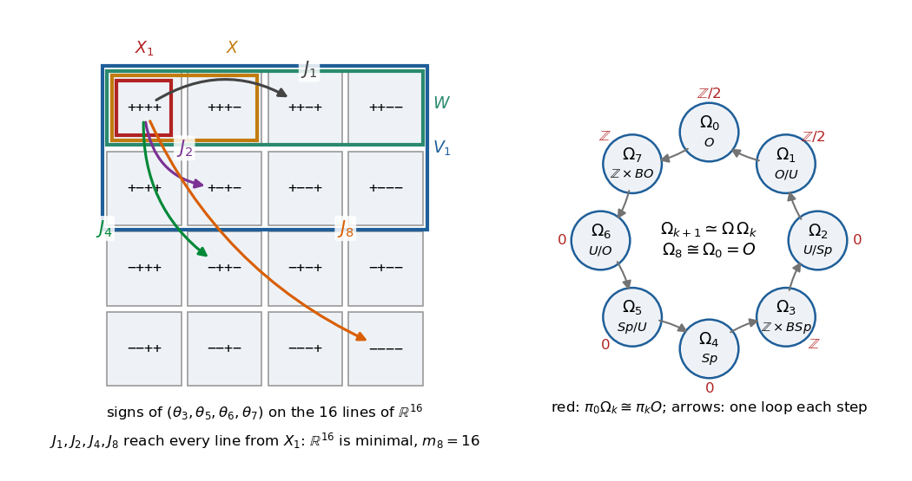

# Chapter 15. Bott periodicity for the orthogonal group: complex structures and Clifford modules

*Milnor, "Morse Theory", §24, rewritten for a first-year graduate student who wants to know what the
theorem is for. Milnor calls his treatment "rather sketchy"; the missing details are supplied, and every
proof is complete, except that, as in Chapter 14, coset fibrations, exact homotopy sequences and two
facts about CW complexes are quoted.*

---

## 0. How many independent directions can be combed on a sphere?

On the sphere of directions $S^2$ no tangent vector field is nowhere zero (the hairy ball theorem,
proved in Chapter 5 of the companion volume, *Topology from the Differentiable Viewpoint*, rewritten,
Theorem 5.1). On
the unit quaternions $S^3$ there are three at once, $x \mapsto ix, jx, kx$, orthonormal and tangent at
every point; on $S^7$ octonion multiplication gives seven. How many pointwise independent tangent fields
does $S^{n-1}$ carry? The answer, due to Radon and Hurwitz (lower bound, 1922–23) and Adams (upper bound,
1962), is $\rho(n) - 1$, where for $n = 2^{4a+b}\cdot(\text{odd})$, $0 \leq b \leq 3$,
$$\rho(n) = 8a + 2^b.$$
The lower bound comes from linear algebra: if $J_1, \dots, J_k$ are orthogonal $n \times n$ matrices with
$J_\alpha^2 = -I$ and $J_\alpha J_\beta = -J_\beta J_\alpha$, then $J_1x, \dots, J_kx$ are orthonormal and
perpendicular to $x$. The $8$ in the formula is Bott's $8$, $\pi_iO \cong \pi_{i+8}O$, and this is no
coincidence: Milnor's proof of the periodicity theorem runs through these families of anti-commuting
"complex structures". The minimal geodesics from $I$ to $-I$ in $O(n)$ are the complex structures $J_1$;
those from $J_1$ to $-J_1$ in the space of complex structures are the $J_2$ anti-commuting with $J_1$; and
so on. After eight steps one is back at an orthogonal group, and Morse theory shifts homotopy groups by
one at each step. §7 returns to vector fields and to real vector bundles over spheres.

---

## 1. The orthogonal group and its minimal geodesics (Milnor pp. 133–136)

$O(n) = \{T \in M_n(\mathbb R) : TT^{\mathsf T} = I\}$. Chapter 14, §1, holds verbatim for real matrices:
$O(n)$ is a compact Lie group with Lie algebra $\mathfrak o(n)$ of skew-symmetric matrices, the metric
$\langle A, B\rangle = \operatorname{tr}(AB^{\mathsf T})$ induced from $M_n(\mathbb R)$ (the restriction of
that of $U(n)$) is bi-invariant, conjugations are isometries, and the geodesic through $S$ with velocity
$SA$ is $t \mapsto S\exp(tA)$; geodesics from $I$ stay in $SO(n)$. We quote the normal form (real spectral
theorem, e.g. Axler): for $A \in \mathfrak o(2m)$ there is $T \in O(2m)$ with
$$TAT^{-1} = \operatorname{diag}(a_1J_0, \dots, a_mJ_0), \qquad J_0 = \begin{pmatrix}0 & 1\\ -1 &
0\end{pmatrix}, \quad a_j \geq 0,$$
and $\exp(\theta J_0) = \cos\theta\, I + \sin\theta\, J_0$ (Milnor p. 134).

**Definition.** For $n$ even, a *complex structure* on $\mathbb R^n$ is a $J \in O(n)$ with $J^2 = -I$.
$\Omega_1(n)$ denotes the set of complex structures.

**Lemma 1.1.** $J \in M_n(\mathbb R)$ is a complex structure iff $J^{\mathsf T} = -J$ and $J^2 = -I$.
For a complex structure, $\exp(\theta J) = \cos\theta\, I + \sin\theta\, J$, $|J|^2 = n$, and
$J$ is conjugate in $O(n)$ to $\operatorname{diag}(J_0, \dots, J_0)$.

*Proof.* If $J$ is orthogonal, $J^{\mathsf T} = J^{-1} = -J$; if $J$ is skew, $JJ^{\mathsf T} = -J^2 = I$.
The series for $\exp$ uses $J^{2k} = (-1)^kI$, and $|J|^2 = \operatorname{tr}(JJ^{\mathsf T}) = n$. In
the normal form, $TJ^2T^{-1} = \operatorname{diag}(-a_j^2I_2) = -I$ forces every $a_j = 1$. $\square$

**Remark (Milnor p. 133).** Fix $J_1 \in \Omega_1(n)$ and let $U(n/2) = \{T \in O(n) : TJ_1 = J_1T\}$, the
unitary group of $\mathbb R^n$ made complex by $i = J_1$. Then $\Omega_1(n) \cong O(n)/U(n/2)$. Indeed
$O(n)$ acts on $\Omega_1(n)$ by $T\cdot J = TJT^{-1}$, transitively by the last part of Lemma 1.1, with
stabilizer $U(n/2)$ at $J_1$; apply (Q1) of Chapter 14.

**Lemma 24.1.** The space of minimal geodesics from $I$ to $-I$ in $O(n)$ is homeomorphic to
$\Omega_1(n)$, by $J \mapsto \gamma_J$, $\gamma_J(t) = \exp(\pi tJ) = \cos(\pi t)\,I + \sin(\pi t)\,J$.

*Proof.* A geodesic from $I$ to $-I$ is $\gamma(t) = \exp(\pi tA)$, $A \in \mathfrak o(n)$,
$\exp(\pi A) = -I$; in the normal form this says every $a_j$ is an odd integer. Its length is
$|\pi A| = \pi(2\sum a_j^2)^{1/2} \geq \pi\sqrt n$, with equality iff every $a_j = 1$, i.e. $A^2 = -I$, i.e.
$A \in \Omega_1(n)$. A minimal geodesic exists ($O(n)$ is compact; Milnor 10.9), so the minimal geodesics
are the $\gamma_J$. The map $J \mapsto \gamma_J$ is injective ($J = \gamma_J'(0)/\pi$), continuous (constant
speed, as in Chapter 14, Lemma 2.3), and $\Omega_1(n)$ is compact. $\square$

**Lemma 24.2.** Every non-minimal geodesic from $I$ to $-I$ in $O(2m)$ has index $\geq 2m - 2$.

*Proof.* Conjugating by an orthogonal matrix (an isometry fixing $\pm I$, so preserving indices, as in
Chapter 14, Lemma 4.1), take $A = \operatorname{diag}(a_1J_0, \dots, a_mJ_0)$, the $a_j$ odd and positive,
$a_1 \geq \cdots \geq a_m$. The velocity is $V = \pi A$, and by Theorems 21.3(b) and 20.5 the conjugate
points are governed by $K_V = \pi^2K_A$, $K_A(W) = -\tfrac14[A, [A, W]]$.

*Eigenvalues of $K_A$* (Milnor's "computation shows"). Write $W \in \mathfrak o(2m)$ in $2 \times 2$ blocks,
$W_{ji} = -W_{ij}^{\mathsf T}$, and split $M_2(\mathbb R) = C_+ \oplus C_-$, where
$C_+ = \operatorname{span}(I, J_0)$ commutes with $J_0$ and
$C_- = \operatorname{span}(\operatorname{diag}(1,-1), \bigl(\begin{smallmatrix}0&1\\1&0\end{smallmatrix}\bigr))$
anti-commutes with it; $J_0C_\pm = C_\pm$. For $i < j$ and $X \in C_\pm$ let $W^{(ij)}_X$ have block $X$ at
$(i,j)$, $-X^{\mathsf T}$ at $(j,i)$, zeros elsewhere. The $(i,j)$ block of $[A, W]$ is
$a_iJ_0W_{ij} - a_jW_{ij}J_0$, so $[A, W^{(ij)}_X] = W^{(ij)}_{(a_i \mp a_j)J_0X}$ and
$K_AW^{(ij)}_X = \tfrac14(a_i \mp a_j)^2W^{(ij)}_X$; the diagonal blocks lie in $\mathbb RJ_0$ and commute
with $A$. Since $4\cdot m(m-1)/2 + m = \dim\mathfrak o(2m)$, the non-zero eigenvalues of $K_A$ are
$(a_i + a_j)^2/4$ ($i < j$) and $(a_i - a_j)^2/4$ ($a_i > a_j$), each twice.

*Conjugate points.* An eigenvalue $e^2$ of $K_A$ gives conjugate points at $t = \pi s/\sqrt{\pi^2e^2} =
s/e$ (Theorem 20.5); for $e = (a_i \pm a_j)/2$, an integer, $e - 1$ of them lie in $(0,1)$. By the Index
Theorem 15.1,
$$\lambda = \sum_{i<j}(a_i + a_j - 2) + \sum_{a_i > a_j}(a_i - a_j - 2),$$
all terms $\geq 0$. For a minimal geodesic all $a_j = 1$ and $\lambda = 0$; otherwise $a_1 \geq 3$ and
$\lambda \geq \sum_{j=2}^m(3 + 1 - 2) = 2m - 2$. $\square$

**Theorem 24.3 (Bott).** The inclusion $\Omega_1(n) \to \Omega(O(n); I, -I)$ of Lemma 24.1 induces
isomorphisms of homotopy groups in dimensions $\leq n - 4$. Hence $\pi_i\Omega_1(n) \cong \pi_{i+1}O(n)$
for $i \leq n - 4$.

*Proof.* As in Chapter 14, Theorem 23.3, in the compact manifold $SO(n)$: $\Omega_1(n)$ is a manifold
(the Remark, or Lemma 24.4), $\lambda_0 = n - 2$ (Lemma 24.2), and
$\pi_i\Omega(SO(n); I, -I) \cong \pi_{i+1}SO(n) = \pi_{i+1}O(n)$. $\square$

---

## 2. Anti-commuting complex structures and the spaces $\Omega_k(n)$ (Milnor pp. 136–138)

**Definition.** Fix complex structures $J_1, \dots, J_{k-1}$ on $\mathbb R^n$ that anti-commute,
$J_rJ_s + J_sJ_r = 0$ for $r \neq s$ (they make $\mathbb R^n$ a module over a Clifford algebra, §5). Let
$\Omega_k(n)$ be the set of complex structures anti-commuting with $J_1, \dots, J_{k-1}$, and
$\Omega_0(n) = O(n)$: $\Omega_k(n) \subseteq \cdots \subseteq \Omega_1(n) \subseteq O(n)$, all compact.

Products of anti-commuting complex structures obey simple sign rules. Let $J_1, \dots, J_k$ anti-commute
pairwise, and for $S = \{s_1 < \cdots < s_p\} \subseteq \{1, \dots, k\}$ put $J_S = J_{s_1}\cdots
J_{s_p}$, $J_\emptyset = I$.

**Lemma 2.1 (sign rules).** (a) $J_S$ is orthogonal and $J_S^{\mathsf T} = (-1)^{p(p+1)/2}J_S$: for
$p \equiv 0, 3 \pmod 4$ it is symmetric with $J_S^2 = I$, for $p \equiv 1, 2 \pmod 4$ it is a complex
structure. (b) $J_SJ_T = (-1)^{pq - |S \cap T|}J_TJ_S$ for $|T| = q$; in particular $J_\alpha$ commutes
with $J_S$ iff $p - [\alpha \in S]$ is even. (c) $J_SJ_T = \pm J_{S \triangle T}$, the sign depending only
on $S$ and $T$.

*Proof.* (a) $J_S^{\mathsf T} = (-1)^pJ_{s_p}\cdots J_{s_1}$, and reversing $p$ anti-commuting factors costs
$(-1)^{p(p-1)/2}$; with $J_S^{\mathsf T}J_S = I$ this gives $J_S^2 = \pm I$ with the same sign. (b) Moving
the $q$ factors of $J_T$ past the $p$ factors of $J_S$ costs a sign for each pair of distinct indices.
(c) Bring equal factors together and use $J_\alpha^2 = -I$. $\square$

Milnor calls a submanifold *totally geodesic* if each of its geodesics (for the induced metric) is a
geodesic of the larger manifold.

**Lemma 2.2.** Let $N$ be a submanifold of a Riemannian manifold $M$, with the induced metric. (a) If for
every $v \in TN_x$ the $M$-geodesic $t \mapsto \exp^M_x(tv)$ stays in $N$ for small $|t|$, then $N$ is
totally geodesic. (b) If $N$ is totally geodesic, then $R^N(X,Y)Z = R^M(X,Y)Z$ for $X, Y, Z \in TN_x$.
(c) An isometry of $M$ that maps $N$ onto $N$ restricts to an isometry of $N$.

*Proof.* (a) Let $c(t) = \exp^M_x(tv)$ lie in $N$ for $|t| < \varepsilon$. For small $\delta$, $c|[0,\delta]$
is no longer than any path in $M$ between its endpoints (Theorem 10.4), in particular than any path in
$N$, which has the same length in both. So it is a minimal path of $N$ parametrized proportionally to
arc length, hence a geodesic of $N$ (Corollary 10.7, applied in $N$). By uniqueness, the $N$-geodesic
with velocity $v$ coincides with $c$ near $t = 0$; as $x$ and $v$ are arbitrary, every $N$-geodesic is
locally, hence globally, an $M$-geodesic. (b) For $X, Y$ tangent to $N$, the tangential part of
$\nabla^M_XY$ is a symmetric connection compatible with the metric, hence is $\nabla^N_XY$ (Lemma 8.6).
The rest, $\mathrm{II}(X,Y) = \nabla^M_XY - \nabla^N_XY$, is tensorial and symmetric, and the same
splitting holds along curves. Along an $N$-geodesic $c$, an $M$-geodesic by hypothesis,
$0 = D^Mc'/dt = \mathrm{II}(c', c')$; so $\mathrm{II} = 0$ by polarization, $\nabla^M = \nabla^N$ on fields
tangent to $N$, and $R(X,Y)Z = -\nabla_X\nabla_YZ + \nabla_Y\nabla_XZ + \nabla_{[X,Y]}Z$ is the same in
$N$ and $M$. (c) Its inverse also preserves $N$. $\square$

**Lemma 24.4.** (i) Each $\Omega_k(n)$ is a smooth, totally geodesic submanifold of $O(n)$; its tangent
space at $J$ is $J\mathcal T_J$, where
$$\mathcal T_J = \{A \in \mathfrak o(n) : AJ = -JA,\ AJ_\alpha = J_\alpha A \text{ for } \alpha < k\}.$$
(ii) Each component of $\Omega_k(n)$ is a symmetric space. (iii) Let $J_k \in \Omega_k(n)$ (and $J_0 = I$),
let $\Omega_{k+1}(n)$ be the set of $J' \in \Omega_k(n)$ anti-commuting with $J_k$, and suppose
$\Omega_{k+1}(n) \neq \emptyset$. Then the minimal geodesics from $J_k$ to $-J_k$ in $\Omega_k(n)$ are
exactly the semicircles
$$\gamma_{J'}(t) = \cos(\pi t)\,J_k + \sin(\pi t)\,J', \qquad J' \in \Omega_{k+1}(n),$$
and $J' \mapsto \gamma_{J'}$ is a homeomorphism of $\Omega_{k+1}(n)$ onto the space of minimal geodesics.

For $k = 0$, (i) is Chapter 14's chart argument and (iii) is Lemma 24.1; assume $k \geq 1$. Milnor's
version of (iii), "for $0 \leq l < k$", tacitly needs $\Omega_{l+1}(n) \neq \emptyset$, which his
standing assumption provides.

*Proof.* Let $B_\varepsilon \subseteq \mathfrak o(n)$ be a ball on which $\exp$ is a diffeomorphism onto
a neighbourhood of $I$ in $O(n)$, invariant under $A \mapsto -A$ and orthogonal conjugation. Let
$J \in \Omega_k(n)$ and $A \in \mathfrak o(n)$.

*Assertion 1.* If $AJ = -JA$, then $J\exp A$ is a complex structure; for $A \in B_\varepsilon$ the converse
holds. Indeed $(J\exp A)^2 = J^2(J^{-1}\exp(A)J)\exp A = -\exp(J^{-1}AJ)\exp(A)$, which is $-I$ iff
$\exp(J^{-1}AJ) = \exp(-A)$; this holds if $J^{-1}AJ = -A$, and for $A \in B_\varepsilon$ only then.

*Assertion 2.* If $AJ_\alpha = J_\alpha A$, then $J\exp A$ anti-commutes with $J_\alpha$; for
$A \in B_\varepsilon$ the converse holds. Indeed $J_\alpha J\exp A = -J\exp(J_\alpha AJ_\alpha^{-1})J_\alpha$,
which is $-(J\exp A)J_\alpha$ iff $\exp(J_\alpha AJ_\alpha^{-1}) = \exp A$.

(i) So $\Omega_k(n) \cap J\exp(B_\varepsilon) = J\exp(B_\varepsilon \cap \mathcal T_J)$; as
$A \mapsto J\exp A$ is a chart of $O(n)$, $\Omega_k(n)$ is near $J$ an open piece of the linear subspace
$\mathcal T_J$ in this chart (components may have different dimensions). The $O(n)$-geodesic
$t \mapsto J\exp(tA)$, $A \in \mathcal T_J$, stays in $\Omega_k(n)$ for all $t$ by the "if" halves, so
$\Omega_k(n)$ is totally geodesic by Lemma 2.2(a): this is Milnor's "clearly implies".

(ii) The reflection of $O(n)$ in $J$ is $I_J(S) = JS^{-1}J$ (Lemma 21.1), and for $J' \in \Omega_k(n)$,
$I_J(J') = -JJ'J$ is orthogonal, squares to $JJ'J^2J'J = J^2 = -I$ and anti-commutes with each $J_\alpha$.
So $I_J$ is an isometry of $\Omega_k(n)$ (Lemma 2.2(c)) fixing $J$ with derivative $-1$, reversing the
geodesics through $J$; $\Omega_k(n)$ is compact, so each component is a symmetric space.

(iii) Distances in $\Omega_k(n)$ are $\geq$ distances in $O(n)$, and $\rho_O(J_k, -J_k) =
\rho_O(I, -I) = \pi\sqrt n$. For $J' \in \Omega_{k+1}(n)$ let $A = J_k^{-1}J' = -J_kJ'$: then
$A^2 = -J_k^2J'^2 = -I$, $A$ anti-commutes with $J_k$ and commutes with each $J_\alpha$, $\alpha < k$, so
$A \in \mathcal T_{J_k}$ is a complex structure and $J_k\exp(\pi tA) = \gamma_{J'}(t)$ (Lemma 1.1). This
$O(n)$-geodesic lies in $\Omega_k(n)$ (Assertions 1, 2) and has length $\pi\sqrt n$, so it is a minimal
path, hence a minimal geodesic, of $\Omega_k(n)$ (Corollary 10.7), and the distance in $\Omega_k(n)$ is
$\pi\sqrt n$. Conversely, a minimal geodesic $\gamma$ of $\Omega_k(n)$ from $J_k$ to $-J_k$ is an
$O(n)$-geodesic of length $\pi\sqrt n$, so $J_k^{-1}\gamma$ is minimal from $I$ to $-I$:
$\gamma(t) = J_k\exp(\pi tA)$ with $A$ a complex structure (Lemma 24.1). As $\gamma(t) \in \Omega_k(n)$ for
small $t$, the "only if" halves give $AJ_k = -J_kA$, $AJ_\alpha = J_\alpha A$, and then $J' = J_kA$ is in
$\Omega_{k+1}(n)$ ($J'^2 = -J_k^2A^2 = -I$, $J_kJ' = -A = -J'J_k$, and $J'$ anti-commutes with $J_\alpha$
because $J_k$ does and $A$ commutes with it), with $\gamma = \gamma_{J'}$. The homeomorphism follows as in
Lemma 24.1. $\square$

**Remark (Milnor p. 138).** The point $J'$ corresponding to a minimal geodesic is its midpoint
$\gamma_{J'}(1/2)$. All of $\Omega_k(n)$ lies on the sphere $|J|^2 = n$ in $M_n(\mathbb R)$, and
$\langle J', J_k\rangle = -\operatorname{tr}(J'J_k) = 0$ since $J'J_k$ is skew: the minimal geodesics are
great semicircles from the "pole" $J_k$ to $-J_k$ through the "equator" $\Omega_{k+1}(n)$, as in the
picture of §22 for antipodal points of $S^{n+1}$.

---

## 3. Stabilization and the statement of the periodicity theorem (Milnor pp. 138, 142)

To pass to the limit we need structures on a block that is added again and again. Let
$\sigma = \bigl(\begin{smallmatrix}0&-1\\1&0\end{smallmatrix}\bigr)$, $\tau = \operatorname{diag}(1,-1)$,
$\kappa = \bigl(\begin{smallmatrix}0&1\\1&0\end{smallmatrix}\bigr)$; any two anti-commute, $\sigma^2 = -I$,
$\tau^2 = \kappa^2 = I$. On $\mathbb R^{16} = (\mathbb R^2)^{\otimes 4}$ (Kronecker products) put
$$\begin{aligned}
J'_1 &= 1\otimes 1\otimes\sigma\otimes\tau, & J'_2 &= 1\otimes\sigma\otimes\tau\otimes\tau, &
J'_3 &= \sigma\otimes 1\otimes\kappa\otimes\tau, & J'_4 &= \sigma\otimes\tau\otimes\tau\otimes\tau,\\
J'_5 &= \sigma\otimes\kappa\otimes\tau\otimes\tau, & J'_6 &= \tau\otimes\sigma\otimes\kappa\otimes\tau, &
J'_7 &= \kappa\otimes\sigma\otimes\kappa\otimes\tau, & J'_8 &= 1\otimes 1\otimes 1\otimes\sigma.
\end{aligned}$$
Products are computed slot by slot, so two such words anti-commute iff they carry different non-identity
letters in an odd number of slots, and a word with one $\sigma$ is skew with square $-I$; checking the
$28$ pairs shows that $J'_1, \dots, J'_8$ are anti-commuting complex structures.

For $n = 16r$ let $J_\alpha = J'_\alpha \oplus \cdots \oplus J'_\alpha$ ($r$ copies) on
$\mathbb R^{16r} = (\mathbb R^{16})^r$. From now on $\Omega_k(16r)$ is defined with these
$J_1, \dots, J_{k-1}$, with base point $J_k$. The map $J \mapsto J \oplus J'_k$ (for $k = 0$,
$T \mapsto T \oplus I_{16}$) embeds $\Omega_k(16r)$ in $\Omega_k(16r + 16)$, carrying $J_k$ to $J_k$.

**Definition (Milnor p. 138).** $\Omega_k = \bigcup_r\Omega_k(16r)$ with the colimit topology. The space
$O = \Omega_0$ is the *infinite orthogonal group*. (Milnor uses all $n$; the
multiples of $16$ are cofinal.)

The maps $\varphi_r : \Omega_{k+1}(16r) \to \Omega(\Omega_k(16r); J_k, -J_k)$,
$\varphi_r(J') = \gamma_{J'}$, of Lemma 24.4(iii) are compatible with the embeddings:
$$\varphi_{r+1}(J' \oplus J'_{k+1}) = \varphi_r(J') \oplus \delta_k, \qquad \delta_k(t) =
\cos(\pi t)\,J'_k + \sin(\pi t)\,J'_{k+1},$$
where on path spaces the embedding is $\omega \mapsto \omega \oplus \delta_k$. This is what Milnor calls
"not difficult to see": the inclusions pass to a limit map $\Omega_{k+1} \to \Omega\Omega_k$. By the
lemma on compact sets in a colimit (Chapter 14, proof of
Corollary 23.6), $\pi_i\Omega_k = \operatorname{colim}_r\pi_i\Omega_k(16r)$, and similarly for the
spaces of continuous paths from $J_k$ to $-J_k$, which we denote $\Omega\Omega_k$.

**Theorem 24.5.** For $0 \leq k \leq 7$ the limit map $\varphi : \Omega_{k+1} \to \Omega\Omega_k$ induces a
bijection of path components and isomorphisms of all homotopy groups. Consequently, with base points
$J_k$,
$$\pi_hO \cong \pi_{h-1}\Omega_1 \cong \pi_{h-2}\Omega_2 \cong \cdots \cong \pi_1\Omega_{h-1} \cong
\pi_0\Omega_h \qquad (1 \leq h \leq 8),$$
the last bijection being one of sets.

The consequence holds because the paths from $J_k$ to $-J_k$ form a space homotopy equivalent to the
loops at $J_k$, compatibly (up to homotopy) with the embeddings, so $\pi_j\Omega\Omega_k \cong
\pi_{j+1}\Omega_k$ (Chapter 14, proof of Theorem 23.3). Milnor states Theorem 24.5 for all $k \geq 0$,
but his proof needs Lemma 24.8 for $k + 1$ structures, which he gives only for $k + 1 \leq 8$; $k \leq 7$
is all that periodicity needs. Milnor's conclusion is a homotopy equivalence, which needs the two facts
quoted at the end of §6; his chain of isomorphisms stops at $\pi_1\Omega_{h-1}$, and the last bijection
is added here. The proof is in §6.

---

## 4. The eight spaces (Milnor pp. 138–142)

Given $J_1, \dots, J_7$, define
$$\theta_3 = J_1J_2J_3, \qquad \theta_5 = J_1J_4J_5, \qquad \theta_6 = J_2J_4J_6, \qquad \theta_7 =
J_1J_6J_7.$$
By Lemma 2.1 these are symmetric orthogonal involutions; any two commute (their index sets meet in one
element), and $J_\alpha$ commutes with $\theta_{abc}$ iff $\alpha \in \{a, b, c\}$. Solving for the last
factor, $J_3 = -J_1J_2\theta_3$, $J_5 = J_4J_1\theta_5$, $J_6 = J_4J_2\theta_6$, $J_7 = J_6J_1\theta_7$.
The table records which $J_\alpha$ commute (c) or anti-commute (a) with which $\theta$:

| | $\theta_3$ | $\theta_5$ | $\theta_6$ | $\theta_7$ |
|---|---|---|---|---|
| $J_1$ | c | c | a | c |
| $J_2$ | c | a | c | a |
| $J_3$ | c | a | a | a |
| $J_4$ | a | c | c | a |
| $J_5$ | a | c | a | a |
| $J_6$ | a | a | c | c |
| $J_7$ | a | a | a | c |
| $J_8$ | a | a | a | a |

Lemma 24.6 rests on two observations.

**Lemma 4.1 (odd steps).** Let $J_1, \dots, J_{k-1}$ be fixed and $a < b < k$. Then
$J \mapsto E = \{v : J_aJ_bJv = v\}$ is a bijection from $\Omega_k(n)$ onto the set of subspaces $E$ with
$J_aE = E$, $J_bE = E$ and $J_cE = E^\perp$ for all $c < k$, $c \notin \{a, b\}$. The inverse is
$J = J_bJ_a(2P_E - I)$, $P_E$ the orthogonal projection, so the bijection is a homeomorphism when
subspaces are topologized by their projections.

*Proof.* For $J \in \Omega_k(n)$, $\theta = J_aJ_bJ$ is a symmetric involution commuting with $J_a, J_b$
and anti-commuting with the other $J_c$ (Lemma 2.1), so $\theta = 2P_E - I$ with $E$ as stated.
Conversely, $\theta = 2P_E - I$ commutes with $J_a, J_b$ and, since $J_cE = E^\perp$ forces
$J_cE^\perp = E$, anti-commutes with $J_c$; then $J = J_bJ_a\theta$ is orthogonal, $J^2 =
(J_bJ_a)^2\theta^2 = -I$, and $J$ anti-commutes with $J_a, J_b$ (as $J_bJ_a$ does) and with $J_c$ (as
$\theta$ does). Finally $\theta = J_aJ_bJ$ iff $J = J_bJ_a\theta$. $\square$

**Lemma 4.2 (even steps).** For $k \geq 2$, $J \mapsto Q = J_{k-1}J$ is a bijection from $\Omega_k(n)$
onto the set of $Q \in O(n)$ with $Q^2 = -I$ that commute with $J_1, \dots, J_{k-2}$ and anti-commute with
$J_{k-1}$; the inverse is $Q \mapsto -J_{k-1}Q$.

*Proof.* Lemma 2.1 gives the properties of $Q$. Conversely, for $J = -J_{k-1}Q$:
$J^2 = J_{k-1}QJ_{k-1}Q = -J_{k-1}^2Q^2 = -I$; for $c \leq k-2$, $J_cJ = J_{k-1}J_cQ = J_{k-1}QJ_c = -JJ_c$;
and $J_{k-1}J = Q = -JJ_{k-1}$. $\square$

The bijections of Lemmas 4.1 and 4.2, and those built from them in Lemma 24.6 below, are restrictions
of affine maps between spaces of matrices (subspaces enter through their projections, and an isometry
$T$ has $T^{-1} = T^{\mathsf T}$), with inverses of the same kind; so they are diffeomorphisms
between the submanifolds involved, as Milnor states.

**$\Omega_2$ (Milnor pp. 138–139).** With $i = J_1$, $\mathbb R^n = \mathbb C^{n/2}$, and
$J \in \Omega_2(n)$ is a conjugate-linear complex structure; $J_1, J, J_1J$ satisfy the relations of the
quaternion units, a "quaternionic structure". For $4 \mid n$, $\Omega_2(n) \cong U(n/2)/Sp(n/4)$, with
$Sp(n/4)$ the isometries commuting with $J_1, J_2$: $U(n/2)$ acts by conjugation, transitively by
Lemma 24.8 below ($k = 2$), with stabilizer $Sp(n/4)$ at $J_2$.

From now on $n = 16r$, with the structures of §3. In $\mathbb R^{16}$ the sixteen joint eigenspaces of
$\theta_3, \theta_5, \theta_6, \theta_7$ are lines (this follows from §5: $\mathbb R^{16}$ is a minimal
$(J'_1, \dots, J'_8)$-space, and the proof of Lemma 24.8 shows that all sixteen are non-zero), so in
$\mathbb R^{16r}$ they all have dimension $r$.

**Lemma 4.3 (the pieces).** (a) Once $J_1, \dots, J_4$ are fixed, $\mathbb R^{16r} = V_1 \oplus J_4V_1$,
$V_1 = \{\theta_3 = 1\}$. (b) Once $J_1, \dots, J_5$ are fixed, with $W = V_1 \cap \{\theta_5 = 1\}$,
$\mathbb R^{16r} = W \oplus J_2W \oplus J_4W \oplus J_4J_2W$ and $V_1 = W \oplus J_2W$. (c) Once
$J_1, \dots, J_6$ are fixed, with $X = W \cap \{\theta_6 = 1\}$, $\mathbb R^{16r} = \bigoplus_{S \subseteq
\{1,2,4\}}J_SX$ and $W = X \oplus J_1X$. All sums are orthogonal, the summands being the joint eigenspaces
of the $\theta$'s involved.

*Proof.* Commuting symmetric involutions split $\mathbb R^{16r}$ orthogonally into joint eigenspaces; by
the table, among $\theta_3, \theta_5, \theta_6$, $J_4$ reverses the sign of $\theta_3$ only, $J_2$ of
$\theta_5$ only, $J_1$ of $\theta_6$ only, and so permutes the joint eigenspaces accordingly. $\square$

**Lemma 24.6-(3).** $J_3 \mapsto V_1 = \{\theta_3 = 1\}$ identifies $\Omega_3(16r)$ with the set of all
quaternionic subspaces of $\mathbb H^{4r}$ (subspaces invariant under $J_1$ and $J_2$). On $V_1$,
$J_3 = -J_1J_2$; on $V_2 = V_1^\perp$, $J_3 = J_1J_2$.

*Proof.* Lemma 4.1 with $(a, b) = (1, 2)$ and no further $c$; $J_3 = J_2J_1(2P - I)$. $\square$

$\Omega_3(16r)$ has components $G_j(\mathbb H^{4r})$ of varying dimension $4j(4r - j)$. Milnor restricts
to the largest, $j = 2r$: $\dim_{\mathbb H}V_1 = \dim_{\mathbb H}V_2 = 2r$, as for our $J_3$.

**Lemma 24.6-(4).** $J_4 \mapsto T = J_3J_4|V_1$ identifies $\Omega_4(16r)$ with the set of quaternionic
isometries $T : V_1 \to V_2$, the inverse being $J_4|V_1 = J_3^{-1}T$, $J_4|V_2 = -T^{-1}J_3$. Thus
$\Omega_4(16r) \cong Sp(2r)$.

*Proof.* By Lemma 4.2, $J_4 \leftrightarrow Q = J_3J_4$ with $Q^2 = -I$, $Q$ commuting with $J_1, J_2$
and anti-commuting with $J_3$, hence with $\theta_3$. So $Q$ maps $V_1$ to $V_2$ and back,
$T = Q|V_1$ is an isometry commuting with $J_1, J_2$, and $Q|V_2 = -T^{-1}$. Conversely, for such a $T$,
$Q = T \oplus (-T^{-1})$ satisfies $Q^2 = -I$, commutes with $J_1, J_2$ (so with $J_1J_2$), and
anti-commutes with $\theta_3$, hence with $J_3 = -J_1J_2\theta_3$. Then $J_4 = -J_3Q$, which is
$J_3^{-1}T$ on $V_1$ and $J_3T^{-1} = -T^{-1}J_3$ on $V_2$ ($T$ intertwines $J_3|V_1 = -J_1J_2$ with
$-J_3|V_2$). Choosing a base point $T_0$, $T \mapsto T_0^{-1}T$ identifies the set with the group of
quaternionic isometries of $V_1 \cong \mathbb H^{2r}$. $\square$

**Lemma 24.6-(5).** $J_5 \mapsto W = V_1 \cap \{\theta_5 = 1\}$ identifies $\Omega_5(16r)$ with the set of
subspaces $W \subseteq V_1$ such that (1) $J_1W = W$ and (2) $V_1 = W \oplus J_2W$, orthogonally.

*Proof.* Lemma 4.1 with $(a,b) = (1,4)$: $\Omega_5 \leftrightarrow E$ with $J_1E = J_4E = E$,
$J_2E = J_3E = E^\perp$. Given $E$: $\theta_5$ commutes with $\theta_3$, so $E = (E \cap V_1) \oplus
(E \cap V_2)$ with $E \cap V_2 = J_4W$; $J_1W = W$; and $J_2$, preserving $V_1$, maps $W$ onto
$E^\perp \cap V_1$. Conversely, given $W$, put $E = W \oplus J_4W$: then $J_1E = J_4E = E$,
$J_2E = J_2W \oplus J_4J_2W = E^\perp$ by Lemma 4.3(a), and $J_3E = J_1J_2\theta_3E = E^\perp$. $\square$

**Remark.** $\Omega_5(16r) \cong Sp(2r)/U(2r)$, where $U(2r)$ is the group of quaternionic automorphisms of
$V_1$ preserving a fixed $W$. Indeed $Sp(V_1)$ acts transitively on the set of such $W$: a unitary
isomorphism $U : W \to W'$ (for $i = J_1$) extends to $V_1$ by $J_2w \mapsto J_2Uw$, and this extension
commutes with $J_1$ and $J_2$; the stabilizer of $W$ restricts isomorphically to the unitary group of $W$.

**Lemma 24.6-(6).** $J_6 \mapsto X = W \cap \{\theta_6 = 1\}$ identifies $\Omega_6(16r)$ with the set of
real subspaces $X \subseteq W$ such that $W = X \oplus J_1X$, orthogonally.

*Proof.* Lemma 4.1 with $(a,b) = (2,4)$: $\Omega_6 \leftrightarrow E$ with $J_2E = J_4E = E$,
$J_1E = J_3E = J_5E = E^\perp$. Given $E$: $\theta_6$ commutes with $\theta_3, \theta_5$, so $E$ splits
along the four pieces of Lemma 4.3(b), and as $J_2, J_4$ preserve $E$,
$E = X \oplus J_2X \oplus J_4X \oplus J_4J_2X$; $J_1$ maps $X$ onto $E^\perp \cap W$. Conversely, given $X$,
define $E$ by this formula: $J_2, J_4$ permute its summands; $J_1E$ is the same sum built on
$J_1X = W \ominus X$, which is $E^\perp$; and since $\theta_3, \theta_5$ are $\pm 1$ on each piece,
$J_3E = J_1J_2E = E^\perp$, $J_5E = J_4J_1E = E^\perp$. $\square$

**Remark.** $\Omega_6(16r) \cong U(2r)/O(2r)$: the unitary group of $(W, J_1)$ acts transitively on such
$X$ (a real isometry $X \to X'$ extends complex-linearly), with stabilizer $O(X)$.

**Lemma 24.6-(7).** $J_7 \mapsto X_1 = X \cap \{\theta_7 = 1\}$ identifies $\Omega_7(16r)$ with the set of
all subspaces of $X \cong \mathbb R^{2r}$.

*Proof.* Lemma 4.1 with $(a,b) = (1,6)$: $\Omega_7 \leftrightarrow E$ with $J_1E = J_6E = E$ and
$J_cE = E^\perp$ for $c = 2, \dots, 5$. Given $E$: $\theta_7$ commutes with $\theta_3, \theta_5, \theta_6$,
so $E$ splits along the eight pieces $J_SX$; as $J_1$ preserves $E$ while $J_2, J_4$ exchange $E$ and
$E^\perp$,
$$E = \bigoplus_{S \subseteq \{1,2,4\}}J_SX_{(S)}, \qquad X_{(S)} = X_1 \text{ if } |S \cap \{2,4\}|
\text{ is even}, \quad X_{(S)} = X_2 = X \ominus X_1 \text{ otherwise}. \tag{4.1}$$
Conversely, for any $X_1 \subseteq X$ define $E$ by (4.1): $J_1E = E$, $J_2E = J_4E = E^\perp$,
$J_6E = J_4J_2\theta_6E = E$, $J_3E = J_1J_2\theta_3E = E^\perp$, $J_5E = J_4J_1\theta_5E = E^\perp$.
$\square$

Again the components $G_j(\mathbb R^{2r})$ vary in dimension, and Milnor restricts to $\dim X_1 = \dim X_2
= r$, as for our $J_7$. **Assertion (Milnor p. 141):** the largest component of $\Omega_7(16r)$ is
diffeomorphic to the Grassmann manifold of $r$-dimensional subspaces of $\mathbb R^{2r}$.

**Lemma 24.6-(8).** $J_8 \mapsto T = J_7J_8|X_1$ identifies $\Omega_8(16r)$ with the set of isometries
$T : X_1 \to X_2$. Thus $\Omega_8(16r) \cong O(r)$.

*Proof.* By Lemma 4.2, $J_8 \leftrightarrow Q = J_7J_8$, $Q^2 = -I$, commuting with $J_1, \dots, J_6$ and
anti-commuting with $J_7$. Then $Q$ commutes with $\theta_3, \theta_5, \theta_6$ and with $J_1, J_2, J_4$,
so it preserves $X$ and is determined by $Q_X = Q|X$ through $Q(J_Sx) = J_SQ_Xx$; and it anti-commutes
with $\theta_7$, so $Q_X$ exchanges $X_1$ and $X_2$, with $Q_X|X_2 = -T^{-1}$. Conversely, given $T$,
put $Q_X = T \oplus (-T^{-1})$ and $Q = J_SQ_XJ_S^{-1}$ on $J_SX$. Then $Q^2 = -I$; $Q$ commutes with
$J_1, J_2, J_4$ (as $J_\alpha J_S = \pm J_{S \triangle \{\alpha\}}$) and with $\theta_3, \theta_5,
\theta_6$ (scalars on each piece), hence with $J_3, J_5, J_6$; and it anti-commutes with $\theta_7$
(on $J_SX$, $\theta_7 = (-1)^{|S \cap \{2,4\}|}J_S\theta_7J_S^{-1}$, and $Q_X$ anti-commutes with
$\theta_7|X$), hence with $J_7 = J_6J_1\theta_7$. $\square$

**Passing to the limit.** Under $J \mapsto J \oplus J'_8$ the spaces $X_1, X_2$ of $\mathbb R^{16r+16}$ are
$X_1 \oplus X'_1$, $X_2 \oplus X'_2$ (lines $X'_1, X'_2 \subseteq \mathbb R^{16}$), and $T \mapsto
T \oplus T'_0$ with $T'_0 = J'_7J'_8|X'_1$. With the base point $T_0 = J_7J_8|X_1$ and $T \mapsto
T_0^{-1}T$, this is $O(r) \to O(r+1)$, $T \mapsto T \oplus 1$. Hence $\Omega_8$ is homeomorphic to $O$,
compatibly with base points. Likewise $\Omega_4(16r) \cong Sp(2r)$ is compatible with
$Sp(2r) \to Sp(2r+2)$, and $Sp = \Omega_4$ is the infinite symplectic group.

**Remark (Milnor's footnote, p. 142).** For $k > 8$, with $J_9, \dots, J_{k-1}$ also fixed,
$J \mapsto J_8J|X_1$ identifies $\Omega_k(16r)$ with $\Omega_{k-8}(r)$, defined on $X_1 \cong
\mathbb R^r$ with the fixed structures $J_8J_\alpha|X_1$, $9 \leq \alpha < k$. Indeed $J_8J$ commutes with
$J_1, \dots, J_7$, hence preserves $X_1$, and is a complex structure anti-commuting with each
$J_8J_\alpha$ (Lemma 2.1). Conversely, $\mathbb R^{16r} = \bigoplus_{S \subseteq \{1,2,4,8\}}J_SX_1$ (the
flips of $J_1, J_2, J_4, J_8$ on $\theta_3, \theta_5, \theta_6, \theta_7$ form a basis of
$(\mathbb Z/2)^4$), and an operator $C$ on $X_1$ extends uniquely to $\hat C$ commuting with
$J_1, \dots, J_7$ and anti-commuting with $J_8$: $\hat C(J_Sx) = \pm J_SCx$, with $-$ iff $8 \in S$; then
$J = -J_8\hat C$. The same decomposition shows that a space $V$ with $k + 8$ anti-commuting structures has
$\dim V = 16\dim X_1(V)$, with $V$ minimal iff $X_1(V)$ is; and $k$ structures $C_\beta$ on $X$ give
$k + 8$ on $\mathbb R^{16} \otimes X$, namely $J'_\alpha \otimes 1$ and $\omega'_8 \otimes C_\beta$, where
$\omega'_8 = J'_1\cdots J'_8$ is a symmetric involution anti-commuting with each $J'_\alpha$. Hence
$m_{k+8} = 16m_k$.

**Theorem 24.7 (Bott).** $\pi_iO \cong \pi_{i+8}O$ for $i \geq 0$. With the facts quoted at the end of §6,
$O$ has the homotopy type of its eighth loop space $\Omega^8O$, $O \simeq \Omega^4Sp$ and $Sp \simeq
\Omega^4O$.

*Proof.* Theorem 24.5, applied eight times, and $\Omega_8 \cong O$:
$\pi_{i+8}O \cong \pi_{i+7}\Omega_1 \cong \cdots \cong \pi_i\Omega_8 \cong \pi_iO$. Similarly
$\Omega_4 \simeq \Omega^4\Omega_0$ and $\Omega_8 \simeq \Omega^4\Omega_4$. $\square$

**The table (Milnor p. 142, "left to the reader").** By Theorem 24.5, $\pi_hO \cong \pi_0\Omega_h$ as sets
for $1 \leq h \leq 8$, and $\pi_0\Omega_h$ is visible from Lemma 24.6, using the connectedness of
$U(n)$, $Sp(n)$, $SO(n)$ and of the Grassmannians:

| $k$ | $\Omega_k(16r)$ | limit | $\pi_0\Omega_k$ |
|---|---|---|---|
| 0 | $O(16r)$ | $O$ | $\mathbb Z/2$ |
| 1 | $O(16r)/U(8r)$ | $O/U$ | $\mathbb Z/2$ |
| 2 | $U(8r)/Sp(4r)$ | $U/Sp$ | $0$ |
| 3 | $\coprod_j G_j(\mathbb H^{4r})$ | $\mathbb Z \times BSp$ | $\mathbb Z$ |
| 4 | $Sp(2r)$ | $Sp$ | $0$ |
| 5 | $Sp(2r)/U(2r)$ | $Sp/U$ | $0$ |
| 6 | $U(2r)/O(2r)$ | $U/O$ | $0$ |
| 7 | $\coprod_j G_j(\mathbb R^{2r})$ | $\mathbb Z \times BO$ | $\mathbb Z$ |
| 8 | $O(r)$ | $O$ | $\mathbb Z/2$ |

($O(n)/U(n/2)$ has two components because $U(n/2) \subseteq SO(n)$ is connected; in the limit the
components of $\Omega_3$ are labelled by $j - 2r \in \mathbb Z$, since $J \mapsto J \oplus J'_3$ adds $2$ to
$j$, and those of $\Omega_7$ by $j - r$; $BSp$ and $BO$ name the colimits of the middle Grassmannians.) So $\pi_iO$ for $i \equiv 0, \dots, 7 \pmod 8$ is
$\mathbb Z/2, \mathbb Z/2, 0, \mathbb Z, 0, 0, 0, \mathbb Z$, and $\pi_iSp = \pi_i\Omega_4$ is
$0, 0, 0, \mathbb Z, \mathbb Z/2, \mathbb Z/2, 0, \mathbb Z$, Milnor's table. For the group structures: a
group of order two is $\mathbb Z/2$; the bundles $Sp(m-1) \to Sp(m) \to S^{4m-1}$ make
$\pi_jSp(m-1) \to \pi_jSp(m)$ an isomorphism for $j \leq 4m - 3$, so $\pi_jSp \cong \pi_jSp(1) = \pi_jS^3$
for $j \leq 5$ and $\pi_7O \cong \pi_3\Omega_4 = \pi_3Sp \cong \mathbb Z$; and $\pi_3O \cong \pi_1\Omega_2 = \pi_1(U/Sp) \cong \pi_1U \cong \mathbb Z$, from the bundle
$Sp(4r) \to U(8r) \to U(8r)/Sp(4r)$ and $\pi_0Sp = \pi_1Sp = 0$. Milnor's hint is a check: $Sp(1) = S^3$,
and $SO(3) \cong \mathbb RP^3$ gives $\pi_1O = \pi_1SO(3) = \mathbb Z/2$.

---

## 5. Clifford modules (Milnor pp. 142–144)

Let $V$ be a Euclidean space with anti-commuting complex structures $J_1, \dots, J_k$ (a
$(J_1, \dots, J_k)$-space). **Definition (Milnor p. 143).** $V$ is *minimal* if no proper non-trivial
subspace is closed under $J_1, \dots, J_k$. Two minimal spaces are *isomorphic* if there is an isometry
between them commuting with the $J_\alpha$.

**Lemma 5.1.** Every $(J_1, \dots, J_k)$-space is an orthogonal sum of minimal ones.

*Proof.* The $J_\alpha$ are skew, so the orthogonal complement of an invariant subspace is invariant.
Induct on the dimension. $\square$

**Lemma 5.2 (cyclic vectors).** Let $V$ be minimal and $u \in V$ a unit vector. Then the $J_Su$,
$S \subseteq \{1, \dots, k\}$, span $V$. If $V'$ is minimal, with a unit vector $u'$ such that
$\langle J_Su, u\rangle = \langle J_Su', u'\rangle$ for all $S$, then $\sum c_SJ_Su \mapsto \sum c_SJ_Su'$
is a well-defined isomorphism $V \to V'$.

*Proof.* The span is invariant (Lemma 2.1(c)), hence all of $V$. By Lemma 2.1(a),(c),
$\langle J_Su, J_Tu\rangle = \langle J_T^{\mathsf T}J_Su, u\rangle = \pm\langle J_{S \triangle T}u, u\rangle$
with a sign depending only on $S, T$. So the two families have the same Gram matrices, the map is
well defined and isometric, and it commutes with $J_\alpha$ because $J_\alpha J_S = \pm J_{S \triangle
\{\alpha\}}$ with the same sign in $V$ and $V'$. $\square$

**Lemma 24.8 (Bott and Shapiro), for $k \leq 8$.** For $0 \leq k \leq 8$, minimal $(J_1, \dots, J_k)$-spaces
exist and have dimension $m_k$:
$$m_0 = 1,\ m_1 = 2,\ m_2 = m_3 = 4,\ m_4 = m_5 = m_6 = m_7 = 8,\ m_8 = 16.$$
For $k \not\equiv 3 \pmod 4$ any two are isomorphic. For $k = 3, 7$ there are exactly two isomorphism
classes, distinguished by $\omega_k = J_1\cdots J_k = \pm I$.

*Proof.* Let $\Theta_k$ consist of those of $\theta_3, \theta_5, \theta_6, \theta_7$ whose indices are all
$\leq k$, and let $t_k = |\Theta_k|$ ($0, 0, 0, 1, 1, 2, 3, 4, 4$ for $k = 0, \dots, 8$). Write $G_k$ for
the index sets $S$ with $J_S = \pm$ a product of elements of $\Theta_k$; the generators $\{1,2,3\}$,
$\{1,4,5\}$, $\{2,4,6\}$, $\{1,6,7\}$ are independent under $\triangle$, so $|G_k| = 2^{t_k}$.

*Step 1: the commutant.* If $S \subseteq \{1, \dots, k\}$, $J_S$ is symmetric and commutes with all of
$\Theta_k$, then $S \in G_k$. By Lemma 2.1(b), $J_S$ commutes with $\theta_T$ ($|T| = 3$) iff
$|S \setminus T|$ is even, a linear condition over $\mathbb Z/2$ on the indicator vector of $S$; and $J_S$
is symmetric iff $|S| \equiv 0, 3 \pmod 4$. For $k \leq 2$ only $S = \emptyset$ is symmetric. For $k = 3$
the symmetric sets are $\emptyset$ and $\{1,2,3\}$. For $k = 4$ the condition is $4 \notin S$, leaving
$\emptyset$ and $\{1,2,3\}$. For $k = 5$ the conditions are that $|S \cap \{4,5\}|$ and
$|S \cap \{2,3\}|$ be even; of the eight solutions the symmetric ones are $\emptyset$, $\{1,2,3\}$,
$\{1,4,5\}$, $\{2,3,4,5\}$, which is $G_5$. For $k = 6, 7, 8$ the complements of the index sets of
$\Theta_k$ in $\{1, \dots, k\}$ have rank $k - t_k$: for $k = 6$, $\{4,5,6\}, \{2,3,6\}, \{1,3,5\}$, rank
$3$; for $k = 7$, $\{4,5,6,7\}, \{2,3,6,7\}, \{1,3,5,7\}, \{2,3,4,5\}$, rank $3$; for $k = 8$ the same with
$8$ added to each, rank $4$. So the solutions form a group of $2^{t_k}$ elements containing $G_k$, hence
equal to $G_k$, even without the symmetry condition.

*Step 2: the flips.* In a $(J_1, \dots, J_k)$-space $V$ the involutions of $\Theta_k$ split $V$ into joint
eigenspaces $V_\varepsilon$, $\varepsilon \in \{\pm 1\}^{t_k}$, and $J_\alpha$ maps $V_\varepsilon$ onto
$V_{\varepsilon f_\alpha}$, $f_\alpha$ recording which $\theta$'s anti-commute with $J_\alpha$ (table of
§4). Let $F_k$ be the group generated by $f_1, \dots, f_k$. If $V$ is minimal, the sum of the
$V_\varepsilon$ over a coset of $F_k$ is invariant, so the non-zero $V_\varepsilon$ form exactly one coset.
By the table, $F_k$ is everything for $k = 4$ ($J_4$), $5$ ($J_2, J_4$), $6$ ($J_1, J_2, J_4$) and $8$
($J_1, J_2, J_4, J_8$); $F_3$ is trivial; $F_7$, generated by the flips of $J_1, J_2, J_4$, is the index-two
subgroup $\varepsilon_3\varepsilon_5\varepsilon_7 = 1$. As $\omega_3 = \theta_3$ and
$\omega_7 = \pm\theta_3\theta_5\theta_7$ ($\{1,2,3\} \triangle \{1,4,5\} \triangle \{1,6,7\} = \{1, \dots,
7\}$), the two cosets for $k = 3, 7$ are told apart by $\omega_k$, which commutes with every $J_\alpha$ and
is therefore $\pm I$ on a minimal space.

*Step 3: uniqueness.* Let $V, V'$ be minimal with $V_\varepsilon \neq 0 \neq V'_\varepsilon$ for some
$\varepsilon$ (for $k \not\equiv 3 \pmod 4$ any $\varepsilon$ will do, by Step 2; for $k = 3, 7$ this
means the same sign of $\omega_k$). Take unit vectors $u \in V_\varepsilon$, $u' \in V'_\varepsilon$. If
$J_S$ is skew, $\langle J_Su, u\rangle = 0$. If $J_S$ is symmetric and anti-commutes with some
$\theta \in \Theta_k$, then $\langle J_Su, u\rangle = \langle J_S\theta u, \theta u\rangle =
\langle\theta J_S\theta u, u\rangle = -\langle J_Su, u\rangle = 0$. Otherwise $S \in G_k$ by Step 1, and
$\langle J_Su, u\rangle$ is a universal sign times a product of entries of $\varepsilon$. The same holds
for $u'$, and Lemma 5.2 gives $V \cong V'$.

*Step 4: dimension.* For $u$ as in Step 3, $\langle J_Su, J_Tu\rangle = \pm\langle J_{S \triangle T}u,
u\rangle$ vanishes unless $S \triangle T \in G_k$, in which case $J_Su = \pm J_Tu$. So one $J_Su$ for
each coset of $G_k$ in the group of subsets of $\{1, \dots, k\}$ gives an orthonormal basis of $V$:
$\dim V = 2^{k - t_k} = m_k$.

*Step 5: existence.* $\mathbb R^{16}$ with $J'_1, \dots, J'_k$ contains a minimal space (Lemma 5.1). For
$k = 3, 7$, replacing $J_k$ by $-J_k$ changes the sign of $\omega_k$, so both classes occur. $\square$

For $k = 8$, Step 4 shows that $\mathbb R^{16}$ is itself minimal, with all sixteen joint eigenspaces
lines, as used in §4. Milnor's minimal spaces are: lines over $\mathbb R, \mathbb C, \mathbb H$ ($k \leq 2$);
$H$, $H'$ with $J_3 = \pm J_1J_2$ ($k = 3$); $H \oplus H'$ ($k = 4, 5, 6$); $L$, $L'$ with
$J_7 = \pm J_1\cdots J_6$ ($k = 7$); $L \oplus L'$ ($k = 8$). In the language of Clifford algebras
(quoted from Atiyah, Bott and Shapiro, *Clifford modules*, Topology 3 (1964); Lawson and Michelsohn,
*Spin Geometry*, Ch. I), a $(J_1, \dots, J_k)$-space is a module over the algebra $C_k$ generated by
$e_1, \dots, e_k$ with $e_\alpha^2 = -1$ and $e_\alpha e_\beta = -e_\beta e_\alpha$; only the last two rows
($m_k$ and the number of classes of minimal spaces), proved above, are used ($\mathbb F(N)$ denotes
$N \times N$ matrices over $\mathbb F$):

| $k$ | 0 | 1 | 2 | 3 | 4 | 5 | 6 | 7 | 8 |
|---|---|---|---|---|---|---|---|---|---|
| $C_k$ | $\mathbb R$ | $\mathbb C$ | $\mathbb H$ | $\mathbb H \oplus \mathbb H$ | $\mathbb H(2)$ | $\mathbb C(4)$ | $\mathbb R(8)$ | $\mathbb R(8) \oplus \mathbb R(8)$ | $\mathbb R(16)$ |
| $m_k$ | 1 | 2 | 4 | 4 | 8 | 8 | 8 | 8 | 16 |
| classes | 1 | 1 | 1 | 2 | 1 | 1 | 1 | 2 | 1 |

### An interactive look at the sixteen pieces

The figure shows $\mathbb R^{16}$ with $J'_1, \dots, J'_8$ (§3) as a $4 \times 4$ grid of sixteen lines,
the joint eigenspaces of $\theta_3, \theta_5, \theta_6, \theta_7$, labelled by their signs. Drag the slider
$k$ from $0$ to $8$: only the $\theta$'s with indices $\leq k$ are defined, and cells on which they agree
form one block, giving $1, 1, 1, 2, 2, 4, 8, 16, 16$ blocks, the subspaces $V_1, W, X, X_1$ of
Lemma 24.6. Tap a button $J_\alpha$ ($\alpha \leq k$) to see how it permutes the blocks, reversing the
signs of the $\theta$'s it anti-commutes with. The panel shows $\Omega_k(16r)$, $m_k$, the number of
classes of minimal spaces, and $\pi_kO \cong \pi_0\Omega_k$. At $k = 8$ the flips of $J_1, J_2, J_4, J_8$
carry any cell to any other, which is why $\mathbb R^{16}$ is minimal.

*(In the printed version this figure is a still image; the interactive version is in the web
edition.)*

---

## 6. Proof of Theorem 24.5 (Milnor pp. 144–148)

Fix $1 \leq k \leq 7$, $n = 16r$, $J = J_k$; the case $k = 0$ is Theorem 24.3, whose range $n - 4$ tends
to infinity. By Lemma 24.4 the geodesics of $\Omega_k(n)$ from $J$ are $t \mapsto J\exp(\pi tA)$,
$A \in \mathcal T = \mathcal T_J$, ending at $-J$ iff $\exp(\pi A) = -I$; the component of $J$ is a
symmetric space whose curvature, being totally geodesic, is that of $O(n)$ (Lemma 2.2(b)). Translating
Theorem 21.3(b) to $J$ by the isometry $L_J$, $R(JA, JB)JA = J\cdot\tfrac14[[A,B],A]$; so for the velocity
$V = \pi JA$, $K_V(JB) = \pi^2J\,K_A(B)$ with
$$K_A(B) = -\tfrac14[A, [A, B]] = \tfrac14(-A^2B + 2ABA - BA^2), \qquad B \in \mathcal T,$$
and by Theorem 20.5 an eigenvalue $e^2$ of $K_A$ gives conjugate points at $t = s/e$, $s = 1, 2, \dots$.
**If $e^2 \geq 4$ there is one at $t = 1/e \leq 1/2$**, so the index is at least the number of eigenvalues
$\geq 4$, counted with multiplicity.

**Lemma 6.1 (splitting).** Let $A \in \mathcal T$ with $\exp(\pi A) = -I$. Then
$\mathbb R^n = M_1 \oplus \cdots \oplus M_s$ orthogonally, each $M_h$ invariant and minimal under
$\mathcal F = \{J_1, \dots, J_{k-1}, J, A\}$, and $A^2 = -a_h^2$ on $M_h$ with $a_h$ a positive odd integer.
The geodesic is minimal iff all $a_h = 1$.

*Proof.* All members of $\mathcal F$ are skew, so the splitting exists as in Lemma 5.1. $A^2$ is
symmetric, negative semi-definite and commutes with $\mathcal F$, so its eigenspaces in $M_h$ are
invariant and $A^2|M_h = -a_h^2$ (Milnor's "all equal, except for sign"). If $a_h = 0$, then
$\exp(\pi A)|M_h = I$; otherwise $A/a_h$ is a complex structure on $M_h$ and
$\exp(\pi A)|M_h = \cos(\pi a_h)I + \sin(\pi a_h)A/a_h = -I$ iff $a_h$ is odd. Minimality means $A^2 = -I$
(Lemma 24.4(iii)). $\square$

### Case $k \not\equiv 2 \pmod 4$

**Assertion.** The index of a non-minimal geodesic from $J$ to $-J$ in $\Omega_k(n)$ is
$\geq n/m_{k+1} - 1$.

*Proof.* On $M_h$ put $J'_h = a_h^{-1}JA$, a complex structure anti-commuting with $J_1, \dots, J_{k-1}$
and $J$: $(JA)^2 = J(AJ)A = -J^2A^2 = -a_h^2$, $(JA)^{\mathsf T} = AJ = -JA$, $J_\alpha JA = -JAJ_\alpha$,
$J(JA) = -A = -(JA)J$. Since $A = -a_hJJ'_h$ on $M_h$, $M_h$ is minimal for the $k + 1$ structures
$J_1, \dots, J_{k-1}, J, J'_h$, so $\dim M_h = m_{k+1}$ and $s = n/m_{k+1}$. For $h \neq j$,
$(J_1, \dots, J_{k-1}, -J, J'_j)$ also makes $M_j$ minimal; as $k + 1 \not\equiv 3 \pmod 4$ and
$k + 1 \leq 8$, Lemma 24.8 gives an isometry $C : M_h \to M_j$ (Milnor's "isomorphism from $M_h$ to
$\bar M_j$") with
$$CJ_\alpha = J_\alpha C\ (\alpha < k), \qquad CJ = -JC, \qquad CJ'_h = J'_jC.$$
Let $B = C$ on $M_h$, $-C^{\mathsf T}$ on $M_j$, $0$ on the other $M_l$; $C^{\mathsf T}$ satisfies the same
relations from $M_j$ to $M_h$, so $B \in \mathcal T$. For $v \in M_h$,
$BAv = -a_hBJJ'_hv = a_hJJ'_jBv = -(a_h/a_j)ABv$ (as $A = -a_jJJ'_j$ on $M_j$), so
$ABAv = a_ha_jBv$ and
$$(K_AB)v = \tfrac14\bigl(a_j^2 + 2a_ha_j + a_h^2\bigr)Bv = \tfrac14(a_h + a_j)^2\,Bv,$$
and likewise on $M_j$. If the geodesic is not minimal, some $a_{h_0} \geq 3$, and the $s - 1$ eigenvectors
from the pairs $(h_0, j)$ are independent, with eigenvalues $(a_{h_0} + a_j)^2/4 \geq 4$. So the index is
$\geq s - 1$. $\square$

Hence, by Theorem 22.1 with $\Omega^d \cong \Omega_{k+1}(n)$ (Lemma 24.4), $\varphi_r$ induces isomorphisms
of $\pi_i$ for $i \leq n/m_{k+1} - 3$, a range that tends to infinity with $r$.

### Case $k \equiv 2 \pmod 4$ ($k = 2, 6$)

The difficulty (Milnor): $\Omega\Omega_k(n)$ has infinitely many components, $\Omega_{k+1}(n)$ finitely
many. Let $i = J_1\cdots J_{k-1}$; as $k - 1 \equiv 1 \pmod 4$, Lemma 2.1 makes $i$ a complex
structure commuting with $J_1, \dots, J_{k-1}$ and anti-commuting with every $J' \in \Omega_k(n)$. Make
$\mathbb R^n$ complex by $i$. For $J' \in \Omega_k(n)$, $J^{-1}J'$ is unitary; put
$f(J') = \det_{\mathbb C}(J^{-1}J') \in S^1$. Each $A \in \mathcal T$ commutes with $i$ and is skew, hence
skew-Hermitian, and $f(J\exp(\pi tA)) = e^{\pi t\operatorname{tr}_{\mathbb C}A}$. Also
$f(-J) = (-1)^{n/2} = 1$, as $n/2 = 8r$ is even; Milnor's "closed loop" needs this.

*The components.* For a path $\omega$ from $J$ to $-J$ let $\vartheta_\omega$ be the continuous argument of
$f\circ\omega$ with $\vartheta_\omega(0) = 0$, so $\vartheta_\omega(1) \in 2\pi\mathbb Z$. If $\omega'$ is
uniformly close to $\omega$, then $|f\circ\omega - f\circ\omega'| < 2$, so $|\vartheta_\omega -
\vartheta_{\omega'}| < \pi$ throughout and $\vartheta_\omega(1) = \vartheta_{\omega'}(1)$. Hence for each
integer $c$ the set $\Omega^{(c)}$ of paths with $\vartheta_\omega(1) = \pi cm_k/2$ is open and closed.

*The geodesics.* Split $\mathbb R^n = M_1 \oplus \cdots \oplus M_\nu$ as in Lemma 6.1. The complex
eigenspaces of $A$ are invariant under $J$ (if $Av = \lambda iv$, then $A(Jv) = -JAv = \lambda iJv$) and the
$J_\alpha$, so $A|M_h = a_hi$, $a_h$ an odd integer of either sign. Each $M_h$ is then a minimal
$(J_1, \dots, J_{k-1}, J)$-space, $\dim M_h = m_k$, $\nu = n/m_k$ (Milnor's $r$), and
$\operatorname{tr}_{\mathbb C}A = i(a_1 + \cdots + a_\nu)m_k/2$: the geodesic lies in $\Omega^{(c)}$ with
$c = a_1 + \cdots + a_\nu = -\operatorname{tr}_{\mathbb R}(iA)/m_k$ (as $\operatorname{tr}_{\mathbb R} =
2\operatorname{Re}\operatorname{tr}_{\mathbb C}$). It is minimal iff all $a_h = \pm 1$; such geodesics
exist in $\Omega^{(c)}$ iff $|c| \leq \nu$ and $c \equiv \nu \pmod 2$, and they form
$\varphi(\Omega_{k+1}(n)^{(c)})$, where $\Omega_{k+1}(n)^{(c)} = \varphi^{-1}(\Omega^{(c)})$ is open and
closed in $\Omega_{k+1}(n)$. (For "if": split $\mathbb R^n$ into minimal
$(J_1, \dots, J_{k-1}, J)$-spaces $M_h$ by Lemma 5.1. A minimal $(J_1, \dots, J_{k+1})$-space has
dimension $m_{k+1} = m_k$, so it is also minimal for its first $k$ structures, hence isomorphic to each
$M_h$ by Lemma 24.8; transporting its last structure gives a complex structure $J''_h$ on $M_h$
anti-commuting with $J_1, \dots, J_{k-1}, J$. Then $J' = \bigoplus_h \pm J''_h$ lies in
$\Omega_{k+1}(n)$, $A = J^{-1}J'$ has $a_h = \pm 1$, and changing the sign on $M_h$ changes the sign
of $a_h$, so every such $c$ occurs.)

**Assertion.** A non-minimal geodesic in $\Omega^{(c)}$ has index $\lambda \geq (\nu - |c|)/4$.

*Proof.* For $h \neq j$, Lemma 24.8 for $k$ structures ($k \not\equiv 3 \pmod 4$), applied to $M_h$ and
to $M_j$ with $J$ replaced by $-J$, gives an isometry $C : M_h \to M_j$ commuting with
$J_1, \dots, J_{k-1}$, hence with $i$, and anti-commuting with $J$. With
$B = C$ on $M_h$, $-C^{\mathsf T}$ on $M_j$, $0$ elsewhere, $B \in \mathcal T$, and for $v \in M_h$:
$ABAv = a_ha_ji^2Bv = -a_ha_jBv$, so $(K_AB)v = \tfrac14(a_j^2 - 2a_ha_j + a_h^2)Bv$: $B$ is an eigenvector
with eigenvalue $(a_h - a_j)^2/4$. For $a_h > a_j$ this gives $(a_h - a_j)/2 - 1$ conjugate points in
$(0,1)$, and the $B$'s of different pairs are independent, so
$$2\lambda \geq \sum_{a_h > a_j}(a_h - a_j - 2).$$
Let $p$ be the sum of the positive $a_h$ and $-q$ that of the negative ones: $p - q = c$ and
$p + q \geq \nu$. Non-minimal means some $|a_{h_0}| \geq 3$. If $a_{h_0} \leq -3$ (Milnor: "suppose for
example that some $a_h$ is equal to $-3$"), pairing $h_0$ with the positive $a_h$ gives
$2\lambda \geq \sum_{a_h > 0}(a_h + 3 - 2) \geq p \geq (\nu + c)/2$. If $a_{h_0} \geq 3$, pairing with the
negative ones gives $2\lambda \geq q \geq (\nu - c)/2$. In either case $4\lambda \geq \nu - |c|$. $\square$

Theorem 22.1 is now needed one component at a time.

**Lemma 6.2 (Theorem 22.1 componentwise).** Let $\Omega' \subseteq \Omega(M; p, q)$ be open and closed and
contain a minimal geodesic. If $\Omega' \cap \Omega^d$ is a topological manifold and every non-minimal
geodesic in $\Omega'$ has index $\geq \lambda_0$, then $\pi_i(\Omega', \Omega' \cap \Omega^d) = 0$ for
$0 \leq i < \lambda_0$.

*Proof.* Milnor's proof of 22.1 (pp. 122–123) applies Lemma 22.5 to $F\circ E$ on the manifold
$B = \operatorname{Int}\Omega^c(t_0, \dots, t_k)$, a deformation retract of $\operatorname{Int}\Omega^c$.
Intersect with $\Omega'$: $B \cap \Omega'$ is open and closed in $B$; a deformation keeps points in their
path components, so preserves $\Omega'$; and $F\circ E$ on $B \cap \Omega'$ attains its minimum exactly on
$\Omega' \cap \Omega^d \neq \emptyset$. The proof then runs verbatim. $\square$

Apply Lemma 6.2 to $\Omega' = \Omega^{(c)}$, for fixed $c$ and $n$ so large that $|c| \leq \nu$ (only
even $c$ occur, as $\nu$ is even): $\varphi$ maps $\Omega_{k+1}(n)^{(c)}$ into $\Omega^{(c)}$ inducing
isomorphisms of $\pi_i$ for $i \leq (\nu - |c|)/4 - 2$. Under $\omega \mapsto \omega \oplus \delta_k$ the
integer $c$ does not change: $f$ is multiplicative on block sums, so $c$ is additive, and $\delta_k$ has
$c = -\operatorname{tr}(i\,J'^{-1}_kJ'_{k+1})/m_k = \operatorname{tr}(\omega_{k+1})/m_k = 0$ on
$\mathbb R^{16}$, because $\omega_3 = \theta_3$ and $\omega_7 = \pm\theta_3\theta_5\theta_7$ have trace $0$
(all sixteen sign patterns occur once). This is Milnor's conclusion: each component of
$\Omega\Omega_k(n)$ is approximated, in a range of dimensions that grows with $n$, by the corresponding
component of $\Omega_{k+1}(n)$.

### Passing to the limit

In both cases, for each $i \geq 1$ and each base point, $\varphi_r$ induces isomorphisms on $\pi_i$
once $r$ is large. On $\pi_0$: in the first case $\varphi_r$ is a bijection once
$n/m_{k+1} \geq 3$. In the second, each set $\Omega' = \{\omega : \vartheta_\omega(1) = \text{const}\}$
is open and closed, and if non-empty it contains a geodesic: for $\omega \in \Omega'$ and
$E(\omega) < a$, the deformation of Theorem 16.2 moves $\omega$, inside $\Omega'$ and without
increasing $E$, into the compact set $B^a \cap \Omega'$, where $E$ attains its minimum at a local
minimum, hence a critical point, of $E|_B$. So every path lies in some $\Omega^{(c)}$ with
$c \equiv \nu \pmod 2$. The integer $c$ does not change under stabilization, and once
$\nu \geq |c| + 8$, Lemma 6.2 with $\lambda_0 \geq 2$ shows that $\varphi_r$ maps the components of
$\Omega_{k+1}(16r)^{(c)}$ bijectively onto those of $\Omega^{(c)}$. As $\varphi_{r+1}$ extends
$\varphi_r$ and homotopy groups and path components of the colimits are colimits (§3), Theorem 24.5
follows.

> **Milnor's text quotes two facts here.** To get a homotopy equivalence Milnor asserts, without
> proof, that both $\Omega_{k+1}$ and $\Omega\Omega_k$ "have the homotopy type of a CW-complex", and
> applies Whitehead's theorem. We quote the same (colimits of compact manifolds along smooth embeddings are
> homotopy equivalent to mapping telescopes; loop spaces by J. Milnor, Trans. AMS 90 (1959)). Every
> homotopy-group statement of this chapter, including $\pi_iO \cong \pi_{i+8}O$, is proved without them.

---

## 7. Application: vector fields on spheres and real vector bundles over spheres

**Vector fields (Milnor's Remark, pp. 143–144).** If $J_1, \dots, J_k$ are anti-commuting complex
structures on $\mathbb R^n$ and $|x| = 1$, then $J_1x, \dots, J_kx$ are orthonormal and orthogonal to $x$:
$\langle J_\alpha x, x\rangle = 0$ since $J_\alpha$ is skew, and $\langle J_\alpha x, J_\beta x\rangle =
-\langle J_\beta J_\alpha x, x\rangle = 0$ since $J_\beta J_\alpha$ is skew. So $S^{n-1}$ carries $k$
orthonormal tangent fields. By Lemmas 5.1 and 24.8, $\mathbb R^n$ carries $k$ such structures iff
$m_k \mid n$; with $m_{k+8} = 16m_k$, the largest such $k$ for $n = 2^{4a+b}\cdot(\text{odd})$ is
$8a + 2^b - 1 = \rho(n) - 1$. Milnor's examples: $3$ fields on $S^{4r-1}$, $7$ on $S^{8r-1}$, $8$ on
$S^{16r-1}$; concretely, $x \mapsto J'_1x, \dots, J'_8x$ (§3) on $S^{15}$. For
$n = 2, 4, 8, 16, 32, 64, 128, 256$,
$$\rho(n) - 1 = 1,\ 3,\ 7,\ 8,\ 9,\ 11,\ 15,\ 16,$$
growing by $8$ each time $n$ is multiplied by $16$. Adams (*Vector fields on spheres*, Annals of Math. 75
(1962)) proved that there are never $\rho(n)$ independent fields; his proof uses real K-theory, whose
foundation is Theorem 24.7. So $S^{n-1}$ is parallelizable only for $n = 1, 2, 4, 8$; and for $n$ odd
Adams's bound is the hairy ball theorem.

**Real vector bundles over spheres.** As in Chapter 14, §5, real vector bundles over $S^n$ are glued from
two trivial ones by maps $S^{n-1} \to O(N)$, and the stable classes form the group
$\widetilde{KO}(S^n) \cong \pi_{n-1}O$. By Theorem 24.7 and the table of §4:

| $n$ (mod 8) | 1 | 2 | 3 | 4 | 5 | 6 | 7 | 0 |
|---|---|---|---|---|---|---|---|---|
| $\widetilde{KO}(S^n)$ | $\mathbb Z/2$ | $\mathbb Z/2$ | $0$ | $\mathbb Z$ | $0$ | $0$ | $0$ | $\mathbb Z$ |

For $n = 1, 2, 4, 8$ a generator is glued by $x \mapsto x_0I + \sum_{\alpha<n}x_\alpha J_\alpha$, built from a
minimal space for $n - 1$ structures, of dimension $m_0, m_1, m_3, m_7 = 1, 2, 4, 8$ (orthogonal for
$|x| = 1$, by anti-commutation): the Möbius band and the real bundles underlying the complex, quaternionic
and octonionic Hopf line bundles (Atiyah, Bott and Shapiro, 1964). So every real vector bundle over
$S^3, S^5, S^6, S^7$ becomes trivial after adding a trivial bundle, while over $S^{8k+4}$ and $S^{8k}$
there is an integer invariant and over $S^{8k+1}$ and $S^{8k+2}$ a $\mathbb Z/2$ invariant ($w_1$ and $w_2$
for $k = 0$).

**The eightfold way of free fermions.** In Kitaev's periodic table of topological insulators and
superconductors (AIP Conf. Proc. 1134 (2009)), the phases in the eight real symmetry classes are
classified by $\pi_0$ of Milnor's $\Omega_0, \dots, \Omega_7$, that is, of $O, O/U, U/Sp,
\mathbb Z \times BSp, Sp, Sp/U, U/O, \mathbb Z \times BO$, shifted along the chain by the dimension; Kitaev's
Majorana wire of 2001 carries the $\mathbb Z/2 = \pi_0O$. The period of the table is Theorem 24.7.

---

## 8. Summary of what was silently assumed, now made explicit

| Where | Milnor says | What is actually needed |
|------|----------------|------------------|
| p. 133 | $O(n)$ "inherits" a bi-invariant metric; $\Omega_1(n) \cong O(n)/U(n/2)$ | Chapter 14's chart argument for real matrices; transitivity from the normal form |
| pp. 133–134 | normal form of skew matrices; "homeomorphic to the space $\Omega_1(n)$" | real spectral theorem (quoted); $\gamma_J = \cos\pi t\,I + \sin\pi t\,J$, compactness |
| p. 135 | "Computation shows" the eigenvalues of $K_A$ | the splitting $M_2(\mathbb R) = C_+ \oplus C_-$ of $2 \times 2$ blocks (Lemma 24.2) |
| p. 136 | Lemma 24.4 "for $0 \leq l < k$"; components are symmetric spaces | $\Omega_{l+1}(n) \neq \emptyset$, $J_0 := I$; $I_J(J') = -JJ'J$ preserves $\Omega_k(n)$ |
| p. 137 | Assertions 1, 2 "iff"; "this clearly implies ... totally geodesic" | "only if" needs $A$ small; Lemma 2.2(a), from Theorem 10.4 and Corollary 10.7 |
| pp. 137–138 | minimal in $O(n)$ "certainly minimal in $\Omega_k(n)$"; the converse | distances in $\Omega_k(n)$ dominate those in $O(n)$; the assertions applied for small $t$ |
| p. 138 | limit inclusions "not difficult to see" | the block $\mathbb R^{16}$ with explicit $J'_1, \dots, J'_8$; $\varphi_{r+1}(J' \oplus J'_{k+1}) = \varphi_r(J') \oplus \delta_k$ |
| p. 138 | Theorem 24.5 "for each $k \geq 0$" | proved here for $k \leq 7$ (Milnor treats Lemma 24.8 only for $\leq 8$ structures, p. 143) |
| pp. 139–142 | Lemma 24.6: "clear", "not hard to see", "it can be shown" | Lemmas 4.1, 4.2 (odd and even steps), Lemma 4.3 (the pieces) |
| pp. 139, 141 | "restrict attention to the component of largest dimension" | $J_3$, $J_7$ must be balanced, otherwise $\Omega_4$, $\Omega_8$ are empty |
| p. 142 | the table "left to the reader" | $\pi_kO \cong \pi_0\Omega_k$; group structures from $\pi_1(U/Sp)$ and $\pi_3Sp(1)$ |
| p. 143 | Lemma 24.8, "follows that of 24.6"; $m_k = 16m_{k-8}$ "can be shown" | proof by joint eigenvectors and cyclic vectors (§5); the footnote's identification (§4) |
| p. 144 | splitting into minimal $M_h$; $K_A$ computed "just as before" | complements of invariant subspaces are invariant; Gauss equation (Lemma 2.2(b)) |
| p. 145 | "Such an isomorphism exists by 24.8" | the structures with $-J$ are again minimal; $k + 1 \leq 8$ |
| p. 146 | both spaces "have the homotopy type of a CW-complex"; $\Omega_k(n)$ "has an infinite cyclic fundamental group" | quoted, needed only for homotopy types; the second is not needed (the integer $c$) |
| p. 147 | $f$ maps the geodesic "into a closed loop" | $f(-J) = (-1)^{n/2}$, so $n/2$ must be even |
| p. 148 | "restrict attention to some fixed component"; "for example ... some $a_h$ is equal to $-3$" | $\Omega^{(c)}$ open and closed, Theorem 22.1 componentwise (Lemma 6.2), $c$ stable; $\lvert a_h\rvert \geq 3$ of either sign gives $4\lambda \geq \nu - \lvert c\rvert$ |

**Checked by machine.** Milnor's §24 has been verified in the Lean proof assistant, for each $n$
and, for the periodicity theorem, in the stable range. The algebra, for real matrices and abstract
vector spaces: the compactness of $\Omega_k(n)$; the algebraic parts of Lemma 24.4 (ii) and (iii);
Assertions 1 and 2, with their converses for small $A$; the odd steps of Lemma 24.6 as bijections
onto sets of involutions (Lemma 4.1), and the dimensions of Lemma 4.3; explicit anti-commuting
complex structures on $\mathbb R^4$, $\mathbb R^8$ and $\mathbb R^{16r}$, with Milnor's embedding
$\Omega_k(n) \to \Omega_k(n + n')$; Lemma 24.2 and the index bounds of §6 from the spectrum of
$K_A$; Lemma 24.8 for $k \leq 8$ (minimal spaces have dimension $m_k$ and, for
$k \not\equiv 3 \pmod 4$, are unique up to a linear isomorphism commuting with the $J_\alpha$); and
the vector fields on spheres of §7. The geometry and the topology: each stratum of $\Omega_k(n)$,
the part where $\mathcal T_J$ has a given dimension, is a compact submanifold of $M_n(\mathbb R)$
whose geodesics are the curves $t \mapsto J\exp(tA)$, $A \in \mathcal T_J$ (Lemma 24.4 (i); the
geodesics are found directly, without Lemma 2.2); Lemma 24.1 and Lemma 24.4 (iii), with the distance
$\pi\sqrt n$ obtained from the Hopf–Rinow theorem in the stratum, and with $\Omega_{k+1}(n)$
homotopy equivalent to the space of minimal paths (homeomorphic to it after identifying paths that
agree on $[0, 1]$); an explicit neighbourhood retraction onto the minimal paths, so that Hanner's
theorem is not needed; the splitting of Lemma 6.1; the bounds of Lemma 24.2 and of both Assertions
of §6 for the index of the geodesics themselves, from Jacobi fields given by isometries of
$\Omega_k(n)$ and the Index Theorem, without the curvature of $\Omega_k(n)$; Theorem 24.3; Lemma
6.2, and that every path from $J$ to $-J$ lies in exactly one $\Omega^{(c)}$, $c$ an integer;
Theorem 24.5 for each $n$ and $k \leq 7$, as bijections of homotopy groups in a range that grows
with $n$ (for $k = 2, 6$ on each $\Omega^{(c)}$, with the path components for $|c| \leq \nu - 8$);
the compatibility $\varphi_{r+1}(J' \oplus J'_{k+1}) = \varphi_r(J') \oplus \delta_k$ and the
invariance of $c$; Lemma 24.6-(8), $\Omega_8(16r) \cong O(r)$; and Theorem 24.7 in the form
$\pi_iO(n) \cong \pi_{i+8}O(n')$ for $n \geq i + 2$ and $n' \geq i + 10$, a bijection of sets. Not
checked: the colimits $\Omega_k$ and $O$ and the passage to the limit; the homotopy equivalences,
which rest on the two quoted facts; the group structure along the chain; the table of §4 and the
identifications of Lemma 24.6-(3) to (7) with Grassmannians and classical groups; uniqueness up to
isometry and the two classes for $k = 3, 7$ in Lemma 24.8; the eigenvalues of $K_A$ on $\Omega_k(n)$
(Lemma 2.2 (b)); the symmetric-space structure of Lemma 24.4 (ii); and the rest of §7. See the
verified edition.
