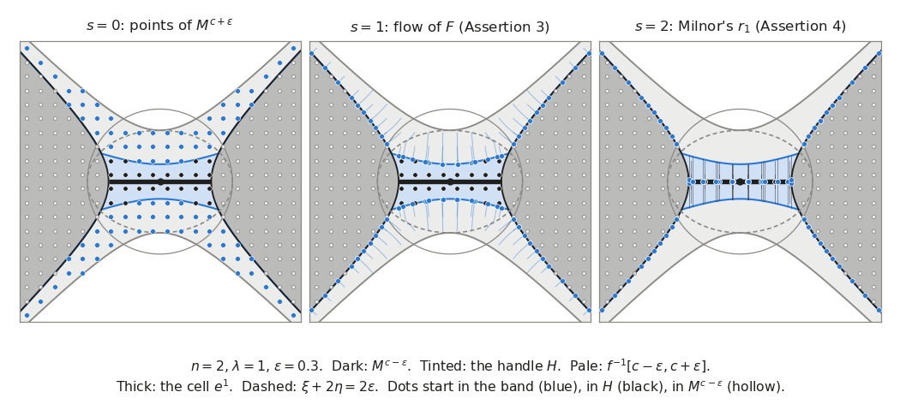

# Chapter 2. Rising water: the homotopy type of $M^a$ in terms of critical values

*Milnor, "Morse Theory", §3, rewritten for a first-year graduate student who wants to know what the
theorem is for. Every proof is complete, except that the cellular approximation theorem, Whitehead's
theorem and the fact that a manifold has the homotopy type of a CW-complex are quoted, as Milnor
quotes them, together with a few standard facts (Riemannian metrics, bump functions, quotient maps,
CW-complexes) stated precisely where they are used.*

---

## 0. Flooding a landscape

Let water rise slowly over a hilly landscape, a reservoir filling behind a dam. At level $a$ the
flooded region is the set of points of height at most $a$. As the level rises, lakes appear, grow,
merge, surround islands, and finally drown them. When does the *shape* of the flooded region change,
and how?

Only when the water passes the height of a point where the ground is horizontal: a pit, a pass or a
summit. Between two such heights the flooded regions are all diffeomorphic, and the larger one slides
down onto the smaller one along the lines of steepest descent (Theorem 3.1). At such a height the
change is, up to homotopy, the attachment of a cell. A pit adds a new lake: a 0-cell. A pass joins two
lakes or closes a ring of water around an island: a 1-cell, attached at its two ends. A summit is
drowned: a 2-cell fills the hole. In general a non-degenerate critical point of index $\lambda$
attaches a $\lambda$-cell (Theorem 3.2). Putting the steps together (Theorem 3.5), a manifold carrying
a function with non-degenerate critical points and compact sublevel sets has the homotopy type of a
CW-complex with one $\lambda$-cell for each critical point of index $\lambda$.

At the end we apply this to the phase space of the double pendulum of Chapter 1. Its energy has four
critical points; they build the phase space out of four cells, and they say which loops become
possible below a given energy.

---

## 1. The regular interval theorem (Milnor pp. 12–14)

Conventions are those of Chapter 1: manifolds are Hausdorff, second countable and without boundary,
and $M^a = f^{-1}(-\infty, a] = \{p \in M : f(p) \le a\}$.

**Definition.** A subspace $A \subseteq X$ is a *deformation retract* of $X$ if there is a continuous
$r : [0,1] \times X \to X$, $(t, x) \mapsto r_t(x)$, with $r_0 = \mathrm{id}_X$, $r_1(X) \subseteq A$
and $r_1(a) = a$ for $a \in A$. It is a *strong* deformation retract if moreover $r_t(a) = a$ for
all $t$ and all $a \in A$. Every deformation retraction constructed in this chapter is strong. If $A$
is a deformation retract of $X$, the inclusion $i : A \to X$ is a homotopy equivalence with homotopy
inverse $r_1$: $r_1 \circ i = \mathrm{id}_A$ and $i \circ r_1 = r_1 \simeq r_0 = \mathrm{id}_X$.

**Lemma A.** Let $A \subseteq B \subseteq X$.
(i) If $A$ is a strong deformation retract of $B$ and $B$ is one of $X$, then $A$ is one of $X$.
(ii) If $A$ is a strong deformation retract of $X$ and $B$ is a retract of $X$ (there is a continuous
$\kappa : X \to B$ with $\kappa|_B = \mathrm{id}_B$), then $A$ is a strong deformation retract of $B$.

*Proof.* (i) Let $r$ deform $X$ onto $B$ and $s$ deform $B$ onto $A$. Put $R_t = r_{2t}$ for $t \le
\frac12$ and $R_t = s_{2t-1} \circ r_1$ for $t \ge \frac12$; both give $r_1$ at $t = \frac12$, so $R$
is continuous; $R_0 = \mathrm{id}$, $R_1(X) \subseteq A$, and $R_t$ fixes $A$ because $r_t$ fixes $B
\supseteq A$ and $s_t$ fixes $A$. (ii) Let $r$ deform $X$ onto $A$ and put $R_t = \kappa \circ
r_t|_B : B \to B$. Then $R_0 = \kappa|_B = \mathrm{id}_B$, $R_1(B) \subseteq \kappa(A) = A$, and
$R_t(a) = \kappa(a) = a$ for $a \in A$. $\square$

**Gradients.** Choose a Riemannian metric $\langle\ ,\ \rangle$ on $M$; one exists by a partition of
unity, which is where second countability enters (Lee, *Introduction to Smooth Manifolds*, 2nd ed.,
Ch. 13). The *gradient* of $f$ is the vector field $\operatorname{grad} f$ characterized by
$\langle X, \operatorname{grad} f\rangle = X(f)$ for every vector field $X$; in local coordinates its
components are $\sum_j g^{ij}\, \partial f/\partial u^j$, so it is smooth. It vanishes exactly at the
critical points of $f$, since each $\langle\ ,\ \rangle_q$ is non-degenerate. For a curve $c :
\mathbb{R} \to M$, the chain rule gives
$$\Big\langle \frac{dc}{dt}, \operatorname{grad} f \Big\rangle = \frac{d(f \circ c)}{dt}.$$

**Theorem 3.1.** Let $f : M \to \mathbb{R}$ be smooth, let $a < b$, and suppose that $f^{-1}[a,b] =
\{p \in M : a \le f(p) \le b\}$ is compact and contains no critical point of $f$. Then $M^a$ and
$M^b$ are diffeomorphic. Moreover $M^a$ is a deformation retract of $M^b$; in particular the
inclusion $M^a \to M^b$ is a homotopy equivalence.

Here $a$ and $b$ are regular values, so $M^a$ and $M^b$ are manifolds with boundary (Chapter 1,
Proposition A; this is Lemma 3.2 of Chapter 2 of the companion volume, *Topology from the
Differentiable Viewpoint*, rewritten). The idea is to slide $M^b$ down onto $M^a$ along the curves
orthogonal to the level hypersurfaces of $f$ (Milnor's Diagram 2). Two lemmas prepare the proof.

**Lemma B (the cut-off).** There is a smooth $\rho : M \to \mathbb{R}$, equal to $1/\langle
\operatorname{grad} f, \operatorname{grad} f\rangle$ on $f^{-1}[a,b]$, which vanishes outside a
compact neighbourhood of $f^{-1}[a,b]$.

*Proof.* The critical set is closed, being the zero set of the continuous function $\langle
\operatorname{grad} f, \operatorname{grad} f\rangle$, so its complement $U$ is an open set containing
the compact set $C = f^{-1}[a,b]$. Each point of $C$ has a coordinate ball with compact closure in
$U$; finitely many such balls cover $C$, and the union $K'$ of their closures is a compact subset of
$U$ whose interior contains $C$. By the existence of smooth bump functions (Lee, *op. cit.*, Ch. 2)
there is a smooth $\zeta : M \to [0,1]$ with $\zeta = 1$ on $C$ and support inside the interior
of $K'$. Put $\rho = \zeta/\langle \operatorname{grad} f, \operatorname{grad} f\rangle$ on $U$ and
$\rho = 0$ on $M \setminus \operatorname{supp}\zeta$. The two formulas agree where both apply, and
the two open sets cover $M$; so $\rho$ is smooth, and it vanishes outside $K'$. $\square$

**Lemma C (one crossing).** Let $g : \mathbb{R} \to \mathbb{R}$ be differentiable with $g'(t) = 1$
whenever $a \le g(t) \le b$. Then either $g < a$ on all of $\mathbb{R}$, or $g > b$ on all of
$\mathbb{R}$, or there is $\alpha \in \mathbb{R}$ such that
$$g < a \text{ on } (-\infty, \alpha), \qquad g(t) = a + (t - \alpha) \text{ on } [\alpha, \alpha + b
- a], \qquad g > b \text{ on } (\alpha + b - a, \infty).$$

*Proof.* Let $J = g^{-1}[a,b]$, a closed set. *$J$ is an interval.* Suppose $t_1 < s < t_2$ with
$t_1, t_2 \in J$ and $s \notin J$. Let $\alpha' = \max(J \cap [t_1, s])$ and $\beta' = \min(J \cap
[s, t_2])$. On $(\alpha', \beta')$, $g$ avoids $[a,b]$, so by the intermediate value theorem either
$g < a$ throughout or $g > b$ throughout. In the first case continuity gives $g(\alpha') = a$, and
$g'(\alpha') = 1 > 0$ forces $g > a$ just to the right of $\alpha'$: a contradiction. In the second
case $g(\beta') = b$ and $g'(\beta') = 1$ forces $g < b$ just to the left of $\beta'$: a
contradiction. *Conclusion.* If $J = \emptyset$, $g(\mathbb{R})$ is an interval missing $[a,b]$, so
$g < a$ everywhere or $g > b$ everywhere. Otherwise $g' = 1$ on the interval $J$, so $g(t) = t +
\text{const}$ there, and as $g(J) \subseteq [a,b]$, $J$ is a compact interval $[\alpha, \beta]$. On
$(-\infty, \alpha)$, $g$ avoids $[a,b]$; if it were $> b$ there, then $g(\alpha) = b$ and
$g'(\alpha) = 1$ would force $g < b$ just left of $\alpha$. So $g < a$ on $(-\infty, \alpha)$ and
$g(\alpha) = a$; symmetrically $g > b$ on $(\beta, \infty)$ and $g(\beta) = b$. Hence $\beta - \alpha
= b - a$. $\square$

*Proof of Theorem 3.1.* With $\rho$ from Lemma B, the vector field $X_q = \rho(q)
(\operatorname{grad} f)_q$ is smooth and vanishes outside a compact set, so by Lemma 2.4 (Chapter 1)
it generates a 1-parameter group of diffeomorphisms $\varphi_t : M \to M$. For fixed $q \in M$ let
$g_q(t) = f(\varphi_t(q))$. If $\varphi_t(q)$ lies in $f^{-1}[a,b]$, then
$$g_q'(t) = \Big\langle \frac{d\varphi_t(q)}{dt}, \operatorname{grad} f\Big\rangle = \langle X,
\operatorname{grad} f\rangle = +1 .$$
So Lemma C applies to every $g_q$: $t \mapsto f(\varphi_t(q))$ is linear with derivative $+1$ as long
as it lies between $a$ and $b$, and each trajectory crosses the slab $f^{-1}[a,b]$ at most once.

*The diffeomorphism.* Let $T = b - a$. We claim $f(q) \le a \iff f(\varphi_T(q)) \le b$. In the
first two alternatives of Lemma C both sides are true ($g_q < a$), respectively both false ($g_q >
b$). In the third, $g_q(t) \le a \iff t \le \alpha$ and $g_q(t) \le b \iff t \le \alpha + T$, so
$g_q(0) \le a \iff 0 \le \alpha \iff g_q(T) \le b$. As $\varphi_T$ is a bijection of $M$, the claim
says $\varphi_T(M^a) = M^b$; so the diffeomorphism $\varphi_T$ of $M$ carries $M^a$ diffeomorphically
onto $M^b$. This proves the first half of 3.1.

*The deformation.* Define $r_t : M^b \to M^b$, $0 \le t \le 1$, by
$$r_t(q) = \begin{cases} q & \text{if } f(q) \le a, \\ \varphi_{t(a - f(q))}(q) & \text{if } a \le
f(q) \le b. \end{cases}$$
If $a \le f(q) \le b$, the third alternative of Lemma C holds for $g_q$ with $\alpha = a - f(q)$, so
$g_q(s) = f(q) + s$ for $s \in [a - f(q), 0]$; hence $f(r_t(q)) = (1 - t) f(q) + ta \in [a,b]$. So
$r_t$ maps $M^b$ into $M^b$ and $r_1$ maps it into $M^a$. The two formulas agree where $f(q) = a$
(as $\varphi_0 = \mathrm{id}$), and each is continuous on its closed piece $[0,1] \times M^a$,
respectively $[0,1] \times f^{-1}[a,b]$, of $[0,1] \times M^b$; by the pasting lemma $r$ is
continuous. Then $r_0$ is the identity, each $r_t$ fixes $M^a$, and $r_1$ is a retraction from $M^b$
to $M^a$. Hence $M^a$ is a (strong) deformation retract of $M^b$. $\square$

> **Milnor's text skips…** why "clearly" $\varphi_{b-a}$ carries $M^a$ onto $M^b$: the derivative of
> $f(\varphi_t(q))$ is known only inside the slab $a \le f \le b$, and a trajectory starting below $a$
> must not be above $b$ at time $b - a$, nor the reverse. Lemma C settles this without assuming $\rho
> \ge 0$, which Milnor does not require.

**Remark (Milnor p. 13).** The condition that $f^{-1}[a,b]$ is compact cannot be omitted. Milnor's
Diagram 3 shows a surface from which a point $p$ with $a < f(p) < b$ has been removed. A concrete
version: $M = \mathbb{R}^2 \setminus \{(0,1)\}$, $f(x,y) = y$, $a = 0$, $b = 2$. There are no critical
points ($df = dy$), but $f^{-1}[0,2]$ is not compact. $M^0 = \{y \le 0\}$ is convex, hence
contractible. $M^2$ is not: the circle $C$ of radius $\tfrac12$ about $(0,1)$ lies in $M^2$, and
$w(z) = (z - (0,1))/|z - (0,1)|$ maps $M^2$ to $S^1$ and $C$ homeomorphically onto $S^1$; if $M^2$
were contractible, $\mathrm{id}_{S^1} = w \circ (\text{inclusion of } C) \circ (w|_C)^{-1}$
would be null-homotopic, which it is not. So $M^0$ is neither a deformation retract of $M^2$ nor
diffeomorphic to it.

---

## 2. Passing one critical point (Milnor pp. 14–19)

**Theorem 3.2.** Let $f : M \to \mathbb{R}$ be smooth and let $p$ be a non-degenerate critical point
of index $\lambda$, with $f(p) = c$. Suppose that for some $\epsilon > 0$ the set $f^{-1}[c -
\epsilon, c + \epsilon]$ is compact and contains no critical point of $f$ besides $p$. Then for
every sufficiently small $\epsilon > 0$, $M^{c+\epsilon}$ has the homotopy type of $M^{c-\epsilon}$
with a $\lambda$-cell attached.

(As reproduced in the scan, the statement ends with "a $k$-cell"; the cell has dimension $\lambda$.)
The plan (Milnor's Diagram 4): a new function $F$ equals $f$ except that $F < f$ near $p$, so that $F^{-1}(-\infty, c -
\epsilon]$ is $M^{c-\epsilon}$ together with a region $H$ near $p$; Theorem 3.1 for $F$ retracts
$M^{c+\epsilon}$ onto $M^{c-\epsilon} \cup H$, and pushing in along "horizontal lines" retracts this
onto $M^{c-\epsilon} \cup e^\lambda$ for a cell $e^\lambda \subset H$. We prove a sharper statement.

> $(\ast)$ For all sufficiently small $\epsilon > 0$ there is a subset $e^\lambda \subset M$,
> homeomorphic to a closed $\lambda$-disk, such that $M^{c-\epsilon} \cup e^\lambda$ is a strong
> deformation retract of $M^{c+\epsilon}$ and is homeomorphic to $M^{c-\epsilon} \cup_\varphi e^\lambda$
> for an embedding $\varphi : S^{\lambda-1} \to M^{c-\epsilon}$.

**Setting up.** Let $\epsilon_0$ be the $\epsilon$ of the hypothesis. By the lemma of Morse there are
coordinates $u^1, \dots, u^n$ on a neighbourhood $U$ of $p$, with $u(p) = 0$, such that
$$f = c - (u^1)^2 - \dots - (u^\lambda)^2 + (u^{\lambda+1})^2 + \dots + (u^n)^2$$
throughout $U$. Write $\xi = (u^1)^2 + \dots + (u^\lambda)^2$ and $\eta = (u^{\lambda+1})^2 + \dots +
(u^n)^2$, so $f = c - \xi + \eta$ on $U$, and write points of $U$ as $(x, y)$ with $x =
(u^1, \dots, u^\lambda)$, $y = (u^{\lambda+1}, \dots, u^n)$, so $\xi = |x|^2$, $\eta = |y|^2$.
Choose $\epsilon \in (0, \epsilon_0]$ so small that

1. the region $f^{-1}[c - \epsilon, c + \epsilon]$ is compact and contains no critical points other
   than $p$ (automatic: it is closed in the compact $f^{-1}[c - \epsilon_0, c + \epsilon_0]$);
2. the image of $U$ under the diffeomorphic embedding $(u^1, \dots, u^n) : U \to \mathbb{R}^n$
   contains the closed ball $\{\sum (u^i)^2 \le 2\epsilon\}$.

Every smaller $\epsilon$ satisfies (1) and (2) too: that is the meaning of "sufficiently small".

**The cell.** Let $e^\lambda = \{q \in U : \xi(q) \le \epsilon,\ \eta(q) = 0\}$. The map $\chi(z) =
u^{-1}(\sqrt\epsilon\, z, 0)$ is a homeomorphism from the closed unit disk $D^\lambda$ onto
$e^\lambda$, and
$$e^\lambda \cap M^{c-\epsilon} = \{\xi = \epsilon, \eta = 0\} = \chi(S^{\lambda-1}) = \dot e^\lambda,$$
"so that $e^\lambda$ is attached to $M^{c-\epsilon}$ as required". To make "attached" precise:

**Lemma D (attaching inside a space).** Let $X = A \cup B_1 \cup \dots \cup B_k$ with $A$ and the
$B_i$ closed in $X$, the $B_i$ pairwise disjoint, and let $\chi_i : D^{\lambda_i} \to B_i$ be
homeomorphisms with $\chi_i(S^{\lambda_i - 1}) = A \cap B_i$. Then $X$ is homeomorphic, by a map that
is the identity on $A$, to $A$ with cells attached by the maps $\varphi_i = \chi_i|_{S^{\lambda_i -
1}}$.

*Proof.* Let $\pi : A \sqcup D^{\lambda_1} \sqcup \dots \sqcup D^{\lambda_k} \to X$ be the inclusion
on $A$ and $\chi_i$ on $D^{\lambda_i}$: continuous and onto. It is closed: for a closed $C$, $\pi(C)$
is the union of $C \cap A$, closed in $A$ and so in $X$, and the sets $\chi_i(C \cap D^{\lambda_i})$,
closed in $B_i$ and so in $X$. A closed continuous surjection is a quotient map. Two distinct points
have the same image exactly when one is some $z \in S^{\lambda_i-1}$ and the other is $\chi_i(z) \in
A$ (the $\chi_i$ are injective, and $\chi_i(D^{\lambda_i})$ meets $A$ only in
$\chi_i(S^{\lambda_i - 1})$ and misses the other $B_j$). These are exactly the identifications defining
the cell attachment, so $\pi$ induces a continuous bijection from that quotient onto $X$, which is a
homeomorphism since $\pi$ is a quotient map. $\square$

Here $A = M^{c-\epsilon}$ is closed and $e^\lambda$ is compact, hence closed because $M$ is Hausdorff.
So $M^{c-\epsilon} \cup e^\lambda \cong M^{c-\epsilon} \cup_\varphi e^\lambda$ with $\varphi =
\chi|_{S^{\lambda-1}}$.

**The function $\mu$.** We need a $C^\infty$ function $\mu : \mathbb{R} \to \mathbb{R}$ with
$$\mu(0) > \epsilon, \qquad \mu(r) = 0 \text{ for } r \ge 2\epsilon, \qquad -1 < \mu'(r) \le 0 \text{
for all } r.$$
Milnor does not show one exists. With the smooth function $\nu(\tau) = e^{-1/\tau}$ for $\tau >
0$, $\nu(\tau) = 0$ for $\tau \le 0$, and the smooth steps $\sigma_{[r_0,r_1]}(r) =
\nu(r - r_0)/\big(\nu(r - r_0) + \nu(r_1 - r)\big)$, equal to $0$ for $r \le r_0$ and $1$ for
$r \ge r_1$ (both as in Chapter 4, §1 of the companion volume), let $\beta(r) = \sigma_{[0,
\epsilon/5]}(r)\,\big(1 - \sigma_{[9\epsilon/5, 2\epsilon]}(r)\big)$. Then $\beta : \mathbb{R} \to
[0,1]$ is smooth, $\beta = 1$ on $[\epsilon/5, 9\epsilon/5]$ and $\beta = 0$ outside $(0,
2\epsilon)$, so $I = \int \beta \ge 8\epsilon/5$. Put
$$\mu(r) = \frac{6\epsilon}{5I}\int_r^\infty \beta(s)\,ds .$$
Then $\mu$ is smooth, $\mu' = -\frac{6\epsilon}{5I}\beta \in [-\frac34, 0]$, $\mu = 0$ on $[2\epsilon,
\infty)$, $\mu \ge 0$, and $\mu(0) = 6\epsilon/5 > \epsilon$.

**The function $F$.** Let $E = \{q \in U : \xi + 2\eta \le 2\epsilon\}$. Since $\xi + \eta \le \xi
+ 2\eta$, $E$ lies inside $u^{-1}$ of the closed ball of radius $\sqrt{2\epsilon}$, so $E$ is compact,
hence closed in $M$. Let $F = f$ outside $U$, and
$$F = f - \mu\big((u^1)^2 + \dots + (u^\lambda)^2 + 2(u^{\lambda+1})^2 + \dots + 2(u^n)^2\big) = c - \xi
+ \eta - \mu(\xi + 2\eta)$$
within $U$. On $U \setminus E$, $\mu(\xi + 2\eta) = 0$, so the two definitions agree on the open sets
$U$ and $M \setminus E$, which cover $M$: $F$ is a well-defined smooth function throughout $M$ (the
"easily verified" step, which uses that $E$ is closed). Moreover $F \le f$, with equality outside $E$.

**Assertion 1.** The region $F^{-1}(-\infty, c + \epsilon]$ coincides with $M^{c+\epsilon} =
f^{-1}(-\infty, c + \epsilon]$.

*Proof.* Outside the ellipsoid $E$ the functions $f$ and $F$ coincide. Within it, $F \le f = c - \xi
+ \eta \le c + \tfrac12\xi + \eta \le c + \epsilon$, so every point of $E$ lies in both sets.
$\square$

**Assertion 2.** The critical points of $F$ are the same as those of $f$.

*Proof.* On the open set $M \setminus E$, $F = f$. On $U$, $F = G(\xi, \eta)$ with $G(s_1, s_2) = c -
s_1 + s_2 - \mu(s_1 + 2s_2)$, so $dF = \frac{\partial F}{\partial \xi}\,d\xi + \frac{\partial
F}{\partial \eta}\,d\eta$ with
$$\frac{\partial F}{\partial \xi} = -1 - \mu'(\xi + 2\eta) < 0, \qquad \frac{\partial F}{\partial
\eta} = 1 - 2\mu'(\xi + 2\eta) \ge 1 .$$
Since $d\xi = 2\sum_{i \le \lambda} u^i\,du^i$, $d\eta = 2\sum_{i > \lambda} u^i\,du^i$ and the
$du^i$ are linearly independent, $dF$ vanishes at a point of $U$ only if $\frac{\partial F}{\partial
\xi} u^i = 0$ for $i \le \lambda$ and $\frac{\partial F}{\partial \eta} u^i = 0$ for $i > \lambda$,
i.e. only at the origin $p$. The same computation with $\mu = 0$ shows that $p$ is also the only
critical point of $f$ in $U$. $\square$

(As reproduced in the scan, this bound reads $\partial F/\partial \eta > 1$; the correct bound is $\ge 1$,
and it is all that is used.)

**Assertion 3.** The region $F^{-1}(-\infty, c - \epsilon]$ is a deformation retract of
$M^{c+\epsilon}$.

*Proof.* If $c - \epsilon \le F(q) \le c + \epsilon$, then $f(q) \ge F(q) \ge c - \epsilon$, and
$f(q) \le c + \epsilon$ by Assertion 1. So $F^{-1}[c - \epsilon, c + \epsilon] \subseteq f^{-1}[c -
\epsilon, c + \epsilon]$, and being closed it is compact. By Assertion 2 it could contain no critical
point of $F$ except $p$; but $F(p) = c - \mu(0) < c - \epsilon$. Theorem 3.1 applied to $F$, with
$a = c - \epsilon$ and $b = c + \epsilon$, shows that $F^{-1}(-\infty, c - \epsilon]$ is a strong
deformation retract of $F^{-1}(-\infty, c + \epsilon] = M^{c+\epsilon}$. $\square$

Denote by $H$ the closure of $F^{-1}(-\infty, c - \epsilon] \setminus M^{c-\epsilon}$. Since $F \le f$,
$M^{c-\epsilon} \subseteq F^{-1}(-\infty, c - \epsilon]$, and so $F^{-1}(-\infty, c - \epsilon] =
M^{c-\epsilon} \cup H$.

**Remark (Smale's handles; Milnor p. 17).** In Smale's terminology $M^{c-\epsilon} \cup H$ is
$M^{c-\epsilon}$ with a *handle* attached. Since $c - \epsilon$ is a regular value of $F$ (Assertion
3), $M^{c-\epsilon} \cup H$ is a manifold with boundary (Chapter 1, Proposition A), and the first half
of Theorem 3.1, applied to $F$, says it is diffeomorphic to $M^{c+\epsilon}$. This is the starting
point of Smale's theory (S. Smale, Generalized Poincaré's conjecture in dimensions greater than
four, *Annals of Mathematics* 74 (1961), 391–406).

**The cell lies in the handle.** Let $q \in e^\lambda$. Since $\eta(q) = 0$ and $\partial F/\partial
\xi < 0$, $F(q) = G(\xi(q), 0) \le G(0,0) = F(p) < c - \epsilon$, while $f(q) = c - \xi(q) \ge c -
\epsilon$. So the points of $e^\lambda$ with $\xi < \epsilon$ lie in $F^{-1}(-\infty, c-\epsilon]
\setminus M^{c-\epsilon}$, and those with $\xi = \epsilon$ are limits of such points. Hence $e^\lambda
\subseteq H$.

**Assertion 4.** $M^{c-\epsilon} \cup e^\lambda$ is a deformation retract of $M^{c-\epsilon} \cup H$.

*Proof.* Write $Y = M^{c-\epsilon} \cup H = F^{-1}(-\infty, c - \epsilon]$. (We let $t$ run so that
$r_0$ is the identity, as in Theorem 3.1; Milnor runs it the other way, with $r_1$ the identity.) Let
$r_t$ be the identity outside $U$, and within $U$ distinguish three cases (Milnor's Diagram 7):

* *Case 1*, $\xi \le \epsilon$: $\ r_t(x, y) = (x, (1-t)\,y)$.
* *Case 2*, $\epsilon \le \xi \le \eta + \epsilon$: $\ r_t(x, y) = (x, s_t\,y)$ with
  $s_t = (1 - t) + t\,\big((\xi - \epsilon)/\eta\big)^{1/2}$.
* *Case 3*, $\eta + \epsilon \le \xi$, i.e. within $M^{c-\epsilon}$: $\ r_t$ is the identity.

The three regions cover $U$. We check what Milnor leaves to the reader.

(i) *Where things move.* If $q \in Y \cap U$ is not in $E$, then $F(q) = f(q) \le c - \epsilon$, i.e.
$\xi \ge \eta + \epsilon$, and $\xi + 2\eta > 2\epsilon$ excludes $\xi \le \epsilon$: so $q$ is in
Case 3, possibly on the edge $\xi = \eta + \epsilon$ of Case 2, where $s_t = 1$. Thus $r_t$ moves
only points of $Y \cap E$. Cases 1 and 2 keep $x$ and shrink $y$, so they keep $\xi$ and do not
increase $\eta$; hence $r_t$ maps $Y \cap E$ into $E \subset U$.

(ii) *The formulas agree on overlaps.* On $\xi = \epsilon$, $s_t = 1 - t$, as in Case 1. On $\xi =
\eta + \epsilon$, $s_t = 1$, as in Case 3. In Case 2 with $\eta = 0$ we have $\xi = \epsilon$ and
$y = 0$, and the formula is read as $r_t(x, 0) = (x, 0)$.

(iii) *Continuity.* In Case 2 with $\eta > 0$, $0 \le (\xi - \epsilon)/\eta \le 1$, so $0 \le s_t \le
1$ and $|s_t y| \le |y|$. Hence as $(x, y)$ tends to a point $(x_0, 0)$, $r_t(x,y) \to (x_0, 0)$:
this is Milnor's "the functions $s_t u^i$ remain continuous as $\xi \to \epsilon$, $\eta \to 0$". So
$r$ is continuous on each of the three closed pieces of $[0,1] \times (Y \cap U)$, hence on $[0,1]
\times (Y \cap U)$; on $[0,1] \times (Y \setminus E)$ it is the projection; and $Y \cap U$, $Y
\setminus E$ are open in $Y$ and cover it.

(iv) *$r_t$ maps $Y$ into $Y$.* For a point of $Y \cap E$, $r_t$ keeps $\xi$ and does not increase
$\eta$, and $F$ is increasing in $\eta$ ($\partial F/\partial \eta \ge 1$), so $F(r_t(q)) \le F(q)
\le c - \epsilon$.

(v) *The end of the deformation.* $r_0$ is the identity. $r_1$ maps Case 1 into $\{(x,0) : \xi \le
\epsilon\} = e^\lambda$, and Case 2 into points with $\eta = \xi - \epsilon$, i.e. into the
hypersurface $f^{-1}(c - \epsilon)$. Case 3 lies in $M^{c-\epsilon}$, and so does $Y \setminus E$
(there $f = F \le c - \epsilon$). So $r_1(Y) \subseteq M^{c-\epsilon} \cup e^\lambda$.

(vi) *$M^{c-\epsilon} \cup e^\lambda$ is fixed.* Points of $e^\lambda$ are in Case 1 with $y = 0$;
points of $M^{c-\epsilon} \cap U$ satisfy $\xi \ge \eta + \epsilon$; points outside $U$ are fixed.

So $M^{c-\epsilon} \cup e^\lambda$ is a strong deformation retract of $Y$. $\square$

*Proof of Theorem 3.2.* By Assertions 3 and 4 and Lemma A(i), $M^{c-\epsilon} \cup e^\lambda$ is a
strong deformation retract of $M^{c+\epsilon}$, so the inclusion is a homotopy equivalence; by
Lemma D it is homeomorphic to $M^{c-\epsilon} \cup_\varphi e^\lambda$. This proves $(\ast)$. $\square$

For a pit ($\lambda = 0$) the handle is a small disk around $p$, contracted to $e^0 = \{p\}$ by
Case 1; for a summit ($\lambda = n$) nothing moves in Assertion 4, and $H = e^n$.

> **Milnor's text skips…** the existence of $\mu$; the closedness of the ellipsoid $E$, without which
> $F$ need not be smooth; the fact that the deformation of Assertion 4 moves only points of $E$, so
> that "the identity outside of $U$" fits continuously with the three cases; and the identification
> of the subspace $M^{c-\epsilon} \cup e^\lambda \subset M$ with the abstract attaching space (Lemma
> D). The last two use that $M$ is Hausdorff.

### An interactive look at the proof

The figure sets Milnor's Diagrams 5–7 in motion, for $n = 2$, $\lambda = 1$ and $c = 0$, in the Morse
coordinates $(u^1, u^2)$ around $p$. The dark region is $M^{c-\epsilon} = \{(u^1)^2 -
(u^2)^2 \ge \epsilon\}$, the pale band is $f^{-1}[c - \epsilon, c + \epsilon]$, the tinted region is
the handle $H$, where $F \le c - \epsilon < f$, and the thick segment through $p$ is the cell $e^1$.
The dashed ellipse bounds $E$, outside which $F = f$; the circle has radius $\sqrt{2\epsilon}$. The
dots are a sample of points of $M^{c+\epsilon}$.

Drag the slider $s$ from $0$ to $1$: each dot follows the descending gradient line of $F$ (flat metric
in the chart) for exactly the time prescribed in Theorem 3.1, and all of $M^{c+\epsilon}$ lands in
$F^{-1}(-\infty, c - \epsilon] = M^{c-\epsilon} \cup H$ (Assertion 3). Drag $s$ from $1$ to $2$:
Milnor's three-case deformation, with $t = s - 1$, pushes the handle vertically onto $M^{c-\epsilon}
\cup e^1$ (Assertion 4): dots above and below the cell drop onto it (Case 1), dots near the corners of
the handle slide onto the hyperbola $f = c - \epsilon$ (Case 2), dots in $M^{c-\epsilon}$ stay put
(Case 3). The slider $\epsilon$ rescales the construction.

*(In the printed version this figure is a still image; the interactive version is in the web
edition.)*

---

## 3. Several critical points, and the critical level itself (Milnor pp. 19–20)

**Remark 3.3.** If $f^{-1}(c)$ contains $k$ non-degenerate critical points $p_1, \dots, p_k$, of
indices $\lambda_1, \dots, \lambda_k$, the same method shows that $M^{c+\epsilon}$ has the homotopy
type of $M^{c-\epsilon} \cup e^{\lambda_1} \cup \dots \cup e^{\lambda_k}$.

The hypotheses of Theorem 3.2 are understood: $f^{-1}[c - \epsilon_0, c + \epsilon_0]$ is compact
and $p_1, \dots, p_k$ are all of its critical points.

*Proof.* Since $M$ is Hausdorff, the $p_i$ have pairwise disjoint neighbourhoods; choose Morse charts
$U_i$ inside them, and $\epsilon$ so small that each $u_i(U_i)$ contains the closed ball of radius
$\sqrt{2\epsilon}$. With $\xi_i, \eta_i, E_i \subset U_i$ and $e^{\lambda_i} \subset U_i$ as before,
let
$$F = f - \sum_{i=1}^k \mu(\xi_i + 2\eta_i),$$
the $i$-th term being defined on $U_i$ and extended by $0$ off $E_i$ (smooth, as before). The $E_i$
are disjoint, so near any point at most one term is nonzero, and the proofs of Assertions 1–4 go
through chart by chart: $F \le f$ with equality off $\bigcup E_i$; $F^{-1}(-\infty, c + \epsilon] =
M^{c+\epsilon}$; $F$ and $f$ have the same critical points; $F^{-1}[c - \epsilon, c + \epsilon]$ is
compact and free of critical points, as $F(p_i) = c - \mu(0) < c - \epsilon$; and the deformation
defined in each $U_i$ by the three cases, and as the identity off $\bigcup E_i$, retracts
$F^{-1}(-\infty, c - \epsilon]$ onto $M^{c-\epsilon} \cup e^{\lambda_1} \cup \dots \cup
e^{\lambda_k}$. By Lemma D, this is $M^{c-\epsilon}$ with $k$ cells attached by maps $\varphi_i$
with pairwise disjoint images. $\square$

**Remark 3.4.** The set $M^c$ is a deformation retract of $M^{c+\epsilon}$ as well: it is one of
$F^{-1}(-\infty, c]$, which is one of $M^{c+\epsilon}$ (Milnor's Diagram 8; he calls this a simple
modification of the proof of 3.2). Together with 3.2 it follows that $M^{c-\epsilon} \cup e^\lambda$
is a deformation retract of $M^c$.

*Proof.* (a) $F^{-1}[c, c + \epsilon]$ is a closed subset of the compact, critical-point-free
$F^{-1}[c - \epsilon, c + \epsilon]$, so Theorem 3.1 for $F$ with $a = c$, $b = c + \epsilon$ makes
$Z = F^{-1}(-\infty, c]$ a strong deformation retract of $M^{c+\epsilon}$.

(b) $M^c \subseteq Z$ since $F \le f$. A point of $Z \setminus M^c$ has $F \le c < f$, so it lies in
$E$, and there $f = c - \xi + \eta > c$ means $\eta > \xi$. On $Z \cap U$ let
$$r_t(x, y) = \big(x, s_t\, y\big), \quad s_t = (1 - t) + t\,(\xi/\eta)^{1/2}, \qquad \text{where }
\eta \ge \xi,\ \eta > 0,$$
and let $r_t$ be the identity where $\eta \le \xi$ and outside $U$. The formulas agree on $\eta = \xi$
($s_t = 1$); at $p$, where $\xi = \eta = 0$, continuity follows from $|s_t y| \le |y|$. As in
Assertion 4, $r_t$ moves only points of $E$ (a point of $Z \cap U$ outside $E$ has $f = F \le c$, so
$\eta \le \xi$), keeps them in $E$, and does not increase $F$; $r_0$ is the identity, $r_1$ sends the
points with $\eta \ge \xi$ to points with $\eta = \xi$, that is into $f^{-1}(c)$, and $M^c$ is fixed
throughout. So $M^c$ is a strong deformation retract of $Z$.

(c) By Lemma A(i), (a) and (b), $M^c$ is a strong deformation retract of $M^{c+\epsilon}$; in
particular $M^c$ is a retract of $M^{c+\epsilon}$.

(d) By the proof of Theorem 3.2, $A = M^{c-\epsilon} \cup e^\lambda$ is a strong deformation retract
of $X = M^{c+\epsilon}$, and $A \subseteq M^c \subseteq X$ ($f = c - \xi \le c$ on $e^\lambda$).
Lemma A(ii), with the retraction from (c), shows that $A$ is a strong deformation retract of $M^c$.
$\square$

With several critical points on $f^{-1}(c)$ the same proof, chart by chart, shows that
$M^{c-\epsilon} \cup e^{\lambda_1} \cup \dots \cup e^{\lambda_k}$ is a strong deformation retract of
$M^c$.

> **Milnor's text skips…** both halves of Remark 3.4: the "simple modification", part (b), is not
> written in the book, and "we see easily" needs Lemma A(ii), which uses a retraction of
> $M^{c+\epsilon}$ onto $M^c$.

---

## 4. Attaching cells along homotopic maps (Milnor pp. 20–23)

Points of $e^\lambda$ are written $tu$ with $0 \le t \le 1$ and $u \in \dot e^\lambda = S^{\lambda-1}$
(the centre is $0u$ for every $u$). For $\lambda = 0$ nothing needs proof below, since both sides are
$X$ plus a disjoint point; let $\lambda \ge 1$. Two facts about quotients are used throughout.
(Q1) A map out of $X \cup_\varphi e^\lambda$ is continuous if its restrictions to $X$ and to
$e^\lambda$ are continuous and compatible with $u \sim \varphi(u)$. (Q2) The same holds for maps out
of $[0,1] \times (X \cup_\varphi e^\lambda)$, that is, for homotopies, because the product of a
quotient map with the identity of the locally compact Hausdorff space $[0,1]$ is again a quotient map
(J. H. C. Whitehead's lemma; Munkres, *Topology*, 2nd ed., §29, Exercise 11). Milnor uses both
silently.

**Lemma 3.6 (Whitehead).** If $\varphi_0, \varphi_1 : \dot e^\lambda \to X$ are homotopic, there is
a homotopy equivalence
$$k : X \cup_{\varphi_0} e^\lambda \to X \cup_{\varphi_1} e^\lambda$$
that restricts to the identity on $X$.

*Proof.* Let $\varphi_s$, $0 \le s \le 1$, be the homotopy. Define $k$ by
$$k(x) = x \ (x \in X), \qquad k(tu) = 2tu \ \ (0 \le t \le \tfrac12), \qquad k(tu) = \varphi_{2-2t}(u)
\ \ (\tfrac12 \le t \le 1).$$
At $t = \frac12$ the two formulas give $u$ and $\varphi_1(u)$, identified in the target; at $t = 1$
the point $u \sim \varphi_0(u)$ goes to $\varphi_0(u)$ under both readings; the centre goes to the
centre. The formulas are continuous on the closed pieces $\{|z| \le \frac12\}$ and $\{\frac12 \le |z|
\le 1\}$ of the disk (on the second, $u = z/|z|$), so $k$ is continuous by (Q1). A corresponding map
$\ell : X \cup_{\varphi_1} e^\lambda \to X \cup_{\varphi_0} e^\lambda$ is defined by the same formulas
for the reversed homotopy: $\ell(x) = x$, $\ell(tu) = 2tu$ for $t \le \frac12$, $\ell(tu) =
\varphi_{2t-1}(u)$ for $t \ge \frac12$. Composing,
$$\ell k(tu) = \begin{cases} 4tu & 0 \le t \le \frac14, \\ \varphi_{4t-1}(u) & \frac14 \le t \le
\frac12, \\ \varphi_{2-2t}(u) & \frac12 \le t \le 1, \end{cases}$$
and $\ell k = \mathrm{id}$ on $X$: along each radius the outer three quarters run out along the
homotopy and back. To shrink the excursion, for $0 \le \tau \le 1$ let $a = \frac{1 + 3\tau}4$, $b =
\frac{1+\tau}2$, and define $H_\tau$ on $X \cup_{\varphi_0} e^\lambda$ by $H_\tau(x) = x$ and
$$H_\tau(tu) = \begin{cases} (t/a)\,u & 0 \le t \le a, \\ \varphi_{4(t - a)}(u) & a \le t \le b, \\
\varphi_{2 - 2t}(u) & b \le t \le 1. \end{cases}$$
At $t = a$ the first two give $u \sim \varphi_0(u)$; at $t = b$ the last two give
$\varphi_{1-\tau}(u)$; at $t = 1$ the last gives $\varphi_0(u) \sim u$; the subscripts stay in $[0, 1
- \tau]$; and $t \ge a \ge \frac14$ wherever $u = z/|z|$ is used. By (Q2), $H$ is a homotopy, from
$H_0 = \ell k$ to $H_1 = \mathrm{id}$ (for $\tau = 1$, $a = b = 1$). So $\ell k \simeq \mathrm{id}$.
The reversed homotopy exchanges the roles of $k$ and $\ell$, so also $k\ell \simeq \mathrm{id}$.
$\square$

**Lemma 3.7.** For an attaching map $\varphi : \dot e^\lambda \to X$ and a homotopy equivalence
$f : X \to Y$, there is a homotopy equivalence
$$F : X \cup_\varphi e^\lambda \to Y \cup_{f\varphi} e^\lambda$$
that extends $f$.

*Proof* (following an unpublished paper of P. Hilton, as Milnor says). Define $F$ by $F|X = f$ and
$F|e^\lambda = \mathrm{id}$; this respects $u \sim \varphi(u)$, as $u \sim f\varphi(u)$ in the target.
Let $g : Y \to X$ be a homotopy inverse to $f$, and define $G : Y \cup_{f\varphi} e^\lambda \to X
\cup_{gf\varphi} e^\lambda$ by $G|Y = g$, $G|e^\lambda = \mathrm{id}$. Let $h_t$ be a homotopy from
$h_0 = gf$ to $h_1 = \mathrm{id}_X$. Then $h_t \varphi$ is a homotopy from $gf\varphi$ to $\varphi$,
and Lemma 3.6 gives a homotopy equivalence $k : X \cup_{gf\varphi} e^\lambda \to X \cup_\varphi
e^\lambda$, with $k(tu) = h_{2-2t}\varphi(u)$ for $t \ge \frac12$. Using the definitions of $k$, $G$
and $F$:
$$kGF(x) = gf(x), \qquad kGF(tu) = 2tu \ \ (0 \le t \le \tfrac12), \qquad kGF(tu) =
h_{2-2t}\varphi(u) \ \ (\tfrac12 \le t \le 1).$$
The homotopy $q_\tau : X \cup_\varphi e^\lambda \to X \cup_\varphi e^\lambda$ is
$$q_\tau(x) = h_\tau(x), \qquad q_\tau(tu) = \tfrac{2}{1+\tau}\,tu \ \ \big(0 \le t \le
\tfrac{1+\tau}2\big), \qquad q_\tau(tu) = h_{2 - 2t + \tau}\varphi(u) \ \ \big(\tfrac{1+\tau}{2} \le
t \le 1\big).$$
At $t = \frac{1+\tau}2$ the two cell formulas give $u \sim \varphi(u)$ and $h_1\varphi(u) =
\varphi(u)$; at $t = 1$ the last gives $h_\tau(\varphi(u)) = q_\tau(\varphi(u))$, as required by $u
\sim \varphi(u)$; the subscript $2 - 2t + \tau$ lies in $[\tau, 1]$. By (Q2) this is a homotopy from
$q_0 = kGF$ to $q_1 = \mathrm{id}$. Therefore $F$ has a left homotopy inverse, namely $kG$.

**Assertion.** A map $F$ with a left homotopy inverse $L$ and a right homotopy inverse $R$ is a
homotopy equivalence, and each of $L$ and $R$ is a two-sided homotopy inverse of $F$.

*Proof.* $LF \simeq \mathrm{id}$ and $FR \simeq \mathrm{id}$ imply $L \simeq L(FR) = (LF)R \simeq R$;
consequently $RF \simeq LF \simeq \mathrm{id}$ and $FL \simeq FR \simeq \mathrm{id}$. (Homotopy is
compatible with composition on either side.) $\square$

The same argument applied to $G$, with $g$ in the role of $f$, $f$ as its homotopy inverse and
$f\varphi$ as attaching map, shows that $G$ has a left homotopy inverse. Now:

*Step 1.* $k(GF) \simeq \mathrm{id}$, and $k$ has a left homotopy inverse (Lemma 3.6); by the
Assertion, $(GF)k \simeq \mathrm{id}$.
*Step 2.* So $G(Fk) \simeq \mathrm{id}$, and $G$ has a left homotopy inverse; hence $(Fk)G \simeq
\mathrm{id}$.
*Step 3.* So $F(kG) \simeq \mathrm{id}$, and $kG$ is also a left homotopy inverse of $F$; hence $F$
is a homotopy equivalence. $\square$

---

## 5. The CW-complex theorem (Milnor pp. 20, 23–24)

**CW-complexes** (J. H. C. Whitehead, Combinatorial homotopy I, *Bull. AMS* 55 (1949), 213–245).
A CW-complex is a Hausdorff space $K$ built inductively: $K^0$ is discrete, $K^m$ is obtained from
$K^{m-1}$ by attaching $m$-cells along maps of their boundary spheres into $K^{m-1}$, and $K =
\bigcup K^m$ carries the topology in which a set is closed if and only if it meets each closed cell in
a closed set. The facts used are in Hatcher, *Algebraic Topology*:

* (W1) *Cellular approximation* (Thm. 4.8): every map $S^m \to K$ is homotopic to a map into $K^m$.
* (W2) Attaching cells to $K$ by maps $\psi_i : S^{\lambda_i - 1} \to K^{\lambda_i - 1}$ gives a
  CW-complex containing $K$ as a subcomplex; an increasing union $K_1 \subseteq K_2 \subseteq \dots$
  of CW-complexes, each a subcomplex of the next, is a CW-complex in the topology where a set is closed
  if and only if it meets every $K_i$ in a closed set.
* (W3) A compact subset of a CW-complex lies in a finite subcomplex (Prop. A.1).
* (W4) *Whitehead's theorem* (Thm. 4.5, applied to each path component): a map between CW-complexes
  that induces a bijection of path components and isomorphisms of all homotopy groups, at every base
  point, is a homotopy equivalence. Milnor quotes Whitehead's own version, for spaces dominated by
  CW-complexes.
* (W5) Every manifold has the homotopy type of a CW-complex. Milnor's hint: $M$ embeds in some
  $\mathbb{R}^N$ and is a retract of a tubular neighbourhood, an open set in $\mathbb{R}^N$, so $M$ is
  dominated by a CW-complex. For compact $M \subseteq \mathbb{R}^N$ the retraction is the
  closest-point map of the companion volume (Chapter 6, Proposition 4.1). A proof of (W5): J. Milnor,
  On spaces having the homotopy type of a CW-complex, *Trans. AMS* 90 (1959), 272–280; for compact
  $M$, Hatcher, Cor. A.12.

We also use that a homotopy equivalence induces a bijection of path components and isomorphisms of
all homotopy groups at every base point (the proof of Hatcher's Prop. 1.18 for $\pi_1$ works for
every $\pi_k$).

**Theorem 3.5.** Let $f$ be a differentiable function on a manifold $M$ all of whose critical points
are non-degenerate, and suppose that every $M^a$ is compact. Then $M$ has the homotopy type of a
CW-complex with exactly one $\lambda$-cell for each critical point of index $\lambda$.

*Proof.* *Step 1 (the critical values are discrete).* For each $a$, the critical points in $M^a$ form
a closed subset of the compact set $M^a$, each of them isolated (Corollary 2.3): a compact discrete
set, hence finite. So only finitely many critical values are $\le a$, and they can be listed $c_1 <
c_2 < c_3 < \dots$, finitely or infinitely many (then $c_i \to \infty$): in Milnor's words, the
sequence "has no cluster point since each $M^a$ is compact". If $M \ne \emptyset$, $f$ attains its
minimum (on the nonempty compact set $M^{f(x_0)}$, any $x_0$), at a critical point; so $c_1 = \min
f$ and $M^a$ is vacuous for $a < c_1$.

*Step 2 (one critical value at a time).* Choose regular values $a_0 < c_1 < a_1 < c_2 < a_2 < \dots$
with exactly one critical value between consecutive ones. We construct finite CW-complexes $K_0
\subseteq K_1 \subseteq \dots$, each a subcomplex of the next, with one $\lambda$-cell in $K_i$ for
each critical point of index $\lambda$ in $M^{a_i}$, and homotopy equivalences $g_i : M^{a_i} \to K_i$
with $g_i|_{M^{a_{i-1}}} = g_{i-1}$. Start with $M^{a_0} = \emptyset$, $K_0 = \emptyset$. Given $g_{i-1}$, let $c =
c_i$, let $p_1, \dots, p_j$ be the critical points on $f^{-1}(c)$, of indices $\lambda_1, \dots,
\lambda_j$, and take $\epsilon$ small enough for Remark 3.3 with $a_{i-1} < c - \epsilon < c +
\epsilon < a_i$ ($f^{-1}[c-\epsilon, c+\epsilon]$ is closed in the compact $M^{a_i}$, and its
critical points are the $p_m$). Then:

* $h : M^{c-\epsilon} \to M^{a_{i-1}}$, the retraction of Theorem 3.1, is a homotopy equivalence
  equal to the identity on $M^{a_{i-1}}$; likewise $\kappa_1 : M^{a_i} \to M^{c+\epsilon}$;
* $\kappa_2 : M^{c+\epsilon} \to W = M^{c-\epsilon} \cup e^{\lambda_1} \cup \dots \cup e^{\lambda_j}$,
  the retraction of Remark 3.3, is a homotopy equivalence equal to the identity on $W$; by Lemma D,
  $W$ is $M^{c-\epsilon}$ with cells attached by maps $\varphi_m : S^{\lambda_m - 1} \to M^{c-\epsilon}$;
* by (W1), $g_{i-1} h \varphi_m$ is homotopic to a map $\psi_m$ into the $(\lambda_m - 1)$-skeleton of
  $K_{i-1}$; by (W2), $K_i = K_{i-1} \cup_{\psi_1} e^{\lambda_1} \cup \dots \cup_{\psi_j}
  e^{\lambda_j}$ is a finite CW-complex with $K_{i-1}$ as a subcomplex;
* attach the cells one at a time: $W_0 = M^{c-\epsilon}$, $W_m = W_{m-1} \cup e^{\lambda_m}$; $L_0 =
  K_{i-1}$, $L_m = L_{m-1} \cup_{\psi_m} e^{\lambda_m}$; $\Theta_0 = g_{i-1}h$. Given a homotopy
  equivalence $\Theta_{m-1} : W_{m-1} \to L_{m-1}$ extending $\Theta_0$, Lemma 3.7 extends it to a
  homotopy equivalence $W_m \to L_{m-1} \cup_{\Theta_{m-1}\varphi_m} e^{\lambda_m}$; since
  $\Theta_{m-1}\varphi_m = g_{i-1}h\varphi_m \simeq \psi_m$, Lemma 3.6 continues it by a homotopy
  equivalence onto $L_m$ that is the identity on $L_{m-1}$. The composite $\Theta_m$ extends
  $\Theta_{m-1}$;
* $g_i = \Theta_j \circ \kappa_2 \circ \kappa_1 : M^{a_i} \to K_i$ is a homotopy equivalence. On
  $M^{a_{i-1}}$, $\kappa_1$ and $\kappa_2$ are the identity and $\Theta_j = g_{i-1}h = g_{i-1}$.

*Step 3 (finitely many critical points).* If $M$ is compact, take the last $a_N$ above $\max f$:
$M = M^{a_N} \simeq K_N$. If $M$ is not compact but all critical points lie in $M^{a_N}$, Milnor says
that "a proof similar to that of Theorem 3.1" shows that $M^{a_N}$ is a deformation retract of $M$.
Theorem 3.1 cannot be applied as it stands, since $f^{-1}[a_N, \infty)$ is not compact; here is
the similar proof.

**Lemma F.** If each $M^b$ is compact and $f^{-1}[a, \infty)$ contains no critical point, then $M^a$ is
a strong deformation retract of $M$.

*Proof.* For each $b > a$ let $r^{(b)}$ be the deformation of $M^b$ onto $M^a$ built in the proof of
Theorem 3.1 from $X^{(b)} = \rho_b \operatorname{grad} f$, with one metric for all $b$. Let $a < b <
b'$ and $q \in M^b$ with $f(q) \ge a$. By Lemma C, the curve $s \mapsto \varphi^{(b)}_s(q)$, $s \in
[a - f(q), 0]$, stays in $f^{-1}[a, f(q)]$, where $X^{(b)} = X^{(b')} = \operatorname{grad} f/\langle
\operatorname{grad} f, \operatorname{grad} f\rangle$; so on that closed interval it is an integral
curve of $X^{(b')}$ with the same value at $s = 0$ as $s \mapsto \varphi^{(b')}_s(q)$, and the two
agree there (Chapter 1, Lemma E, which allows closed intervals). Hence $r^{(b')}_t = r^{(b)}_t$ on
$M^b$, and $r_t(q) = r^{(b)}_t(q)$ for any $b > \max(a, f(q))$ is well defined. It is continuous on
each $[0,1] \times f^{-1}(-\infty, b)$, these open sets cover $[0,1] \times M$, $r_0 = \mathrm{id}$,
$r_t$ fixes $M^a$, and $r_1(M) \subseteq M^a$. $\square$

So $M \simeq M^{a_N} \simeq K_N$.

*Step 4 (infinitely many critical points).* Then Step 2 gives an infinite sequence of homotopy
equivalences
$$\begin{array}{ccccccc} M^{a_1} & \subset & M^{a_2} & \subset & M^{a_3} & \subset & \cdots \\
\downarrow & & \downarrow & & \downarrow & & \\ K_1 & \subset & K_2 & \subset & K_3 & \subset &
\cdots \end{array}$$
each extending the previous one. Let $K$ be the union of the $K_i$ with the direct limit topology,
the finest compatible topology; it is a CW-complex by (W2). Let $g : M \to K$ be the limit map,
$g|_{M^{a_i}} = g_i$. It is continuous, because on each open set $f^{-1}(-\infty, a_i)$ it is $g_i$
followed by the inclusion $K_i \subseteq K$, and these open sets cover $M$ since $a_i \to \infty$.

$g$ induces isomorphisms of homotopy groups in all dimensions, and a bijection of path components.
Fix $x_0 \in M^{a_{i_0}}$ and $k \ge 0$ ($S^0$ is a pair of points). *Onto:* a map $\alpha : (S^k,
\ast) \to (K, g(x_0))$ has compact image, which by (W3) lies in some $K_i$, $i \ge i_0$; since $g_i$ is a homotopy equivalence, $\alpha$ is homotopic in $K_i$, hence in $K$, to $g
\circ \beta$ for some $\beta : (S^k, \ast) \to (M^{a_i}, x_0)$. *One-to-one:* if $\beta : (S^k,
\ast) \to (M, x_0)$ and $g \circ \beta$ is null-homotopic in $K$, then $\beta$ has image in some
$M^{a_i}$ (as $f$ is bounded on compact sets) and the null-homotopy has image in some $K_j$, $j \ge
i$; so $g_j \circ \beta$ is null-homotopic in $K_j$, and since $g_j$ is a homotopy equivalence,
$\beta$ is null-homotopic in $M^{a_j}$, hence in $M$. For $k \ge 1$ this is injectivity, $\pi_k$
being a group; for $k = 0$ it says that a point of $M$ whose image lies in the path component of
$g(x_0)$ lies in that of $x_0$, and as $x_0$ is arbitrary, $g$ is injective on path components.

By (W5) there is a homotopy equivalence $e : P \to M$ from a CW-complex $P$; then $g \circ e$ is a map
of CW-complexes inducing a bijection of path components and isomorphisms of all homotopy groups,
hence a homotopy equivalence by (W4), and therefore so is $g$. $\square$

Alternatively, the Appendix of the book (Milnor pp. 149–153, Theorem A with its Examples 1 and 2)
proves directly that $g$ is a homotopy equivalence, using that every point of $M$ is interior to some
$M^{a_i}$ and that $M$ is paracompact; this avoids (W5).

**Remark (Milnor p. 24).** The proof shows more: each $M^a$, even when $a$ is a critical value, has
the homotopy type of a finite CW-complex with one $\lambda$-cell for each critical point of index
$\lambda$ in $M^a$. For a regular $a$, choose $a_i = a$ in Step 2. For $a = c_i$, the several-point
version of Remark 3.4 makes $W = M^{c-\epsilon} \cup e^{\lambda_1} \cup
\dots \cup e^{\lambda_j}$ a deformation retract of $M^c$, and $\Theta_j : W \to K_i$ is a homotopy
equivalence; the critical points in $M^c$ are exactly those in $M^{a_i}$.

---

## 6. Application: the phase space of the double pendulum

We return to the double pendulum of Chapter 1, §7, with equal masses $m$ and equal lengths $l$. Its
phase space is $P = T^2 \times \mathbb{R}^2$, with points $(\theta, \omega)$, $\omega = \dot\theta$,
and its energy is
$$\begin{aligned} E(\theta, \omega) &= \tfrac12\, \omega^{\mathsf T} K(\theta)\, \omega + V(\theta),
\\ K(\theta) &= ml^2\begin{pmatrix} 2 & \cos(\theta_1 - \theta_2) \\ \cos(\theta_1 - \theta_2) &
1\end{pmatrix}, \qquad V = -mgl\,(2\cos\theta_1 + \cos\theta_2). \end{aligned}$$

**The hypotheses of Theorem 3.5 hold.** *Compact sublevel sets.* The eigenvalues of $K(\theta)$ have
product $m^2l^4\big(2 - \cos^2(\theta_1 - \theta_2)\big) \ge m^2l^4$ and sum $3ml^2$, so the smaller one is at least $ml^2/3$.
Hence $E \ge \frac{ml^2}{6}|\omega|^2 - 3mgl$, and each $E^h$ is a closed subset of $T^2 \times
\{|\omega|^2 \le 6(h + 3mgl)/ml^2\}$, compact. *Critical points.* $\partial E/\partial\omega =
K(\theta)\omega$ vanishes only for $\omega = 0$, and there $\partial E/\partial\theta = \partial
V/\partial\theta$. So the critical points are $(\theta^*, 0)$ with $\theta^*$ one of the four
equilibria. *Non-degeneracy and index.* At $(\theta^*, 0)$ the mixed block $\partial(K(\theta)
\omega)/\partial\theta$ vanishes, the kinetic term contributes nothing to the $\theta\theta$ block
(it is quadratic in $\omega$), and the Hessian is block diagonal, $\mathrm{diag}(\text{Hessian of } V
\text{ at } \theta^*, K(\theta^*))$. Both blocks are non-singular, so each critical point is
non-degenerate; and since $K$ is positive definite, Lemma C of Chapter 1 gives
$\text{index}_E(\theta^*, 0) = \text{index}_V(\theta^*)$: the indices are $0, 1, 1, 2$.

**The conclusion.** By Theorem 3.5, $P$ has the homotopy type of a CW-complex with one 0-cell, two
1-cells and one 2-cell. That is right: $P \simeq T^2$, which is the square with opposite sides
identified, a CW-complex with exactly these cells. The indices alone do not say how the cells are
attached ($S^1 \vee S^1 \vee S^2$ has the same cells), but they do give the Euler characteristic
$1 - 2 + 1 = 0$ of the torus.

**Which loops are possible below a given energy.** With $m = 1\ \mathrm{kg}$, $l = 1\ \mathrm m$,
$g = 9.81\ \mathrm{m/s^2}$, the critical values are $V(0,0) = -3mgl = -29.43\ \mathrm J$, $V(0,\pi) =
-mgl = -9.81\ \mathrm J$, $V(\pi, 0) = mgl = 9.81\ \mathrm J$ and $V(\pi,\pi) = 3mgl = 29.43\
\mathrm J$. By Theorems 3.1 and 3.2 and the Remark after Theorem 3.5, the set $E^h$ of states with
energy at most $h$ is:

| energy $h$ (J) | cells | $E^h \simeq$ |
|---|---|---|
| $h < -29.43$ | none | empty |
| $-29.43 \le h < -9.81$ | $e^0$ | a point |
| $-9.81 \le h < 9.81$ | $e^0, e^1$ | a circle |
| $9.81 \le h < 29.43$ | $e^0, e^1, e^1$ | a figure eight $S^1 \vee S^1$ |
| $29.43 \le h$ | $e^0, e^1, e^1, e^2$ | the torus $T^2$ |

(A complex with one 0-cell and one or two 1-cells is a circle or a wedge of two circles, since every
1-cell is attached at both ends to the only 0-cell. For $h > 29.43$, $E^h \simeq P \simeq T^2$ by
Lemma F.) Between consecutive thresholds the sets $E^h$ are even diffeomorphic to each other, by
Theorem 3.1.

The physical reading uses the deformation $(\theta, \omega) \mapsto (\theta, (1 - t)\omega)$, which
does not increase $E$ and retracts $E^h$ onto $\{V \le h\} \times \{0\}$. So $E^h$ has the homotopy
type of the *accessible region* $\{V \le h\}$ of the configuration torus (Hill's region), which a
motion of energy $h$ never leaves, kinetic energy being non-negative. The circle that appears at
$-9.81\ \mathrm J$ is represented by the loop $\theta_2 \mapsto (0, \theta_2)$: the outer rod goes
over the top while the inner rod hangs down, and the highest potential energy on the loop is $V(0,
\pi)$. The second circle, at $9.81\ \mathrm J$, is represented by $\theta_1 \mapsto (\theta_1, 0)$,
highest at $V(\pi, 0)$. Starting from rest at the bottom, the outer rod can loop only after at least
$V(0,\pi) - V(0,0) = 2mgl = 19.62\ \mathrm J$ has been added, and the inner rod only after $4mgl =
39.24\ \mathrm J$; below these values the accessible region does not even meet the set where that rod
is upright. Whether a given motion above the threshold actually loops is a question about the
(chaotic) dynamics, which topology does not answer.

---

## 7. Summary of what was silently assumed, now made explicit

| Where | Milnor says | What is actually needed |
|---|---|---|
| p. 12 | "Choose a Riemannian metric on $M$" | partitions of unity: $M$ Hausdorff and second countable |
| p. 13 | "$\rho$ ... equal to $1/\langle \operatorname{grad} f, \operatorname{grad} f\rangle$ throughout ... vanishes outside of a compact neighborhood" | the critical set is closed; a compact neighbourhood inside its complement; a smooth bump function (Lemma B) |
| p. 13 | "Clearly this carries $M^a$ diffeomorphically onto $M^b$" | each trajectory crosses the slab $a \le f \le b$ once, at unit speed (Lemma C) |
| p. 13 | $r_t$ defined in two pieces | the pasting lemma on the closed sets $[0,1]\times M^a$ and $[0,1]\times f^{-1}[a,b]$ |
| p. 14 | Theorem 3.2: "a $k$-cell", as reproduced in the scan | a $\lambda$-cell |
| pp. 14–15 | "for all sufficiently small $\epsilon$" | conditions (1), (2) persist for smaller $\epsilon$ |
| p. 16 | $e^\lambda \cap M^{c-\epsilon} = \dot e^\lambda$, "so that $e^\lambda$ is attached to $M^{c-\epsilon}$ as required" | Lemma D: a closed cell meeting a closed set in its boundary sphere gives the attaching space |
| p. 16 | a function $\mu$ with $\mu(0) > \epsilon$, $-1 < \mu' \le 0$ | an explicit construction (§2); it needs a bump with a plateau |
| p. 16 | "$F$ is a well defined smooth function throughout $M$" | the ellipsoid $E$ is compact, hence closed, since $M$ is Hausdorff |
| p. 17 | $\partial F/\partial\eta = 1 - 2\mu' > 1$, as reproduced in the scan | $\ge 1$, which suffices |
| p. 17 | "$d\xi$ and $d\eta$ are simultaneously zero only at the origin" | the $du^i$ are independent and $\partial F/\partial\xi$, $\partial F/\partial\eta$ never vanish |
| pp. 18–19 | Assertion 4; "the reader should verify ... continuous as $\xi \to \epsilon$, $\eta \to 0$" | $\lvert s_t y \rvert \le \lvert y \rvert$; the cases move only points of $E$, so they paste with the identity; the parameter runs from $r_1 = \mathrm{id}$ in Milnor |
| p. 19 | Remark 3.3 | compactness of $f^{-1}[c - \epsilon, c + \epsilon]$ and no other critical points in it; disjoint Morse charts (Hausdorff) |
| p. 20 | Remark 3.4, "we see easily" | the deformation of $F^{-1}(-\infty, c]$ onto $M^c$, and Lemma A(ii) |
| p. 21 | "It is now not difficult to verify" that $k\ell$ and $\ell k$ are homotopic to the identity maps | the explicit homotopy $H_\tau$; homotopies on attaching spaces need $[0,1] \times$ quotient $=$ quotient (Q2) |
| p. 23 | "The sequence $\{c_i\}$ has no cluster point" | critical points are isolated (Corollary 2.3), so finitely many in each compact $M^a$ |
| p. 23 | "a proof similar to that of Theorem 3.1" shows that $M^a$ is a deformation retract of $M$ | patching the deformations of the $M^b$, $b \to \infty$, by uniqueness of integral curves (Lemma F) |
| p. 23 | "an infinite sequence of homotopy equivalences ..., each extending the previous one" | the equivalences can be chosen to extend each other because every retraction used is the identity on the smaller set (Step 2) |
| p. 24 | Whitehead's theorem for $M$ | $M$ has the homotopy type of a CW-complex (W5), or the Appendix's Theorem A |

**Checked by machine.** Theorem 3.1 has been verified in the Lean proof assistant in a
finite-dimensional inner product space, for submanifolds of Euclidean space with $f$ the restriction
of a smooth function, and, through the Whitney embedding, for compact manifolds; on a submanifold,
the gradient flow is replaced by the flow of an ambient field tangent to it. Lemmas A–D are checked,
and the Remark after Theorem 3.1 on the plane minus a point. Theorem 3.2, with an explicit $\mu$, is
checked in the inner product space and for submanifolds of Euclidean space, Remark 3.3 for
submanifolds, Remark 3.4 only in the inner product space, and Lemmas 3.6 and 3.7 with Milnor's
formulas. Theorem 3.5 is checked for compact submanifolds of Euclidean space as an iterated
attachment of cells, one of dimension $\lambda$ for each critical point of index $\lambda$, in order
of critical value, but not as a CW-complex, since Mathlib has no cellular approximation. Not
checked: Lemma F and Theorem 3.5 for non-compact manifolds, Theorems 3.2 and 3.5 on abstract
manifolds, and the application. See the verified edition.
