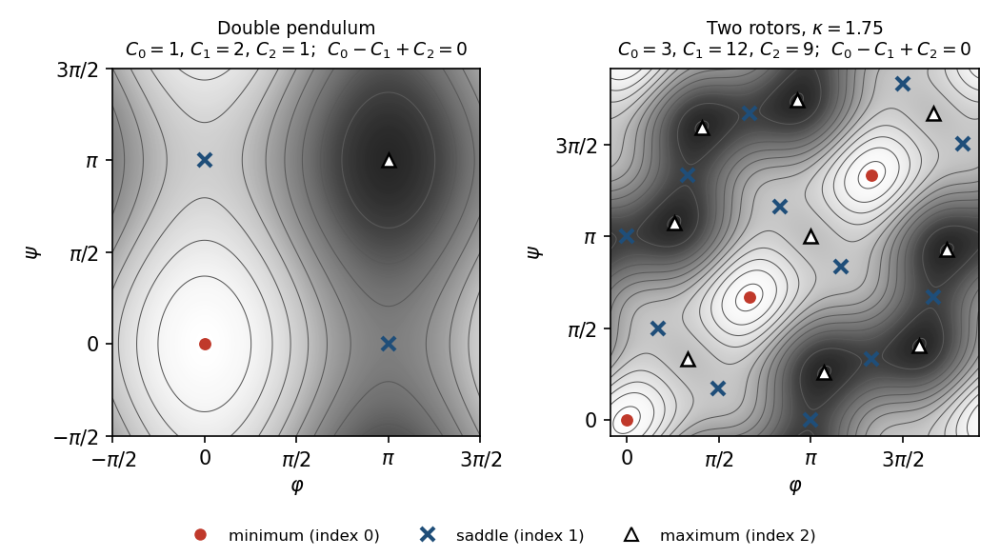

# Chapter 3. Counting critical points: examples and the Morse inequalities

*Milnor, "Morse Theory", §4–§5, rewritten for a first-year graduate student who wants to know what
the theorem is for. Every proof is complete; the outside facts used (standard properties of
singular homology, Poincaré duality mod 2, Brown's monotone union theorem) are stated precisely
where they enter.*

---

## 0. How many transition states must a flexible molecule have?

Take a molecule with two bonds about which parts of it can rotate. Its shape is described by two
torsion angles $\varphi$ and $\psi$, each defined up to a full turn, so the configuration space is
a torus and the potential energy is a smooth function $V(\varphi, \psi)$ on it. The local minima
of $V$ are the *conformers*; to pass between them the molecule crosses a saddle point, a
*transition state*; the maxima are the most crowded shapes. Is there a relation between the three
numbers?

There is, and nothing about the chemistry enters. If the critical points are nondegenerate (the
generic situation, Chapter 4),
$$\#\{\text{saddles}\} = \#\{\text{minima}\} + \#\{\text{maxima}\}, \qquad
\#\{\text{saddles}\} \ \ge\ \#\{\text{minima}\} + 1 .$$
The same law holds for a double pendulum or a two-joint robot arm under any load. The constants
come from the topology of the torus: its Betti numbers are $1, 2, 1$.

This chapter proves such statements in general. The *Morse inequalities* bound the number
$C_\lambda$ of critical points of index $\lambda$ of a Morse function on a compact manifold from
below by its Betti numbers, and their alternating sum is an equality, the Euler characteristic.
They are what survives of the cell decomposition of Chapter 2 when one only counts the cells.

First come Milnor's examples of what the cell decomposition alone can do: two nondegenerate
critical points force a sphere (Reeb), three force something like a projective plane, and complex
projective space has a function with one critical point in each even index. In §7 the
inequalities count the equilibria of a double pendulum and the conformers of a two-rotor
molecule.

---

## 1. Reeb's theorem: two critical points make a sphere (Milnor p. 25)

**Conventions.** In this chapter a *manifold* is smooth, Hausdorff, second countable and without
boundary; $f : M \to \mathbb{R}$ is smooth and $M^a = f^{-1}(-\infty, a]$. A *Morse function* is
one whose critical points are all nondegenerate. Earlier results are cited by Milnor's numbers:
the Morse lemma 2.2, Corollary 2.3 (nondegenerate critical points are isolated), Theorem 3.1 (if
$f^{-1}[a,b]$ is compact and free of critical points, the flow of a compactly supported multiple
of $\operatorname{grad} f$ carries $M^a$ diffeomorphically onto $M^b$, and $M^a$ is a
deformation retract of $M^b$), Theorem 3.2 with Remark 3.3 (quoted precisely in §5) and Theorem
3.5.

Two consequences of the Morse lemma are used repeatedly.

(i) A nondegenerate critical point that is a local minimum has index $0$, and one that is a local
maximum has index $n$. Indeed if $\lambda \ge 1$, then in Morse coordinates $f(s e_1) = f(p) -
s^2 < f(p)$ for small $s \ne 0$, so $p$ is not a local minimum; similarly for maxima.

(ii) A Morse function on a compact manifold has finitely many critical points (Corollary 2.3 and
compactness of the closed set of critical points).

**Theorem 4.1 (Reeb).** Let $M$ be a compact $n$-manifold and $f$ a smooth function on $M$ with
exactly two critical points, both nondegenerate. Then $M$ is homeomorphic to $S^n$.

Milnor's figure on p. 25 shows the idea: a small sublevel set around the minimum is a disk,
Theorem 3.1 stretches it until it covers everything except a small disk around the maximum, and
two disks glued along their boundary spheres form a sphere.

*Proof.* If $n = 0$, $M$ is a finite set and every point is critical, so $M$ has two points and
is $S^0$. Let $n \ge 1$.

*Step 1: the critical points are the minimum and the maximum.* By compactness $f$ attains its
minimum at some $p$ and its maximum at some $q$, and both are critical (in a chart they are
interior extrema). If $f(p) = f(q)$ then $f$ is constant and every point is critical, infinitely
many since $n \ge 1$. So $p \ne q$ are the two critical points, and every other point $x$ has
$f(p) < f(x) < f(q)$, since any point where an extreme value is attained is critical. Replacing
$f$ by $(f - f(p))/(f(q) - f(p))$, which has the same critical points and positively rescaled
Hessians, we may assume $f(p) = 0$, $f(q) = 1$ and $0 < f < 1$ on $M \setminus \{p, q\}$.

*Step 2: two small closed $n$-cells.* By the Morse lemma and (i) there is a chart $\phi$ from a
neighbourhood $U$ of $p$ onto an open subset of $\mathbb{R}^n$ with $\phi(p) = 0$ and
$f \circ \phi^{-1}(x) = |x|^2$. Choose $r > 0$ with $\bar B_r \subset \phi(U)$ and put
$V = \phi^{-1}(B_r)$. The set $M \setminus V$ is compact and does not contain $p$, so $f$ has a
positive minimum $m$ on it (put $m = 1$ if $M \setminus V$ is empty). For
$0 < \varepsilon < \min(m, r^2)$, every point with $f \le \varepsilon$ lies in $V$, where the
condition reads $|\phi|^2 \le \varepsilon$. Hence $M^\varepsilon = \phi^{-1}(\bar
B_{\sqrt\varepsilon})$, and
$$h_0 : D^n \to M^\varepsilon, \qquad h_0(x) = \phi^{-1}(\sqrt{\varepsilon}\, x),$$
is a homeomorphism (indeed a diffeomorphism) of the closed unit disk onto $M^\varepsilon$ that
carries the unit sphere $S^{n-1}$ onto $f^{-1}(\varepsilon)$. At $q$ the Morse lemma and (i) give
coordinates $\psi$ with $f \circ \psi^{-1}(y) = 1 - |y|^2$, and the same argument, after
shrinking $\varepsilon$ (keep $\varepsilon < \tfrac12$), shows that $D_2 := f^{-1}[1-\varepsilon,
1]$ is the image of a homeomorphism $h_2(y) = \psi^{-1}(\sqrt\varepsilon\, y)$ of $D^n$, with
$h_2(S^{n-1}) = f^{-1}(1-\varepsilon)$.

*Step 3: stretching the lower cell.* The set $f^{-1}[\varepsilon, 1-\varepsilon]$ is compact and
free of critical points, so Theorem 3.1 gives a diffeomorphism $\Phi$ of $M$ with
$\Phi(M^\varepsilon) = M^{1-\varepsilon}$. Moreover $\Phi(f^{-1}(\varepsilon)) =
f^{-1}(1-\varepsilon)$: in the proof of Theorem 3.1, $\Phi$ is the time-$(1-2\varepsilon)$ map of
a flow along which $f$ never decreases and increases with unit speed inside
$f^{-1}[\varepsilon, 1-\varepsilon]$. A point starting on the level $\varepsilon$ is therefore on
the level $\varepsilon + t$ at every time $t \le 1 - 2\varepsilon$, which gives
$\Phi(f^{-1}(\varepsilon)) \subset f^{-1}(1-\varepsilon)$, and running the flow backwards gives
the reverse inclusion. Put $D_1 := M^{1-\varepsilon}$ and $h_1 := \Phi \circ h_0$, a
homeomorphism $D^n \to D_1$ with $h_1(S^{n-1}) = f^{-1}(1-\varepsilon)$.

*Step 4: gluing.* Now $M = D_1 \cup D_2$ and $D_1 \cap D_2 = f^{-1}(1-\varepsilon) =
h_1(S^{n-1}) = h_2(S^{n-1})$, so $g := h_2^{-1} \circ h_1 : S^{n-1} \to S^{n-1}$ is a
homeomorphism. Its cone
$$G(x) = |x|\, g(x/|x|) \quad (x \ne 0), \qquad G(0) = 0,$$
is a homeomorphism of $D^n$ extending $g$: it is continuous at $0$ because $|G(x)| = |x|$, and
its inverse is the cone of $g^{-1}$. (This is *Alexander's trick*.) Write points of $S^n \subset
\mathbb{R}^n \times \mathbb{R}$ as $(x, s)$, so that $x \in D^n$, and define
$$H(x, s) = h_1(x) \ \text{ if } s \ge 0, \qquad H(x, s) = h_2(G(x)) \ \text{ if } s \le 0 .$$
On the equator $s = 0$ we have $|x| = 1$ and $h_2(G(x)) = h_2(g(x)) = h_1(x)$, so $H$ is well
defined, and it is continuous on each closed hemisphere (on each, $(x,s) \mapsto x$ is a
homeomorphism onto $D^n$), hence continuous. $H$ maps the upper hemisphere bijectively onto
$D_1$, the lower one onto $D_2$, the equator onto $D_1 \cap D_2$, and the open hemispheres into the
disjoint sets $D_1 \setminus D_2$ and $D_2 \setminus D_1$; so $H$ is a bijection $S^n \to M$. A
continuous bijection from a compact space to a Hausdorff space is a homeomorphism. $\square$

> **Milnor's text skips the gluing.** He ends by calling the construction of a homeomorphism
> between $M$ and $S^n$ "now easy". What is needed is that Theorem 3.1 carries the boundary
> sphere of the lower cell onto that of the upper one (Step 3), and Alexander's cone (Step 4). The
> cone is not differentiable at its vertex unless $g$ is linear, and $H$ need not be smooth along
> the equator; Remark 2 says "homeomorphic" cannot be improved.

**Remark 1 (Milnor).** Theorem 4.1 remains true when the two critical points are allowed to be
degenerate.

Milnor cites his paper in Bull. Soc. Math. France 87 (1959), Theorem 1(3), and R. Rosen (Notices
Amer. Math. Soc. 7, 1960). Here is a proof using one outside theorem.

**Brown's monotone union theorem** (M. Brown, Proc. Amer. Math. Soc. 12 (1961), 812–814). If an
$n$-manifold $X$ is the union of open subsets $W_1 \subset W_2 \subset \cdots$, each homeomorphic
to $\mathbb{R}^n$, then $X$ is homeomorphic to $\mathbb{R}^n$.

*Proof of Remark 1.* Step 1 above did not use nondegeneracy: $f$ has exactly two critical points,
the minimum $p$ and the maximum $q$, and we normalize $f(p) = 0$, $f(q) = 1$. Choose a chart
$\phi$ with $\phi(p) = 0$ whose domain avoids $q$ and whose image contains the closed unit ball,
and let $B = \phi^{-1}(\text{open unit ball})$; then $B \cong \mathbb{R}^n$, the closure $\bar B$ is
compact and $q \notin \bar B$. As in Step 2 choose $\delta \in (0,1)$ with $M^\delta \subset B$.
For each $b \in (\delta, 1)$, Theorem 3.1 gives a diffeomorphism $\Phi_b$ of $M$ with
$\Phi_b(M^\delta) = M^b$. It fixes $q$: the vector field generating it vanishes outside a compact
neighbourhood of $f^{-1}[\delta, b]$, which may be taken inside $f^{-1}(\delta/2, (1+b)/2)$. The
open set $W(b) := \Phi_b(B)$ is homeomorphic to $\mathbb{R}^n$ and contains $M^b$, and its closure
$\Phi_b(\bar B)$ is compact and does not contain $q$, so $\beta(b) := \max f(\Phi_b(\bar B)) < 1$.
Choose $b_1 \in (\delta, 1)$ and inductively $b_{k+1} \in (\max(\beta(b_k), b_k, 1 - 1/k), 1)$,
so that $\delta < b_k < b_{k+1} < 1$. Then
$$W(b_k) \subset \Phi_{b_k}(\bar B) \subset M^{\beta(b_k)} \subset M^{b_{k+1}} \subset W(b_{k+1}),$$
and since $b_k \to 1$ the union of the $W(b_k)$ contains $f^{-1}[0,1) = M \setminus \{q\}$, while
each $W(b_k)$ lies in $M \setminus \{q\}$. By Brown's theorem $M \setminus \{q\} \cong
\mathbb{R}^n$. Finally a homeomorphism $\kappa : \mathbb{R}^n \to M \setminus \{q\}$ extends to a
bijection $S^n = \mathbb{R}^n \cup \{\infty\} \to M$ by $\infty \mapsto q$. It is continuous at
$\infty$: for an open $O \ni q$, the set $\kappa^{-1}(M \setminus O)$ is compact, so its complement
together with $\infty$ is a neighbourhood of $\infty$ mapped into $O$. A continuous bijection from
a compact space to a Hausdorff space is a homeomorphism. $\square$

**Remark 2 (Milnor).** $M$ need not be diffeomorphic to $S^n$ with its standard smooth structure.
In *On manifolds homeomorphic to the 7-sphere* (Ann. of Math. 64 (1956), 399–405) Milnor found,
on certain 3-sphere bundles over $S^4$, functions with exactly two nondegenerate critical points,
so that these 7-manifolds are homeomorphic to $S^7$ by Theorem 4.1, and proved with
characteristic classes that some of them are not diffeomorphic to $S^7$. We quote this; it is not
used later. The proof of Theorem 4.1 shows where smoothness is lost: $M$ is two smooth disks
glued by the diffeomorphism $g$ of $S^{n-1}$, and Alexander's cone extends $g$ over the disk only
as a homeomorphism.

---

## 2. Three critical points (Milnor p. 26)

Milnor notes that if an $n$-manifold has a function with only three critical points, they have
indices $0$, $n$ and $n/2$ ("by Poincaré duality"), and the manifold has the homotopy type of an
$(n/2)$-sphere with an $n$-cell attached; implicitly $M$ is compact and the critical points are
nondegenerate. The proof uses the weak Morse inequalities of §6 with coefficients $\mathbb{Z}/2$
(proved there independently of this section) and two facts.

**Facts (mod 2 homology of closed manifolds).** Let $M$ be a compact connected $n$-manifold and
$b_i = \dim H_i(M; \mathbb{Z}/2)$. Then (a) $b_n = 1$, and (b) $b_i = b_{n-i}$ for all $i$.
Statement (a) is Hatcher, *Algebraic Topology*, Theorem 3.26 (every closed manifold is
$\mathbb{Z}/2$-orientable); (b) is Poincaré duality with $\mathbb{Z}/2$ coefficients (Hatcher,
Theorem 3.30) combined with $H^i(M;\mathbb{Z}/2) \cong \operatorname{Hom}(H_i(M;\mathbb{Z}/2),
\mathbb{Z}/2)$ (universal coefficients over a field).

**Proposition A (three critical points).** Let $M$ be a compact $n$-manifold, $n \ge 1$, and $f$
a smooth function on $M$ with exactly three critical points, all nondegenerate. Then $n$ is even,
the indices are $0$, $n/2$, $n$, and $M$ has the homotopy type of a CW complex $S^{n/2} \cup
e^n$.

*Proof.* $M$ is connected: on each component $M'$ (compact and open in $M$), $f$ attains its
maximum and minimum at two distinct critical points, as in Step 1 of §1, so a disconnected $M$
would have at least four. The minimum $p_0$ has index $0$ and the maximum $p_2$ index $n$, by (i)
of §1. Let $\lambda$ be the index of the third critical point $p_1$, and $c_i$ the number of
critical points of index $i$.

By Theorem 5.2 of §6 with $F = \mathbb{Z}/2$: $b_i \le c_i$ for all $i$, and $\sum (-1)^i b_i =
\sum (-1)^i c_i$. Reducing the second relation mod 2, $\sum b_i \equiv \sum c_i = 3$. Also $b_0 =
1$ ($M$ is connected), $b_n = 1$ by (a), and $0 \ne n$; so $2 \le \sum b_i \le \sum c_i = 3$ with
$\sum b_i$ odd. Hence $\sum b_i = 3$, which together with $b_i \le c_i$ forces $b_i = c_i$ for
every $i$. If $\lambda = 0$ then $c_0 = 2 \ne b_0$; if $\lambda = n$ then $c_n = 2 \ne b_n$. So
$0 < \lambda < n$, $b_\lambda = 1$, and $b_i = 0$ for $i \notin \{0, \lambda, n\}$. By (b),
$b_{n-\lambda} = b_\lambda = 1$, so $n - \lambda \in \{0, \lambda, n\}$, and $0 < \lambda < n$
leaves $n - \lambda = \lambda$.

Finally $f(p_0) < f(p_1) < f(p_2)$: by (i), $p_1$, whose index is neither $0$ nor $n$, is
neither a local minimum nor a local maximum, so the extreme values are attained only at $p_0$ and
$p_2$. The proof of Theorem 3.5 builds a CW complex homotopy equivalent to $M$ by attaching cells
in the order of the critical values: a $0$-cell; then an $(n/2)$-cell attached to it, which gives
$S^{n/2}$ (a disk with its boundary collapsed to a point); then an $n$-cell. $\square$

> **A hidden hypothesis.** "By Poincaré duality" must be read with coefficients $\mathbb{Z}/2$:
> over $\mathbb{Z}$ or $\mathbb{Q}$ duality needs orientability, and Milnor's own example
> $\mathbb{R}P^2$ is not orientable (its rational Betti numbers are $1, 0, 0$). Duality alone is
> also not enough: the parity argument giving $b_i = c_i$ is what makes the third critical point
> visible in homology.

*Examples.* On $\mathbb{C}P^2$ the function $\sum c_j |z_j|^2$ of §3 has indices $0, 2, 4$; on
$\mathbb{R}P^2 = S^2/\pm 1$ the same formula has indices $0, 1, 2$ (the computation of §3 with
$x_j$ real, each coordinate contributing $1$ instead of $2$). The "forthcoming papers" of Eells
and Kuiper (*Manifolds which are like projective planes*, Publ. Math. IHÉS 14, 1962) showed, using
Adams' theorem on Hopf invariant one, that $n \in \{2, 4, 8, 16\}$.

---

## 3. Complex projective space (Milnor pp. 26–27)

Let $\mathbb{C}P^n$ be the set of classes $(z_0 : z_1 : \dots : z_n)$ of $(n+1)$-tuples of complex
numbers with $\sum |z_j|^2 = 1$, two tuples being identified when they differ by a factor of
absolute value $1$. Its smooth structure is given by the affine charts $(z_j/z_k)_{j \ne k}$ on
$U_k = \{z_k \ne 0\}$. Fix *distinct* real numbers $c_0, \dots, c_n$ and put
$$f(z_0 : \dots : z_n) = \sum_{j=0}^n c_j |z_j|^2 ,$$
which is well defined because $|\omega z_j| = |z_j|$ when $|\omega| = 1$. (The scan of p. 26 drops
the summation sign and the exponent; the formula in coordinates below shows what is meant.)

**Coordinates.** On $U_0$ put $x_j + i y_j := (|z_0|/z_0)\, z_j$ for $j = 1, \dots, n$. This does
not depend on the representative (multiplying all $z_j$ by $\omega$ multiplies $|z_0|/z_0$ by
$\bar\omega$). In terms of the affine coordinates $u_j = z_j/z_0$, the normalization $\sum|z_j|^2
= 1$ gives $|z_0|^2(1 + |u|^2) = 1$, hence $w := (x_j + iy_j)_j = u/\sqrt{1 + |u|^2}$. The map
$u \mapsto u/\sqrt{1+|u|^2}$ is a diffeomorphism of $\mathbb{C}^n$ onto the open unit ball, with
inverse $w \mapsto w/\sqrt{1 - |w|^2}$. So $x_1, y_1, \dots, x_n, y_n$ are coordinates mapping
$U_0$ diffeomorphically onto the open unit ball of $\mathbb{R}^{2n}$, centred at $p_0 =
(1:0:\dots:0)$. Since $|x_j + i y_j| = |z_j|$ for $j \ge 1$ and $|z_0|^2 = 1 - \sum_{j \ge 1}
|z_j|^2$,
$$f = c_0 + \sum_{j=1}^n (c_j - c_0)\,(x_j^2 + y_j^2) \qquad \text{on } U_0 .$$

**Proposition B.** $f$ is a Morse function on $\mathbb{C}P^n$ whose critical points are exactly
$p_k = (0 : \dots : 1 : \dots : 0)$ ($1$ in position $k$), $k = 0, \dots, n$, and the index at
$p_k$ is $2\,\#\{j : c_j < c_k\}$. Consequently $C_\lambda = 1$ for $\lambda = 0, 2, 4, \dots,
2n$ and $C_\lambda = 0$ otherwise.

*Proof.* On $U_0$, $\partial f/\partial x_j = 2(c_j - c_0) x_j$ and $\partial f/\partial y_j =
2(c_j - c_0) y_j$ vanish together only at $x = y = 0$, since $c_j \ne c_0$; so $p_0$ is the only
critical point in $U_0$. The Hessian there is diagonal with entries $2(c_j - c_0)$, each twice, so
$p_0$ is nondegenerate of index $2\,\#\{j : c_j < c_0\}$. The same computation in the analogous
coordinates $(|z_k|/z_k)\, z_j$, $j \ne k$, on $U_k$ handles $p_k$. The sets $U_0, \dots, U_n$
cover $\mathbb{C}P^n$, so there are no other critical points. As the $c_j$ are distinct, $k
\mapsto \#\{j : c_j < c_k\}$ is a bijection of $\{0, \dots, n\}$ onto itself (the rank of $c_k$
in increasing order). $\square$

**Corollary C (Milnor p. 27).** $\mathbb{C}P^n$ has the homotopy type of a CW complex $e^0 \cup
e^2 \cup \dots \cup e^{2n}$, and $H_i(\mathbb{C}P^n; \mathbb{Z}) \cong \mathbb{Z}$ for $i = 0, 2,
\dots, 2n$ and $0$ for all other $i$.

*Proof.* $\mathbb{C}P^n$ is compact (an image of $S^{2n+1}$), so Theorem 3.5 applies with
Proposition B. In cellular homology (Hatcher, Theorem 2.35) the chain group is $\mathbb{Z}$ in
each even degree $\le 2n$ and $0$ in odd degrees, so every boundary map has zero source or target.
$\square$

Proposition G in §6 gives a second proof that avoids Theorem 3.5 and cellular homology.

---

## 4. Subadditive functions (Milnor p. 28)

Morse, without Theorem 3.5, expressed the topology through inequalities between numbers. Fix a
field $F$. A *pair* $(X, Y)$ is a space $X$ with a subspace $Y$, possibly empty;
$H_\lambda(X,Y)$ is singular homology with coefficients in $F$, and $H_\lambda(X) =
H_\lambda(X, \emptyset)$. Call $(X,Y)$ *of finite type* if $\sum_\lambda \dim_F
H_\lambda(X,Y) < \infty$. (Milnor says only "for any pair $(X,Y)$ such that this rank is
finite"; we need one class of pairs on which all functions below are defined, closed under the
operation of Lemma D.)

**Facts from homology** (Hatcher, *Algebraic Topology*, §§2.1–2.3), for any coefficient group:

* (H1) For $X \supset Y \supset Z$ the sequence of the triple
  $$\cdots \to H_\lambda(Y,Z) \to H_\lambda(X,Z) \to H_\lambda(X,Y) \xrightarrow{\ \partial\ }
  H_{\lambda-1}(Y,Z) \to \cdots \to H_0(X,Y) \to 0$$
  is exact and natural for maps of triples; $Z = \emptyset$ gives the sequence of a pair.
* (H2) Homotopic maps of pairs induce equal maps. Hence, by (H1) and the five lemma, if the
  inclusion $Y \subset X$ is a homotopy equivalence then $H_*(X,Y) = 0$, and a map of pairs that
  is the identity on the subspaces and a homotopy equivalence of the total spaces induces
  isomorphisms on relative homology.
* (H3) Excision: if $Z \subset A \subset X$ and the closure of $Z$ lies in the interior of $A$,
  the inclusion $(X \setminus Z, A \setminus Z) \to (X, A)$ induces isomorphisms.
* (H4) $H_\lambda(D^m, S^{m-1})$ is the coefficient group for $\lambda = m$ and $0$ otherwise
  ($S^{-1} = \emptyset$); this is the standard computation from the homology of spheres, by
  Mayer–Vietoris or by the exact sequence of the pair.
* (H5) If $X$ is the disjoint union of finitely many subsets $X_j$, each open in $X$, and $A_j
  \subset X_j$, then $H_*(X, \bigcup A_j) = \bigoplus_j H_*(X_j, A_j)$.

**Lemma D.** If $X \supset Y \supset Z$ and $(X,Y)$, $(Y,Z)$ are of finite type, so is $(X,Z)$,
and $\dim H_\lambda(X,Z) \le \dim H_\lambda(X,Y) + \dim H_\lambda(Y,Z)$ for every $\lambda$.

*Proof.* In the exact segment $H_\lambda(Y,Z) \xrightarrow{i} H_\lambda(X,Z) \xrightarrow{j}
H_\lambda(X,Y)$ we have $\ker j = \operatorname{im} i$, so $\dim H_\lambda(X,Z) = \dim\ker j +
\dim\operatorname{im} j \le \dim H_\lambda(Y,Z) + \dim H_\lambda(X,Y)$. $\square$

**Definition (Milnor).** An integer-valued function $S$ on pairs of finite type is *subadditive*
if $S(X,Z) \le S(X,Y) + S(Y,Z)$ whenever $X \supset Y \supset Z$ with $(X,Y)$ and $(Y,Z)$ of finite
type, and *additive* if equality always holds. Write $S(X) := S(X, \emptyset)$.

**Examples.** The $\lambda$-th Betti number $R_\lambda(X,Y) = \dim_F H_\lambda(X,Y;F)$ is
subadditive by Lemma D (Milnor: "as is easily seen" from a segment of the exact sequence). The
Euler characteristic $\chi(X,Y) = \sum_\lambda (-1)^\lambda R_\lambda(X,Y)$ is additive: the sequence
of the triple is a finite exact sequence $0 \to V_m \to \dots \to V_0 \to 0$ of
finite-dimensional spaces, for which rank–nullity and exactness give $\dim V_i =
\operatorname{rank} d_i + \operatorname{rank} d_{i+1}$ ($d_i : V_i \to V_{i-1}$), so $\sum (-1)^i
\dim V_i = 0$; grouping by degree, $\chi(Y,Z) - \chi(X,Z) + \chi(X,Y) = 0$.

**Lemma 5.1.** Let $S$ be subadditive and $X_0 \subset X_1 \subset \dots \subset X_n$ with every
$(X_i, X_{i-1})$ of finite type. Then $(X_n, X_0)$ is of finite type and
$S(X_n, X_0) \le \sum_{i=1}^n S(X_i, X_{i-1})$, with equality if $S$ is additive. In particular,
for $X_0 = \emptyset$,
$$S(X_n) \le \sum_{i=1}^n S(X_i, X_{i-1}). \qquad (1)$$

*Proof.* Induction on $n$; for $n = 1$ there is nothing to prove, and $n = 2$ is the definition.
If the claim holds for $n - 1$, then $(X_{n-1}, X_0)$ is of finite type, hence so is $(X_n, X_0)$
by Lemma D applied to $X_n \supset X_{n-1} \supset X_0$, and
$$S(X_n, X_0) \le S(X_n, X_{n-1}) + S(X_{n-1}, X_0) \le \sum_{i=1}^n S(X_i, X_{i-1}).$$
For additive $S$ every inequality is an equality. $\square$

---

## 5. The homology of a slab (Milnor p. 29)

Milnor's computation on p. 29 is the single line
$$H_*(M^{a_i}, M^{a_{i-1}}) = H_*(M^{a_{i-1}} \cup e^{\lambda_i}, M^{a_{i-1}}) =
H_*(e^{\lambda_i}, \dot e^{\lambda_i}) \ \text{(by excision)} = \begin{cases} F & \text{in
dimension } \lambda_i, \\ 0 & \text{otherwise.} \end{cases}$$
The first equality replaces a pair by a homotopy equivalent pair. The second is not literally an
excision: one would excise $A \setminus \dot e$ from $(A \cup e, A)$, but its closure $A$ is not
inside the interior of $A$ (points of $\dot e$ are limits of points of the open cell). The repair
is to thicken $A$ first. We also allow several critical points on one level (see §6).

**What we use from Chapter 2** (Theorem 3.2 and Remark 3.3, in the form proved there). Let $c$
be a critical value with $f^{-1}[c - \varepsilon_0, c + \varepsilon_0]$ compact, whose only
critical points $p_1, \dots, p_r$ lie on the level $c$ and are nondegenerate, of indices
$\lambda_1, \dots, \lambda_r$. Then for all sufficiently small $\varepsilon > 0$ there are
pairwise disjoint sets $e_1, \dots, e_r \subset M^{c+\varepsilon}$ and homeomorphisms $\sigma_j
: D^{\lambda_j} \to e_j$ with $e_j \cap M^{c-\varepsilon} = \sigma_j(S^{\lambda_j - 1})$, such
that $M^{c-\varepsilon} \cup e_1 \cup \dots \cup e_r$ is a deformation retract of
$M^{c+\varepsilon}$. In Morse coordinates $u$ around $p_j$ the cell is $e_j = \{u_1^2 + \dots +
u_{\lambda_j}^2 \le \varepsilon,\ u_{\lambda_j + 1} = \dots = u_n = 0\}$. Milnor proves $r = 1$;
for $r > 1$ the same construction is made in disjoint coordinate neighbourhoods.

**Lemma E (excision for attached cells).** Let $X$ be a Hausdorff space, $A \subset X$ closed,
and $e_1, \dots, e_r \subset X$ pairwise disjoint, with homeomorphisms $\sigma_j : D^{\lambda_j}
\to e_j$, such that $X = A \cup e_1 \cup \dots \cup e_r$ and $A \cap e_j =
\sigma_j(S^{\lambda_j - 1})$. Then for any coefficients, $H_*(X, A) \cong \bigoplus_j
H_*(D^{\lambda_j}, S^{\lambda_j - 1})$; over $F$, $\dim H_\mu(X, A) = \#\{j : \lambda_j = \mu\}$.

*Proof.* Each $e_j$ is compact, hence closed in $X$, and so is $\sigma_j(S^{\lambda_j - 1})$. The
complement of $e_j \setminus \sigma_j(S^{\lambda_j-1})$ is $A \cup \bigcup_{i \ne j} e_i \cup
\sigma_j(S^{\lambda_j - 1})$, a closed set, so the open cell $e_j \setminus
\sigma_j(S^{\lambda_j-1})$ is open in $X$, and with it $O_j := \sigma_j(\{|x| < \tfrac12\})$.
Let $K_j = \{x \in D^{\lambda_j} : \tfrac12 \le |x| \le 1\}$ (empty if $\lambda_j = 0$) and
$$A' := X \setminus \textstyle\bigcup_j O_j = A \cup \bigcup_j \sigma_j(K_j).$$

*Thickening.* $A$ is a deformation retract of $A'$: let $\rho_s$ be the identity on $A$ and
$\rho_s(\sigma_j(x)) = \sigma_j\big((1-s)x + s\,x/|x|\big)$ on $\sigma_j(K_j)$, $0 \le s \le 1$.
The pieces are finitely many closed sets agreeing on their overlaps $\sigma_j(S^{\lambda_j-1})$,
where both formulas give the identity, so $\rho$ is continuous on $A' \times [0,1]$. By (H2),
$H_*(A', A) = 0$, and the sequence of the triple $(X, A', A)$ shows that $H_*(X, A) \to
H_*(X, A')$ is an isomorphism.

*Excision.* Let $Z = X \setminus \bigcup_j e_j$. Its closure lies in the closed set $A$. The set
$X \setminus \bigcup_j \sigma_j(\{|x| \le \tfrac12\})$ is open, contained in $A'$, and contains
$A$ (because $A \cap e_j = \sigma_j(S^{\lambda_j - 1})$). So $\bar Z \subset \operatorname{int}
A'$, and (H3) gives $H_*(X \setminus Z, A' \setminus Z) \cong H_*(X, A')$. Here $X \setminus Z =
\bigcup_j e_j$ and $A' \setminus Z = \bigcup_j \sigma_j(K_j)$.

*Counting.* The $e_j$ are disjoint closed sets, hence each is open in their union, so by (H5)
$H_*(\bigcup e_j, \bigcup \sigma_j(K_j)) \cong \bigoplus_j H_*(D^{\lambda_j}, K_j)$. Finally
$S^{\lambda_j - 1} \subset K_j$ is a homotopy equivalence (radial retraction), so the five lemma
on the sequences of the pairs gives $H_*(D^{\lambda_j}, K_j) \cong H_*(D^{\lambda_j},
S^{\lambda_j - 1})$, which is (H4). $\square$

**Proposition F (one critical level).** Let $a < b$, let $f^{-1}[a,b]$ be compact, and suppose
its only critical points lie on one level $c \in (a,b)$, are nondegenerate, and have indices
$\lambda_1, \dots, \lambda_r$. Then for any coefficients $H_*(M^b, M^a) \cong \bigoplus_j
H_*(D^{\lambda_j}, S^{\lambda_j-1})$. With coefficients in $F$: $(M^b, M^a)$ is of finite type,
$R_\mu(M^b, M^a) = \#\{j : \lambda_j = \mu\}$, and $\chi(M^b, M^a) = \sum_j
(-1)^{\lambda_j}$.

*Proof.* Choose $\varepsilon$ as in the statement quoted above, with $a < c - \varepsilon < c +
\varepsilon < b$, and let $Y = M^{c-\varepsilon} \cup e_1 \cup \dots \cup e_r$. By Theorem 3.1,
$M^a$ is a deformation retract of $M^{c-\varepsilon}$, and $M^{c+\varepsilon}$ is one of $M^b$;
so the inclusions $M^a \subset M^{c-\varepsilon}$ and $Y \subset M^{c+\varepsilon} \subset
M^b$ are homotopy equivalences. By (H2), $H_*(M^{c-\varepsilon}, M^a) = 0$, and the sequence of
the triple $(M^b, M^{c-\varepsilon}, M^a)$ gives $H_*(M^b, M^a) \cong H_*(M^b, M^{c-\varepsilon})$.
By (H2) again, $H_*(Y, M^{c-\varepsilon}) \cong H_*(M^b, M^{c-\varepsilon})$. Lemma E applies to
$X = Y$ and $A = M^{c-\varepsilon}$, which is closed in the Hausdorff space $M$. $\square$

---

## 6. The Morse inequalities (Milnor pp. 29–31)

Let $M$ be a compact manifold, $f$ a Morse function on $M$, and $C_\lambda$ the (finite) number
of critical points of index $\lambda$. Let $c_1 < \dots < c_m$ be the critical values and choose
$$a_0 < c_1 < a_1 < c_2 < a_2 < \dots < a_{m-1} < c_m < a_m, \qquad a_0 < \min f, \quad a_m \ge
\max f .$$
Then $\emptyset = M^{a_0} \subset M^{a_1} \subset \dots \subset M^{a_m} = M$, each
$f^{-1}[a_{i-1}, a_i]$ is compact and contains exactly one critical value, and Proposition F,
summed over $i$, gives
$$\sum_{i=1}^m R_\mu(M^{a_i}, M^{a_{i-1}}) = C_\mu, \qquad \sum_{i=1}^m \chi(M^{a_i},
M^{a_{i-1}}) = \sum_\mu (-1)^\mu C_\mu . \qquad (5)$$

> **A hidden hypothesis.** Milnor chooses $a_1 < \dots < a_k$ "such that $M^{a_i}$ contains
> exactly $i$ critical points". Such numbers exist only if distinct critical points have distinct
> critical values, which is not assumed and fails in natural examples: for the two-rotor
> potential of §7 with $\kappa = 0$, all nine minima lie on the level $0$. Placing one critical
> *value* in each slab and using Remark 3.3 removes the issue.

**Theorem 5.2 (weak Morse inequalities).** For every field $F$,
$$R_\lambda(M) \le C_\lambda \ \text{ for every } \lambda, \qquad (2)$$
$$\sum_\lambda (-1)^\lambda R_\lambda(M) = \sum_\lambda (-1)^\lambda C_\lambda . \qquad (3)$$
In particular $H_*(M; F)$ is finite dimensional, and the Euler characteristic $\chi(M)$ does not
depend on $F$.

*Proof.* Lemma 5.1 applied to the chain $M^{a_0} \subset \dots \subset M^{a_m}$ shows that $(M,
\emptyset)$ is of finite type; inequality (1) with $S = R_\lambda$ and the equality case with
$S = \chi$, together with (5), give (2) and (3). The right side of (3) involves no $F$. $\square$

The same argument up to a regular value $a$ gives $\chi(M^a) = \sum_\lambda (-1)^\lambda
C_\lambda(a)$, with $C_\lambda(a)$ counting critical points of index $\lambda$ in $M^a$.

**Lemma 5.3.** For each $\lambda \ge 0$ the function
$$S_\lambda(X,Y) = R_\lambda(X,Y) - R_{\lambda-1}(X,Y) + R_{\lambda-2}(X,Y) - \dots \pm R_0(X,Y)
= \sum_{\mu=0}^\lambda (-1)^{\lambda-\mu} R_\mu(X,Y)$$
is subadditive.

*Proof.* First an algebraic fact. Let $A' \xrightarrow{h} A_m \xrightarrow{d_m} A_{m-1} \to
\cdots \xrightarrow{d_1} A_0 \to 0$ be exact, with the $A_i$ finite dimensional. Exactness at
$A_i$ says $\operatorname{im} d_{i+1} = \ker d_i$, so $\operatorname{rank} d_{i+1} = \dim A_i -
\operatorname{rank} d_i$ (with $d_{m+1} = h$ and $d_0 = 0$). Unwinding from $i = m$ down to $i =
0$,
$$\operatorname{rank} h = \dim A_m - \dim A_{m-1} + \dim A_{m-2} - \dots \pm \dim A_0 \ \ge\ 0 .$$
Apply this to the end of the exact sequence of a triple $X \supset Y \supset Z$ of pairs of finite
type, starting with $h = \partial : H_{\lambda+1}(X,Y) \to H_\lambda(Y,Z)$:
$$H_\lambda(Y,Z) \to H_\lambda(X,Z) \to H_\lambda(X,Y) \to H_{\lambda-1}(Y,Z) \to \cdots \to
H_0(X,Z) \to H_0(X,Y) \to 0 .$$
The terms $H_\mu(Y,Z)$, $H_\mu(X,Z)$, $H_\mu(X,Y)$ carry the signs $(-1)^{\lambda-\mu}$,
$-(-1)^{\lambda-\mu}$, $(-1)^{\lambda-\mu}$, so
$$0 \le \operatorname{rank}\partial = R_\lambda(Y,Z) - R_\lambda(X,Z) + R_\lambda(X,Y) -
R_{\lambda-1}(Y,Z) + \dots = S_\lambda(Y,Z) - S_\lambda(X,Z) + S_\lambda(X,Y),$$
which is the subadditivity $S_\lambda(X,Z) \le S_\lambda(X,Y) + S_\lambda(Y,Z)$. $\square$

**The Morse inequalities.** Inequality (1) for $S = S_\lambda$ and the chain $\emptyset =
M^{a_0} \subset \dots \subset M^{a_m} = M$, together with (5), give for every $\lambda \ge 0$
$$R_\lambda(M) - R_{\lambda-1}(M) + \dots \pm R_0(M) \ \le\ C_\lambda - C_{\lambda-1} + \dots \pm
C_0 . \qquad (4_\lambda)$$

They are sharper than Theorem 5.2. Put $R_\mu = C_\mu = 0$ for $\mu < 0$.

(a) Adding $(4_\lambda)$ and $(4_{\lambda-1})$ gives $(2)$, since $S_\lambda + S_{\lambda-1} =
R_\lambda$ and likewise on the right.

(b) For $\lambda > n = \dim M$ we have $C_\lambda = 0$ (indices are at most $n$), hence
$R_\lambda(M) = 0$ by (2). Then $(4_{n+1})$ reads $-S_n(M) \le -\sum_{\mu \le n} (-1)^{n-\mu}
C_\mu$; together with $(4_n)$ this is the equality $S_n(M) = \sum_{\mu \le n}(-1)^{n-\mu}C_\mu$,
which is (3) multiplied by $(-1)^n$. (Milnor compares "$(4_\lambda)$ with $(4_{\lambda-1})$ for
$\lambda > n$"; $\lambda = n + 1$ suffices.)

(c) If $C_{\lambda+1} = 0$, then $R_{\lambda+1}(M) = 0$ by (2), and $(4_{\lambda+1})$ becomes
$S_\lambda(M) \ge \sum_{\mu \le \lambda}(-1)^{\lambda-\mu} C_\mu$. With $(4_\lambda)$:
$$R_\lambda - R_{\lambda-1} + \dots \pm R_0 = C_\lambda - C_{\lambda-1} + \dots \pm C_0 .$$

(d) If moreover $C_{\lambda-1} = 0$, then $R_{\lambda-1} = 0$, and (c) with $\lambda - 2$ in
place of $\lambda$ gives $R_{\lambda-2} - R_{\lambda-3} + \dots = C_{\lambda-2} -
C_{\lambda-3} + \dots$. Subtracting this from the equality in (c) leaves $R_\lambda = C_\lambda$:

**Corollary 5.4.** If $C_{\lambda+1} = C_{\lambda-1} = 0$, then $R_\lambda(M) = C_\lambda$ and
$R_{\lambda+1}(M) = R_{\lambda-1}(M) = 0$.

(As Milnor remarks, this also follows from Theorem 3.5.) For $\mathbb{C}P^n$, Proposition B gives
$C_\lambda = 1$ for even $\lambda \le 2n$ and $0$ otherwise. For even $\lambda$ both neighbours
vanish, so $R_\lambda = C_\lambda$; for odd $\lambda$, $R_\lambda \le C_\lambda = 0$. Hence
$\dim H_\lambda(\mathbb{C}P^n; F) = 1$ for $\lambda = 0, 2, \dots, 2n$ and $0$ otherwise, for every
field $F$.

> **Milnor's text skips the passage to integers.** He notes that the corollary yields the homology
> groups of complex projective space without the help of Theorem 3.5. Corollary 5.4
> gives Betti numbers over every field, not the integral groups of Corollary C. Universal
> coefficients would finish once $H_*(\mathbb{C}P^n;\mathbb{Z})$ is known to be finitely
> generated; here is a direct argument.

**Proposition G (lacunary principle).** Let $f$ be a Morse function on a compact manifold $M$
such that $C_{\lambda-1} = C_{\lambda+1} = 0$ whenever $C_\lambda \ne 0$. Then $H_\lambda(M;
\mathbb{Z})$ is free abelian of rank $C_\lambda$ for every $\lambda$. In particular Corollary C
holds without Theorem 3.5.

*Proof.* Proposition F with integer coefficients gives $H_\mu(M^{a_i}, M^{a_{i-1}};
\mathbb{Z}) \cong \mathbb{Z}^{c_\mu^{(i)}}$, where $c_\mu^{(i)}$ is the number of critical points of
index $\mu$ on the level $c_i$. We show by induction on $i$ that $H_\mu(M^{a_i}; \mathbb{Z})$ is
free of rank $\sum_{i' \le i} c_\mu^{(i')}$; for $i = 0$, $M^{a_0} = \emptyset$. In the exact
sequence of the pair $(M^{a_i}, M^{a_{i-1}})$,
$$H_{\mu+1}(M^{a_i}, M^{a_{i-1}}) \to H_\mu(M^{a_{i-1}}) \to H_\mu(M^{a_i}) \to
H_\mu(M^{a_i}, M^{a_{i-1}}) \to H_{\mu-1}(M^{a_{i-1}}),$$
if $C_\mu = 0$ the second and fourth groups vanish (by induction, and by Proposition F), so
$H_\mu(M^{a_i}) = 0$. If $C_\mu \ne 0$, then $C_{\mu \pm 1} = 0$, so the first and last groups
vanish, and $0 \to H_\mu(M^{a_{i-1}}) \to H_\mu(M^{a_i}) \to \mathbb{Z}^{c_\mu^{(i)}} \to 0$ is
exact; it splits because the right-hand group is free. $\square$

### An interactive look at the Morse inequalities on a torus

The square is the torus, with opposite edges glued: $\varphi$ runs horizontally and $\psi$
vertically, each over one full turn (markers on an edge appear on both glued sides). The shading
is the potential
$$V(\varphi, \psi) = \tfrac12(1 - \cos k\varphi) + \tfrac12 B\,(1 - \cos k\psi) - \kappa
\cos(\varphi - \psi - \delta),$$
fading into the page background where $V$ is lowest (white in the still image). The program finds
the critical points numerically (Newton's method started from a grid of points) and classifies
them by the signs of the eigenvalues of the Hessian: minima are filled discs, saddles are
crosses, maxima are triangles. Below the picture it reports $C_0, C_1, C_2$ and checks the three
Morse inequalities of the torus, $C_0 \ge 1$, $C_1 - C_0 \ge 1$ and $C_0 - C_1 + C_2 = 0$.

The preset "double pendulum" ($k = 1$, $B = \tfrac12$, $\kappa = 0$) shows one disc, two crosses
and one triangle; "two rotors" ($k = 3$, $B = 1$) shows $9 + 18 + 9$. (The still image shows the
first preset, and the second with $\kappa = 1.75$, where the counts are $3 + 12 + 9$.) Drag the
coupling $\kappa$: minima collide with saddles and vanish in pairs, and so do saddles with maxima, but
$C_0 - C_1 + C_2$ stays $0$ (at a collision the function is degenerate, and the readout says so). The level slider shades the sublevel set $M^a = \{V \le a\}$; as $a$
crosses a critical value, $M^a$ gains a cell of dimension equal to the index, and the readout
gives $\chi(M^a)$, the number of minima minus saddles plus maxima below $a$.

*(In the printed version this figure is a still image; the interactive version is in the web
edition.)*

---

## 7. Application: equilibria of a double pendulum and conformers of a two-rotor molecule

**The double pendulum.** Two rigid rods of lengths $l_1, l_2$, carrying point masses $m_1, m_2$
at their far ends, hang in a vertical plane: the first from a fixed pivot, the second from the
end of the first. Both may turn through full circles (in the planar model the rods pass each
other). The configuration is given by the angles $\theta_1, \theta_2$ of the rods from the
downward vertical, so the configuration space is the torus $T^2 = S^1 \times S^1$. The heights of
the masses are $-l_1 \cos\theta_1$ and $-l_1\cos\theta_1 - l_2\cos\theta_2$, so the potential
energy is
$$V = -(m_1 + m_2)\, g\, l_1 \cos\theta_1 - m_2\, g\, l_2 \cos\theta_2 .$$
The equilibria are its critical points: $\sin\theta_1 = \sin\theta_2 = 0$, the four
configurations in which each rod points straight down ($0$) or straight up ($\pi$). The Hessian is
diagonal with entries $(m_1 + m_2) g l_1 \cos\theta_1$ and $m_2 g l_2 \cos\theta_2$, so all four
are nondegenerate:

| $(\theta_1, \theta_2)$ | configuration | index |
|---|---|---|
| $(0, 0)$ | both rods down | $0$ (stable) |
| $(\pi, 0)$ | first rod up, second hanging down from its top | $1$ |
| $(0, \pi)$ | first rod down, second balanced upright on it | $1$ |
| $(\pi, \pi)$ | both rods up | $2$ |

So $(C_0, C_1, C_2) = (1, 2, 1)$.

**The Betti numbers of the torus, from the pendulum.** Theorem 5.2 gives $R_0 \le 1$, $R_1 \le
2$, $R_2 \le 1$ and $R_0 - R_1 + R_2 = 0$. The torus is path connected, so $R_0 = 1$. For a lower
bound on $R_1$, let $i_1(\theta) = (\theta, 0)$, $i_2(\theta) = (0, \theta)$ and let $p_1, p_2$ be
the projections. Then $p_a \circ i_b$ is the identity of $S^1$ if $a = b$ and constant if $a \ne
b$, and constant maps induce zero on $H_1$; so the composite
$$H_1(S^1) \oplus H_1(S^1) \xrightarrow{\ i_{1*} + i_{2*}\ } H_1(T^2) \xrightarrow{\ (p_{1*},\,
p_{2*})\ } H_1(S^1) \oplus H_1(S^1)$$
is the identity, the first map is injective, and $R_1 \ge 2\dim H_1(S^1;F) = 2$. Hence $(R_0,
R_1, R_2) = (1, 2, 1)$ for every field $F$, and the pendulum's potential is a *perfect* Morse
function, $C_\lambda = R_\lambda$.

**Every potential on the torus.** Now let $V$ be any Morse function on $T^2$: the double
pendulum with springs or magnets added, a two-joint robot arm under any load, the torsional
energy of a molecule with two rotatable bonds. The inequalities $(4_0)$, $(4_1)$, $(4_2)$ with
$R = (1, 2, 1)$ read
$$C_0 \ge 1, \qquad C_1 - C_0 \ge 1, \qquad C_2 - C_1 + C_0 \ge 0,$$
and (3) makes the last an equality. Therefore
$$C_1 = C_0 + C_2, \qquad C_1 \ge C_0 + 1 \ge 2, \qquad C_0 + C_1 + C_2 = 2C_1 \ge 4 .$$
There is always at least one more saddle than stable equilibria, and the number of equilibria is
even.

For one rotatable bond the configuration space is a circle, $R = (1, 1)$, and the same reasoning
gives $C_0 = C_1$; butane has three staggered minima (anti and two gauche) and three eclipsed
maxima.

**Two rotors.** A simple model of two coupled threefold rotors is
$$V(\varphi, \psi) = \tfrac{V_3}{2}(1 - \cos 3\varphi) + \tfrac{V_3}{2}(1 - \cos 3\psi) - \kappa
\cos(\varphi - \psi - \delta),$$
a threefold torsional term for each rotor plus a coupling of strength $\kappa$ (a model, not data
for a particular molecule). For $\kappa = 0$ the critical points are products of those of the two
one-variable potentials, each with three minima and three maxima: $9$ minima, $9 + 9 = 18$ saddles
and $9$ maxima, and $18 = 9 + 9$. As the coupling grows, critical points of adjacent index collide
and disappear in pairs. With $V_3 = 1$ and $\delta = 0$, the numerical search of the figure
(confirmed by an independent sign-change search) finds $(C_0, C_1, C_2) = (9, 18, 9)$ at $\kappa =
0.5$, $1$ and $1.5$, then $(3, 12, 9)$ at $\kappa = 1.75$ and $(3, 9, 6)$ at $\kappa = 2.5$; with
$\delta = 0.8$ and $\kappa = 2$ it finds $(6, 12, 6)$. Every case satisfies $C_1 = C_0 + C_2$.
Used in reverse, the relation is a consistency check on a computed list of stationary points: if a
search on a two-dihedral energy surface reports $C_0 - C_1 + C_2 \ne 0$, some stationary point has
been missed or one of them is degenerate.

---

## 8. Summary of what was silently assumed, now made explicit

| Where | Milnor says | What is actually needed |
|---|---|---|
| p. 25 | Reeb: "$M$ is a compact manifold"; "the two critical points must be the minimum and maximum" | $M$ without boundary; $n = 0$ separately; for $n \ge 1$, $f$ is not constant, and extremes are critical |
| p. 25 | "$M^\varepsilon$ … closed $n$-cells by §2.2" | $\varepsilon$ below the minimum of $f$ outside a Morse ball; index $0$ at a minimum |
| p. 25 | "$M^\varepsilon$ is homeomorphic to $M^{1-\varepsilon}$ by §3.1" | the diffeomorphism also carries $f^{-1}(\varepsilon)$ onto $f^{-1}(1-\varepsilon)$ (unit-speed flow) |
| p. 25 | "it is now easy to construct a homeomorphism" | Alexander's cone on the gluing map; the result is only a homeomorphism |
| p. 25 | Remark 1 (degenerate case), cited | proof via Theorem 3.1 and Brown's monotone union theorem |
| p. 26 | three critical points: indices $0, n, n/2$ "by Poincaré duality" | $M$ compact, critical points nondegenerate; duality mod 2 ($\mathbb{R}P^2$ is nonorientable); the parity argument giving $b_i = c_i$ |
| p. 26 | $f = c_j \lvert z_j\rvert$ (scan) | $f = \sum c_j \lvert z_j \rvert^2$ with distinct $c_j$; the coordinates form a smooth chart; $U_0, \dots, U_n$ cover $\mathbb{C}P^n$ |
| p. 27 | "it follows that the integral homology groups …" | cellular homology, or the lacunary argument (Proposition G) |
| p. 28 | $S$ defined on "certain pairs of spaces"; "$R_\lambda$ is subadditive, as is easily seen" | a class of pairs closed under triples (finite total homology); exactness at $H_\lambda(X,Z)$ (Lemma D) |
| p. 29 | $a_i$ with "$M^{a_i}$ contains exactly $i$ critical points" | distinct critical values; otherwise one critical value per slab and Remark 3.3 |
| p. 29 | $H_*(M^{a_i}, M^{a_{i-1}}) = H_*(M^{a_{i-1}} \cup e^{\lambda_i}, M^{a_{i-1}})$ | the deformation retractions of Theorems 3.1, 3.2 and the five lemma (Proposition F) |
| p. 29 | "$= H_*(e^\lambda, \dot e^\lambda)$ by excision" | excision needs a thickened subspace first (Lemma E) |
| p. 30 | "comparing $(4_\lambda)$ with $(4_{\lambda-1})$ for $\lambda > n$" | $R_\lambda(M) = 0$ for $\lambda > n$ follows from (2); use $(4_{n+1})$ and $(4_n)$ |
| p. 31 | Corollary 5.4 gives the homology of $\mathbb{C}P^n$ | it gives Betti numbers over every field; integral groups need Proposition G or universal coefficients |

**Checked by machine.** Theorem 4.1 (Reeb) has been verified in the Lean proof assistant for compact
submanifolds of Euclidean space and, through the Whitney embedding, for compact manifolds. §5 is
checked in singular homology over every field. Relative homology, excision, the exact sequences of
pairs and triples and the homology of attached cells (Lemma E), absent from Mathlib, were built for
this. On every compact submanifold of Euclidean space, and through the Whitney embedding on every
compact manifold, each slab between regular values has the homology of its critical points
(Proposition F over a field, with several critical points per level), and Lemmas 5.1, D and 5.3,
Theorem 5.2, the inequalities $(4_\lambda)$, Corollary 5.4 and the lacunary principle hold for the
Betti numbers. Their alternating sum, the same over every field, equals
$\sum_\lambda (-1)^\lambda C_\lambda$ for every Morse function and the index sum of the
Poincaré–Hopf theorem, and is $1 + (-1)^n$ on $S^n$. The example of $\mathbb CP^n$ is checked as
well, for the compact submanifold of rank-one Hermitian projections: Milnor's coordinates are
coordinates on it, Proposition B holds, and Corollary C holds in the form of one cell in each
dimension $0, 2, \dots, 2n$, with the Betti numbers over every field given by the lacunary
principle. Not checked: Remarks 1 and 2, Proposition A, Proposition G (the integral form of the
lacunary principle), integral homology, non-compact manifolds and the application. See the verified
edition.
