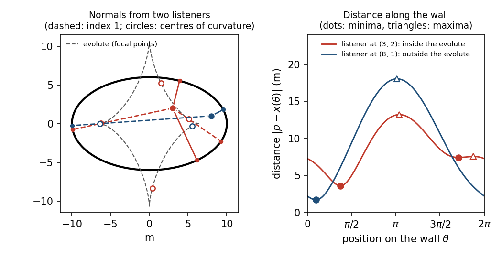

# Chapter 4. Focal points: every manifold has a Morse function

*Milnor, "Morse Theory", §6, rewritten for a first-year graduate student who wants to know what
the theorem is for. Every proof is complete; Sard's theorem, the normal bundle, the index of a
nondegenerate zero and the Poincaré–Hopf theorem are quoted from the companion volume
("Topology from the Differentiable Viewpoint", rewritten), and the Whitney embedding theorem from
the literature.*

---

## 0. Echoes in an oval room

Stand in a room whose wall, seen from above, is an ellipse, and clap once. Some of the sound
strikes the wall head-on and comes straight back to you. How many such echoes do you hear, and
when?

A sound ray from your position $p$ returns to $p$ after one reflection at a point $q$ of the wall
exactly when it meets the wall at right angles: the reflected ray is the mirror image of the
incoming one in the normal line, and it points back along the incoming ray only if that ray is the
normal. So the echoes correspond to the normals to the wall through $p$, and these are the
critical points of the squared distance
$$L_p(q) = |p - q|^2, \qquad q \text{ on the wall},$$
because the derivative of $L_p$ along the wall vanishes exactly when $p - q$ is perpendicular to
the wall. The delay of an echo is $2|p - q|$ divided by the speed of sound.

The answer depends on where you stand, through a curve you cannot see: the locus of the centres
of curvature of the wall, its *evolute*. Inside the evolute you hear four echoes, outside it two.
As you walk across it, two of the echoes slide together in time, merge and vanish; on the evolute
itself $L_p$ has a degenerate critical point.

This chapter proves the general statement behind this, for any submanifold $M$ of a Euclidean
space. $L_p$ has a degenerate critical point exactly when $p$ is a *focal point* of $M$, a point
where infinitely near normals of $M$ meet (Lemma 6.5). Along each normal line the focal points
sit at the principal radii of curvature (Lemma 6.3), and by Sard's theorem they form a set of
measure zero. Hence $L_p$ is a Morse function for almost every $p$ (Theorem 6.6). Since every
manifold embeds in some $\mathbb{R}^n$ as a closed subset, every manifold carries a Morse function
with compact sublevel sets (Corollary 6.7), and the theory of Chapters 2 and 3 applies to every
manifold. Finally, the index of $L_p$ at $q$ is the number of focal points between $q$ and $p$
(Lemma 6.9): the echoes that come back from beyond a centre of curvature are those of index $1$.
Section 9 does the numbers for an oval room 20 m long and 12 m wide.

---

## 1. Normals and focal points (Milnor p. 32)

So far we have studied functions with only nondegenerate critical points, without knowing that
any exist. Milnor constructs them on every manifold embedded in Euclidean space.

**Setting.** Throughout, $M \subset \mathbb{R}^n$ is a smooth submanifold of dimension $k < n$
(Milnor: "differentiably embedded"; $M$ need not be compact or closed). Every point of $M$ has a
neighbourhood $x(U)$ in $M$, where $U \subset \mathbb{R}^k$ is open and $x : U \to \mathbb{R}^n$
is a *parametrization*: smooth, with injective derivative, and a homeomorphism onto $x(U)$. Its
inverse gives coordinates $u = (u^1, \dots, u^k)$, and $TM_q$ is the image of $dx$ at $q$. We cite
the companion volume by chapter and number.

**Definition (Milnor).** The *normal bundle* is $N = \{(q, v) \in M \times \mathbb{R}^n : v \perp
TM_q\}$, and the *endpoint map* is $E : N \to \mathbb{R}^n$, $E(q, v) = q + v$.

**Fact A (the normal bundle).** $N$ is a smooth $n$-dimensional submanifold of $\mathbb{R}^{2n}$.
Concretely, let $x : U \to M$ be a parametrization and $w_1, \dots, w_{n-k} : U \to \mathbb{R}^n$
smooth maps such that $w_1(u), \dots, w_{n-k}(u)$ is an orthonormal basis of $(TM_{x(u)})^\perp$
for each $u$. Then
$$\Psi(u, t) = \Big(x(u),\ \sum_{\alpha=1}^{n-k} t^\alpha w_\alpha(u)\Big), \qquad (u,t) \in U
\times \mathbb{R}^{n-k},$$
is a parametrization of $N$ onto the open subset $N \cap (x(U) \times \mathbb{R}^n)$. Such frames
exist near every point of $M$: apply Gram–Schmidt to $\partial_1 x, \dots, \partial_k x$ followed
by $n - k$ standard basis vectors completing them to a basis at one point (they then do so
nearby). This is proved in Chapter 6 of the companion volume (*Topology from the Differentiable
Viewpoint*, rewritten), in the proof of Proposition 4.1; see also its Chapter 8, Problem 11. That
proof assumes $M$ compact but is local. (In brief: $\Psi$ is smooth and injective; its derivative
sends $\partial/\partial u^i$ and $\partial/\partial t^\beta$ to $(\partial_i x, \ast)$ and $(0,
w_\beta)$, which are independent; and its inverse $(q, v) \mapsto (x^{-1}(q), (v \cdot
w_\alpha(x^{-1}(q)))_\alpha)$ is continuous.)

$E$ is smooth, as the restriction of the linear map $(q, v) \mapsto q + v$ of $\mathbb{R}^{2n}$.

**Definition (Milnor).** A point $e \in \mathbb{R}^n$ is a *focal point of $(M, q)$ with
multiplicity $\mu$* if $e = q + v$ with $(q, v) \in N$ and the derivative $dE_{(q,v)} :
TN_{(q,v)} \to \mathbb{R}^n$ has a kernel of dimension $\mu > 0$. It is a *focal point of $M$* if
it is a focal point of $(M, q)$ for some $q \in M$.

Both spaces have dimension $n$, so $(q, v)$ is then a critical point of $E$. Intuitively a focal
point is where nearby normals meet: if $dE$ kills a tangent vector to $N$ at $(q, v)$, then the
normal lines through nearby points of $M$, followed for the right length, arrive at $e$ to first
order (Milnor's figure on p. 32).

*Example.* For the sphere $M = S^{n-1}(r)$ of radius $r$ about $0$, the normal space at $q$ is
spanned by $q$, and in the parametrization $\Psi(u, s) = (x(u), s\,x(u)/r)$ we get $E(\Psi(u,s)) =
(1 + s/r)\, x(u)$, with partial derivatives $(1 + s/r)\,\partial_i x$ and $x/r$. These are
dependent exactly when $s = -r$, and then the kernel has dimension $n - 1$. So the centre is a
focal point of $(M, q)$ for every $q$, of multiplicity $n - 1$, and there are no others: all
normals of a sphere meet at its centre.

---

## 2. Sard's theorem and the measure of the focal set (Milnor p. 33)

A set $Z \subset \mathbb{R}^n$ has *measure zero* if for each $\eta > 0$ it can be covered by
countably many cubes of total volume less than $\eta$. A countable union of such sets has measure
zero, and a set of measure zero contains no ball, so its complement is dense. A *critical point*
of a $C^1$ map between manifolds of the same dimension is a point where its derivative is
singular.

**Theorem 6.1 (Sard).** If $M_1$ and $M_2$ are manifolds with countable bases, of the same
dimension, and $f : M_1 \to M_2$ is of class $C^1$, then the image of the set of critical points
has measure zero in $M_2$ (its trace in each chart is carried to a set of measure zero).

Milnor does not prove it and cites de Rham, *Variétés différentiables*, p. 10. We apply it only
to smooth maps into $\mathbb{R}^n$, and that case is proved in Chapter 3 of the companion volume:
Theorem 1.1 there is Sard's theorem for smooth maps between open subsets of vector spaces, and
the proof of its Theorem 2.1 passes to a manifold domain by covering it with countably many
charts $\varphi_i$, the critical values of $f$ being the union of those of the maps $f \circ
\varphi_i^{-1}$.

> **How much smoothness.** "Of class $C^1$" suffices because the dimensions are equal. From
> higher-dimensional manifolds Sard's theorem needs more derivatives, and Whitney's $C^1$ example
> shows that they are necessary (companion volume, Chapter 3). Every map below is smooth.

**Corollary 6.2.** For almost all $x \in \mathbb{R}^n$ (all but a set of measure zero), $x$ is
not a focal point of $M$.

*Proof.* $N$ is an $n$-manifold (Fact A), with a countable basis since it is a subset of
$\mathbb{R}^{2n}$, and $E : N \to \mathbb{R}^n$ is smooth. By definition, $x$ is a focal point of
$M$ if and only if $x = E(q, v)$ for a point $(q, v) \in N$ at which $dE$ is singular, that is,
if and only if $x$ is a critical value of $E$. By Theorem 6.1 these form a set of measure zero.
$\square$

---

## 3. The second fundamental form (Milnor pp. 33–34)

Fix a parametrization $x(u) = (x_1(u), \dots, x_n(u))$ of a neighbourhood of $q$ in $M$, write
$\partial_i = \partial/\partial u^i$, and let $u_q$ be the coordinates of $q$. (Milnor writes
vectors with arrows; we drop them.)

**Definition (Milnor).** The *first fundamental form* is the symmetric matrix of functions $g_{ij}
= \partial_i x \cdot \partial_j x$; it is positive definite because the $\partial_i x$ are
independent. The vector $\partial_i\partial_j x$ at a point of $M$ is the sum of a vector tangent
to $M$ and a vector normal to $M$; the normal part is denoted $\ell_{ij}$, and the matrix
$(\ell_{ij})$ of vector-valued functions, symmetric in $i, j$, is the *second fundamental form*.
For a unit normal vector $v$ at $q$, the symmetric matrix
$$\big(v \cdot \partial_i\partial_j x\big) = \big(v \cdot \ell_{ij}\big)$$
is the *second fundamental form of $M$ at $q$ in the direction $v$*. The two expressions agree
because $v$ is orthogonal to the tangent part.

It simplifies matters to have $g_{ij}(u_q) = \delta_{ij}$. A linear change of coordinates
achieves this: if $P$ is invertible with $P^{\mathsf T} g(u_q) P = I$ (for instance $P =
g(u_q)^{-1/2}$), then $\tilde x(\tilde u) = x(u_q + P\tilde u)$ has $\tilde g(0) = I$.

**Definition (Milnor).** With $g_{ij}(u_q) = \delta_{ij}$, the eigenvalues $K_1, \dots, K_k$ of
the symmetric $k \times k$ matrix $(v \cdot \ell_{ij})$ at $q$ are the *principal curvatures* of
$M$ at $q$ in the normal direction $v$, and the reciprocals $K_i^{-1}$ of the nonzero ones are the
*principal radii of curvature*. (Milnor writes $K_1, \dots, K_n$; there are $k$ of them.) If the
matrix is singular some $K_i$ vanish, and the corresponding radii are not defined.

**Claim B.** The principal curvatures, with multiplicities, do not depend on the coordinates with
$g_{ij}(u_q) = \delta_{ij}$. In arbitrary coordinates they are the eigenvalues of $g^{-1}(v \cdot
\ell)$ at $q$.

*Proof.* Let $\tilde u$ be other coordinates near $q$ and $J = (\partial u^i/\partial \tilde
u^a)$ at $q$. By the chain rule $\partial x/\partial\tilde u^a = \sum_i J_{ia}\,\partial_i x$, so
$\tilde g = J^{\mathsf T} g J$, and
$$\frac{\partial^2 x}{\partial \tilde u^a \partial \tilde u^b} = \sum_{i,j} J_{ia} J_{jb}\,
\partial_i\partial_j x + \sum_i \frac{\partial^2 u^i}{\partial\tilde u^a \partial\tilde u^b}\,
\partial_i x .$$
The last sum is tangent, so $v \cdot \tilde\ell = J^{\mathsf T}(v \cdot \ell) J$. If $g = \tilde g =
I$ at $q$ then $J^{\mathsf T} J = I$, and $v \cdot \tilde\ell = J^{-1}(v \cdot \ell) J$ has the same
eigenvalues. In general $\tilde g^{-1}(v \cdot \tilde\ell) = J^{-1} g^{-1}(v \cdot \ell) J$, which
for $g = I$ is the matrix of the definition. $\square$

*Example.* For the sphere of radius $r$ and the inward normal $v = -q/r$: differentiating $x \cdot
x = r^2$ twice gives $\partial_i\partial_j x \cdot x = -g_{ij}$, so $v \cdot \ell_{ij} =
g_{ij}/r$. All principal curvatures equal $1/r$ and all radii equal $r$, in agreement with §1.

---

## 4. Focal points along a normal line (Milnor pp. 34–35)

Let $v$ be a unit normal vector at $q$ and $\ell = \{q + tv : t \in \mathbb{R}\}$ the normal line.

**Lemma 6.3.** The focal points of $(M, q)$ on $\ell$ are exactly the points $q + K_i^{-1} v$
with $K_i \ne 0$, where $K_1, \dots, K_k$ are the principal curvatures in the direction $v$; the
multiplicity of $q + K^{-1}v$ is the multiplicity of $K$ as an eigenvalue. Hence there are at most
$k$ focal points of $(M, q)$ on $\ell$, counted with multiplicity.

*Proof.* Choose $x$ and a normal frame $w_1, \dots, w_{n-k}$ near $q$ (Fact A) and use the
coordinates $(u, t)$ on $N$ given by $\Psi$. Then $e(u, t) := E(\Psi(u,t)) = x(u) + \sum_\alpha
t^\alpha w_\alpha(u)$, with
$$\frac{\partial e}{\partial u^i} = \partial_i x + \sum_\alpha t^\alpha\, \partial_i w_\alpha,
\qquad \frac{\partial e}{\partial t^\beta} = w_\beta .$$
Since $d\Psi$ is an isomorphism onto the tangent space of $N$, the kernel of $dE$ at $\Psi(u,t)$
has the dimension of the kernel of the $n \times n$ Jacobian matrix of $e$. Take the inner
products of these $n$ vectors with the basis $\partial_1 x, \dots, \partial_k x, w_1, \dots,
w_{n-k}$ of $\mathbb{R}^n$. This multiplies the Jacobian by an invertible matrix and so does not
change the dimension of the kernel. Since $w_\alpha \cdot \partial_j x = 0$ and $w_\alpha \cdot
w_\beta = \delta_{\alpha\beta}$, with rows indexed by $u^i$ then $t^\beta$, and columns by
$\partial_j x$ then $w_\beta$, the result is
$$\begin{pmatrix} \partial_i x\cdot\partial_j x + \sum_\alpha t^\alpha\,\partial_i w_\alpha \cdot
\partial_j x & \sum_\alpha t^\alpha\,\partial_i w_\alpha \cdot w_\beta \\ 0 & I \end{pmatrix}.$$
Differentiating $w_\alpha \cdot \partial_j x = 0$ gives $\partial_i w_\alpha \cdot \partial_j x =
-w_\alpha \cdot \partial_i\partial_j x = -w_\alpha \cdot \ell_{ij}$, so the upper left block is
$\big(g_{ij} - \sum_\alpha t^\alpha\, w_\alpha \cdot \ell_{ij}\big)$. Subtracting multiples of the
identity rows clears the upper right block, so the kernel of the whole matrix has the dimension of
the kernel of the upper left block. At the point $(q, tv)$ of $N$ we have $\sum_\alpha t^\alpha
w_\alpha = tv$, hence $\sum_\alpha t^\alpha w_\alpha \cdot \ell_{ij} = t\,v \cdot \ell_{ij}$. We
have proved:

**Assertion 6.4.** $q + tv$ is a focal point of $(M, q)$ with multiplicity $\mu$ if and only if
the matrix
$$\big(g_{ij} - t\, v \cdot \ell_{ij}\big) \qquad (\ast)$$
at $q$ is singular, with nullity $\mu$.

Now take coordinates with $g_{ij}(u_q) = \delta_{ij}$ and let $L = (v \cdot \ell_{ij}(u_q))$. For
$t = 0$ the matrix $(\ast)$ is $I$, so $q$ itself is never a focal point of $(M, q)$. For $t \ne
0$, $I - tL = -t(L - t^{-1} I)$ is singular if and only if $1/t$ is an eigenvalue of $L$, and its
nullity is the dimension of the $1/t$-eigenspace, which for the symmetric matrix $L$ is the
multiplicity of $1/t$ as an eigenvalue. So the focal points on $\ell$ are the points $q + tv$ with
$1/t = K_i$, with the stated multiplicities, which add up to at most $k$. $\square$

> **Milnor's text skips three small points.** (1) The fields $w_\alpha$, which he writes as
> functions of $u$, need Gram–Schmidt to exist near each point (Fact A), and in general they exist
> only locally, not along all of $M$: a Möbius band in $\mathbb{R}^3$ has no nowhere-zero normal
> field. (2) "Thus the rank is equal to the rank of the upper left hand block": the rank of the
> $n \times n$ matrix is that rank plus $n - k$; it is the nullities that agree, which is what the
> argument uses. (3) The case $t = 0$ must be set aside before dividing by $t$, and "multiplicity
> as eigenvalue" equals the nullity because $(v \cdot \ell_{ij})$ is symmetric.

---

## 5. The squared distance function (Milnor pp. 35–36)

For $p \in \mathbb{R}^n$ let $L_p : M \to \mathbb{R}$, $L_p(q) = |q - p|^2$. In coordinates,
$f(u) := L_p(x(u)) = x \cdot x - 2\,x \cdot p + p \cdot p$, so
$$\partial_i f = 2\,\partial_i x \cdot (x - p), \qquad \partial_i\partial_j f = 2\big(\partial_i x
\cdot \partial_j x + \partial_i\partial_j x \cdot (x - p)\big).$$
The first formula shows that *$q$ is a critical point of $L_p$ if and only if $q - p$ is normal to
$M$ at $q$*, that is, $(q, p - q) \in N$. So the critical points of $L_p$ are the first components
of the points of $E^{-1}(p)$.

At a critical point $q \ne p$ write $p = q + tv$, where $t > 0$ is the distance from $q$ to $p$
and $v = (p - q)/t$ is a unit normal. Then $\partial_i\partial_j x \cdot (x - p) = -t\,v \cdot
\partial_i\partial_j x = -t\, v \cdot \ell_{ij}$, so the Hessian is
$$\partial_i\partial_j f(u_q) = 2\big(g_{ij} - t\, v \cdot \ell_{ij}\big). \qquad (\ast\ast)$$
If $p = q$, the Hessian is $2g_{ij}$, nondegenerate of index $0$ ($q$ is the minimum). Recall
from Chapter 1 that at a critical point the Hessian is a well-defined symmetric bilinear form on
$TM_q$, so its nullity and index do not depend on the coordinates.

**Lemma 6.5.** The point $q \in M$ is a degenerate critical point of $L_p$ if and only if $p$ is a
focal point of $(M, q)$. The nullity of $q$ as a critical point equals the multiplicity of $p$ as
a focal point.

*Proof.* If $q$ is not critical, then $p - q$ is not normal at $q$ and $p$ is not a focal point of
$(M, q)$. If $q$ is critical and $q = p$, the Hessian $2g$ is nondegenerate and $p = q$ is not a
focal point of $(M,q)$ (Lemma 6.3, $t = 0$). If $q$ is critical and $q \ne p$, the Hessian
$(\ast\ast)$ is twice the matrix $(\ast)$ of Assertion 6.4, so the nullities agree. $\square$

**Theorem 6.6.** For almost all $p \in \mathbb{R}^n$, the function $L_p : M \to \mathbb{R}$ has no
degenerate critical points.

*Proof.* By Lemma 6.5, $L_p$ has a degenerate critical point if and only if $p$ is a focal point
of $(M, q)$ for some $q$, that is, a focal point of $M$. By Corollary 6.2 these $p$ form a set of
measure zero. $\square$

---

## 6. Every manifold carries a Morse function (Milnor pp. 36–37)

Here $M$ is an abstract manifold (smooth, Hausdorff, with a countable basis), of dimension $m$.
To use Theorem 6.6 we need it inside a Euclidean space.

**Whitney embedding theorem (quoted).** Every smooth $m$-manifold that is Hausdorff and has a
countable basis admits a smooth embedding into $\mathbb{R}^{2m+1}$ whose image is a closed
subset. (Milnor cites Whitney, *Geometric Integration Theory*, p. 113; a modern proof is in J.
Lee, *Introduction to Smooth Manifolds*, 2nd ed., Chapter 6.)

For compact $M$ an easy version suffices. Cover $M$ by charts $\varphi_i : U_i \to
\mathbb{R}^m$, $i = 1, \dots, r$, and choose smooth $\rho_i : M \to [0,1]$ supported in $U_i$
such that the interiors of the sets $\{\rho_i = 1\}$ cover $M$. Then $F = (\rho_1\varphi_1,
\dots, \rho_r\varphi_r, \rho_1, \dots, \rho_r)$ is injective (if $F(a) = F(b)$ and $\rho_i(a) =
1$, then $\rho_i(b) = 1$, both points lie in $U_i$, and $\varphi_i(a) = \varphi_i(b)$) and an
immersion (near a point with $\rho_i = 1$ the component $\rho_i\varphi_i = \varphi_i$ is a chart),
hence an embedding, $M$ being compact.

**Corollary 6.7.** On any manifold $M$ there is a smooth function with no degenerate critical
points for which each $M^a$ is compact.

*Proof.* Embed $M$ as a closed subset of $\mathbb{R}^{2m+1}$ and identify it with its image. By
Theorem 6.6 choose $p$ such that $L_p$ has no degenerate critical points. Then $M^a =
L_p^{-1}(-\infty, a] = M \cap \bar B(p, \sqrt a)$ (empty for $a < 0$) is closed and bounded in
$\mathbb{R}^{2m+1}$, hence compact. $\square$

> **A hidden hypothesis.** "Any manifold" must be Hausdorff with a countable basis, as Whitney's
> theorem requires, and the corollary fails without it: on the long line every continuous real
> function is eventually constant, so some sublevel set contains a closed unbounded piece of the
> line and is not compact. The closedness of the embedding is what makes $M^a$ compact; an
> embedding onto a non-closed set would not do.

**Application 1 (Milnor).** Every manifold has the homotopy type of a CW complex, with one cell of
dimension $\lambda$ for each critical point of index $\lambda$ of the function of Corollary 6.7.
*Proof.* Theorem 3.5 (Chapter 2) applies to that function. $\square$

**Application 2 (Milnor).** Let $M$ be compact and $f$ a Morse function on $M$ (one exists by
Theorem 6.6). Then: (i) $\chi(M) = \sum_\lambda (-1)^\lambda C_\lambda$; (ii) for any Riemannian
metric, the zeros of $\operatorname{grad} f$ are the critical points of $f$, and the index of
$\operatorname{grad} f$ at a critical point of index $\lambda$ is $(-1)^\lambda$; hence (iii) the
vector field $\operatorname{grad} f$ has index sum $\chi(M)$, and so does every vector field on
$M$ with isolated zeros.

*Proof.* (i) is Theorem 5.2, equation (3), of Chapter 3. (ii) In coordinates $\operatorname{grad}
f$ has components $X^i = \sum_j g^{ij}\partial_j f$, which vanish exactly where $df = 0$. At a
critical point the terms containing $\partial_j f$ drop out of $\partial_k X^i$, so the Jacobian
matrix of $X$ there is $G^{-1}H$, with $G = (g_{ij})$ and $H$ the Hessian. Its determinant $\det
H/\det G$ is nonzero, with the sign of $\det H$, which is $(-1)^\lambda$ since $H$ has $\lambda$
negative and $m - \lambda$ positive eigenvalues. A nondegenerate zero has index equal to the sign
of this determinant (companion volume, Chapter 6, Lemmas 3.1 and 3.2). (iii) Embed $M$ in some
$\mathbb{R}^N$. The index sum of a tangent vector field with isolated zeros does not depend on the
field: companion volume, Chapter 6, Theorem 4.2 for nondegenerate zeros and the remark on
degenerate zeros that follows it (Milnor cites Steenrod, *The Topology of Fibre Bundles*, 39.7).
$\square$

> **Milnor's text skips** the hypothesis in (i): "for any differentiable function $f$ on $M$"
> must read "for any function without degenerate critical points". This application is also the
> identification that the companion volume (Chapter 6) quotes from this book: the Euler number
> defined there by vector fields equals the homological Euler characteristic.

---

## 7. Approximation by Morse functions (Milnor p. 37)

**Corollary 6.8.** Let $M$ be a manifold of dimension $m$, $f : M \to \mathbb{R}$ a bounded smooth
function, $K \subset M$ compact and $k \ge 0$ an integer. Fix finitely many charts $\varphi_j :
U_j \to \mathbb{R}^m$ and compact sets $K_j \subset U_j$ with $K = \bigcup_j K_j$. Then for every
$\eta > 0$ there is a smooth $g : M \to \mathbb{R}$ without degenerate critical points such that
$|g - f| < \eta$ on $M$, and every partial derivative of order between $1$ and $k$ of $(g - f)
\circ \varphi_j^{-1}$ has absolute value less than $\eta$ on $\varphi_j(K_j)$, for every $j$.

Milnor asks that on the compact set $K$ the derivatives of $g$ of order $i \le k$ uniformly
approximate those of $f$. Derivatives on a manifold make sense only in
charts, so the charts must be fixed in advance; finitely many suffice because $K$ is compact.
(Milnor compares M. Morse, Trans. Amer. Math. Soc. 33 (1931), 71–91.)

*Proof.* *Step 1: a bounded embedding whose first coordinate is $f$.* Let $h' : M \to
\mathbb{R}^{n-1}$ be an embedding (Whitney), $\beta(y) = y/\sqrt{1 + |y|^2}$, a diffeomorphism of
$\mathbb{R}^{n-1}$ onto the open unit ball, and $h = (f, \beta \circ h') : M \to \mathbb{R}^n$.
Then $h$ is smooth, injective and an immersion (because its second component is), and a
homeomorphism onto its image (its inverse is $(\beta\circ h')^{-1}$ composed with the projection
forgetting the first coordinate). So $h$ is an embedding with $h_1 = f$, and $|h| \le B :=
(\sup f^2 + 1)^{1/2}$.

*Step 2: Milnor's "short computation".* For $c > 0$ and $\varepsilon = (\varepsilon_1, \dots,
\varepsilon_n)$ put $p = (-c + \varepsilon_1, \varepsilon_2, \dots, \varepsilon_n)$ and $g =
(L_p \circ h - c^2)/(2c)$. Expanding $|h - p|^2 = (h_1 + c - \varepsilon_1)^2 + \sum_{i \ge 2}
(h_i - \varepsilon_i)^2$,
$$g = f + \sum_{i=1}^n \frac{h_i^2}{2c} - \sum_{i=1}^n \frac{\varepsilon_i h_i}{c} + \sum_{i=1}^n
\frac{\varepsilon_i^2}{2c} - \varepsilon_1 .$$

*Step 3: estimates.* The formula says $g - f = |h - \varepsilon|^2/(2c) - \varepsilon_1$, so
$|g - f| \le (B + |\varepsilon|)^2/(2c) + |\varepsilon|$. In the derivatives of order $\ge 1$
the constants drop out; the functions $h_i
\circ \varphi_j^{-1}$ and their squares are smooth on $\varphi_j(U_j)$, so their partial
derivatives of orders $1$ to $k$ are bounded on the compact sets $\varphi_j(K_j)$ by one constant
$D$. Hence each such derivative of $(g - f)\circ\varphi_j^{-1}$ is at most $nD/(2c) +
n|\varepsilon| D/c$. Choose $c > \max\{(B+1)^2/\eta,\ 3nD/(2\eta),\ 1\}$; then every
$\varepsilon$ with $|\varepsilon| < \min\{1, \eta/2\}$ gives both estimates with bound $\eta$.

*Step 4: nondegeneracy.* By Theorem 6.6 for the submanifold $h(M) \subset \mathbb{R}^n$, the
points $p$ for which $L_p$ has a degenerate critical point on $h(M)$ form a set of measure zero,
which contains no ball. So some $\varepsilon$ in the allowed range makes $L_p \circ h$ a Morse
function, and then so is $g$, which has the same critical points and Hessians multiplied by
$1/(2c) > 0$. $\square$

> **Why "bounded".** Boundedness of $f$ is what makes $h$ bounded, and hence the error terms
> $\sum h_i^2/2c$ uniformly small. Without it the statement is still true but needs another
> argument (density of Morse functions in the strong topology; M. Hirsch, *Differential
> Topology*, Chapter 6, §1).

---

## 8. The index of $L_p$ (Milnor pp. 37–38)

**Lemma 6.9 (index theorem for $L_p$).** The index of $L_p$ at a nondegenerate critical point $q
\in M$ equals the number of focal points of $(M, q)$ on the segment from $q$ to $p$, each counted
with its multiplicity.

*Proof.* If $p = q$, the index is $0$ and the segment $\{q\}$ contains no focal point of $(M, q)$
(Lemma 6.3, $t = 0$). Otherwise write $p = q + tv$ with $t > 0$ as in §5 and take coordinates
with $g_{ij}(u_q) = \delta_{ij}$. The index of the Hessian $(\ast\ast)$ is the number of negative
eigenvalues of $I - tL$, $L = (v \cdot \ell_{ij})$: by the spectral theorem a symmetric matrix is
negative definite on the span of its eigenvectors with negative eigenvalues and nonnegative on a
complement. The eigenvalues of $I - tL$ are $1 - tK_i$, and $1 - tK_i < 0$ if and only if $K_i >
1/t$, that is, $K_i > 0$ and $K_i^{-1} < t$. By Lemma 6.3 the focal points of $(M, q)$ on the line
are the points $q + K_i^{-1} v$; such a point lies on the segment from $q$ to $p = q + tv$ if and
only if $0 < K_i^{-1} \le t$, and $K_i^{-1} = t$ is excluded because $p$ is not a focal point of
$(M, q)$ ($q$ is nondegenerate; Lemma 6.5). Counting multiplicities on both sides gives the
claim. $\square$

Milnor writes "eigenvalues … which are $\ge 1/t$"; by the last remark $\ge$ and $>$ agree here.
An analogous statement in Part III, the Morse index theorem, will be of fundamental importance:
there the straight segment becomes a geodesic, focal points become conjugate points, and $L_p$
becomes the energy of paths.

### An interactive look at focal points

The figure shows an oval room: the wall $M$ is an ellipse with semi-axes $a = 10$ m and $b$ (a
slider), and the dashed closed curve with four cusps is the evolute, the set of focal points of
$M$. Drag the point $p$, or use its sliders. The program solves $dL_p/d\theta = 0$ along the
wall and draws every normal from $p$ to the wall: solid for minima of $L_p$ (index $0$), dashed for
maxima (index $1$). On each normal a small circle marks the focal point of $(M, q)$, the centre of
curvature at its foot $q$; a normal has index $1$ exactly when that circle lies between $q$ and
$p$, as Lemma 6.9 says. Below, the graph of the distance from $p$ along the wall shows the same
critical points, and the readout lists the echo delays $2|p - q|/(343\ \text{m/s})$. Drag $p$
across the evolute: a minimum and a maximum approach each other, merge into a degenerate critical
point on the evolute, and disappear. The wavefront slider draws the curve at distance $s$ from
the wall along the inward normals, where a sound front emitted by the whole wall at once would be
after travelling a distance $s$; its cusps run along the evolute. (The still image shows the
listeners at $(3, 2)$, inside the evolute, and $(8, 1)$, outside it, with their distance graphs
side by side.)

*(In the printed version this figure is a still image; the interactive version is in the web
edition.)*

---

## 9. Application: echoes in an oval room

**The wall and its focal points.** Let the wall be the ellipse $M = \{X^2/a^2 + Y^2/b^2 = 1\}$,
$a > b > 0$, parametrized by $x(\theta) = (a\cos\theta, b\sin\theta)$; here $k = 1$ and $n = 2$.
Put $s(\theta) = |x'(\theta)| = (a^2\sin^2\theta + b^2\cos^2\theta)^{1/2}$ and let $\nu =
-(b\cos\theta, a\sin\theta)/s$ be the inward unit normal. Since $x'' = -x$, the second fundamental
form in the direction $\nu$ is $\nu \cdot x'' = ab/s$, and $g_{11} = s^2$. By Claim B the
principal curvature is $K = ab/s^3 > 0$, the curvature of the ellipse, and by Lemma 6.3 the only
focal point of $(M, x(\theta))$ is the centre of curvature $x + K^{-1}\nu$. (In the direction
$-\nu$ the curvature is $-K$ and the focal point is the same.) Using $a^2 - s^2 = (a^2 -
b^2)\cos^2\theta$ and $b^2 - s^2 = -(a^2 - b^2)\sin^2\theta$,
$$x + K^{-1}\nu = \Big(\frac{a^2 - b^2}{a}\cos^3\theta,\ -\frac{a^2 - b^2}{b}\sin^3\theta\Big).$$
So the focal set of $M$ is the *evolute* $(a|X|)^{2/3} + (b|Y|)^{2/3} = (a^2 - b^2)^{2/3}$, a
closed curve with cusps at $(\pm(a^2-b^2)/a, 0)$ and $(0, \pm(a^2-b^2)/b)$.

**The count.** The normals from $p = (p_1, p_2)$ are the critical points of $L_p(\theta) =
|x(\theta) - p|^2$, and
$$\tfrac12 L_p'(\theta) = (b^2 - a^2)\sin\theta\cos\theta + a p_1 \sin\theta - b p_2
\cos\theta .$$

* By Lemma 6.5 and the computation above, $L_p$ is a Morse function if and only if $p$ is off the
  evolute.
* By Theorem 5.2 of Chapter 3 for the circle ($R_0 = R_1 = 1$), $C_0 = C_1 \ge 1$: off the
  evolute the number of echoes is even and at least $2$.
* By Lemma 6.9, a foot $q$ has index $1$ (a local maximum of the distance along the wall) if and
  only if the centre of curvature at $q$ lies between $q$ and $p$.
* The number of normals is constant on each component of the complement of the evolute. It is
  $\#E^{-1}(p)$ (§5), and $E$ is proper: on $N = \{(x(\theta), \tau\nu(\theta))\}$ we have $|E|
  \ge |\tau| - a$, so preimages of bounded sets are bounded and closed. For a proper smooth map
  between manifolds of the same dimension, $\#E^{-1}(p)$ is finite and locally constant on the
  regular values: see Theorems 5.1 and 5.2 of Chapter 1 of the companion volume, whose proofs use
  the compactness of the domain only to know that $E^{-1}(p)$ is compact and that $E$ maps
  closed sets to closed sets; proper maps into $\mathbb{R}^2$ have both properties. The regular
  values of $E$ are the points off the evolute.
* The complement of the evolute has two components, $\{F < F_0\}$ and $\{F > F_0\}$ with $F =
  (a|X|)^{2/3} + (b|Y|)^{2/3}$ and $F_0 = (a^2 - b^2)^{2/3}$. Both are connected because
  $F(\lambda X, \lambda Y) = \lambda^{2/3} F(X, Y)$: the first is star-shaped about $0$, and every
  point of the second can be pushed radially out to a large circle lying in it.
* At $p = 0$, $L_p' = 0$ if and only if $\sin\theta\cos\theta = 0$: four normals. At $p = (R, 0)$
  with $R > (a^2 - b^2)/a$, $\tfrac12 L_p' = \sin\theta\,(aR - (a^2 - b^2)\cos\theta)$ vanishes
  only where $\sin\theta = 0$: two normals.

So a listener inside the evolute hears four echoes and one outside it two, as promised in §0.
(Apollonius studied the normals from a point to a conic in Book V of the *Conics*; the boundary
between two and four normals is implicit there.)

**Numbers.** Take a room 20 m by 12 m: $a = 10$ m, $b = 6$ m, $a^2 - b^2 = 64$ m$^2$. The evolute
has cusps at $(\pm 6.4, 0)$ and $(0, \pm 10.7)$, so it pokes out through the long walls; the foci
are $(\pm 8, 0)$. With the speed of sound $343$ m/s (air at $20\,^\circ$C), an echo from a foot
at distance $d$ arrives after $2d/343$ s. Solving $L_p' = 0$ numerically:

| listener at | feet of the normals: distance (index) | echo delays |
|---|---|---|
| $(0, 0)$, centre | $(0, \pm 6)$: 6 m $(0)$; $(\pm 10, 0)$: 10 m $(1)$ | 35.0 ms (two), 58.3 ms (two) |
| $(5, 0)$ | $(7.81, \pm 3.75)$: 4.68 m $(0)$; $(10, 0)$: 5 m $(1)$; $(-10, 0)$: 15 m $(1)$ | 27.3 ms (two), 29.2 ms, 87.5 ms |
| $(8, 0)$, a focus | $(10, 0)$: 2 m $(0)$; $(-10, 0)$: 18 m $(1)$ | 11.7 ms, 105.0 ms |
| $(3, 2)$ | 3.64 m $(0)$, 7.43 m $(0)$, 7.57 m $(1)$, 13.21 m $(1)$ | 21.2, 43.3, 44.2, 77.0 ms |

Check one index with Lemma 6.9. For the listener at $(5, 0)$ the radius of curvature of the wall
at $(10, 0)$ is $b^2/a = 3.6$ m, so the centre of curvature $(6.4, 0)$ lies between $(10, 0)$ and
the listener: index $1$. Indeed the 5 m foot is a local maximum of the distance along the wall,
flanked by the two feet at 4.68 m, where the radius of curvature, 7.93 m, exceeds the distance:
index $0$. Walk from $(5, 0)$ toward the end wall and the three near feet slide together; at the
cusp $(6.4, 0)$ they merge into one degenerate critical point, and beyond it only $(10, 0)$ is
left, now a minimum. The pair of echoes at 27.3 ms and the echo at 29.2 ms fuse into one. The
model is idealized: specular reflection, a point listener, and only single reflections.

---

## 10. Summary of what was silently assumed, now made explicit

| Where | Milnor says | What is actually needed |
|---|---|---|
| p. 32 | $M$ "differentiably embedded" in $\mathbb{R}^n$, $k < n$ | a smooth submanifold (parametrizations are homeomorphisms onto open subsets); compactness not needed |
| p. 32 | "it is not difficult to show that $N$ is an $n$-dimensional manifold" | local orthonormal normal frames by Gram–Schmidt; $\Psi$ is a parametrization (Fact A, companion Ch. 6) |
| p. 33 | Sard's theorem, cited | only the smooth case is used; $N$ has a countable basis as a subset of $\mathbb{R}^{2n}$ (companion Ch. 3) |
| p. 33 | the measure-zero set of focal points | a measure-zero set contains no ball, so good $p$ exist arbitrarily close to any point |
| p. 34 | coordinates with $g_{ij}(q) = \delta_{ij}$ | a linear change of coordinates; principal curvatures independent of the choice (Claim B) |
| p. 34 | "principal curvatures $K_1, \dots, K_n$" | $K_1, \dots, K_k$ |
| p. 34 | fields $w_\alpha$ "along the manifold" | local frames only; the normal bundle can be nontrivial |
| p. 35 | "the rank is equal to the rank of the upper left hand block" | the nullities agree; the ranks differ by $n - k$ |
| p. 35 | $(\ast)$ singular iff $1/t$ is an eigenvalue, with the same multiplicity | $t \ne 0$ ($q$ is never a focal point of $(M,q)$); symmetry of $(v \cdot \ell_{ij})$ |
| p. 36 | "setting $p = x + tv$" | $q$ critical, so $p - q$ is normal; $t$ the distance, $v$ the unit normal; the case $p = q$ |
| p. 36 | Corollary 6.7 "on any manifold", by Whitney | Hausdorff with a countable basis; a closed embedding makes $M^a$ compact |
| p. 36 | Application 2: "for any differentiable function $f$" | $f$ without degenerate critical points; index $(-1)^\lambda$ of $\operatorname{grad} f$; Poincaré–Hopf (companion Ch. 6) |
| p. 37 | Corollary 6.8: "choose some imbedding" $h$, with bounded image and $h_1 = f$ | $h = (f, \beta \circ h')$; derivatives measured in fixed charts covering $K$ |
| p. 38 | eigenvalues "$\ge 1/t$" | $> 1/t$, equality excluded by nondegeneracy; index = number of negative eigenvalues |

**Checked by machine.** Milnor's §6 has been verified in the Lean proof assistant for submanifolds
of Euclidean space, closed or not: Theorem 6.1 for smooth maps into a vector space, Corollary 6.2,
focal points and their multiplicities, Lemma 6.3 (with principal curvatures as eigenvalues of the
shape operator), Assertion 6.4, Lemmas 6.5 and 6.9, Theorem 6.6, and Corollary 6.7 for closed
submanifolds. Corollary 6.8 is proved differently, by adding to $f$ a small linear function of a
bounded embedding instead of using $L_p$, and $f$ need not be bounded. Through Mathlib's Whitney
embedding, which exists only for compact manifolds, it is checked that every compact manifold
carries a Morse function, that Corollary 6.8 holds on it, and that $\chi(M)$ is well defined:
$\sum_\lambda (-1)^\lambda C_\lambda$ is the same for every Morse function and equals the index sum
of every vector field on any embedded copy, as in Application 2, and the homological Euler
characteristic (Chapter 3). Not checked: Corollary 6.7 for non-compact manifolds, Application 1,
and the oval room of §9. See the verified edition.
