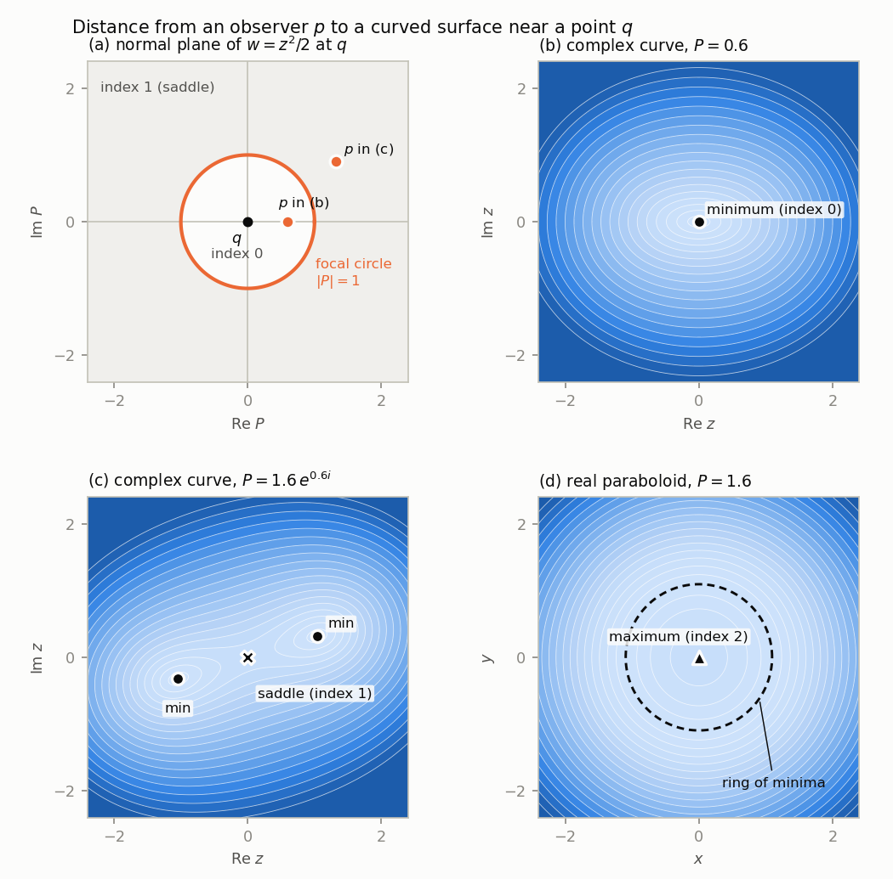

# Chapter 5. Hyperplane sections: complex manifolds have no high cells

*Milnor, "Morse Theory", §7, rewritten for a first-year graduate student who wants to know what
the theorem is for. Every proof is complete, except that the triangulability of algebraic
varieties, the Lefschetz duality theorem and two standard lemmas of homotopy theory are quoted,
with references.*

---

## 0. Why a soap film never bulges away from you

Bend a wire into a closed loop, dip it in soapy water and pull it out: a film spans the wire. Now
fix a point $p$ in the room, your eye for instance. Is there a point of the film, away from the
wire, that is farther from $p$ than all nearby points of the film? Look at any soap film and you
will not find one. The film may sag towards you or away from you, but it never forms a dome
with a farthest point. The farthest point of the film from $p$ is always on the wire, and
consequently the film lies inside every ball that contains the wire, hence inside the convex
hull of the wire.

The reason is curvature. The air pressure is the same on both sides of a soap film, so by the
Young–Laplace law its mean curvature is zero: at every point it bends one way in one principal
direction exactly as much as it bends the other way in the perpendicular direction. Its principal
curvatures are $\kappa$ and $-\kappa$. In Chapter 4 (Milnor §6) we computed the Hessian of the
squared distance $L_p(x) = \|x - p\|^2$ on a surface at a critical point $q$, where
$p = q + t\nu$ for a unit normal $\nu$: in principal directions it is diagonal with entries
$2(1 - t\kappa_1)$ and $2(1 - t\kappa_2)$. For the film these are $2(1 - t\kappa)$ and
$2(1 + t\kappa)$, which add up to $4$. At least one of them is positive, so $q$ is never a local
maximum. It can be a minimum (index $0$) or a saddle (index $1$), never index $2$.

This chapter is about the same mechanism in complex geometry. The set of complex solutions of a
polynomial equation such as $z^3 + w^3 = 1$ is a real surface in $\mathbb{C}^2 = \mathbb{R}^4$,
and Andreotti and Frankel observed that it too curves equally in opposite directions, in every
normal direction at once: multiplication by $i$ turns its second fundamental form into its
negative. So the squared distance from a point, restricted to a complex curve, has critical
points of index $0$ and $1$ only, and on a complex manifold of complex dimension $k$, of index at
most $k$: half the real dimension. Morse theory (Theorem 3.5 of Chapter 2) converts this into
topology. A closed complex submanifold of $\mathbb{C}^n$ of complex dimension $k$ is built, up
to homotopy, from cells of dimension at most $k$ (Theorem 7.2). Applied to the complement of a
hyperplane section of a projective variety, this gives the Lefschetz hyperplane theorem
(Corollary 7.3 and Theorem 7.4): a projective variety and its hyperplane section have the same
homology and homotopy groups below the middle dimension.

At the end (§6) we prove the statement about soap films, and we compute: the complex curve
$z^3 + w^3 = 1$ has the homotopy type of a wedge of four circles, and a numerical search finds
exactly one minimum and four saddle points of a distance function on it, and no maximum.

---

## 1. The theorems, and what they rest on (Milnor p. 39)

We identify $\mathbb{C}^n$ with $\mathbb{R}^{2n}$. Besides the Hermitian product
$\langle a, b\rangle = \sum_\alpha a_\alpha \bar b_\alpha$ there is the real inner product
$a \cdot b = \operatorname{Re}\langle a, b\rangle$, which is the Euclidean inner product of
$\mathbb{R}^{2n}$. Multiplication by $i$ preserves both; in particular it is an orthogonal map of
$\mathbb{R}^{2n}$.

A *complex submanifold of $\mathbb{C}^n$ of complex dimension $k$* is a subset $M$ such that each
$q \in M$ has a neighbourhood $W$ in $\mathbb{C}^n$ and a holomorphic map $w : B \to
\mathbb{C}^n$, $B \subset \mathbb{C}^k$ open, which is a homeomorphism onto $M \cap W$ and whose
complex derivative has rank $k$ at every point; $z = w^{-1}$ is a *holomorphic chart*. Milnor's
complex analytic manifold of dimension $k$, "bianalytically embedded as a closed subset" of
$\mathbb{C}^n$, means exactly: a complex submanifold of $\mathbb{C}^n$ of complex dimension $k$
which is a closed subset. Such an $M$ is a smooth submanifold of $\mathbb{R}^{2n}$ of dimension
$2k$, and each tangent space $TM_q$, the image of the complex-linear map $dw$, is a *complex*
subspace of $\mathbb{C}^n$. A *non-singular affine algebraic variety* is a common zero set of
finitely many polynomials which is a complex submanifold (checked in practice by the Jacobian
criterion and the holomorphic implicit function theorem). A zero set of continuous functions is
closed.

**Theorem 7.1.** If $M \subset \mathbb{C}^n$ is a non-singular affine algebraic variety of real
dimension $2k$, then $H_i(M;\mathbb{Z}) = 0$ for $i > k$.

**Theorem 7.2.** A complex submanifold $M$ of $\mathbb{C}^n$ of complex dimension $k$ which is a
closed subset of $\mathbb{C}^n$ has the homotopy type of a CW-complex of dimension at most $k$.

Milnor's statement says "a $k$-dimensional CW-complex" (his proof ends, p. 41, with "dimension
$\le k$"). The proof produces one cell of dimension $\lambda$ for each critical point of index
$\lambda$ of a function, with every $\lambda \le k$, so "of dimension at most $k$" is what is
proved, and it is what is true: $\mathbb{C}$ is contractible.

*Proof of Theorem 7.1 from Theorem 7.2.* $M$ is closed and a complex submanifold of dimension $k$,
so $M$ is homotopy equivalent to a CW-complex $X$ of dimension at most $k$. Singular homology is a
homotopy invariant, and $H_i(X;\mathbb{Z}) = 0$ for $i > \dim X$ for every CW-complex, finite or
not (Hatcher, *Algebraic Topology*, Lemma 2.34). $\square$

If the components of $M$ have different dimensions, $k$ is the largest of them; the proof of 7.2
bounds the index at a point by the complex dimension of the component through it, so the
conclusion is unchanged.

**What is used from earlier chapters.** From Chapter 4 (Milnor §6), for a smooth submanifold
$M \subset \mathbb{R}^N$ of dimension $m$ and a point $p \in \mathbb{R}^N$:

(a) $q \in M$ is a critical point of $L_p|_M$ if and only if $p - q$ is normal to $M$ at $q$
(Milnor p. 35).

(b) In local coordinates $u = (u^1, \dots, u^m)$ on $M$, with $x = x(u)$ the inclusion, let
$g_{ij} = \frac{\partial x}{\partial u^i}\cdot\frac{\partial x}{\partial u^j}$ (the first
fundamental form) and, for a unit normal $v$ at $q$, let $(v \cdot \ell_{ij}) = (v\cdot
\partial^2 x/\partial u^i\partial u^j)$ (the second fundamental form in the direction $v$; only
the normal component $\ell_{ij}$ of the second derivative contributes). At a critical point $q$
with $p = q + tv$,
$$\frac{\partial^2 L_p}{\partial u^i \partial u^j}(q) = 2\big(g_{ij} - t\, v\cdot\ell_{ij}\big).$$
We refer to this as formula (1.1) (Milnor pp. 36, 38).

(c) Assertion 6.4: $q + tv$ is a focal point of $(M, q)$ of multiplicity $\mu$ if and only if the
matrix $(g_{ij} - t\,v\cdot\ell_{ij})$ is singular with nullity $\mu$. Lemma 6.3: the focal
points on the normal line $\{q + tv\}$ are the points $q + K_i^{-1} v$, where the $K_i \neq 0$
are the nonzero eigenvalues of $(v\cdot\ell_{ij})$ relative to $(g_{ij})$, the *principal
curvatures*; so there are at most $m$ of them, counted with multiplicity.

(d) Lemma 6.5: $q$ is a degenerate critical point of $L_p$ if and only if $p$ is a focal point of
$(M,q)$. Theorem 6.6: for almost every $p$, $L_p|_M$ has no degenerate critical points. Lemma 6.9
(index theorem for $L_p$): the index of $L_p$ at a nondegenerate critical point $q$ equals the
number of focal points of $(M, q)$ on the segment from $q$ to $p$, counted with multiplicity.

From Chapter 2 (Milnor §3) we use Theorem 3.5: *if $f$ is a smooth function on a manifold $M$
with no degenerate critical points, and each $M^a = f^{-1}(-\infty, a]$ is compact, then $M$ has
the homotopy type of a CW-complex with one cell of dimension $\lambda$ for each critical point of
index $\lambda$.* (When there are infinitely many critical points, its proof uses the Appendix.)
In §5 we shall also need the ingredients of that proof, Theorems 3.1 and 3.2 and Remark 3.3, in a
slightly more general setting.

---

## 2. A quadratic form that is its own negative (Milnor p. 39)

Let $Q(z^1, \dots, z^k) = \sum_{h,j} b_{hj}\, z^h z^j$, with complex coefficients
$b_{hj} = b_{jh}$, be a quadratic form in $k$ complex variables. Substituting $z^h = x^h + i y^h$
and taking the real part gives a real quadratic form in $2k$ real variables,
$$Q'(x^1,\dots,x^k,y^1,\dots,y^k) = \operatorname{Re} \sum_{h,j} b_{hj}\,(x^h + iy^h)(x^j + iy^j).$$
Write $Q'(u) = u^{\mathsf T} A u$ with $A$ a real symmetric $2k \times 2k$ matrix; the eigenvalues
of $Q'$ are those of $A$. Let $J$ be the real linear map $J(x, y) = (-y, x)$, which is
multiplication by $i$ in the variable $z = x + iy$. It is orthogonal and $J^2 = -1$.

**Assertion 1.** If $e$ is an eigenvalue of $Q'$ with multiplicity $\mu$, then $-e$ is also an
eigenvalue, with the same multiplicity $\mu$.

*Proof.* $Q$ is homogeneous of degree $2$, so $Q(iz^1, \dots, iz^k) = i^2 Q(z) = -Q(z)$. Taking
real parts, $Q'(Ju) = -Q'(u)$ for all $u$, that is $J^{\mathsf T} A J = -A$. Since
$J^{\mathsf T} = J^{-1}$ this says $AJ = -JA$. If $Au = eu$ then $A(Ju) = -J(Au) = -e\,(Ju)$, so
$J$ maps the $e$-eigenspace of $A$ injectively into the $(-e)$-eigenspace. By the same argument
it maps the $(-e)$-eigenspace injectively into the $e$-eigenspace. The two eigenspaces have the
same dimension. $\square$

For $k = 1$ and $Q = b z^2$, the matrix of $Q' = \operatorname{Re}\big(b(x + iy)^2\big)$ has
trace $0$ and determinant $-|b|^2$: its eigenvalues are $\pm|b|$.

What the next section actually needs is the same statement *relative to a $J$-invariant inner
product*, because focal points are eigenvalues relative to the first fundamental form:

**Assertion 1a.** Let $G$ and $B$ be real symmetric $2k \times 2k$ matrices with
$J^{\mathsf T} G J = G$ and $J^{\mathsf T} B J = -B$. Then for every real $t$ the matrices
$G - tB$ and $G + tB$ have the same nullity.

*Proof.* $J^{\mathsf T}(G - tB)J = G + tB$, and $J$ is invertible. $\square$

---

## 3. Focal points of a complex submanifold come in symmetric pairs (Milnor p. 40)

Let $M \subset \mathbb{C}^n$ be a complex submanifold of complex dimension $k$ and $q \in M$.

**Lemma 3.1.** Let $T \subset \mathbb{C}^n$ be a complex linear subspace and $v \in
\mathbb{C}^n$ with $a \cdot v = 0$ for all $a \in T$. Then $\langle a, v\rangle = 0$ for all
$a \in T$.

*Proof.* $\operatorname{Re}\langle a, v\rangle = a\cdot v = 0$, and $\operatorname{Im}\langle
a, v\rangle = -\operatorname{Re}\big(i\langle a, v\rangle\big) = -\operatorname{Re}\langle ia,
v\rangle = -(ia)\cdot v = 0$, because $ia \in T$. $\square$

**Assertion 2.** The focal points of $(M, q)$ along any normal line occur in pairs situated
symmetrically about $q$: if $v$ is a unit normal vector at $q$, $t \neq 0$, and $q + tv$ is a
focal point of multiplicity $\mu$, then $q - tv$ is a focal point of multiplicity $\mu$.

*Proof.* Choose holomorphic coordinates $z^1, \dots, z^k$ for $M$ near $q$ with $z(q) = 0$. The
inclusion $M \to \mathbb{C}^n$ is given by $n$ holomorphic functions $w_\alpha(z^1, \dots, z^k)$.
Writing $z^h = x^h + iy^h$, the $2k$ functions $u = (x, y)$ are real coordinates for $M$, and we
compute the quantities of (b) and (c) in these coordinates.

*Step 1: the first fundamental form is $J$-invariant.* By the Cauchy–Riemann equations,
$\partial w/\partial y^h = i\,\partial w/\partial x^h$. Let $J$ act on coordinate vectors by
$\partial_{x^h} \mapsto \partial_{y^h}$, $\partial_{y^h} \mapsto -\partial_{x^h}$; this is the
matrix $J$ of §2. Then $dw(J\xi) = i\,dw(\xi)$ for every $\xi \in \mathbb{R}^{2k}$. Since
multiplication by $i$ is orthogonal, the matrix $G = (g_{ij})$ satisfies
$G(J\xi, J\eta) = (i\,dw\,\xi)\cdot(i\,dw\,\eta) = (dw\,\xi)\cdot(dw\,\eta) = G(\xi, \eta)$,
that is $J^{\mathsf T} G J = G$, at every point.

*Step 2: the second fundamental form is $J$-anti-invariant.* Let $v$ be a unit vector orthogonal
to $M$ at $q$, in the real sense. The Hermitian product $h(z) = \langle w(z), v\rangle =
\sum_\alpha w_\alpha(z)\,\bar v_\alpha$ is a holomorphic function of $z$ near $0$, with a
convergent power series
$$h(z) = h(0) + \sum_h c_h z^h + Q(z) + (\text{terms of order} \ge 3),$$
$Q$ a homogeneous quadratic polynomial. The linear coefficients are $c_h = \langle \partial
w/\partial z^h(0), v\rangle$, and they vanish by Lemma 3.1 applied to the complex subspace
$T = TM_q$. (Milnor: "the linear terms vanish since $v$ is orthogonal to $M$"; the lemma is
needed because orthogonality is meant in the real sense.) Taking real parts, the real
function $\varphi(u) := w(u)\cdot v = \operatorname{Re} h$ has the Taylor expansion
$$\varphi(u) = q\cdot v + Q'(x, y) + O(|u|^3).$$
On the other hand $\partial^2 \varphi/\partial u^i\partial u^j(0) = v\cdot \partial^2
w/\partial u^i\partial u^j(0) = v\cdot\ell_{ij}$, because $v$ is constant and normal at $q$.
Comparing with Taylor's formula, $(v\cdot\ell_{ij}) = 2A$, where $A$ is the matrix of $Q'$.
This is the precise content of Milnor's remark that $Q'$ determines the second fundamental form
in the direction $v$. By §2, $J^{\mathsf T}(v\cdot\ell_{ij})J = -(v\cdot\ell_{ij})$.

*Step 3.* By Assertion 6.4 the multiplicity of $q + tv$ as a focal point is the nullity of
$G - t(v\cdot\ell_{ij})$, and that of $q - tv$ is the nullity of $G + t(v\cdot\ell_{ij})$. By
Steps 1 and 2 and Assertion 1a these are equal. $\square$

> **Milnor's text skips a normalization.** Milnor concludes from Assertion 1 that the eigenvalues
> of $Q'$ come in opposite pairs, and "hence" that the focal points do. But Assertion 1 is about
> eigenvalues with respect to the standard inner product of the coordinate space
> $\mathbb{R}^{2k}$, while focal points are governed by the eigenvalues of $(v\cdot\ell_{ij})$
> *relative to* $(g_{ij})$; Lemma 6.3 even assumes coordinates with $g_{ij}(q) = \delta_{ij}$.
> The two notions agree when the real coordinates are orthonormal at $q$, not in general. One can
> arrange this by a complex-linear change of the coordinates $z$ that makes the vectors
> $\partial w/\partial z^h(0)$ Hermitian-orthonormal (then the real vectors
> $\partial w/\partial x^h(0)$, $\partial w/\partial y^h(0)$ are orthonormal), or bypass it, as
> above, by the $J$-invariance of $(g_{ij})$.

**Corollary 3.2.** In every unit normal direction $v$ at $q$, the principal curvatures of $M$ are
$K_1, \dots, K_k, -K_1, \dots, -K_k$ for suitable $K_1, \dots, K_k \ge 0$. In particular the
mean curvature of a complex submanifold is zero in every normal direction, and in any normal
direction at most $k$ principal curvatures are positive.

*Proof.* The principal curvatures are the eigenvalues of $S = G^{-1}L$, where $L =
(v\cdot\ell_{ij})$; $S$ is self-adjoint for the inner product $G$, hence diagonalizable with real
eigenvalues. From $J^{\mathsf T} G J = G$ we get $G^{-1}(J^{\mathsf T})^{-1} = JG^{-1}$, and with
$J^{\mathsf T}LJ = -L$ this gives $SJ = G^{-1}(J^{\mathsf T})^{-1}(J^{\mathsf T}LJ) = -JG^{-1}L =
-JS$. As in Assertion 1, $J$ maps the $e$-eigenspace of $S$ isomorphically onto the
$(-e)$-eigenspace. The positive eigenvalues are therefore matched with the negative ones, at most
$k$ of each among $2k$; and the trace of $S$ (the mean curvature, up to normalization) is zero.
$\square$

---

## 4. Proof of Theorem 7.2 (Milnor pp. 40–41)

*Proof of Theorem 7.2.* Regard $M$ as a $2k$-dimensional submanifold of $\mathbb{R}^{2n}$. By
Theorem 6.6 choose $p \in \mathbb{C}^n$ such that $L_p : M \to \mathbb{R}$ has no degenerate
critical points. Each set $M^a = L_p^{-1}[0, a]$ is the intersection of the closed set $M$ with
the closed ball of radius $\sqrt a$ about $p$, hence compact.

Let $q$ be a critical point, of index $\lambda$. If $q = p$ then $q$ is the absolute minimum and
$\lambda = 0$. Otherwise, by (a), $p = q + tv$ with $v$ a unit normal at $q$ and $t = \|p - q\| >
0$. By Lemma 6.9, $\lambda$ is the number of focal points $q + sv$ with $0 < s < t$, counted with
multiplicity. (Neither end of the segment is focal: $s = 0$ would make $G$ singular, and $p$ is
not focal by Lemma 6.5, because $q$ is nondegenerate.) By Lemma 6.3 these are the points
$q + K_i^{-1}v$ with $K_i > 1/t$, so $\lambda \le \#\{i : K_i > 0\} \le k$ by Corollary 3.2.
Milnor's version: at most $2k$ focal points on the whole normal line, symmetric about $q$
(Assertion 2), hence at most $k$ between $q$ and $p$.

By Theorem 3.5, $M$ has the homotopy type of a CW-complex with one cell of dimension $\lambda$
for each critical point of index $\lambda$, and every $\lambda$ is at most $k$. $\square$

(If $k = n$, then $M$ is open and closed in $\mathbb{C}^n$, so it is empty or all of
$\mathbb{C}^n$, and the statement is trivial; Chapter 4 assumes $\dim M < N$ but nothing above
uses it.)

> **A shorter route to the index bound.** Steps 1 and 2 give the bound directly, without focal
> points. Let $q$ be a critical point and $\nu = p - q$. By formula (1.1) the Hessian of $L_p$ at
> $q$ is $H(X, X) = 2\big(G(X,X) - \mathrm{II}_\nu(X, X)\big)$ with $\mathrm{II}_\nu(X,X) =
> \sum_{i,j} X^iX^j\, \nu\cdot\partial^2 w/\partial u^i\partial u^j$. Steps 1 and 2 (with $v =
> \nu/\|\nu\|$; if $\nu = 0$, $\mathrm{II}_\nu = 0$) say $G(JX,JX) = G(X,X)$ and
> $\mathrm{II}_\nu(JX,JX) = -\mathrm{II}_\nu(X,X)$. Hence
> $$H(JX, JX) = 4\,G(X, X) - H(X, X).$$
> If $H$ is negative definite on a subspace $W$, it is positive definite on $JW$; so
> $W \cap JW = 0$ and $2\dim W \le 2k$. This bounds the index by $k$ at *every* critical point,
> degenerate or not, and uses neither Lemma 6.3 nor Lemma 6.9; it is the Andreotti–Frankel
> mechanism without focal points. It also shows that $H$ is not negative semidefinite on any
> nonzero $J$-invariant subspace, in particular on $TM_q$: if $X \ne 0$ and $H(X,X) \le 0$ then
> $H(JX, JX) \ge 4G(X,X) > 0$. So $L_p$ has no local maximum on a complex submanifold of positive
> dimension. For a formalization this is the route to take.

### An interactive look at the index bound

The simplest curved complex curve is $M = \{(z, w) \in \mathbb{C}^2 : w = z^2/2\}$, parametrized
by $z = x + iy$. At $q = 0$ its tangent plane is the $z$-axis, and its normal plane is the
$w$-axis, a copy of $\mathbb{C}$. For an observer at $p = (0, P)$ in the normal plane,
$$L_p(z) = |z|^2 + \big|z^2/2 - P\big|^2 = |P|^2 + |z|^2 - \operatorname{Re}(\bar P z^2) +
\tfrac14|z|^4 .$$
The Hessian at $q$ has eigenvalues $2(1 - |P|)$ and $2(1 + |P|)$: the term $|z|^2$ is $g_{ij} =
\delta_{ij}$, and the term $-\operatorname{Re}(\bar P z^2)$ is $-t\,v\cdot\ell_{ij}$, whose
eigenvalues $\pm|P|$ are the pair of Assertion 1. The focal points of $(M, q)$ form the circle
$|P| = 1$ in the normal plane, one symmetric pair on each normal line. Inside the circle $q$ is
the minimum of $L_p$; outside it $q$ is a saddle, and two minima appear at
$z = \pm\sqrt{2(|P| - 1)}\, e^{i\arg(P)/2}$ (solve $\partial L_p/\partial\bar z = z +
\bar z\,(z^2/2 - P) = 0$).

The figure shows the normal plane on the left, with the focal circle; drag the observer $p$. On
the right is a contour map of $L_p$ over the $z$-plane, with the critical points marked and their
indices listed. The button switches to the real paraboloid $h = (x^2 + y^2)/2$ in $\mathbb{R}^3$,
whose normal line at $0$ has a single double focal point at height $1$. For an observer at height
$P$, $L_p = P^2 + (1 - P)r^2 + r^4/4$; both Hessian eigenvalues are $2(1 - P)$, and for $P > 1$
the origin is a local *maximum* (index $2$), surrounded by a ring of minima. The complex curve
never does this: however far you drag $p$, the index at $q$ stays at most $1$.

*(In the printed version this figure is a still image; the interactive version is in the web
edition.)*

---

## 5. Hyperplane sections: Corollary 7.3 and Theorem 7.4 (Milnor pp. 41–42)

A *projective algebraic variety* $V \subset \mathbb{C}P_n$ is the common zero set of finitely many
homogeneous polynomials; it is closed in $\mathbb{C}P_n$, hence compact. A point of $V$ is
*non-singular* if $V$ is a complex submanifold of $\mathbb{C}P_n$ near it, and the *singular
points* are the others. Let $P$ be a hyperplane. After a linear change of homogeneous coordinates
$P = \{Z_0 = 0\}$, and $[Z_0 : \dots : Z_n] \mapsto (Z_1/Z_0, \dots, Z_n/Z_0)$ is a
biholomorphism of $\mathbb{C}P_n - P$ onto $\mathbb{C}^n$, Milnor's "affine space
$\mathbb{C}P_n - P$". It carries $V - P$ onto the zero set of the dehomogenized polynomials, a
closed subset of $\mathbb{C}^n$, which is a complex submanifold when all singular points of $V$
lie in $P$. Write $A = V \cap P$.

> **A hidden hypothesis.** "An algebraic variety of complex dimension $k$" must be read as *of pure
> dimension $k$*: every irreducible component has dimension $k$. Otherwise $V - P$ may have
> components of smaller dimension, which are invisible to the dimension count, and both results
> fail. Example: in $\mathbb{C}P_4$ let $V = \Pi \cup L$, where $\Pi$ is a hyperplane
> ($\cong\mathbb{C}P_3$) and $L$ a line meeting $\Pi$ in one point $s$; $\dim V = 3$ and the
> only singular point is $s$. For a hyperplane $P \ne \Pi$ through $s$ not containing $L$,
> $V \cap P = \Pi \cap P \cong \mathbb{C}P_2$, and $H_2(V\cap P) = \mathbb{Z} \to H_2(V) =
> \mathbb{Z}^2$ is not onto, contrary to Corollary 7.3 with $k = 3$. Under pure dimensionality,
> $V - P$ is a closed complex submanifold of $\mathbb{C}^n$ of pure complex dimension $k$, in
> particular an oriented $2k$-manifold.

**Corollary 7.3 (Lefschetz).** Let $V \subset \mathbb{C}P_n$ be an algebraic variety of pure
complex dimension $k$, and $P$ a hyperplane containing the singular points of $V$. Then the
inclusion $V \cap P \to V$ induces isomorphisms $H_r(V\cap P;\mathbb{Z}) \to H_r(V;\mathbb{Z})$
for $r < k - 1$, and a surjection for $r = k - 1$.

*Proof (Milnor's).* In the exact sequence of the pair,
$$H_{r+1}(V, A) \to H_r(A) \to H_r(V) \to H_r(V, A),$$
if $H_s(V, A) = 0$ for all $s \le k - 1$ then $H_r(A) \to H_r(V)$ is injective for
$r + 1 \le k - 1$ and surjective for $r \le k - 1$. So it suffices to show $H_r(V, A;\mathbb{Z}) = 0$ for
$r \le k - 1$. By Lefschetz duality (stated below),
$$H_r(V, A;\mathbb{Z}) \cong H^{2k - r}(V - A;\mathbb{Z}).$$
Now $V - A$ is a closed complex submanifold of $\mathbb{C}P_n - P \cong \mathbb{C}^n$ of
complex dimension $k$, so by Theorem 7.2 it has the homotopy type of a CW-complex of dimension at
most $k$, and its cohomology vanishes in degrees above $k$. Since $2k - r > k$ exactly when
$r < k$, the group vanishes for $r \le k - 1$. $\square$

> **The duality theorem, stated.** Milnor does not say which form of Lefschetz duality he uses.
> The form that applies is: *if $X$ is compact, $A \subset X$ is closed, $X - A$ is an oriented
> $m$-manifold, and the pair $(X, A)$ is triangulable, then $H_r(X, A;\mathbb{Z}) \cong
> H^{m-r}(X - A;\mathbb{Z})$ for all $r$* (see Spanier, *Algebraic Topology*, Ch. 6; for compact
> manifolds with boundary, Hatcher, *Algebraic Topology*, Theorem 3.43). Some niceness of $A$ is
> needed; for $(V, V\cap P)$ it comes from the triangulation theorem quoted below, the same input
> as for Theorem 7.4. The proof of Corollary 7.3 given after Theorem 7.4 avoids duality
> altogether.

**Theorem 7.4 (Lefschetz).** Under the hypotheses of Corollary 7.3, the relative homotopy group
$\pi_r(V, V\cap P)$ is zero for $r < k$, for every base point in $V \cap P$. (For $r = 0$ this
means that every point of $V$ can be joined to $V\cap P$ by a path.)

Milnor bases the proof on the following hypothesis, which he says can be proved using "the
theorem that algebraic varieties can be triangulated".

**Hypothesis (N).** There are a neighbourhood $U$ of $A$ in $V$ and a homotopy
$H : U \times [0,1] \to V$ with $H_0$ the inclusion, $H_1(U) \subset A$, and $H_t(a) = a$ for all
$a \in A$ and all $t$.

It holds: there is a triangulation of $V$ in which $V\cap P$ is a subcomplex (Łojasiewicz,
*Triangulation of semi-analytic sets*, 1964), and a subcomplex of a CW-complex is a deformation
retract, keeping it pointwise fixed, of some open neighbourhood (Hatcher, Proposition A.5). We
quote both facts.

> **A hidden hypothesis.** Milnor asks only that $U$ "can be deformed into $V\cap P$ within $V$".
> The deformation must keep $V \cap P$ fixed: it is composed with maps of pairs
> $(I^r, \partial I^r) \to (U, V\cap P)$, which must remain maps of pairs with a fixed base point.

*Step 1: the function.* By Theorem 6.6 choose $p \in \mathbb{C}^n = \mathbb{C}P_n - P$ such that
$L_p$ has no degenerate critical points on $V - P$. Define $f : V \to [0, 1]$ by
$$f(x) = 0 \ \ (x \in A), \qquad f(x) = \frac{1}{1 + L_p(x)} \ \ (x \in V - P).$$
(Milnor uses $1/L_p$, which is infinite at $p$ if $p \in V$; the extra $1$ changes nothing else.)
Then:

(i) $f$ is continuous, and $f^{-1}(0) = A$. On $V - P$ it is smooth. At points of $A$: the function
$\rho([Z]) = |Z_0|^2/\sum_\alpha |Z_\alpha|^2$ is well defined and continuous on $\mathbb{C}P_n$,
vanishes exactly on $P$, and the affine coordinates of a point of $\mathbb{C}P_n - P$ satisfy
$\|x\|^2 = (1 - \rho)/\rho$. So as $x \to A$ within $V - P$, $\|x\| \to \infty$, hence
$L_p(x) \ge (\|x\| - \|p\|)^2 \to \infty$ and $f(x) \to 0$.

(ii) For $0 < \varepsilon \le 1$, the set
$f^{-1}[\varepsilon, 1] = \{x \in V - P : L_p(x) \le 1/\varepsilon - 1\}$ is a closed bounded
subset of $\mathbb{C}^n$, hence compact. Nondegenerate critical points
are isolated, so $f$ has only finitely many critical points in $f^{-1}[\varepsilon, 1]$, and its
critical values in $(0, 1]$ can accumulate only at $0$.

(iii) The critical points of $f$ are those of $L_p$ on $V - P$, since $df = -dL_p/(1 + L_p)^2$.
At such a point the Hessian is $-\operatorname{Hess}L_p/(1 + L_p)^2$, so a critical point where
$L_p$ has index $\lambda$ is a nondegenerate critical point of $f$ of index $2k - \lambda$. Here
pure dimensionality enters: the real dimension of $V - P$ at the point is $2k$. By Theorem 7.2's
index bound, $\lambda \le k$, so every critical point of $f$ has index $\ge 2k - k = k$.

*Step 2: Morse theory away from $A$.* For $a > 0$ put $V^a = f^{-1}[0, a]$; these contain $A$, and
$V^a = V$ for $a \ge 1$.

**Lemma 5.1.** (i) If $0 < a < b$ and $[a, b]$ contains no critical value of $f$, then $V^a$ is a
deformation retract of $V^b$ by a deformation that keeps $V^a$ pointwise fixed. (ii) If $c > 0$
is a critical value and $q_1, \dots, q_j$ are the critical points on the level $c$, of indices
$\lambda_1, \dots, \lambda_j$, then for all small $\delta > 0$ there are cells $e^{\lambda_1},
\dots, e^{\lambda_j} \subset V$, attached to $V^{c-\delta}$ along their boundary spheres, such that
$V^{c-\delta} \cup e^{\lambda_1} \cup \dots \cup e^{\lambda_j}$ is a deformation retract of
$V^{c+\delta}$ keeping it pointwise fixed.

*Proof.* $V$ is not a manifold, but Milnor's proofs of Theorem 3.1, Theorem 3.2 (its Assertions
3 and 4) and Remark 3.3 never leave the compact set $f^{-1}[a, b]$, respectively $f^{-1}[c - \delta,
c + \delta]$, and small neighbourhoods of it, all inside the manifold $V - A$. They use a
Riemannian metric on $V - A$, the vector field $\rho\cdot\operatorname{grad} f$ with $\rho$
supported in a compact neighbourhood $K$ of that set inside $V - A$, Morse charts at the $q_i$,
and a modification $F$ of $f$ near the $q_i$. The flow of a compactly supported field is complete
and is the identity outside $K$; extended by the identity on $V - K$, an open neighbourhood of
$A$, it is continuous on $V$. The deformation retractions Milnor builds from it fix the smaller
set pointwise. $\square$

*Step 3: pushing maps off high cells.*

**Lemma 5.2.** Let $Y = X \cup e^{\lambda_1} \cup \dots \cup e^{\lambda_j}$ be a space obtained
by attaching cells, and $g : I^r \to Y$ continuous with $r < \min_i \lambda_i$. Then $g$ is
homotopic, relative to $g^{-1}(X)$, to a map into $X$.

This is the lemma behind the cellular approximation theorem. By Hatcher's Lemma 4.10, applied
with $W = X \cup e^{\lambda_2} \cup \dots \cup e^{\lambda_j}$, $g$ is homotopic relative to
$g^{-1}(W)$ to a map that is piecewise linear over a small simplex in the open cell
$e^{\lambda_1}$; since there is no linear surjection $\mathbb{R}^r \to \mathbb{R}^{\lambda_1}$ for
$r < \lambda_1$, the new map misses a point $y_1$ of that cell. The radial deformation retraction
of $Y - \{y_1\}$ onto $W$, which fixes $W$ pointwise, then pushes the map into $W$. Repeat for
the other cells. In our situation the cells of Lemma 5.1 are subsets of the
compact Hausdorff space $V$, and $V^{c-\delta} \cup e^{\lambda_1} \cup \dots$ carries the topology
of the abstract attaching space (a continuous bijection from a compact space onto a Hausdorff
space is a homeomorphism), so the lemma applies.

*Step 4: proof of Theorem 7.4.* Let $r < k$, $x_0 \in A$, and $g : (I^r, \partial I^r, J^{r-1})
\to (V, A, x_0)$ represent an element of $\pi_r(V, A, x_0)$. By (ii) of Step 1 and Hypothesis (N)
choose a regular value $\varepsilon > 0$ of $f$ with $V^\varepsilon \subset U$: the sets
$V^\varepsilon - U$ are compact, decrease as $\varepsilon \downarrow 0$, and have empty
intersection (because $\bigcap_\varepsilon V^\varepsilon = A \subset U$), so one of them is
empty. List the finitely many critical values of $f$ in $[\varepsilon, 1]$ as $c_1 < \dots <
c_m$ (the value $1$ is critical if $p \in V$) and choose regular values $\varepsilon = a_0 < c_1 <
a_1 < \dots < c_m < a_m = 2$, so that $V^{a_m} = V$.

Suppose $g$ maps into $V^{a_i}$ (true for $i = m$). By Lemma 5.1(i) on $[c_i + \delta, a_i]$,
deform $g$ into $V^{c_i + \delta}$; by Lemma 5.1(ii), into $V^{c_i - \delta} \cup e^{\lambda_1}
\cup \dots$ with all $\lambda$'s $\ge k > r$ (Step 1(iii)); by Lemma 5.2, into $V^{c_i -
\delta}$; by Lemma 5.1(i) on $[a_{i-1}, c_i - \delta]$, into $V^{a_{i-1}}$. Each deformation fixes
$A \supset g(\partial I^r)$ pointwise, so all homotopies are relative to $\partial I^r$. After
$m$ rounds, $g$ is homotopic relative to $\partial I^r$ to a map $g'$ into $V^\varepsilon \subset
U$. Then $H_t \circ g'$ is a homotopy relative to $\partial I^r$ (since $H$ fixes $A$) from $g'$
to a map into $A$. By the compression criterion (Hatcher, §4.1: a map of triples
$(I^r, \partial I^r, J^{r-1}) \to (V, A, x_0)$ represents $0$ if it is homotopic relative to
$\partial I^r$ to a map into $A$), $[g] = 0$. For $r = 0$ the same deformations join any point of
$V$ to $A$ by a path. $\square$

**A proof of Corollary 7.3 without duality.** The same ingredients give the homology statement
directly. (1) The map $H_r(V^\varepsilon, A) \to H_r(V, A)$ induced by inclusion is zero: the
inclusion of pairs $(V^\varepsilon, A) \to (V, A)$ is homotopic through maps of pairs (by
$H_t|_{V^\varepsilon}$, which maps $A$ into $A$) to $H_1|_{V^\varepsilon}$, which factors through
the pair $(A, A)$, and $H_r(A, A) = 0$. (2) $H_r(V, V^\varepsilon) = 0$ for $r < k$: by Lemma 5.1
and the five lemma, $H_r(V^{a_i}, V^{a_{i-1}}) \cong H_r(V^{c_i-\delta} \cup e^{\lambda_1} \cup
\dots, V^{c_i - \delta}) \cong \bigoplus_l \tilde H_r(S^{\lambda_l})$ (Hatcher, Proposition 2.22,
for the good pair of a space with cells attached), which vanishes for $r < k$; the exact
sequences of the triples $(V^{a_i}, V^{a_{i-1}}, V^\varepsilon)$ and induction on $i$ give the
claim. (3) In the exact sequence of the triple $(V, V^\varepsilon, A)$,
$$H_r(V^\varepsilon, A) \xrightarrow{\;0\;} H_r(V, A) \to H_r(V, V^\varepsilon) = 0 \qquad (r <
k),$$
so $H_r(V, A) = 0$ for $r \le k - 1$, and the exact sequence of the pair finishes the proof as
before. $\square$

**Example 5.3 (hypersurfaces are simply connected).** Let $X = \{F = 0\} \subset \mathbb{C}P_n$,
$n \ge 2$, be a hypersurface, $F$ homogeneous of degree $d \ge 1$, singular or not. Then
$\pi_r(X) \to \pi_r(\mathbb{C}P_n)$ is an isomorphism for $r < n - 1$ and onto for $r = n - 1$;
in particular a hypersurface in $\mathbb{C}P_n$, $n \ge 3$, is simply connected (for instance every
smooth surface in $\mathbb{C}P_3$). *Proof.* The Veronese map $\nu_d : \mathbb{C}P_n \to
\mathbb{C}P_N$, $[Z] \mapsto [Z^m]_{|m| = d}$, $N = \binom{n+d}{d} - 1$, is a holomorphic
embedding whose image $W$ is a non-singular projective variety of dimension $n$ (cut out by the
quadrics $Y_mY_{m'} = Y_{m''}Y_{m'''}$ for $m + m' = m'' + m'''$). Writing $F = \sum c_m Z^m$, the
hyperplane $P_F = \{\sum c_m Y_m = 0\}$ satisfies $W \cap P_F = \nu_d(X)$, and it contains all
singular points of $W$ (there are none). Theorem 7.4 with $k = n$ gives $\pi_r(W, W\cap P_F) = 0$
for $r < n$, and the exact homotopy sequence of the pair gives the claim. $\square$

---

## 6. Application: soap films, and the four loops of a complex cubic

**Soap films lie in the convex hull of their wire.** Let $\Sigma \subset \mathbb{R}^3$ be a compact
smooth surface with boundary curve $\Gamma$, with mean curvature zero at its interior points, as a
soap film has. Fix $p \in \mathbb{R}^3$ and let $q$ be a point of $\Sigma$ where $L_p$ is largest.
If $q$ were an interior point, $L_p$ would have a local maximum there, so its Hessian would be
negative semidefinite. But $q \neq p$ (otherwise $\max L_p = 0$ and $\Sigma$ is a point), so
$p = q + t\nu$ with $\nu$ a unit normal, and in principal directions the Hessian (1.1) is
$\operatorname{diag}\big(2(1 - t\kappa), 2(1 + t\kappa)\big)$, of trace $4 > 0$: a contradiction.
So $\max_\Sigma L_p = \max_\Gamma L_p$, and $\Sigma$ lies in every closed ball containing $\Gamma$.
The intersection of all closed balls containing the compact set $\Gamma$ is its closed convex
hull: if $x$ lies outside the hull, a plane separates $x$ from $\Gamma$, and a ball of very large
radius whose boundary sphere nearly coincides with that plane contains $\Gamma$ but not $x$. So
$\Sigma$ lies in the convex hull of $\Gamma$.

A concrete case: the film spanning two coaxial rings of radius $1$ at heights $\pm 0.5$ is the
catenoid $r = a\cosh(h/a)$ with $a = 0.848$, the stable root of $a\cosh(0.5/a) = 1$. At the waist
its principal curvatures are $\pm 1/a = \pm 1.18$, and the focal points on the normal line
through a waist point sit at distance $a$ on either side: one is the centre of the waist circle.
Seen from that centre the film is nearest along the whole waist circle (distance $0.848$, a
degenerate minimum, as Lemma 6.5 predicts for a focal point) and farthest on the rings
($\sqrt{1.25} = 1.118$).

**Complex manifolds are soap films.** By Corollary 3.2 a complex submanifold of $\mathbb{C}^n$ has
zero mean curvature, and by the remark in §4 the Hessian of $L_p$ is never negative semidefinite
on it. The argument above therefore shows that a compact complex submanifold with boundary lies
in the convex hull of its boundary, and that a compact complex submanifold of $\mathbb{C}^n$
without boundary has dimension $0$, so it is a finite set: on a component of positive dimension
$L_p$ would attain a maximum.

**The complex cubic $C = \{(z, w) \in \mathbb{C}^2 : z^3 + w^3 = 1\}$.** It is closed, and it is
a complex submanifold because the gradient $(3z^2, 3w^2)$ vanishes only at $z = w = 0$, which is
not on $C$. By Theorem 7.2 it has the homotopy type of a graph, and by Theorem 7.1 $H_2(C) = 0$:
although $C$ is a surface, it carries no $2$-cycle. To see the graph, we located all critical
points of $L_p$ on $C$ for $p = (0.3 + 0.2i,\ -0.1 + 0.4i)$, solving numerically the four real
equations
$$z^3 + w^3 = 1, \qquad (z - 0.3 - 0.2i)\,\bar w^2 = (w + 0.1 - 0.4i)\,\bar z^2$$
(the second says that $p - (z, w)$ is Hermitian-orthogonal to the tangent vector $(w^2, -z^2)$,
which by (a) and Lemma 3.1 is the critical point condition), with a Newton-type solver started
from 20,000 random points of $C$ with $|z| \le 6$. Exactly five solutions appear. Writing $C$
near a solution as a graph $w = w(z)$, the quadratic part of $L_p$ is $\alpha|\zeta|^2 + \operatorname{Re}(\beta\zeta^2)$,
with $\alpha = 1 + |w'|^2$ and $\beta = \overline{(w - b)}\,w''$ ($b$ the second coordinate of $p$),
whose eigenvalues are $\alpha \pm |\beta|$: the Lefschetz mechanism in one line, since
$\alpha > 0$. The results, confirmed by finite-difference Hessians:

| critical point $(z, w)$ | $L_p$ | index |
|---|---|---|
| $(0.386 + 0.142i,\ -0.477 + 0.867i)$ | $0.370$ | $0$ |
| $(-0.250 + 0.711i,\ 0.872 + 0.100i)$ | $1.598$ | $1$ |
| $(-0.303 + 0.613i,\ -0.419 - 0.778i)$ | $2.023$ | $1$ |
| $(-0.456 - 0.713i,\ 0.740 + 0.050i)$ | $2.233$ | $1$ |
| $(-0.349 - 0.722i,\ -0.449 - 0.660i)$ | $2.517$ | $1$ |

By Theorem 3.5, $C$ has the homotopy type of one $0$-cell with four $1$-cells attached: a wedge of
four circles. So $C$ is connected, $H_1(C;\mathbb{Z}) = \mathbb{Z}^4$, and $H_i(C) = 0$ for
$i \ge 2$. A cross-check from outside this book: the closure of $C$ in $\mathbb{C}P_2$ is a smooth
cubic, which is a torus (genus formula for plane curves), with Euler number $0$ (proved in
Chapter 6 of the companion volume, *Topology from the Differentiable Viewpoint*, rewritten); it
meets the line at infinity in the three points $Z^3 + W^3 = 0$, and removing them gives
$\chi(C) = -3 = 1 - 4$. The same search for $z^2 + w^2 = 1$ gives one
minimum and one saddle ($C \simeq S^1$, indeed $C \cong \mathbb{C}^*$ via $z + iw$), and for
$z^4 + w^4 = 1$ six minima and fourteen saddles: a graph with Euler characteristic $-8$, which,
being connected (the curve is irreducible), is a wedge of nine circles. In general
$z^d + w^d = 1$ is a wedge of $(d - 1)^2$ circles, by the same Euler characteristic count. In
every case the search found no critical point of index $2$, as Theorem 7.2 demands.

---

## 7. Summary of what was silently assumed, now made explicit

| Where | Milnor says | What is actually needed |
|---|---|---|
| p. 39 | "has the homotopy type of a $k$-dimensional CW-complex" | of dimension *at most* $k$ (Theorem 7.2) |
| p. 39 | 7.1 is "a consequence of" 7.2 | "non-singular" means a closed complex submanifold; homotopy invariance of homology and $H_i = 0$ above the dimension of a CW-complex |
| p. 39 | Assertion 1 "clearly follows" | $J^{\mathsf T}AJ = -A$, so $J$ maps the $e$-eigenspace onto the $(-e)$-eigenspace (§2) |
| p. 40 | "The linear terms vanish since $v$ is orthogonal to $M$" | real orthogonality to a complex subspace implies Hermitian orthogonality (Lemma 3.1) |
| p. 40 | "Clearly the quadratic terms $Q'$ determine the second fundamental form" | the Hessian of $w\cdot v$ at $q$ is $(v\cdot\ell_{ij}) = 2A$ (Step 2) |
| p. 40 | eigenvalues of $Q'$ in opposite pairs, "hence" focal points in symmetric pairs | focal points are eigenvalues relative to $(g_{ij})$; need orthonormal coordinates at $q$ or the $J$-invariance of $(g_{ij})$ (Steps 1, 3, Assertion 1a) |
| p. 41 | "at most $2k$ focal points", so "at most $k$ of them can lie between $p$ and $q$" | Lemma 6.3 with $\dim_{\mathbb{R}} M = 2k$; $p$ not focal (Lemma 6.5); the case $p = q$ |
| p. 41 | Corollary 7.3, Theorem 7.4 for "an algebraic variety of complex dimension $k$" | $V$ of *pure* dimension $k$; counterexample $\Pi \cup L$ otherwise (§5) |
| p. 41 | "the Lefschetz duality theorem asserts" | a form for compact pairs with $X - A$ an oriented manifold and $(X, A)$ triangulable; or avoid it (proof after Theorem 7.4) |
| p. 42 | "$U$ can be deformed into $V\cap P$ within $V$" | the deformation must fix $V \cap P$ (Hypothesis (N)); triangulation of the pair and regular neighbourhoods |
| p. 42 | $f = 1/L_p$ | infinite at $p$ if $p \in V$, use $1/(1 + L_p)$; continuity at $V \cap P$; Hessian $= -\operatorname{Hess}L_p/(1+L_p)^2$ at critical points (Step 1) |
| p. 42 | "$V$ has the homotopy type of $V^\varepsilon$ with finitely many cells ... attached" | Theorems 3.1, 3.2, Remark 3.3 on $V - P$, where $f$ is smooth; compactness of $f^{-1}[\varepsilon, 1]$; $\varepsilon$ a regular value (Lemma 5.1) |
| p. 42 | "Choose $\varepsilon$ small enough so that $V^\varepsilon \subset U$" | decreasing compact sets with intersection $V \cap P$ (Step 4) |
| p. 42 | "since $r < k$, ... can be deformed into ..." | cellular approximation: push maps of $r$-cubes off cells of dimension $> r$, relative to $\partial I^r$ (Lemma 5.2); compression criterion |

**Checked by machine.** Milnor's §7 has been verified in the Lean proof assistant, for submanifolds
of $\mathbb C^n = \mathbb R^{2n}$ whose tangent spaces are complex subspaces. The algebra:
Assertions 1 and 1a, Lemma 3.1, and the content of Assertion 2 in holomorphic coordinates, that the
Hessians of $L_{q+tv}$ and $L_{q-tv}$ at $q$ have the same nullity. The index bound, by the shorter
route at the end of §4 and not through focal points: at every critical point of $L_p$ on such a
submanifold of complex dimension $k$, degenerate or not, the index is at most $k$. Theorem 7.2, for
such a submanifold closed in $\mathbb C^n$, as a countable cell complex all of whose cells have
dimension at most $k$; and Theorem 7.1 over every field. Under the hypothesis that a neighbourhood
of $V \cap P$ can be deformed into $V \cap P$ keeping it fixed: Corollary 7.3 over every field, by
the route of §5 without Lefschetz duality, and Theorem 7.4, for a closed $V \subseteq \mathbb CP_n$
whose affine part is a complex submanifold of complex dimension $k$, and for the hyperplane
$z_0 = 0$. Not checked: integral coefficients; that algebraic varieties satisfy these hypotheses,
and the deformation hypothesis itself; Corollary 3.2 and Milnor's route through Lemmas 6.3 and 6.9;
Lemmas 5.1 and 5.2 as stated (the pushing lemma of Chapter 13 plays their role); Example 5.3; and
the application. See the verified edition.
