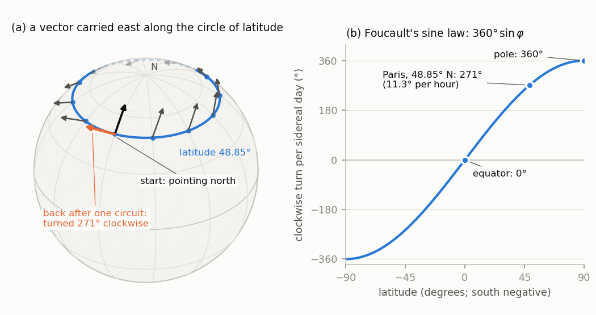

# Chapter 6. Covariant derivatives and curvature: why Foucault's pendulum turns

*Milnor, "Morse Theory", §8–§9, rewritten for a first-year graduate student who wants to know what
the theorem is for. Every proof is complete, except that the smooth dependence of solutions of
linear differential equations on parameters is quoted.*

---

## 0. Why does Foucault's pendulum turn?

In 1851 Léon Foucault hung a 28 kg bob on a 67 m wire from the dome of the Panthéon in Paris and
set it swinging. The plane of the swing did not stay put relative to the building: seen from
above, it turned clockwise by about $11^\circ$ every hour. Foucault's sine law says that at latitude
$\varphi$ the plane turns by $360^\circ \sin\varphi$ per sidereal day (23.93 hours): once a day at
the North Pole, not at all at the equator, and in Paris ($\sin 48.85^\circ = 0.753$) by $271^\circ$ a day,
$11.3^\circ$ an hour, one full turn in $31.8$ hours. Why the sine?

Here is the geometric answer, which this chapter makes precise. During one sidereal day the
suspension point is carried once around its circle of latitude. Nothing pushes the swing
sideways, so the pendulum carries its direction of swing along that circle *without turning it*.
On a flat table, a direction carried around a closed loop without turning comes back to itself.
On a sphere it does not: it comes back turned, and the angle is the curvature of the sphere
integrated over the enclosed cap. For the cap above latitude $\varphi$ on the unit sphere the area
is $2\pi(1 - \sin\varphi)$, and a turn by that angle is the same as a turn by $-2\pi\sin\varphi$.

To make "carry a vector along a curve without turning it" mean something on a curved manifold,
Milnor introduces affine connections, covariant derivatives along curves and parallel transport
(§§1–2 below). On a Riemannian manifold there is exactly one connection that is compatible with
the metric and symmetric, the Levi-Civita connection (§§3–4). The curvature tensor measures the
failure of covariant derivatives to commute, equivalently the failure of parallel transport to be
independent of the path (§§5–6), and it has four symmetries (§7). These tools are used in every
later chapter: the second variation of energy, Jacobi fields and conjugate points are all written
in terms of $D/dt$ and $R$. In §8 we solve the parallel-transport equation on the sphere
explicitly and obtain Foucault's sine law.

Throughout, $M$ is a smooth manifold of dimension $n$, $C^\infty(M)$ its smooth functions and
$\mathfrak X(M)$ its smooth vector fields. A tangent vector $X_p$ acts on functions by the
directional derivative $X_p f$, and $[X, Y]f = X(Yf) - Y(Xf)$. We keep Milnor's notation
$X \vdash Y$ for what is now written $\nabla_X Y$. We use *bump functions*: for every open
$U \ni p$ there is $\psi \in C^\infty(M)$ with values in $[0,1]$, support a compact subset of $U$,
and $\psi = 1$ on a neighbourhood of $p$. (In a chart it is $\theta(\|u - u(p)\|^2)$ for a smooth
$\theta$ built from $\lambda(\tau) = e^{-1/\tau}$, as in Chapter 4, §1 and §3 of the companion
volume, *Topology from the Differentiable Viewpoint*, rewritten.) With them, every tangent vector
extends to a vector field, and every function or vector field defined near $p$ agrees near $p$
with a globally defined one.

---

## 1. Affine connections (Milnor pp. 43–45)

**Definition.** An *affine connection at $p$* assigns to each $X_p \in TM_p$ and each vector field
$Y$ a vector $X_p \vdash Y \in TM_p$, the *covariant derivative* of $Y$ in the direction $X_p$,
which is bilinear in $(X_p, Y)$ and satisfies
$$X_p \vdash (fY) = (X_p f)\,Y_p + f(p)\,X_p \vdash Y \qquad (f \in C^\infty(M)).$$

**Definition.** A *global affine connection*, or *connection*, assigns to each $p$ an affine
connection $\vdash_p$ at $p$ such that (1) for smooth $X, Y$ the vector field $X \vdash Y$,
defined by $(X\vdash Y)_p = X_p \vdash_p Y$, is smooth. It then satisfies (2) $X \vdash Y$ is
bilinear in $X$ and $Y$; (3) $(fX)\vdash Y = f\,(X\vdash Y)$; (4) $X \vdash (fY) = (Xf)\,Y +
f\,(X\vdash Y)$.

**Lemma 1.1 (locality).** If $Y = Y'$ on a neighbourhood of $p$, then $X_p\vdash Y = X_p\vdash
Y'$.

*Proof.* $Z = Y - Y'$ vanishes on a neighbourhood $W$ of $p$. Take $\psi \in C^\infty(M)$ with
$\psi = 0$ near $p$ and $\psi = 1$ outside $W$ ($1$ minus a bump function supported in $W$). Then
$\psi Z = Z$, so $X_p\vdash Z = (X_p\psi)Z_p + \psi(p)\,X_p\vdash Z = 0$, as $Z_p = 0$ and
$\psi(p) = 0$. $\square$

So $X_p \vdash Y$ makes sense for a field $Y$ defined only near $p$ (extend it by a bump function;
the result does not depend on the extension), and a connection restricts to a connection on every
open subset. Milnor uses this silently when he writes $\partial_i \vdash \partial_j$ for
coordinate fields, which exist only on a chart.

**Lemma 1.2 (tensoriality).** Let $A$ be a map from $\mathfrak X(M)^r$ to $\mathfrak X(M)$ or to
$C^\infty(M)$ that is $\mathbb{R}$-multilinear and $C^\infty(M)$-linear in each variable. Then the
value of $A(X_1, \dots, X_r)$ at $p$ depends only on $X_1(p), \dots, X_r(p)$, so $A$ is a
multilinear map $TM_p^r \to TM_p$ (or $\to\mathbb{R}$) at each point.

*Proof.* By multilinearity it suffices to show $A(X_1, \dots)_p = 0$ when $X_1(p) = 0$. Take a
chart $(U; u^1, \dots, u^n)$ at $p$, write $X_1 = \sum_i x^i\partial_i$ on $U$, and let $\psi$ be
a bump function supported in $U$, equal to $1$ near $p$. Then $\psi x^i$ and $\psi\partial_i$,
extended by zero, are global, and $X_1 = \sum_i (\psi x^i)(\psi\partial_i) + (1 - \psi^2)X_1$.
Hence $A(X_1,\dots)_p = \sum_i x^i(p)\,A(\psi\partial_i, \dots)_p + (1 - \psi(p)^2)\,A(X_1,
\dots)_p = 0$. $\square$

**Proposition 1.3 (Milnor: conditions (1)–(4) "can be taken as the definition").** Every map
$\vdash : \mathfrak X(M)\times\mathfrak X(M)\to\mathfrak X(M)$ satisfying (2), (3), (4) comes from
exactly one global affine connection.

*Proof.* By (2) and (3), $X \mapsto X\vdash Y$ is $C^\infty(M)$-linear, so by the argument of
Lemma 1.2 $(X\vdash Y)_p$ depends only on $X_p$. Define $X_p\vdash_p Y = (X\vdash Y)_p$ for any
field $X$ through $X_p$. Bilinearity and the Leibniz rule at $p$ follow from (2) and (4), and (1)
holds by construction. Uniqueness is clear. $\square$

**Christoffel symbols.** On a chart $(U; u^1,\dots,u^n)$ with $\partial_k = \partial/\partial u^k$,
the restricted connection gives smooth functions $\Gamma^k_{ij}$ on $U$ ($n^3$ of them) by
$$\partial_i \vdash \partial_j = \sum_k \Gamma^k_{ij}\,\partial_k. \tag{5}$$
For $X = \sum_i x^i\partial_i$ and $Y = \sum_j y^j\partial_j$, rules (2), (3), (4) give
$X\vdash Y = \sum_i x^i \sum_j \big((\partial_i y^j)\partial_j + y^j\,\partial_i\vdash\partial_j\big)$,
that is
$$X\vdash Y = \sum_k\Big(\sum_i x^i\,y^k_{\,,i}\Big)\partial_k, \qquad y^k_{\,,i} = \partial_i y^k +
\sum_j \Gamma^k_{ij}\,y^j. \tag{6}$$
Conversely, any smooth functions $\Gamma^k_{ij}$ on $U$ define by (6) a connection on $U$
satisfying (1)–(5). Conditions (1), (2), (3) are evident; (5) is (6) with $X = \partial_i$,
$Y = \partial_j$; and for (4), replacing $y^k$ by $fy^k$ turns $y^k_{\,,i}$ into
$(\partial_i f)y^k + f\,y^k_{\,,i}$, which gives $X\vdash(fY) = (Xf)Y + f\,X\vdash Y$. Evaluated at
$p$, (6) shows that $X_p\vdash Y$ depends only on $X_p$, on $Y_p$, and on the derivatives $X_p y^k$
of the components of $Y$ in the direction $X_p$.

(Milnor does not claim that every manifold has a connection; that needs a partition of unity.
For a Riemannian manifold, Lemma 8.6 provides one.)

---

## 2. Covariant derivatives along curves, and parallel transport (Milnor pp. 45–47)

**Definitions.** A *parametrized curve* is a smooth map $c : I \to M$ from an open interval
(Milnor takes $I = \mathbb{R}$; everything below is local in $t$, and curves on closed intervals
are restrictions of curves on open ones). A *vector field along $c$* assigns to each $t$ a vector
$V_t \in TM_{c(t)}$ such that $t\mapsto V_t f$ is smooth for every $f\in C^\infty(M)$. The
*velocity* is $dc/dt = c_*(d/dt)$, i.e. $(dc/dt)f = d(f\circ c)/dt$.

**Lemma 2.1.** In a chart, write $u^i(t) = u^i(c(t))$ and $V_t = \sum_j v^j(t)\,\partial_j$ for $t
\in c^{-1}(U)$. Then $V$ is smooth if and only if every $v^j$ is smooth, and $dc/dt = \sum_i
(du^i/dt)\,\partial_i$.

*Proof.* $V_t f = \sum_j v^j(t)\,(\partial_j f)(c(t))$, which is smooth if the $v^j$ are.
Conversely, near $t_0$ take $f = \psi u^j$ with $\psi$ a bump function equal to $1$ near
$c(t_0)$; then $V_t f = v^j(t)$ for $t$ near $t_0$. The formula for $dc/dt$ is the chain rule.
$\square$

Now let $M$ carry a connection. Milnor characterizes the covariant derivative $V\mapsto DV/dt$ of
fields along $c$ by three axioms:

a) $D(V + W)/dt = DV/dt + DW/dt$;

b) $D(fV)/dt = (df/dt)\,V + f\,DV/dt$ for every smooth $f : I \to\mathbb{R}$;

c) if $V$ is induced by a vector field $Y$ on $M$, $V_t = Y_{c(t)}$, then $DV/dt = (dc/dt)\vdash Y$.

**Lemma 8.1.** There is one and only one operation $V\mapsto DV/dt$ satisfying a), b), c). In a
chart it is
$$\frac{DV}{dt} = \sum_k\Big(\frac{dv^k}{dt} + \sum_{i,j}\frac{du^i}{dt}\,\Gamma^k_{ij}(c(t))\,
v^j\Big)\partial_k. \tag{2.1}$$

*Proof. Uniqueness.* Let $D$ satisfy a), b), c). (i) *Locality:* if $V = 0$ on an open interval
$J \ni t_0$, take $f$ smooth on $I$ with $f = 0$ near $t_0$ and $f = 1$ outside $J$. Then
$fV = V$, so by b) $DV/dt(t_0) = f'(t_0)V_{t_0} + f(t_0)\,DV/dt(t_0) = 0$. (ii) *The formula:*
given $t_0$, choose a chart $U\ni c(t_0)$, a bump function $\psi$ supported in $U$ with $\psi =
1$ on a neighbourhood $W$ of $c(t_0)$, and an interval $J\ni t_0$ with $c(J)\subset W$. The fields
$E_j = \psi\partial_j$ are global and equal $\partial_j$ on $W$. Let $\chi$ be smooth on $I$,
supported in $J$, equal to $1$ near $t_0$. The field $\tilde V = \sum_j(\chi v^j)\,E_j\circ c$ is
smooth along all of $c$ and equals $V$ near $t_0$. By (i), a), b), c) and Lemma 1.1,
$$\frac{DV}{dt}(t_0) = \frac{D\tilde V}{dt}(t_0) = \sum_j\Big(\frac{dv^j}{dt}\,\partial_j +
v^j\,\frac{dc}{dt}\vdash E_j\Big)(t_0) = \sum_j\Big(\frac{dv^j}{dt}\,\partial_j +
v^j\sum_i\frac{du^i}{dt}\,\partial_i\vdash\partial_j\Big)(t_0),$$
which is (2.1). So $D$ is determined.

*Existence.* Define $DV/dt$ by (2.1) on $c^{-1}(U)$. It is smooth by Lemma 2.1, a) is clear, b)
follows from $d(fv^k)/dt = f'v^k + f\,dv^k/dt$, and c) holds because for $v^j = y^j\circ c$ we have
$dv^k/dt = \sum_i (du^i/dt)(\partial_i y^k)(c(t))$, so (2.1) becomes (6) with $x^i = du^i/dt$.
Two charts give the same result on the overlap: on a subinterval mapped into both charts, the
formula of each chart satisfies a), b), c), and the uniqueness argument, run in the other chart,
shows that it equals the other formula. $\square$

A vector field $V$ along $c$ is *parallel* if $DV/dt \equiv 0$. In a chart this is the linear
system $dv^k/dt = -\sum_{i,j}(du^i/dt)\,\Gamma^k_{ij}(c(t))\,v^j$. Milnor cites Graves for the
following fact; here is the short proof.

**Fact 2.2 (linear ODE).** Let $A : J\to\mathbb{R}^{n\times n}$ be continuous on an open interval
$J$, $t_0\in J$, $v_0\in\mathbb{R}^n$. There is exactly one $C^1$ map $v : J\to\mathbb{R}^n$ with
$v' = A(t)v$ and $v(t_0) = v_0$, defined on all of $J$. It depends linearly on $v_0$, and it is
smooth if $A$ is.

*Proof.* On a compact interval $K\ni t_0$ in $J$ let $C = \max_K\|A\|$. The Picard iterates
$v_0(t) = v_0$, $v_{m+1}(t) = v_0 + \int_{t_0}^t A(s)v_m(s)\,ds$ satisfy $|v_{m+1}(t) - v_m(t)|\le
|v_0|\,(C|t - t_0|)^{m+1}/(m+1)!$, so they converge uniformly on $K$ to a solution of the integral
equation, i.e. of the ODE. If $w$ is a solution with $w(t_0) = 0$, then $|w(t)| \le
C\,|\int_{t_0}^t|w(s)|\,ds|$, and iterating, $|w(t)|\le\max_K|w|\,(C|t - t_0|)^m/m!\to 0$; so
solutions are unique, and the solutions on increasing compact intervals fit together on $J$.
Linearity follows from uniqueness, and $v' = Av$ shows inductively that $v$ is $C^{m+1}$ when it
is $C^m$ and $A$ is smooth. $\square$

**Lemma 8.2.** Given a curve $c : I\to M$, $t_0\in I$ and $V_0\in TM_{c(t_0)}$, there is one and
only one parallel vector field $V$ along $c$ with $V_{t_0} = V_0$.

*Proof.* *Uniqueness.* If $V, W$ are parallel with $V_{t_0} = W_{t_0}$, the set $\{t : V_t =
W_t\}$ is closed, and it is open, because near any of its points both are solutions of the same
linear system in a chart with the same value there (Fact 2.2). As $I$ is connected, $V = W$.
*Existence.* Fix a compact interval $[\alpha,\beta]\subset I$ containing $t_0$. By the Lebesgue
number lemma there are $\alpha = s_0 < s_1 < \dots < s_m = \beta$ such that each $c([s_{l-1},
s_l])$ lies in a chart $U_l$, and then an open interval $J_l\supset[s_{l-1},s_l]$ with $c(J_l)
\subset U_l$. Solve the linear system on the $J_l$ successively, starting from the one containing
$t_0$ and passing the value at each $s_l$ on to the neighbouring interval (Fact 2.2). On the
overlaps the solutions agree by uniqueness, so they define a parallel field on a neighbourhood
of $[\alpha,\beta]$; exhausting $I$ by such intervals and using uniqueness again gives $V$ on all
of $I$. $\square$

$V_t$ is obtained from $V_0$ by *parallel translation* along $c$. The map $P_t : TM_{c(t_0)}\to
TM_{c(t)}$, $V_0\mapsto V_t$, is linear (sums and constant multiples of parallel fields are
parallel, by a) and b)) and injective (a parallel field vanishing at one time vanishes everywhere,
by uniqueness), hence a linear isomorphism.

---

## 3. Connections compatible with a metric (Milnor pp. 47–48)

Now let $M$ be a Riemannian manifold, with inner product $\langle X_p, Y_p\rangle$ on each tangent
space, smooth in the sense that $g_{ij} = \langle\partial_i,\partial_j\rangle$ is smooth in every
chart.

**Definition.** A connection is *compatible with the metric* if parallel translation preserves
inner products: for every curve $c$ and all parallel fields $P, P'$ along $c$, $\langle P,
P'\rangle$ is constant.

Milnor proves that compatibility implies a product rule along curves (Lemma 8.3) and for vector
fields (Corollary 8.4). For the existence half of Lemma 8.6 we need the converse as well, so we
prove all equivalences at once.

**Lemma 3.1.** For a connection on a Riemannian manifold the following are equivalent.

(i) The connection is compatible with the metric.

(ii) (Lemma 8.3) For every curve $c$ and all fields $V, W$ along $c$,
$$\frac{d}{dt}\langle V, W\rangle = \Big\langle\frac{DV}{dt}, W\Big\rangle + \Big\langle V,
\frac{DW}{dt}\Big\rangle.$$

(iii) (Corollary 8.4) For all vector fields $Y, Y'$ and all $X_p$: $X_p\langle Y, Y'\rangle =
\langle X_p\vdash Y, Y'_p\rangle + \langle Y_p, X_p\vdash Y'\rangle$.

(iv) In every chart, $\partial_i g_{jk} = \Gamma_{ij,k} + \Gamma_{ik,j}$, where
$\Gamma_{ij,k} := \langle\partial_i\vdash\partial_j, \partial_k\rangle = \sum_l \Gamma^l_{ij}\,
g_{lk}$.

*Proof.* (i) $\Rightarrow$ (ii), Milnor's proof of 8.3. By Lemma 8.2 choose parallel fields $P_1,
\dots, P_n$ along $c$ that are orthonormal at one time; by (i) they are orthonormal at every time,
hence a basis of each $TM_{c(t)}$. Then $V = \sum_i v^iP_i$ and $W = \sum_j w^jP_j$ with $v^i =
\langle V, P_i\rangle$ and $w^j = \langle W, P_j\rangle$ smooth (in a chart they are sums of
products of smooth functions). By a) and b), $DV/dt = \sum_i (dv^i/dt)P_i$ and $DW/dt = \sum_j
(dw^j/dt)P_j$, so
$$\Big\langle\frac{DV}{dt}, W\Big\rangle + \Big\langle V,\frac{DW}{dt}\Big\rangle =
\sum_i\Big(\frac{dv^i}{dt}w^i + v^i\frac{dw^i}{dt}\Big) = \frac{d}{dt}\sum_i v^iw^i =
\frac{d}{dt}\langle V, W\rangle.$$

(ii) $\Rightarrow$ (iii), Milnor's proof of 8.4. Take a curve with $c(0) = p$ and $\dot c(0) =
X_p$, for instance $c(t) = u^{-1}(u(p) + ta)$ for small $|t|$ in a chart, where $a$ is the
coordinate vector of $X_p$. Apply (ii) to $V = Y\circ c$, $W = Y'\circ c$ at $t = 0$: the left side
is $X_p\langle Y, Y'\rangle$, and by c) $DV/dt(0) = X_p\vdash Y$, $DW/dt(0) = X_p\vdash Y'$.

(iii) $\Rightarrow$ (iv). Apply (iii) on the chart (Lemma 1.1) to $X = \partial_i$, $Y =
\partial_j$, $Y' = \partial_k$.

(iv) $\Rightarrow$ (ii). On a subinterval where $c$ stays in a chart, write $V = \sum v^j\partial_j$,
$W = \sum w^k\partial_k$. By (2.1),
$$\Big\langle\frac{DV}{dt}, W\Big\rangle + \Big\langle V, \frac{DW}{dt}\Big\rangle =
\sum_{j,k}g_{jk}\Big(\frac{dv^j}{dt}w^k + v^j\frac{dw^k}{dt}\Big) + \sum_{i,j,k}
\frac{du^i}{dt}\big(\Gamma_{ij,k} + \Gamma_{ik,j}\big)v^jw^k,$$
and by (iv) the last sum is $\sum_{i,j,k}(du^i/dt)(\partial_i g_{jk})v^jw^k$. The total is
$\frac{d}{dt}\sum_{j,k}g_{jk}(u(t))v^jw^k = \frac{d}{dt}\langle V, W\rangle$.

(ii) $\Rightarrow$ (i). For parallel $P, P'$, (ii) gives $\frac{d}{dt}\langle P, P'\rangle = 0$, so
$\langle P, P'\rangle$ is constant on the interval $I$. $\square$

---

## 4. Symmetric connections and the fundamental lemma (Milnor pp. 48–49)

**Definition 8.5.** A connection is *symmetric* if $X\vdash Y - Y\vdash X = [X, Y]$ for all
vector fields $X, Y$.

The *torsion* $T(X, Y) = X\vdash Y - Y\vdash X - [X, Y]$ is $C^\infty(M)$-bilinear: using $[fX,
Y] = f[X, Y] - (Yf)X$, one finds $T(fX, Y) = f\,X\vdash Y - (Yf)X - f\,Y\vdash X - f[X,Y] + (Yf)X =
fT(X,Y)$, and $T(Y, X) = -T(X,Y)$. By Lemma 1.2, $T$ is a tensor, and since $[\partial_i,
\partial_j] = 0$, $T(\partial_i,\partial_j) = \sum_k(\Gamma^k_{ij} - \Gamma^k_{ji})\partial_k$.
Therefore: *a connection is symmetric if and only if $\Gamma^k_{ij} = \Gamma^k_{ji}$ in every
chart.* (This is Milnor's "using formula (6) it is not difficult to verify".)

**Milnor's footnote: symmetry as symmetry of second derivatives.** Define the covariant second
derivative of $f\in C^\infty(M)$ by $\nabla^2 f(X_p, Y_p) = X_p(Yf) - (X_p\vdash Y)f$, where $Y$
extends $Y_p$. The expression $X(Yf) - (X\vdash Y)f$ is $C^\infty(M)$-linear in $X$, and also in
$Y$: replacing $Y$ by $gY$ gives $(Xg)(Yf) + g\,X(Yf) - (Xg)(Yf) - g\,(X\vdash Y)f$. By Lemma 1.2 it
depends only on $X_p$ and $Y_p$, so $\nabla^2 f$ is well defined. Moreover $\nabla^2f(X, Y) -
\nabla^2f(Y, X) = [X, Y]f - (X\vdash Y - Y\vdash X)f = -T(X,Y)f$. Since a tangent vector that
annihilates every function is zero, $\nabla^2 f$ is symmetric for all $f$ if and only if the
connection is symmetric. At a critical point of $f$, $\nabla^2 f$ is the Hessian $f_{**}$ of
Milnor §2, because $(X_p\vdash Y)f = df_p(X_p\vdash Y) = 0$ there.

**Lemma 8.6 (fundamental lemma of Riemannian geometry).** A Riemannian manifold possesses one and
only one symmetric connection which is compatible with its metric.

*Proof of uniqueness.* Let $\vdash$ be symmetric and compatible. In a chart, Lemma 3.1(iv) and the
symmetry $\Gamma_{ij,k} = \Gamma_{ji,k}$ give
$$\partial_i g_{jk} = \Gamma_{ij,k} + \Gamma_{ik,j},\qquad \partial_j g_{ik} = \Gamma_{ij,k} +
\Gamma_{jk,i},\qquad \partial_k g_{ij} = \Gamma_{ik,j} + \Gamma_{jk,i}.$$
Adding the first two and subtracting the third gives the *first Christoffel identity*
$$\langle\partial_i\vdash\partial_j,\partial_k\rangle = \Gamma_{ij,k} = \tfrac12\big(\partial_i
g_{jk} + \partial_j g_{ik} - \partial_k g_{ij}\big).$$
Its left side is $\sum_l\Gamma^l_{ij}g_{lk}$; multiplying by the inverse matrix $(g^{kl})$ of
$(g_{lk})$ gives the *second Christoffel identity*
$$\Gamma^l_{ij} = \sum_k\tfrac12\big(\partial_i g_{jk} + \partial_j g_{ik} - \partial_k
g_{ij}\big)g^{kl}.$$
So the $\Gamma^l_{ij}$, and with (6) the connection, are determined by the metric on every chart.

*Proof of existence.* On each chart, define $\Gamma^l_{ij}$ by the second Christoffel identity and
a connection on the chart by (6) (§1). It is symmetric, since the formula is symmetric in $i, j$.
It is compatible: $\Gamma_{ij,k} = \sum_l\Gamma^l_{ij}g_{lk}$ equals $\frac12(\partial_i g_{jk} +
\partial_j g_{ik} - \partial_k g_{ij})$, so $\Gamma_{ij,k} + \Gamma_{ik,j} = \partial_i g_{jk}$,
which is condition (iv) of Lemma 3.1. On the overlap of two charts both connections are symmetric
and compatible (Lemma 3.1 is local), so they coincide by uniqueness. Hence they define one
connection on $M$, smooth because it is given locally by (6). $\square$

> **A possible misprint in Milnor's proof.** Milnor writes that permuting $i, j, k$ gives three linear
> equations in "the three quantities $\langle\partial_i\vdash\partial_j,\partial_k\rangle$,
> $\langle\partial_j\vdash\partial_i,\partial_k\rangle$, and $\langle\partial_k\vdash\partial_j,
> \partial_i\rangle$". By symmetry the first two are equal. The three unknowns are $\Gamma_{ij,k}$,
> $\Gamma_{ik,j}$ and $\Gamma_{jk,i}$, as above. Also, "Conversely ... one can verify that the
> resulting connection is ... compatible with the metric" needs the implication (iv)
> $\Rightarrow$ (i) of Lemma 3.1, which Milnor does not state, and the patching of the local
> connections, which uses uniqueness.

From now on, a Riemannian manifold carries this connection, the *Levi-Civita connection*.

---

## 5. Parametrized surfaces (Milnor pp. 49–50)

A *parametrized surface* is a smooth map $s : \mathbb{R}^2\to M$ (an open subset of
$\mathbb{R}^2$ works equally well). A *vector field along $s$* assigns to each $(x, y)$ a vector
$V_{(x,y)}\in TM_{s(x,y)}$, smooth in the sense of §2. Examples are the *velocity fields*
$\partial s/\partial x = s_*(\partial/\partial x)$ and $\partial s/\partial y$. For each fixed
$y_0$, $V$ restricts to a field along the curve $x\mapsto s(x, y_0)$; its covariant derivative is
$DV/\partial x$ at $(x, y_0)$. Likewise $DV/\partial y$. In a chart, with $s^i = u^i\circ s$ and
$V = \sum v^k\partial_k$, (2.1) gives
$$\frac{DV}{\partial x} = \sum_k\Big(\frac{\partial v^k}{\partial x} + \sum_{i,j}\frac{\partial
s^i}{\partial x}\,\Gamma^k_{ij}(s)\,v^j\Big)\partial_k,$$
which shows that $DV/\partial x$ is smooth in $(x, y)$ jointly, a point Milnor does not mention.
$\frac{D}{\partial x}\frac{\partial s}{\partial x}$ is the acceleration of the curves
$x\mapsto s(x, y_0)$, but the mixed derivatives have no such description.

**Lemma 8.7.** If the connection is symmetric, then $\dfrac{D}{\partial x}\dfrac{\partial
s}{\partial y} = \dfrac{D}{\partial y}\dfrac{\partial s}{\partial x}$.

*Proof.* With $v^k = \partial s^k/\partial y$ in the formula above,
$$\frac{D}{\partial x}\frac{\partial s}{\partial y} = \sum_k\Big(\frac{\partial^2s^k}{\partial
x\,\partial y} + \sum_{i,j}\Gamma^k_{ij}(s)\,\frac{\partial s^i}{\partial x}\frac{\partial
s^j}{\partial y}\Big)\partial_k.$$
Exchanging $x$ and $y$ gives the same expression, by equality of mixed partial derivatives and
$\Gamma^k_{ij} = \Gamma^k_{ji}$. $\square$

The converse holds too, which makes this the "alternative characterization of symmetry" Milnor
announces: for $s(x,y) = u^{-1}(u(p) + xe_i + ye_j)$ near $0$, the two sides at $(0,0)$ are $\sum_k
\Gamma^k_{ij}\partial_k$ and $\sum_k\Gamma^k_{ji}\partial_k$.

---

## 6. The curvature tensor (Milnor pp. 51–53)

The curvature tensor measures how far the second covariant derivative $\partial_i\vdash
(\partial_j\vdash Z)$ is from being symmetric in $i$ and $j$. For vector fields $X, Y, Z$ Milnor
defines
$$R(X, Y)Z = -X\vdash(Y\vdash Z) + Y\vdash(X\vdash Z) + [X, Y]\vdash Z.$$

> **Watch the sign.** This is the negative of the convention of Nomizu and of most modern texts,
> $R^{\mathrm{std}}(X,Y)Z = \nabla_X\nabla_YZ - \nabla_Y\nabla_XZ - \nabla_{[X,Y]}Z$: $R =
> -R^{\mathrm{std}}$. Milnor's footnote gives the reason: with his sign, $\langle
> R(\partial_h,\partial_i)\partial_j, \partial_k\rangle$ is the classical symbol $R_{hijk}$. The
> sectional curvature of an orthonormal pair is $\langle R(X, Y)X, Y\rangle$ in Milnor's
> convention (p. 100; §7 below) and $\langle R^{\mathrm{std}}(X, Y)Y, X\rangle$ in the other, the
> same number. A formalization against a library using the other convention must insert this sign.

**Lemma 9.1.** The value of $R(X, Y)Z$ at $p$ depends only on $X_p, Y_p, Z_p$, and $(X_p, Y_p,
Z_p)\mapsto R(X_p, Y_p)Z_p$ is trilinear. Briefly, $R$ is a tensor.

*Proof.* $R$ is $\mathbb{R}$-trilinear. Replacing $X$ by $fX$, the three terms become
$-f\,X\vdash(Y\vdash Z)$, then $(Yf)(X\vdash Z) + f\,Y\vdash(X\vdash Z)$, then $-(Yf)(X\vdash Z) +
f\,[X,Y]\vdash Z$ (as $[fX, Y] = f[X, Y] - (Yf)X$). Adding, $R(fX, Y)Z = fR(X,Y)Z$. Since
$[Y,X] = -[X,Y]$, the definition gives $R(Y, X)Z = -R(X, Y)Z$, so $R$ is also $C^\infty$-linear
in $Y$. For $Z$: by (4), $X\vdash(Y\vdash fZ) = X(Yf)\,Z + (Yf)\,X\vdash Z + (Xf)\,Y\vdash Z +
f\,X\vdash(Y\vdash Z)$, and symmetrically in $X, Y$; also $[X,Y]\vdash fZ = ([X,Y]f)Z +
f\,[X,Y]\vdash Z$. In $R(X,Y)(fZ)$ the terms with one derivative of $f$ cancel in pairs, and those
with two derivatives give $\big(-X(Yf) + Y(Xf) + [X,Y]f\big)Z = 0$. So $R(X, Y)(fZ) = fR(X,Y)Z$, and
Lemma 1.2 finishes the proof. $\square$

Milnor finishes with coordinates instead: $R(X, Y)Z = \sum_{i,j,k}x^iy^jz^k\,R(\partial_i,
\partial_j)\partial_k$, which presupposes that $R$ can be computed on a chart; it can, because
$\vdash$ and $[\ ,\ ]$ are local. From (5), $R(\partial_i,\partial_j)\partial_k = \sum_l
R^l_{ijk}\partial_l$ with
$$R^l_{ijk} = \partial_j\Gamma^l_{ik} - \partial_i\Gamma^l_{jk} + \sum_m\big(\Gamma^m_{ik}
\Gamma^l_{jm} - \Gamma^m_{jk}\Gamma^l_{im}\big).$$

**Lemma 9.2.** For a parametrized surface $s$ and a vector field $V$ along $s$,
$$\frac{D}{\partial y}\frac{D}{\partial x}V - \frac{D}{\partial x}\frac{D}{\partial y}V =
R\Big(\frac{\partial s}{\partial x},\frac{\partial s}{\partial y}\Big)V.$$

*Proof.* In a chart let $E_k = \partial_k\circ s$, so $V = \sum_k v^kE_k$, and by c) applied to
the coordinate curves, $DE_k/\partial x = \sum_i(\partial_x s^i)(\partial_i\vdash\partial_k)\circ
s$. Then
$$\frac{D}{\partial y}\frac{D}{\partial x}V = \sum_k\Big(\partial_y\partial_x v^k\,E_k +
\partial_x v^k\,\frac{DE_k}{\partial y} + \partial_y v^k\,\frac{DE_k}{\partial x} +
v^k\,\frac{D}{\partial y}\frac{DE_k}{\partial x}\Big),$$
and the first three terms are symmetric in $x, y$. Next, by b) and c),
$$\frac{D}{\partial y}\frac{DE_k}{\partial x} = \sum_i\partial_y\partial_xs^i\,(\partial_i
\vdash\partial_k) + \sum_{i,j}\partial_xs^i\,\partial_ys^j\,\partial_j\vdash(\partial_i\vdash
\partial_k).$$
Subtracting the same expression with $x$ and $y$ exchanged, the second derivatives of $s^i$
cancel, and what is left is $\sum_{i,j}\partial_xs^i\,\partial_ys^j\,\big[\partial_j\vdash
(\partial_i\vdash\partial_k) - \partial_i\vdash(\partial_j\vdash\partial_k)\big] = \sum_{i,j}
\partial_xs^i\,\partial_ys^j\,R(\partial_i,\partial_j)\partial_k$, because $[\partial_i,
\partial_j] = 0$. Multiplying by $v^k$, summing, and using Lemma 9.1 gives $R(\partial s/\partial
x,\partial s/\partial y)V$. $\square$

Note that Lemma 9.2 holds for every affine connection; symmetry is not used.

**Proposition 6.1 (Milnor's remark on pp. 52–53).** Suppose $R = 0$. Then for every parametrized
surface $s$, defined on $\mathbb{R}^2$ or on an open square centred at $0$, and every
$P_0\in TM_{s(0,0)}$, there is exactly one vector field $P$ along $s$ with $DP/\partial x =
DP/\partial y = 0$ and $P_{(0,0)} = P_0$. Conversely, if such fields exist for all such $s$ and
$P_0$, then $R = 0$.

*Proof.* Let $P_{(x,0)}$ be the parallel field along the $x$-axis with value $P_0$ at $0$, and for
each $x_0$ let $y\mapsto P_{(x_0,y)}$ be the parallel field along $y\mapsto s(x_0, y)$ with the
value $P_{(x_0,0)}$ at $y = 0$ (Lemma 8.2). This defines $P$ on the domain of $s$. It is smooth in
$(x, y)$ jointly: on a small rectangle in a chart, $P$ solves the linear system
$\partial P^k/\partial y = -\sum_{i,j}\Gamma^k_{ij}(s)\,(\partial s^i/\partial y)\,P^j$, whose
coefficients depend smoothly on the parameter $x$, with initial values smooth in $x$; solutions of
such systems depend smoothly on parameters and initial values (see Hartman, *Ordinary Differential
Equations*, Chapter V), and covering a compact rectangle by finitely many chart rectangles as in
Lemma 8.2 gives smoothness everywhere. By construction $DP/\partial y = 0$ everywhere and
$DP/\partial x = 0$ on the $x$-axis. By Lemma 9.2 with $R = 0$,
$$\frac{D}{\partial y}\Big(\frac{DP}{\partial x}\Big) = \frac{D}{\partial x}\frac{D}{\partial
y}P + R\Big(\frac{\partial s}{\partial x},\frac{\partial s}{\partial y}\Big)P = 0,$$
so for each $x_0$ the field $DP/\partial x$ is parallel along $y\mapsto s(x_0, y)$ and vanishes at
$y = 0$; by uniqueness in Lemma 8.2 it vanishes identically. Uniqueness of $P$ follows from
uniqueness of parallel transport along the $x$-axis and then along each curve $y\mapsto s(x_0, y)$.
For the converse, given $p$ and $X_p, Y_p, Z_p$, take $s(x, y) = u^{-1}(u(p) + xa + yb)$ near
$0$ in a chart, $a, b$ the coordinate vectors of $X_p, Y_p$, and $P$ with $P_0 = Z_p$: Lemma 9.2
gives $R(X_p, Y_p)Z_p = 0$. $\square$

So in a flat manifold, parallel transport along the boundary of any small parametrized square
returns every vector to itself, while curvature is exactly the obstruction to this. The figure
below shows the obstruction on the sphere.

### An interactive look at parallel transport

The figure shows a sphere and a circle of latitude $\varphi$. A tangent vector starts at the
marked point pointing due north and is carried eastward along the circle by parallel transport,
that is, by solving the equations of Lemma 8.2 for the Levi-Civita connection of the sphere. (The
solution is derived in §8: relative to the local north and east directions, the vector turns
clockwise at the constant rate $\sin\varphi$ per radian of longitude.) Drag the *longitude
travelled* slider, or press *play*, and watch the vector come back after a full circuit turned by
$360^\circ\sin\varphi$. Move the latitude slider: near the pole the vector hardly moves in space while
the local frame spins under it; at the equator, a great circle, nothing turns at all. The panel
also shows the area of the cap above the circle, in degrees of angle: it always adds up with the
turning angle to $360^\circ$, which is the curvature at work. Two more sliders tilt and turn the
view, and the check box lets the camera ride along with the pendulum, the way Foucault's audience
saw it.

*(In the printed version this figure is a still image; the interactive version is in the web
edition.)*

---

## 7. The symmetries of the curvature tensor (Milnor pp. 53–54)

From now on $M$ is a Riemannian manifold with its Levi-Civita connection.

**Lemma 9.3.** The curvature tensor satisfies

(1) $R(X, Y)Z + R(Y, X)Z = 0$;

(2) $R(X, Y)Z + R(Y, Z)X + R(Z, X)Y = 0$;

(3) $\langle R(X, Y)Z, W\rangle + \langle R(X, Y)W, Z\rangle = 0$;

(4) $\langle R(X, Y)Z, W\rangle = \langle R(Z, W)X, Y\rangle$.

*Proof.* (1) was noted in the proof of Lemma 9.1; it holds for every connection.

A preliminary remark used for (2) and (3): all expressions involved are tensors (Lemma 9.1), so it
suffices to prove them at a point $p$ for arbitrary vectors $X_p, Y_p, Z_p, W_p$, and we may
choose the extensions. Extend each to a field whose components are constant in a chart near $p$
(cut off by a bump function away from $p$). Brackets of such fields vanish near $p$, and by
locality their covariant derivatives at $p$ vanish too.

(2) uses only symmetry. With all brackets zero near $p$, the left side of (2) is
$$\begin{aligned}&-X\vdash(Y\vdash Z) + Y\vdash(X\vdash Z) - Y\vdash(Z\vdash X) + Z\vdash(Y\vdash X)
\\ &\quad - Z\vdash(X\vdash Y) + X\vdash(Z\vdash Y) = X\vdash[Z, Y] + Y\vdash[X, Z] + Z\vdash[Y, X]
= 0\end{aligned}$$
at $p$, since $Y\vdash Z - Z\vdash Y = [Y, Z]$ and so on: the terms cancel in pairs.

(3) uses only compatibility. The bilinear form $B(Z, W) = \langle R(X,Y)Z, W\rangle$ is
skew-symmetric if and only if $B(Z, Z) = 0$ for all $Z$, because $B(Z+W, Z+W) - B(Z,Z) - B(W,W) =
B(Z, W) + B(W, Z)$. With $[X, Y] = 0$ near $p$, $\langle R(X,Y)Z, Z\rangle = \langle -X\vdash
(Y\vdash Z) + Y\vdash(X\vdash Z), Z\rangle$, so we must show that $\langle Y\vdash(X\vdash Z),
Z\rangle$ is symmetric in $X$ and $Y$. By Corollary 8.4 (Lemma 3.1(iii)) applied twice,
$$YX\langle Z, Z\rangle = Y\big(2\langle X\vdash Z, Z\rangle\big) = 2\langle Y\vdash(X\vdash Z),
Z\rangle + 2\langle X\vdash Z, Y\vdash Z\rangle.$$
The left side is symmetric in $X, Y$ because $XY\langle Z,Z\rangle - YX\langle Z,Z\rangle = [X,
Y]\langle Z, Z\rangle = 0$, and the last term is visibly symmetric. Hence so is $\langle Y\vdash
(X\vdash Z), Z\rangle$.

(4) is pure algebra from (1), (2), (3). Write $[XYZW] = \langle R(X,Y)Z, W\rangle$; by (1) and (3)
it changes sign when the first two or the last two entries are exchanged. Milnor places the six
quantities
$$T = [XYZW],\quad B = [ZWXY],\quad L = [XWYZ],\quad K = [YWZX],\quad Q = [YZXW],\quad F = [ZXYW]$$
at the vertices of an octahedron (top, bottom, and four around the middle) and shades four faces,
each labelled by a letter. Face $W$: identity (2) for $X, Y, Z$, paired with $W$, reads $T + Q +
F = 0$. Face $Z$: identity (2) for $X, Y, W$, paired with $Z$, reads $[XYWZ] + [YWXZ] + [WXYZ] =
0$, which by (1), (3) is $-(T + K + L) = 0$. Face $X$: (2) for $Y, Z, W$ paired with $X$ gives
$[YZWX] + [ZWYX] + [WYZX] = -(Q + B + K) = 0$. Face $Y$: (2) for $Z, W, X$ paired with $Y$ gives
$[ZWXY] + [WXZY] + [XZWY] = B + L + F = 0$. Adding the top two faces and subtracting the bottom
two,
$$(T + Q + F) + (T + K + L) - (Q + B + K) - (B + L + F) = 2T - 2B = 0,$$
which is (4). $\square$

**Sectional curvature (Milnor p. 100).** Milnor defines it in §19, but it belongs here. If $A,
B\in TM_p$ are orthonormal, $K(A, B) = \langle R(A, B)A, B\rangle$ is the *sectional curvature*
determined by $A$ and $B$. More generally, for linearly independent $X, Y$ put
$$K(X, Y) = \frac{\langle R(X, Y)X, Y\rangle}{|X|^2|Y|^2 - \langle X, Y\rangle^2}.$$

**Lemma 7.1.** $K(X, Y)$ depends only on the plane $\sigma$ spanned by $X$ and $Y$.

*Proof.* Let $X' = aX + bY$, $Y' = cX + dY$ be another basis of $\sigma$. By (1), $R(X', Y') =
(ad - bc)R(X, Y)$, and by (3), the bilinear form $(Z, W)\mapsto\langle R(X, Y)Z, W\rangle$ is
skew, so $\langle R(X,Y)X', Y'\rangle = (ad - bc)\langle R(X,Y)X, Y\rangle$. Thus the numerator
gets multiplied by $(ad - bc)^2$, and so does the Gram determinant in the denominator. $\square$

**Lemma 7.2.** The sectional curvatures determine $R$: if $R$ and $R'$ satisfy (1)–(4) and
$\langle R(X,Y)X, Y\rangle = \langle R'(X,Y)X, Y\rangle$ for all $X, Y$, then $R = R'$.

*Proof.* $D = R - R'$ satisfies (1)–(4), and $[XYXY] = 0$ for all $X, Y$, where now $[XYZW] =
\langle D(X,Y)Z, W\rangle$. Replacing $X$ by $X + Z$ and using (4): $[XYZY] + [ZYXY] = 2[XYZY] =
0$. Replacing $Y$ by $Y + W$ in $[XYZY] = 0$: $[XYZW] = -[XWZY] = [XWYZ]$, using (3). So $[XYZW]$
is unchanged by cyclically permuting its last three entries. Now by (2), $0 = [XYZW] + [YZXW] +
[ZXYW]$; here $[YZXW] = [XWYZ] = [XYZW]$ by (4) and the cyclic rule, and $[ZXYW] = -[XZYW] =
-[XYWZ] = [XYZW]$ by (1), the cyclic rule and (3). So $3[XYZW] = 0$. $\square$

**Corollary 7.3.** If all sectional curvatures at $p$ equal $\kappa$, then $R(X, Y)Z =
\kappa\big(\langle X, Z\rangle Y - \langle Y, Z\rangle X\big)$ at $p$.

*Proof.* $R_0(X,Y)Z = \langle X, Z\rangle Y - \langle Y, Z\rangle X$ satisfies (1)–(4) (direct
check; for (2), the six terms cancel in pairs) and $\langle R_0(X, Y)X, Y\rangle = |X|^2|Y|^2 -
\langle X, Y\rangle^2$. Apply Lemma 7.2 to $R$ and $\kappa R_0$. $\square$

On a surface there is one plane at each point, $K$ is a function (the Gaussian curvature), and
$R(X, Y)Z = K(\langle X, Z\rangle Y - \langle Y, Z\rangle X)$.

---

## 8. Application: Foucault's pendulum, and the curvature of the sphere

**The sphere's connection.** Let $S$ be the sphere of radius $\rho$ in $\mathbb{R}^3$ with the
induced metric, and use latitude $\varphi\in(-\pi/2,\pi/2)$ and longitude $\lambda$ as
coordinates: $x(\varphi, \lambda) = \rho(\cos\varphi\cos\lambda, \cos\varphi\sin\lambda,
\sin\varphi)$. From $\partial_\varphi x = \rho(-\sin\varphi\cos\lambda, -\sin\varphi\sin\lambda,
\cos\varphi)$ and $\partial_\lambda x = \rho(-\cos\varphi\sin\lambda, \cos\varphi\cos\lambda, 0)$,
$$g_{\varphi\varphi} = \rho^2,\qquad g_{\lambda\lambda} = \rho^2\cos^2\varphi,\qquad
g_{\varphi\lambda} = 0.$$
The only nonzero derivative of the metric is $\partial_\varphi g_{\lambda\lambda} =
-2\rho^2\cos\varphi\sin\varphi$, and the second Christoffel identity gives
$$\Gamma^\varphi_{\lambda\lambda} = -\tfrac12\,\partial_\varphi g_{\lambda\lambda}/g_{\varphi\varphi}
= \sin\varphi\cos\varphi,\qquad \Gamma^\lambda_{\varphi\lambda} = \Gamma^\lambda_{\lambda\varphi} =
\tfrac12\,\partial_\varphi g_{\lambda\lambda}/g_{\lambda\lambda} = -\tan\varphi,$$
all others zero. (They do not depend on $\rho$.)

**Transport around a circle of latitude.** Let $c(t) = (\varphi_0, \lambda_0 + t)$, the circle of
latitude $\varphi_0$ traversed eastward. Here $du^\varphi/dt = 0$ and $du^\lambda/dt = 1$, so the
parallel transport equations of Lemma 8.2 are
$$\frac{dv^\varphi}{dt} = -\sin\varphi_0\cos\varphi_0\,v^\lambda,\qquad \frac{dv^\lambda}{dt} =
\tan\varphi_0\,v^\varphi.$$
In terms of the components $a = \rho v^\varphi$ and $b = \rho\cos\varphi_0\,v^\lambda$ along the
unit vectors pointing north and east, they read $a' = -\sin\varphi_0\,b$, $b' = \sin\varphi_0\,a$,
with solution
$$\begin{pmatrix}a(t)\\ b(t)\end{pmatrix} = \begin{pmatrix}\cos(t\sin\varphi_0) &
-\sin(t\sin\varphi_0)\\ \sin(t\sin\varphi_0) & \cos(t\sin\varphi_0)\end{pmatrix}
\begin{pmatrix}a(0)\\ b(0)\end{pmatrix}.$$
The transported vector keeps its length (compatibility at work) and turns from north towards east,
which seen from outside the sphere is clockwise, at the rate $\sin\varphi_0$ per radian of
longitude. After a full circuit, $t = 2\pi$, the north–east frame is back where it started and
the vector has turned clockwise by
$$2\pi\sin\varphi_0.$$

**The numbers.** In Foucault's model the suspension point makes one circuit per sidereal day,
$23.934$ hours, and the swing direction is transported in this way. At the Panthéon
($\varphi_0 = 48.85^\circ$, $\sin\varphi_0 = 0.7530$) the swing plane turns $360^\circ\times 0.7530 =
271.1^\circ$ per sidereal day, that is $11.33^\circ$ per hour, and a full turn takes $23.934/0.7530 = 31.8$
hours, as observed. At $45^\circ$ the rate is $10.6^\circ$ per hour; at the North Pole it is $15.04^\circ$ per
hour (the Earth simply turns under the pendulum); at the equator, a great circle, it is $0$; in the
southern hemisphere $\sin\varphi_0 < 0$ and the turning is counterclockwise. (That the swing
direction is parallel transported is the standard geometric reading of Foucault's sine law, valid
for a long pendulum with small swings, and the sine law itself is confirmed by Foucault pendulums
in museums around the world. We take this piece of physics as given.)

**The curvature.** From the coordinate formula of §6,
$R^\lambda_{\varphi\lambda\varphi} = -\partial_\varphi\Gamma^\lambda_{\lambda\varphi} -
\Gamma^\lambda_{\lambda\varphi}\Gamma^\lambda_{\varphi\lambda} = \sec^2\varphi - \tan^2\varphi = 1$,
so $R(\partial_\varphi,\partial_\lambda)\partial_\varphi = \partial_\lambda$ and
$$K = \frac{\langle R(\partial_\varphi,\partial_\lambda)\partial_\varphi, \partial_\lambda\rangle}
{g_{\varphi\varphi}g_{\lambda\lambda} - g_{\varphi\lambda}^2} = \frac{\rho^2\cos^2\varphi}
{\rho^4\cos^2\varphi} = \frac{1}{\rho^2}.$$
The round sphere has positive curvature (in either sign convention, each with its own formula for
$K$), and by Corollary 7.3, $R(X, Y)Z = \rho^{-2}(\langle X, Z\rangle Y - \langle Y, Z\rangle X)$
in Milnor's.

**Turning angle equals enclosed curvature.** The cap $\{\varphi > \varphi_0\}$ has area
$2\pi\rho^2(1 - \sin\varphi_0)$, so curvature times area is $2\pi(1 - \sin\varphi_0)$. A
counterclockwise turn by this angle (the circle goes counterclockwise around the cap, seen from
above the North Pole) is the same as a clockwise turn by $2\pi\sin\varphi_0$, which is what we
computed. For Paris, the cap above the circle accounts for $88.9^\circ$, and $88.9^\circ + 271.1^\circ = 360^\circ$.
This is the Gauss–Bonnet theorem for a disc, which is not proved in this book, but Lemma 9.2
explains its infinitesimal version. Transport $V$ around the image of the square with corners
$(0,0), (\varepsilon,0), (\varepsilon,\varepsilon), (0,\varepsilon)$, in that order. With $P$ built
as in the proof of Proposition 6.1 (along the $x$-axis, then up each vertical line), Lemma 9.2
gives $\frac{D}{\partial y}\frac{DP}{\partial x} = R(\partial_x s,\partial_y s)P$, so on the top
edge $DP/\partial x \approx \varepsilon R(\partial_x s,\partial_y s)V$, and the vector comes back
as $V + \varepsilon^2R(\partial_x s, \partial_y s)V$ up to higher order. On the sphere, with
$\partial_x s, \partial_y s$ a positively oriented orthonormal pair $e_1, e_2$ and $V = e_1$,
Corollary 7.3 turns this into $e_1 + \varepsilon^2K e_2$: a counterclockwise turn by curvature
times area, which is the sign found above. The convention affects the formula, not the geometry:
with $R^{\mathrm{std}} = -R$ the returning vector is written $V -
\varepsilon^2R^{\mathrm{std}}(\partial_x s, \partial_y s)V$, the same vector.

---

## 9. Summary of what was silently assumed, now made explicit

| Where | Milnor says | What is actually needed |
|---|---|---|
| p. 43 | $X_p\vdash Y$ for a vector field $Y$ | it depends only on $Y$ near $p$ (Lemma 1.1, bump functions); needed to use coordinate fields $\partial_j$, defined only on a chart |
| p. 44 | "Conditions (1), (2), (3), (4) can be taken as the definition" | $C^\infty$-linearity in $X$ implies dependence on $X_p$ only (Lemma 1.2, Proposition 1.3) |
| p. 45 | "The result clearly satisfies the conditions (1), …, (5)" | the Leibniz rule (4) for formula (6), checked in §1 |
| p. 45 | smoothness of a vector field along a curve | equivalent to smoothness of its components (Lemma 2.1) |
| p. 46 | Lemma 8.1: formula (2.1) "follows from (a), (b), and (c)" | locality in $t$, and extension of the coordinate fields by bump functions; existence needs independence of the chart |
| p. 47 | the equations are linear, so the solutions "can be defined for all relevant values of $t$" | global existence for linear ODEs (Fact 2.2) and patching across charts by compactness (Lemma 8.2) |
| p. 47 | Lemma 8.3 | the parallel orthonormal frame exists by Lemma 8.2 and stays orthonormal by compatibility |
| p. 48 | Corollary 8.4: choose a curve with velocity $X_p$ at $t = 0$ | a coordinate line on a small interval; Milnor's curves on all of $\mathbb{R}$ are unnecessary |
| p. 48 | symmetry iff $\Gamma^k_{ij} = \Gamma^k_{ji}$, "not difficult to verify" | the torsion is a tensor (§4) |
| p. 48 (footnote) | the covariant second derivative "does not depend on the choice of $Y$" | $C^\infty$-linearity in $Y$ and Lemma 1.2 (§4) |
| p. 49 | "three quantities ... $\langle\partial_j\vdash\partial_i,\partial_k\rangle$ ..." | possible misprint: the unknowns are $\Gamma_{ij,k}, \Gamma_{ik,j}, \Gamma_{jk,i}$ |
| p. 49 | "one can verify that the resulting connection is symmetric and compatible" | compatibility from $\partial_ig_{jk} = \Gamma_{ij,k} + \Gamma_{ik,j}$ (Lemma 3.1(iv) $\Rightarrow$ (i)); patching charts by uniqueness |
| p. 49 | $DV/\partial x$ "along the entire parametrized surface" | joint smoothness in $(x,y)$, from the coordinate formula (§5) |
| p. 50 | Lemma 8.7: "express both sides ... and compute" | the computation in §5; the converse also holds |
| p. 51 | Lemma 9.1: "corresponding identities for $Y$ and $Z$ are easily obtained" | $Y$ by skew-symmetry, $Z$ by the computation in §6; pointwise dependence by Lemma 1.2 or locality |
| p. 51 | sign of $R$ | opposite to the modern convention; sectional curvature is $\langle R(X,Y)X,Y\rangle$ |
| p. 52 | Lemma 9.2: "express both sides ... and compute" | the computation in §6; valid for every affine connection |
| pp. 52–53 | flat surfaces carry parallel fields | joint smoothness of $P$ (smooth dependence of ODE solutions on parameters); converse via Lemma 9.2 (Proposition 6.1) |
| p. 53 | "it is sufficient to prove (2)" when the brackets of $X, Y, Z$ are zero | extend vectors to fields with constant coordinate components near $p$; tensoriality |
| p. 53 | skew-symmetry in $Z, W$ is "clearly equivalent" to $\langle R(X,Y)Z,Z\rangle = 0$ | polarization of a bilinear form |
| p. 54 | the octahedron | the four Bianchi identities with signs, made explicit (§7) |
| p. 100 | sectional curvature for orthonormal $A, B$ | independent of the basis of the plane (Lemma 7.1); determines $R$ (Lemma 7.2) |

**Checked by machine.** Milnor's §§8–9 have been verified in the Lean proof assistant for
submanifolds of Euclidean space with the induced metric, where the connection is
$X \vdash Y = P(dY(X))$, with $P$ the orthogonal projection onto the tangent space: rules (1)–(4),
Lemmas 8.1–8.3, parallel translation as a linear isometry, Corollary 8.4, symmetry, Lemma 8.6
(existence and uniqueness), Lemmas 8.7, 9.1, 9.2 and 9.3, and sectional curvature $1$ for the unit
sphere. The curvature is computed from the second fundamental form by the Gauss equation, with
Milnor's sign, and parallel fields come from one linear equation with skew-adjoint coefficients
instead of chart-by-chart solutions. Lemmas 7.1 and 7.2 and Corollary 7.3 are checked as linear
algebra, with (4) of Lemma 9.3 derived from (1)–(3) by the octahedron. On an abstract Riemannian
manifold only the uniqueness half of Lemma 8.6 is checked: Mathlib has no curvature, parallel
transport or Levi-Civita connection. Not checked: Lemmas 1.1, 1.2 and 2.1, the equivalences of Lemma
3.1, Proposition 1.3 and the Christoffel symbols on an abstract manifold, Proposition 6.1, and
Foucault's pendulum. See the verified edition.
