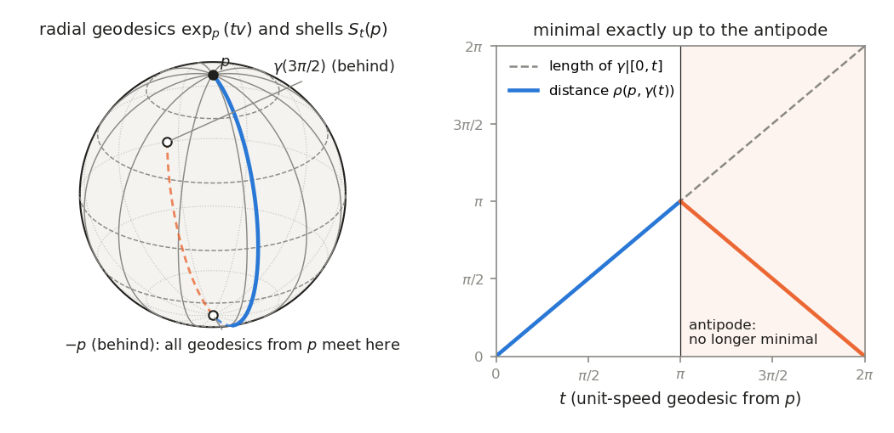

# Chapter 7. The shortest way round: geodesics and completeness

*Milnor, "Morse Theory", §10, rewritten for a first-year graduate student who wants to know what
the theorem is for. Every proof is complete.*

---

## 0. Why does the flight to New York go north?

A flight from London Heathrow to New York JFK sets off towards the west-north-west, although New
York lies eleven degrees of latitude further south. On a sphere of radius 6,371 km the shortest
track climbs to $53.7^\circ$N, over the Atlantic west of Ireland, before turning south towards
Newfoundland. A route of constant compass heading, the one that looks straight on a Mercator chart,
is about 4% longer. Behind the pilot's choice are three questions that make sense on any curved
space.

* *Is there a shortest route?* Not always. In the plane with the origin removed, $(-1,0)$ and
  $(1,0)$ are joined by paths of length as close to $2$ as we like, but by none of length exactly
  $2$: the only candidate, the segment, runs through the missing point.
* *How is a shortest route recognized locally?* A particle confined to a frictionless surface, with
  no force but the constraint, has acceleration normal to the surface: it goes "straight ahead".
  Such curves are the *geodesics*. Short pieces of them are shortest routes, and shortest routes are
  made of them.
* *How many geodesics join two points?* The great circle through London and New York gives
  infinitely many (go round once more), exactly one of them shortest. For London and its antipode,
  infinitely many are shortest.

This chapter answers these questions on any Riemannian manifold. Geodesics solve a second-order
differential equation (§1) and are packaged into the exponential map (§2). Short geodesics are
shortest paths and shortest paths are geodesics (§3), which makes the manifold a metric space (§4).
The Hopf–Rinow theorem (§5): if every geodesic can be continued indefinitely, any two points are
joined by a shortest geodesic. This is exactly what fails in the punctured plane. The application
(§7) does the London–New York computation and counts geodesics on a sphere, a cylinder and a torus.
The rest of the book rests on this chapter: the critical points of the energy on the path space are
the geodesics, and completeness is the hypothesis of the fundamental theorem of Morse theory (§17).

---

## 1. Geodesics as solutions of a differential equation (Milnor pp. 55–57)

*Conventions.* Manifolds are smooth, Hausdorff and second countable. $M$ is a connected Riemannian
manifold with its Levi-Civita connection (Lemma 8.6, in Chapter 6 of this book, on Milnor §8–§9);
$\frac{D}{dt}$ is covariant differentiation along curves (Lemma 8.1). A *piecewise smooth path*
$\omega:[a,b]\to M$ is continuous with every $\omega|[t_{i-1},t_i]$ smooth for some subdivision
$a=t_0<\dots<t_k=b$ (Milnor p. 67). Its *length* $L(\omega)=\int_a^b\|\frac{d\omega}{dt}\|\,dt$ is
integrated piece by piece; it is additive under concatenation and unchanged by reversal or affine
reparametrization.

**Definition.** A smooth curve $\gamma:I\to M$ on an interval $I$ is a *geodesic* if
$\frac{D}{dt}\frac{d\gamma}{dt}\equiv0$: its velocity field is parallel along $\gamma$.

By Lemma 8.3, $\frac{d}{dt}\langle\frac{d\gamma}{dt},\frac{d\gamma}{dt}\rangle=2\langle\frac{D}{dt}
\frac{d\gamma}{dt},\frac{d\gamma}{dt}\rangle=0$, so a geodesic has constant speed $c$ and arc length
$s(t)=ct+\text{const}$: the parameter is a linear function of arc length, equal to it iff $c=1$.

In a chart with coordinates $u^1,\dots,u^n$, the coordinate formula for $\frac{D}{dt}$ (Lemma 8.1,
with $V=\sum_j\frac{du^j}{dt}\partial_j$) turns the geodesic condition into
$$\frac{d^2u^k}{dt^2}+\sum_{i,j}\Gamma^k_{ij}(u^1,\dots,u^n)\frac{du^i}{dt}\frac{du^j}{dt}=0,
\qquad k=1,\dots,n.\qquad(1)$$

If $u(t)$ solves (1), so does $u(ct)$ for a constant $c$: both terms acquire the factor $c^2$. So
*if $t\mapsto\gamma(t)$ is a geodesic, so is $t\mapsto\gamma(ct)$* (Milnor's "homogeneity", p. 57).

**Theorem 10.1 (existence and uniqueness).** Let $\vec F$ be an $n$-tuple of $C^\infty$ functions
on an open set $U\subseteq\mathbb R^{2n}$, and $(\vec u_1,\vec v_1)\in U$. There are a neighbourhood
$W$ of $(\vec u_1,\vec v_1)$ and $\varepsilon>0$ such that for each $(\vec u_0,\vec v_0)\in W$ the
equation $\frac{d^2\vec u}{dt^2}=\vec F(\vec u,\frac{d\vec u}{dt})$ has a unique solution
$t\mapsto\vec u(t)$, $|t|<\varepsilon$, with $(\vec u(t),\vec u\,'(t))\in U$, $\vec u(0)=\vec u_0$,
$\vec u\,'(0)=\vec v_0$; and $(\vec u_0,\vec v_0,t)\mapsto\vec u(t)$ is $C^\infty$ on
$W\times(-\varepsilon,\varepsilon)$.

*Proof.* With $\vec v=\frac{d\vec u}{dt}$ the equation becomes the first-order system
$\frac{d\vec u}{dt}=\vec v$, $\frac{d\vec v}{dt}=\vec F(\vec u,\vec v)$, i.e. $x'=G(x)$ with
$G(\vec u,\vec v)=(\vec v,\vec F(\vec u,\vec v))$ smooth on $U$. We quote the standard theorem for
such systems (Picard–Lindelöf with smooth dependence on initial conditions): for $G$ smooth on an
open $U\subseteq\mathbb R^m$ and $x_1\in U$ there are a neighbourhood $W$ of $x_1$ and
$\varepsilon>0$ such that for $x_0\in W$ a solution $x:(-\varepsilon,\varepsilon)\to U$ with
$x(0)=x_0$ exists, $(x_0,t)\mapsto x(t)$ is $C^\infty$, and two solutions with the same value at
$0$ agree on their common interval of definition. (Milnor cites Graves, *The Theory of Functions of
Real Variables*, p. 166; see also Hartman, *Ordinary Differential Equations*, Ch. V, or Lee,
*Introduction to Smooth Manifolds*, 2nd ed., Appendix D. The same facts are quoted, in global
Lipschitz form, in Chapter 4 of the companion volume, *Topology from the Differentiable Viewpoint*,
rewritten.) $\square$

Theorem 10.1 asserts uniqueness only inside one chart. Milnor's repeated "the unique geodesic"
needs uniqueness in the large.

**Lemma A (uniqueness in the large).** Let $\gamma_1,\gamma_2:I\to M$ be geodesics on the same
interval with $\gamma_1(t_0)=\gamma_2(t_0)$ and $\gamma_1'(t_0)=\gamma_2'(t_0)$ for some $t_0\in I$.
Then $\gamma_1=\gamma_2$.

*Proof.* $J=\{t:\gamma_1(t)=\gamma_2(t),\ \gamma_1'(t)=\gamma_2'(t)\}\ni t_0$ is closed in $I$, as
the set where two continuous maps into the Hausdorff space $TM$ agree. It is open: near $t_1\in J$
both curves lie in one chart and solve (1) with the same data at $t_1$, so they agree near $t_1$ by
the uniqueness clause of Theorem 10.1. As $I$ is connected, $J=I$. $\square$

> **A hidden hypothesis.** Hausdorff is essential. On the line with two origins (two copies of
> $\mathbb R$ glued along $\mathbb R\setminus\{0\}$), with the flat metric, the curves $t\mapsto t$
> through the two origins are geodesics that agree for $t<0$ and differ at $t=0$.

**Lemma 10.2.** For every $p_0\in M$ there are a neighbourhood $U$ of $p_0$ and $\varepsilon>0$
such that for each $p\in U$ and each $v\in TM_p$ with $\|v\|<\varepsilon$ there is a unique
geodesic $\gamma_v:(-2,2)\to M$ with $\gamma_v(0)=p$, $\frac{d\gamma_v}{dt}(0)=v$. Moreover
$(p,v,t)\mapsto\gamma_v(t)$ is smooth.

*Proof.* Take a chart $u:U_0\to\mathbb R^n$ around $p_0$ and apply Theorem 10.1 to
$\vec F(\vec u,\vec v)=-\big(\sum_{i,j}\Gamma^k_{ij}(\vec u)v^iv^j\big)_{k}$ on
$u(U_0)\times\mathbb R^n$ at $(u(p_0),0)$; call the resulting time $2\varepsilon_2$. Choose $a,b>0$
with $\bar B(u(p_0),a)\subseteq u(U_0)$ and $B(u(p_0),a)\times B(0,b)\subseteq W$. The smallest
eigenvalue of the positive definite matrix $(g_{ij}(\vec u))$ is continuous, so it has a positive
minimum $\lambda$ on the compact ball $\bar B(u(p_0),a)$, where therefore
$\|v\|^2=\sum g_{ij}v^iv^j\ge\lambda|\vec v|^2$. Put $U=u^{-1}B(u(p_0),a)$ and
$\varepsilon_1=b\sqrt\lambda$. For $p\in U$ and $\|v\|<\varepsilon_1$ the coordinates of $(p,v)$ lie
in $W$, so Theorem 10.1 gives a geodesic with initial velocity $v$ on
$(-2\varepsilon_2,2\varepsilon_2)$, staying in the chart, smooth in $(p,v,t)$, and unique by
Lemma A. Now fix $0<\varepsilon<\varepsilon_1\varepsilon_2$. If $\|v\|<\varepsilon$ and $|t|<2$, then
$\|v/\varepsilon_2\|<\varepsilon_1$ and $|\varepsilon_2t|<2\varepsilon_2$, so
$$\gamma_v(t):=\gamma_{v/\varepsilon_2}(\varepsilon_2t)$$
is defined. It is a geodesic by homogeneity, with initial velocity $\varepsilon_2\cdot
v/\varepsilon_2=v$, smooth in $(p,v,t)$, and unique by Lemma A. $\square$

> **Milnor's text skips…** the comparison $\|v\|^2\ge\lambda|\vec v|^2$ on a compact coordinate
> ball, needed to turn the neighbourhood $W$ of Theorem 10.1 into "$p\in U$, $\|v\|<\varepsilon_1$".

**Definition (the exponential).** Let $v\in TM_q$. If there is a geodesic $\gamma:[0,1]\to M$ with
$\gamma(0)=q$, $\frac{d\gamma}{dt}(0)=v$, then $\exp_q(v):=\gamma(1)$, the *exponential* of $v$. By
Lemma A there is at most one such $\gamma$, so $\exp_q(v)$, if defined at all, is uniquely defined.
For $0\le t\le1$ the curve $s\mapsto\gamma(ts)$ is a geodesic on $[0,1]$ with initial velocity $tv$,
so
$$\gamma(t)=\exp_q(tv),\qquad0\le t\le1.$$
By Lemma 10.2, $\exp_q(v)$ is defined when $\|v\|$ is small, uniformly for $q$ near a given point; in
general not for large $v$. Milnor's footnote explains the name: on the unitary group, $\exp_I$ is
the matrix exponential. That depends on the metric; see §6.

---

## 2. The exponential map and uniformly normal neighbourhoods (Milnor pp. 58–59)

**Definition.** $M$ is *geodesically complete* if $\exp_q(v)$ is defined for all $q\in M$ and
$v\in TM_q$.

To compare this with Milnor's reformulation, and to know that $\exp$ is smooth wherever it is
defined (needed in Corollary 10.10), we use the global ODE theorem.

**Fact (flows).** Let $G$ be a smooth vector field on a manifold $N$. There are an open set
$\mathcal D\subseteq\mathbb R\times N$ containing $\{0\}\times N$ and a smooth map
$\theta:\mathcal D\to N$ such that for each $x\in N$, $\{t:(t,x)\in\mathcal D\}$ is an open interval
and $t\mapsto\theta(t,x)$ is an integral curve of $G$ starting at $x$ that extends every other one.
(Lee, *Introduction to Smooth Manifolds*, 2nd ed., Theorem 9.12.)

**Lemma B (the geodesic flow).** (i) Every geodesic extends to a unique maximal geodesic, defined on
an open interval. (ii) The set $\mathcal E\subseteq TM$ of $(q,v)$ for which $\exp_q(v)$ is defined
is open and contains all zero vectors, and $\exp:\mathcal E\to M$ is smooth.

*Proof.* Over a chart domain $U$, with coordinates $(u,v)$ on $TU$ (described below), let
$$G_U=\sum_kv^k\frac{\partial}{\partial u^k}-\sum_k\Big(\sum_{i,j}\Gamma^k_{ij}(u)v^iv^j\Big)
\frac{\partial}{\partial v^k}.$$
Its integral curves are the $(u(t),v(t))$ with $v=\frac{du}{dt}$ and $u$ solving (1): the lifts
$(\gamma,\gamma')$ of geodesics in $U$. Through a point of $TU\cap TU'$ the integral curves of $G_U$
and $G_{U'}$ are lifts of geodesics with the same initial data, equal for small $t$ by Lemma A, so
$G_U=G_{U'}$ there. Thus the $G_U$ form one smooth vector field $G$ on $TM$, the *geodesic spray*,
whose integral curves are the lifts of geodesics. Apply the Fact. (i) A geodesic lifts into a
maximal integral curve, whose projection is the maximal geodesic; uniqueness by Lemma A. (ii)
$(q,v)\in\mathcal E$ iff $(1,(q,v))\in\mathcal D$, an open condition, and $\exp=\pi\circ\theta(1,
\cdot)$ with $\pi:TM\to M$ the projection. $\square$

*Milnor's reformulation: $M$ is geodesically complete iff every geodesic segment
$\gamma_0:[a,b]\to M$ extends to a geodesic $\gamma:\mathbb R\to M$.* Suppose $\exp$ is defined
everywhere and let $\gamma:(\alpha,\beta)\to M$ be the maximal geodesic extending $\gamma_0$. If
$\beta<\infty$, choose $T>\beta-a$; with $q=\gamma_0(a)$, $v=\gamma_0'(a)$ there is a geodesic
$\sigma:[0,1]\to M$ with initial velocity $Tv$, and $t\mapsto\sigma((t-a)/T)$ is a geodesic on
$[a,a+T]$ with the data of $\gamma$ at $a$. By Lemma A and maximality, $[a,a+T]\subseteq(\alpha,
\beta)$, contradicting $a+T>\beta$. Likewise $\alpha=-\infty$. Conversely, a geodesic with initial
velocity $v$ exists on a short interval (rescale Lemma 10.2); extended to $\mathbb R$ and restricted
to $[0,1]$, it shows $\exp_q(v)$ is defined.

*The tangent manifold.* A chart $u^1,\dots,u^n$ on $U\subseteq M$ gives coordinates
$(u^1,\dots,u^n,t^1,\dots,t^n)$ on $TU$, where $v=\sum t^i\partial_i$. A change of chart
$\tilde u=\varphi(u)$ gives $(u,t)\mapsto(\varphi(u),D\varphi(u)t)$, smooth; so $TM$ is a smooth
$2n$-manifold, Hausdorff and second countable.

By Lemma 10.2, for each $p\in M$, $(q,v)\mapsto\exp_q(v)=\gamma_v(1)$ is defined and smooth on the
neighbourhood $V=\{(q,v):q\in U,\ \|v\|<\varepsilon\}$ of $(p,0)$. Consider
$$F:V\to M\times M,\qquad F(q,v)=(q,\exp_q(v)).$$
In coordinates $(u,t)$ on $TU$ and $(u_1,u_2)$ on $U\times U$, $F(u,t)=(u,E(u,t))$. As
$\exp_q(0)=q$, $E(u,0)=u$ and $\partial E/\partial u=I$ at $t=0$; as $t\mapsto\exp_q(tv)$ has
velocity $v$ at $t=0$, $d(\exp_q)_0$ is the identity and $\partial E/\partial t=I$ at $t=0$. So
$$F_*\Big(\frac{\partial}{\partial u^i}\Big)=\frac{\partial}{\partial u_1^i}+\frac{\partial}{\partial
u_2^i},\qquad F_*\Big(\frac{\partial}{\partial t^j}\Big)=\frac{\partial}{\partial u_2^j},$$
and the Jacobian $\begin{pmatrix}I&0\\I&I\end{pmatrix}$ (Milnor prints its transpose) is
nonsingular. By the inverse function theorem on manifolds (Milnor says "implicit"; it is proved
from the Euclidean one in Chapter 1, Theorem 4.1, of the companion volume, and the proof works
verbatim in charts), $F$ maps a neighbourhood $V''$ of $(p,0)$ diffeomorphically onto a neighbourhood
of $(p,p)$. The sets $V(U',\varepsilon')=\{(q,v):q\in U',\ \|v\|<\varepsilon'\}$, $U'$ an open
neighbourhood of $p$, are open and form a neighbourhood base of $(p,0)$ in $TM$: by
$\|v\|^2\ge\lambda|t|^2$, the coordinate box $\{u\in B(u(p),a'),|t|<b'\}$ contains
$V(u^{-1}B(u(p),a'),b'\sqrt\lambda)$. So choose $V'=V(U',\varepsilon)\subseteq V''$ (a new
$\varepsilon$) and a neighbourhood $W\subseteq U'$ of $p$ with $W\times W\subseteq F(V')$.

**Lemma 10.3.** For each $p\in M$ there are a neighbourhood $W$ of $p$ and $\varepsilon>0$ such
that:

1. any two points $q_1,q_2$ of $W$ are joined by a unique geodesic $\gamma:[0,1]\to M$ of length
   $<\varepsilon$;
2. this geodesic depends smoothly on the two points: $\gamma(t)=\exp_{q_1}(tv)$, and
   $(q_1,q_2)\mapsto(q_1,v)\in TM$ is smooth on $W\times W$;
3. for each $q\in W$, $\exp_q$ maps the open $\varepsilon$-ball $B_\varepsilon(q)=\{v\in TM_q:
   \|v\|<\varepsilon\}$ diffeomorphically onto an open set $U_q\supseteq W$.

*Proof.* Take $W,\varepsilon,V'$ as above. (1) As $F$ keeps the first coordinate,
$(q_1,q_2)\in F(V')$ gives $(q_1,q_2)=F(q_1,v)$ with $\|v\|<\varepsilon$, and $t\mapsto
\exp_{q_1}(tv)$ is a geodesic from $q_1$ to $q_2$ of length $\|v\|$. If $\sigma:[0,1]\to M$ is a
geodesic from $q_1$ to $q_2$ with $L(\sigma)<\varepsilon$ and $w=\sigma'(0)$, then
$\|w\|=L(\sigma)<\varepsilon$, so $(q_1,w)\in V'$ and $F(q_1,w)=F(q_1,v)$; injectivity gives $w=v$,
and $\sigma=\gamma$ by Lemma A. (2) $(q_1,v)=(F|_{V'})^{-1}(q_1,q_2)$. (3) For $q\in W$,
$\exp_q|B_\varepsilon(q)$ is $v\mapsto\mathrm{pr}_2F(q,v)$, injective; its image
$U_q=\{q':(q,q')\in F(V')\}$ is open and contains $W$; its inverse
$q'\mapsto\mathrm{pr}_2(F|_{V'})^{-1}(q,q')$ is smooth. $\square$

Call $\varepsilon>0$ a *normal radius at $q$* if $\exp_q$ is defined on $B_\varepsilon(q)$ and maps
it diffeomorphically onto an open set $U_q$; by item 3 (at $p=q$) every point has one. For
$0<s<\varepsilon$ write
$$\mathcal B_s(q)=\exp_qB_s(q),\qquad\bar{\mathcal B}_s(q)=\exp_q\bar B_s(q),\qquad
S_s(q)=\exp_q\{v:\|v\|=s\},$$
the *normal ball*, its closed version and the *spherical shell* of radius $s$. $\mathcal B_s(q)$ is
open; $\bar{\mathcal B}_s(q)$ is compact, hence closed in the Hausdorff space $M$, so it contains
the closure of $\mathcal B_s(q)$; and $\bar{\mathcal B}_s(q)\setminus\mathcal B_s(q)=S_s(q)$.

**Remark (Milnor).** With more care $W$ can be chosen so that the geodesic of length $<\varepsilon$
joining any two of its points lies in $W$ (J. H. C. Whitehead, *Convex regions in the geometry of
paths*, Quart. J. Math. Oxford 3 (1932), 33–42). The book does not use this; it is proved in §4.

---

## 3. Short geodesics are shortest: the Gauss lemma (Milnor pp. 59–61)

**Theorem 10.4.** Let $W$ and $\varepsilon$ be as in Lemma 10.3, let $\gamma:[0,1]\to M$ be the
geodesic of length $<\varepsilon$ joining two points of $W$, and let $\omega:[0,1]\to M$ be any
piecewise smooth path joining the same two points. Then
$$\int_0^1\Big\|\frac{d\gamma}{dt}\Big\|\,dt\le\int_0^1\Big\|\frac{d\omega}{dt}\Big\|\,dt,$$
and if equality holds, $\omega=\gamma\circ\rho$ for a continuous nondecreasing surjection
$\rho:[0,1]\to[0,1]$; in particular $\omega([0,1])=\gamma([0,1])$. Thus $\gamma$ is the shortest
path joining its endpoints.

Milnor's equality clause says only that the point sets coincide; Corollary 10.7 needs the sharper
form. In the two lemmas below, $\varepsilon$ is a normal radius at $q$ (for $q\in W$, the
$\varepsilon$ of 10.3 is one).

**Lemma 10.5 (Gauss).** In $U_q$, the geodesics through $q$ are the orthogonal trajectories of the
hypersurfaces $S_r(q)=\{\exp_q(v):\|v\|=r\}$, $0<r<\varepsilon$.

These are hypersurfaces since $\exp_q$ is a diffeomorphism on $B_\varepsilon(q)$, and each tangent
vector of $S_{r_0}(q)$ at $\exp_q(r_0v_0)$ is $\frac{d}{dt}\exp_q(r_0v(t))|_{t=0}$ for a smooth curve
$v(t)$ on the unit sphere of $TM_q$ with $v(0)=v_0$. So the claim is that *for every such curve the
curves $t\mapsto\exp_q(r_0v(t))$ are orthogonal to the radial geodesics $r\mapsto\exp_q(rv(t_0))$.*

*Proof.* Let $f(r,t)=\exp_q(rv(t))$, $|r|<\varepsilon$, a smooth parametrized surface. By Lemma 8.3,
$$\frac{\partial}{\partial r}\Big\langle\frac{\partial f}{\partial r},\frac{\partial f}{\partial t}
\Big\rangle=\Big\langle\frac{D}{\partial r}\frac{\partial f}{\partial r},\frac{\partial f}{\partial
t}\Big\rangle+\Big\langle\frac{\partial f}{\partial r},\frac{D}{\partial r}\frac{\partial f}
{\partial t}\Big\rangle.$$
The first term vanishes because $r\mapsto f(r,t)$ is a geodesic. By the symmetry Lemma 8.7,
$\frac{D}{\partial r}\frac{\partial f}{\partial t}=\frac{D}{\partial t}\frac{\partial f}{\partial r}$,
so the second term is
$$\Big\langle\frac{\partial f}{\partial r},\frac{D}{\partial t}\frac{\partial f}{\partial r}\Big
\rangle=\frac12\frac{\partial}{\partial t}\Big\langle\frac{\partial f}{\partial r},\frac{\partial f}
{\partial r}\Big\rangle=0,$$
since $\|\frac{\partial f}{\partial r}\|$ is the constant speed $\|v(t)\|=1$ of the geodesic
$r\mapsto\exp_q(rv(t))$. Hence $\langle\frac{\partial f}{\partial r},\frac{\partial f}{\partial t}
\rangle$ does not depend on $r$. At $r=0$, $f(0,t)=q$ for all $t$, so $\frac{\partial f}{\partial t}
(0,t)=0$. Therefore $\langle\frac{\partial f}{\partial r},\frac{\partial f}{\partial t}\rangle\equiv0$.
$\square$

*Polar coordinates.* For piecewise smooth $\omega:[a,b]\to U_q\setminus\{q\}$, the functions
$w(t)=\exp_q^{-1}\omega(t)\ne0$, $r(t)=\|w(t)\|\in(0,\varepsilon)$ and $v(t)=w(t)/r(t)$ are
piecewise smooth (the norm is smooth away from $0$), and $\omega(t)=\exp_q(r(t)v(t))$ uniquely.

**Lemma 10.6.** $\int_a^b\|\frac{d\omega}{dt}\|\,dt\ge|r(b)-r(a)|$, with equality only if $r(t)$ is
monotone and $v(t)$ is constant. Thus the shortest path joining two concentric spherical shells
around $q$ is a radial geodesic.

*Proof.* On each smooth piece, with $f(r,t)=\exp_q(rv(t))$, $\omega(t)=f(r(t),t)$ and
$$\frac{d\omega}{dt}=\frac{\partial f}{\partial r}\,r'(t)+\frac{\partial f}{\partial t}.$$
The terms are orthogonal (Lemma 10.5) and $\|\frac{\partial f}{\partial r}\|=1$, so
$$\Big\|\frac{d\omega}{dt}\Big\|^2=|r'(t)|^2+\Big\|\frac{\partial f}{\partial t}\Big\|^2\ge
|r'(t)|^2,$$
with equality only where $\frac{\partial f}{\partial t}=d(\exp_q)_{rv}(r\,v'(t))=0$, i.e. (as
$d(\exp_q)_{rv}$ is injective and $r>0$) where $v'(t)=0$. Hence
$$\int_a^b\Big\|\frac{d\omega}{dt}\Big\|\,dt\ge\int_a^b|r'(t)|\,dt\ge\Big|\int_a^br'(t)\,dt\Big|=
|r(b)-r(a)|.$$
If equality holds throughout, then on each piece the continuous functions $\|\omega'\|-|r'|\ge0$ and
$|r'|\mp r'\ge0$ (sign of $r(b)-r(a)$) have integral $0$, so vanish: $v'=0$ on every piece, so the
continuous $v$ is constant, and $r'$ has one sign, so $r$ is monotone. $\square$

Milnor's proof of 10.4 then asserts that the path contains a segment running from the shell of
radius $\delta$ to the shell of radius $r$ and lying between the two. But a competing path may
leave $U_q$ and come back; the assertion holds because closed normal balls are closed in $M$.

**Lemma C (crossing the shells).** Let $0<\delta<r<\varepsilon$ and let $\omega:[a,b]\to M$ be
piecewise smooth with $\omega(a)\in\bar{\mathcal B}_\delta(q)$ and $\omega(b)\notin\mathcal B_r(q)$.
Then there are $a\le t_1<t_2\le b$ with $\omega(t_1)\in S_\delta(q)$, $\omega(t_2)\in S_r(q)$ and
$\omega([t_1,t_2])\subseteq\bar{\mathcal B}_r(q)\setminus\mathcal B_\delta(q)$. Consequently
$L(\omega)\ge r-\delta$, and every path from $q$ to a point outside $\mathcal B_r(q)$ has length
$\ge r$.

*Proof.* Let $t_1$ be the largest $t$ with $\omega(t)\in\bar{\mathcal B}_\delta(q)$ (a closed set);
$t_1<b$. If $\omega(t_1)$ lay in the open set $\mathcal B_\delta(q)$, so would $\omega(t)$ for $t$
slightly larger; so $\omega(t_1)\in S_\delta(q)$. Let $t_2$ be the least $t\ge t_1$ with
$\omega(t)\notin\mathcal B_r(q)$ (a closed set containing $b$); $t_2>t_1$. As $\omega(t)\in
\mathcal B_r(q)$ for $t_1\le t<t_2$, $\omega(t_2)$ lies in the closure of $\mathcal B_r(q)$, inside
$\bar{\mathcal B}_r(q)$, hence in $S_r(q)$. On $[t_1,t_2]$ the path stays in $\bar{\mathcal B}_r(q)
\setminus\mathcal B_\delta(q)\subseteq U_q\setminus\{q\}$, with $r(t_1)=\delta$, $r(t_2)=r$, so
Lemma 10.6 gives $L(\omega)\ge r-\delta$. For paths from $q$, let $\delta\to0$. $\square$

*Proof of Theorem 10.4.* Let $q=\gamma(0)$, $\gamma(t)=\exp_q(tw)$ with $\|w\|=L(\gamma)<
\varepsilon$, and $q'=\gamma(1)$. If $w=0$ all is trivial (equality forces $\omega$ constant).
Otherwise $r=\|w\|$ and $q'=\exp_q(rv)$ with $v=w/r$, so $q'\in S_r(q)$, $q'\notin\mathcal B_r(q)$,
and Lemma C gives $L(\omega)\ge r=L(\gamma)$.

Suppose $L(\omega)=r$. Let $T_0$ be the last time with $\omega(T_0)=q$ and $T_1$ the first time
after $T_0$ with $\omega(T_1)\notin\mathcal B_r(q)$; as in Lemma C, $\omega(T_1)\in S_r(q)$ and
$\omega(t)\in\mathcal B_r(q)\setminus\{q\}$ for $T_0<t<T_1$. In polar coordinates on $(T_0,T_1]$,
$r(t)\to0$ as $t\downarrow T_0$ and $r(T_1)=r$. For $T_0<s'<s<T_1$ Lemma 10.6 gives
$L(\omega|[s',s])\ge r(s)-r(s')$ and $L(\omega|[s,T_1])\ge r-r(s)$; letting $s'\downarrow T_0$,
$L(\omega|[T_0,s])\ge r(s)$. Adding,
$$r=L(\omega)\ge L(\omega|[0,T_0])+r(s)+\big(r-r(s)\big)+L(\omega|[T_1,1]).$$
So $\omega$ has length $0$, hence is constant, on $[0,T_0]$ and $[T_1,1]$, and
$L(\omega|[s,T_1])=r-r(s)$ for all $s\in(T_0,T_1)$. By the equality case of Lemma 10.6, $v$ is
constant on $(T_0,T_1]$ and $r$ is nondecreasing there. Then $\exp_q(rv(T_1))=\omega(T_1)=q'=
\exp_q(rv)$ gives $v(T_1)=v$. Thus $\omega(t)=\gamma(r(t)/r)$ on $(T_0,T_1]$, $\omega=\gamma(0)$ on
$[0,T_0]$, $\omega=\gamma(1)$ on $[T_1,1]$: $\omega=\gamma\circ\rho$. $\square$

> **Milnor's text skips…** that a competing path may leave $U_q$, so the shell-crossing step needs
> Lemma C; and "we easily obtain a strict inequality" is the equality analysis above (last visit to
> $q$, first arrival at $S_r(q)$).

**Corollary 10.7.** Suppose a path $\omega:[0,\ell]\to M$, parametrized by arc length (piecewise
smooth, $\|\omega'\|=1$ on each piece), has length less than or equal to that of any other path from
$\omega(0)$ to $\omega(\ell)$. Then $\omega$ is a geodesic; in particular it is smooth.

*Proof.* Every segment $\omega|[\alpha,\beta]$ is shortest between its endpoints, since a shorter
path between them, inserted in place of the segment, would shorten $\omega$. Fix $t_*\in[0,\ell]$,
take $W,\varepsilon$ from Lemma 10.3 for $\omega(t_*)$, and a neighbourhood $[\alpha,\beta]$ of
$t_*$ in $[0,\ell]$ with $\omega([\alpha,\beta])\subseteq W$, $\beta-\alpha<\varepsilon$. Let
$\gamma$ be the geodesic of length $<\varepsilon$ from $\omega(\alpha)$ to $\omega(\beta)$. By 10.4,
$L(\gamma)\le\beta-\alpha$; by minimality of the segment, $\beta-\alpha\le L(\gamma)$. So equality
holds, and the proof of 10.4 gives, with $q=\omega(\alpha)$: $\omega$ is constant on $[\alpha,T_0]$
and $[T_1,\beta]$, so $T_0=\alpha$, $T_1=\beta$ by unit speed; and on $(\alpha,\beta]$,
$\omega(t)=\exp_q(r(t)v)$ with $v$ fixed, $r$ nondecreasing and $\|\omega'\|=|r'|=1$, so $r'=1$ on
each piece and $r(t)=t-\alpha$. Thus $\omega(t)=\exp_q((t-\alpha)v)$ on $[\alpha,\beta]$, a geodesic,
smooth even at a break point $t_*$. Every $t_*$ has such a neighbourhood. $\square$

> **Milnor's text skips…** that equal point sets do not make $\omega$ a geodesic (a path running
> along $\gamma$ at varying speed has the same image). One needs the monotone reparametrization,
> the unit speed, minimality of sub-paths, and segments containing the break points in their
> interiors.

**Definition.** A geodesic $\gamma:[a,b]\to M$ is *minimal* if its length is at most that of any
other piecewise smooth path joining its endpoints.

By Theorem 10.4 every sufficiently small segment of a geodesic is minimal: a short segment around
$\gamma(t_*)$ lies in the $W$ of Lemma 10.3 for $\gamma(t_*)$ and has length $<\varepsilon$, so it is
the geodesic of 10.3(1). A long geodesic need not be minimal: a great-circle arc on the unit sphere
is a geodesic (§6), and if its length $\ell$ exceeds $\pi$ the complementary arc joins the same
endpoints with length $2\pi-\ell<\ell$. Minimal geodesics need not be unique: antipodal points of
the sphere are joined by infinitely many (§6).

---

## 4. The Riemannian distance (Milnor p. 62)

**Definition.** The *distance* $\rho(p,q)$ is the greatest lower bound of the lengths of piecewise
smooth paths from $p$ to $q$.

Milnor calls the metric property clear, and says that compatibility with the topology of $M$
"follows easily from 10.4". The first claim needs Lemma C.

**Proposition D.** (i) $\rho$ is a metric. (ii) If $\varepsilon$ is a normal radius at $p$ and
$0<r\le\varepsilon$, the metric ball $\{q:\rho(p,q)<r\}$ equals $\mathcal B_r(p)$, and points of
$S_s(p)$, $0<s<\varepsilon$, are at distance exactly $s$ from $p$. (iii) The metric topology is the
manifold topology, and $\rho$ is continuous on $M\times M$.

*Proof.* (i) *Finiteness:* the points joined to $p$ by a piecewise smooth path form an open set
(straight segments in a coordinate ball are smooth paths) with open complement, so all of the
connected $M$. *Symmetry, triangle inequality, $\rho(p,p)=0$:* reverse and concatenate paths; use
the constant path. *Positivity:* for $p\ne q$ and a normal radius $\varepsilon$ at $p$, take
$r\in(0,\varepsilon)$ arbitrary if $q\notin U_p$, and $r=\|w\|$ if $q=\exp_p(w)$, $0<\|w\|<
\varepsilon$. Then $q\notin\mathcal B_r(p)$, and Lemma C gives $\rho(p,q)\ge r>0$.

(ii) For $q=\exp_p(w)$, $\|w\|<r$, the radial geodesic has length $<r$. For $r<\varepsilon$ and
$q\notin\mathcal B_r(p)$, Lemma C gives $\rho(p,q)\ge r$. For $r=\varepsilon$ take the union. A point
of $S_s(p)$ is at distance $\le s$ (radial geodesic) and $\ge s$ (Lemma C).

(iii) A $\rho$-open set contains around each point $p$ some $\mathcal B_r(p)$, open in $M$. If
$N\ni p$ is open in $M$, then $\exp_p^{-1}(N\cap U_p)$ contains some $B_r(p)$, so $N$ contains the
metric ball $\mathcal B_r(p)$. Finally $|\rho(x,y)-\rho(x',y')|\le\rho(x,x')+\rho(y,y')$. $\square$

**Corollary 10.8.** Given a compact set $K\subseteq M$ there is $\delta>0$ such that any two points
of $K$ with distance less than $\delta$ are joined by a unique geodesic of length less than
$\delta$. This geodesic is minimal, and depends differentiably on its endpoints.

*Proof.* Take $(W_p,\varepsilon_p)$ from Lemma 10.3 for each $p\in K$, and $W_{p_1},\dots,W_{p_m}$
covering $K$. By Proposition D, $K$ is a compact metric space, so the cover has a Lebesgue number
$\lambda>0$. Let $\delta=\min(\lambda,\varepsilon_{p_1},\dots,\varepsilon_{p_m})$. If $x,y\in K$,
$\rho(x,y)<\delta$, they lie in some $W_{p_j}$, and 10.3 gives a geodesic $\gamma$ from $x$ to $y$ of
length $<\varepsilon_{p_j}$, minimal by 10.4, so $L(\gamma)=\rho(x,y)<\delta$. A geodesic from $x$ to
$y$ of length $<\delta\le\varepsilon_{p_j}$ equals $\gamma$ by 10.3(1). The initial vector of
$\gamma$ is the smooth map of 10.3(2) on each $W_{p_j}\times W_{p_j}$; these agree on overlaps by
uniqueness, so $(x,y)\mapsto\gamma'(0)$ is smooth on the open set $\bigcup_j\{(x,y)\in W_{p_j}\times
W_{p_j}:\rho(x,y)<\delta\}$, which contains all pairs in $K$ at distance $<\delta$. $\square$

> **Milnor's text skips…** the finite subcover and $\delta\le\min_j\varepsilon_{p_j}$, without which
> uniqueness does not follow from 10.3; "differentiably" means smoothness on an open set of pairs.

*Proof of the Remark after Lemma 10.3 (convex neighbourhoods).* Fix $p$, its $W,\varepsilon$, and
normal coordinates $x$ on $U_p$, $x(\exp_p\sum_ix^ie_i)=(x^1,\dots,x^n)$ for an orthonormal basis
$(e_i)$ of $TM_p$. Then $\mathcal B_s(p)=\{|x|<s\}$ and $|x(y)|=\rho(p,y)$ (Proposition D). Let
$\Gamma(x)$ be the bilinear map $(a,b)\mapsto(\sum_{i,j}\Gamma^k_{ij}(x)a^ib^j)_k$, $C$ the maximum
of its norm over $|x|\le\varepsilon/2$, and $r_0=\min(\varepsilon/2,1/(2C))$ ($\varepsilon/2$ if
$C=0$). For a nonconstant geodesic with coordinates $x(t)$, $|x(t)|<r_0$, we have $x'\ne0$ and by (1)
$$\frac{d^2}{dt^2}|x|^2=2|x'|^2+2\langle x,x''\rangle=2|x'|^2-2\langle x,\Gamma(x)(x',x')\rangle\ge
2|x'|^2(1-C|x|)\ge|x'|^2>0,$$
so $\rho(p,\cdot)^2$ is strictly convex along it. Choose $s>0$ with $3s\le r_0$ and $\mathcal B_s(p)
\subseteq W$, and let $W'=\mathcal B_s(p)$. For $q_1,q_2\in W'$ the geodesic $\gamma$ of length
$<\varepsilon$ joining them is minimal, so $L(\gamma)=\rho(q_1,q_2)<2s$ and $\gamma$ stays within
distance $<3s\le r_0$ of $p$. Along $\gamma$, $\rho(p,\cdot)^2$ is convex and $<s^2$ at both ends,
hence $<s^2$ throughout: $\gamma\subseteq W'$. Items 1–3 of 10.3 still hold for $W'\subseteq W$.
$\square$

---

## 5. Completeness: the Hopf–Rinow theorem (Milnor pp. 62–64)

**Theorem 10.9 (Hopf and Rinow).** If $M$ is geodesically complete, then any two points can be
joined by a minimal geodesic.

(Milnor cites G. de Rham, *Sur la réductibilité d'un espace de Riemann*, Comment. Math. Helv. 26
(1952), p. 341, and H. Hopf and W. Rinow, *Über den Begriff der vollständigen
differentialgeometrischen Fläche*, Comment. Math. Helv. 3 (1931), 209–225.)

*Proof.* Let $p,q\in M$ with $r=\rho(p,q)>0$ (if $p=q$ use a constant geodesic). Let $\varepsilon$
be a normal radius at $p$, fix $0<\delta<\min(\varepsilon,r)$, and let $S=S_\delta(p)$.

*Step 1: $\rho(p,q)=\delta+\min_{s\in S}\rho(s,q)$.* As $\rho(p,q)>\delta$, $q\notin\mathcal
B_\delta(p)$ (Proposition D). For a path $\omega$ from $p$ to $q$, the first $t$ with $\omega(t)
\notin\mathcal B_\delta(p)$ has $\omega(t)$ in the closure of $\mathcal B_\delta(p)$, hence in $S$:
every path from $p$ to $q$ passes through $S$. Splitting there, and using $\rho(p,s)=\delta$ on $S$,
$L(\omega)\ge\delta+\rho(\omega(t),q)\ge\delta+\inf_S\rho(\cdot,q)$; the reverse inequality is the
triangle inequality. $S$ is compact and $\rho(\cdot,q)$ continuous, so the infimum is attained at
some $p_0=\exp_p(\delta v)$, $\|v\|=1$, and $\rho(p_0,q)=r-\delta$.

*Step 2: the moving point gets closer.* By completeness $\gamma(t)=\exp_p(tv)$ is defined for all
$t\ge0$, a unit-speed geodesic with $\gamma(\delta)=p_0$. We show that for every $t\in[\delta,r]$
$$\rho(\gamma(t),q)=r-t.\qquad(1_t)$$
Step 1 is $(1_\delta)$. The set of $t\in[\delta,r]$ with $(1_t)$ is closed, as $t\mapsto\rho(\gamma(t)
,q)$ is continuous; let $t_0$ be its largest element and suppose $t_0<r$. Take a normal radius
$\varepsilon'$ at $\gamma(t_0)$, $0<\delta'<\min(\varepsilon',r-t_0)$, $S'=S_{\delta'}(\gamma(t_0))$,
and $p_0'\in S'$ nearest to $q$ (Milnor's Diagram 10). As $\rho(\gamma(t_0),q)=r-t_0>\delta'$, Step
1 at $\gamma(t_0)$ gives $\rho(\gamma(t_0),q)=\delta'+\rho(p_0',q)$, so
$$\rho(p_0',q)=(r-t_0)-\delta'.\qquad(2)$$
Then $\rho(p,p_0')\ge\rho(p,q)-\rho(p_0',q)=t_0+\delta'$. But following $\gamma$ from $p$ to
$\gamma(t_0)$ and then the radial geodesic to $p_0'$, both at unit speed, is a broken geodesic of
length exactly $t_0+\delta'$: a shortest path parametrized by arc length, hence by Corollary 10.7 an
unbroken geodesic $\sigma$. As $\sigma=\gamma$ on $[0,t_0]$ with $t_0>0$, they share the velocity at
$t_0$, and Lemma A gives $\sigma=\gamma$ on $[0,t_0+\delta']$. So $p_0'=\gamma(t_0+\delta')$, and (2)
is $(1_{t_0+\delta'})$ with $t_0<t_0+\delta'\le r$, a contradiction. Hence $t_0=r$.

*Conclusion.* $(1_r)$ gives $\gamma(r)=q$, and $\gamma|[0,r]$ has length $r=\rho(p,q)$: a minimal
geodesic. $\square$

> **Milnor's text skips…** that $\delta$ must also be smaller than $\rho(p,q)$ (else "every path
> from $p$ to $q$ must pass through $S$" can fail), and likewise $\delta'<r-t_0$; that
> $\rho(p,s)=\delta$ on $S$ and the continuity of $\rho$ come from Proposition D; and that "hence
> coincides with $\gamma$" is Lemma A. Completeness is used only for $\exp_p(tv)$, $t\le r$: if
> $\exp_p$ is defined on all of $TM_p$ for one $p$, every point is joined to $p$ by a minimal
> geodesic.

**Corollary 10.10.** If $M$ is geodesically complete, every bounded subset of $M$ has compact
closure. Consequently $M$ is complete as a metric space (every Cauchy sequence converges).

*Proof.* Let $X$ be nonempty of diameter $d$, and $p\in X$. For $x\in X$, Theorem 10.9 gives a
minimal geodesic $t\mapsto\exp_p(tw)$ from $p$ to $x$ with $\|w\|=\rho(p,x)\le d$, so
$X\subseteq\exp_p(\bar B_d(p))$. This set is compact because $\exp_p$ is continuous on all of
$TM_p$, by Lemma B and completeness; so it is closed and contains the closure of $X$, which is
therefore compact. A Cauchy sequence is bounded, so it has a convergent subsequence, hence
converges. $\square$

> **A hidden hypothesis.** Continuity of $\exp_p$ on the whole disk of radius $d$ is not given by
> Lemma 10.2, which concerns small vectors; it is the global smooth dependence of Lemma B.

Milnor states the converse, that metric completeness implies geodesic completeness, calls it "not
difficult, using Lemma 10.3", and refers to Hopf and Rinow for details. Here they are.

**Proposition (converse of 10.10).** If $(M,\rho)$ is a complete metric space, then $M$ is
geodesically complete.

*Proof.* Let $\gamma:(\alpha,\beta)\to M$ be a nonconstant maximal geodesic (Lemma B), of unit speed
after a linear change of parameter, and suppose $\beta<\infty$. As $\rho(\gamma(t),\gamma(t'))\le
|t-t'|$, $\gamma(t_n)$ is Cauchy for $t_n\uparrow\beta$, converges to some $x$, and $\gamma(t)\to x$
as $t\uparrow\beta$. Take $U,\varepsilon$ for $p_0=x$ from Lemma 10.2: for $y\in U$ and a unit
$u\in TM_y$, $t\mapsto\gamma_{\varepsilon u/2}(2t/\varepsilon)$ is a geodesic with initial velocity
$u$ on $|t|<\varepsilon$. Choose $t_*\in(\beta-\varepsilon/2,\beta)$ with $\gamma(t_*)\in U$, and
let $\sigma$ be this geodesic for $u=\gamma'(t_*)$. By Lemma A, $\gamma$ and $s\mapsto\sigma(s-t_*)$
agree where both are defined, and together form a geodesic on $(\alpha,t_*+\varepsilon)$, with
$t_*+\varepsilon>\beta$: this contradicts maximality. Likewise $\alpha=-\infty$. $\square$

Henceforth, as Milnor says, the two notions are not distinguished: $M$ is a *complete Riemannian
manifold*. Compact Riemannian manifolds are complete. The punctured plane of §0 is not: the
geodesic $t\mapsto(t,0)$ starting at $t=-1$ cannot be continued past $t=0$, and $(\pm1,0)$ have no
minimal geodesic between them.

---

## 6. Familiar examples of geodesics (Milnor pp. 65–66)

*Euclidean space.* In $\mathbb R^n$ with metric $dx_1\otimes dx_1+\dots+dx_n\otimes dx_n$,
$g_{ij}=\delta_{ij}$, so $\Gamma^k_{ij}=0$ (second Christoffel identity, Lemma 8.6), and (1) is
$\frac{d^2x_i}{dt^2}=0$: the geodesics are the lines $x(t)=a+tb$. Milnor adds that the integral
$\int(\sum_i(\frac{dx_i}{dt})^2)^{1/2}dt$ "coincides with" the supremum of the lengths of inscribed
polygons, so straight lines are minimal, hence geodesics by Corollary 10.7. Proof: polygons are no
longer, as $|\omega(t_i)-\omega(t_{i-1})|=|\int_{t_{i-1}}^{t_i}\omega'|\le\int_{t_{i-1}}^{t_i}
|\omega'|$; and for a partition containing the break points, so fine that
$|\omega'(s)-\omega'(t_i)|<\eta$ on each $[t_{i-1},t_i]$ (uniform continuity), $|\omega(t_i)-
\omega(t_{i-1})|\ge\int_{t_{i-1}}^{t_i}|\omega'|-2\eta(t_i-t_{i-1})$, so the polygon is longer than
$L(\omega)-2\eta(b-a)$. Minimality of segments is quicker still: $\int|\omega'|\ge|\int\omega'|$.

**Lemma E (isometries).** Let $I:M\to M$ be an isometry (a diffeomorphism whose derivative
preserves inner products). Then $I$ preserves lengths and distances, and carries geodesics to
geodesics. If $x,y$ are fixed by $I$ and joined by a unique minimal geodesic $\gamma:[0,1]\to M$,
then $\gamma$ lies in the fixed point set of $I$.

*Proof.* $\|(I\circ\omega)'\|=\|dI(\omega')\|=\|\omega'\|$, and $I^{-1}$ is an isometry too. A short
segment of a nonconstant geodesic is minimal (end of §3); its image, parametrized by arc length, is
again shortest, so a geodesic by Corollary 10.7; being a geodesic is local. If $x,y$ are fixed,
$I\circ\gamma$ is a minimal geodesic from $x$ to $y$ on $[0,1]$, so $I\circ\gamma=\gamma$. $\square$

**Spheres.** The geodesics of the unit sphere $S^n\subseteq\mathbb R^{n+1}$ (induced metric) are
the great circles, $S^n\cap(\text{plane through }0)$, at constant speed:
$t\mapsto(\cos ct)\,x+(\sin ct)\,u$ with $x\in S^n$, $u\perp x$ a unit vector, $c\ge0$.

*Proof (Milnor's, completed).* Let $E^2$ be a plane through $0$, and $I$ the reflection fixing
$E^2$ and reversing $(E^2)^\perp$: an orthogonal map, so an isometry of $S^n$ with fixed set the
great circle $C=S^n\cap E^2$. Apply Corollary 10.8 to $K=S^n$, with $\delta\le\pi$: points at
distance $<\delta$ have a unique geodesic of length $<\delta$, which is minimal, and every minimal
geodesic between them has length $<\delta$, so they have a unique minimal geodesic. Let $x\in C$,
$u\in E^2$ a unit vector orthogonal to $x$, $y=(\cos s)x+(\sin s)u$, $0<s<\delta$; then
$\rho(x,y)\le s$ (an arc of $C$). By Lemma E the minimal geodesic $C'$ from $x$ to $y$ lies in $C$:
$C'(t)=(\cos\theta(t))x+(\sin\theta(t))u$, $\theta$ smooth, $\theta(0)=0$. Its speed $|\theta'|$ is
a constant $\ell=L(C')\in(0,\pi)$, so $\theta=\pm\ell t$, and $C'(1)=y$ gives $\cos\ell=\cos s$,
$\pm\sin\ell=\sin s>0$: $\theta(t)=st$. By homogeneity the geodesic with initial velocity $u$ is
$\sigma(t)=(\cos t)x+(\sin t)u$ for $t\in[0,s]$. Since $\sigma(t_0+t)=(\cos t)\sigma(t_0)+(\sin
t)\sigma'(t_0)$ with $\sigma'(t_0)\perp\sigma(t_0)$ a unit vector of $E^2$, the same applies at every
$\sigma(t_0)$, so $\sigma$ is a geodesic on $\mathbb R$. A great circle passes through any point in
any direction, so by Lemma A the $\sigma(ct)$ are all the geodesics. $\square$

(Lemma F below gives a one-line check: $\sigma''=-\sigma$ is normal to $S^n$.) All geodesics of $S^n$
are defined on $\mathbb R$: $S^n$ is complete.

*Pairs of points.* Milnor states that antipodal points are joined by a continuum of minimal
geodesics, and every other pair by a unique minimal geodesic and infinitely many non-minimal ones.
Let $x\ne y$, $\theta=\arccos\langle x,y\rangle\in(0,\pi]$. A geodesic $\sigma:[0,1]\to S^n$ from $x$ to $y$ is $\sigma(t)=(\cos\ell t)x+(\sin\ell
t)u$ with $\ell=L(\sigma)>0$, $u\perp x$ a unit vector, $y=(\cos\ell)x+(\sin\ell)u$.

* If $y=-x$: every unit $u\perp x$, with $\ell\in\{\pi,3\pi,\dots\}$, works. A minimal geodesic exists
  (Theorem 10.9) and is among these, so $\rho(x,-x)=\pi$ and all the half great circles
  $t\mapsto(\cos\pi t)x+(\sin\pi t)u$ are minimal.
* If $y\ne\pm x$: write $y=(\cos\theta)x+(\sin\theta)u_0$, $u_0\perp x$ a unit vector. Then
  $u\perp x$ forces $\cos\ell=\cos\theta$, $u=(\sin\theta/\sin\ell)u_0$: either $u=u_0$ and
  $\ell\in\{\theta,\theta+2\pi,\dots\}$, or $u=-u_0$ and $\ell\in\{2\pi-\theta,4\pi-\theta,\dots\}$,
  all along one great circle. The minimal geodesic (Theorem 10.9) is the shortest, $\ell=\theta$,
  unique as $\theta<\pi<2\pi-\theta$. So $\rho(x,y)=\theta$.

In particular a unit-speed geodesic from $x$ is minimal on $[0,t]$ exactly for $t\le\pi$.

*Surfaces of revolution.* Milnor adds that, by the same reasoning, the meridians of a surface of
revolution are geodesics. Rotate an embedded smooth curve in $\{(x,0,z):x>0\}$ about the $z$-axis. Reflection in
the plane through the axis and a meridian is an isometry of the surface whose fixed set is that
meridian and the opposite one, two disjoint curves. By Corollary 10.8 (on a compact neighbourhood)
and Lemma E, two nearby points $x,y$ of the meridian have a unique minimal geodesic $\gamma$, lying
in the meridian by connectedness. With $s$ the arc length along the meridian,
$\|\gamma'\|=|(s\circ\gamma)'|$, so $L(\gamma)\ge|s(y)-s(x)|\ge\rho(x,y)=L(\gamma)$, which forces
$s\circ\gamma$ to be affine: the meridian, parametrized by arc length, is locally, hence globally, a
geodesic.

*Cylinders.* On $Z=\{x^2+y^2=1\}\subseteq\mathbb R^3$, Milnor says, the geodesics are the generating
lines, the circles cut by planes perpendicular to them, and the helices. The map
$P(\theta,z)=(\cos\theta,\sin\theta,z)$ carries the orthonormal pair $\partial_\theta,\partial_z$ to
an orthonormal pair. For a generating line $L=\{\theta=\theta_0\}$, $P$ maps the strip
$(\theta_0,\theta_0+2\pi)\times\mathbb R$ bijectively onto $Z\setminus L$ with injective
derivative: an isometry, whose inverse is Milnor's $I$, "rolling $Z$ onto $\mathbb R^2$". In the
coordinates $(\theta,z)$ the metric is $d\theta^2+dz^2$, so $\Gamma^k_{ij}=0$ and geodesics are
$\theta=\theta_1+at$, $z=z_1+ct$. Every point lies off some generating line, so by Lemma A every
geodesic is $t\mapsto(\cos(\theta_1+at),\sin(\theta_1+at),z_1+ct)$: a generating line ($a=0$), a
circle ($c=0$), a helix ($ac\ne0$) or a point. The points $P(\theta_1,z_1)$, $P(\theta_2,z_2)$ are
joined by the geodesics $t\mapsto P(\theta_1+t(\theta_2+2\pi k-\theta_1),z_1+t(z_2-z_1))$,
$k\in\mathbb Z$, of lengths $\sqrt{(\theta_2-\theta_1+2\pi k)^2+(z_2-z_1)^2}$: infinitely many.

*The unitary group (Milnor's footnote, p. 57).* The claim $\exp_I(A)=I+A+\frac1{2!}A^2+\cdots$ for
skew-Hermitian $A$ holds for the metric $\langle A,B\rangle=\operatorname{Re}\operatorname{tr}(AB^*)$
induced from $\mathbb C^{n\times n}=\mathbb R^{2n^2}$, by the following lemma.

**Lemma F (submanifolds).** If $M\subseteq\mathbb R^k$ has the induced metric, then
$\frac{DV}{dt}=\pi(\frac{dV}{dt})$, the orthogonal projection to $TM_{c(t)}$ of the ordinary
derivative. So a curve in $M$ is a geodesic iff its acceleration in $\mathbb R^k$ is normal to $M$.

*Proof.* $X\vdash Y:=\pi(dY(X))$ is a connection, symmetric because $dY(X)-dX(Y)=[X,Y]$ is tangent,
and compatible because $X\langle Y,Z\rangle=\langle dY(X),Z\rangle+\langle Y,dZ(X)\rangle$ with $Y,Z$
tangent. By Lemma 8.6 it is the Levi-Civita connection, and by the uniqueness in Lemma 8.1 its
covariant derivative along curves is $\pi(\frac{dV}{dt})$. $\square$

For $U(n)$, differentiating $gg^*=I$ gives $TM_g=\{gY:Y^*=-Y\}$. The space $\{gH:H^*=H\}$ is
orthogonal to it, since $\operatorname{Re}\operatorname{tr}(gY(gH)^*)=\operatorname{Re}\operatorname
{tr}(YH)$ and $\overline{\operatorname{tr}(YH)}=\operatorname{tr}(H^*Y^*)=-\operatorname{tr}(YH)$;
by dimension ($n^2+n^2$) it is the normal space. For skew-Hermitian $A$, $\gamma(t)=e^{tA}$ has
$\gamma''=e^{tA}A^2$ with $A^2$ Hermitian: a geodesic with $\gamma'(0)=A$, so $\exp_I(A)=e^A$.

---

### An interactive look at the exponential map of the sphere

The figure shows the unit sphere with a base point $p$. Thin curves are radial geodesics
$t\mapsto\exp_p(tv)$; the dashed circle is the shell $S_t(p)$, which by the Gauss lemma meets each
of them at a right angle. The thick curve is one geodesic $\gamma(t)=\exp_p(tv)$ of length $t$. Drag
the *length* slider: up to $t=\pi$, $\gamma$ is minimal and $\rho(p,\gamma(t))=t$. At $t=\pi$ all
geodesics from $p$ meet at the antipode and the shell collapses to a point; beyond it $\gamma$ (now
drawn in a second colour) is not minimal, and the inset graph of $\rho(p,\gamma(t))$ turns down
along $2\pi-t$. The *direction* slider changes $v$, the *tilt* slider turns the sphere. The meeting
point is the first conjugate point of $p$ (Chapter 9), the source of the cells of dimension
$n-1,2(n-1),\dots$ in the path space of $S^n$ (Chapter 10).

*(In the printed version this figure is a still image; the interactive version is in the web
edition.)*

---

## 7. Application: London to New York, and counting geodesics

*The shortest route.* Take the Earth to be a sphere of radius $R=6371$ km, its mean radius (the
Earth is flattened by about one part in 300, which changes the figures below by a fraction of a
percent). London Heathrow is at $\varphi_1=51.47^\circ$N, $\lambda_1=0.45^\circ$W; New York JFK at
$\varphi_2=40.64^\circ$N, $\lambda_2=73.78^\circ$W. With unit vectors
$(\cos\varphi\cos\lambda,\cos\varphi\sin\lambda,\sin\varphi)$,
$$\cos\theta=\sin\varphi_1\sin\varphi_2+\cos\varphi_1\cos\varphi_2\cos(\lambda_2-\lambda_1)=0.6451,
\qquad\theta=49.83^\circ=0.8696\text{ rad}.$$
By §6 the minimal geodesic is the shorter arc of the great circle through the two cities, unique,
of length $R\theta\approx5540$ km. That great circle reaches its highest latitude, $53.66^\circ$N, at
$22.9^\circ$W, between the cities: the northward bulge of the track. A rhumb line (constant
heading) has length $R\sqrt{\Delta\varphi^2+(\Delta\varphi/\Delta\psi)^2\Delta\lambda^2}\approx5759$
km, where $\psi=\ln\tan(\frac\pi4+\frac\varphi2)$ is the Mercator coordinate: 219 km, or 4%, longer.

*The other geodesics.* By §6 every geodesic from London to New York runs along the same great
circle, with length $R(\theta+2\pi k)$ or $R(2\pi(k+1)-\theta)$, $k\ge0$:
$$5540,\ 34490,\ 45570,\ 74520,\ 85600,\ 114550,\ \dots\ \text{km},$$
five of them under 100,000 km and about $L/(\pi R)$ under $L$. Only the first is minimal. A geodesic
leaving London stops being minimal after $\pi R\approx20{,}015$ km, at London's antipode
($51.47^\circ$S, $179.55^\circ$E), in the Pacific south-east of New Zealand near the Antipodes
Islands, named for lying close to the point antipodal to Greenwich. The second geodesic leaves London heading east-south-east and
passes the antipodes of New York and of London before arriving.

*Cylinders and tori.* On the cylinder the geodesics between two points are indexed by
$k\in\mathbb Z$, and the number of length $\le L$ grows linearly in $L$, as on the sphere. On the
flat torus $T=\mathbb R^2/\mathbb Z^2$ the argument for the cylinder (the projection
$\mathbb R^2\to T$ is a local isometry) shows that the geodesics from $p$ to $q$ correspond to the
vectors $w\in(q-p)+\mathbb Z^2$, of length $|w|$. Those of length $\le L$ are the points of a
translated lattice in a disk of radius $L$, about $\pi L^2$ of them: for $q=p$ and $L=10$ there are
317 lattice points, so 316 nonconstant geodesic loops at $p$ of length at most 10, against
$\pi L^2\approx314$. The minimal geodesic is the shortest $w$; it need not be unique: for
$q-p=(\frac12,0)$, $w=(\pm\frac12,0)$ give two.

On every compact manifold Hopf–Rinow gives at least one geodesic between two points. That two
non-conjugate points are joined by infinitely many when the manifold is not contractible is a
theorem of Morse theory (Chapter 10, after Milnor §17).

---

## 8. Summary of what was silently assumed, now made explicit

| Where | Milnor says | What is actually needed |
|---|---|---|
| p. 55 | "Let $M$ be a connected Riemannian manifold" | Hausdorff (Lemma A; compact sets closed); connectedness ($\rho<\infty$) |
| p. 56 | "unique solution" (10.1) | uniqueness in the large, Lemma A |
| p. 56 | Lemma 10.2 "would follow immediately from 10.1" | $\|v\|^2\ge\lambda|\vec v|^2$ on a compact coordinate ball |
| p. 57 | "$\gamma(t)=\exp_q(tv)$" | homogeneity of (1) and Lemma A |
| p. 58 | completeness "clearly equivalent" to extending segments | maximal geodesics from the geodesic flow (Lemma B) |
| p. 58 | "implicit function theorem" | inverse function theorem; $d(\exp_q)_0=\mathrm{id}$ |
| p. 59 | $V'=\{(q,v):q\in U',\|v\|<\varepsilon\}$ | such sets are a neighbourhood base of $(p,0)$ in $TM$ |
| p. 59 | Remark on convex $W$ | proof in §4, bounding Christoffel symbols in normal coordinates |
| p. 61 | "only if $\frac{\partial f}{\partial t}=0$; hence only if $\frac{dv}{dt}=0$" | $d(\exp_q)_{rv}$ injective, $r>0$ |
| p. 61 | "$\omega$ must contain a segment … between these two shells" | closed normal balls are closed in $M$ (Lemma C) |
| p. 61 | "we easily obtain a strict inequality" | equality analysis giving $\omega=\gamma\circ\rho$ |
| p. 61 | Corollary 10.7 | minimal sub-paths; reparametrization plus unit speed; break points |
| p. 62 | "This clearly makes $M$ into a metric space" | positivity of $\rho$ via Lemma C |
| p. 62 | "compatible with the usual topology" | small metric balls are normal balls (Proposition D) |
| p. 62 | Corollary 10.8 | finite subcover, Lebesgue number, $\delta\le\min_j\varepsilon_{p_j}$ |
| p. 62–63 | Hopf–Rinow, "$\delta<\varepsilon$" | also $\delta<\rho(p,q)$, $\delta'<r-t_0$; Lemma A for "coincides with $\gamma$" |
| p. 64 | Corollary 10.10 | $\exp_p$ continuous on all of $TM_p$ (Lemma B) |
| p. 64 | the converse is "not difficult" (details left to Hopf and Rinow) | proof in §5 via Lemma 10.2 |
| p. 65 | polygons; straight lines minimal | uniform continuity of $\omega'$; $\int|\omega'|\ge|\int\omega'|$ |
| p. 65 | "$C'=I(C')$. This implies $C'\subset C$" | isometries preserve geodesics (Lemma E); $C'$ is a constant-speed arc; locality |
| p. 65 | other pairs have "a unique geodesic of minimal length" | classification of geodesics plus Hopf–Rinow |
| p. 66 | rolling $Z$ onto $\mathbb R^2$ | $P$ a local isometry; geodesics through $L$ use another line |
| p. 57 | footnote on $U(n)$ | the metric $\operatorname{Re}\operatorname{tr}(AB^*)$; Lemma F |

**Checked by machine.** Milnor's §10 has been verified in the Lean proof assistant for submanifolds
of Euclidean space with the induced metric, where geodesics are the curves with normal acceleration
(Lemma F); every Riemannian manifold is such a submanifold by Nash's embedding theorem (quoted, not
proved). Checked: Theorem 10.1 (proved, not quoted), Lemma A, Lemma 10.2 with smooth dependence on
$(p,v,t)$, the exponential map, smooth near the zero section, Lemma 10.3, the Gauss lemma, Theorem
10.4 with the forms of Lemmas 10.6 and C it needs, Corollaries 10.7 and 10.8, Proposition D, both
forms of geodesic completeness, continuity of $\exp$ on its open domain, the Hopf–Rinow theorem from
completeness at one point, Corollary 10.10 and its converse, and the completeness of closed
submanifolds, the sphere among them. The equality case of Theorem 10.4 is proved in the sharp form
of §3, $\omega=\gamma\circ\rho$ with $\rho$ monotone, as Corollary 10.7 requires. The smoothness of
$\exp$ on its whole domain in Lemma B is checked with Chapter 11. Not checked: maximal geodesics,
the convexity remark, the remarks on minimal geodesics, Lemma E and the examples of §§6–7. See the
verified edition.