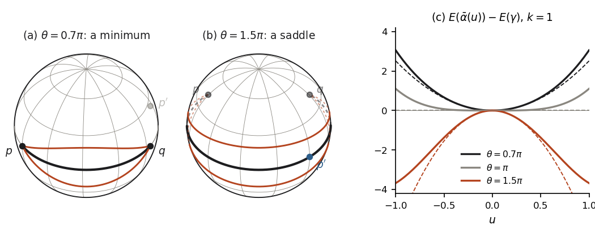

# Chapter 8. Paths and their energy: geodesics as critical points, and the second variation

*Milnor, "Morse Theory", §11–§13, rewritten for a first-year graduate student who wants to know what
the theorem is for. Every proof is complete, except that results of Chapters 6 and 7 (Milnor's
§§8–10) are quoted by their numbers.*

---

## 0. A rubber band on a frictionless globe

Put two pins into a smooth, frictionless globe, one at New York and one at London, and stretch a
rubber band between them along the surface. The band slides until it cannot get any shorter, and
comes to rest on the shorter arc of the great circle through the two cities: 5,540 km on the scale
of the Earth. The same great circle has a second arc joining the pins, the long way round: south-west
over Mexico and across the Pacific, south of New Zealand, through the Southern and Indian Oceans,
over Arabia and Turkey, 34,490 km. Lay the band carefully along that arc and it is also in
equilibrium: at every point it is pulled equally forwards and backwards, and nothing pulls it
sideways. Yet it will not stay there. The smallest sideways nudge and it slips off, towards a pole
of that great circle, and round to the short side. If instead the pins
are placed at exactly opposite points of the globe, something else happens: every half great circle
between them is an equilibrium, all of the same length, and the band can be rolled from one to the
next without effort.

To explain this one changes the point of view. A position of the band is a path from New York to
London, so the band is a point of the *space of all such paths*, and its elastic energy is a
function on that space. Equilibria are critical points of the function, and stability is decided,
as in Part I of the book, by its Hessian at the critical point. The space of paths is infinite
dimensional, and Milnor does not make it a manifold. He uses the language of manifolds as a guide
and makes each statement precise by hand. This chapter covers his §§11–13:

* §1: what a "tangent vector" to the path space $\Omega$ is, what it is not, and what a rigorous
  version requires;
* §2: the energy $E$ of a path, and why it is better suited than length;
* §§3–4: the first variation formula, and the theorem that the critical points of $E$ are exactly
  the geodesics;
* §5: the Hessian $E_{**}$ at a geodesic and the second variation formula, in which the curvature
  of $M$ appears.

In §6 we return to the globe. The first variation formula explains why the air route between two
cities at the same latitude bulges towards the pole, and the second variation formula produces a
negative number, $\pi^2 - \theta^2 \approx -19.4$, which is the reason the band on the long arc
slips.

---

## 1. The path space and its tangent spaces (Milnor pp. 67–69)

Let $M$ be a smooth manifold of dimension $n$ and let $p, q \in M$, not necessarily distinct. A map
from a closed interval $[a,b]$, or from a strip $I \times [a,b]$, into $M$ is called *smooth* if it is
the restriction of a smooth map defined on an open set containing it.

**Definition (Milnor p. 67).** A *piecewise smooth path* from $p$ to $q$ is a map
$\omega : [0,1] \to M$ such that

1. there is a subdivision $0 = t_0 < t_1 < \dots < t_k = 1$ for which each restriction
   $\omega|[t_{i-1}, t_i]$ is smooth;
2. $\omega(0) = p$ and $\omega(1) = q$.

The set of these paths is denoted $\Omega(M; p, q)$, or $\Omega$. A path is continuous, since the
pieces agree at the $t_i$.

A *vector field along* $\omega$ assigns to each $t$ a vector $W_t = W(t) \in TM_{\omega(t)}$. It is
*piecewise smooth* if it is continuous and, for some subdivision, smooth on each $[t_{i-1}, t_i]$ as
a map into the tangent manifold $TM$. (That $TM$ is a smooth manifold of dimension $2n$ is Milnor's
p. 58; for manifolds in $\mathbb{R}^k$ it is proved in Chapter 8, Problem 10, of the companion
volume, *Topology from the Differentiable Viewpoint*, rewritten.) Refining a subdivision preserves
all these properties, so finitely many paths and fields can always be given a common subdivision.

**Definition (Milnor p. 67).** The *tangent space* of $\Omega$ at $\omega$ is the vector space
$$T\Omega_\omega = \{ W \text{ piecewise smooth vector field along } \omega : W(0) = 0,\ W(1) = 0 \},$$
with pointwise addition and scalar multiplication (use a common subdivision).

For a smooth function $F$ on a finite-dimensional manifold, $F_*$ can be computed with curves: if
$u \mapsto \alpha(u)$ is a smooth curve with $\alpha(0) = p$ and $\frac{d\alpha}{du}(0) = X$, then
$F_*(X)$ is $\frac{dF(\alpha(u))}{du}(0)$ times the basis vector $\left(\frac{d}{dt}\right)_{F(p)}$,
and by the chain rule this does not depend on the curve. Milnor imitates the construction on
$\Omega$.

**Definition (Milnor p. 68).** A *variation* of $\omega \in \Omega$ (keeping end points fixed) is a
function $\bar\alpha : (-\varepsilon, \varepsilon) \to \Omega$, for some $\varepsilon > 0$, such that

1. $\bar\alpha(0) = \omega$;
2. there is a subdivision $0 = t_0 < \dots < t_k = 1$ such that the map $\alpha(u,t) =
   \bar\alpha(u)(t)$ is smooth on each strip $(-\varepsilon,\varepsilon)\times[t_{i-1},t_i]$.

Since every $\bar\alpha(u)$ lies in $\Omega$, automatically

3. $\alpha(u, 0) = p$ and $\alpha(u, 1) = q$ for all $u$.

Replacing $(-\varepsilon,\varepsilon)$ by a neighbourhood $U$ of $0$ in $\mathbb{R}^m$ gives an
*$m$-parameter variation*. Both $\alpha$ and $\bar\alpha$ are called the variation.

The *variation vector field* of $\alpha$ is
$$W_t = \frac{d\bar\alpha}{du}(0)_t = \frac{\partial\alpha}{\partial u}(0, t).$$
Milnor says "clearly $W \in T\Omega_\omega$". The reasons: $W$ is smooth on each $[t_{i-1}, t_i]$
because $\alpha$ is smooth on the strip; it is well defined and continuous at a division point
$t_i$, because both adjacent strips compute the velocity at $u = 0$ of the same curve
$u \mapsto \alpha(u, t_i)$; and it vanishes at $t = 0, 1$ by property 3.

The converse is the first statement that needs a proof.

**Lemma 11.A (every tangent vector is a velocity).** Let $M$ carry a Riemannian metric, let
$\omega \in \Omega$ and $W_1, \dots, W_m \in T\Omega_\omega$. There are $\varepsilon > 0$ and an
$m$-parameter variation $\alpha : (-\varepsilon,\varepsilon)^m \times [0,1] \to M$ of $\omega$ with
$\frac{\partial\alpha}{\partial u_j}(0,t) = W_j(t)$ for $j = 1, \dots, m$. Completeness of $M$ is not
needed.

*Proof.* Milnor's formula is $\alpha(u,t) = \exp_{\omega(t)}\big(\sum_j u_j W_j(t)\big)$; the point is
that it is defined. By Lemma 10.2 and the remark that follows it (Chapter 7; Milnor p. 58), every
$x_0 \in M$ has a neighbourhood $U_{x_0}$ and a number $\varepsilon_{x_0} > 0$ such that
$(x, v) \mapsto \exp_x(v)$ is defined and smooth on $\{(x,v) \in TM : x \in U_{x_0},\ \|v\| <
\varepsilon_{x_0}\}$. Finitely many $U_{x_0}$ cover the compact set $\omega([0,1])$; let
$\varepsilon_0 > 0$ be the least of the corresponding $\varepsilon_{x_0}$. The continuous function
$t \mapsto \sum_j \|W_j(t)\|$ is bounded on $[0,1]$ by some $C$; put $\varepsilon = \varepsilon_0 /
(C+1)$. For $|u_j| < \varepsilon$ the vector $\sum_j u_j W_j(t)$ has length $< \varepsilon_0$, so
$\alpha$ is defined, and on each strip it is the composition of the smooth map $(u, t) \mapsto
\sum_j u_jW_j(t) \in TM$ with $\exp$, hence smooth. Since $\exp_x(0) = x$, $\alpha(0, t) = \omega(t)$;
since $W_j(0) = W_j(1) = 0$, $\alpha(u, 0) = p$ and $\alpha(u, 1) = q$. Finally $s \mapsto
\exp_x(sw)$ is the geodesic with initial velocity $w$ (homogeneity of geodesics, Milnor p. 57), so
$\frac{\partial\alpha}{\partial u_j}(0,t) = \frac{d}{ds}\exp_{\omega(t)}(sW_j(t))\big|_{s=0} =
W_j(t)$. $\square$

(Every smooth manifold carries a Riemannian metric: a manifold in $\mathbb{R}^k$, as in the companion
volume, inherits one, and in general one is glued together with a partition of unity. From §2 on,
$M$ is Riemannian anyway.)

With variations available, Milnor tentatively defines $F_* : T\Omega_\omega \to
T\mathbb{R}_{F(\omega)}$ for a real function $F$ on $\Omega$: choose a variation $\bar\alpha$ with
$\frac{d\bar\alpha}{du}(0) = W$, and let $F_*(W)$ be $\frac{dF(\bar\alpha(u))}{du}(0)$ times
$\left(\frac{d}{dt}\right)_{F(\omega)}$. He warns that without hypotheses on $F$ the derivative need
not exist, or may depend on $\bar\alpha$, and he does not pursue the question. What he keeps is the
following.

**Definition (Milnor p. 69).** A path $\omega$ is a *critical path* of $F : \Omega \to \mathbb{R}$ if
$\frac{dF(\bar\alpha(u))}{du}\big|_{u=0}$ exists and is zero for every variation $\bar\alpha$ of
$\omega$.

**Example (Milnor p. 69).** If $F$ takes its minimum at $\omega_0$ and all the derivatives
$\frac{dF(\bar\alpha(u))}{du}(0)$ exist, then $\omega_0$ is critical. Indeed $u \mapsto
F(\bar\alpha(u))$ is a real function, differentiable at $0$, with a minimum at the interior point $0$;
if its derivative were positive the function would be smaller slightly to the left of $0$, and if
negative, slightly to the right.

**What Milnor's tangent space is, and what a rigorous version needs.** Nothing in §§11–15 gives
$\Omega$ a topology, let alone a manifold structure. (Milnor postpones even the topology to §16,
saying it is not needed before.) So $T\Omega_\omega$ is a *definition* chosen to make an analogy
work, not the tangent space of
anything, and every statement about it must be read as a statement about variations, that is, about
real-valued functions $u \mapsto F(\bar\alpha(u))$ of finitely many real variables. For the energy
$E$ this reading is fully rigorous; every argument in this chapter and the next is of this kind. The
facts that make it work, which Milnor uses tacitly, are:

1. every $W \in T\Omega_\omega$, and every finite family of them, is realized by a variation (Lemma
   11.A);
2. for $F = E$ the derivative $\frac{dE(\bar\alpha(u))}{du}(0)$ exists and depends only, and
   linearly, on $W$ (the first variation formula, Theorem 12.2), so that "$E_*$" is an honest linear
   form on $T\Omega_\omega$;
3. at a critical point, $\frac{\partial^2 E(\bar\alpha(u_1,u_2))}{\partial u_1 \partial u_2}(0,0)$
   depends only on $W_1, W_2$, bilinearly (the second variation formula, Theorem 13.1).

There are two ways to replace the analogy by an actual manifold. Milnor's own, in §16 (Chapter 10),
stays finite dimensional: below a given energy level he replaces $\Omega$ by a manifold of broken
geodesics, on which $E$ is an ordinary smooth function whose Hessian is a restriction of $E_{**}$.
The other, due to Palais (*Morse theory on Hilbert manifolds*, Topology 2, 1963) and developed in
Klingenberg's *Riemannian Geometry*, enlarges $\Omega$ to the space $\Omega^{1,2}$ of absolutely
continuous paths with square-integrable velocity. That space is a Hilbert manifold; its tangent space
at $\omega$ is the space of $H^1$ vector fields along $\omega$ vanishing at the ends, which contains
Milnor's $T\Omega_\omega$ as a dense subspace; $E$ is smooth on it, and its first and second
derivatives are given by the integral formulas of §3 and §5. Index and nullity are not changed by
passing to the dense subspace: a basis of a negative definite subspace can be approximated by
piecewise smooth fields without losing negative definiteness (an open condition on the Gram matrix),
and the null space consists of smooth Jacobi fields (Chapter 9, together with the standard fact that
a weak $H^1$ solution of the Jacobi equation is smooth), which already lie in $T\Omega_\omega$. For a
formalization the first reading is the economical one: define
$T\Omega_\omega$ as a concrete vector space of fields along $\omega$, define $dE_\omega$ and $E_{**}$
by explicit formulas, and prove as theorems that they compute the derivatives of $u \mapsto
E(\bar\alpha(u))$.

---

## 2. Energy and length (Milnor pp. 70–71)

From now on $M$ is a Riemannian manifold with the Levi-Civita connection of Chapter 6, and
$\|v\| = \langle v, v\rangle^{1/2}$.

**Definition (Milnor p. 70).** For $\omega \in \Omega$ and $0 \le a < b \le 1$, the *energy* and the
*length* of $\omega$ from $a$ to $b$ are
$$E_a^b(\omega) = \int_a^b \left\|\frac{d\omega}{dt}\right\|^2 dt, \qquad L_a^b(\omega) = \int_a^b
\left\|\frac{d\omega}{dt}\right\| dt,$$
and $E = E_0^1$, $L = L_0^1$. The integrands are continuous on each closed piece (with one-sided
velocities at its ends), so the integrals are finite sums of Riemann integrals.

**Lemma 12.A (Schwarz's inequality with its equality case).** $\left(L_a^b(\omega)\right)^2 \le
(b-a)\,E_a^b(\omega)$, with equality if and only if $\|d\omega/dt\|$ is constant on $[a,b]$ off the
break points, that is, if and only if $t$ is proportional to arc length.

*Proof.* Let $g = \|d\omega/dt\|$ and let $\bar g = \frac{1}{b-a}\int_a^b g\,dt$ be its mean.
Expanding the square,
$$(b-a)\int_a^b (g - \bar g)^2\,dt = (b-a)\int_a^b g^2\,dt - \left(\int_a^b g\,dt\right)^2 =
(b-a)E_a^b(\omega) - \left(L_a^b(\omega)\right)^2 .$$
The left side is $\ge 0$, and it vanishes exactly when the function $(g - \bar g)^2$, continuous and
$\ge 0$ on each piece, vanishes on each open piece, that is, when $g \equiv \bar g$ off the break
points. $\square$

Recall (Chapter 7) that a geodesic has constant speed, that the distance $d(p,q)$ is the infimum of
the lengths of piecewise smooth paths from $p$ to $q$, and that a geodesic is *minimal* if its length
is at most that of every other piecewise smooth path with the same end points, that is, if its
length is $d(p,q)$.

**Lemma 12.1 (Milnor p. 70).** Let $M$ be complete and let $p, q \in M$ be at distance $d$. Then the
energy $E : \Omega(M;p,q) \to \mathbb{R}$ takes its minimum value $d^2$ precisely on the set of
minimal geodesics from $p$ to $q$.

*Proof.* By the Hopf–Rinow theorem (Theorem 10.9) there is a minimal geodesic $\gamma$ from $p$ to
$q$. It has constant speed, equal to $L(\gamma) = d$, so $E(\gamma) = d^2$. For any $\omega \in
\Omega$, Lemma 12.A on $[0,1]$ and the definition of $d$ give
$$E(\omega) \ge L(\omega)^2 \ge d^2 = E(\gamma).$$
So $d^2$ is the minimum, and it is attained at every minimal geodesic. Conversely, suppose $E(\omega)
= d^2$. Then both inequalities are equalities: $L(\omega) = d$, and by the equality case of Lemma
12.A the speed of $\omega$ is constant, necessarily equal to $L(\omega) = d$. If $d = 0$, then
$\omega$ has speed $0$ and is the constant path, which is the constant (minimal) geodesic. If $d >
0$, then $\sigma(s) = \omega(s/d)$, $0 \le s \le d$, is parametrized by arc length and is no longer
than any other path from $p$ to $q$; by Corollary 10.7, $\sigma$ is a geodesic. Hence $\omega(t) =
\sigma(dt)$ is a geodesic (a linear change of parameter takes geodesics to geodesics, Milnor p. 57),
and it is minimal since $L(\omega) = d$. $\square$

> **Milnor's text skips** how the two equality cases combine, and what completeness is for. He says
> that $L(\gamma)^2 = L(\omega)^2$ forces $\omega$ to be "a minimal geodesic, possibly
> reparametrized", and that $L(\omega)^2 = E(\omega)$ forces the parameter to be proportional to arc
> length. The first statement alone does not make $\omega$ smooth (a geodesic run with a stop in the
> middle is still a piecewise smooth path of minimal length); it is the second that rules out bad
> parametrizations, after which Corollary 10.7 applies to the arc-length reparametrization.
> Completeness is used only to know that a minimal geodesic exists. On any Riemannian manifold the
> same argument shows: $E \ge d^2$ on $\Omega$, with equality exactly at the minimal geodesics, if
> there are any. This is the form used in Lemma 13.6 and in Chapter 9.

---

## 3. The first variation formula (Milnor pp. 71–72)

Let $\omega \in \Omega$, and let $\alpha$ be a variation of $\omega$ that is smooth on the strips of a
subdivision $0 = t_0 < \dots < t_k = 1$, with variation field $W_t = \frac{\partial\alpha}{\partial
u}(0,t)$. Following Milnor, write
$$V_t = \frac{d\omega}{dt}, \qquad A_t = \frac{D}{dt}\frac{d\omega}{dt}, \qquad \Delta_t V = V_{t^+}
- V_{t^-} \quad (0 < t < 1)$$
for the velocity, the acceleration and the jump of the velocity. Here $V_{t^\pm}$ are one-sided
velocities; $V$ and $A$ are smooth on each closed piece, with one-sided values at its ends; and
$\Delta_t V = 0$ except at the finitely many break points of $\omega$. Covariant derivatives along
curves are those of Chapter 6 (Lemma 8.1), and we use two facts from there:

* (Lemma 8.3) $\frac{d}{dx}\langle X, Y\rangle = \left\langle \frac{DX}{dx}, Y\right\rangle +
  \left\langle X, \frac{DY}{dx}\right\rangle$ for vector fields $X, Y$ along a curve;
* (Lemma 8.7) $\frac{D}{\partial x}\frac{\partial s}{\partial y} = \frac{D}{\partial
  y}\frac{\partial s}{\partial x}$ for a smooth parametrized surface $s(x,y)$.

**Theorem 12.2 (first variation formula).** The function $u \mapsto E(\bar\alpha(u))$ is smooth, and
$$\frac12\frac{dE(\bar\alpha(u))}{du}\bigg|_{u=0} = -\sum_t \langle W_t, \Delta_t V\rangle -
\int_0^1 \langle W_t, A_t\rangle\,dt,$$
the sum running over the finitely many $t \in (0,1)$ at which $V$ jumps. More generally, at every
$u$,
$$\frac12\frac{dE(\bar\alpha(u))}{du} = -\sum_{i=1}^{k-1}\left\langle \frac{\partial\alpha}{\partial
u}, \Delta_{t_i}\frac{\partial\alpha}{\partial t}\right\rangle - \int_0^1 \left\langle
\frac{\partial\alpha}{\partial u}, \frac{D}{\partial t}\frac{\partial\alpha}{\partial
t}\right\rangle dt, \qquad (12.2')$$
with everything evaluated at $(u, t)$ and $\Delta_{t_i}\frac{\partial\alpha}{\partial t} =
\frac{\partial\alpha}{\partial t}(u, t_i^+) - \frac{\partial\alpha}{\partial t}(u, t_i^-)$.

*Proof.* We have $E(\bar\alpha(u)) = \sum_i \int_{t_{i-1}}^{t_i} \left\langle
\frac{\partial\alpha}{\partial t}, \frac{\partial\alpha}{\partial t}\right\rangle dt$. On each closed
strip the integrand is a smooth function of $(u,t)$, so all its $u$-derivatives are continuous on
the compact sets $[-\varepsilon', \varepsilon']\times[t_{i-1}, t_i]$, $\varepsilon' < \varepsilon$,
and we may differentiate under the integral sign as often as we like; in particular $E\circ\bar\alpha$
is smooth. By Lemma 8.3 along the curves $u \mapsto \alpha(u,t)$, and then Lemma 8.7 for the surface
$\alpha$ on the strip,
$$\frac{\partial}{\partial u}\left\langle \frac{\partial\alpha}{\partial t},
\frac{\partial\alpha}{\partial t}\right\rangle = 2\left\langle \frac{D}{\partial
u}\frac{\partial\alpha}{\partial t}, \frac{\partial\alpha}{\partial t}\right\rangle =
2\left\langle \frac{D}{\partial t}\frac{\partial\alpha}{\partial u}, \frac{\partial\alpha}{\partial
t}\right\rangle.$$
Next integrate by parts on $[t_{i-1}, t_i]$. By Lemma 8.3 along the curves $t \mapsto \alpha(u, t)$,
$$\frac{\partial}{\partial t}\left\langle \frac{\partial\alpha}{\partial u},
\frac{\partial\alpha}{\partial t}\right\rangle = \left\langle \frac{D}{\partial
t}\frac{\partial\alpha}{\partial u}, \frac{\partial\alpha}{\partial t}\right\rangle + \left\langle
\frac{\partial\alpha}{\partial u}, \frac{D}{\partial t}\frac{\partial\alpha}{\partial
t}\right\rangle,$$
and by the fundamental theorem of calculus on the closed piece,
$$\int_{t_{i-1}}^{t_i}\left\langle \frac{D}{\partial t}\frac{\partial\alpha}{\partial u},
\frac{\partial\alpha}{\partial t}\right\rangle dt = \left\langle \frac{\partial\alpha}{\partial u},
\frac{\partial\alpha}{\partial t}\right\rangle\bigg|_{t = t_{i-1}^+}^{t = t_i^-} -
\int_{t_{i-1}}^{t_i}\left\langle \frac{\partial\alpha}{\partial u}, \frac{D}{\partial
t}\frac{\partial\alpha}{\partial t}\right\rangle dt.$$
Sum over $i$. The field $\frac{\partial\alpha}{\partial u}(u, \cdot)$ is continuous in $t$ (at $t_i$
it is the velocity of the single curve $u \mapsto \alpha(u,t_i)$), so the boundary terms telescope to
$$-\sum_{i=1}^{k-1}\left\langle \frac{\partial\alpha}{\partial u}(u,t_i),
\Delta_{t_i}\frac{\partial\alpha}{\partial t}\right\rangle + \left\langle
\frac{\partial\alpha}{\partial u}, \frac{\partial\alpha}{\partial t}\right\rangle(u,1^-) -
\left\langle \frac{\partial\alpha}{\partial u}, \frac{\partial\alpha}{\partial t}\right\rangle(u,0^+).$$
The last two terms vanish: $\alpha(u,0) = p$ and $\alpha(u,1) = q$ for all $u$, so
$\frac{\partial\alpha}{\partial u}(u,0) = \frac{\partial\alpha}{\partial u}(u,1) = 0$. This proves
(12.2$'$). At $u = 0$ we have $\frac{\partial\alpha}{\partial u} = W$,
$\frac{\partial\alpha}{\partial t} = V$ and $\frac{D}{\partial t}\frac{\partial\alpha}{\partial t} =
A$, and division points at which $V$ does not jump contribute nothing. $\square$

> **Milnor's text skips** a reference: for the substitution of $\frac{D}{\partial
> t}\frac{\partial\alpha}{\partial u}$ for $\frac{D}{\partial u}\frac{\partial\alpha}{\partial t}$ he
> cites "Lemma 8.5", which is the definition of a symmetric connection; the statement used is Lemma
> 8.7. He also states only the case $u = 0$, but his proof gives (12.2$'$) at every $u$, and that
> stronger form is what the second variation formula differentiates.

Two consequences. First, the right side depends only on $W$, and linearly, so for the energy Milnor's
tentative $F_*$ is well defined: $dE_\omega(W) = -2\sum_t\langle W_t,\Delta_tV\rangle - 2\int_0^1
\langle W_t, A_t\rangle\,dt$ is a linear form on $T\Omega_\omega$, and by Lemma 11.A $\omega$ is a
critical path of $E$ if and only if $dE_\omega = 0$. Second, the formula says how to lower the energy
(Milnor's Diagram 11). At a kink, $\Delta_t V = V_{t^+} - V_{t^-}$ points towards the inside of the
corner; moving the path in that direction, $\langle W_t, \Delta_t V\rangle > 0$, cuts the corner
and decreases $E$. Away from kinks, moving the path in the direction of its acceleration
also decreases $E$.

---

## 4. The critical points of the energy are the geodesics (Milnor p. 73)

Recall that a path $\omega \in \Omega$ is a *geodesic* if it is smooth on the whole interval $[0,1]$
and its acceleration $\frac{D}{dt}\frac{d\omega}{dt}$ vanishes identically. To stress the smoothness
at the former break points, Milnor sometimes says "unbroken geodesic".

**Corollary 12.3.** A path $\omega \in \Omega$ is a critical point of $E$ if and only if it is a
geodesic.

*Proof.* If $\omega$ is a geodesic, $V$ has no jumps and $A = 0$, so by Theorem 12.2
$\frac{dE(\bar\alpha(u))}{du}(0) = 0$ for every variation.

Conversely, let $\omega$ be critical, with all its break points among $0 = t_0 < \dots < t_k = 1$.

*Step 1: each piece is a geodesic.* Let $f(t) = \prod_{i=0}^k (t - t_i)^2$, a polynomial that
vanishes exactly at the $t_i$ and is positive elsewhere, and put $W(t) = f(t)A(t)$, where on each
closed piece $A$ is the acceleration of that piece. At $t_i$ the two one-sided accelerations may
differ, but $f(t_i) = 0$, so $W$ is a well-defined, continuous, piecewise smooth field with $W(0) =
W(1) = 0$; that is, $W \in T\Omega_\omega$. By Lemma 11.A it is the variation field of a variation,
and Theorem 12.2 gives, the kink terms being zero because $W(t_i) = 0$,
$$0 = \frac12\frac{dE}{du}(0) = -\int_0^1 f(t)\,\|A(t)\|^2\,dt.$$
The integrand is $\ge 0$ and continuous on each piece, so it vanishes identically. Since $f > 0$
inside the pieces, $A = 0$ on each open piece, hence by continuity on each closed piece: each
$\omega|[t_{i-1},t_i]$ is a geodesic.

*Step 2: there are no kinks.* For $1 \le i \le k-1$ let $P_i$ be the parallel field along $\omega$
with $P_i(t_i) = \Delta_{t_i}V$ (Lemma 8.2, applied piece by piece), and let $\varphi_i(t) =
\prod_{j \ne i}\frac{t - t_j}{t_i - t_j}$, $0 \le j \le k$, be the Lagrange polynomials, so that
$\varphi_i(t_j) = \delta_{ij}$. Then $W = \sum_i \varphi_i P_i$ lies in $T\Omega_\omega$ and $W(t_i)
= \Delta_{t_i}V$. By Lemma 11.A and Theorem 12.2, with $A = 0$ now,
$$0 = \frac12\frac{dE}{du}(0) = -\sum_{i=1}^{k-1}\|\Delta_{t_i}V\|^2 .$$
So $V$ is continuous and $\omega$ is $C^1$.

*Step 3: $\omega$ is smooth.* Fix $i \in \{1, \dots, k-1\}$. By Theorem 10.1 there is a geodesic
$\sigma$, defined on an open interval around $t_i$, with $\sigma(t_i) = \omega(t_i)$ and
$\sigma'(t_i) = V_{t_i}$. In a chart around $\omega(t_i)$ the left piece $\omega|[t_{i-1}, t_i]$ and
$\sigma$ both solve the geodesic equation, a second-order system with smooth coefficients, on an
interval $[t_i - \eta, t_i]$, with the same position and velocity at $t_i$. By the uniqueness theorem
for ordinary differential equations, which holds on intervals having the initial time as an end
point, they coincide there. The same holds on $[t_i, t_i + \eta]$ for the right piece. So $\omega =
\sigma$ near $t_i$, and $\omega$ is smooth near $t_i$. Hence $\omega$ is smooth on $[0,1]$ with $A
\equiv 0$, an unbroken geodesic. $\square$

> **Milnor's text skips** the construction of the two test fields. He writes "there is a variation of
> $\omega$ with $W(t) = f(t)A(t)$" and "pick a variation such that $W(t_i) = \Delta_{t_i}V$". Both
> need Lemma 11.A; the first needs $f(t_i) = 0$ so that $W$ is continuous where the one-sided
> accelerations differ, and the second needs an explicit field such as the Lagrange-polynomial one
> above. The final step, that $\omega$ is $C^\infty$ by "the uniqueness theorem for differential
> equations", is uniqueness of the geodesic with given position and velocity at $t_i$, applied on
> both sides of $t_i$.

---

## 5. The Hessian of the energy at a geodesic (Milnor pp. 74–76)

**The finite-dimensional model.** If $f$ is a smooth function on a manifold with a critical point
$p$, its Hessian $f_{**}: TM_p \times TM_p \to \mathbb{R}$ (Chapter 1) can be computed from any smooth
map $(u_1, u_2) \mapsto \alpha(u_1,u_2)$, defined near $(0,0)$, with $\alpha(0,0) = p$ and
$\frac{\partial \alpha}{\partial u_i}(0,0) = X_i$:
$$f_{**}(X_1, X_2) = \frac{\partial^2 f(\alpha(u_1,u_2))}{\partial u_1\,\partial
u_2}\bigg|_{(0,0)}.$$
In a chart the chain rule gives $\frac{\partial^2 (f\circ\alpha)}{\partial u_1\partial u_2} =
\sum_{j,l}\frac{\partial^2 f}{\partial x_j\partial x_l}\frac{\partial\alpha_j}{\partial
u_1}\frac{\partial\alpha_l}{\partial u_2} + \sum_j\frac{\partial f}{\partial
x_j}\frac{\partial^2\alpha_j}{\partial u_1\partial u_2}$. At $(0,0)$ the second sum vanishes because
$p$ is critical, and what remains is the Hessian matrix evaluated on $X_1, X_2$, whatever $\alpha$ is.

Milnor imitates this on $\Omega$. Let $\gamma \in \Omega$ be a geodesic, that is (Corollary 12.3) a
critical point of $E$, and let $V = d\gamma/dt$.

**Definition (Milnor p. 74).** Given $W_1, W_2 \in T\Omega_\gamma$, choose a 2-parameter variation
$\alpha : U \times [0,1] \to M$, $U$ a neighbourhood of $(0,0)$ in $\mathbb{R}^2$, with
$$\alpha(0,0,t) = \gamma(t), \qquad \frac{\partial\alpha}{\partial u_1}(0,0,t) = W_1(t), \qquad
\frac{\partial\alpha}{\partial u_2}(0,0,t) = W_2(t)$$
(one exists by Lemma 11.A), let $\bar\alpha(u_1,u_2) \in \Omega$ be the path $t \mapsto
\alpha(u_1,u_2,t)$, and define the *Hessian* of $E$ at $\gamma$ by
$$E_{**}(W_1, W_2) = \frac{\partial^2 E(\bar\alpha(u_1,u_2))}{\partial u_1\,\partial
u_2}\bigg|_{(0,0)}.$$
As in Theorem 12.2, $E\circ\bar\alpha$ is a smooth function on $U$. A priori the value depends on the
choice of $\alpha$; the next theorem shows that it does not.

**Theorem 13.1 (second variation formula).** With these notations,
$$\frac12 E_{**}(W_1,W_2) = -\sum_t \left\langle W_2(t), \Delta_t\frac{DW_1}{dt}\right\rangle -
\int_0^1\left\langle W_2, \frac{D^2W_1}{dt^2} + R(V, W_1)V\right\rangle dt,$$
where $\Delta_t\frac{DW_1}{dt} = \frac{DW_1}{dt}(t^+) - \frac{DW_1}{dt}(t^-)$ is the jump at one of
the finitely many points of $(0,1)$ where $\frac{DW_1}{dt}$ is discontinuous, and $R$ is the curvature
tensor of Chapter 6, with Milnor's sign convention $R(X,Y)Z = -\nabla_X\nabla_YZ + \nabla_Y\nabla_XZ +
\nabla_{[X,Y]}Z$.

*Proof.* Let $0 = t_0 < \dots < t_k = 1$ be a subdivision for $\alpha$. For each fixed $u_1$, the
family $u_2 \mapsto \bar\alpha(u_1,u_2)$ is a one-parameter family of paths to which the proof of
(12.2$'$) applies verbatim, at every value of $u_2$:
$$\frac12\frac{\partial E}{\partial u_2} = -\sum_{i=1}^{k-1}\left\langle\frac{\partial\alpha}{\partial
u_2},\Delta_{t_i}\frac{\partial\alpha}{\partial t}\right\rangle -
\int_0^1\left\langle\frac{\partial\alpha}{\partial u_2},\frac{D}{\partial
t}\frac{\partial\alpha}{\partial t}\right\rangle dt .$$
Differentiate with respect to $u_1$, using Lemma 8.3 along the curves $u_1 \mapsto
\alpha(u_1,u_2,t)$ and differentiating under the integral sign piece by piece:
$$\begin{aligned}\frac12\frac{\partial^2E}{\partial u_1\partial u_2} = &-\sum_i\left\langle\frac{D}{\partial u_1}\frac{\partial\alpha}{\partial u_2},\Delta_{t_i}\frac{\partial\alpha}{\partial t}\right\rangle - \sum_i\left\langle\frac{\partial\alpha}{\partial u_2},\frac{D}{\partial u_1}\Delta_{t_i}\frac{\partial\alpha}{\partial t}\right\rangle\\ &-\int_0^1\left\langle\frac{D}{\partial u_1}\frac{\partial\alpha}{\partial u_2},\frac{D}{\partial t}\frac{\partial\alpha}{\partial t}\right\rangle dt - \int_0^1\left\langle\frac{\partial\alpha}{\partial u_2},\frac{D}{\partial u_1}\frac{D}{\partial t}\frac{\partial\alpha}{\partial t}\right\rangle dt.\end{aligned}$$
Evaluate at $(u_1,u_2) = (0,0)$. Since $\bar\alpha(0,0) = \gamma$ is an unbroken geodesic,
$\Delta_{t_i}\frac{\partial\alpha}{\partial t} = \Delta_{t_i}V = 0$ and $\frac{D}{\partial
t}\frac{\partial\alpha}{\partial t} = 0$ there, so the first and third terms vanish.

*The second term.* Along the curve $u_1 \mapsto \alpha(u_1, 0, t_i)$, the jump
$\Delta_{t_i}\frac{\partial\alpha}{\partial t}$ is the difference of two smooth vector fields, the
one-sided velocities computed on the two adjacent strips. Since $\frac{D}{\partial u_1}$ is linear,
$\frac{D}{\partial u_1}\Delta_{t_i}\frac{\partial\alpha}{\partial t} =
\Delta_{t_i}\frac{D}{\partial u_1}\frac{\partial\alpha}{\partial t}$, and by Lemma 8.7 on each strip
this equals $\Delta_{t_i}\frac{D}{\partial t}\frac{\partial\alpha}{\partial u_1}$, which at $(0,0)$
is $\Delta_{t_i}\frac{DW_1}{dt}$. This is Milnor's "rearranging the second term", and it gives
$$\frac12 E_{**}(W_1,W_2) = -\sum_t\left\langle W_2, \Delta_t\frac{DW_1}{dt}\right\rangle -
\int_0^1\left\langle W_2, \frac{D}{\partial u_1}\frac{D}{\partial t}V\right\rangle dt, \qquad (13.2)$$
where $V$ now stands for the field $\frac{\partial\alpha}{\partial t}$ along the surface $(u_1, t)
\mapsto \alpha(u_1, 0, t)$, and the derivative is evaluated at $u_1 = 0$.

*The fourth term.* Lemma 9.2 of Chapter 6, applied on each strip to this surface with $x = t$ and
$y = u_1$, states
$$\frac{D}{\partial u_1}\frac{D}{\partial t}V - \frac{D}{\partial t}\frac{D}{\partial u_1}V =
R\left(\frac{\partial\alpha}{\partial t},\frac{\partial\alpha}{\partial u_1}\right)V .$$
By Lemma 8.7, $\frac{D}{\partial u_1}V = \frac{D}{\partial t}\frac{\partial\alpha}{\partial u_1}$,
which on the curve $u_1 = 0$ is $\frac{DW_1}{dt}$; and $\frac{D}{\partial t}$ at $u_1 = 0$ only
involves values on that curve, so $\frac{D}{\partial t}\frac{D}{\partial u_1}V =
\frac{D^2W_1}{dt^2}$ at $u_1 = 0$. Hence
$$\frac{D}{\partial u_1}\frac{D}{\partial t}V = \frac{D^2W_1}{dt^2} + R(V,W_1)V \qquad\text{at } u_1 =
0. \qquad (13.3)$$
Substituting (13.3) into (13.2) proves the theorem. $\square$

**Corollary 13.4.** $E_{**}(W_1,W_2)$ is a well-defined, symmetric, bilinear function of $W_1, W_2
\in T\Omega_\gamma$.

*Proof.* By Theorem 13.1 the value depends only on $W_1$ and $W_2$, not on the variation; and by Lemma
11.A it is defined for every pair. The right side of Theorem 13.1 is visibly linear in $W_2$, and it
is linear in $W_1$ because $W_1 \mapsto \Delta_t\frac{DW_1}{dt}$, $\frac{D^2W_1}{dt^2}$ and
$R(V,W_1)V$ are linear. Symmetry is not visible in the formula, but it follows from
$\frac{\partial^2 (E\circ\bar\alpha)}{\partial u_1\partial u_2} = \frac{\partial^2
(E\circ\bar\alpha)}{\partial u_2\partial u_1}$ ($E\circ\bar\alpha$ being $C^2$): exchanging the names
of $u_1$ and $u_2$ turns a variation for the pair $(W_1, W_2)$ into one for $(W_2,W_1)$. $\square$

The symmetry becomes visible after one integration by parts. The resulting formula is not in Milnor,
but it is the one used most in practice, and it is used in Chapter 9.

**Proposition 13.A (the Hessian as an integral).** For $W_1, W_2 \in T\Omega_\gamma$,
$$\frac12 E_{**}(W_1,W_2) = \int_0^1\left(\left\langle\frac{DW_1}{dt},\frac{DW_2}{dt}\right\rangle -
\langle R(V,W_1)V, W_2\rangle\right)dt,$$
and $\langle R(V,W_1)V,W_2\rangle = \langle R(V,W_2)V,W_1\rangle$. In particular
$$\frac12 E_{**}(W,W) = \int_0^1 \left(\left\|\frac{DW}{dt}\right\|^2 - \langle
R(V,W)V,W\rangle\right)dt .$$

*Proof.* Take a common subdivision on whose pieces $W_1$ and $W_2$ are smooth. On each piece, by
Lemma 8.3, $\frac{d}{dt}\left\langle W_2,\frac{DW_1}{dt}\right\rangle =
\left\langle\frac{DW_2}{dt},\frac{DW_1}{dt}\right\rangle + \left\langle
W_2,\frac{D^2W_1}{dt^2}\right\rangle$. Integrate over each piece and sum; as in the proof of Theorem
12.2 the boundary terms telescope, $W_2$ being continuous and zero at $0$ and $1$:
$$\int_0^1\left\langle W_2,\frac{D^2W_1}{dt^2}\right\rangle dt = -\sum_t\left\langle
W_2(t),\Delta_t\frac{DW_1}{dt}\right\rangle -
\int_0^1\left\langle\frac{DW_2}{dt},\frac{DW_1}{dt}\right\rangle dt.$$
Substituting into Theorem 13.1, the jump terms cancel and the formula follows. The symmetry of the
curvature term is Lemma 9.3(4), $\langle R(X,Y)Z,T\rangle = \langle R(Z,T)X,Y\rangle$, with $X = Z =
V$, $Y = W_1$, $T = W_2$. $\square$

With Milnor's sign convention, $\langle R(X,Y)X,Y\rangle$ is the sectional curvature of the plane
spanned by $X$ and $Y$ times $\|X\|^2\|Y\|^2 - \langle X,Y\rangle^2$, and the unit sphere has
sectional curvature $1$ (Chapter 6, §§7–8). So $E_{**}(W,W)$ is a competition between the bending term
$\int\|DW/dt\|^2$, which favours the geodesic, and the curvature term, which in positive curvature
rewards moving sideways. Section 6 makes the competition concrete.

**Remark 13.5.** The diagonal values are second derivatives along 1-parameter variations: if
$\bar\alpha : (-\varepsilon,\varepsilon) \to \Omega$ is any variation of $\gamma$ with variation field
$W$, then
$$E_{**}(W,W) = \frac{d^2E(\bar\alpha(u))}{du^2}\bigg|_{u=0}.$$

*Proof.* $\beta(u_1,u_2) = \bar\alpha(u_1+u_2)$, for $|u_1|,|u_2| < \varepsilon/2$, is a 2-parameter
variation, smooth on the same strips, with $\frac{\partial\beta}{\partial u_1}(0,0) =
\frac{\partial\beta}{\partial u_2}(0,0) = \frac{d\bar\alpha}{du}(0) = W$; and by the chain rule
$\frac{\partial^2 E(\beta(u_1,u_2))}{\partial u_1\partial u_2} =
\frac{d^2E(\bar\alpha(u))}{du^2}\big|_{u = u_1+u_2}$. Evaluate at $(0,0)$. $\square$

The *index* of $E_{**}$ is the largest dimension of a subspace of $T\Omega_\gamma$ on which $E_{**}$
is negative definite. (Milnor makes this definition explicit only in §15; a priori it could be
infinite.)

**Lemma 13.6.** If $\gamma$ is a minimal geodesic from $p$ to $q$, then $E_{**}$ is positive
semi-definite, and hence its index is $0$.

*Proof.* By the proof of Lemma 12.1 (no completeness is needed, $\gamma$ being given), $E(\omega) \ge
d(p,q)^2 = E(\gamma)$ for all $\omega \in \Omega$. So for any variation, the smooth function $u
\mapsto E(\bar\alpha(u))$ has a minimum at $u = 0$. Its first derivative vanishes there, and its
second derivative is $\ge 0$: by Taylor's formula $E(\bar\alpha(u)) = E(\gamma) + \frac12
u^2\frac{d^2E(\bar\alpha)}{du^2}(\xi)$ with $\xi$ between $0$ and $u$, so a negative second
derivative at $0$ would give $E(\bar\alpha(u)) < E(\gamma)$ for small $u \ne 0$. By Remark 13.5 and
Lemma 11.A, $E_{**}(W,W) \ge 0$ for all $W\in T\Omega_\gamma$. A subspace on which $E_{**}$ is
negative definite is therefore $\{0\}$. $\square$

**Other parameter intervals.** Chapter 9 needs the Hessian of geodesics $\gamma : [0,\tau] \to M$.
Everything in §§1–5 holds verbatim for paths parametrized by $[0,\tau]$, with $E_0^\tau$ in place of
$E$ and $\int_0^\tau$ in place of $\int_0^1$, with the same proofs. One can also reduce to $[0,1]$:

**Lemma 13.B (rescaling).** Let $\tau > 0$, let $\gamma : [0,\tau] \to M$ be a geodesic, and put
$\hat\gamma(s) = \gamma(\tau s)$ and $\hat W(s) = W(\tau s)$ for a field $W$ along $\gamma$. Then $W
\mapsto \hat W$ is a linear isomorphism from the fields along $\gamma$ vanishing at $0$ and $\tau$
onto $T\Omega_{\hat\gamma}$, and $E_{**}(\hat W_1,\hat W_2) = \tau\,(E_0^\tau)_{**}(W_1,W_2)$. In
particular the two Hessians have the same index and the same null space, up to $W \mapsto \hat W$.

*Proof.* For a path $\omega$ on $[0,\tau]$, $\hat\omega(s) = \omega(\tau s)$ has $\hat\omega'(s) =
\tau\omega'(\tau s)$, so $E(\hat\omega) = \int_0^1\tau^2\|\omega'(\tau s)\|^2\,ds = \tau
E_0^\tau(\omega)$. A 2-parameter variation $\alpha$ of $\gamma$ with fields $W_1,W_2$ gives the
variation $\hat\alpha(u,s) = \alpha(u,\tau s)$ of $\hat\gamma$ with fields $\hat W_1,\hat W_2$, and
$E(\hat\alpha(u,\cdot)) = \tau E_0^\tau(\alpha(u,\cdot))$; differentiate. $\square$

### An interactive look at the second variation

The figure shows a globe and a great-circle route of angle $\theta$ starting at the point $p$, drawn
along the equator, together with the varied route $\bar\alpha(u)$ of §6: the route pushed north and
south by $u\sin(k\pi t)$ radians of latitude, in $k$ alternating lobes. The point $p'$ is the
antipode of $p$. The second panel plots $E(\bar\alpha(u)) - E(\gamma)$ against $u$ (solid) and the
parabola $\frac12(k^2\pi^2 - \theta^2)u^2$ predicted by the second variation formula (dashed). Drag
$\theta$: while the route is shorter than half a great circle ($\theta < \pi$, the route stops before
$p'$) the energy has a minimum at $u = 0$ for every $k$. Push $\theta$ past $\pi$ with $k = 1$: the
curve turns over, $u = 0$ becomes a maximum in this direction, and pushing the route sideways
shortens it. With $k = 2$ the route remains a minimum in that direction until $\theta = 2\pi$. Drag
the globe to turn it.

*(In the printed version this figure is a still image; the interactive version is in the web
edition.)*

---

## 6. Application: air routes, and a band on a globe

Model the Earth as the unit sphere $S^2 \subset \mathbb{R}^3$, with lengths in Earth radii
($R = 6{,}371$ km). Two facts about $S^2$ are used.

(a) *Covariant derivatives are tangential projections.* For a vector field $X$ along a curve in
$S^2$, $\frac{DX}{dt}$ is the orthogonal projection onto the tangent plane of the ordinary derivative
$\frac{dX}{dt}$ in $\mathbb{R}^3$. Indeed, projecting the ordinary directional derivative,
$\nabla_XY = (\partial_XY)^{T}$, defines a connection on $S^2$. It is compatible with the metric,
because $X\langle Y,Z\rangle = \langle\partial_XY,Z\rangle + \langle Y,\partial_XZ\rangle$ and the
normal components drop out against the tangent fields $Y, Z$; and it is symmetric, because
$\nabla_XY - \nabla_YX = [X,Y]^T = [X,Y]$. By uniqueness (Lemma 8.6) it is the Levi-Civita
connection, and the induced derivative along curves is the projection.

(b) *Great circles.* For orthonormal $x, w \in \mathbb{R}^3$, the curve $s \mapsto \cos(s)x +
\sin(s)w$ is a unit-speed geodesic: its second derivative is minus the curve itself, which is normal
to the sphere, so by (a) its acceleration is $0$. Hence $\exp_x(sw) = \cos(s)\,x + \sin(s)\,w$.

**First variation: why routes at one latitude bulge towards the pole.** Take two points at latitude
$\phi = 50^\circ$N whose longitudes differ by $\Lambda = 90^\circ = \pi/2$. The route along the
parallel of latitude is
$$\omega(t) = (\cos\phi\cos\Lambda t,\ \cos\phi\sin\Lambda t,\ \sin\phi), \qquad 0 \le t \le 1.$$
Its ordinary second derivative is $\omega'' = -\Lambda^2\cos\phi\,(\cos\Lambda t, \sin\Lambda t,
0)$. Subtracting the normal component $\langle\omega'',\omega\rangle\omega =
-\Lambda^2\cos^2\phi\,\omega$ leaves, by (a),
$$A_t = \Lambda^2\sin\phi\cos\phi\ \mathbf{n}(t), \qquad \mathbf{n}(t) = (-\sin\phi\cos\Lambda t,\
-\sin\phi\sin\Lambda t,\ \cos\phi),$$
where $\mathbf n$ is the unit tangent vector pointing due north. So the parallel is not a geodesic
(unless $\phi = 0$), hence by Corollary 12.3 not a critical point of $E$, and Theorem 12.2 says which
way to push it. Take the northward push $W(t) = \sin(\pi t)\,\mathbf{n}(t)$, which vanishes at the
end points. The route has no kinks, so
$$\frac12\frac{dE}{du}(0) = -\int_0^1\langle W_t, A_t\rangle\,dt =
-\Lambda^2\sin\phi\cos\phi\int_0^1\sin\pi t\,dt = -\frac{2}{\pi}\Lambda^2\sin\phi\cos\phi \approx
-0.773 .$$
Pushing north lowers the energy, at the rate $1.547$ per radian of push. (The variation of Lemma
11.A, $\exp_{\omega(t)}(uW_t)$, is the path at latitude $\phi + u\sin\pi t$ and longitude $\Lambda t$;
a direct numerical evaluation of its energy gives the same derivative to seven digits.) The minimum
of $E$ is the arc of great circle through the two points, which runs north of the parallel and
reaches latitude $59.3^\circ$ midway. Its length is $0.9437$, or $6{,}012$ km, against $1.0097$, or $6{,}433$
km, along the parallel. This is the northward arc that great-circle flight routes between Europe and
North America draw on a flat map.

**Second variation: the long way round.** New York (JFK, $40.64^\circ$N $73.78^\circ$W) and London
(Heathrow, $51.47^\circ$N $0.45^\circ$W) subtend the angle $\theta_0 = 0.8696$ at the centre of the
Earth, so the short great-circle arc is $5{,}540$ km long. The long arc of the same great circle has
angle $\theta_1 = 2\pi - \theta_0 = 5.4135$ and length $34{,}490$ km. Both arcs are geodesics, hence
critical points of $E$ and equilibria for the band.

Rotate the globe so that this great circle is the equator and New York is $(1,0,0)$. The route of
angle $\theta$ is $\gamma(t) = (\cos\theta t, \sin\theta t, 0)$, $0\le t\le 1$, with speed $\theta$
and $E(\gamma) = \theta^2$. The vector $N = (0,0,1)$ is tangent to the sphere along $\gamma$, and it
is parallel by (a), its derivative being $0$. For an integer $k \ge 1$ let $W_k(t) = \sin(k\pi t)\,N$
and use Milnor's variation, which by (b) is
$$\alpha(u,t) = \exp_{\gamma(t)}(u\sin(k\pi t)N) = (\cos\psi\cos\theta t,\ \cos\psi\sin\theta t,\
\sin\psi), \qquad \psi = u\sin k\pi t .$$
Here $\psi$ is the latitude and $\theta t$ the longitude, so $\|\partial\alpha/\partial t\|^2 =
\psi_t^2 + \theta^2\cos^2\psi$ and
$$E(\bar\alpha(u)) = \int_0^1\left(k^2\pi^2u^2\cos^2 k\pi t + \theta^2\cos^2(u\sin k\pi t)\right)dt .$$
Differentiate twice under the integral sign at $u = 0$, using $\frac{d^2}{du^2}\cos^2(us)\big|_{u=0}
= -2s^2$ and $\int_0^1\cos^2k\pi t\,dt = \int_0^1\sin^2k\pi t\,dt = \frac12$. By Remark 13.5,
$$E_{**}(W_k,W_k) = k^2\pi^2 - \theta^2 .$$
This agrees with Proposition 13.A: there $\int_0^1\|DW_k/dt\|^2dt = k^2\pi^2/2$, and the curvature
term is $\int_0^1\theta^2\sin^2(k\pi t)\,dt = \theta^2/2$ because the unit sphere has curvature $1$.
The second variation formula sees the curvature of the globe.

For the short route, $\pi^2 - \theta_0^2 = 9.11 > 0$, as it must be: the short arc is minimal, so
$E_{**} \ge 0$ on all of $T\Omega_\gamma$ by Lemma 13.6. For the long route,
$$E_{**}(W_1,W_1) = \pi^2 - \theta_1^2 = 9.870 - 29.306 = -19.44 < 0 .$$
Hence $E(\bar\alpha(u)) < E(\gamma)$ for all small $u \ne 0$ (Taylor's formula, as in Lemma 13.6),
and by Lemma 12.A the lengths satisfy $L(\bar\alpha(u))^2 \le E(\bar\alpha(u)) < E(\gamma) =
L(\gamma)^2$. Arbitrarily small sideways displacements of a band lying along the long arc make it
strictly shorter: the equilibrium is unstable, and the band slips towards a pole. The obstruction
appears exactly at $\theta = \pi$, when the pins are antipodal, $20{,}015$ km apart along the
surface. Then $E_{**}(W_1,W_1) = 0$, and indeed every meridian from one pin to the other is a route
of the same length. For $k \ge 2$, $k^2\pi^2 - \theta_1^2 \ge 4\pi^2 - \theta_1^2 = 10.17 > 0$, so
among these test fields only one shortens the long route. Chapter 9 proves that this count is exact:
by the Morse index theorem the index of $E_{**}$ at the long route is $1$, because the route passes
through exactly one point conjugate to New York, its antipode in the Indian Ocean.

---

## 7. Summary of what was silently assumed, now made explicit

| Where | Milnor says | What is actually needed |
|---|---|---|
| p. 67 | each $\omega\vert[t_{i-1},t_i]$ is "differentiable of class $C^\infty$" | smoothness up to the ends of a closed interval: restriction of a smooth map on an open interval |
| p. 67 | the "tangent space" $T\Omega_\omega$ | a definition by analogy: $\Omega$ has no manifold structure in §§11–15; every statement is about variations (§1), or else one uses the Hilbert manifold of $H^1$ paths (Palais) |
| p. 68 | "Clearly $W \in T\Omega_\omega$" | continuity at break points: $u \mapsto \alpha(u,t_i)$ is a single curve |
| p. 68 | $\bar\alpha(u)(t) = \exp_{\omega(t)}(uW_t)$ | a Riemannian metric; $\exp$ is defined only near the zero section, and compactness of $\omega([0,1])$ gives a uniform $\varepsilon$ (Lemma 11.A); no completeness |
| p. 69 | "clearly $\omega_0$ is a critical path" | a function differentiable at an interior minimum has derivative $0$ |
| p. 70 | Schwarz's inequality, equality iff $g$ constant | variance identity; for piecewise continuous $g$, constant off the break points (Lemma 12.A) |
| p. 70 | equality "only if $\omega$ is also a minimal geodesic, possibly reparametrized" | the equality case of Schwarz fixes the parametrization; then Corollary 10.7 applies |
| p. 70 | Lemma 12.1 assumes $M$ complete | completeness only makes the minimum attained (Hopf–Rinow); $E \ge d^2$ with equality exactly at minimal geodesics holds on any $M$ |
| p. 71 | differentiation under the integral sign | $\alpha$ smooth on closed strips |
| p. 71 | "By Lemma 8.5" | the symmetry lemma is Lemma 8.7 |
| p. 72 | first variation formula at $u = 0$ | the proof gives (12.2$'$) at every $u$, which §13 needs |
| p. 73 | "There is a variation of $\omega$ with $W(t) = f(t)A(t)$" | Lemma 11.A; $f = \prod(t - t_i)^2$; $W$ continuous because $f(t_i) = 0$ |
| p. 73 | "pick a variation such that $W(t_i) = \Delta_{t_i}V$" | Lagrange polynomials times parallel fields |
| p. 73 | "it follows from the uniqueness theorem ... $\omega$ is $C^\infty$" | uniqueness of geodesics with given data at $t_i$, applied on each side |
| p. 74 | $f_{**}$ is well defined | chain rule in a chart; the first-derivative term vanishes at a critical point |
| p. 75 | "Rearranging the second term" | $D/\partial u_1$ commutes with taking the jump $\Delta_t$; Lemma 8.7 strip by strip |
| p. 75 | "the curvature formula" | Lemma 9.2 with $x = t$, $y = u_1$ |
| p. 76 | symmetry from $\partial^2E/\partial u_1\partial u_2 = \partial^2E/\partial u_2\partial u_1$ | $E\circ\bar\alpha$ is $C^2$; symmetry is also visible in the integral form (Proposition 13.A, Lemma 9.3(4)) |
| p. 76 | Remark 13.5 | $\beta(u_1,u_2) = \bar\alpha(u_1+u_2)$ is a 2-parameter variation |
| p. 76 | Lemma 13.6 | only minimality of $\gamma$ is used, not completeness; Taylor's formula for the second derivative |
| pp. 85–87 (used in Ch. 9) | Hessians of geodesics on $[0,\tau]$ | everything holds on $[0,\tau]$; rescaling multiplies $E_{**}$ by $\tau$ (Lemma 13.B) |

**Checked by machine.** Milnor's §§11–13 have been verified in the Lean proof assistant for
submanifolds of Euclidean space with the induced metric. As in the book, the path space has no
manifold structure: its tangent space is a vector space of fields along the path, tied to paths by
variations, and the Hessian is the bilinear form of the second variation formula, which every
two-parameter variation computes. Checked: Lemma 11.A for any number of fields, without
completeness; Lemma 12.A; the inequality of Lemma 12.1 at a minimal geodesic; Theorem 12.2 and
formula (12.2$'$) at every $u$; Corollary 12.3; Theorem 13.1, with Milnor's sign of the curvature
and the existence of the second derivative part of the conclusion; Corollary 13.4, the symmetry
coming from Proposition 13.A instead of an unproved smoothness of $E\circ\bar\alpha$; Remark 13.5;
and Lemma 13.6, from minimality alone. Not checked: the rest of Lemma 12.1 (the minimum $d^2$,
attained exactly at the minimal geodesics), the index of $E_{**}$ as a number, Lemma 13.B and the
application. See the verified edition.