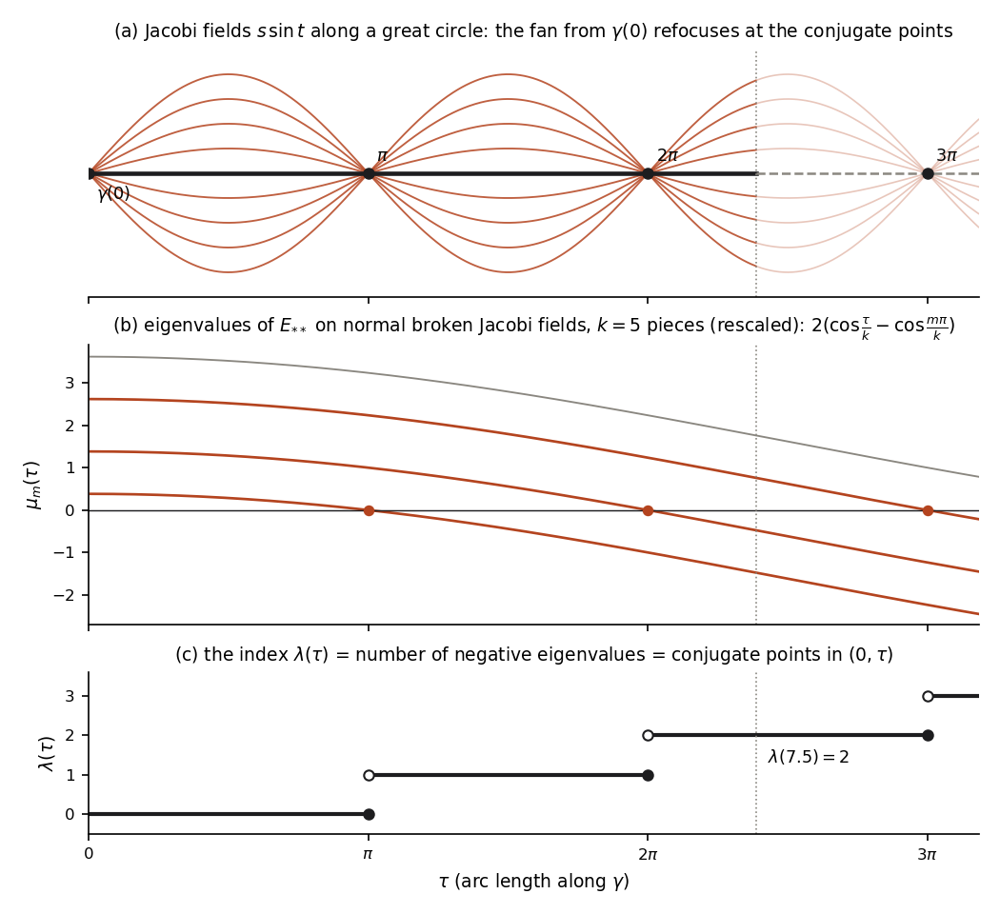

# Chapter 9. Where geodesics meet again: Jacobi fields and the index theorem

*Milnor, "Morse Theory", §14–§15, rewritten for a first-year graduate student who wants to know what
the theorem is for. Every proof is complete, except that results of Chapters 6–8 (Milnor's §§8–13)
are quoted by their numbers.*

---

## 0. Where do the rays meet again?

Send ships out of New York along great circles, in all directions at once. They spread apart, are
farthest apart a quarter of the way round the globe, and then close in again: all of them pass
through one point on the far side, the antipode of New York, in the Indian Ocean about 1,300 km
south-west of Perth. A lens does the same with light: the rays leaving a point source spread and then
reconverge at an image point. A point where a family of geodesics leaving $p$ refocuses is called
*conjugate* to $p$.

Refocusing is what decides whether a geodesic is a shortest path. In Chapter 8 the great-circle route
from New York to London the long way round, 34,490 km, turned out to have a direction in which it
can be shortened, while the short route, 5,540 km, has none. The long route passes through the
antipode of New York and the short one does not. Morse's index theorem says that this is the whole
story: the index of the Hessian $E_{**}$ at a geodesic $\gamma$, the largest number of independent
directions in which $\gamma$ can be shortened, equals the number of points conjugate to $\gamma(0)$
along $\gamma$, counted with multiplicity. A question about a quadratic form on the infinite
dimensional space $T\Omega_\gamma$ becomes a count of zeros of solutions of a linear ODE.

The infinitesimal version of a family of geodesics is a *Jacobi field* (§1). Section 2 shows that the
Jacobi fields vanishing at both ends form exactly the null space of $E_{**}$; §3 shows that Jacobi
fields are exactly what families of geodesics produce; §4 proves the index theorem. In §5 the
theorem is checked against an explicit $7\times7$ matrix that computes the index of the long New
York–London route, and it lists every geodesic between two points of a round sphere together with
its index: there is exactly one of each index $0, n-1, 2(n-1), \dots$

---

## 1. Jacobi fields (Milnor p. 77)

Throughout, $M$ is a Riemannian manifold of dimension $n \ge 1$, $\gamma : [0,1] \to M$ is a geodesic
and $V = d\gamma/dt$. The curvature tensor is that of Chapter 6, with Milnor's sign convention
$R(X,Y)Z = -\nabla_X\nabla_YZ + \nabla_Y\nabla_XZ + \nabla_{[X,Y]}Z$; we use its symmetries (Lemma
9.3), $R(X,Y) = -R(Y,X)$ and $\langle R(X,Y)Z,T\rangle = \langle R(Z,T)X,Y\rangle$.

**Definition (Milnor p. 77).** A smooth vector field $J$ along $\gamma$ is a *Jacobi field* if
$$\frac{D^2J}{dt^2} + R(V,J)V = 0 .$$

To solve the equation, extend an orthonormal basis of $TM_{\gamma(0)}$ by parallel translation (Lemma
8.2) to fields $P_1, \dots, P_n$ along $\gamma$; they stay orthonormal because parallel translation
preserves inner products (Lemma 8.3). Write $J = \sum_i f^i P_i$. The rules of Lemma 8.1 and
$DP_i/dt = 0$ give $\frac{DJ}{dt} = \sum_i (f^i)' P_i$ and $\frac{D^2J}{dt^2} = \sum_i (f^i)''P_i$,
and trilinearity of $R$ (Lemma 9.1) gives $R(V,J)V = \sum_{i,j} f^j\langle R(V,P_j)V,P_i\rangle
P_i$. So the Jacobi equation is the linear system
$$\frac{d^2f^i}{dt^2} + \sum_{j=1}^n a^i_j(t)\,f^j(t) = 0 \quad (i = 1,\dots,n), \qquad a^i_j =
\langle R(V,P_j)V,P_i\rangle,$$
with smooth coefficients on $[0,1]$; by Lemma 9.3(4), $a^i_j = a^j_i$. Milnor states the solution
theory without proof; it is short enough to include.

**Lemma 14.A (linear ODE).** Let $B : [a,b] \to \mathbb{R}^{m\times m}$ be continuous. For every
$s \in [a,b]$ and $\xi \in \mathbb{R}^m$ there is exactly one $C^1$ map $x : [a,b] \to \mathbb{R}^m$
with $x' = B(t)x$ and $x(s) = \xi$. It depends linearly on $\xi$, and it is smooth if $B$ is.

*Proof.* Let $C = \max_t\|B(t)\|$. Put $x_0(t) = \xi$ and $x_{j+1}(t) = \xi + \int_s^t
B(r)x_j(r)\,dr$. By induction $|x_{j+1}(t) - x_j(t)| \le |\xi|\,(C|t-s|)^{j+1}/(j+1)!$, so the $x_j$
converge uniformly on all of $[a,b]$ to a continuous $x$ with $x(t) = \xi + \int_s^tB(r)x(r)\,dr$,
which is therefore $C^1$ and solves the problem. If $y$ is another solution, $z = x - y$ satisfies
$|z(t)| \le C\left|\int_s^t|z(r)|\,dr\right|$, and iterating gives $|z(t)| \le \max|z|\cdot
(C|t-s|)^j/j!$ for every $j$, so $z = 0$. Linearity follows from uniqueness, and smoothness by
induction from $x' = Bx$. $\square$

Applied to the first-order system for $(f, f')$ in $\mathbb{R}^{2n}$, this gives what Milnor states:
the Jacobi equation has $2n$ linearly independent solutions, all defined on the whole of $\gamma$ and
all $C^\infty$, and a Jacobi field is determined by $J(0)$ and $\frac{DJ}{dt}(0)$.

**Corollary 14.B.** The Jacobi fields along $\gamma$ form a vector space $\mathcal{J}(\gamma)$ of
dimension $2n$. Each is smooth on $[0,1]$, and for every $s \in [0,1]$ the map $J \mapsto
\left(J(s), \frac{DJ}{dt}(s)\right)$ is an isomorphism $\mathcal{J}(\gamma) \to TM_{\gamma(s)}\oplus
TM_{\gamma(s)}$. In particular, a Jacobi field with $J(s) = 0$ and $\frac{DJ}{dt}(s) = 0$ for one $s$
vanishes identically, and a Jacobi field along a subsegment $\gamma|[a,b]$ extends uniquely to a
Jacobi field along $\gamma$. $\square$

**Definition (Milnor p. 77).** Let $a \ne b$ in $[0,1]$. The points $\gamma(a)$ and $\gamma(b)$ are
*conjugate along* $\gamma$ if some nonzero Jacobi field along $\gamma$ vanishes at $t = a$ and at
$t = b$. The *multiplicity* is the dimension of the space of such Jacobi fields.

As Milnor's footnote warns, if $\gamma$ passes through a point twice, "the point $\gamma(b)$" is
ambiguous: conjugacy is a relation between *parameter values*. We say that $b$ is conjugate to $a$
along $\gamma$, and we write $\nu(b)$ for the multiplicity of $b$ as a conjugate point of $0$
($\nu(b) = 0$ if it is not one).

**Lemma 14.C (reparametrization and restriction).** Let $c \ne 0$, $s_0 \in \mathbb{R}$, and
$\tilde\gamma(s) = \gamma(cs + s_0)$ on the corresponding interval. Then $J$ is a Jacobi field along
$\gamma$ if and only if $\tilde J(s) = J(cs+s_0)$ is a Jacobi field along $\tilde\gamma$. Hence $s$
and $s'$ are conjugate along $\tilde\gamma$ if and only if $cs+s_0$ and $cs'+s_0$ are conjugate along
$\gamma$, with the same multiplicity. Also, for $0 \le a < b \le 1$, the parameters $a$ and $b$ are
conjugate along $\gamma|[a,b]$ if and only if they are conjugate along $\gamma$, with the same
multiplicity.

*Proof.* By the coordinate formula for $D/dt$ in Lemma 8.1, $\frac{D\tilde J}{ds} = c\frac{DJ}{dt}$
and $\frac{D^2\tilde J}{ds^2} = c^2\frac{D^2J}{dt^2}$; and $\tilde V = cV$, so $R(\tilde V,\tilde
J)\tilde V = c^2R(V,J)V$. The Jacobi equation for $\tilde J$ is $c^2$ times the one for $J$. The last
statement follows from the restriction–extension bijection of Corollary 14.B. $\square$

---

## 2. The null space of the Hessian (Milnor pp. 77–79)

Now let $\gamma$ be a geodesic in $\Omega = \Omega(M;p,q)$ and let $E_{**}$ be the Hessian of Chapter 8
on $T\Omega_\gamma$. Its *null space* is the set of $W_1 \in T\Omega_\gamma$ with $E_{**}(W_1, W_2)
= 0$ for all $W_2 \in T\Omega_\gamma$; the *nullity* $\nu$ is the dimension of the null space; and
$E_{**}$ is *degenerate* if $\nu > 0$.

**Theorem 14.1.** A vector field $W_1 \in T\Omega_\gamma$ belongs to the null space of $E_{**}$ if
and only if $W_1$ is a Jacobi field. Hence $E_{**}$ is degenerate if and only if $p$ and $q$ are
conjugate along $\gamma$, and the nullity of $E_{**}$ is the multiplicity of $p$ and $q$ as
conjugate points.

(A field in $T\Omega_\gamma$ vanishes at $0$ and $1$, so the Jacobi fields in $T\Omega_\gamma$ are
the Jacobi fields vanishing at both ends.)

*Proof.* If $J$ is a Jacobi field vanishing at $0$ and $1$, then $J$ is smooth, so $J \in
T\Omega_\gamma$ and $DJ/dt$ has no jumps, and the second variation formula (Theorem 13.1) gives, for
every $W_2$,
$$-\frac12E_{**}(J,W_2) = \sum_t\langle W_2(t), 0\rangle + \int_0^1\langle W_2, 0\rangle\,dt = 0 .$$

Conversely, let $W_1$ be in the null space, smooth on the pieces of $0 = t_0 < \dots < t_k = 1$.
Milnor takes any smooth $f$ vanishing at the $t_i$ and positive elsewhere; $f(t) = \prod_{i=0}^k(t -
t_i)^2$ will do. Let
$$W_2(t) = f(t)\left(\frac{D^2W_1}{dt^2} + R(V,W_1)V\right)_t,$$
computed piece by piece. As $f(t_i) = 0$, $W_2$ is continuous and lies in $T\Omega_\gamma$; and
$W_2(t_i) = 0$ kills the jump terms in Theorem 13.1, so
$$0 = -\frac12E_{**}(W_1,W_2) = \int_0^1 f(t)\left\|\frac{D^2W_1}{dt^2} + R(V,W_1)V\right\|^2 dt .$$
As in Corollary 12.3, the integrand is continuous and $\ge 0$ on each piece, so it vanishes, and each
$W_1|[t_{i-1},t_i]$ is a Jacobi field. Next choose $W_2' \in T\Omega_\gamma$ with $W_2'(t_i) =
\Delta_{t_i}\frac{DW_1}{dt}$ for $1 \le i \le k-1$ (Lagrange polynomials times parallel fields, as in
Corollary 12.3). Now the integral term vanishes and
$$0 = -\frac12E_{**}(W_1,W_2') = \sum_{i=1}^{k-1}\left\|\Delta_{t_i}\frac{DW_1}{dt}\right\|^2,$$
so $DW_1/dt$ has no jumps. Let $J_i$ be the Jacobi field along $\gamma$ extending
$W_1|[t_{i-1},t_i]$ (Corollary 14.B). The fields $J_i$ and $J_{i+1}$ have the same value $W_1(t_i)$
and the same derivative $\frac{DW_1}{dt}(t_i)$ at $t_i$, so $J_i = J_{i+1}$, again by Corollary 14.B.
All pieces are restrictions of one Jacobi field, which is therefore $W_1$, smooth on $[0,1]$.

The null space is thus the space of Jacobi fields vanishing at $0$ and $1$. It is nonzero if and only
if $p = \gamma(0)$ and $q = \gamma(1)$ are conjugate along $\gamma$, and its dimension is by
definition their multiplicity. $\square$

Since $\mathcal{J}(\gamma)$ is finite-dimensional, *the nullity of $E_{**}$ is always finite*. Milnor
sharpens this.

**Remark 14.2.** The nullity satisfies $0 \le \nu < n$.

*Proof.* By Corollary 14.B with $s = 0$, the Jacobi fields with $J(0) = 0$ form a space of dimension
exactly $n$ (they are parametrized by $\frac{DJ}{dt}(0)$), and the null space is a subspace of it, so
$\nu \le n$. If $\gamma$ is not constant, $J_t = tV_t$ is a Jacobi field: $\frac{DJ}{dt} = V +
t\frac{DV}{dt} = V$, hence $\frac{D^2J}{dt^2} = 0$, and $R(V,J)V = tR(V,V)V = 0$ because $R$ is skew
in its first two arguments. It vanishes at $t = 0$ but not at $t = 1$, since $J_1 = V_1 \ne 0$; so the
null space is a proper subspace and $\nu < n$. If $\gamma$ is constant, $V = 0$ and the Jacobi
equation is $\frac{D^2J}{dt^2} = 0$; along a constant curve $D/dt$ is the ordinary derivative in the
fixed vector space $TM_p$ (Lemma 8.1), so $J(t) = X + tY$ with $X, Y \in TM_p$, and vanishing at $0$
and $1$ forces $J = 0$: $\nu = 0 < n$. $\square$

> **A hidden hypothesis.** Milnor's proof uses $J_1 = V_1 \ne 0$, that is, that $\gamma$ is not the
> constant path. When $p = q$ the constant path is a geodesic in $\Omega(M;p,p)$, and its nullity is
> $0$ by the separate argument above.

**Example 1 (flat manifolds).** Suppose the curvature tensor vanishes identically. Then the Jacobi
equation in a parallel frame reads $(f^i)'' = 0$, so $J(t) = \sum_i(c_i + d_it)P_i(t)$. If such a
field vanishes at two parameters $a \ne b$, each linear function $c_i + d_it$ has two zeros and
vanishes identically. So a nonzero Jacobi field has at most one zero, no two points are conjugate
along any geodesic, and $E_{**}$ is nondegenerate at every geodesic. This applies to
$\mathbb{R}^n$, to flat tori, and to the cylinder of Milnor's pp. 65–66.

---

## 3. Jacobi fields come from families of geodesics (Milnor pp. 79–82)

**Lemma 14.3.** Let $\alpha : (-\varepsilon,\varepsilon)\times[0,1] \to M$ be a smooth map with
$\alpha(0,t) = \gamma(t)$ such that each $\bar\alpha(u) = \alpha(u,\cdot)$ is a geodesic (a
*variation through geodesics*; the end points may move). Then $W(t) = \frac{\partial\alpha}{\partial
u}(0,t)$ is a Jacobi field along $\gamma$.

*Proof.* Since every $\bar\alpha(u)$ is a geodesic, $\frac{D}{\partial t}\frac{\partial\alpha}{\partial
t} \equiv 0$. Apply $\frac{D}{\partial u}$, then Lemma 9.2 (with $x = t$, $y = u$) and Lemma 8.7:
$$0 = \frac{D}{\partial u}\frac{D}{\partial t}\frac{\partial\alpha}{\partial t} = \frac{D}{\partial
t}\frac{D}{\partial u}\frac{\partial\alpha}{\partial t} + R\left(\frac{\partial\alpha}{\partial
t},\frac{\partial\alpha}{\partial u}\right)\frac{\partial\alpha}{\partial t} =
\frac{D^2}{\partial t^2}\frac{\partial\alpha}{\partial u} + R\left(\frac{\partial\alpha}{\partial
t},\frac{\partial\alpha}{\partial u}\right)\frac{\partial\alpha}{\partial t}.$$
At $u = 0$ this is $\frac{D^2W}{dt^2} + R(V,W)V = 0$. $\square$

So one way to obtain Jacobi fields is to move geodesics around. Milnor's two pictures show the
geodesics leaving one point in nearby directions, whose variation field vanishes at that point, and
the geodesics leaving a curve orthogonally.

**Example 2 (antipodal points on $S^n$).** Let $S^n \subset \mathbb{R}^{n+1}$ be the unit sphere,
$e_0, \dots, e_n$ the standard basis, $p = e_0$, $q = -e_0$, and $\gamma(t) = \cos(\pi t)e_0 +
\sin(\pi t)e_1$, a great semicircle from $p$ to $q$, which is a geodesic (Milnor p. 65). For $2 \le j
\le n$ let $\rho^j_u$ be the rotation by the angle $u$ in the plane of $e_1, e_j$, fixing the other
basis vectors. It fixes $p$ and $q$ and carries great circles to great circles, so
$$\alpha_j(u,t) = \rho^j_u\gamma(t) = \cos(\pi t)\,e_0 + \sin(\pi t)\left(\cos u\,e_1 + \sin
u\,e_j\right)$$
is a variation of $\gamma$ through geodesics from $p$ to $q$. By Lemma 14.3 its variation field
$$W_j(t) = \frac{\partial\alpha_j}{\partial u}(0,t) = \sin(\pi t)\,e_j$$
is a Jacobi field, and it vanishes at $t = 0$ and $t = 1$. The fields $W_2, \dots, W_n$ are linearly
independent (look at $t = \frac12$). Therefore $p$ and $q$ are conjugate along $\gamma$ with
multiplicity at least $n-1$, and by Remark 14.2 exactly $n-1$: the nullity of $E_{**}$ takes its
largest possible value.

> **Milnor's text skips** the upper bound. He obtains $n-1$ independent Jacobi fields by rotating in
> $n-1$ directions and concludes that the multiplicity is $n-1$. The rotations only give multiplicity
> $\ge n-1$; equality needs Remark 14.2.

The converse of Lemma 14.3 needs neighbourhoods in which geodesics depend smoothly on their end
points. We use Lemma 10.3 of Chapter 7 in the following form, which is what its proof (Milnor
pp. 58–59) provides: *every point of $M$ has a neighbourhood $\mathcal W$, together with a number
$\varepsilon > 0$, such that $\exp$ is defined and smooth on $\{(x,w)\in TM : x \in \mathcal W,
\|w\| < \varepsilon\}$, and any two points $x, y \in \mathcal W$ are joined by a unique geodesic of
length $< \varepsilon$, namely $t \mapsto \exp_x(t\,v(x,y))$, $0 \le t \le 1$, where $v : \mathcal
W\times\mathcal W \to TM$ is smooth and $\|v(x,y)\| < \varepsilon$.* By Theorem 10.4 this geodesic
is the shortest path from $x$ to $y$, so it is also the unique minimal geodesic. Call such a pair
$(\mathcal W, \varepsilon)$ a *good neighbourhood*.

We also need a global fact that Milnor uses without comment: *the set $\mathcal E \subset TM$ of
vectors $w$ for which $\exp(w)$ is defined is open, and $\exp : \mathcal E \to M$ is smooth.* This
is Lemma B of Chapter 7, deduced there from the fundamental theorem on flows applied to the geodesic
vector field on $TM$ (J. M. Lee, *Introduction to Smooth Manifolds*, 2nd ed., Theorem 9.12); Theorem
10.1 is its local form.

**Lemma 14.4.** Every Jacobi field along a geodesic $\gamma : [0,1] \to M$ is the variation field of
a variation of $\gamma$ through geodesics.

*Proof.* Let $(\mathcal W,\varepsilon)$ be a good neighbourhood of $\gamma(0)$, and choose $\delta \in
(0,1]$ with $\gamma([0,\delta]) \subset \mathcal W$ and $\delta\|V\| < \varepsilon$. Then
$\gamma|[0,\delta]$ is a geodesic of length $< \varepsilon$ joining two points of $\mathcal W$, so it
is *the* one: $\gamma(t) = \exp_{\gamma(0)}\left(\frac t\delta v(\gamma(0),\gamma(\delta))\right)$ for
$0\le t\le\delta$.

*Prescribed end values on $[0,\delta]$.* Given $X \in TM_{\gamma(0)}$ and $Y \in TM_{\gamma(\delta)}$,
choose smooth curves $a, b$ in $\mathcal W$ with $a(0) = \gamma(0)$, $a'(0) = X$, $b(0) =
\gamma(\delta)$, $b'(0) = Y$ (for instance $a(u) = \exp_{\gamma(0)}(uX)$ for small $u$), and define
$$\alpha(u,t) = \exp_{a(u)}\left(\frac t\delta\,v(a(u),b(u))\right), \qquad |u| \text{ small},\ 0
\le t \le \delta .$$
This is smooth, each $\bar\alpha(u)$ is the geodesic from $a(u)$ to $b(u)$, and $\bar\alpha(0) =
\gamma|[0,\delta]$. By Lemma 14.3 its variation field $J$ is a Jacobi field along $\gamma|[0,\delta]$,
with $J(0) = a'(0) = X$ and $J(\delta) = b'(0) = Y$.

*All Jacobi fields arise.* Let $\mathcal{J}_\delta$ be the space of Jacobi fields along
$\gamma|[0,\delta]$ and $\ell : \mathcal{J}_\delta \to TM_{\gamma(0)}\times TM_{\gamma(\delta)}$,
$\ell(J) = (J(0), J(\delta))$. We have just shown that $\ell$ is onto. Both spaces have dimension
$2n$ (Corollary 14.B), so $\ell$ is an isomorphism: a Jacobi field along $\gamma|[0,\delta]$ is
determined by its values at $0$ and $\delta$, and is the variation field of the variation just built
from $X = J(0)$ and $Y = J(\delta)$.

*From $[0,\delta]$ to $[0,1]$.* Let $J$ be a Jacobi field along $\gamma$, and $\alpha$ the variation
just built for $X = J(0)$, $Y = J(\delta)$. Let $w(u) = \frac{\partial\alpha}{\partial t}(u,0) =
v(a(u),b(u))/\delta$, a smooth curve in $TM$ with $w(0) = V(0)$, and put $\alpha'(u,t) =
\exp(t\,w(u))$, the geodesic with initial velocity $w(u)$. Since $\gamma(t) = \exp(tV(0))$ is
defined for $t \in [0,1]$, the open set $\{(u,t) : t\,w(u) \in \mathcal E\}$ contains $\{0\}\times
[0,1]$, and by compactness of $[0,1]$ (tube lemma) it contains $(-\varepsilon',\varepsilon')\times
[0,1]$ for some $\varepsilon' > 0$; there $\alpha'$ is smooth. Each $\bar\alpha'(u)$ is a geodesic,
$\bar\alpha'(0) = \gamma$, and $\alpha' = \alpha$ on $[0,\delta]$, since both are the geodesic with
initial velocity $w(u)$. By Lemma 14.3 the variation field $J'$ of $\alpha'$ is a Jacobi field along $\gamma$; it
agrees with $J$ on $[0,\delta]$, so $J'(0) = J(0)$ and $\frac{DJ'}{dt}(0) = \frac{DJ}{dt}(0)$, and
$J' = J$ by Corollary 14.B. $\square$

> **Milnor's text skips** why the construction returns $\gamma$. He only asks that $\gamma(t) \in U$
> for $0 \le t \le \delta$, while the construction needs $\bar\alpha(0) = \gamma|[0,\delta]$, that is,
> that $\gamma|[0,\delta]$ is *the* minimal geodesic between its end points. For his $U$ this does
> follow, by an argument he does not give. For $x, y \in U$ let $v(x,y)$ be the initial vector of the
> minimal geodesic $[0,1] \to M$ from $x$ to $y$, so that $\exp_x(v(x,y)) = y$, with $v$
> differentiable by Milnor's choice of $U$. Short segments of $\gamma$ are minimal, and
> limits of minimal segments are minimal; if $\gamma|[0,t]$ were minimal exactly for $t \le t_c <
> \delta$, then as $t \downarrow t_c$ the distinct vectors $tV(0)$ and $v(\gamma(0),\gamma(t))$, both
> tending to $t_cV(0)$, would have the same image under $\exp_{\gamma(0)}$; but differentiating
> $\exp_{\gamma(0)}\circ v(\gamma(0),\cdot) = \mathrm{id}$ shows that $\exp_{\gamma(0)}$ is a local
> diffeomorphism at $t_cV(0)$. Requiring $\delta\|V\| < \varepsilon$, as we do, makes the point
> immediate. (In §15 Milnor does add the condition that $\gamma|[t_{i-1},t_i]$ be minimal.) And the
> step that $\bar\alpha(u)$ "can be extended" to all of $[0,1]$ "using the compactness of $[0,1]$" is
> the openness of the domain of $\exp$, a global fact that is not among the local statements of
> Milnor's §10.

The middle step of the proof deserves to be stated on its own.

**Remark 14.5.** Let $(\mathcal W,\varepsilon)$ be a good neighbourhood and $\sigma : [a,b] \to
\mathcal W$ a geodesic of length $< \varepsilon$. Then $J \mapsto (J(a), J(b))$ is an isomorphism
from the Jacobi fields along $\sigma$ onto $TM_{\sigma(a)}\times TM_{\sigma(b)}$: Jacobi fields along
$\sigma$ are uniquely determined by their values at the end points, and every pair of values occurs.
In particular no two parameters in $[a,b]$ are conjugate along $\sigma$.

*Proof.* The proof of Lemma 14.4, with $[0,\delta]$ replaced by $[a,b]$. The map is injective
exactly when no nonzero Jacobi field vanishes at both $a$ and $b$. Every subsegment of $\sigma$ again
lies in $\mathcal W$ and is shorter than $\varepsilon$, so the same holds for any two parameters in
$[a,b]$ (Lemma 14.C). $\square$

The same dimension count gives Milnor's parenthetical remark on p. 81, and a little more: *a Jacobi
field is determined by its values at any two non-conjugate parameters $a \ne b$, and those values can
be prescribed arbitrarily.* Indeed $J \mapsto (J(a), J(b))$ is injective by the definition of
non-conjugacy, and it maps between spaces of the same dimension $2n$.

**Remark 14.6.** There is $\delta > 0$ such that no $t \in (0,\delta)$ is conjugate to $0$ along
$\gamma$ (and likewise no $t \in (-\delta, 0)$, if $\gamma$ is defined there).

*Proof.* With $\delta$ as in the proof of Lemma 14.4, $\gamma|[0,t]$ for $0 < t \le \delta$ is a
geodesic in $\mathcal W$ of length $< \varepsilon$, and Remark 14.5 applies. $\square$

Milnor adds that the conjugate points of $\gamma(0)$ along an entire geodesic have no cluster points;
this is proved after Corollary 15.2.

---

## 4. The index theorem (Milnor pp. 83–87)

The *index* $\lambda$ of $E_{**}$ on $T\Omega_\gamma$ is the supremum of the dimensions of the
subspaces on which $E_{**}$ is negative definite (a priori it could be $+\infty$).

**Theorem 15.1 (Morse).** The index $\lambda$ of $E_{**}$ is equal to the number of parameters $t \in
(0,1)$ such that $\gamma(t)$ is conjugate to $\gamma(0)$ along $\gamma$, each counted with its
multiplicity: $\lambda = \sum_{0<t<1}\nu(t)$. In particular $\lambda$ is finite.

**Corollary 15.2.** A geodesic segment $\gamma : [0,1] \to M$ contains only finitely many points
conjugate to $\gamma(0)$ along $\gamma$.

Milnor calls 15.2 an immediate consequence: each conjugate parameter in $(0,1)$ adds at least $1$ to
the finite sum, and $t = 1$ adds at most one more parameter. In the proof below the finiteness is
actually established first, as a step. (For generalizations Milnor refers to W. Ambrose, *The index
theorem in Riemannian geometry*, Ann. of Math. 73, 1961.)

### Some linear algebra

Let $H$ be a symmetric bilinear form on a real vector space $X$, with index $\lambda(H)$ as above,
null space $N(H) = \{x : H(x,y) = 0 \text{ for all } y\}$, and nullity $\nu(H) = \dim N(H)$.

**Lemma 15.A.** Let $\dim X = m < \infty$.

1. If $H$ is positive semi-definite on a subspace $P$, every subspace on which $H$ is negative
   definite has dimension $\le m - \dim P$.
2. (Sylvester) There is a basis $e_1,\dots,e_m$ with $H(e_i,e_j) = 0$ for $i \ne j$. The numbers of
   $i$ with $H(e_i,e_i)$ negative and zero are $\lambda(H)$ and $\nu(H)$, and $H$ is positive definite
   on a subspace of dimension $m - \lambda(H) - \nu(H)$.
3. If $H_\tau$ depends continuously on a real parameter $\tau$ (its matrix in a fixed basis does) and
   $H_{\tau_0}$ is negative definite on a subspace $S$, then so is $H_\tau$ for all $\tau$ near
   $\tau_0$; the same holds for positive definite.

*Proof.* (1) A negative definite subspace meets $P$ only in $0$, so its dimension plus $\dim P$ is at
most $m$. (2) In any basis the matrix of $H$ is symmetric, so an orthogonal change of basis
diagonalizes it (spectral theorem); this gives the $e_i$. Let $X_+, X_-, X_0$ be the spans of the
$e_i$ with $H(e_i,e_i)$ positive, negative, zero. A vector $x = \sum x_ie_i$ lies in $N(H)$ iff
$H(x,e_i) = x_iH(e_i,e_i) = 0$ for all $i$, iff $x \in X_0$; so $\nu(H) = \dim X_0$. $H$ is negative
definite on $X_-$, so $\lambda(H) \ge \dim X_-$, and $H \ge 0$ on $X_+\oplus X_0$, so by (1)
$\lambda(H) \le \dim X_-$. Finally $H$ is positive definite on $X_+$, of dimension $m - \lambda(H) -
\nu(H)$. (3) Fix a norm and let $Z$ be the unit sphere of $S$, which is compact. The set of $(\tau, x)$
with $H_\tau(x,x) < 0$ is open, because $(\tau,x) \mapsto H_\tau(x,x)$ is continuous, and it contains
$\{\tau_0\}\times Z$; by the tube lemma it contains $(\tau_0 - \delta, \tau_0 + \delta)\times Z$ for
some $\delta > 0$, that is, $H_\tau$ is negative definite on $S$ for $|\tau - \tau_0| < \delta$.
$\square$

**Lemma 15.B.** Let $X = A\oplus B$, with $H(a,b) = 0$ for all $a\in A$, $b\in B$, and $H$ positive
definite on $B$. Then $\lambda(H) = \lambda(H|_A)$ and $N(H) = N(H|_A)$, so $\nu(H) = \nu(H|_A)$.

*Proof.* Clearly $\lambda(H) \ge \lambda(H|_A)$. Let $S \subset X$ be a finite-dimensional subspace on
which $H$ is negative definite, and $\pi_A : X \to A$ the projection along $B$. For $s = a + b \in S$,
$H(s,s) = H(a,a) + H(b,b)$. If $\pi_A(s) = 0$ then $s = b$ and $H(s,s) \ge 0$, so $s = 0$: $\pi_A$ is
injective on $S$. For $s \ne 0$, $H(a,a) = H(s,s) - H(b,b) \le H(s,s) < 0$. So $\pi_A(S)$ is a
subspace of $A$ of dimension $\dim S$ on which $H$ is negative definite, and $\lambda(H|_A) \ge \dim
S$. For the null spaces: if $x = a + b \in N(H)$ then $0 = H(x,b) = H(b,b)$, so $b = 0$ and $x = a
\in N(H|_A)$; conversely, if $a\in N(H|_A)$ then $H(a, a'+b') = H(a,a') + 0 = 0$. $\square$

### Fine subdivisions and broken Jacobi fields

Cover the compact set $\gamma([0,1])$ by finitely many good neighbourhoods $(\mathcal
W_1,\varepsilon_1),\dots,(\mathcal W_r,\varepsilon_r)$, let $\eta > 0$ be a Lebesgue number of the
open cover $\{\gamma^{-1}(\mathcal W_j)\}$ of $[0,1]$, and put $\varepsilon_* = \min_j\varepsilon_j$.
Call a subdivision $0 = t_0 < t_1 < \dots < t_k = 1$ *fine* if every $t_i - t_{i-1}$ is less than
$\eta$ and less than $\varepsilon_*/(\|V\|+1)$. Then each segment $\gamma|[t_{i-1},t_i]$ lies in some
$\mathcal W_j$ and is shorter than $\varepsilon_j$. Consequently each segment is a minimal geodesic
(Theorem 10.4), and along each segment Jacobi fields are determined by, and can take, arbitrary
values at the two ends (Remark 14.5). Every subdivision of an interval $[0,\tau]$ whose pieces lie
inside pieces of a fine subdivision has the same two properties. These are Milnor's "sufficiently
fine" subdivisions, and they can be chosen to avoid any given $\tau \in (0,1)$ and to have $t_1 <
\tau$: take a uniform subdivision of small mesh, and if $\tau$ is a division point, move that point
slightly.

Fix a fine subdivision. Following Milnor (pp. 83–84), let

* $T\Omega_\gamma(t_0,\dots,t_k)$ be the space of *broken Jacobi fields*: fields $W \in
  T\Omega_\gamma$ such that each $W|[t_{i-1},t_i]$ is a Jacobi field along $\gamma|[t_{i-1},t_i]$;
* $T' \subset T\Omega_\gamma$ be the space of fields $W$ with $W(t_0) = W(t_1) = \dots = W(t_k) = 0$.

The map $W \mapsto (W(t_1),\dots,W(t_{k-1}))$ is an isomorphism
$$T\Omega_\gamma(t_0,\dots,t_k) \cong TM_{\gamma(t_1)}\oplus\dots\oplus TM_{\gamma(t_{k-1})},$$
because on each segment a Jacobi field with prescribed end values exists and is unique (Remark 14.5),
and the pieces fit together continuously since they share the values at the $t_i$. In particular
$T\Omega_\gamma(t_0,\dots,t_k)$ has dimension $n(k-1)$.

**Lemma 15.3.** $T\Omega_\gamma = T\Omega_\gamma(t_0,\dots,t_k)\oplus T'$. The two summands are
perpendicular with respect to $E_{**}$, and $E_{**}$ restricted to $T'$ is positive definite.

*Proof.* *Direct sum.* For $W \in T\Omega_\gamma$, let $W_1$ be the broken Jacobi field with $W_1(t_i)
= W(t_i)$ for all $i$ (it exists and is unique, by the isomorphism above; this is Milnor's "it
follows from §14.5"). Then $W - W_1 \in T'$, so the summands span. A field in both is a broken Jacobi
field vanishing at every $t_i$, hence zero on every segment (Remark 14.5).

*Perpendicular.* Let $W_1$ be a broken Jacobi field and $W_2\in T'$. In the second variation formula
the integrand vanishes, since $W_1$ is Jacobi on each piece, and the jump terms vanish, since $W_2$
is zero at the only points $t_i$ where $DW_1/dt$ can jump:
$$\frac12E_{**}(W_1,W_2) = -\sum_t\left\langle W_2(t),\Delta_t\frac{DW_1}{dt}\right\rangle -
\int_0^1\langle W_2, 0\rangle\,dt = 0 .$$

*$E_{**} \ge 0$ on $T'$.* Let $W\in T'$, and let $\bar\alpha$ be the variation $\alpha(u,t) =
\exp_{\gamma(t)}(uW(t))$ of Lemma 11.A. Since $W(t_i) = 0$, every path $\bar\alpha(u)$ passes through
$\gamma(t_i)$ at time $t_i$. Each $\gamma|[t_{i-1},t_i]$ is a minimal geodesic, so by Lemma 12.A on
$[t_{i-1},t_i]$,
$$E_{t_{i-1}}^{t_i}(\bar\alpha(u)) \ge \frac{\left(L_{t_{i-1}}^{t_i}(\bar\alpha(u))\right)^2}{t_i -
t_{i-1}} \ge \frac{d(\gamma(t_{i-1}),\gamma(t_i))^2}{t_i - t_{i-1}} = E_{t_{i-1}}^{t_i}(\gamma),$$
the last equality because $\gamma$ has constant speed and the segment is minimal. Summing over $i$,
$E(\bar\alpha(u)) \ge E(\gamma) = E(\bar\alpha(0))$, so the second derivative at $u = 0$ is $\ge 0$
(as in Lemma 13.6), and $E_{**}(W,W) \ge 0$ by Remark 13.5.

*$E_{**} > 0$ on nonzero elements of $T'$.* Suppose $W \in T'$ and $E_{**}(W,W) = 0$. For every $W_2
\in T'$ and $c\in\mathbb{R}$, $W + cW_2 \in T'$, so
$$0 \le E_{**}(W+cW_2,W+cW_2) = 2c\,E_{**}(W_2,W) + c^2E_{**}(W_2,W_2);$$
a function $2bc + ac^2$ that is $\ge 0$ for all $c$ has $b = 0$, so $E_{**}(W_2,W) = 0$. Also
$E_{**}(W_1,W) = 0$ for every broken Jacobi field $W_1$, by perpendicularity. By the direct sum
decomposition $E_{**}(X,W) = 0$ for all $X \in T\Omega_\gamma$: $W$ lies in the null space. By Theorem
14.1, $W$ is a Jacobi field. It vanishes at $t_0 = 0$ and at $t_1$, so it is zero on $[t_0,t_1]$
(Remark 14.5), hence $W(0) = 0$ and $\frac{DW}{dt}(0) = 0$, and $W = 0$ by Corollary 14.B. $\square$

**Lemma 15.4.** The index and the nullity of $E_{**}$ are equal to the index and the nullity of
$E_{**}$ restricted to the space $T\Omega_\gamma(t_0,\dots,t_k)$ of broken Jacobi fields. In
particular the index $\lambda$ is finite: $\lambda \le n(k-1)$.

*Proof.* Lemma 15.B applied to the decomposition of Lemma 15.3. $\square$

Milnor says that "the proof is straightforward"; it is the linear algebra of Lemma 15.B. Lemma 15.4
already turns the index of a quadratic form on an infinite-dimensional space into the number of
negative eigenvalues of an explicit symmetric matrix of size $n(k-1)$; §5 computes one.

### Proof of the index theorem

For $0 < \tau \le 1$ let $\gamma_\tau = \gamma|[0,\tau]$, a geodesic from $\gamma(0)$ to
$\gamma(\tau)$, and let $\lambda(\tau)$ and $\nu(\tau)$ be the index and the nullity of its Hessian
$(E_0^\tau)_{**}$ on $T\Omega_{\gamma_\tau}$, the piecewise smooth fields along $\gamma_\tau$
vanishing at $0$ and $\tau$. Everything in Chapter 8 and in §§1–4 so far holds on $[0,\tau]$ (Chapter
8, Lemma 13.B). By Theorem 14.1 and Lemma 14.C, $\nu(\tau)$ is the multiplicity of $\tau$ as a
conjugate point of $0$ along $\gamma$, consistently with the notation of §1; and Lemma 15.4 holds for
$\gamma_\tau$ and any subdivision of $[0,\tau]$ whose pieces lie inside pieces of a fine subdivision
of $[0,1]$. We want $\lambda(1)$.

**Assertion (1).** $\lambda(\tau)$ is a monotone (non-decreasing) function of $\tau$.

*Proof.* Let $\tau < \tau'$. Extending a field on $[0,\tau]$ by $0$ on $[\tau,\tau']$ is an injective
linear map $T\Omega_{\gamma_\tau}\to T\Omega_{\gamma_{\tau'}}$ (the extension is continuous because
the field vanishes at $\tau$), and it preserves the Hessian: in the integral formula of Proposition
13.A the integrand of extended fields vanishes on $[\tau,\tau']$. So a $\lambda(\tau)$-dimensional
subspace on which $(E_0^\tau)_{**}$ is negative definite goes to one on which $(E_0^{\tau'})_{**}$ is
negative definite, and $\lambda(\tau) \le \lambda(\tau')$. $\square$

**Assertion (2).** $\lambda(\tau) = 0$ for small $\tau$.

*Proof.* If $\tau$ is smaller than the mesh bound above, $\gamma_\tau$ is a minimal geodesic (Theorem
10.4), and $\lambda(\tau) = 0$ by Lemma 13.6. $\square$

*The forms $H_\tau$.* Fix $\tau_0 \in (0,1]$ and a fine subdivision with $t_1 < \tau_0$ and $\tau_0$ not
a division point unless $\tau_0 = 1$; let $i \ge 1$ be the index with $t_i < \tau_0 \le t_{i+1}$. For
every $\tau \in (t_i, t_{i+1}]$ the subdivision $0 < t_1 < \dots < t_i < \tau$ of $[0,\tau]$ has its
pieces inside pieces of the fine subdivision, so the broken Jacobi fields along $\gamma_\tau$ for it
correspond to their values at $t_1,\dots,t_i$, that is, to the elements of
$$\Sigma = TM_{\gamma(t_1)}\oplus\dots\oplus TM_{\gamma(t_i)}, \qquad x \mapsto W^\tau_x,$$
a space that does not depend on $\tau$. Let $H_\tau(x,y) = (E_0^\tau)_{**}(W^\tau_x, W^\tau_y)$. By
Lemma 15.4 for $\gamma_\tau$, $\lambda(\tau)$ and $\nu(\tau)$ are the index and the nullity of
$H_\tau$.

**Lemma 15.C.** The form $H_\tau$ on $\Sigma$ depends continuously on $\tau \in (t_i, t_{i+1}]$.

Milnor calls this evident: the form $H_\tau$ "varies continuously with $\tau$". The reason is the
following.

*Proof.* By the second variation formula, as in Lemma 15.3, $\frac12H_\tau(x,y) =
-\sum_{j=1}^i\left\langle y_j,\Delta_{t_j}\frac{DW_x^\tau}{dt}\right\rangle$. On $[0,t_i]$ the field
$W_x^\tau$ is determined by $x$ and its value $0$ at $t_0$, so it does not depend on $\tau$. The only
dependence on $\tau$ is through $\frac{DW^\tau_x}{dt}(t_i^+) = \frac{DY^\tau}{dt}(t_i)$, where
$Y^\tau$ is the Jacobi field along $\gamma$ with $Y^\tau(t_i) = x_i$ and $Y^\tau(\tau) = 0$. For $y, z
\in TM_{\gamma(t_i)}$, the Jacobi field with $J(t_i) = y$ and $\frac{DJ}{dt}(t_i) = z$ is $J(t) =
\mathcal A(t)y + \mathcal B(t)z$, where, in a parallel frame, $\mathcal A(t)$ and $\mathcal B(t)$ are
$n\times n$ matrices whose columns solve the Jacobi system; they are smooth in $t$. For $\tau \in
(t_i,t_{i+1}]$ the matrix $\mathcal B(\tau)$ is invertible: if $\mathcal B(\tau)z = 0$, the Jacobi
field with data $(0, z)$ at $t_i$ vanishes at $t_i$ and at $\tau$, two points of the segment
$[t_i,t_{i+1}]$, so it is zero by Remark 14.5, and $z = 0$. Hence $\frac{DY^\tau}{dt}(t_i) = -\mathcal
B(\tau)^{-1}\mathcal A(\tau)x_i$, a continuous function of $\tau$ (Cramer's rule). $\square$

**Assertion (3).** $\lambda$ is continuous from the left: $\lambda(\tau-\varepsilon) = \lambda(\tau)$
for all sufficiently small $\varepsilon > 0$.

*Proof.* Use the forms $H$ with $\tau_0 = \tau$. Let $\mathcal V\subset\Sigma$ be a
$\lambda(\tau)$-dimensional subspace on which $H_\tau$ is negative definite. By Lemmas 15.C and
15.A(3), $H_{\tau'}$ is negative definite on $\mathcal V$ for all $\tau'$ near $\tau$, so
$\lambda(\tau') \ge \lambda(\tau)$. For $\tau' = \tau - \varepsilon < \tau$, Assertion (1) gives the
reverse inequality. $\square$

**Assertion (4).** Let $\tau < 1$ and $\nu = \nu(\tau)$. Then $\lambda(\tau+\varepsilon) =
\lambda(\tau) + \nu$ for all sufficiently small $\varepsilon > 0$.

So $\lambda$ jumps by $\nu$ just after a conjugate point of multiplicity $\nu$, and is continuous
elsewhere.

*Proof that $\lambda(\tau+\varepsilon) \le \lambda(\tau)+\nu$.* Use $H$ and $\Sigma$ with $\tau_0 =
\tau$, so $t_i < \tau < t_{i+1}$ and $\dim\Sigma = ni$. By Lemma 15.A(2), $H_\tau$ is positive definite
on a subspace $\mathcal V'\subset\Sigma$ of dimension $ni - \lambda(\tau) - \nu$. By Lemmas 15.C and
15.A(3), $H_{\tau'}$ is positive definite on $\mathcal V'$ for $\tau'$ near $\tau$, and then by Lemma
15.A(1), $\lambda(\tau') \le ni - \dim\mathcal V' = \lambda(\tau)+\nu$.

*Proof that $\lambda(\tau+\varepsilon) \ge \lambda(\tau)+\nu$, for every $\varepsilon > 0$ with
$\tau + \varepsilon \le 1$.* Write $\lambda = \lambda(\tau)$. Let $W_1,\dots,W_\lambda \in
T\Omega_{\gamma_\tau}$ be such that the matrix $N = \left((E_0^\tau)_{**}(W_i,W_j)\right)$ is
negative definite, and let $J_1,\dots,J_\nu$ be a basis of the Jacobi fields along $\gamma_\tau$
vanishing at $0$ and $\tau$. The vectors $\frac{DJ_h}{dt}(\tau)$ are linearly independent: if $\sum
c_h\frac{DJ_h}{dt}(\tau) = 0$, then $J = \sum c_hJ_h$ has $J(\tau) = 0$ and $\frac{DJ}{dt}(\tau) =
0$, so $J = 0$ (Corollary 14.B) and all $c_h = 0$. Their Gram matrix $G$ is therefore invertible, and
$x_k = \sum_l (G^{-1})_{kl}\frac{DJ_l}{dt}(\tau)$ satisfies $\left\langle\frac{DJ_h}{dt}(\tau),
x_k\right\rangle = \delta_{hk}$. Choose $X_k \in T\Omega_{\gamma_{\tau+\varepsilon}}$ with $X_k(\tau)
= x_k$ (a smooth function vanishing at $0$ and $\tau+\varepsilon$ and equal to $1$ at $\tau$, times
the parallel field through $x_k$). Extend each $W_i$ and $J_h$ by $0$ on $[\tau,\tau+\varepsilon]$,
and write $E_{**}$ for $(E_0^{\tau+\varepsilon})_{**}$.

The extended $J_h$ is a Jacobi field on $[0,\tau]$ and on $[\tau,\tau+\varepsilon]$, and $DJ_h/dt$
jumps only at $\tau$, by $0 - \frac{DJ_h}{dt}(\tau)$. So the second variation formula gives, for every
$Z\in T\Omega_{\gamma_{\tau+\varepsilon}}$,
$$\frac12E_{**}(J_h, Z) = \left\langle Z(\tau),\frac{DJ_h}{dt}(\tau)\right\rangle .$$
Hence $E_{**}(J_h, W_i) = 0$ and $E_{**}(J_h,J_k) = 0$ (since $W_i(\tau) = J_k(\tau) = 0$), and
$E_{**}(J_h,X_k) = 2\delta_{hk}$; also $E_{**}(W_i,W_j) = (E_0^\tau)_{**}(W_i,W_j)$, as in Assertion
(1). Now let $c \ne 0$ and consider the $\lambda + \nu$ fields
$$W_1,\dots,W_\lambda,\quad c^{-1}J_1 - cX_1,\ \dots,\ c^{-1}J_\nu - cX_\nu .$$
Expanding bilinearly, $E_{**}(W_i, c^{-1}J_h - cX_h) = -c\,E_{**}(W_i,X_h)$ and
$$E_{**}(c^{-1}J_h - cX_h, c^{-1}J_k - cX_k) = c^{-2}\cdot0 - 2\delta_{hk} - 2\delta_{kh} +
c^2E_{**}(X_h,X_k),$$
so the matrix of $E_{**}$ on these fields is
$$M(c) = \begin{pmatrix} N & cA\\ cA^{\mathsf T} & -4I + c^2B\end{pmatrix},\qquad A_{ih} =
-E_{**}(W_i,X_h),\quad B_{hk} = E_{**}(X_h,X_k),$$
with $A$ and $B$ independent of $c$. At $c = 0$ the matrix is block diagonal with negative definite
blocks $N$ and $-4I$; by Lemma 15.A(3), applied with the parameter $c$, $M(c)$ is negative definite
for all small $c$. Fix such a $c \neq 0$. A negative definite Gram matrix is nonsingular, so the
$\lambda+\nu$ fields are linearly independent, and they span a subspace of dimension $\lambda+\nu$ on
which $E_{**}$ is negative definite. Thus $\lambda(\tau+\varepsilon)\ge\lambda+\nu$. $\square$

*The theorem from the assertions.* Milnor says that 15.1 "clearly follows" from Assertions (2), (3)
and (4). In detail, finiteness comes first. Let $\tau_1 < \dots < \tau_m$ be
conjugate to $0$ in $(0,1)$. By (4) and (1), $\lambda(\tau_{j+1}) \ge \lambda(\tau_j + \varepsilon) =
\lambda(\tau_j) + \nu(\tau_j)$ for small $\varepsilon$, and likewise $\lambda(1) \ge \lambda(\tau_m)
+ \nu(\tau_m)$; by induction $\lambda(1) \ge \sum_j\nu(\tau_j) \ge m$. Since $\lambda(1)$ is finite
(Lemma 15.4), the set $C$ of conjugate parameters in $(0,1)$ is finite.

Now write $C = \{\tau_1<\dots<\tau_m\}$, $\tau_0 = 0$, $\tau_{m+1} = 1$. At a point $\tau$ of an open
interval $(\tau_j,\tau_{j+1})$ we have $\nu(\tau) = 0$, so by (3) and (4) $\lambda$ is constant on a
neighbourhood of $\tau$. A locally constant function on an interval is constant, so $\lambda$ is
constant on $(\tau_j,\tau_{j+1})$, and by (3) at $\tau_{j+1}$ also on $(\tau_j,\tau_{j+1}]$. By (2) its
value on $(0,\tau_1]$ is $0$, and by (4) its value on $(\tau_j,\tau_{j+1}]$ exceeds its value on
$(\tau_{j-1},\tau_j]$ by $\nu(\tau_j)$. Therefore
$$\lambda = \lambda(1) = \sum_{j=1}^m\nu(\tau_j) = \sum_{0<t<1}\nu(t). \qquad\square$$

*Proof of Corollary 15.2.* The conjugate parameters in $(0,1)$ form the finite set $C$; adding $t =
1$ keeps it finite. $\square$

*No cluster points (the promise of Remark 14.6).* If $\gamma$ is defined on an interval $I \ni 0$, then
for every $T > 0$ in $I$ the parameters in $(0,T)$ conjugate to $0$ correspond, under $s = t/T$, to
the parameters conjugate to $0$ along $s\mapsto\gamma(Ts)$, $s\in[0,1]$ (Lemma 14.C), and there are
finitely many by Corollary 15.2; the same holds for negative $t$. So the conjugate points of
$\gamma(0)$ along $\gamma$ have no cluster point in $I$. $\square$

> **Milnor's text skips** several steps in this proof, all supplied above: that the subdivision used
> for $\gamma_{\tau'}$ is still fine; why $H_\tau$ varies continuously (Lemma 15.C, which needs the
> non-conjugacy of points within one segment); Sylvester's law of inertia for the subspace of dimension
> $ni - \lambda(\tau) - \nu$, together with the fact that the nullity of $H_\tau$ is $\nu(\tau)$
> (Lemma 15.4 again); the construction of the fields $X_k$; why the compound matrix is negative
> definite for small $c$, and why its $\lambda+\nu$ fields are linearly independent; and the
> deduction of the theorem from the assertions, which needs the finiteness of the conjugate set
> before the jumps can be added up.

### An interactive look at the index theorem

The figure follows the proof of Theorem 15.1 on a surface of constant curvature $K$ ($K = 1$ is the
round sphere). The geodesic $\gamma$ is drawn horizontally, parametrized by arc length $t$. The upper
panel shows the Jacobi fields $s\,\mathrm{sn}_K(t)$ along it, where $\mathrm{sn}_K(t) =
\sin(\sqrt K t)/\sqrt K$, $t$ or $\sinh(\sqrt{-K}t)/\sqrt{-K}$ according to the sign of $K$: the
linearized fan of geodesics leaving $\gamma(0)$ in nearby directions (Lemma 14.3). Where the fan
closes up, at $t = \pi/\sqrt K, 2\pi/\sqrt K, \dots$, are the conjugate points. The middle panel
computes the index as Lemmas 15.3 and 15.4 do: it divides $[0,\tau]$ into $k$ equal pieces and plots
against $\tau$ the eigenvalues of the matrix of $E_{**}$ on broken Jacobi fields normal to $\gamma$,
multiplied by a positive factor that does not change their signs (§5 derives them for the round
sphere; the tangential ones are always positive). The lower panel is the step function $\lambda(\tau)$, the number of
negative eigenvalues. Drag $\tau$: an eigenvalue crosses zero exactly when $\tau$ passes a conjugate
point, and $\lambda$ jumps just after it (Assertion (4)) and not before (Assertion (3)). Change $k$:
the eigenvalues move but their signs do not (Lemma 15.4), until the pieces become longer than
$\pi/\sqrt K$; then the construction breaks down, which is why Milnor needs a fine subdivision. Make
$K \le 0$ and no eigenvalue ever becomes negative: $\mathrm{sn}_K$ then has no zero for $t > 0$, so
there are no conjugate points (Example 1 is the case $K = 0$).

*(In the printed version this figure is a still image; the interactive version is in the web
edition.)*

---

## 5. Application: the index of every great-circle route

**Conjugate points on the round sphere.** Let $\gamma$ be a unit-speed great circle on the unit sphere
$S^n$, $n \ge 2$; after a rotation, $\gamma(t) = \cos t\,e_0 + \sin t\,e_1$. The rotations $\rho^j_u$ of Example 2
($2\le j\le n$) fix $\gamma(0) = e_0$, so $\rho^j_u\gamma$ is a variation through geodesics, and
$\sin(t)\,e_j$ is a Jacobi field (Lemma 14.3); so is $tV(t)$ (Remark 14.2). These $n$ fields vanish
at $t = 0$, and they are linearly independent because $V(t) = -\sin t\,e_0 + \cos t\,e_1$ is
orthogonal to every $e_j$, $j \ge 2$. By Corollary 14.B they span the $n$-dimensional space of Jacobi
fields vanishing at $0$. A combination $a\,tV(t) + \sum_j b_j\sin(t)e_j$ vanishes at some $\tau > 0$
if and only if $a = 0$ and either $\sin\tau = 0$ or all $b_j = 0$. Hence *the parameters conjugate to
$0$ are $\tau = \pi, 2\pi, 3\pi, \dots$, each of multiplicity $n-1$*: the geodesics from a point
refocus at its antipode, then at the point itself, and so on.

**The index of a route.** By Theorem 15.1, with Lemma 14.C to pass to the parameter interval
$[0,1]$, a great-circle arc of length $\ell$ has index $(n-1)\cdot\#\{m\ge1 : m\pi < \ell\}$, and
nullity $n - 1$ if $\ell$ is a multiple of $\pi$, $0$ otherwise.

**All geodesics between two points.** Let $p, q\in S^n$ be at angular distance $\theta\in(0,\pi)$.
They are not antipodal, so they span a unique plane through the origin; a geodesic from $p$ runs
along a great circle through $p$, and it reaches $q$ only if that circle lies in this plane. Going
one way round the circle, the geodesics from $p$ to $q$ have lengths $\theta + 2\pi j$; going the
other way, $2\pi - \theta + 2\pi j$, for $j = 0,1,2,\dots$ These lengths lie in the open intervals
$(2j\pi, (2j+1)\pi)$ and $((2j+1)\pi,(2j+2)\pi)$ respectively, so the indices are $2j(n-1)$ and
$(2j+1)(n-1)$, and all these geodesics are nondegenerate. *The energy function on $\Omega(S^n;p,q)$
has exactly one critical point of each index $0,\ n-1,\ 2(n-1),\ 3(n-1),\dots$* This is the input for
Milnor's §17 (Chapter 10), where it shows that the loop space of $S^n$ has the homotopy type of a CW
complex with one cell in each of these dimensions.

For the Earth ($n = 2$) and New York–London ($\theta = 0.8696$):

| route | length (radians) | length (km) | conjugate points passed | index |
|---|---|---|---|---|
| short arc | 0.870 | 5,540 | none | 0 |
| long arc | 5.414 | 34,490 | antipode of New York | 1 |
| short arc plus one turn | 7.153 | 45,570 | antipode, New York | 2 |
| long arc plus one turn | 11.697 | 74,520 | antipode, New York, antipode | 3 |

**The index by an explicit matrix.** Lemma 15.4 says the index is the number of negative eigenvalues
of a finite symmetric matrix, and on $S^2$ this matrix can be written down. Let $\gamma(t) = (\cos
Lt,\sin Lt,0)$, $0\le t\le1$, be a route of length $L$; its unit tangent $T = V/L$ and $N = (0,0,1)$
are parallel along $\gamma$ (Chapter 8, §6(a): their ordinary derivatives are normal to the sphere).
The Jacobi fields along $\gamma$ are the fields $f(t)T + g(t)N$ with $f'' = 0$ and $g'' + L^2g = 0$:
the four fields $T$, $tT$ (that is, $V$ and $tV$, as in Remark 14.2), $\sin(Lt)N$ and $\cos(Lt)N$
(the variation fields of the rotations about the first and second coordinate axes, Lemma 14.3) are
independent Jacobi fields, and $\dim\mathcal J(\gamma) = 4$. Divide $[0,1]$ into $k$ pieces of length
$h = 1/k$ with $Lh < \pi$. The proofs of Lemmas 15.3 and 15.4 used only two properties of a fine
subdivision: each segment is minimal, and no two points of a segment are conjugate. On $S^2$ both hold
for arcs shorter than $\pi$ (Milnor p. 65 and the conjugate points just found). So a broken Jacobi
field is determined by its node values $W(t_j) = f_jT + g_jN$, with $f_0 = g_0 = f_k = g_k = 0$: on
$[t_{j-1},t_j]$, $f$ is linear and
$$g(t) = \frac{g_{j-1}\sin L(t_j - t) + g_j\sin L(t - t_{j-1})}{\sin Lh}.$$
The integral term of the second variation formula vanishes on broken Jacobi fields, so $\frac12
E_{**}(W,W) = -\sum_j\left\langle W(t_j),\Delta_{t_j}\frac{DW}{dt}\right\rangle = -\sum_j\left(f_j\,\Delta
f'(t_j) + g_j\,\Delta g'(t_j)\right)$, and computing the one-sided derivatives gives
$$\frac12E_{**}(W,W) = k\sum_{j=1}^{k}(f_j - f_{j-1})^2 + \frac{L}{\sin Lh}\sum_{j=1}^{k}\left((g_{j-1}^2
+ g_j^2)\cos Lh - 2g_{j-1}g_j\right).$$
Both parts are tridiagonal Toeplitz forms in $(f_1,\dots,f_{k-1})$ and $(g_1,\dots,g_{k-1})$. A
symmetric matrix of size $k-1$ with diagonal $d$ and off-diagonal $e$ has eigenvalues $d + 2e\cos(m\pi
/k)$, $m = 1,\dots,k-1$, with eigenvectors $\left(\sin(jm\pi/k)\right)_j$. So the eigenvalues are
$$2k\left(1-\cos\frac{m\pi}{k}\right) > 0 \qquad\text{and}\qquad
\frac{2L}{\sin(L/k)}\left(\cos\frac Lk - \cos\frac{m\pi}{k}\right),$$
and the second is negative exactly when $m < L/\pi$, since both $L/k$ and $m\pi/k$ lie in $(0,\pi)$.
So the index is $\#\{m \ge 1: m\pi < L\}$, whatever the number $k > L/\pi$ of pieces: Theorem 15.1 for
$S^2$, obtained without using it. For the long New York–London route, $L = 5.4135$, and $k = 8$, the
normal eigenvalues are
$$-2.49,\quad 1.25,\quad 6.86,\quad 13.48,\quad 20.10,\quad 25.71,\quad 29.45,$$
and the tangential ones lie between $1.22$ and $30.78$: exactly one negative eigenvalue, index $1$.
Its eigenvector, $g_j \propto \sin(j\pi/8)$, is a single sideways bulge: the test field $\sin(\pi t)N$
of Chapter 8 seen through a finite-dimensional window. As a check on the whole chain of formulas, a
direct numerical computation of $\frac{d^2}{du^2}E\left(\exp_{\gamma(t)}(uW_t)\right)$ at $u = 0$,
for a random broken Jacobi field $W$, agrees with twice this quadratic form, $E_{**}(W,W)$ (Remark
13.5), to six significant digits.

**The same count in optics.** Light rays in a medium of refractive index $n(x)$ are the geodesics of
the metric $n^2(dx_1^2 + dx_2^2 + dx_3^2)$ (Fermat's principle). By the index theorem, a ray that has
passed through a focus is a saddle point, not a minimum, of the optical path length, with as many
independent shortening directions as foci passed, counted with multiplicity. Wave optics records the
same number: a beam passing through a focus acquires an extra phase of $\pi/2$ for each unit of
multiplicity, that is $\pi$ through a point focus (multiplicity $2$) and $\pi/2$ through the line focus
of a cylindrical lens (multiplicity $1$). This is the Gouy phase shift, and the same Morse index enters
the phase of each classical path in the semiclassical approximation of quantum mechanics (see M. C.
Gutzwiller, *Chaos in Classical and Quantum Mechanics*, Springer, 1990).

---

## 6. Summary of what was silently assumed, now made explicit

| Where | Milnor says | What is actually needed |
|---|---|---|
| p. 77 | "$2n$ linearly independent solutions", defined throughout $\gamma$, all $C^\infty$ | global existence and uniqueness for linear ODE (Lemma 14.A), in a parallel orthonormal frame |
| p. 77 (footnote) | conjugate "points" | conjugacy is a relation between parameter values |
| p. 78 | $f$ "vanishes for the parameter values $t_0,\dots,t_k$ and is positive otherwise" | e.g. $f = \prod(t-t_i)^2$; $W_2$ is continuous because $f(t_i) = 0$ |
| p. 78 | "let $W_2' \in T\Omega_\gamma$ be a field such that $W_2'(t_i) = \Delta_{t_i}\frac{DW_1}{dt}$" | Lagrange polynomials times parallel fields |
| p. 78 | "the $k$ Jacobi fields ... fit together" | extend each piece to all of $\gamma$ (Corollary 14.B) and compare value and derivative at $t_i$ |
| p. 79 | $\nu < n$ via $J = tV$ | needs $\gamma$ nonconstant; the constant geodesic has $\nu = 0$ by a separate argument |
| p. 80 | rotating in $n-1$ directions gives multiplicity $n-1$ | rotations give $\ge n-1$; equality is Remark 14.2 |
| p. 81 | "suppose that $\gamma(t) \in U$ for $0 \le t \le \delta$" | that $\gamma\vert[0,\delta]$ is then the minimal geodesic between its ends needs an argument (given after Lemma 14.4); here it is ensured by length $< \varepsilon$ |
| p. 81 | the geodesic "depends differentiably on the endpoints" | Lemma 10.3(2): the initial vector $v(x,y)$ is smooth on $\mathcal W\times\mathcal W$ |
| p. 81 | "using the compactness of $[0,1]$, $\bar\alpha(u)$ can be extended" | the domain of $\exp$ is open and $\exp$ is smooth on it (Chapter 7, Lemma B, from the global flow theorem), plus the tube lemma |
| pp. 81–82 | Remark 14.5, "a geodesic segment in $U$" | that such a segment is the minimal geodesic between its ends (as after Lemma 14.4); here: a segment of length $< \varepsilon$ in a good neighbourhood |
| p. 82 | conjugate points have "no cluster points" | Corollary 15.2 on each compact subinterval, after rescaling (Lemma 14.C) |
| p. 83 | "sufficiently fine" subdivision | Lebesgue number of a finite cover by good neighbourhoods, plus a length bound |
| p. 84 | "It follows from §14.5 that $W_1$ exists and is unique" | Remark 14.5 on each segment |
| p. 85 | "$T'$ contains no Jacobi fields other than zero" | a Jacobi field vanishing at $t_0$ and $t_1$ vanishes on $[t_0,t_1]$ (Remark 14.5), then everywhere |
| p. 85 | Lemma 15.4, "the proof is straightforward" | Lemma 15.B: index and nullity of an orthogonal sum with a positive definite summand |
| p. 85 | Assertion (1) | extension by zero preserves the Hessian (integral form, Proposition 13.A) |
| p. 86 | "Evidently" $H_\tau$ "varies continuously with $\tau$" | Lemma 15.C: $\frac{DY^\tau}{dt}(t_i) = -\mathcal B(\tau)^{-1}\mathcal A(\tau)x_i$, with $\mathcal B(\tau)$ invertible by non-conjugacy within a segment |
| p. 86 | "$H_\tau$ is positive definite on some subspace" of dimension $ni - \lambda(\tau) - \nu$ | Sylvester's law of inertia (Lemma 15.A), and nullity of $H_\tau$ equal to $\nu(\tau)$ by Lemma 15.4 |
| p. 87 | "it is possible to choose $\nu$ vector fields $X_1,\dots,X_\nu$" | a dual basis through the Gram matrix; a cut-off function times parallel fields |
| p. 87 | for small $c$ "this compound matrix is certainly negative definite" | openness of negative definiteness (Lemma 15.A(3)); a nonsingular Gram matrix gives linear independence |
| p. 87 | "15.1 clearly follows from the Assertions (2), (3), and (4)" | finiteness of the conjugate set first, from (1), (4) and $\lambda(1) < \infty$; then $\lambda$ is constant between conjugate points |

**Checked by machine.** All of §§14–15 except the examples has been verified in the Lean proof
assistant, for submanifolds of Euclidean space with the induced metric: the solution theory of the
Jacobi equation (Lemma 14.A, Corollary 14.B), Theorem 14.1 with the nullity, Remark 14.2, Lemmas
14.3 and 14.4, Remarks 14.5 and 14.6, Lemmas 15.3 and 15.4, the four assertions, Theorem 15.1 and
Corollary 15.2. Three proofs take another route. Lemma 14.4 builds the variation from the initial
value and derivative of the Jacobi field, so no minimal geodesics are needed. A fine subdivision is
one whose pieces are shorter than an explicit length computed from the geometry along $\gamma$; an
inequality of Poincaré type then makes $E_{**}$ positive definite on the fields vanishing at its
points, which gives Lemma 15.3 and Assertion (2) without minimal geodesics. And $\lambda(\tau)$ is
the index of $E_{**}$ on the fields that vanish outside $[0,\tau]$. Not checked: Examples 1 and 2,
the absence of cluster points along a whole geodesic, and §5. See the verified edition.