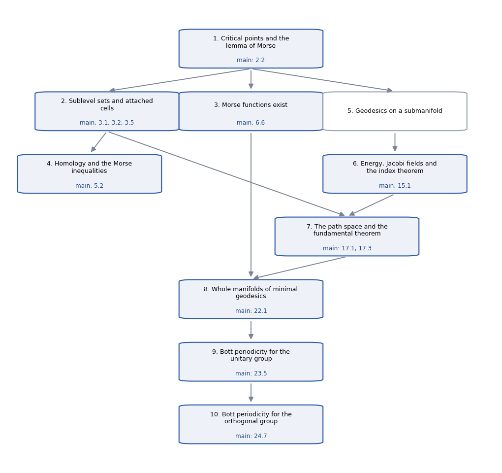

# Morse Theory, the Shortest Path

*The main theorems of Milnor's Morse Theory, and exactly what their formal proofs use: a route through the book read off the dependency graph of its Lean formalization.*

## 0. The path {#ch-0}

This text proves the main theorems of Milnor's *Morse Theory* and nothing else. Which results
count as needed is not a matter of taste: it is read off the Lean formalization of the book, by
following the formal proofs of the main theorems back through every declaration they use. What
they use is proved or stated here, in the order of the dependencies; what they do not use is left
out, and Appendix B lists it.

This is the third part of the project. The first, *Morse Theory, Rewritten*, is the whole book with
all the details and some applications, for advanced undergraduates. The second, *Morse Theory,
Checked*, is the Lean formalization with its faithfulness checks: the verified edition, the proof by
proof, the comparison of each result with its formal statement, and the round-trip audit. This part
keeps only what the main theorems need.

### 0.1 The main theorems {#sec-0-1}

The path ends at the twelve main theorems below, each proved in the chapter shown. The last columns
give what each one needs: the number of declarations of the formalization its proof uses
("Decls."), the number of results of the verified edition among them, and the chapters of this
text it rests on.

| Main theorem | Ch. | Decls. | Results | Needs chapters |
|:---------------------------------------------|:---|-------:|-------:|:-------------|
| **Lemma 2.2**: the lemma of Morse, on a manifold | 1 | 80 | 6 | 1 |
| **Theorem 3.1**: no critical values, no change of homotopy type | 2 | 194 | 7 | 1, 2 |
| **Theorem 3.2**: crossing a critical level attaches a cell | 2 | 384 | 13 | 1, 2 |
| **Theorem 3.5**: a compact manifold is a cell complex, one cell per critical point | 2 | 489 | 21 | 1, 2 |
| **Theorem 6.6**: Morse functions exist (almost every $L_p$) | 3 | 244 | 15 | 1, 3 |
| **Theorem 5.2 and the Euler characteristic**: the Morse inequalities | 4 | 893 | 30 | 1, 2, 4 |
| **Theorem 15.1**: the Morse index theorem | 6 | 432 | 39 | 1, 5, 6 |
| **Theorem 17.1**: piecewise smooth paths suffice | 7 | 783 | 54 | 1, 2, 5, 6, 7 |
| **Theorem 17.3**: the fundamental theorem of Morse theory | 7 | 1,613 | 110 | 1, 2, 5, 6, 7 |
| **Theorem 22.1**: whole manifolds of minimal geodesics | 8 | 1,558 | 106 | 1, 2, 3, 5, 6, 7, 8 |
| **The periodicity theorem and Theorem 23.5**: Bott periodicity for the unitary group ($\pi_{2k+1}U(m) \cong \mathbb Z$) | 9 | 2,745 | 175 | 1, 2, 3, 5, 6, 7, 8, 9 |
| **Theorem 24.7**: Bott periodicity for the orthogonal group | 10 | 2,959 | 181 | 1, 2, 3, 5, 6, 7, 8, 9, 10 |

Four of them are used by no other main theorem: Theorem 3.5, the existence of Morse functions, the
Morse inequalities and the fundamental theorem 17.3. The rest form a chain. The lemma of Morse and
Theorems 3.1 and 3.2, the index theorem, Theorem 17.1 and Theorem 22.1 lead to the two periodicity
theorems, which stand side by side: the orthogonal case uses the material of the unitary chapter,
but not its theorem.

### 0.2 How the path was found {#sec-0-2}

A formal proof is a graph. Every declaration of the formalization, definition or theorem, refers in
its statement and in its proof to other declarations, and Lean records these references exactly. The
script `Exposition/shortest/DepDump.lean` writes the graph out: one node for each declaration of this
project and of the companion project (the formalization of Milnor's *Topology from the
Differentiable Viewpoint*, on which this one is built), and an edge for every direct use.
Declarations of Mathlib are leaves, since Mathlib cannot depend on either project.
`Exposition/shortest/deps.py` then starts from the formal statements of the main theorems and
follows the edges back. The declarations it reaches are the path.

Of the 6,287 declarations of this project, 3,888 are on the path (62%); of the 1,799 of the companion project, 147 are. Of the results of the verified edition, 239 are on the path and 158 are not.

Each result of the verified edition (`Exposition/Verification.md`) names the declarations that
prove it, and a result is on the path when one of them is. These results are the units of this
text: every one of them appears, labelled by its number in the verified edition (Milnor's Theorem
3.2, for instance, is result V2.8), and no other result does. Every trace tag in the text, such as
⟦Chapter2/CellAttachSubmanifold · theorem_3_2_attach_submanifold⟧, names a declaration that the
script found on the path; `Exposition/shortest/check.py` verifies this for every tag. Appendix A
gives, for each result, the results it uses directly.

Two cautions. The path is the one these proofs take. A different proof could need less, and a
result off the path can still be worth knowing. It is also the path in the setting the
formalization chose. Manifolds are submanifolds of a Euclidean space and "complete" becomes "closed
in the Euclidean space"; homology has coefficients in a field; cell complexes are iterated
adjunction spaces; and the limits of §§23–24 are replaced by finite stages. Every Riemannian
manifold is such a submanifold, by the theorems of Whitney and Nash, but those theorems are not on
the path.

### 0.3 What the graph shows {#sec-0-3}

Some of what the dependencies say is not visible in the book's order of presentation.

- **Part I and the rest meet only at the start.** Theorem 3.5, the existence of Morse functions
  and the Morse inequalities are used by no later main theorem. The homology of Chapter 4 is used by
  nothing after it, because the fundamental theorem and Bott periodicity are statements about
  homotopy types and homotopy groups. Still, Theorems 3.1 and 3.2 are used throughout, and Sard's
  theorem and the generic perturbations behind Corollary 6.8 come back in the proof of Theorem 22.1.
- **The fundamental theorem does not need the index theorem.** Theorem 17.3 needs only that the
  index of the energy at a geodesic equals the index of its restriction to broken geodesics
  (Theorem 16.2). The index theorem is needed to *compute* indices, and only Bott periodicity does
  that.
- **Bott periodicity does not need the fundamental theorem.** It needs Theorem 17.1 (piecewise
  smooth paths suffice), through Corollary 22.2, and Theorem 22.1, but not Theorem 17.3.
- **Much of the geometry is never used.** Parallel transport, sectional curvature, the curvature
  of a totally geodesic submanifold, the Hopf–Rinow theorem in full (only the existence of a
  shortest geodesic is used, for the distance from $I$ to $-I$), Theorem 18.1 and the density of
  non-conjugate points are all off the path. The fundamental theorem simply assumes its end points
  non-conjugate.
- **The algebra of §§21, 23 and 24 is replaced.** The Lie-algebra computations of §21, Milnor's
  eigenvectors of $K_A$ in §23 and the spectral counts of §24 are off the path. Indices are computed
  from Jacobi fields (explicit ones for $SU(n)$, Killing fields for the spaces $\Omega_k(n)$) and the
  index theorem.

### 0.4 What is assumed {#sec-0-4}

The path rests on Mathlib and on the companion project, and on nothing else. From the companion
project it uses fifty theorems directly. In substance they are:

- the inverse function theorem on manifolds
  ⟦Milnor/Chapter1/InverseFunction · isLocalDiffeomorphAt_of_isInvertible_mfderiv⟧;
- slice submanifolds and their charts ⟦Milnor/Chapter2/Submanifold · IsSliceSubmanifold⟧, with
  regular level sets as slice submanifolds ⟦Milnor/Chapter2/LevelSet · isSliceSubmanifold_preimage⟧;
- Sard's theorem ⟦Milnor/Chapter3/Sard · sard⟧;
- the $\varepsilon$-neighbourhood (tubular) construction
  ⟦Milnor/Chapter6/Tubular1 · Tub.injective_fderiv_φ⟧ and the normal bundle as a slice submanifold
  ⟦Milnor/Chapter8/NormalBundle · Problems.isSliceSubmanifold_normalBundle⟧;
- smooth approximation on compact sets
  ⟦Milnor/Chapter8/Approx · Problems.exists_contDiff_approx_of_isCompact⟧.

From Mathlib it uses about 3,900 theorems directly. The substantial ones fall under a few headings:

- **Calculus:** derivatives, the mean value theorem, Taylor's formula, the inverse function theorem.
- **Ordinary differential equations:** Picard–Lindelöf
  ⟦Mathlib/Analysis/ODE/PicardLindelof · IsPicardLindelof⟧ and Grönwall's inequality.
- **Linear algebra:** Sylvester's law of inertia
  ⟦Mathlib/LinearAlgebra/QuadraticForm/Signature · sigNeg_isGreatest⟧, the spectral theorem for
  Hermitian matrices ⟦Mathlib/Analysis/Matrix/Spectrum · Matrix.IsHermitian.spectral_theorem⟧,
  the continuous functional calculus, the matrix exponential, determinants, Gram–Schmidt,
  quaternions and Clifford algebras.
- **Measure theory:** Lebesgue and Haar measure, and null sets.
- **Topology:** compactness, the Lebesgue number lemma, bump functions, paths and homotopies,
  homotopy groups as Mathlib defines them, and covering maps (for the circle).
- **Homological algebra:** chain complexes, their homology, the long exact sequence of a short
  exact sequence of complexes, and the singular chain complex.

Everything else is proved in Chapters 1–10. The infrastructure that the formalization had to build
because Mathlib does not have it is marked "Fact (standard)": relative singular homology and
excision, homotopy lifting and the exact homotopy sequence of a fibration, mapping telescopes, and
smooth dependence on initial conditions. It is stated precisely, with an indication of the proof;
the formal proofs are in the files the tags name.

### 0.5 How to read {#sec-0-5}

Results are labelled by their number in the verified edition, and a reference to another result
gives that number and the section where the result is proved: "[V1.8, [§1.6](#sec-1-6)]". To reach one
theorem, read the chapters listed for it in §0.1. Within a chapter the order is a dependency order,
so nothing is used before it is stated.

## 1. Critical points and the lemma of Morse {#ch-1}

This chapter fixes the setting and the vocabulary (critical points, the Hessian, index, nullity)
and proves the lemma of Morse on a manifold and the isolation of non-degenerate critical points;
every main theorem rests on it. A manifold $M$ is here
Mathlib's: smooth, without boundary, modelled on a real normed space $E$, with no Hausdorff or
countability hypothesis. The torus of §1, the examples of degenerate critical points, the converse
of the lemma of Morse and Lemma 2.4 are not needed; the flows behind Lemma 2.4 are stated where
Theorem 3.1 uses them [V1.14, [§2.2](#sec-2-2)].

### 1.1 The setting {#sec-1-1}

- $V$ is a finite-dimensional real inner product space. A manifold is a slice submanifold
  $N \subseteq V$ modelled on $Z$, $n = \dim Z$, not necessarily closed, with tangent spaces
  $T_qN \subseteq V$ and projections $P_q$ (§1.4).
- A function on $N$ is a restriction $f = F|N = F \circ \iota$ of a smooth $F : V \to \mathbb R$,
  $\iota$ the inclusion; its critical points, Hessian, index and nullity are those of §1.2, computed
  in any chart.
- The metric is induced by $V$; "complete" becomes "closed in $V$", which makes closed Riemannian
  balls compact.
- Cell complexes are iterated adjunction spaces, finitely or countably many cells attached one at a
  time along arbitrary maps [V2.11, [§2.7](#sec-2-7)].
- Homology is singular, with coefficients in a field $\mathbb k$. Homotopy groups are Mathlib's
  $\pi_i(X, x)$; "$\cong$" between them means a bijection (not claimed to respect base points)
  unless "as groups" is said.
- Paths are maps $\mathbb R \to V$ used on $[0, 1]$; $\Omega(N; p, q)$ is the space of piecewise
  smooth paths in $N$ from $p$ to $q$ with Milnor's pseudometric; $E$, $E_{**}$ and $\Omega^d$ are
  the energy, its Hessian at a geodesic and the paths of least energy $d$.

**Definition (attaching a cell)** [V1.2]. Let $D^n$, $S^{n-1}$ be the closed unit ball and sphere
of $\mathbb R^n$ ($S^{-1} = \emptyset$). For a continuous $\varphi : S^{n-1} \to X$,
$X \cup_\varphi e^n$ is the pushout of $\varphi$ and $S^{n-1} \hookrightarrow D^n$: the quotient of
$X \sqcup D^n$ by $u \sim \varphi(u)$. A map out of it is a pair of maps on $X$ and on $D^n$
agreeing along $\varphi$. ⟦Chapter2/Attaching · AttachCell⟧ ⟦Chapter2/Attaching · cellDesc⟧

### 1.2 Critical points, the Hessian, the index {#sec-1-2}

**Definition** [V5.1, V1.3]. Let $f : E \to \mathbb R$. A point $p$ is *critical* if $f$ has
derivative $0$ at $p$. The *Hessian* $d^2f_p(v, w) = D(x \mapsto df_x w)(p)\,v$ is the second
derivative, defined everywhere and symmetric where $f$ is $C^2$. A continuous bilinear form $H$ has
*null space* $\{v : H(v, \cdot) = 0\}$ and *nullity* its dimension; it is *non-degenerate* if the
null space is $0$; its *index* is Mathlib's negative index of inertia of $v \mapsto H(v, v)$. For
finite-dimensional $E$ the index is the largest dimension of a subspace on which $H(v, v) < 0$ for
$v \ne 0$, and non-degenerate means nullity $0$.
⟦Chapter1/Nondegenerate · IsCriticalPoint⟧ ⟦Chapter1/Nondegenerate · hessian⟧
⟦Chapter1/Nondegenerate · index_isGreatest⟧

**Definition** [V1.4]. Let $f : M \to \mathbb R$ and $\kappa_p$ the preferred chart at $p$. The
point $p$ is *critical* if $df_p = 0$. The *Hessian* $f_{**}$ is $d^2(f \circ \kappa_p^{-1})$ at
$\kappa_p(p)$, a form on $T_pM = E$; the *index* and *nullity* of $f$ at $p$ are those of
$f_{**}$; $p$ is a *non-degenerate critical point* if it is critical and $f_{**}$ is
non-degenerate. A *Morse function* is a smooth function whose critical points are all
non-degenerate. ⟦Chapter1/Manifold · IsCriticalPointM⟧ ⟦Chapter1/Manifold · hessianM⟧
⟦Chapter1/Manifold · IsMorseFunction⟧

### 1.3 Independence of the coordinates {#sec-1-3}

**Theorem** [V1.5]. (i) If $\psi$ is $C^2$ at $q$ and $f$ is $C^2$ at $\psi(q)$, then
$$d^2(f \circ \psi)_q(v, w) = d^2f_{\psi(q)}(d\psi_q v, d\psi_q w) + df_{\psi(q)}(d^2\psi_q(v, w)),$$
and the last term vanishes if $df_{\psi(q)} = 0$.
⟦Chapter1/Manifold · hessian_comp_apply⟧ ⟦Chapter1/Nondegenerate · hessian_comp⟧
(ii) A *smooth coordinate system* is an open partial homeomorphism $y$ from $M$ to a normed space,
smooth on its domain, with inverse smooth on its image (with values in $E$: a chart of the maximal
atlas). Let $p \in \operatorname{dom} y$. If $f$ is differentiable at $p$, then $p$ is critical iff
$y(p)$ is critical for $f \circ y^{-1}$. If $f$ is $C^2$ at the critical point $p$, then
$d^2(f \circ y^{-1})_{y(p)}$ has the non-degeneracy, index and nullity of $f_{**}$.
⟦Chapter1/Manifold · IsSmoothCoord⟧ ⟦Chapter1/Manifold · IsSmoothCoord.isCriticalPointM_iff⟧
⟦Chapter1/Manifold · IsSmoothCoord.index_eq⟧ ⟦Chapter1/Manifold · IsSmoothCoord.nullity_eq⟧

*Proof.* (i) Near $q$, $d(f \circ \psi)_x = df_{\psi(x)} \circ d\psi_x$; differentiate at $q$ by
the product rule. (ii) The transition $\tau = \kappa_p \circ y^{-1}$ is smooth near $y(p)$ with
invertible derivative $L$, and $f \circ y^{-1} = (f \circ \kappa_p^{-1}) \circ \tau$ there. The
chain rule handles criticality; at a critical point (i) gives
$d^2(f \circ y^{-1})_{y(p)} = f_{**}(L\,\cdot, L\,\cdot)$. A pull-back by an isomorphism has the same
index (Mathlib's index is invariant under isometries) and nullity
⟦Chapter1/Nondegenerate · index_bilinearComp⟧. $\square$

### 1.4 Functions on a slice submanifold {#sec-1-4}

A *slice chart* for $N \subseteq V$ is a diffeomorphism $\sigma$ of an open subset of $V$ onto one
of $Z \times W$ such that a point of its domain lies in $N$ iff the $W$-component of its image is
$0$. $N$ is a *slice submanifold* if slice charts cover it
⟦Milnor/Chapter2/Submanifold · IsSliceSubmanifold⟧; it is a manifold modelled on $Z$ with charts
$q \mapsto \sigma(q)_Z$, inverted by the *parametrizations* $x(z) = \sigma^{-1}(z, 0)$
⟦Chapter1/ManifoldSubmanifold · sliceParam⟧.

**Definition** [V6.1]. $T_qN$ is the range of $d\iota_q$ and $P_q$ the orthogonal projection of $V$
onto it (smooth in $q$ [V6.2, [§5.1](#sec-5-1)]). For $g : N \to E'$, $d^Ng_q = dg_q \circ \tau_q : V \to E'$, where
$\tau_q(v) = (d\sigma_q v)_Z$ for the slice chart $\sigma$ chosen at $q$; only its values on
$T_qN$, written $dg_q$, are used. If $g = G$ on $N$ near $q$ for a $G : V \to E'$ differentiable
at $q$, then $dg_q = dG_q$ on $T_qN$.
⟦Chapter1/ManifoldSubmanifold · tangentSubspace⟧ ⟦Chapter6/Projection · tanProj⟧
⟦Chapter6/Projection · dN⟧ ⟦Chapter6/Projection · dN_eq_fderiv⟧

*Proof.* $\tau_q \circ d\iota_q$ is the derivative of the chart at $q$ read in itself, the
identity, so $d\iota_q(\tau_q v) = v$ on $T_qN$; apply the chain rule to $G \circ \iota$. $\square$

**Theorem** [V1.6]. Let $q \in N$ lie in the domain of a slice chart $\sigma$ with parametrization
$x$, $u = \sigma(q)_Z$, and $F : V \to \mathbb R$.

1. $T_qN$ is the range of $dx_u$.
2. If $F$ is differentiable at $q$: $q$ is critical for $F|N$ iff $u$ is critical for $F \circ x$,
   iff $dF_q$ vanishes on $T_qN$.
3. If $F$ is $C^2$ at $q$ and $q$ is critical for $F|N$, the index and nullity of $F|N$ at $q$ are
   those of $d^2(F \circ x)_u$.
4. For $L_p(y) = \|y - p\|^2$: $q$ is critical for $L_p|N$ iff $q - p \perp T_qN$; if $x$ is $C^2$
   at $u$,
   $d^2(L_p \circ x)_u(v, w) = 2\big(\langle dx_u v, dx_u w\rangle + \langle d^2x_u(v, w), x(u) - p\rangle\big)$;
   at a critical $q$ the nullity of $L_p|N$ is that of this form.

⟦Chapter1/ManifoldSubmanifold · tangentSubspace_eq_range_fderiv_sliceParam⟧
⟦Chapter1/ManifoldSubmanifold · isCriticalPointM_comp_val_iff_forall_tangent⟧
⟦Chapter1/ManifoldSubmanifold · index_hessian_comp_sliceParam⟧
⟦Chapter1/ManifoldSubmanifold · nullityM_normSq_sub_eq⟧

*Proof.* The chart induced by $\sigma$ is in the maximal atlas, and $F|N$ read in it is
$F \circ x$ near $u$: §1.3 gives the first part of 2, and 3. Near $q$,
$\iota = x \circ (\text{chart})$ with the chart's derivative invertible: this is 1. The chain rule
$d(F|N)_q = dF_q \circ d\iota_q$ gives the rest of 2. For 4, $dL_p(y) = 2\langle y - p, \cdot\rangle$,
$d^2L_p = 2\langle\cdot, \cdot\rangle$, and §1.3 (i) applies with its first-order term, Milnor's
second-fundamental-form term (p. 36) ⟦Chapter1/ManifoldSubmanifold · hessian_normSq_sub_comp⟧.
$\square$

### 1.5 Hadamard's lemma {#sec-1-5}

**Lemma 2.1, to second order** [V1.7]. Let $O \subseteq E$ be open and star-shaped about $0$, and
$f$ smooth on $O$ with values in a complete space, $f(0) = 0$, $df_0 = 0$. Then
$f(x) = B(x)(x, x)$ on $O$, where $B(x) = \int_0^1 (1 - t)\, d^2f_{tx}\, dt$ is smooth on $O$ and
symmetric, and $B(0) = \tfrac12 d^2f_0$. ⟦Chapter1/Hadamard · exists_hadamard_two_on⟧

*Proof.* Taylor's formula with integral remainder along $[0, x] \subseteq O$. Smoothness of $B$ is
differentiation under the integral sign, which Milnor does not argue: if $h$ is $C^n$ on an open
$U \subseteq E \times \mathbb R$ containing $O \times [0, 1]$, then
$x \mapsto \int_0^1 h(x, t)\, dt$ is $C^n$ on $O$ ⟦Chapter1/Hadamard · contDiffOn_intervalIntegral⟧,
by induction on $n$, dominating the integrand on a tube around $\{x_0\} \times [0, 1]$. $\square$

### 1.6 The lemma of Morse {#sec-1-6}

**Lemma 2.2 (the lemma of Morse)** [V1.8]. Let $E$ be finite-dimensional, $n = \dim E$, $f$ smooth
on an open $U \ni p$, and $p$ critical with $d^2f_p$ non-degenerate of index $\lambda$. There is an
open partial homeomorphism $y : E \to \mathbb R^n$, smooth with smooth inverse,
$p \in \operatorname{dom} y \subseteq U$, $y(p) = 0$, with
$$f = f(p) - \textstyle\sum_{i < \lambda} y_i^2 + \sum_{i \ge \lambda} y_i^2 \quad \text{on } \operatorname{dom} y.$$
The same holds on $M$, for $p$ a non-degenerate critical point of index $\lambda$, with $y$ a
smooth coordinate system.
⟦Chapter1/MorseLemma · morse_lemma⟧ ⟦Chapter1/ManifoldMorse · morse_lemmaM⟧

*Proof.* Not Milnor's induction, which needs an unjustified linear change making $H_{rr}(0) \ne 0$,
but one application of the inverse function theorem. First a chart $\varphi$, smooth with smooth
inverse, $\varphi(p) = 0$, $d\varphi_p = \mathrm{id}$, $f = f(p) + \tfrac12 d^2f_p(\varphi, \varphi)$
⟦Chapter1/MorseLemma · exists_morse_chart⟧.

1. On a ball $O$ with $p + O \subseteq U$, $f(p + x) - f(p) = B(x)(x, x)$ by §1.5, and
   $B_0 = B(0) = \tfrac12 d^2f_p$ is symmetric and non-degenerate.
2. On linear maps of $E$ let $\Psi(T) = B_0(T\cdot, T\cdot) + B_0(T\cdot, \cdot) - B_0(\cdot, T\cdot)$.
   Then $\Psi(\mathrm{id}) = B_0$, $\Psi(T)(v, v) = B_0(Tv, Tv)$ by symmetry, and
   $d\Psi_{\mathrm{id}}(K) = 2B_0(K\cdot, \cdot)$ is invertible, as $v \mapsto B_0(v, \cdot)$ is an
   injective map $E \to E^*$; the skew term makes this so. The inverse function theorem, with an
   inverse smooth on its whole image
   ⟦Chapter1/SquareRoot · exists_openPartialHomeomorph_of_contDiffOn⟧, makes
   $C(x) = \Psi^{-1}(B(x))$ smooth near $0$, with $C(0) = \mathrm{id}$ and
   $B(x)(v, v) = B_0(C(x)v, C(x)v)$ ⟦Chapter1/SquareRoot · exists_sqrt_family⟧.
3. $\psi(x) = C(x - p)(x - p)$ has $d\psi_p = C(0) = \mathrm{id}$; inverting it again gives
   $\varphi$, with $f = f(p) + B_0(\varphi, \varphi)$.
4. Sylvester's law of inertia in Mathlib gives an isomorphism $e : E \to \mathbb R^n$ with
   $d^2f_p(v, v) = -\sum_{i<\lambda} (ev)_i^2 + \sum_{i \ge \lambda} (ev)_i^2$, after a permutation
   ⟦Chapter1/MorseLemma · exists_linearEquiv_diagForm⟧. Put $y = e(\varphi/\sqrt2)$.
5. On $M$, apply this to $f \circ \kappa_p^{-1}$ on $\kappa_p(U \cap \operatorname{dom} \kappa_p)$:
   its Hessian at $\kappa_p(p)$ is $f_{**}$, and $\kappa_p(p)$ is critical by §1.3. Then
   $y \circ \kappa_p$ is a smooth coordinate system. $\square$

### 1.7 Non-degenerate critical points are isolated {#sec-1-7}

**Corollary 2.3** [V1.10]. Let $E$ be finite-dimensional, $f : M \to \mathbb R$ $C^2$ at $p$, and
$p$ a non-degenerate critical point. Some neighbourhood of $p$ contains no other critical point.
⟦Chapter1/ManifoldMorse · IsNondegenerateCriticalPointM.exists_nhds_isCriticalPointM_eq⟧

*Proof.* On $E$, $x \mapsto df_x \in E^*$ has at $p$ the injective, hence bounded below, derivative
$v \mapsto d^2f_p(v, \cdot)$, so $df_x \ne 0$ for $x \ne p$ near $p$
⟦Chapter1/Nondegenerate · eventually_not_isCriticalPoint⟧. On $M$ read this in $\kappa_p$, which is
injective (§1.3). $\square$

**Theorem** [V1.11]. (i) The critical set of a $C^1$ function on $M$ is closed. Let $E$ be
finite-dimensional. (ii) If $f$ is $C^2$ on $S \subseteq M$ and its critical points in $S$ are
non-degenerate, they form a discrete set. (iii) If $f$ is $C^2$ with non-degenerate critical
points, a compact set contains finitely many; so does a compact $M$ for a Morse function.
⟦Chapter1/ManifoldMorse · finite_inter_setOf_isCriticalPointM⟧
⟦Chapter1/ManifoldMorse · IsMorseFunction.finite_setOf_isCriticalPointM⟧

*Proof.* (i) If $df_{x_0} \ne 0$, the derivative of $f \circ \kappa_{x_0}^{-1}$ is non-zero near
$\kappa_{x_0}(x_0)$ by continuity; read back by §1.3. (ii) is Corollary 2.3. (iii) The critical
points in a compact $K$ form a closed, hence compact, discrete set, which is finite; no Hausdorff
hypothesis is used. $\square$

## 2. Sublevel sets and attached cells {#ch-2}

This chapter proves Theorems 3.1, 3.2 and 3.5 for $f = F|N$, with $N \subseteq V$ a slice
submanifold modelled on a finite-dimensional $Z$ and $F : V \to \mathbb R$ smooth (§1.1). The
Morse inequalities, Theorems 17.3 and 22.1 and Bott periodicity need Theorems 3.1 and 3.2; no other
main theorem needs Theorem 3.5. Theorems 3.1 and 3.2 on a Euclidean space or an abstract manifold,
the Remark on p. 13, Remark 3.4 and Lemma 3.6 are not needed (the construction of Lemma 3.6
reappears in the proof of Lemma 3.7).

### 2.1 Sublevel sets and deformation retracts {#sec-2-1}

**Definition and lemma** [V2.1]. For $F : T \to \mathbb R$ on a set, $T^c = \{x : F(x) \le c\}$. A
subset $A$ of a space $X$ is a *strong deformation retract* of $X$ if there are a continuous
$r : X \to X$ with values in $A$ and a homotopy $r_t$ from $r_0 = \mathrm{id}$ to $r_1 = r$ with
$r_t(a) = a$ for all $t$ and $a \in A$. If $A \subseteq B$ and $A$ is one of $B$, the inclusion
$A \to B$ is a homotopy equivalence with homotopy inverse $r_1$. ⟦Chapter2/Crossing · sublevel⟧
⟦Chapter2/Crossing · IsStrongDeformationRetract⟧
⟦Chapter2/Crossing · IsStrongDeformationRetract.exists_homotopyEquiv⟧

*Proof.* $r_1 \circ i = \mathrm{id}_A$, and $i \circ r_1 = r$ is homotopic to $\mathrm{id}_B$.
$\square$

Strong deformation retractions compose: if $A \subseteq B \subseteq C$,
first deform $C$ onto $B$ by $s_t$, then follow $r_t \circ s_1$
⟦Chapter2/CellAttach · IsStrongDeformationRetract.trans⟧.

### 2.2 Flows {#sec-2-2}

**Fact (global flows, standard)** [V1.14]. Let $E$ be a complete real normed space and
$X : E \to E$ bounded and globally Lipschitz, for instance $C^1$ and zero outside a compact set.
Through each point there is a unique integral curve defined on $\mathbb R$; the flow $\varphi_t(x)$
has $\varphi_0 = \mathrm{id}$, $\varphi_{s+t} = \varphi_s \circ \varphi_t$, every integral curve is
$\gamma(t) = \varphi_{t - t_0}(\gamma(t_0))$, and $(t, x) \mapsto \varphi_t(x)$ is continuous. If
$S$ is closed and through each point of $S$ some local solution stays in $S$, then
$\varphi_t(S) \subseteq S$. If $X$ is $C^n$, $1 \le n \le \infty$, with compact support, then
$(t, x) \mapsto \varphi_t(x)$ is $C^n$. ⟦Flow/Global · IsBddLipschitz⟧ ⟦Flow/Global · flow⟧
⟦Flow/Global · IsBddLipschitz.flow_add⟧ ⟦Flow/Global · IsBddLipschitz.flow_mem⟧
⟦Flow/Smooth · contDiff_flow⟧ ⟦Flow/Smooth · contDiff_flow_uncurry⟧

*Proof idea.* A bounded field has Picard–Lindelöf solutions on intervals of every length, which
replaces Milnor's iteration of $\varphi_{\varepsilon_0/2}$; Grönwall gives uniqueness and
continuity, and invariance holds because the times at which a flow line lies in $S$ form a clopen
set. Smoothness, which Mathlib lacks: for a Lipschitz constant below $1$, $\varphi_1(x)$ is the
value at $1$ of $\Psi^{-1}$ applied to the constant curve $x$, where
$\Psi(\gamma) = \gamma - \int_0^{\cdot} X(\gamma)$ is a $C^n$ homeomorphism of $C([0, 1], E)$
with invertible derivative (a Neumann series), hence with $C^n$ inverse
⟦Flow/Volterra · contDiff_voltHomeomorph_symm⟧; then $\varphi_t = (\varphi_{t/N})^N$, and joint
smoothness follows from the flow of $(x, \tau) \mapsto (\rho(\tau) X(x), 0)$. $\square$

### 2.3 Theorem 3.1 {#sec-2-3}

**Theorem 3.1** [V2.3]. Let $a \le b$, and suppose that $f^{-1}[a, b] \subseteq N$ is compact and
contains no critical point of $f$. Then a $C^\infty$ diffeomorphism $\Phi$ of $N$ carries $N^a$
onto $N^b$, $N^a$ is a strong deformation retract of $N^b$, and the inclusion $N^a \to N^b$ is a
homotopy equivalence. If $N$ is compact, $f^{-1}[a, b]$ need not be assumed compact.
⟦Chapter2/Submanifold · theorem_3_1_submanifold⟧
⟦Chapter2/Submanifold · theorem_3_1_submanifold_of_isCompact⟧

*Proof.* Milnor's, without a metric: an ambient field tangent to $N$ replaces
$\rho \operatorname{grad} f$, and a lemma on one real function replaces his "clearly". Let
$K = f^{-1}[a, b]$.

1. *A field.* For a slice chart $\sigma$ and $u \in Z$, $Y_u(y) = d(\sigma^{-1})_{\sigma(y)}(u, 0)$
   is smooth on $\operatorname{dom}\sigma$ and tangent to $N$ along $N$. As $dF_q$ does not vanish on
   $T_qN$ for $q \in K$ [V1.6, [§1.4](#sec-1-4)], some $Y_u$ has $dF(Y_u) > 0$ near $q$; a finite sum of bump
   functions times such fields is a smooth $Y$, tangent to $N$ along $N$, with $dF(Y) > 0$ on $K$
   ⟦Chapter2/Submanifold · exists_tangent_field⟧. A smooth Urysohn function divided by $dF(Y)$ is
   a $\rho$ with compact support in the union $O$ of the slice chart domains and
   $\rho\, dF(Y) = 1$ on $K$ ⟦Chapter2/Regular · exists_cutoff_mul⟧. Let $X = \rho Y$.
2. *$N$ is invariant.* Local solutions of $X$ read in a slice chart, mapped back by the
   parametrization, are integral curves in $N$. So $N \cup (V \setminus O)$, closed as $N$ is
   closed in $O$, is invariant (Fact), and a flow line from $N$ cannot reach a zero of $X$:
   $\varphi_t(N) \subseteq N$ ⟦Chapter2/Submanifold · flow_mem_of_tangent⟧. As a smooth map into
   $V$ with values in $N$ is smooth into $N$, $\Phi = \varphi_{b-a}|N$ is a diffeomorphism with
   inverse $\varphi_{a-b}|N$.
3. *One crossing.* $g(t) = f(\varphi_t(x))$ is continuous, with $g' = dF(X) = 1$ where
   $g \in [a, b]$. By continuous induction, if $g(s) \ge c \in [a, b]$ then $g \ge c$ after $s$,
   and if $g(s) \in [a, b]$ then $g(s + \tau) = g(s) + \tau$ for $a - g(s) \le \tau \le b - g(s)$ ⟦Chapter2/Crossing · UnitSpeedInSlab.eq_add⟧. A flow line
   crosses the slab once, upwards, at unit speed, so $\varphi_{c'-c}(N^c) = N^{c'}$ for
   $a \le c \le c' \le b$ ⟦Chapter2/Crossing · IsSlabFlow.image_sublevel⟧.
4. *The deformation.* Milnor's two-case $r_t$ is $r_t(x) = \varphi_{t \min(0,\, a - f(x))}(x)$,
   continuous in $(t, x)$. It fixes $N^a$, and $f(r_t(x)) = f(x) + t(a - f(x))$ on the slab, so
   $r_t(N^b) \subseteq N^b$ and $r_1(N^b) \subseteq N^a$
   ⟦Chapter2/Crossing · IsSlabFlow.isStrongDeformationRetract⟧. §2.1 finishes; for compact $N$,
   $K$ is closed in $N$. $\square$

### 2.4 A cell inside a space {#sec-2-4}

**Lemma D** [V2.7]. Let $W$ be Hausdorff, $j : A \to W$ a closed embedding, $D$ compact,
$\chi : D \to W$ continuous and injective, $i : S \to D$, and $\varphi : S \to A$ with
$j\varphi = \chi i$. If $W = j(A) \cup \chi(D)$ and $\chi(d) \in j(A)$ only for $d \in i(S)$, then
$W$ is the pushout of $A \xleftarrow{\varphi} S \xrightarrow{i} D$. Hence, if $A$ is closed in a
Hausdorff space $M$ and $\chi : D^n \to M$ is continuous and injective with $\chi(z) \in A$ iff
$|z| = 1$, then $A \cup \chi(D^n)$ is $A \cup_\varphi e^n$ [V1.2, [§1.1](#sec-1-1)] with
$\varphi = \chi|S^{n-1}$ injective. If moreover $A = M^a$ for a continuous $f$, $a \le b$,
$\chi(D^n) \subseteq M^b$, and $M^a \cup \chi(D^n)$ is a strong deformation retract of $M^b$, then
$M^b$ is homotopy equivalent to $M^a \cup_\varphi e^n$.
⟦Chapter2/CellAdjunction · isPushout_of_cell⟧ ⟦Chapter2/CellPatch · exists_isPushout_union_cell_of_t2⟧
⟦Chapter2/CellPatch · exists_homotopyEquiv_pushout_of_cell⟧

*Proof.* $j$ and $\chi$ are homeomorphisms onto closed images. Maps $a$ on $A$ and $d$ on $D$ with
$a\varphi = di$ glue to $a j^{-1}$ on $j(A)$ and $d\chi^{-1}$ on $\chi(D)$, which agree on the
overlap by the hypothesis on $i(S)$; the result is continuous by the pasting lemma and unique. The
last claim adds §2.1. $\square$

### 2.5 Theorem 3.2 {#sec-2-5}

Let $X$, $Y$ be finite-dimensional inner product spaces, $\xi(x, y) = |x|^2$, $\eta(x, y) = |y|^2$.
For $f : M \to \mathbb R$ on a space, a *Morse patch* at $p$ is an open partial homeomorphism
$\varphi : M \to X \times Y$ with $\varphi(p) = 0$ and $f = c - \xi\varphi + \eta\varphi$ on its
domain, $c = f(p)$ ⟦Chapter2/CellPatch · IsMorsePatch⟧. *Milnor's $\mu$* for $\epsilon > 0$ is
smooth with $\mu(0) > \epsilon$, $\mu = 0$ on $[2\epsilon, \infty)$ and $-1 < \mu' \le 0$
⟦Chapter2/CellModel · IsMilnorMu⟧. Milnor does not show that one exists;
$\mu(r) = \tfrac34 \int_r^{2\epsilon} \beta$ is one, for a smooth $\beta : \mathbb R \to [0, 1]$
equal to $1$ below $\tfrac32\epsilon$ and $0$ above $2\epsilon$
⟦Chapter2/CellModel · isMilnorMu_milnorMu⟧. Then $\mu \ge 0$, $\mu$ decreases, and
$s + \mu(s)$ increases. Put $\tilde f = f - \mu(\xi\varphi + 2\eta\varphi)$ on $\operatorname{dom}\varphi$ and
$\tilde f = f$ elsewhere; $\tilde f = f$ off the *ellipsoid* $\varphi^{-1}\{\xi + 2\eta \le 2\epsilon\}$.
The *cell* is $e = \varphi^{-1}\{\xi \le \epsilon,\ y = 0\}$. In coordinates:

- *Assertion 1:* $\tilde f \le c + \epsilon$ iff $f \le c + \epsilon$, as $\tilde f \le f$ and
  both hold on the ellipsoid.
- *Assertion 2:* $d\tilde f = -(1 + \mu')\, d\xi + (1 - 2\mu')\, d\eta$ vanishes only at $0$
  (evaluate on $(x, 0)$ and $(0, y)$).
- On $e$, $\tilde f = c - \xi - \mu(\xi) \le c - \mu(0) < c - \epsilon$, and
  $e \cap M^{c-\epsilon} = \{\xi = \epsilon,\ y = 0\}$.
- *Assertion 4:* Milnor's three cases are one formula, $r_t(x, y) = (x, \sigma_t y)$ with
  $\sigma_t = 1 - t + t\sqrt{\min(1, (\xi - \epsilon)/\eta)}$, where $0/0 = 0$ and $\sqrt s = 0$
  for $s < 0$. As $0 \le \sigma_t \le 1$, $r_t$ keeps $\xi$ and does not increase $\eta$, nor
  $\tilde f$; it fixes $M^{c-\epsilon} = \{\eta + \epsilon \le \xi\}$ and $e$; $r_1$ lands in
  $M^{c-\epsilon} \cup e$; and $r_t$ is continuous, also where $\eta = 0$, since it moves no point
  farther from such a point. Transported by $\varphi$ and extended by the identity, it stays in the
  chart on $\tilde f^{-1}(-\infty, c - \epsilon]$ and is continuous there if $M$ is Hausdorff, the
  ellipsoid being compact, hence closed. So $M^{c-\epsilon} \cup e$ is a strong deformation retract
  of $\tilde f^{-1}(-\infty, c - \epsilon]$ ⟦Chapter2/CellPatch · isStrongDeformationRetract_patch_handle⟧.

**Theorem 3.2 in a patch** [V2.8]. Let $M$ be Hausdorff, $\varphi$ a Morse patch at $p$ whose
image contains $\{\xi + \eta \le 2\epsilon\}$, $\epsilon > 0$, $\mu$ as above, and
$\iota$ a linear isometry of $X$ onto $\mathbb R^\lambda$. If $\tilde f^{-1}(-\infty, c - \epsilon]$
is a strong deformation retract of $M^{c+\epsilon}$ (Assertion 3), then
$\chi(z) = \varphi^{-1}(\sqrt\epsilon\, \iota^{-1} z, 0)$ is continuous and injective on
$D^\lambda$, $\chi(z) \in M^{c-\epsilon}$ iff $|z| = 1$, $\chi(D^\lambda) \subseteq M^{c+\epsilon}$,
and $M^{c-\epsilon} \cup \chi(D^\lambda)$ is a strong deformation retract of $M^{c+\epsilon}$.
⟦Chapter2/CellPatch · patch_theorem_3_2⟧

*Proof.* $f(\chi(z)) = c - \epsilon|z|^2$; compose Assertion 3 with Assertion 4 (§2.1). $\square$

**Theorem 3.2** [V2.8]. Let $p \in N$ be a non-degenerate critical point of $f$ of index
$\lambda$, $c = f(p)$, and suppose that for some $\epsilon_0 > 0$ the set
$f^{-1}[c - \epsilon_0, c + \epsilon_0]$ is compact with no critical point but $p$. There is
$\epsilon_1 > 0$ such that for every $\epsilon \in (0, \epsilon_1]$ there is a
$\chi : D^\lambda \to N$ with the four properties of the patch theorem, $N$ in place of $M$; and
$N^{c+\epsilon}$ is homotopy equivalent to $N^{c-\epsilon} \cup_\varphi e^\lambda$ for an
injective $\varphi$.
⟦Chapter2/CellAttachSubmanifold · theorem_3_2_submanifold⟧
⟦Chapter2/CellAttachSubmanifold · theorem_3_2_attach_submanifold⟧

*Proof.*

1. The lemma of Morse on $N$ [V1.8, [§1.6](#sec-1-6)], inside a slice chart $\sigma$, with the coordinates
   split after the $\lambda$-th, gives a Morse patch $\psi$ that is a smooth coordinate system
   ⟦Chapter2/CellAttachSubmanifold · exists_isMorsePatch_submanifold⟧. If its image contains the
   ball of radius $r$, let $\epsilon_1 = \min(\epsilon_0, r^2/4)$.
2. $\tilde f$ is smooth, the correction vanishing off the closed ellipsoid, and has the critical
   points of $f$, by Assertion 2 read in $\psi$ (§1.3)
   ⟦Chapter2/CellAttachSubmanifold · isCriticalPointM_patchF_iff⟧.
3. Theorem 3.1 is for restrictions, so $\tilde f$ is made one, a step Milnor does not need. The
   correction $b$ vanishes off the ellipsoid, a compact subset of $\operatorname{dom}\sigma$; for a
   cut-off $\theta$ equal to $1$ there, $B(y) = \theta(y)\, b(x(\sigma(y)_Z))$ is smooth with
   $B|N = b$ ⟦Chapter2/CellAttachSubmanifold · exists_contDiff_comp_val_eq_of_chart⟧.
4. *Assertion 3.* $\tilde f^{-1}[c - \epsilon, c + \epsilon]$ lies in
   $f^{-1}[c - \epsilon_0, c + \epsilon_0]$ (by $\tilde f \le f$ and Assertion 1), so it is
   compact; its only candidate critical point is $p$, but $\tilde f(p) = c - \mu(0) < c - \epsilon$.
   Theorem 3.1 for $F - B$ makes $\tilde f^{-1}(-\infty, c - \epsilon]$ a strong deformation
   retract of $\tilde f^{-1}(-\infty, c + \epsilon] = N^{c+\epsilon}$.
5. Apply the patch theorem ($\lambda \le \dim Z$ gives $\iota$), then Lemma D. $\square$

### 2.6 Several critical points on one level {#sec-2-6}

**Remark 3.3** [V2.9]. Let $S$ be a finite set of non-degenerate critical points of $f$, all at the
level $c$, and suppose that for some $\epsilon_0 > 0$ the set $f^{-1}[c - \epsilon_0, c + \epsilon_0]$
is compact with all its critical points in $S$. There is $\epsilon_1 > 0$ such that for every
$\epsilon \in (0, \epsilon_1]$ there are maps $\chi_p : D^{\lambda_p} \to N$, $p \in S$,
$\lambda_p$ the index of $p$, continuous and injective, with $\chi_p(z) \in N^{c-\epsilon}$ iff
$|z| = 1$, images in $N^{c+\epsilon}$ and pairwise disjoint, such that
$N^{c-\epsilon} \cup \bigcup_p \chi_p(D^{\lambda_p})$ is a strong deformation retract of
$N^{c+\epsilon}$. ⟦Chapter2/SeveralCritical · remark_3_3_submanifold⟧

*Proof.* $N$ is Hausdorff, so the points of $S$ have Morse patches with disjoint domains
⟦Chapter2/SeveralCritical · exists_isMorsePatch_submanifold_subset⟧, and one $\epsilon$ serves all.
Subtract the extended corrections $B_p$ one at a time. By induction on the set $s$ already
subtracted ⟦Chapter2/SeveralCritical · multi_induction⟧, $F_s = F - \sum_{p \in s} B_p$ satisfies
Assertions 1, 2 and 4 of §2.5, since each step is Milnor's modification of $F_s|N$ in a patch where
$F_s = F$. For Assertion 4 the earlier deformation is first extended by the identity over the new
cell: if $A$ is a strong deformation retract of $B$, with $B$, $C$ closed and $B \cap C \subseteq A$,
then $A \cup C$ is one of $B \cup C$ ⟦Chapter2/SeveralCritical · IsStrongDeformationRetract.union_of_isClosed⟧.
Assertion 3 for $F_S$ is as in §2.5. $\square$

### 2.7 Cell complexes and Lemma 3.7 {#sec-2-7}

**Definition** [V2.11]. $K$ is an *iterated adjunction space with cells* $(\lambda_1, \dots, \lambda_k)$
if it is obtained from $\emptyset$ by attaching a $\lambda_1$-cell, then a $\lambda_2$-cell, and so
on, each along an arbitrary continuous map into the space built so far [V1.2, [§1.1](#sec-1-1)]. A space *has
the homotopy type of a finite cell complex with cells* $(\lambda_1, \dots, \lambda_k)$ if it is
homotopy equivalent to such a $K$. ⟦Chapter2/CWType · IsCellAttachment⟧
⟦Chapter2/CWType · IsFiniteCellComplexType⟧

Unlike Milnor's CW-complexes, the attaching maps need not be cellular: Mathlib has no cellular
approximation.

**Lemma 3.7** [V2.14]. Let $\varphi : S^{n-1} \to X$ be continuous and $f : X \to Y$ a homotopy
equivalence. The map $F : X \cup_\varphi e^n \to Y \cup_{f\varphi} e^n$ which is $f$ on $X$ and the
identity on the cell is a homotopy equivalence. And for maps with $LF \simeq \mathrm{id}$ and
$FR \simeq \mathrm{id}$, also $RF \simeq \mathrm{id}$.
⟦Chapter2/Attaching · lemma_3_7⟧ ⟦Chapter2/Attaching · homotopic_of_leftInv_rightInv⟧

*Proof.* The second claim: $L \simeq L(FR) = (LF)R \simeq R$, so $RF \simeq LF \simeq \mathrm{id}$.
A homotopy out of $X \cup_\varphi e^n$ may be given on $X$ and on $D^n$ compatibly, because
$[0, 1] \times (\text{quotient map})$ is a quotient map ($[0, 1]$ is locally compact)
⟦Chapter2/Attaching · cellHomotopy⟧. On the cell, write $z = tu$, $|u| = 1$; every map below is *radial*: $tu \mapsto (t/a)u$ for $t \le a$ and $tu \mapsto \Psi(t, u) \in X$ for
$t \ge a$, where $\Psi(a, u) = \varphi(u)$ ⟦Chapter2/Attaching · radial⟧.

1. For a homotopy $\varphi_s$ from $\varphi_0$ to $\varphi_1$, Milnor's
   $k : X \cup_{\varphi_0} e^n \to X \cup_{\varphi_1} e^n$ is the identity on $X$ and radial with
   $a = \tfrac12$, $\Psi(t, u) = \varphi_{2-2t}(u)$; $\ell$ is $k$ for the reversed homotopy, and
   $\ell k \simeq \mathrm{id}$ through the radial maps with $a = (1 + 3\tau)/4$ and
   $\Psi(t, u) = \varphi_{\min(4(t - a),\, 2 - 2t)}(u)$ ⟦Chapter2/Attaching · lemma36Homotopy⟧.
2. Let $g$ be a homotopy inverse of $f$, $h_\tau$ a homotopy from $gf$ to $\mathrm{id}_X$, $G$ the
   analogue of $F$ for $g$, and $k$ as in 1 for $h_\tau\varphi$. Then $kGF \simeq \mathrm{id}$,
   through $h_\tau$ on $X$ and the radial maps with $a = (1 + \tau)/2$,
   $\Psi(t, u) = h_{2-2t+\tau}(\varphi(u))$ ⟦Chapter2/Attaching · lemma37Homotopy⟧.
3. So $k$ has left inverse $\ell$ and right inverse $GF$, whence $GFk \simeq \mathrm{id}$. The same
   with $f$, $g$ exchanged gives $G$ a left inverse, while $Fk$ is a right one: $FkG \simeq \mathrm{id}$.
   Thus $kG$ is a two-sided homotopy inverse of $F$. $\square$

### 2.8 Theorem 3.5 {#sec-2-8}

**Theorem (the Remark on p. 24, at regular values)** [V2.15]. Let $N$ be compact, all critical
points of $f$ non-degenerate, and $a$ not a critical value. The critical points $p$ with
$f(p) < a$ can be listed without repetition as $p_1, \dots, p_j$, with
$f(p_1) \le \dots \le f(p_j)$, so that $N^a$ has the homotopy type of a finite cell complex with
cells $(\lambda(p_1), \dots, \lambda(p_j))$, $\lambda(p)$ the index.
⟦Chapter2/CWType · isFiniteCellComplexType_sublevel'⟧

*Proof.* $f$ is a Morse function on the compact $N$, so it has finitely many critical points
[V1.11, [§1.7](#sec-1-7)]. Induct on their number below $a$. If there is none, $N^a = \emptyset$: a global
minimum is a critical point ⟦Chapter2/CWType · isCriticalPointM_of_forall_le⟧, and $a$ is regular.
Otherwise let $c$ be the largest critical value below $a$, $S$ the critical points at level $c$, and
$a' < c$ a regular value above all smaller critical values. Remark 3.3, with
$\epsilon_0 = \min(c - a', a - c)$, gives $\epsilon \le \epsilon_0/2$ and disjoint cells, and
Theorem 3.1 makes $N^{a'} \to N^{c-\epsilon}$ and $N^{c+\epsilon} \to N^a$ homotopy equivalences;
$N^{a'}$ is handled by induction.
The cells are attached one at a time: by Lemma D each meets the closed set built so far exactly in
its boundary sphere, and attaching a cell preserves the property, since
$X \cup_\varphi e^n \simeq K \cup_{h\varphi} e^n$ for $h : X \simeq K$ by Lemma 3.7
⟦Chapter2/CWType · isFiniteCellComplexType_union_cells⟧
⟦Chapter2/CWType · IsFiniteCellComplexType.sublevel_step_finset⟧. $\square$

**Theorem 3.5** [V2.12]. Let $N$ be compact and all critical points of $f$ non-degenerate. The
critical points can be listed without repetition as $p_1, \dots, p_k$, with
$f(p_1) \le \dots \le f(p_k)$, so that $N$ has the homotopy type of a finite cell complex with
cells $(\lambda(p_1), \dots, \lambda(p_k))$; in particular of one whose number of cells of
dimension $\lambda$ is, for every $\lambda$, the number $C_\lambda$ of critical points of index
$\lambda$. ⟦Chapter2/CWType · theorem_3_5'⟧ ⟦Chapter2/CWType · theorem_3_5_count'⟧

*Proof.* Take $a > \max f$ in the previous theorem, so $N^a = N$; count the entries. $\square$

## 3. Morse functions exist {#ch-3}

This chapter proves Theorem 6.6: on a slice submanifold $M \subseteq \mathbb R^n$, for almost every
$p$ the function $L_p(q) = \|q - p\|^2$ is a Morse function. The same argument shows that a generic
linear perturbation of a smooth function on a manifold embedded in $\mathbb R^n$ is a Morse function
(§3.3); only Theorem 22.1, and through it Bott periodicity (Theorems 23.5, 24.7), needs this.
Principal curvatures, Lemmas 6.3 and 6.9, Assertion 6.4, Corollaries 6.7 and 6.8 and Whitney's
embedding theorem are not needed.

In §§3.1–3.3, $M \subseteq \mathbb R^n$ is a slice submanifold modelled on $\mathbb R^k$ with
complement $\mathbb R^w$ [V1.6, [§1.4](#sec-1-4)], not necessarily closed or compact.

### 3.1 The normal bundle and focal points {#sec-3-1}

**Fact (Sard's theorem)** (companion volume). Let $E, F$ be finite-dimensional real normed spaces,
$U \subseteq E$ open, $f : E \to F$ smooth on $U$, $\mu$ a Haar measure on $F$. Then $f(\{x \in U :
df_x \text{ not onto}\})$ is $\mu$-null. ⟦Milnor/Chapter3/Sard · sard⟧

**Theorem 6.1** [V4.3]. Let $X$ be a second countable smooth manifold without boundary modelled on a
finite-dimensional space, $F, \mu$ as above, $U \subseteq X$ open and $f : X \to F$ smooth on $U$.
Then $f(\{x \in U : df_x \text{ not onto}\})$ is $\mu$-null.
⟦Chapter4/Sard · measure_image_inter_critPoints_eq_zero⟧

*Proof.* Countably many charts $\varphi$ cover $U$; a critical point of $f$ is one of $f \circ
\varphi^{-1}$ by the chain rule. Apply Sard to each $f \circ \varphi^{-1}$. $\square$

**Definition (normal bundle, endpoint maps)** [V4.1]. If $M \ne \emptyset$ then $k + w = n$, by the
dimensions in a slice chart ⟦Chapter4/Focal · slice_dim_add_eq_of_nonempty⟧. The normal bundle is $N =
\{(q, v) \in M \times \mathbb R^n : v \perp T_qM\}$
⟦Milnor/Chapter8/NormalBundle · normalBundleSet⟧. For $\Gamma : \mathbb R^n \to \mathbb R^n$ put
$E_\Gamma(q, v) = \Gamma(q) + v$ on $N$ ⟦Chapter4/NormalBundle · normalEnd⟧; Milnor's endpoint map
is $E = E_{\mathrm{id}}$.

**Fact (the normal bundle is a manifold)** (companion volume). If $k + w = n$, $N$ is a slice
submanifold of $\mathbb R^n \times \mathbb R^n$ of dimension $n$
⟦Milnor/Chapter8/NormalBundle · isSliceSubmanifold_normalBundle⟧. Near $(q, v)$ it is the zero set
of $\Theta(a, b) = ((\sigma a)_2, B(a)b)$, $\sigma$ the slice chart of $M$ at $q$ and $B(a)$ the
adjoint of the derivative of $u \mapsto \sigma^{-1}(u, 0)$ at $(\sigma a)_1$; $d\Theta$ is onto, and
$T_{(q,v)}N = \ker d\Theta$
⟦Milnor/Chapter8/LocalSlice · IsSliceSubmanifold.range_mfderiv_val_eq_ker⟧.

**Definition (fundamental forms)** [V4.5]. For $q \in M$ let $x(u) = \sigma^{-1}(u, 0)$, $x(u_q) =
q$ (Milnor's coordinates), and $dx$, $d^2x$ its derivatives at $u_q$; $dx$ is injective. On $\mathbb
R^k$ put $g(\xi, \eta) = \langle dx\,\xi, dx\,\eta\rangle$, $\ell_v(\xi, \eta) = \langle v,
d^2x(\xi, \eta)\rangle$ and, for $T$ linear, $B_{T,v}(\xi, \eta) = \langle T\,dx\,\xi,
dx\,\eta\rangle - \ell_v(\xi, \eta)$; so $B_{\mathrm{id},v} = g - \ell_v$.
⟦Chapter4/NormalBundle · normalForm⟧

**Lemma (the Jacobian of $E_\Gamma$)** [V4.8]. Let $k + w = n$ and $(q, v) \in N$.

1. $(a, b)$ is tangent to $N$ at $(q, v)$ iff $a = dx\,\xi$ for some $\xi$ and $\langle b,
   dx\,\eta\rangle + \langle v, d^2x(\xi, \eta)\rangle = 0$ for all $\eta$.
   ⟦Chapter4/NormalBundle · mem_range_mfd_val_normalBundle_iff⟧
2. If $\Gamma$ is differentiable at $q$, $dE_\Gamma$ at $(q, v)$ is $(a, b) \mapsto d\Gamma_q a + b$
   on $T_{(q,v)}N$, with kernel of dimension $\operatorname{nullity} B_{d\Gamma_q, v}$
   ⟦Chapter4/NormalBundle · finrank_ker_mfd_normalEnd⟧. In particular $\dim \ker dE_{(q,v)} =
   \operatorname{nullity}(g - \ell_v)$ ⟦Chapter4/Focal · endpointNullity_eq_nullity⟧.

*Proof.* (1) As $\sigma \circ x = (\cdot, 0)$, $(d\sigma\,a)_2 = 0$ iff $a = dx\,\xi$. And $\langle
B(q)b, \eta\rangle = \langle b, dx\,\eta\rangle$, $dB_q(a) = d^2x((d\sigma\,a)_1, \cdot)^\dagger$,
so the second component of $d\Theta(a, b)$, paired with $\eta$, is the displayed expression. (2) The
chain rule; a tangent pair with $d\Gamma_q a + b = 0$ has $a = dx\,\xi$, $b = -d\Gamma_q\,dx\,\xi$,
and (1) reads $B_{d\Gamma_q, v}(\xi, \cdot) = 0$; $\xi \mapsto (dx\,\xi, -d\Gamma_q\,dx\,\xi)$ is
injective. $\square$

**Definition (focal points)** [V4.2]. Let $k + w = n$. The nullity of $E$ at $z \in N$ is $\dim \ker
dE_z$, $T_zN$ read in a chart ⟦Chapter4/Focal · endpointNullity⟧. A point $e$ is a focal point of
$(M, q)$ of multiplicity $\mu$ if $(q, e - q) \in N$ and the nullity there is $\mu > 0$
⟦Chapter4/Focal · IsFocalPointMult⟧; a focal point of $M$ if it is one of some $(M, q)$
⟦Chapter4/Focal · focalSet⟧. As $\dim N = n$, the nullity is positive iff $dE_z$ is not onto
⟦Chapter4/Focal · endpointNullity_pos_iff⟧, so the focal points of $M$ are the critical values of
$E$ ⟦Chapter4/Focal · focalSet_eq_image_critPoints⟧.

**Corollary 6.2** [V4.4]. If $k + w = n$, the focal points of $M$ form a null set for every Haar
measure. ⟦Chapter4/Focal · measure_focalSet_eq_zero⟧

*Proof.* $E$ is smooth and $N \subseteq \mathbb R^{2n}$ second countable; Theorem 6.1. $\square$

### 3.2 Theorem 6.6 {#sec-3-2}

**Lemma (critical points and Hessian of $L_p$)** [V4.10]. $q \in M$ is a critical point of $L_p$ iff
$(q, p - q) \in N$; and at every $q \in M$, $\operatorname{Hess}(L_p \circ x)(u_q) = 2(g -
\ell_{p-q})$. ⟦Chapter4/Focal · isCriticalPointM_normSq_sub_iff_mem_normalBundleSet⟧
⟦Chapter4/Focal · hessian_normSq_sub_xParam⟧

*Proof.* $dL_p = 2\langle y - p, \cdot\rangle$ vanishes on $T_qM$ iff $p - q \perp T_qM$; and
$\operatorname{Hess}(L_p \circ x) = 2(\langle dx\,\xi, dx\,\eta\rangle + \langle d^2x(\xi, \eta), x
- p\rangle)$ by the second-order chain rule [V1.6, [§1.4](#sec-1-4)]. $\square$

**Lemma 6.5** [V4.11]. Let $k + w = n$, $q \in M$. If $(q, p - q) \in N$, the nullity of $L_p$ at
$q$ equals the nullity of $E$ at $(q, p - q)$. Hence $p$ is a focal point of $(M, q)$ of
multiplicity $\mu$ iff $q$ is a critical point of $L_p$ of nullity $\mu > 0$; and $q$ is a
degenerate critical point of $L_p$ iff $p$ is a focal point of $(M, q)$.
⟦Chapter4/Focal · nullityM_normSq_sub_eq_endpointNullity⟧ ⟦Chapter4/Focal · isFocalPointMult_iff⟧
⟦Chapter4/Focal · isDegenerate_normSq_sub_iff_isFocalPoint⟧

*Proof.* At a critical point the nullity is read in $x$ [V1.6, [§1.4](#sec-1-4)]: it is that of $2(g - \ell_{p-q})$,
hence of $g - \ell_{p-q}$, hence of $E$ [V4.8, [§3.1](#sec-3-1)]. Non-degenerate means nullity $0$ [V1.3, [§1.2](#sec-1-2)]. $\square$

**Theorem 6.6** [V4.12]. For every slice submanifold $M \subseteq \mathbb R^n$ and every Haar
measure $\mu$ on $\mathbb R^n$, $L_p$ is a Morse function on $M$ for $\mu$-almost every $p$.
⟦Chapter4/Focal · ae_isMorseFunction_normSq_sub⟧

*Proof.* Let $M \ne \emptyset$, so $k + w = n$. If the smooth $L_p$ is not a Morse function, it has
a degenerate critical point $q$, and $p$ is a focal point of $(M, q)$ (Lemma 6.5)
⟦Chapter4/Focal · mem_focalSet_of_not_isMorseFunction⟧. Such $p$ form a null set (Corollary 6.2).
$\square$

### 3.3 Linear perturbations {#sec-3-3}

Theorem 22.1 applies [V4.22, [§3.3](#sec-3-3)], the formal substitute for Milnor's Corollary 6.8, to a slice
submanifold of $V$, $e$ being its inclusion followed by a linear isomorphism $V \cong \mathbb
R^{\dim V}$.

**Theorem (generic linear perturbations)** [V4.20]. For every smooth $f : M \to \mathbb R$ and every
Haar measure on $\mathbb R^n$, $f + \langle a, \cdot\rangle$ is a Morse function on $M$ for almost
every $a$. ⟦Chapter4/Approximation · ae_isMorseFunction_add_inner⟧

*Proof.* Let $M \ne \emptyset$. For smooth $F$ define $-\nabla F$ by $\langle -\nabla F(y), u\rangle =
-dF_y u$; then $\langle d(-\nabla F)_y u, u'\rangle = -d^2F_y(u, u')$.

1. Near each point $f$ extends to a smooth $F$ on an open $U \subseteq \mathbb R^n$, namely $F(y) =
   f(\sigma^{-1}((\sigma y)_1, 0))$ ⟦Chapter4/Approximation · exists_local_extension_of_contMDiff⟧.
2. Let $q \in M \cap U$ be a degenerate critical point of $f + \langle a, \cdot\rangle$. Then $G = F +
   \langle a, \cdot\rangle$, equal to it on $M$ near $q$, has $dG_q = \langle v, \cdot\rangle$, $v =
   a + \nabla F(q)$, vanishing on $T_qM$; so $(q, v) \in N$ and $E_{-\nabla F}(q, v) = a$. And
   $\operatorname{Hess}(G \circ x) = d^2F_q(dx\,\cdot, dx\,\cdot) + \ell_v = -B_{d(-\nabla F)_q, v}$
   has positive nullity, being the Hessian of $f + \langle a, \cdot\rangle$ in $x$; by [V4.8, [§3.1](#sec-3-1)]
   $dE_{-\nabla F}$ is not onto at $(q, v)$
   ⟦Chapter4/Approximation · mem_image_critPoints_of_not_isNondegenerate⟧.
3. Countably many such $U$ cover $M$. Over each, $E_{-\nabla F}$ is smooth and its critical values,
   which by step 2 contain the exceptional $a$, are null (Theorem 6.1). $\square$

**Theorem (the image of an embedding)** [V4.14]. Let $E, F, Z, W$ be finite-dimensional real normed
spaces, $\dim Z = \dim E$, $\dim Z + \dim W = \dim F$, $X$ a smooth manifold without boundary
modelled on $E$, and $e : X \to F$ smooth, a homeomorphism onto its image, with injective derivative
everywhere. Then $e(X)$ is a slice submanifold of $F$ modelled on $Z$ with complement $W$, and $e :
X \to e(X)$ is a diffeomorphism. ⟦Chapter4/WhitneySlice · isSliceSubmanifold_range⟧
⟦Chapter4/WhitneySlice · diffeomorphRange⟧

*Proof.* Fix $T : Z \cong E$, a chart $\varphi$ at $x$, and $L : W \to F$ such that $(z, w) \mapsto
de_x(Tz) + Lw$ is invertible ($L$ onto a complement of $\operatorname{range} de_x$). That is the
derivative of $\Psi(z, w) = e(\varphi^{-1}(Tz)) + Lw$ at $(T^{-1}\varphi x, 0)$, so $\Psi$ is a
local diffeomorphism $\Phi$ there
⟦Milnor/Chapter1/InverseFunction · isLocalDiffeomorphAt_of_isInvertible_mfderiv⟧. As $e$ is an
embedding, the $y$ with $(T^{-1}\varphi y, 0)$ in the domain of $\Phi$ form $e^{-1}(O)$, $O$ open,
and $\Phi^{-1}|_O$ is a slice chart: $\Phi^{-1}(e(y)) = (T^{-1}\varphi y, 0)$, and $\Phi^{-1}(p) =
(z, 0)$ forces $p = e(\varphi^{-1}(Tz))$ ⟦Chapter4/WhitneySlice · exists_sliceChart_range⟧. Near
$e(x)$, $e^{-1} = \varphi^{-1} \circ T \circ (\Phi^{-1})_1$ is smooth. $\square$

**Lemma (invariance under diffeomorphisms)** [V4.15]. Let $g : X \to X'$ be a diffeomorphism of
manifolds without boundary modelled on real normed spaces, and $f : X \to \mathbb R$. (1) $q$ is a
critical point of $f \circ g^{-1}$ iff $g^{-1}q$ is one of $f$. (2) If $f$ is $C^2$ at a critical
point $g^{-1}q$, the Hessian of $f \circ g^{-1}$ at $q$ is non-degenerate iff that of $f$ at
$g^{-1}q$ is. (3) $f$ is a Morse function iff $f \circ g^{-1}$ is.
⟦Chapter4/WhitneyInvariance · isCriticalPointM_comp_symm_iff⟧
⟦Chapter4/WhitneyInvariance · isNondegenerate_hessianM_comp_symm_iff⟧
⟦Chapter4/WhitneyInvariance · isMorseFunction_comp_symm_iff⟧

*Proof.* (1) The chain rule; where $f$ is not differentiable, neither is $f \circ g^{-1}$, and both
derivatives are $0$ by convention. (2) The Hessian of $f \circ g^{-1}$ in the chart at $q$ is that
of $f$ in the smooth coordinate system $\mathrm{chart}_q \circ g$
⟦Chapter4/WhitneyInvariance · hessianM_comp_symm_eq⟧, and non-degeneracy does not depend on the
coordinate system [V1.5, [§1.3](#sec-1-3)]. (3) From (1), (2), for $g$ and $g^{-1}$. $\square$

**Theorem (perturbations through an embedding)** [V4.22]. Let $X$, $E$ and $e$ be as in [V4.14, [§3.3](#sec-3-3)],
with $F = \mathbb R^n$, and $f : X \to \mathbb R$ smooth. Then $f + \langle a, e(\cdot)\rangle$ is a
Morse function for almost every $a$ (any Haar measure).
⟦Chapter4/Whitney · ae_isMorseFunction_add_inner_comp⟧

*Proof.* Let $X \ne \emptyset$; then $\dim E \le n$, and $\Phi = e$ is a diffeomorphism onto the
slice submanifold $e(X)$ [V4.14, [§3.3](#sec-3-3)]. For almost every $a$, $f \circ \Phi^{-1} + \langle a,
\cdot\rangle$ is a Morse function on $e(X)$ [V4.20, [§3.3](#sec-3-3)], hence so is its composite with $\Phi$, $f +
\langle a, e(\cdot)\rangle$ [V4.15, [§3.3](#sec-3-3)]. $\square$

## 4. Homology and the Morse inequalities {#ch-4}

This chapter proves Theorem 5.2: for a function $f = F|_N$ with non-degenerate critical points on a
compact slice submanifold $N \subseteq V$, and any field $\mathbb k$, the Betti numbers $b_\lambda =
\dim H_\lambda(N; \mathbb k)$ satisfy $b_\lambda \le C_\lambda$ and $\sum_i (-1)^i b_i = \sum_\lambda
(-1)^\lambda C_\lambda$, $C_\lambda$ the number of critical points of index $\lambda$. The algebra
is proved for an abstract homology of a filtration (§4.1); singular homology, which the
formalization had to build, is one (§§4.2–4.3); the sublevel sets supply the filtration and Chapter
2 the homology of its steps (§4.4). The strong inequalities $(4_\lambda)$, Lemma 5.3, Corollary 5.4,
the lacunary principle, the Mayer–Vietoris sequence, the homology of spheres, abstract compact
manifolds and the examples are not needed.

### 4.1 The algebra of a filtration {#sec-4-1}

**Definition (long exact sequences)** [V3.9]. Over a field $\mathbb k$, a long exact sequence consists
of vector spaces $A_i, B_i, C_i$ ($i \in \mathbb N$) and linear maps $f_i : A_i \to B_i$, $g_i : B_i \to
C_i$, $\delta_i : C_{i+1} \to A_i$ with $\ker g_i = \operatorname{im} f_i$, $\ker \delta_i =
\operatorname{im} g_{i+1}$, $\ker f_i = \operatorname{im} \delta_i$, and $g_0$ onto
⟦Chapter3/Inequalities · LongExactSeq⟧. For $d : \mathbb N \to \mathbb Z$ let
$\operatorname{alt}_n(d) = \sum_{i \le n} (-1)^{n-i} d_i$ ⟦Chapter3/Inequalities · altSum⟧.

**Lemma (dimensions in a long exact sequence)** [V3.10].

1. If $A_i$ and $C_i$ are finite-dimensional, so is $B_i$.
   ⟦Chapter3/Inequalities · LongExactSeq.finiteDimensional_middle⟧

If all the spaces are finite-dimensional:

2. $\dim B_i \le \dim A_i + \dim C_i$ ⟦Chapter3/Inequalities · LongExactSeq.finrank_le⟧;
3. if $C_{N+1} = 0$, then $\operatorname{alt}_N(\dim B) = \operatorname{alt}_N(\dim A) +
   \operatorname{alt}_N(\dim C)$
   ⟦Chapter3/Inequalities · LongExactSeq.altSum_eq_of_finrank_eq_zero⟧.

*Proof.* (1) $A_i \to B_i \to \operatorname{im} g_i \to 0$ is exact and $\operatorname{im} g_i
\subseteq C_i$. (2) Rank–nullity for $g_i$. (3) Rank–nullity at the three kinds of places gives
$\dim A_i = \operatorname{rk} f_i + \operatorname{rk}\delta_i$, $\dim B_i = \operatorname{rk} g_i +
\operatorname{rk} f_i$, $\dim C_{i+1} = \operatorname{rk}\delta_i + \operatorname{rk} g_{i+1}$,
$\dim C_0 = \operatorname{rk} g_0$. So $e_i = \dim A_i - \dim B_i + \dim C_i$ has $e_0 =
\operatorname{rk}\delta_0$ and $e_{i+1} = \operatorname{rk}\delta_{i+1} +
\operatorname{rk}\delta_i$, and $\operatorname{alt}_N(e)$ telescopes to $\operatorname{rk}\delta_N$
⟦Chapter3/Inequalities · LongExactSeq.finrank_range_δ⟧, which is $0$. $\square$

**Definition (homology of a filtration)** [V3.9]. For a preorder $\iota$, a homology of a filtration
is a family of $\mathbb k$-vector spaces $H(i, a, b)$ ($i \in \mathbb N$, $a, b \in \iota$; read
$H_i(X_b, X_a)$), finite-dimensional for $a \le b$, with, for each $a \le b \le c$, a long exact
sequence with $A_i = H(i, a, b)$, $B_i = H(i, a, c)$, $C_i = H(i, b, c)$
⟦Chapter3/Inequalities · FiltrationHomology⟧. Nothing else is assumed. The Morse numbers of a chain
$X_0 \le \dots \le X_n$ are $C_i = \sum_{k < n} \dim H(i, X_k, X_{k+1})$
⟦Chapter3/Inequalities · morseNumber⟧. For $\iota = \mathbb N$ the finiteness need only be assumed
for the steps $H(i, k, k+1)$ and for $H(i, k, k)$: induction on $b$ with Lemma (1)
⟦Chapter3/Inequalities · FiltrationHomology.ofSteps⟧.

**Definition (subadditive functions)** [V3.7]. $S : \iota \times \iota \to \mathbb Z$ is subadditive
if $S(a, c) \le S(a, b) + S(b, c)$ whenever $a \le b \le c$ ⟦Chapter3/Inequalities · IsSubadditive⟧.

**Lemma 5.1** [V3.8]. If $S$ is subadditive and $X_0 \le \dots \le X_n$, $n \ge 1$, then $S(X_0,
X_n) \le \sum_{k<n} S(X_k, X_{k+1})$. ⟦Chapter3/Inequalities · IsSubadditive.le_sum⟧

*Proof.* Induction on $n$, using $S$ only on the triples $X_0 \le X_m \le X_{m+1}$
⟦Chapter3/Inequalities · le_sum_of_chain⟧; with equality on these triples the same induction gives
equality ⟦Chapter3/Inequalities · eq_sum_of_chain⟧. $\square$

> **Hidden hypothesis.** $n \ge 1$: for $n = 0$ the claim is $S(X_0, X_0) \le 0$, whereas
> subadditivity gives $S(X, X) \ge 0$.

**Lemma** [V3.10]. In a homology of a filtration, $(a, b) \mapsto \dim H(\lambda, a, b)$ is
subadditive, by Lemma (2). ⟦Chapter3/Inequalities · FiltrationHomology.isSubadditive_finrank⟧

**Theorem 5.2 for a filtration** [V3.11]. Given a homology of a filtration and a chain $X_0 \le
\dots \le X_n$, $n \ge 1$, let $b_i = \dim H(i, X_0, X_n)$.

1. $b_\lambda \le C_\lambda$ for every $\lambda$.
   ⟦Chapter3/Inequalities · FiltrationHomology.finrank_le_morseNumber⟧
2. If $H(N+1, X_k, X_{k+1}) = 0$ for all $k < n$, then $\sum_{i \le N} (-1)^i b_i = \sum_{i \le N}
   (-1)^i C_i$. ⟦Chapter3/Inequalities · FiltrationHomology.sum_neg_one_pow_finrank_eq⟧
3. Let $P$ be a finite set with maps $\operatorname{ind}, \operatorname{step} : P \to \mathbb N$,
   $\operatorname{step} < n$, such that $\dim H(i, X_k, X_{k+1}) = \#\{p : \operatorname{step} p =
   k,\ \operatorname{ind} p = i\}$ for all $k < n$ and all $i$ (the *cell hypothesis*). Then $C_i =
   \#\{p : \operatorname{ind} p = i\}$. ⟦Chapter3/Inequalities · morseNumber_eq_card⟧

*Proof.* (1) Lemma 5.1. (2) Put $\chi_N(a, b) = \sum_{i \le N} (-1)^i \dim H(i, a, b) = (-1)^N
\operatorname{alt}_N(\dim H(\cdot, a, b))$ ⟦Chapter3/Inequalities · sum_neg_one_pow_mul_eq⟧. On a
triple $X_0 \le X_m \le X_{m+1}$ the third pair is a step, so Lemma (3) makes $\chi_N$ additive
there; the equality case of Lemma 5.1 and an exchange of finite sums conclude. (3) Group the points
of index $i$ by their step. $\square$

Milnor needs one critical point per step, hence distinct critical values; the cell hypothesis allows
several.

### 4.2 Singular homology {#sec-4-2}

Mathlib has singular chains, absolute singular homology and its homotopy invariance, and the long
exact sequence of a short exact sequence of complexes; the rest was built. Coefficients are a
commutative ring $R$ (a field $\mathbb k$ from §4.3 on); the spaces are subsets of a topological space,
$H_n(B, A)$ is written for $A \subseteq B$, and the spaces must lie in the universe of $R$, a
formality of type theory.

**Fact (relative homology and the pair)** [V3.26] (standard). For $A \subseteq X$, $C(A) \to C(X)$
is injective; the relative chains $C(X, A)$ are its cokernel and $H_n(X, A)$ their homology,
functorial in maps of pairs ⟦Homology/Relative · relChains⟧ ⟦Homology/Relative · relHomology⟧. The
connecting map $\partial$ of $0 \to C(A) \to C(X) \to C(X, A) \to 0$
⟦Homology/Relative · relShortComplex_shortExact⟧ ⟦Homology/Relative · relδ⟧ makes $H_n(A) \to H_n(X) \to
H_n(X, A) \xrightarrow{\partial} H_{n-1}(A) \to H_{n-1}(X)$ a complex, exact at $H_n(X)$ and $H_n(X,
A)$, with $H_0(X) \to H_0(X, A)$ onto ⟦Homology/Relative · relHomology_exact₂⟧
⟦Homology/Relative · relHomology_exact₃⟧ ⟦Homology/Relative · epi_homologyMap_relπ_zero⟧. Hence:

- a map of pairs inducing isomorphisms on the homology of both spaces induces isomorphisms on
  relative homology ⟦Homology/Relative · isIso_relHomology_map⟧; $H_n(X, A) = 0$ if $A = X$
  ⟦Homology/Relative · isZero_relHomology_of_isIso⟧;
- if $A \subseteq B \subseteq X$ and $B$ is a strong deformation retract of $X$ [V2.1, [§2.1](#sec-2-1)], then $H_n(B,
  A) \cong H_n(X, A)$ and $H_n(X, B) = 0$
  ⟦Homology/RelativeRetract · isIso_relHomology_map_of_isStrongDeformationRetract⟧
  ⟦Homology/RelativeRetract · isZero_relHomology_of_isStrongDeformationRetract⟧.

*Idea.* Mathlib's homology sequence; at degree $0$ no differential leaves $C_0$. Then the five
lemma; the inclusion of a strong deformation retract is a homotopy equivalence, and Mathlib's
homotopy invariance applies.

**Fact (the triple)** [V3.27] (standard). For $A \subseteq B \subseteq D$
⟦Homology/Triple · TopTriple.ofSubsets⟧, $0 \to C(B, A) \to C(D, A) \to C(D, B) \to 0$ is exact
⟦Homology/Triple · TopTriple.shortComplex_shortExact⟧, and its connecting map
⟦Homology/Triple · TopTriple.δ⟧ gives a sequence
$$\cdots \to H_n(B, A) \to H_n(D, A) \to H_n(D, B) \xrightarrow{\partial} H_{n-1}(B, A) \to \cdots
\to H_0(D, A) \to H_0(D, B) \to 0$$
exact everywhere ⟦Homology/Triple · TopTriple.exact₁⟧ ⟦Homology/Triple · TopTriple.exact₂⟧
⟦Homology/Triple · TopTriple.exact₃⟧ ⟦Homology/Triple · TopTriple.epi_map₂_zero⟧.

*Idea.* The third isomorphism theorem $(C(D)/C(A))/(C(B)/C(A)) \cong C(D)/C(B)$, in any abelian
category ⟦Homology/Triple · cokernel_comp_shortExact⟧.

**Fact (excision)** [V3.28] (standard). If $Z \subseteq A \subseteq X$ and the closure of $Z$ in $X$
lies in the interior of $A$ in $X$, then $(X \setminus Z, A \setminus Z) \to (X, A)$ induces
isomorphisms in all degrees. ⟦Homology/Excision · excision⟧

*Idea.* Hatcher's proof (Prop. 2.21, Thm. 2.20): on a concrete model of singular chains, isomorphic
to Mathlib's ⟦Homology/Simplex · singChainsIso⟧, barycentric subdivision with the diameter bound
$(n/(n+1))^m$ shows that chains small for the cover $\{A, X \setminus Z\}$ compute the homology,
also modulo the chains of $A$ ⟦Homology/SmallChains · quasiIso_smallQuotMap⟧. In place of Hatcher's
order of a simplex, which faces need not respect, a Lebesgue-number order is used.

**Fact (excision for an attached cell)** [V3.31] (standard). Let $E$ be Hausdorff, $Y \subseteq X
\subseteq E$ with $Y$ closed in $X$, $V$ a finite-dimensional normed space with unit ball $D$ and
sphere $S$, and $\chi : V \to E$ continuous and injective on $D$, with $\chi(z) \in Y$ iff $\|z\| =
1$ for $z \in D$, and $X = Y \cup \chi(D)$. Then $(\chi(D), \chi(S)) \to (X, Y)$ induces
isomorphisms in all degrees. ⟦Homology/CellExcision · cellPair⟧
⟦Homology/CellExcision · isIso_relHomology_map_cellPair⟧

*Idea.* Milnor's "by excision" (p. 29) is not literally one: the closure of $Y \setminus \chi(S)$
meets $\chi(S)$, which is not interior to $Y$. With $p = \chi(0)$, $Y$ is a strong deformation
retract of $X \setminus \{p\}$, pushing the punctured cell radially onto $\chi(S)$
⟦Homology/CellExcision · isStrongDeformationRetract_sdiff_center⟧; excise $X \setminus \chi(D)$ from
$(X, X \setminus \{p\})$, and compare with the cell alone.

**Fact (cells)** [V3.30] (standard). If $E$ is Hausdorff and $\chi : \mathbb R^k \to E$ is
continuous and injective on $D^k$, then $H_k(\chi(D^k), \chi(S^{k-1})) \cong R$ and $H_i(\chi(D^k),
\chi(S^{k-1})) = 0$ for $i \ne k$ ⟦Homology/Spheres · cellPairIso⟧
⟦Homology/Spheres · isZero_relHomology_cellPair⟧. So does Mathlib's disk pair $(\mathbb D^k,
\partial\mathbb D^k)$ ⟦Homology/Spheres · relHomologyTopDiskPairIso⟧.

*Idea.* Induction on $k$: the cell contracts onto a point $q \in \chi(S^k)$, so the boundary of the
triple $\{q\} \subseteq \chi(S^k) \subseteq \chi(D^{k+1})$ is an isomorphism; and the upper
hemisphere is a $k$-cell attached to the lower one, which contracts onto $q$.

**Fact (attaching cells)** [V3.31] (standard). In the setting of excision for an attached cell, with
$V = \mathbb R^k$ and $Y$ closed in $E$, the characteristic map $(\mathbb D^k, \partial\mathbb D^k) \to
(X, Y)$ induces isomorphisms ⟦Homology/CellAttach · relHomology_cellAttach_iso⟧: $H_k(X, Y) \cong R$
and $H_i(X, Y) = 0$ for $i \ne k$ ⟦Homology/CellAttach · relHomologyCellAttachTopIso⟧
⟦Homology/CellAttach · isZero_relHomology_cellAttach⟧. If $\chi_j : \mathbb R^{k_j} \to E$, $j \in
s$ finite, are such maps with pairwise disjoint cells $e_j = \chi_j(D^{k_j})$ and $X = Y \cup
\bigcup_j e_j$, then over a field $\dim H_i(X, Y) = \#\{j : k_j = i\}$.
⟦Homology/CellAttach · finrank_relHomology_cellsAttach⟧

*Idea.* One cell: the two previous facts. Several: attach them one at a time. Disjointness puts
$e_a$ inside the interior of $Y \cup e_a$ in $X_{s \cup a} = X_s \cup e_a$; excising $e_a \setminus
Y$ splits the sequence of the triple $Y \subseteq X_s \subseteq X_{s \cup a}$
⟦Homology/CellAttach · TopTriple.isoBiprodOfRetraction⟧, and dimensions add.

### 4.3 Singular homology of a filtration {#sec-4-3}

From now on the coefficients are a field $\mathbb k$.

**Theorem (the Morse inequalities for a filtration of a space)** [V3.32]. The sequence of a triple
is a long exact sequence in the sense of §4.1 ⟦Homology/TripleFiltration · TopTriple.longExactSeq⟧.
Let $X_0 \subseteq X_1 \subseteq \cdots$ be subsets of a space and $n \ge 1$, the steps $(X_{k+1},
X_k)$, $k < n$, having finite-dimensional homology. Let $b_i = \dim H_i(X_n, X_0)$ and $C_i =
\sum_{k < n} \dim H_i(X_{k+1}, X_k)$ ⟦Homology/TripleFiltration · singularMorseNumber⟧. Then:

1. $b_l \le C_l$ ⟦Homology/TripleFiltration · singular_weak_morse_inequality⟧;
2. $\sum_{i \le N} (-1)^i b_i = \sum_{i \le N} (-1)^i C_i$ if no step has homology in degree $N + 1$
   ⟦Homology/TripleFiltration · singular_euler_characteristic⟧;
3. under the cell hypothesis of §4.1, $C_i = \#\{p : \operatorname{ind} p = i\}$
   ⟦Homology/TripleFiltration · singularMorseNumber_eq_card⟧, and $b_\lambda \le \#\{p :
   \operatorname{ind} p = \lambda\}$
   ⟦Homology/TripleFiltration · singular_weak_morse_inequality_of_cells⟧.

*Proof.* $H(i, a, b) = H_i(X_{\max(a,b)}, X_a)$ ⟦Homology/TripleFiltration · subsetHomology⟧
⟦Homology/TripleFiltration · filtrationGroup⟧, with the sequences of triples and $H_i(X_k, X_k) =
0$, is a homology of a filtration ([V3.9, [§4.1](#sec-4-1)], $\iota = \mathbb N$) as soon as all steps have
finite-dimensional homology ⟦Homology/TripleFiltration · filtrationHomology⟧. Apply this to $k
\mapsto X_{\min(k, n)}$ ⟦Homology/TripleFiltration · truncatedFiltrationHomology⟧, whose later steps
$(X_n, X_n)$ have zero homology and whose $b_i$, $C_i$ are those of $X$; then [V3.11, [§4.1](#sec-4-1)]. $\square$

**Definition (Betti numbers)** [V3.33]. $b_i(T) = \dim_{\mathbb k} H_i(T; \mathbb k)$, Mathlib's singular
homology, set to $0$ if infinite-dimensional ⟦Homology/MorseHomologyBasic · spaceHomology⟧
⟦Homology/MorseHomologyBasic · bettiNumber⟧; it is $\dim H_i(T, \emptyset)$
⟦Homology/MorseHomologyBasic · finrank_subsetHomology_eq_bettiNumber⟧.

**Lemma (moving the bottom)** [V3.33]. If $A \subseteq B \subseteq D$ and $A$ is a strong
deformation retract of $B$, then $H_i(D, A) \cong H_i(D, B)$.
⟦Homology/MorseHomologyBasic · subsetHomologyEquivOfIsSDRBottom⟧

*Proof.* In the sequence of the triple $A \subseteq B \subseteq D$ every $H_i(B, A)$ vanishes
(§4.2), so each $H_i(D, A) \to H_i(D, B)$ is injective by exactness and onto because $\partial$
lands in $0$ (in degree $0$, by the end of the sequence)
⟦Homology/MorseHomologyBasic · LongExactSeq.bijective_g_of_subsingleton⟧. $\square$

**Lemma (the slab, abstractly)** [V3.33]. Let $A \subseteq B \subseteq X' \subseteq X$ be subsets of
a Hausdorff space $E$, $B$ closed, and $\chi_j : \mathbb R^{k_j} \to E$, $j < m$, continuous and
injective on the unit balls, with pairwise disjoint cells $e_j$ meeting $B$ exactly in
$\chi_j(S^{k_j - 1})$ and $B \cup \bigcup_j e_j \subseteq X'$. If $A$ is a strong deformation
retract of $B$, $B \cup \bigcup_j e_j$ one of $X'$, and $X'$ one of $X$, then $H_i(X, A)$ is
finite-dimensional, of dimension $\#\{j : k_j = i\}$.
⟦Homology/MorseHomologyBasic · finrank_subsetHomology_of_cells⟧

*Proof.* $H_i(X, A) \cong H_i(X, B) \cong H_i(X', B) \cong H_i(B \cup \bigcup_j e_j, B)$, moving the
bottom, then the top twice (§4.2); the last is given by attaching cells, which holds over every
field ⟦Homology/MorseHomologyBasic · CellAttachHomology⟧
⟦Homology/MorseHomologyCells · cellAttachHomology⟧. $\square$

### 4.4 The Morse filtration and Theorem 5.2 {#sec-4-4}

Let $N \subseteq V$ be a compact slice submanifold modelled on $Z$, $F : V \to \mathbb R$ smooth, $f =
F|_N$ with every critical point non-degenerate, and $N^a = \{f \le a\}$ [V2.1, [§2.1](#sec-2-1)]. There are finitely
many critical points [V1.11, [§1.7](#sec-1-7)].

**Definition** [V3.16]. $C_\lambda$ is the number of critical points of $f$ of index $\lambda$ ($0$
if there are infinitely many). ⟦Chapter3/EulerChar · critCount⟧

Homology is read in a space $T$ in the universe of $\mathbb k$ (§4.2) with a homeomorphism $e : T \to
N$, for instance $N$ itself; strong deformation retracts carry over
⟦Chapter4/Whitney · IsStrongDeformationRetract.preimage_homeomorph⟧.

**Theorem (the homology of a slab)** [V3.34]. Let $a' \le a$ be values taken by no critical point,
such that all critical values in $(a', a)$ are equal. Then $H_i(N^a, N^{a'}; \mathbb k)$, read in $T$,
is finite-dimensional, of dimension the number of critical points of index $i$ in $f^{-1}(a', a)$.
⟦Homology/MorseHomology · sublevel_step⟧

*Proof.* If $(a', a)$ contains no critical value, $N^{a'}$ is a strong deformation retract of $N^a$
by Theorem 3.1 [V2.3, [§2.3](#sec-2-3)], and the group is $0$. Otherwise let $c$ be that value, $S$ the critical
points on $f^{-1}(c)$, and $\varepsilon_0 = \min(c - a', a - c)$. The compact $f^{-1}[c -
\varepsilon_0, c + \varepsilon_0]$ has no critical points outside $S$, so Remark 3.3 [V2.9, [§2.6](#sec-2-6)] gives,
for small $\varepsilon < \varepsilon_0$, pairwise disjoint cells $e_p$, $p \in S$, of dimension the
index of $p$, meeting $N^{c-\varepsilon}$ exactly in their boundary spheres, with $N^{c-\varepsilon}
\cup \bigcup_p e_p$ a strong deformation retract of $N^{c+\varepsilon}$. Theorem 3.1 on $[a', c -
\varepsilon]$ and $[c + \varepsilon, a]$ makes $N^{a'}$ one of $N^{c - \varepsilon}$ and
$N^{c+\varepsilon}$ one of $N^a$. The slab lemma, with $(A, B, X', X) = (N^{a'}, N^{c-\varepsilon},
N^{c+\varepsilon}, N^a)$ carried to $T$, concludes
⟦Homology/MorseHomology · sublevel_step_critical⟧. $\square$

> **Hidden hypothesis.** Milnor's $H_*(M^{a_i}, M^{a_{i-1}}) = H_*(M^{a_{i-1}} \cup e,
> M^{a_{i-1}})$ is about pairs: the top must move along deformations fixing the bottom (strong
> deformation retracts, not homotopy types), and the bottom moves only in homology.

**Theorem (the Morse filtration)** [V3.34]. There are $n \ge 1$ and values $a_0 \le a_1 \le \cdots$
taken by no critical point, with $N^{a_0} = \emptyset$, $N^{a_n} = N$ and at most one critical value
in each $(a_k, a_{k+1})$ ⟦Homology/MorseHomology · exists_morse_filtration⟧. Hence $X_k =
e^{-1}(N^{a_k})$, with $P$ the critical points, $\operatorname{ind}$ the index and
$\operatorname{step}(p)$ the $k < n$ with $a_k < f(p) < a_{k+1}$, has finite-dimensional steps
satisfying the cell hypothesis, $X_0 = \emptyset$ and $X_n = T$
⟦Homology/MorseHomology · exists_cells_filtration⟧; and $C_\lambda = \#\{p : \operatorname{ind} p =
\lambda\}$ ⟦Homology/MorseHomology · critCount_eq_card⟧.

*Proof.* For a finite $s \subseteq (L, \infty)$ there are $n > 0$ and a monotone $a$ with $L < a_0$,
no $a_k$ in $s$, $s \subseteq (a_0, a_n)$ and at most one element of $s$ in each $(a_k, a_{k+1})$,
$k < n$: induction on $s$, prepending $(L + m)/2$ for a new minimum $m$
⟦Homology/MorseHomologyBasic · exists_separating_seq⟧. Apply it to the critical values. The minimum
and the maximum of $f$ are critical values ⟦Chapter2/CWType · isCriticalPointM_of_forall_le⟧
⟦Homology/MorseHomologyBasic · isCriticalPointM_of_forall_ge⟧, hence in $(a_0, a_n)$: $N^{a_0} =
\emptyset$, $N^{a_n} = N$. Each step is a slab. The step of $p$
exists because $a_0 < f(p) < a_n$, and is unique because the intervals are disjoint. $\square$

**Theorem 5.2** [V3.35]. Let $N \subseteq V$ be a compact slice submanifold modelled on $Z$, $F : V \to
\mathbb R$ smooth such that every critical point of $f = F|_N$ is non-degenerate, $\mathbb k$ a field,
$T$ a space in the universe of $\mathbb k$ homeomorphic to $N$ (for instance $N$), $b_i = \dim_{\mathbb k}
H_i(T; \mathbb k)$, and $C_\lambda$ the number of critical points of $f$ of index $\lambda$. Then

1. $b_\lambda \le C_\lambda$ for every $\lambda$
   ⟦Homology/MorseHomology · bettiNumber_le_critCount⟧;
2. $\sum_{i=0}^{\dim Z} (-1)^i b_i = \sum_{\lambda=0}^{\dim Z} (-1)^\lambda C_\lambda$
   ⟦Homology/MorseHomology · sum_bettiNumber_eq_sum_critCount⟧.

*Proof.* Take the filtration of the previous theorem: $H_i(X_n, X_0) = H_i(T)$, and the cell
hypothesis holds. (1) is [V3.32, [§4.3](#sec-4-3)] (3). For (2), no step has homology in degree $\dim Z + 1$: by the
cell hypothesis its dimension counts critical points of index $\dim Z + 1$, and every index is at
most $\dim Z$ ⟦Chapter1/Manifold · indexM_le_finrank⟧. Then [V3.32, [§4.3](#sec-4-3)] (2) and (3). $\square$

## 5. Geodesics on a submanifold {#ch-5}

This chapter builds the geometry of $N \subseteq V$ used in Chapters 6–10: geodesics, the exponential map, Theorem 10.4, Corollary 10.7, the distance $\rho$ and Theorem 10.9 at one point. $N$ need not be closed, compact or connected; everything is computed in $V$. Abstract connections, parallel transport and Lemmas 8.1–8.7, the symmetries and sectional curvature of §9, metric completeness, Corollary 10.10 and the Hopf–Rinow equivalence are not needed.

### 5.1 The second fundamental form {#sec-5-1}

Recall [V6.1, [§1.4](#sec-1-4)]: $P_q$ is the orthogonal projection onto $T_qN$, and for $F : N \to E$, $dF_q = dG_q$ on $T_qN$ whenever $G : V \to E$ is differentiable at $q$ and equals $F$ on $N$ near $q$. A slice chart $\sigma$ has the parametrization $x(u) = \sigma^{-1}(u, 0)$, and $T_{x(u)}N = \operatorname{ran} dx_u$ [V1.6, [§1.4](#sec-1-4)].

**Proposition (the projection is smooth)** [V6.2]. For injective linear $A$ from a finite-dimensional space to $V$, $\Pi(A) = A(A^{\mathsf T}A)^{-1}A^{\mathsf T}$ is the orthogonal projection onto $\operatorname{ran} A$, smooth in $A$ ⟦Chapter6/Projection · contDiffAt_gramProj⟧. So $Q_\sigma(y) = \Pi(dx_{(\sigma y)_1})$ is smooth near $N \cap \operatorname{dom}\sigma$ and equals $P_y$ on $N$, and $q \mapsto P_q$ is smooth ⟦Chapter6/Projection · projRep⟧ ⟦Chapter6/Projection · contMDiff_tanProj⟧. ($A^{\mathsf T}A$ is invertible; $dx_u$ is injective as $\sigma \circ x = (\,\cdot\,, 0)$.)

Let $D_v = dP_q(v)$; for tangent $v$, $D_v = dQ_\sigma(v)$.

**Proposition (the second fundamental form)** [V6.12]. Put $\mathrm{II}_q(v, w) = D_vw$ ⟦Chapter6/Submanifold · secondFundForm⟧. Each $D_v$ is self-adjoint; for $v \in T_qN$, $D_v$ maps $T_qN$ into $T_qN^\perp$ and $T_qN^\perp$ into $T_qN$; and $\mathrm{II}_q$ is symmetric on $T_qN$ ⟦Chapter6/Submanifold · inner_secondFundForm_comm⟧ ⟦Chapter6/Submanifold · secondFundForm_comm⟧.

*Proof.* Differentiate $P^* = P$ and $P^2 = P$: $D_vP_q + P_qD_v = D_v$, so $P_qD_vP_q = 0$ and $P_qD_v\nu = D_v\nu$ for normal $\nu$. Symmetry: with $g = (\sigma\,\cdot)_2$, $T_xN = \ker dg_x$ on $N$, so $dg_y \circ Q_\sigma(y) = 0$ on $N$ near $q$; differentiating along tangent $a$ and applying to tangent $b$, $d^2g_q(a, b) + dg_q\,\mathrm{II}_q(a, b) = 0$. So $\mathrm{II}_q(a, b) - \mathrm{II}_q(b, a)$ lies in $\ker dg_q = T_qN$, and is normal. $\square$

**Definition (curvature)** [V6.17]. $R_q(x, y) = D_yD_x - D_xD_y$, i.e. $R_q(x, y)z = \mathrm{II}_q(y, \mathrm{II}_q(x, z)) - \mathrm{II}_q(x, \mathrm{II}_q(y, z))$ ⟦Chapter6/Submanifold · curvOp⟧, Milnor's $R$ with his sign. It is tangent for tangent arguments, $D_y$ mapping the normal $\mathrm{II}_q(x, z)$ to $T_qN$ ⟦Chapter6/Submanifold · curvOp_mem⟧.

**Proposition (the Gauss equation)** [V6.18]. $\langle R_q(x, y)z, w\rangle = \langle\mathrm{II}_q(x, z), \mathrm{II}_q(y, w)\rangle - \langle\mathrm{II}_q(x, w), \mathrm{II}_q(y, z)\rangle$ for $x, y, z, w \in V$, by self-adjointness ⟦Chapter6/Submanifold · inner_curvOp⟧.

### 5.2 Differential equations {#sec-5-2}

**Fact (Theorem 10.1)** [V7.4] (standard). (a) Continuous maps into a Hausdorff space that agree at a point of an open interval $s$, and near each point of $s$ where they agree, agree on $s$ ⟦Chapter7/ODE · eqOn_of_eventuallyEq⟧. (b) Solutions of $x' = G(x)$ that agree at $t_0$ agree near $t_0$ if $G$ is $C^1$ at their value, and on a whole interval if they stay in an open set where $G$ is $C^1$ ⟦Chapter7/ODE · ode_eventuallyEq⟧ ⟦Chapter7/ODE · ode_eqOn⟧. (c) If $G$ is smooth on an open $U \ni x_1$ of a finite-dimensional space, a smooth $\varphi$ and $r, \tau > 0$ satisfy $\varphi(0, x) = x$, $\varphi(t, x) \in U$, $\partial_t\varphi(t, x) = G(\varphi(t, x))$ for $\|x - x_1\| < r$, $|t| < \tau$ ⟦Chapter7/ODE · exists_localFlow⟧.
*Proof idea.* (b): Grönwall, then (a). (c): the flow [V1.14, [§2.2](#sec-2-2)] of $G$ times a bump function.

**Fact (linear equations)** [V6.7] (standard). For continuous $A : \mathbb R \to \operatorname{End}(E)$, solutions of $x' = A(t)x$ on an open interval, or on $\mathbb R$, that agree once agree everywhere ⟦Chapter6/LinearODE · linearODE_eqOn⟧ ⟦Chapter6/LinearODE · linearODE_eq⟧. (Grönwall, $A$ being bounded on compact intervals.)

### 5.3 Geodesics {#sec-5-3}

**Definition (geodesics)** [V7.1]. For open $s \subseteq \mathbb R$, $\gamma : \mathbb R \to V$ is a *geodesic on $s$* if it is $C^\infty$ on $s$, $\gamma(s) \subseteq N$, and $\gamma''(t) \perp T_{\gamma(t)}N$ on $s$ ⟦Chapter7/Geodesic · IsGeodesicOn⟧; constants in $N$ are geodesics. A curve in $N$ near $t$ has $c'(t) \in T_{c(t)}N$ if differentiable at $t$, since $(\sigma \circ c)_2 = 0$ near $t$ ⟦Chapter7/Geodesic · hasDerivAt_mem_tangentSubspace⟧. So $\gamma' \in T_\gamma N$ and $P_\gamma\gamma'' = 0$: Milnor's $\frac{D}{dt}\frac{d\gamma}{dt} = 0$ ⟦Chapter7/Geodesic · IsGeodesicOn.tanProj_deriv_deriv⟧. Being a geodesic is local ⟦Chapter7/Minimal · isGeodesicOn_of_locally⟧.

**Proposition (the geodesic equation)** [V7.3]. (i) A geodesic satisfies $\gamma'' = \mathrm{II}_\gamma(\gamma', \gamma')$ ⟦Chapter7/Geodesic · IsGeodesicOn.deriv_deriv_eq⟧. (ii) For a slice chart with parametrization $x$ on $T_\sigma \subseteq Z$, let $A^+ = (A^{\mathsf T}A)^{-1}A^{\mathsf T}$ and $\Gamma(u)(w) = (dx_u)^+d^2x_u(w, w)$. The field $(u, w) \mapsto (w, -\Gamma(u)(w))$ is smooth on $T_\sigma \times Z$, and if $(u, w)$ is a $C^\infty$ solution on an open $s$ with $u(s) \subseteq T_\sigma$, then $x \circ u$ is a geodesic on $s$ ⟦Chapter7/GeodesicLocal · contDiffOn_chartSpray⟧ ⟦Chapter7/GeodesicLocal · isGeodesicOn_chart⟧.

*Proof.* (i) Differentiate $Q_\sigma(\gamma)\gamma' = \gamma'$: $D_{\gamma'}\gamma' + P\gamma'' = \gamma''$. (ii) $(x \circ u)'' = (1 - \Pi(dx_u))\,d^2x_u(w, w)$ is normal. $\square$

**Theorem (uniqueness)** [V7.5]. Geodesics on open sets containing $t_0$ with equal position and velocity at $t_0$ agree near $t_0$, and on all of a common open interval ⟦Chapter7/Geodesic · IsGeodesicOn.eventuallyEq⟧ ⟦Chapter7/Geodesic · IsGeodesicOn.eqOn⟧.

*Proof.* With $Q = Q_\sigma$ at $\gamma_1(t_0)$, $G(x, v) = (v, dQ_x(v)v)$ is smooth, and since $D_v = dQ(v)$ along $N$, both lifts $(\gamma_i, \gamma_i')$ solve $z' = G(z)$ near $t_0$ by [V7.3, [§5.3](#sec-5-3)]; apply [V7.4, [§5.2](#sec-5-2)] (b), then (a). $\square$

**Proposition (constant speed, homogeneity)** [V7.2]. For a geodesic on $s$, $\frac{d}{dt}\|\gamma'\|^2 = 2\langle\gamma'', \gamma'\rangle = 0$, so the speed is constant on intervals ⟦Chapter7/Geodesic · IsGeodesicOn.norm_deriv_eq⟧; and $t \mapsto \gamma(at + b)$ is a geodesic on $\{t : at + b \in s\}$ for all $a, b \in \mathbb R$ ⟦Chapter7/Geodesic · IsGeodesicOn.comp_mul_add⟧.

**Lemma 10.2** [V7.6]. For $q_0 \in N$ there are an open $U \ni q_0$, $\varepsilon > 0$ and $\Theta$ smooth on $U \times B(0, \varepsilon) \times (-2, 2)$ such that for $p \in N \cap U$ and $v \in T_pN$, $\|v\| < \varepsilon$, $\Theta(p, v, \cdot)$ is the geodesic on $(-2, 2)$ with value $p$ and velocity $v$ at $0$ (unique there) ⟦Chapter7/GeodesicLocal · lemma_10_2⟧.

*Proof.* [V7.4, [§5.2](#sec-5-2)] (c) for the chart field at $(u_0, 0)$, $u_0 = (\sigma q_0)_1$, gives a flow $\varphi$ with $r, \tau$. By quadratic homogeneity of $\Gamma$ (Milnor's rescaling), $\mathrm{geo}(u, w)(t) = x\big((\varphi(ct, (u, w/c)))_1\big)$, $c = \tau/2$, is for $(u, w) \in B(u_0, r) \times B(0, cr)$ a geodesic on $(-2, 2)$ with initial data $(x(u), dx_uw)$, smooth in $(u, w, t)$ ⟦Chapter7/GeodesicLocal · LocalSpray.contDiffOn_geo⟧. Put $\Theta(p, v, t) = \mathrm{geo}((\sigma p)_1, (d\sigma_pv)_1)(t)$ on $U = \{p : (\sigma p)_1 \in B(u_0, r),\ \|d\sigma_p\| < C\}$, $C = \|d\sigma_{q_0}\| + 1$, $\varepsilon = cr/C$. Uniqueness is [V7.5, [§5.3](#sec-5-3)]. $\square$

### 5.4 The exponential map {#sec-5-4}

**Definition (the exponential map)** [V7.7]. $\gamma$ is a *geodesic from $q$ with velocity $v$* if it is a geodesic on some $(-\delta, 1 + \delta)$ with $\gamma(0) = q$, $\gamma'(0) = v$ ⟦Chapter7/Exp · IsGeodesicFrom⟧; then $q \in N$. The *domain* of $\exp$ is the set of such $(q, v)$ ⟦Chapter7/Exp · expDom⟧, and $\exp_q(v) = \gamma(1)$ for a chosen such $\gamma$, $= q$ off the domain ⟦Chapter7/Exp · exp⟧. By [V7.5, [§5.3](#sec-5-3)] and [V7.2, [§5.3](#sec-5-3)]: $\exp_q(v) = \gamma(1)$ for *every* such $\gamma$ ⟦Chapter7/Exp · IsGeodesicFrom.exp_eq⟧; $\exp_q(0) = q$ for $q \in N$; and $t \mapsto \exp_q(tv)$ equals $\gamma$, hence is a geodesic, on some $(-\delta, 1 + \delta)$ ⟦Chapter7/Exp · IsGeodesicFrom.isGeodesicOn_exp_smul⟧. Any geodesic on an open interval containing $0$ and $1$ is one from $\gamma(0)$.

**Proposition ($\exp$ near the zero section)** [V7.8]. Let $TN = \{(q, v) : q \in N,\ v \in T_qN\}$ ⟦Milnor/Chapter8/TangentBundle · Problems.tangentBundleSet⟧. (i) For $q_0 \in N$ there are an open $U \ni q_0$, $\varepsilon > 0$ and $F$ smooth on $U \times B(0, \varepsilon)$ with $\exp_p(v) = F(p, v)$ (and $(p, v)$ in the domain) for $(p, v) \in TN$, $p \in U$, $\|v\| < \varepsilon$ ⟦Chapter7/Exp · exists_exp_eq⟧. (ii) An open $O \subseteq V \times V$ contains every $(q, 0)$, and near each point of $TN \cap O$, which is in the domain, $\exp$ is the restriction to $TN$ of a smooth map ⟦Chapter7/Exp · exists_isOpen_exp⟧. (iii) $\exp_q : T_qN \to V$ has derivative the inclusion at $0$ ⟦Chapter7/Exp · hasFDerivAt_exp_zero⟧.
*Proof.* $F(p, v) = \Theta(p, v, 1)$; $O = \bigcup U \times B(0, \varepsilon)$; for small $v$, $t \mapsto F(q, tv) = \exp_q(tv)$ has velocity $v$ at $0$. $\square$

**Definition (normal coordinates)** [V7.9]. Let $B_\varepsilon(q) = \{v \in T_qN : \|v\| < \varepsilon\}$. *Normal coordinates of radius $\varepsilon$ at $q$* are open $O, U \subseteq V$, $F$ smooth on $O$ and $G$ smooth on $U$, such that each $v \in B_\varepsilon(q)$ is in $O$, $(q, v)$ in the domain, $F(v) = \exp_q(v) \in U$, $G(\exp_qv) = v$; and each $y \in N \cap U$ has $G(y) \in B_\varepsilon(q)$, $\exp_q(G(y)) = y$ ⟦Chapter7/NormalNbhd · NormalCoord⟧. $\varepsilon$ is then a *normal radius* at $q$ ⟦Chapter7/NormalNbhd · IsNormalRadius⟧.

**Lemma 10.3** [V7.10]. Each $p \in N$ has an open $O \ni p$ and $\varepsilon > 0$ such that: (1) for $q_1, q_2 \in N \cap O$, exactly one $v \in B_\varepsilon(q_1)$ has $\exp_{q_1}(v) = q_2$; (2) $v = G(q_1, q_2)$ for a $G$ smooth on an open $O_2 \supseteq (N \cap O)^2$; (3) $\varepsilon$ is a normal radius at every $q \in N \cap O$ ⟦Chapter7/NormalNbhd · lemma_10_3⟧. In particular every point has a normal radius ⟦Chapter7/NormalNbhd · exists_isNormalRadius⟧.

*Proof.* In the chart at $p$, $\exp(x(u), dx_uw) = x(E(u, w))$ with $E(u, w) = (\varphi(c, (u, w/c)))_1$. Milnor's $\Phi(u, w) = (u, E(u, w))$ has derivative $(a, b) \mapsto (a, a + b)$ at $(u_0, 0)$ ⟦Chapter7/NormalNbhd · LocalSpray.hasFDerivAt_chartF⟧, as $E(u, 0) = u$ and $t \mapsto E(u_0, tb)$ has velocity $b$; by the inverse function theorem ⟦Milnor/Chapter1/InverseFunction · ContMDiff.isLocalDiffeomorphAt_of_isInvertible_mfderiv⟧ it is invertible on a small set $S \ni (u_0, 0)$, chosen of the form $\|dx_{z_1}z_2\| < \varepsilon$ near $(u_0, 0)$. Take $O$ so small that $((\sigma y)_1, (\sigma y')_1) \in \Phi(S)$ for $y, y' \in O$. Then $v = dx\,w$ with $((\sigma q_1)_1, w) = \Phi^{-1}((\sigma q_1)_1, (\sigma q_2)_1)$ gives (1) and (2), and $v \mapsto x(E((\sigma q)_1, (d\sigma_qv)_1))$, $G(q, \cdot)$ are normal coordinates at $q$. $\square$

### 5.5 Paths, the Gauss lemma, and leaving a normal ball {#sec-5-5}

**Definitions (paths, length)** [V7.11]. For $c : \mathbb R \to V$ and $a \le b$, $L(c|[a, b]) = \int_a^b\|c'\|$, with $c' = 0$ where $c$ is not differentiable ⟦Chapter7/Path · pathLength⟧. $c$ is *piecewise smooth* on $[a, b]$ if continuous there and, for a finite $B$, $C^\infty$ on each $[s, t] \subseteq [a, b]$, $s < t$, with $B \cap (s, t) = \emptyset$ ⟦Chapter7/Path · IsPiecewiseSmooth⟧; *admissible* if continuous on $[a, b]$, differentiable off a countable set, with $\|c'\|$ integrable ⟦Chapter7/Path · IsAdmissible⟧; *in $N$* if $c([a, b]) \subseteq N$. Piecewise smooth paths are admissible ⟦Chapter7/Path · IsPiecewiseSmooth.isAdmissible⟧. For admissible $c$: $\|c(b) - c(a)\| \le L$ (fundamental theorem of calculus off a countable set); $L$ is additive; $L = 0$ forces $c$ constant; $\|c'\| = k$ wherever defined gives $L = k(b - a)$ ⟦Chapter7/Path · pathLength_eq_of_norm_deriv⟧. Restriction, concatenation, reversal and translation preserve piecewise smoothness, and lengths behave as expected ⟦Chapter7/Path · pathLength_concat⟧.

By [V7.2, [§5.3](#sec-5-3)], a geodesic on an interval $s \supseteq [a, b]$ has length $\|\gamma'(t_0)\|(b - a)$, $t_0 \in s$. Fix normal coordinates $(O, U, F, G)$ of radius $\varepsilon$ at $q$; write $D_w = dF_w$.

**Lemma 10.5, the Gauss lemma** [V7.12]. For $w, x \in T_qN$, $\|w\| < \varepsilon$: $\langle D_ww, D_wx\rangle = \langle w, x\rangle$; $\|D_{rw}w\| = \|w\|$ for $0 \le r \le 1$; and $dG(D_wx) = x$, so $D_w$ is injective on $T_qN$ ⟦Chapter7/GaussLemma · NormalCoord.inner_fderiv_F⟧ ⟦Chapter7/GaussLemma · NormalCoord.injective_fderiv_F⟧.

*Proof.* $F(tw) = \exp_q(tw)$ has speed $\|w\|$; differentiate $G(F(w + sx)) = w + sx$. Let $g(r) = \langle D_{rw}w, D_{rw}(rx)\rangle$; then $g(0) = 0$ and $g'(r) = \langle d^2F_{rw}(w, w), D_{rw}(rx)\rangle + \langle D_{rw}w, d^2F_{rw}(w, rx) + D_{rw}x\rangle$. The first term vanishes: a normal acceleration against the tangent velocity of $s \mapsto F(rw + srx)$. The second is $\langle w, x\rangle$: differentiate $\|D_{r(w + sx)}(w + sx)\|^2 = \|w + sx\|^2$ at $s = 0$, using the symmetry of $d^2F$. So $g(1) = \langle w, x\rangle$. $\square$

**Lemma 10.6** [V7.13]. Let $c$ lie in $N$ near $t$, be differentiable at $t$, with $c(t) \in U \setminus \{q\}$. Then $r = \|G \circ c\|$ is differentiable at $t$ with $|r'(t)| \le \|c'(t)\|$, and if $r'(t) = \|c'(t)\|$ the direction $G(c)/r$ is stationary at $t$ ⟦Chapter7/GaussLemma · NormalCoord.hasDerivAt_radius⟧. For $c$ admissible on $[a, b]$ with values in $(N \cap U) \setminus \{q\}$, $L(c|[a, b]) \ge r(b) - r(a)$, and with equality the direction is constant ⟦Chapter7/Shortest · NormalCoord.radius_sub_le_pathLength⟧ ⟦Chapter7/Shortest · NormalCoord.direction_eq_of_pathLength_eq⟧.

*Proof.* With $w = G(c(t))$ and $w' = dG(c'(t)) \in T_qN$, $D_ww' = c'(t)$ and $r' = \langle w, w'\rangle/\|w\| = \langle D_ww, c'\rangle/\|D_ww\|$ by the Gauss lemma; Cauchy–Schwarz. Equality makes $c'$ a multiple of $D_ww$, so $w'$ of $w$ by injectivity. Integrate off a countable set. $\square$

**Lemma (leaving a normal ball)** [V7.14]. For $s > 0$ let $\mathrm{ball}_s = U \cap G^{-1}B(0, s)$ ⟦Chapter7/Shortest · NormalCoord.ballSet⟧; for $s < \varepsilon$, $F(\bar B(0, s) \cap T_qN) = \{y \in N \cap U : \|G(y)\| \le s\}$ is compact ⟦Chapter7/Shortest · NormalCoord.isCompact_closedBallSet⟧. If $0 < s < \varepsilon$ and $c$ is admissible on $[a, b]$, in $N$, with $c(a) = q$, $c(b) \notin \mathrm{ball}_s$, there are $a \le t_1 < t_2 \le b$ with $c(t_1) = q$, $c((t_1, t_2]) \subseteq U \setminus \{q\}$, $\|G(c(t))\| < s$ on $[t_1, t_2)$, $\|G(c(t_2))\| = s$ and $L(c|[t_1, t_2]) \ge s$ ⟦Chapter7/Shortest · NormalCoord.exists_crossing⟧.

*Proof.* Let $t_2$ be the first exit from $\mathrm{ball}_s$; since the closed normal ball is closed in $V$, $\|G(c(t_2))\| = s$. Let $t_1$ be the last visit of $q$ before $t_2$. Lemma 10.6 on $[t', t_2]$, with $\|G(c(t'))\|$ small, gives the length bound. $\square$ Milnor's proof of Theorem 10.4 omits this lemma: a competing path may leave $U$.

### 5.6 Short geodesics are shortest {#sec-5-6}

**Theorem 10.4** [V7.15]. Let $\varepsilon$ be a normal radius at $q$ and $v \in B_\varepsilon(q)$. Then $t \mapsto \exp_q(tv)$ is a geodesic near $[0, 1]$ with velocity $v$ at $0$ and length $\|v\|$ on $[0, 1]$ ⟦Chapter7/Shortest · NormalCoord.radial⟧, and every admissible path in $N$ from $q$ to $\exp_q(v)$ has length $\ge \|v\|$ ⟦Chapter7/Shortest · NormalCoord.norm_le_pathLength⟧. (Apply [V7.14, [§5.5](#sec-5-5)] with $s = \|v\| = \|G(\exp_qv)\|$.)

**Theorem 10.4, sharp equality case** [V7.16]. If moreover $v \ne 0$ and $L(c|[a, b]) = \|v\|$, then $c(t) = \exp_q\big(\|v\|^{-1}L(c|[a, t])\,v\big)$ on $[a, b]$ ⟦Chapter7/Shortest · NormalCoord.eq_exp_of_pathLength_eq⟧.
*Proof.* With $t_1, t_2$ of [V7.14, [§5.5](#sec-5-5)], $c$ has length $0$, hence is constant, on $[a, t_1]$ and $[t_2, b]$. For $t \in (t_1, t_2]$, [V7.15, [§5.6](#sec-5-6)] on $[t_1, t]$ and Lemma 10.6 on $[t, t_2]$ give bounds $\|G(c(t))\|$ and $\|v\| - \|G(c(t))\|$ adding up to the total; both are equalities, so $G(c(t))$ points along $v$. $\square$ Milnor's equal images do not suffice for Corollary 10.7.

**Corollary 10.7** [V7.17]. Let $c$ be piecewise smooth on $[0, \ell]$, in $N$, with $\|c'\| = 1$ wherever $c$ is differentiable in $(0, \ell)$, and no longer than any piecewise smooth path in $N$, on any interval, from $c(0)$ to $c(\ell)$. Then $c$ is a geodesic on $(0, \ell)$ ⟦Chapter7/Minimal · corollary_10_7⟧.
*Proof.* If $c([\alpha, \beta]) \subseteq O$ for $O, \varepsilon$ as in Lemma 10.3, let $v$ join $c(\alpha)$ to $c(\beta)$ by (1) and $\tilde\gamma(t) = \exp_{c(\alpha)}(\frac{t - \alpha}{\beta - \alpha}v)$. Replacing $c|[\alpha, \beta]$ by $\tilde\gamma$ gives a competitor, so $L(c|[\alpha, \beta]) = \|v\| = \beta - \alpha$ by [V7.15, [§5.6](#sec-5-6)], and [V7.16, [§5.6](#sec-5-6)] with unit speed gives $c = \tilde\gamma$ on $[\alpha, \beta]$ ⟦Chapter7/Minimal · minimal_segment⟧. Apply this around each $t_0 \in (0, \ell)$; locality. $\square$

### 5.7 The distance {#sec-5-7}

**Definition (the distance)** [V7.18]. $\rho(p, q) \in [0, \infty]$ is the infimum of the lengths of the piecewise smooth paths in $N$, on any interval, from $p$ to $q$ ⟦Chapter7/Distance · riemDist⟧ ($\infty$ if $q \notin N$ ⟦Chapter7/Distance · riemDist_eq_top_of_notMem⟧). It is at most the length of each such path, $\rho(p, p) = 0$ on $N$, and $\rho$ is symmetric and satisfies the triangle inequality (reversal, translation, concatenation) ⟦Chapter7/Distance · riemDist_triangle⟧. If $\varepsilon$ is a normal radius at $p$, $0 < s < \varepsilon$ and $y \notin \mathrm{ball}_s$, then $\rho(p, y) \ge s$ by [V7.14, [§5.5](#sec-5-5)] ⟦Chapter7/Distance · NormalCoord.ofReal_le_riemDist⟧; so $\rho(p, q) = 0$ implies $p = q$ on $N$ ⟦Chapter7/Distance · eq_of_riemDist_eq_zero⟧.

**Proposition (metric balls)** [V7.19]. If $\varepsilon$ is a normal radius at $p$: $\rho(p, \exp_pv) = \|v\|$ for $v \in B_\varepsilon(p)$; for $0 < r \le \varepsilon$, $\rho(p, y) < r$ iff $y \in N \cap \mathrm{ball}_r$ ⟦Chapter7/Distance · NormalCoord.riemDist_lt_iff⟧. Hence the $\rho$-balls about $p$ form a neighbourhood basis of $p$ in $N$ ⟦Chapter7/Distance · hasBasis_nhdsWithin_riemDist⟧. (The radial geodesic and [V7.18, [§5.7](#sec-5-7)]; continuity of $F$ at $0$.)

**Lemma (Corollary 10.8, local form)** [V7.20]. Call $y, z \in N$ *$\delta$-joined* if exactly one $v \in T_yN$ has $\|v\| < \delta$ and $\exp_y(v) = z$, $\rho(y, z) = \|v\|$, and $v = G(y, z)$ for some $G$ smooth on an open $O_2 \ni (y, z)$ that likewise gives such vectors $G(y', z')$ for all $y', z' \in N$ with $(y', z') \in O_2$, $\rho(y', z') < \delta$ ⟦Chapter7/Distance · IsShortJoin⟧. Each $p \in N$ has $s > 0$ and an open $\Omega \ni p$, with $\rho(p, \cdot) < s$ on $N \cap \Omega$, such that $y \in N \cap \Omega$ and $z$ with $\rho(y, z) < \delta \le s$ are $\delta$-joined ⟦Chapter7/Distance · exists_isShortJoin⟧.
*Proof.* Take $O, \varepsilon$ from Lemma 10.3, the $\rho$-ball of radius $r$ in $O$, $s = \min(r, \varepsilon)/2$, $\Omega = \mathrm{ball}_s$; then $y, z \in O$, and (1)–(3) with [V7.19, [§5.7](#sec-5-7)] apply. $\square$

**Proposition (continuity of $\rho$)** [V7.21]. $\|q - p\| \le \rho(p, q)$ ⟦Chapter7/Metric · ofReal_norm_sub_le_riemDist⟧; points of $N$ near $p \in N$ are $\rho$-near $p$ ⟦Chapter7/Metric · eventually_riemDist_lt⟧; $\rho$ is continuous on $N \times N$, in particular $y \mapsto \rho(y, q)$ on $N$ ⟦Chapter7/Metric · continuousOn_riemDist⟧ (triangle inequality and [V7.19, [§5.7](#sec-5-7)]).

**Proposition (convergence)** [V7.30]. If $x_n \to y \in N$ within $N$, then $\rho(x_n, y) \to 0$ ⟦Chapter7/Metric · tendsto_riemDist_of_tendsto⟧, by [V7.19, [§5.7](#sec-5-7)].

### 5.8 Continuing geodesics; Theorem 10.9 {#sec-5-8}

**Proposition (the geodesic flow)** [V7.23]. (i) A geodesic on an open interval $s \ni 0$ is $\gamma(t) = \exp_{\gamma(0)}(t\gamma'(0))$ on $s$ ⟦Chapter7/GeodesicFlow · IsGeodesicOn.exp_smul_eq⟧. Let $\Psi_t(y, w) = \big(\exp_y(tw), \frac{d}{dt}\exp_y(tw)\big)$ ⟦Chapter7/GeodesicFlow · geoFlow⟧. (ii) For $x_0 \in N$, $R > 0$ there are an open $U \ni x_0$, $\tau > 0$ and $\Phi$ continuous on $U \times B(0, R) \times (-\tau, \tau)$ such that for $(y, w) \in TN$ with $y \in U$, $\|w\| < R$, the ray $t \mapsto \exp_y(tw)$ is a geodesic on $(-\tau, \tau)$ with velocity $w$ at $0$ and $\Psi_t(y, w) = \Phi(y, w, t)$ ⟦Chapter7/GeodesicFlow · exists_localFlow_exp⟧. (iii) If the ray of $(y, w) \in TN$ is a geodesic on an open interval $I \ni 0$, and that of $\Psi_s(y, w)$, $s \in I$, on an open interval $J \ni 0$, the former is one on $I \cup (s + J)$, and $\Psi_{s + t}(y, w) = \Psi_t(\Psi_s(y, w))$ for $t \in J$ ⟦Chapter7/GeodesicFlow · isGeodesicOn_exp_smul_union⟧. (iv) If $(p, v)$ is in the domain, so is every point of $TN$ near it, and $\exp|_{TN}$ is continuous at $(p, v)$ ⟦Chapter7/GeodesicFlow · eventually_mem_expDom_and_continuousWithinAt_exp⟧.

*Proof.* (i) $\sigma \mapsto \gamma(t\sigma)$ is a geodesic from $\gamma(0)$ with velocity $t\gamma'(0)$. (ii) Lemma 10.2 rescaled. (iii) [V7.5, [§5.3](#sec-5-3)] on $I \cap (s + J)$; glue. (iv) Cover the arc from $p$ by finitely many sets of (ii), $R = \|v\| + 1$, of least time $2\tau_0$. By induction on $k$, for $(y, w) \in TN$ near $(p, v)$ the ray is a geodesic near $[0, \min(k\tau_0, 1)]$ and $\Psi_{\min(k\tau_0, 1)}$ is continuous at $(p, v)$, as $\Psi_{s + h} = \Phi(\Psi_s, h)$ by (iii) and constant speed. $\square$

**Definition (geodesic completeness)** [V7.22]. $N$ is *geodesically complete* if $TN$ lies in the domain of $\exp$ ⟦Chapter7/GeodesicFlow · IsGeodesicallyComplete⟧. If $\{q\} \times T_qN$ lies in the domain, each $t \mapsto \exp_q(tv)$ is a geodesic on $\mathbb R$ ⟦Chapter7/GeodesicFlow · isGeodesicOn_univ_exp_smul⟧ (rescale the geodesics with velocities $\pm Tv$).

**Definition (minimal geodesics)** [V7.24]. $\gamma$ is a *minimal geodesic on $[a, b]$* if it is a geodesic on an open set containing $[a, b]$ and no piecewise smooth path in $N$ from $\gamma(a)$ to $\gamma(b)$ is shorter ⟦Chapter7/HopfRinow · IsMinimalGeodesic⟧. On the domain, $\exp_p(v) \in N$ ⟦Chapter7/HopfRinow · exp_mem_of_mem_expDom⟧. If $t \mapsto \exp_p(tv)$ is a geodesic on $\mathbb R$ and $\rho(p, \exp_pv) = \|v\|$, it is minimal on $[0, 1]$, of length $\|v\|$ ⟦Chapter7/HopfRinow · isMinimalGeodesic_exp_smul⟧.

**Lemma (two steps of Theorem 10.9)** [V7.25]. (i) If $\varepsilon$ is a normal radius at $p$ and $0 < \delta < \varepsilon$, $\delta < \rho(p, q) < \infty$, some $w \in T_pN$ with $\|w\| = \delta$ has $\rho(p, q) = \delta + \rho(\exp_pw, q)$ ⟦Chapter7/HopfRinow · NormalCoord.exists_riemDist_eq_add⟧. (ii) Let $\gamma$ be a geodesic on $\mathbb R$ with $\|\gamma'(0)\| = 1$, $0 < t_0 < t_1$, and $\sigma$ a geodesic on an open interval containing $[t_0, t_1]$ with $\|\sigma'(t_0)\| = 1$, $\sigma(t_0) = \gamma(t_0)$. If $\rho(\gamma(0), \sigma(t_1)) \ge t_1$, then $\sigma(t_1) = \gamma(t_1)$ ⟦Chapter7/HopfRinow · broken_geodesic_eq⟧.
*Proof.* (i) As $q \notin \mathrm{ball}_\delta$ [V7.19, [§5.7](#sec-5-7)], by [V7.14, [§5.5](#sec-5-5)] every path from $p$ to $q$ has length at least $\delta + \rho(y, q)$ for some $y$ on the compact sphere $S = \exp_p\{\|w\| = \delta\}$. Minimize the continuous $\rho(\cdot, q)$ [V7.21, [§5.7](#sec-5-7)] on $S$, and use the triangle inequality. (ii) The broken path, $\gamma$ then $\sigma$, has unit speed (also at $t_0$, one-sided derivatives being unique), so its length $t_1$ is at most $\rho$: it is minimal, a geodesic by Corollary 10.7, equal to $\gamma$ by [V7.5, [§5.3](#sec-5-3)]. $\square$

**Theorem 10.9 at one point** [V7.26]. If $\{p\} \times T_pN$ lies in the domain of $\exp$ and $q \in N$ has $\rho(p, q) < \infty$, some $v \in T_pN$ has $\exp_p(v) = q$, $\rho(p, q) = \|v\|$, and $t \mapsto \exp_p(tv)$ minimal on $[0, 1]$ ⟦Chapter7/HopfRinow · theorem_10_9⟧.
*Proof.* Let $r = \rho(p, q) > 0$ (else $v = 0$), $\delta < \min(\varepsilon, r)$, $w_0$ from [V7.25, [§5.8](#sec-5-8)] (i), and $\gamma(t) = \exp_p(tw_0/\delta)$, a unit-speed geodesic on $\mathbb R$ [V7.22, [§5.8](#sec-5-8)]. $A = \{t : \rho(\gamma(t), q) = r - t\}$ is closed [V7.21, [§5.7](#sec-5-7)] and contains $\delta$. For $t_0 \in A \cap [\delta, r)$ and $y > t_0$, (i) at $\gamma(t_0)$, with radius $\delta' < \min(\varepsilon', r - t_0, y - t_0)$, and (ii) put $t_0 + \delta' \in A$. By continuous induction $r \in A$ ⟦Mathlib/Topology/Order/IntermediateValue · IsClosed.Icc_subset_of_forall_exists_gt⟧, so $\gamma(r) = q$; take $v = rw_0/\delta$ and [V7.24, [§5.8](#sec-5-8)]. $\square$

Completeness is used at $p$ only.

## 6. Energy, Jacobi fields and the index theorem {#ch-6}

This chapter proves the index theorem 15.1, with the variational tools that Chapters 7–10 also use: Lemma 11.A, the variation formulas, Corollary 12.3, $E_{**}$, Theorem 14.1, Lemma 14.3, smooth dependence of geodesics on initial data, and Remark 14.5. $\Omega$ carries no topology; $T\Omega_\omega$ is a space of fields, tied to $\Omega$ by variations. $E_{**}$ is defined by the second variation formula, the Jacobi theory is developed along any smooth curve, and no completeness is assumed. Lemmas 12.1 and 13.6, Remarks 14.2 and 14.6, Corollary 15.2 and Lemma 14.4 itself are not needed.

### 6.1 Paths, variations, energy {#sec-6-1}

$P_x$ is the projection onto $T_xN$ for $x \in N$, $0$ otherwise; $c'$ is the derivative where it exists, $0$ elsewhere.

**Definition (the path space)** [V8.1]. $\Omega(N; p, q)$ is the set of $c : \mathbb R \to V$, piecewise smooth on $[0, 1]$ [V7.11, [§5.5](#sec-5-5)], with $c([0, 1]) \subseteq N$, $c(0) = p$, $c(1) = q$ ⟦Chapter8/Energy · pathSpace⟧. $T\Omega_\omega$ is the vector space of fields $X : \mathbb R \to V$, piecewise smooth on $[0, 1]$, with $P_{\omega(t)}X(t) = X(t)$ on $[0, 1]$ and $X(0) = X(1) = 0$ ⟦Chapter8/Energy · pathTangent⟧; it depends only on $\omega|[0, 1]$ ⟦Chapter8/FirstVariation · mem_pathTangent_congr⟧.

**Fact (calculus on closed strips)** [V8.8] (standard). On a closed strip $S = U \times [a, b]$, $U \subseteq \mathbb R$ open, let $\partial_u$, $\partial_t$ be partial derivatives within $S$. For $F$ smooth on $S$, $\partial_u\partial_tF = \partial_t\partial_uF$ on all of $S$, edges included ⟦Chapter8/Piecewise · pdU_pdT⟧. If $F$, $F'$ are continuous on $S$ and $F'$ is the $u$-derivative of $F$ for $t \in (a, b)$, then $\frac{d}{du}\int_a^bF\,dt = \int_a^bF'\,dt$; likewise if on each piece of a finite subdivision the integrand agrees inside with a function $C^1$ on the closed strip ⟦Chapter8/Piecewise · hasDerivAt_integral_of_piecewise⟧. If $g$ is integrable and $\int_s^tg = F^-(t) - F^+(s)$ on every piece $[s, t]$ for break points $B$, then $\int_a^bg = F^-(b) - F^+(a) - \sum_{x \in B \cap (a, b)}(F^+(x) - F^-(x))$ ⟦Chapter8/Piecewise · integral_eq_of_piecewise⟧, by induction over the pieces.
*Proof idea.* Mathlib's symmetry of second derivatives within a set; domination by compactness.

**Definition (variations)** [V8.2]. For a normed space $\mathcal P$, an open $U \ni 0$ in $\mathcal P$ and a finite $B$, $\alpha : \mathcal P \to (\mathbb R \to V)$ is a *variation with break points $B$* if $\alpha(u, t) \in N$ for $u \in U$, $t \in [0, 1]$, $\alpha(u, 0)$, $\alpha(u, 1)$ do not depend on $u$, and $(u, t) \mapsto \alpha(u, t)$ is $C^\infty$ on each $U \times [s, t]$, $0 \le s < t \le 1$, $B \cap (s, t) = \emptyset$ ⟦Chapter8/Energy · IsVariation⟧. Then $\alpha(u) \in \Omega(N; \alpha(0, 0), \alpha(0, 1))$, $\alpha \circ \varphi$ is a variation for smooth $\varphi$ with $\varphi(0) \in U$, and $\partial_u\alpha$ is tangent ⟦Chapter8/Energy · hasFDerivWithinAt_mem_tangentSubspace⟧. For $\mathcal P = \mathbb R$ the *variation field* $W_t = \partial_u\alpha(0, t)$ ⟦Chapter8/Energy · varField⟧ lies in $T\Omega_{\alpha(0)}$ ⟦Chapter8/Energy · IsVariation.varField_mem⟧: on each piece it is $\partial_u\alpha$ on the strip, and adjacent strips agree at break points.

**Lemma 11.A** [V8.3]. Let $\omega \in \Omega(N; p, q)$ and $\Lambda : \mathbb R \to L(\mathcal P, V)$ be piecewise smooth on $[0, 1]$, with values in $T_{\omega(t)}N$ and $\Lambda(0) = \Lambda(1) = 0$. For some $\varepsilon > 0$ and finite $B$, $\alpha(u, t) = \exp_{\omega(t)}(\Lambda(t)u)$, $\|u\| < \varepsilon$, is a variation with break points $B$, with $\alpha(0, t) = \omega(t)$ and $\partial_u\alpha(0, t) = \Lambda(t)$ on $[0, 1]$ ⟦Chapter8/FirstVariation · exists_variation⟧. In particular each $X \in T\Omega_\omega$ is the field of $\exp_{\omega(t)}(uX(t))$ ⟦Chapter8/FirstVariation · exists_variation_one⟧.
*Proof.* The compact set $\{(\omega(t), 0)\}$ lies in the open set $O$ of [V7.8, [§5.4](#sec-5-4)], hence so does $\{(\omega(t), v) : \|v\| < \delta\}$ for some $\delta$; take $\varepsilon = \delta/(\sup\|\Lambda\| + 1)$. Smoothness on strips by [V7.8, [§5.4](#sec-5-4)] (ii), values in $N$ by [V7.24, [§5.8](#sec-5-8)], the field by $d(\exp_q)_0 = \mathrm{id}$. $\square$

**Lemma 12.A** [V8.5]. Let $E_a^b(c) = \int_a^b\|c'\|^2$, $E = E_0^1$ ⟦Chapter8/Energy · energy⟧. For piecewise smooth $c$, $L(c|[a, b])^2 \le (b - a)E_a^b(c)$ (expand $\int(\|c'\| - \frac{L}{b - a})^2 \ge 0$); for admissible $c$ with $\|c'\| = k$ wherever differentiable, $E_a^b(c) = k^2(b - a)$ ⟦Chapter8/Energy · pathLength_sq_le_energy⟧ ⟦Chapter8/Energy · energy_eq_of_norm_deriv⟧.

### 6.2 The first variation and critical paths {#sec-6-2}

**Definitions (the first variation)** [V8.7]. $\Delta_tf = f'(t^+) - f'(t^-)$ is the jump of the derivative, $0$ where $f$ is differentiable ⟦Chapter8/Energy · jump⟧. Along $c$, $\frac{DX}{dt} = P_cX'$ ⟦Chapter8/FirstVariation · covD⟧, $A = \frac{D}{dt}c'$, and
$$\mathrm{FV}(c, X) = -\sum_{0 < t < 1}\langle X(t), \Delta_tc\rangle - \int_0^1\langle X, A\rangle\,dt$$
⟦Chapter8/FirstVariation · firstVariation⟧, a finite sum over the break points of $c$ ⟦Chapter8/FirstVariation · finsum_jump_eq_sum⟧, depending only on $X|[0, 1]$.

**Theorem 12.2, at every $u$** [V8.9]. For a variation $\alpha$ with $U \subseteq \mathbb R$ and every $u_0 \in U$, $u \mapsto E(\alpha(u))$ has derivative $2\,\mathrm{FV}(\alpha(u_0), \partial_u\alpha(u_0, \cdot))$ at $u_0$ ⟦Chapter8/FirstVariation · IsVariation.hasDerivAt_energy⟧; at $0$ it is $2\,\mathrm{FV}(\omega, W)$ for any $\omega = \alpha(0)$ on $[0, 1]$ ⟦Chapter8/FirstVariation · first_variation⟧.
*Proof.* Differentiate under the integral [V8.8, [§6.1](#sec-6-1)], with integrand $2\langle\partial_t\partial_u\alpha, \partial_t\alpha\rangle$ by symmetry of mixed partials; integrate by parts on each piece and telescope; $Y = \partial_u\alpha$ vanishes at $t = 0, 1$ and is tangent, so $\langle Y, c''\rangle = \langle Y, A\rangle$. $\square$

**Definitions (critical paths, geodesics)** [V8.4] [V8.10]. $c$ is a *critical path* if $\frac{d}{du}E(\alpha(u))|_0 = 0$ for every variation $\alpha$ ($U \subseteq \mathbb R$) with $\alpha(0) = c$ on $[0, 1]$ ⟦Chapter8/Critical · IsCriticalPath⟧; an *unbroken geodesic* if it is $C^\infty$ on $[0, 1]$ and a geodesic on $(0, 1)$ ⟦Chapter8/Critical · IsUnbrokenGeodesic⟧. For $c \in \Omega$, $c$ is critical iff $\mathrm{FV}(c, \cdot) = 0$ on $T\Omega_c$, by [V8.9, [§6.2](#sec-6-2)] and Lemma 11.A ⟦Chapter8/Critical · isCriticalPath_iff⟧; an unbroken geodesic has $\mathrm{FV}(c, \cdot) = 0$ (no jumps, $A = 0$) ⟦Chapter8/Critical · IsUnbrokenGeodesic.firstVariation_eq_zero⟧.

**Corollary 12.3** [V8.11]. $c \in \Omega(N; p, q)$ is critical iff it is an unbroken geodesic ⟦Chapter8/Critical · corollary_12_3⟧.
*Proof.* Let $c$ be critical, with break points $B$. (1) For $x \notin B$, the test field $\varphi A$, $\varphi$ a bump inside the piece at $x$, gives $\int\varphi\|A\|^2 = 0$, so $A(x) = 0$ ⟦Chapter8/Critical · accel_eq_zero_of_critical⟧. (2) At $x \in B$, $\Delta = \Delta_xc$ is tangent, and $\varphi P_c\Delta$ gives $\|\Delta\|^2 = 0$. (3) A path smooth on both sides of $x$, a geodesic there and differentiable at $x$, is a geodesic near $x$ ⟦Chapter8/Critical · isGeodesicOn_of_glue⟧: its lift solves the $C^1$ system of [V7.5, [§5.3](#sec-5-3)] off $x$, hence at $x$ by a derivative-extension theorem, and so equals the geodesic with its data at $x$ [V7.4, [§5.2](#sec-5-2)]. Locality [V7.1, [§5.3](#sec-5-3)]. $\square$

### 6.3 The second variation and $E_{**}$ {#sec-6-3}

Write $R(a, b)c$ for $R_x(a, b)c$ [V6.17, [§5.1](#sec-5-1)] at the relevant point $x$ ($0$ if $x \notin N$) ⟦Chapter8/SecondVariation · curvR⟧.

**Proposition (curvature identity)** [V8.12]. (i) For $F$ smooth on an open $O \subseteq \mathbb R^2$ with values in $N$, at every point,
$$P\,\partial_u\big(P\,\partial_t\partial_tF\big) = P\,\partial_t\big(P\,\partial_t\partial_uF\big) + R(\partial_tF, \partial_uF)\partial_tF$$
⟦Chapter8/SecondVariation · curvature_identity⟧. (ii) For a variation $\alpha$ ($U \subseteq \mathbb R$) and $0 < x < 1$, $u \mapsto \Delta_x\alpha(u)$ has derivative $\Delta_x\partial_u\alpha(u_0, \cdot)$ at $u_0$ ⟦Chapter8/SecondVariation · IsVariation.hasDerivAt_jump⟧.
*Proof.* (i) With $a = \partial_tF$, $b = \partial_uF$ tangent and $D_v = \mathrm{II}(v, \cdot)$ at the point: $\partial_ta = D_aa + P\partial_ta$, $\partial_tb = D_ab + P\partial_tb$, $\partial_u\partial_ta = \partial_t\partial_tb$, $PD_bP = 0$, and $D_b$ maps normal to tangent. The two sides differ by $D_bD_aa - D_aD_ab = R(a, b)a$, as $D_ab = D_ba$ [V6.12, [§5.1](#sec-5-1)]. (ii) Symmetry of mixed partials on the edges of the strips at $x$ [V8.8, [§6.1](#sec-6-1)]. $\square$

**Theorem 13.1** [V8.13]. With $V = \gamma'$ put
$$\Phi(X_1, X_2) = -\sum_{0 < t < 1}\langle X_2, P\Delta_tX_1\rangle - \int_0^1\Big\langle X_2, \frac{D^2X_1}{dt^2} + R(V, X_1)V\Big\rangle dt$$
⟦Chapter8/SecondVariation · secondVariation⟧. If $\gamma$ is an unbroken geodesic and $\alpha$ a variation with $U \subseteq \mathbb R^2$ and $\alpha(0) = \gamma$ on $[0, 1]$, then $u_1 \mapsto \partial_{u_2}E(\alpha(u_1, u_2))|_{u_2 = 0}$ has derivative $2\Phi(W_1, W_2)$ at $0$, $W_i$ the variation fields ⟦Chapter8/SecondVariation · second_variation⟧.
*Proof.* By [V8.9, [§6.2](#sec-6-2)] at every $u_1$, differentiate $\mathrm{FV}(\alpha(u_1, 0), \partial_{u_2}\alpha(u_1, 0))$ at $0$. Jump terms: [V8.12, [§6.3](#sec-6-3)] (ii), $\gamma$ having no jumps. Integral: differentiate under the integral [V8.8, [§6.1](#sec-6-1)]; as $A = 0$ along $\gamma$, the integrand is $\langle W_2, P\partial_{u_1}A\rangle$, which (i) turns into $\langle W_2, \frac{D^2W_1}{dt^2} + R(V, W_1)V\rangle$. $\square$

**Proposition 13.A** [V8.15]. For $\gamma \in \Omega$ and $X_1, X_2 \in T\Omega_\gamma$, $\Phi(X_1, X_2) = \int_0^1\big(\langle\frac{DX_1}{dt}, \frac{DX_2}{dt}\rangle - \langle R(V, X_1)V, X_2\rangle\big)dt$ ⟦Chapter8/Hessian · hessForm⟧ ⟦Chapter8/Hessian · secondVariation_eq_hessForm⟧.
*Proof.* On each piece $\int(\langle DX_2, DX_1\rangle + \langle X_2, D^2X_1\rangle) = \big[\langle X_2, PX_1'\rangle\big]$, $X_2$ being tangent; telescope [V8.8, [§6.1](#sec-6-1)]. $\square$

**Corollary 13.4** [V8.16]. $\langle R(v, w_1)v, w_2\rangle = \langle R(v, w_2)v, w_1\rangle$ for tangent $v, w_i$, by [V6.18, [§5.1](#sec-5-1)] and the symmetry of $\mathrm{II}$ ⟦Chapter8/Hessian · inner_curvR_comm⟧. So the integral form is symmetric and linear on $T\Omega_\gamma$ ⟦Chapter8/Hessian · hessForm_comm⟧ ⟦Chapter8/Hessian · hessForm_add_right⟧, and so is $E_{**}$ ⟦Chapter8/Hessian · energyHessian_isSymm⟧.

**Definition ($E_{**}$)** [V8.14]. For $\gamma \in \Omega(N; p, q)$, $E_{**} = 2\Phi$, a symmetric bilinear form on $T\Omega_\gamma$ ⟦Chapter8/Hessian · energyHessian⟧, depending only on the fields on $[0, 1]$ ⟦Chapter8/Hessian · secondVariation_congr⟧. By Theorem 13.1 and Lemma 11.A it is Milnor's Hessian at a geodesic.

**Remark 13.5** [V8.17]. For an unbroken geodesic $\gamma \in \Omega$ and a variation $\alpha$ ($U \subseteq \mathbb R$) of $\gamma$ with field $W$, $\frac{d}{du}E(\alpha(u))$ has derivative $2\Phi(W, W) = E_{**}(W, W)$ at $0$ ⟦Chapter8/SecondVariation · remark_13_5⟧ ⟦Chapter8/Hessian · hasDerivAt_deriv_energy⟧: Theorem 13.1 for $(u_1, u_2) \mapsto \alpha(u_1 + u_2)$.

### 6.4 Jacobi fields {#sec-6-4}

**Fact (linear equations)** [V9.1] (standard). Let $E$ be complete and $A : \mathbb R \to \operatorname{End}(E)$ continuous. Each $(t_0, x_0)$ has a solution of $x' = A(t)x$ on $\mathbb R$ ⟦Chapter9/JacobiODE · exists_linearODE⟧; the chosen one $\mathrm{sol}_s(\xi)$ with value $\xi$ at $s$ is linear in $\xi$ ⟦Chapter9/JacobiODE · linSol⟧; a function continuous on $[a, b]$ solving the equation on $(a, b)$ equals $\mathrm{sol}_s(f(s))$ on $[a, b]$, $s \in [a, b]$ ⟦Chapter9/JacobiODE · eqOn_Icc_linSol⟧; and if $A$ is smooth on $[a, b]$ and $f' = Af$ there, $f$ is smooth on $[a, b]$ ⟦Chapter9/JacobiSystem · contDiffOn_Icc_of_hasDerivAt⟧.
*Proof idea.* Picard–Lindelöf for a radially truncated field, the truncation never acting (Grönwall); glue by [V6.7, [§5.2](#sec-5-2)].

A *smooth curve in $N$* is $C^\infty$ on $[0, 1]$ with $\gamma([0, 1]) \subseteq N$; unbroken geodesics in $\Omega$ are such, and such $\gamma$ lie in $\Omega(N; \gamma(0), \gamma(1))$. Along $\gamma$, $V$, $P' = \frac{d}{dt}P_{\gamma(t)}$ and $\frac{D}{dt}$ are taken within $[0, 1]$.

**Proposition (Jacobi fields)** [V9.2]. $J$ is a *Jacobi field along $\gamma$* if it is $C^\infty$ on $[0, 1]$, tangent there, and $\frac{D^2J}{dt^2} + R(V, J)V = 0$ on $(0, 1)$ ⟦Chapter8/Jacobi · IsJacobiField⟧. Let $S = P'P - PP'$, $K(t)v = R(V, Pv)V$. The *Jacobi system* $J' = SJ + Y$, $Y' = SY - KJ$ on $V \times V$ ⟦Chapter9/JacobiSystem · jacSys⟧ has coefficients smooth on $[0, 1]$, extended constantly to a continuous family on $\mathbb R$; let $\mathrm{jac}_s(\zeta)$ be its solution with value $\zeta$ at $s$ ⟦Chapter9/JacobiSystem · jacSol⟧. For $s \in [0, 1]$ and tangent $\zeta = (x, y)$ at $\gamma(s)$, both components of $\mathrm{jac}_s(\zeta)$ are tangent on $[0, 1]$, and the first is a Jacobi field $J$ with $\frac{DJ}{dt}$ the second ⟦Chapter9/JacobiSystem · jacSol_mem_tanAt⟧ ⟦Chapter9/JacobiSystem · isJacobiField_jacSol⟧. Every Jacobi field has $(J, \frac{DJ}{dt}) = \mathrm{jac}_s(J(s), \frac{DJ}{dt}(s))$ on $[0, 1]$ ⟦Chapter9/JacobiSystem · IsJacobiField.eqOn_jacSol⟧; so $J(s) = \frac{DJ}{dt}(s) = 0$ forces $J = 0$ on $[0, 1]$ ⟦Chapter9/JacobiSystem · IsJacobiField.eqOn_zero⟧.
*Proof.* As $PP'P = 0$, the normal parts $a = (1 - P)J$, $b = (1 - P)Y$ solve $a' = -P'a + b$, $b' = -P'b$ and vanish at $s$, hence on $[0, 1]$ [V9.1, [§6.4](#sec-6-4)]. Then $\frac{DJ}{dt} = P(SJ + Y) = Y$ and $\frac{D^2J}{dt^2} = P(SY - KJ) = -KJ$. Conversely $J = PJ$ gives $J' = SJ + \frac{DJ}{dt}$, and the Jacobi equation the second equation; uniqueness on $[0, 1]$. $\square$

No parallel frame is used; $S$ keeps tangent data tangent.

**Corollary 14.B** [V9.3]. Let $\mathcal J(\gamma)$ be the space of Jacobi fields with $J = J \circ \pi$, $\pi$ the nearest-point map onto $[0, 1]$ ⟦Chapter9/JacobiSpace · jacobiSpace⟧; every Jacobi field agrees on $[0, 1]$ with one in $\mathcal J(\gamma)$, and one vanishing on $[0, 1]$ is $0$ ⟦Chapter9/JacobiSpace · jacobiSpace_eq_zero⟧. For $s \in [0, 1]$, $J \mapsto (J(s), \frac{DJ}{dt}(s))$ is an isomorphism onto $T_{\gamma(s)}N \times T_{\gamma(s)}N$, so $\dim\mathcal J(\gamma) = 2n$ ⟦Chapter9/JacobiSpace · jacEval_bijective⟧ ⟦Chapter9/JacobiSpace · finrank_jacobiSpace⟧. (By [V9.2, [§6.4](#sec-6-4)].)

**Definition (conjugate points)** [V9.4]. $a \ne b$ in $[0, 1]$ are *conjugate along $\gamma$* if a Jacobi field vanishes at $a$ and $b$ but not on all of $[0, 1]$ ⟦Chapter9/JacobiSpace · IsConjugate⟧. The *multiplicity* $\nu(a, b)$ is $\dim\{J \in \mathcal J(\gamma) : J(a) = J(b) = 0\}$ ⟦Chapter9/JacobiSpace · conjMultiplicity⟧; for $a \ne b$ in $[0, 1]$, conjugacy is $\nu(a, b) > 0$ ⟦Chapter9/JacobiSpace · isConjugate_iff⟧. Write $\nu(t) = \nu(0, t)$.

**Theorem 14.1** [V9.5]. Let $\gamma \in \Omega(N; p, q)$ be an unbroken geodesic and $X \in T\Omega_\gamma$. Then $E_{**}(X, \cdot) = 0$ on $T\Omega_\gamma$ iff $X$ is a Jacobi field ⟦Chapter8/Jacobi · theorem_14_1⟧.
*Proof.* For a Jacobi field, $\Phi(J, \cdot) = 0$ termwise. Conversely, as in Corollary 12.3, test fields give the Jacobi equation off the break points ⟦Chapter8/Jacobi · jacobiExpr_eq_zero_of_null⟧ and $P\Delta_xX = 0$; the normal part of $\Delta_xX$ vanishes since $X = PX$, so $X$ is $C^1$. Writing the Jacobi equation as $X'' = -PP'X' - R(V, X)V + (1 - P)(P''X + 2P'X')$, a derivative-extension lemma and bootstrapping make $X$ smooth across each break point ⟦Chapter8/Jacobi · smooth_near_of_null⟧. $\square$

**Theorem 14.1, nullity** [V9.6]. The null space of $E_{**}$ is read on $[0, 1]$, as the image of its kernel under $X \mapsto X \circ \pi$ ⟦Chapter9/JacobiSpace · hessNullSpace⟧, and the nullity is its dimension. For an unbroken geodesic $\gamma \in \Omega$ the null space is $\{J \in \mathcal J(\gamma) : J(0) = J(1) = 0\}$, and the nullity is $\nu(1)$ ⟦Chapter9/JacobiSpace · hessNullSpace_eq⟧ ⟦Chapter9/JacobiSpace · theorem_14_1_nullity⟧.

**Lemma 14.3** [V9.8]. If $\alpha$ is $C^\infty$ on $(-\varepsilon, \varepsilon) \times [0, 1]$ with values in $N$ and each $\alpha(u)$ is a geodesic on $(0, 1)$, then $\partial_u\alpha(0, \cdot)$ is a Jacobi field along $\alpha(0)$ ⟦Chapter9/JacobiVariation · lemma_14_3⟧; being a Jacobi field depends only on $\gamma|[0, 1]$ ⟦Chapter9/JacobiVariation · IsJacobiField.congr_curve⟧. (Apply [V8.12, [§6.3](#sec-6-3)] (i) on the open strip, where $P\partial_t\partial_t\alpha = 0$.)

**Lemma (the tools of Lemma 14.4)** [V9.9]. (i) For $x_1 \in N$, $R > 0$ there are an open $U \ni x_1$, $h > 0$ and $\Phi$ smooth on $U \times B(0, R) \times (-h, h)$ with $\exp_y(tw) = \Phi(y, w, t)$, a geodesic on $(-h, h)$, for $(y, w) \in TN$, $y \in U$, $\|w\| < R$ ⟦Chapter9/GeodesicVariation · exists_smooth_ray⟧. (ii) A smooth curve $\gamma$ in $N$, geodesic on $(0, 1)$, equals $t \mapsto \exp_{\gamma(0)}(tV(0))$ on $[0, 1]$, a geodesic on some $(-\eta, 1 + \eta)$ ⟦Chapter9/GeodesicVariation · exists_initial_ray⟧. (iii) Let $c, w$ be smooth on an open $U_0 \ni 0$ of $\mathbb R$, $c(u) \in N$, $w(u) \in T_{c(u)}N$. If $t \mapsto \exp_{c(0)}(tw(0))$ is a geodesic on $(-\delta, b + \delta)$, $b \ge 0$, then for some $\varepsilon, \eta > 0$, $(u, t) \mapsto \exp_{c(u)}(tw(u))$ is smooth on $(-\varepsilon, \varepsilon) \times (-\eta, b + \eta)$ and each $t \mapsto \exp_{c(u)}(tw(u))$ is a geodesic there ⟦Chapter9/GeodesicVariation · RaysGood⟧ ⟦Chapter9/GeodesicVariation · raysGood_of_isGeodesicOn⟧.
*Proof.* (i) Lemma 10.2 [V7.6, [§5.3](#sec-5-3)] rescaled, with [V7.23, [§5.8](#sec-5-8)] (i). (ii) Start at $t = 1/2$ [V7.23, [§5.8](#sec-5-8)] (i); continue past both ends by (i) and the gluing [V7.23, [§5.8](#sec-5-8)] (iii). (iii) Let $b_0$ be the supremum of the good $b' \in [0, b]$ ($0$ is good by (i)). With a flow (i) near the base ray at $b_0$, for good $s$ near $b_0$ the rays continue from their position and velocity $(F(u), G(u))$ at time $s$, smooth in $u$, as $\Phi(F(u), G(u), t - s)$ [V7.23, [§5.8](#sec-5-8)] (iii); so $\min(s + h/2, b) > b_0$ is good unless it is $b$. $\square$

**Proposition (several parameters)** [V11.1]. (iii) holds with $u$ in an open subset $U_0$ of any real normed space, about any $u_0 \in U_0$, with $B(u_0, \varepsilon)$ for $(-\varepsilon, \varepsilon)$ ⟦Chapter11/ExpSmooth · RaysGoodE⟧ ⟦Chapter11/ExpSmooth · raysGoodE_of_isGeodesicOn⟧, by the same proof. Every $p \in N$ has an open $U \ni p$ and $r$ smooth on $U$ with $r(U) \subseteq N$ and $r = \mathrm{id}$ on $N \cap U$, namely $r(y) = x((\sigma y)_1)$ ⟦Chapter11/ExpSmooth · exists_retraction⟧.

**Proposition (non-conjugate ends)** [V9.10]. If $a \ne b$ in $[0, 1]$ are not conjugate, $J \mapsto (J(a), J(b))$ is an isomorphism $\mathcal J(\gamma) \to T_{\gamma(a)}N \times T_{\gamma(b)}N$ ⟦Chapter9/GeodesicVariation · jacEvalEnds_bijective_of_not_isConjugate⟧: injective by definition, onto as $2n = n + n$.

**Remark 14.5** [V9.11]. If $\varepsilon$ is a normal radius at $q$ and $v \in B_\varepsilon(q)$, then $\sigma(t) = \exp_q(tv)$ is a smooth curve in $N$, a Jacobi field along $\sigma$ vanishing at $0$ and $1$ vanishes on $[0, 1]$, and $J \mapsto (J(0), J(1))$ is an isomorphism ⟦Chapter9/JacobiVariation · IsNormalRadius.isSmoothCurveIn_ray⟧ ⟦Chapter9/JacobiVariation · remark_14_5_of_isNormalRadius⟧ ⟦Chapter9/JacobiVariation · remark_14_5_bijective⟧.
*Proof.* With $w = \frac{DJ}{dt}(0)$, $F(t(v + uw))$ is a variation through geodesics [V7.9, [§5.4](#sec-5-4)] whose field $t\,dF_{tv}(w)$ is a Jacobi field (Lemma 14.3) with data $(0, w)$ at $0$, hence is $J$ [V9.2, [§6.4](#sec-6-4)]. $J(1) = 0$ gives $dF_v(w) = 0$, so $w = dG(dF_v(w)) = 0$ [V7.12, [§5.5](#sec-5-5)]. $\square$

### 6.5 The index theorem {#sec-6-5}

**Definition (index of a form)** [V9.13]. For a bilinear form $B$ on a real vector space, *negative (positive) definite on $S$* means $B(x, x) < 0$ ($> 0$) for $x \in S \setminus 0$ ⟦Chapter9/FormIndex · IsNegDefOn⟧; the *index* is the supremum in $\mathbb N \cup \{\infty\}$ of the dimensions of finite-dimensional negative definite subspaces ⟦Chapter9/FormIndex · formIndex⟧. A finite index is attained ⟦Chapter9/FormIndex · exists_isNegDefOn_of_formIndex_eq⟧. If $B'(Lx, Ly) = B(x, y)$, $\operatorname{index}B \le \operatorname{index}B'$, $L$ being injective on negative definite subspaces ⟦Chapter9/FormIndex · formIndex_le_of_map⟧; isomorphisms preserve the index. In finite dimension it is Mathlib's negative index of inertia ⟦Chapter9/FormIndex · formIndex_eq_sigNeg⟧.

**Lemmas 15.A and 15.B** [V9.14]. (1) In dimension $m$, a negative and a positive definite subspace have dimensions adding to at most $m$ ⟦Chapter9/FormIndex · finrank_add_finrank_le⟧, and a symmetric $B$ is positive definite on a subspace of dimension $m - \operatorname{index} - \operatorname{nullity}$ (Sylvester) ⟦Chapter9/FormIndex · exists_isPosDefOn_add⟧. (2) If $\tau \mapsto H_\tau(x, y)$ is continuous at $\tau_0$ for $x, y$ in a finite-dimensional $S$ on which $H_{\tau_0}$ is negative (positive) definite, so is $H_\tau$ for $\tau$ near $\tau_0$ ⟦Chapter9/FormIndex · eventually_isNegDefOn⟧ ⟦Chapter9/FormIndex · eventually_isPosDefOn⟧ (by compactness). (3) If $X = A \oplus C$, $B(A, C) = B(C, A) = 0$ and $B$ is positive definite on $C$, then $\operatorname{index}B = \operatorname{index}B|_A$ ⟦Chapter9/FormIndex · formIndex_eq_restrict_of_isCompl⟧ (project along $C$). (4) Let $B$ be symmetric, $U : \mathbb R^k \to X$ with $B(Ua, Ua) < 0$ for $a \ne 0$, and $J, Y : \mathbb R^\nu \to X$ with $B(Jb, Ua) = B(Jb, Jb') = 0$ and $B(Jb, Yb') = 2\langle b, b'\rangle$. Then $\operatorname{index}B \ge k + \nu$ ⟦Chapter9/IndexAssertions · le_formIndex_of_compound⟧.
*Proof of (4).* $(a, b) \mapsto Ua + c^{-1}Jb - cYb$ carries to $B$ a form $G_c$ polynomial in $c$, with $G_0 = B(Ua, Ua') - 4\langle b, b'\rangle$ negative definite; apply (2) and [V9.13, [§6.5](#sec-6-5)]. $\square$

Fix a smooth curve $\gamma$ in $N$, its form $E_{**}$ [V8.14, [§6.3](#sec-6-3)], and $\mathcal J = \mathcal J(\gamma)$.

**Proposition (the jump formula)** [V9.15]. If $X, Y \in T\Omega_\gamma$ and near each $t \in (0, 1) \setminus B$, $B$ finite, $X$ agrees with a Jacobi field, then $E_{**}(X, Y) = -2\sum_{b \in B \cap (0, 1)}\langle Y(b), P\Delta_bX\rangle$ ⟦Chapter9/IndexForm · energyHessian_eq_jumps⟧. (The Jacobi operator is local ⟦Chapter9/IndexForm · jacobiExpr_congr⟧, and $0$ is a Jacobi field.)

**Proposition (the mesh $h_0$)** [V9.16]. Let $C \ge 0$ bound $\|P'\|^2 + \|K\|$ on $[0, 1]$ and $h_0 = 1/(C + 1) > 0$ ⟦Chapter9/IndexForm · fineMesh⟧. (i) If $X \in T\Omega_\gamma$ and each $t \in [0, 1]$ has a zero $s \in [0, t]$ of $X$ with $t - s \le h_0$, then $\int_0^1\|X\|^2 \le \frac12E_{**}(X, X)$, so $E_{**}(X, X) \le 0$ forces $X = 0$ on $[0, 1]$ ⟦Chapter9/IndexForm · hessForm_ge⟧ ⟦Chapter9/IndexForm · eqOn_zero_of_hessForm⟧. (ii) $J \in \mathcal J$ vanishing at $a < b$, $b - a \le h_0$, is $0$, and for such $a, b$, $J \mapsto (J(a), J(b))$ is an isomorphism ⟦Chapter9/IndexForm · eq_zero_of_short⟧ ⟦Chapter9/IndexForm · jacEvalEnds_bijective⟧. (iii) $B \subseteq (0, \tau)$ is *fine for $[0, \tau]$* if consecutive points of $\{0\} \cup B \cup \{\tau\}$ are at most $h_0$ apart ⟦Chapter9/BrokenJacobi · IsFine⟧; for $\tau > 0$ one exists with the last point of $\{0\} \cup B$ within $h_0/2$ of $\tau$ ⟦Chapter9/BrokenJacobi · exists_isFine⟧.
*Proof.* (i) $X = PX$ gives $\|X'\|^2 \le \|\frac{DX}{dt}\|^2 + \|P'\|^2\|X\|^2$, so the integrand of [V8.15, [§6.3](#sec-6-3)] is $\ge \|X'\|^2 - C\|X\|^2$ ⟦Chapter9/IndexForm · integrand_ge⟧; and $\|X(t)\|^2 \le L_s^t(X)^2 \le h_0E_0^1(X)$ by [V8.5, [§6.1](#sec-6-1)], so $\int\|X\|^2 \le h_0\int\|X'\|^2$ ⟦Chapter9/IndexForm · integral_norm_sq_le⟧. Combine, as $h_0(C + 1) = 1$. (ii) $\mathbf 1_{[a, b]}J \in T\Omega_\gamma$ has $E_{**} = 0$ by [V9.15, [§6.5](#sec-6-5)], so vanishes by (i), and $J = 0$ by [V9.2, [§6.4](#sec-6-4)]; onto by dimension. $\square$

**Definitions (broken Jacobi fields)** [V9.17]. Fix $0 < \tau \le 1$ and $B$ fine for $[0, \tau]$. The *fields along $\gamma|[0, \tau]$* are the $X \in T\Omega_\gamma$ vanishing off $[0, \tau]$ ⟦Chapter9/BrokenJacobi · fieldsUpTo⟧; they vanish at $\tau$. $X$ is a *broken Jacobi field* if on each piece of $\{0\} \cup B \cup \{\tau\}$ it agrees with an element of $\mathcal J$ ⟦Chapter9/BrokenJacobi · IsBrokenJacobi⟧; those along $\gamma|[0, \tau]$ form $\mathcal B_\tau$ ⟦Chapter9/BrokenJacobi · brokenSpace⟧, and the fields along $\gamma|[0, \tau]$ vanishing on $B$ form $T'_\tau$ ⟦Chapter9/BrokenJacobi · nodeZero⟧. A broken Jacobi field is determined by its values at $0$, $\tau$ and on $B$, which may be any tangent vectors ⟦Chapter9/BrokenJacobi · IsBrokenJacobi.eqOn_zero⟧ ⟦Chapter9/BrokenJacobi · exists_isBrokenJacobi⟧, piece by piece by [V9.16, [§6.5](#sec-6-5)] (ii). So $X \mapsto (X(b))_{b \in B}$ is an isomorphism of $\mathcal B_\tau$ onto $\Sigma = \bigoplus_{b \in B}T_{\gamma(b)}N$ ⟦Chapter9/IndexReduction · nodeEval_bijective⟧.

**Lemma 15.3** [V9.18]. The fields along $\gamma|[0, \tau]$ are $\mathcal B_\tau \oplus T'_\tau$ ⟦Chapter9/IndexReduction · isCompl_broken_nodeZero⟧; $E_{**}(X, Y) = -2\sum_{b \in B}\langle Y(b), P\Delta_bX\rangle$ for $X \in \mathcal B_\tau$ and $Y$ along $\gamma|[0, \tau]$ ⟦Chapter9/BrokenJacobi · energyHessian_broken_eq⟧, so $E_{**}(\mathcal B_\tau, T'_\tau) = 0$; and $E_{**}$ is positive definite on $T'_\tau$ ⟦Chapter9/BrokenJacobi · energyHessian_nodeZero_pos⟧.
*Proof.* $X = W + (X - W)$, $W$ the broken field with $W = X$ on $B$; the formula is [V9.15, [§6.5](#sec-6-5)]; positivity is [V9.16, [§6.5](#sec-6-5)] (i), a field of $T'_\tau$ vanishing at the start of each piece. $\square$

Milnor proves this, the fineness of subdivisions and Assertion (2) by minimal geodesics; [V9.16, [§6.5](#sec-6-5)] (i) replaces them.

**Definition ($\lambda(\tau)$)** [V9.20]. $\lambda(\tau)$ is the index of $E_{**}$ on the fields along $\gamma|[0, \tau]$ ⟦Chapter9/IndexReduction · indexUpTo⟧. Then $\lambda(1) = \operatorname{index}E_{**}$ ⟦Chapter9/IndexReduction · indexUpTo_one⟧; $\lambda$ is nondecreasing (Assertion (1)); and $\lambda(\tau) = 0$ for $0 < \tau \le h_0$ (Assertion (2): [V9.16, [§6.5](#sec-6-5)] (i) with the zero at $0$) ⟦Chapter9/IndexReduction · indexUpTo_mono⟧ ⟦Chapter9/IndexReduction · indexUpTo_eq_zero⟧.

**Lemma 15.4** [V9.19]. $\lambda(\tau)$ is the index of $E_{**}$ on $\mathcal B_\tau$ ⟦Chapter9/IndexReduction · lemma_15_4⟧, so $\lambda(\tau) \le \dim\mathcal B_\tau < \infty$ ⟦Chapter9/IndexReduction · indexUpTo_lt_top⟧; and the nullity of $E_{**}$ on $\mathcal B_\tau$ is $\nu(\tau)$ ⟦Chapter9/IndexReduction · finrank_ker_broken⟧.
*Proof.* [V9.14, [§6.5](#sec-6-5)] (3) with Lemma 15.3. For the nullity, $J \mapsto \mathbf 1_{[0, \tau]}J$ maps the $J \in \mathcal J$ vanishing at $0, \tau$ injectively onto the null space: its image is null by the jump formula; and a null $X$, tested against the broken field with values $P\Delta_bX$, has no tangential jumps, hence is one Jacobi field on $[0, \tau]$ by [V9.2, [§6.4](#sec-6-4)] ⟦Chapter9/IndexReduction · eq_jacobi_of_jumps_zero⟧. $\square$

**Lemma 15.C** [V9.21]. Fix $B$; $\tau$ is *valid* if $0 < \tau \le 1$ and $B$ is fine for $[0, \tau]$ ⟦Chapter9/IndexContinuity · validFor⟧. For valid $\tau$ let $H_\tau(x, y) = E_{**}(W^\tau_x, W^\tau_y)$ on $\Sigma$, with $W^\tau_x \in \mathcal B_\tau$ equal to $x$ on $B$ ($H_\tau = 0$ otherwise) ⟦Chapter9/IndexContinuity · Hform⟧. $H_\tau$ is symmetric, with index $\lambda(\tau)$ and nullity $\nu(\tau)$ ⟦Chapter9/IndexContinuity · formIndex_Hform⟧ ⟦Chapter9/IndexContinuity · finrank_ker_Hform⟧, and $\tau \mapsto H_\tau(x, y)$ is continuous on the valid $\tau$ ⟦Chapter9/IndexContinuity · continuousWithinAt_Hform⟧. If $B$ is fine for $[0, \tau]$ with last point $m$ of $\{0\} \cup B$ within $h_0/2$ of $\tau$, every $\tau' \in (m, \tau + h_0/2)$, $\tau' \le 1$, is valid ⟦Chapter9/IndexContinuity · mem_validFor_of_near⟧.
*Proof.* Index and nullity by Lemma 15.4 and [V9.17, [§6.5](#sec-6-5)]. For continuity, $W^\tau_x$ does not depend on $\tau$ on $[0, \max B]$, so only the projected right derivative $z(\tau)$ at $m = \max B$ varies; it solves $L(\tau)z(\tau) = c(\tau)$, with $L(\tau)z$ the first component at $\tau$ of $\mathrm{jac}_m(0, z)$ and $c$ likewise continuous ⟦Chapter9/JacobiODE · continuous_linFlow⟧. $L(\tau_0)$ is injective by [V9.16, [§6.5](#sec-6-5)] (ii), as $\tau_0 - m \le h_0$, and the solution of a linear system with injective limit is continuous ⟦Chapter9/IndexContinuity · continuousWithinAt_of_injective⟧. $\square$

**Assertion (3)** [V9.22]. For $0 < \tau \le 1$, $\lambda(\tau') = \lambda(\tau)$ for $\tau' < \tau$ near $\tau$ ⟦Chapter9/IndexAssertions · assertion_3⟧.
*Proof.* With $B$ as in [V9.16, [§6.5](#sec-6-5)] (iii), $\lambda(\tau)$ is attained on some $S \subseteq \Sigma$ for $H_\tau$, which stays negative definite for $H_{\tau'}$, $\tau' < \tau$ near $\tau$, by [V9.14, [§6.5](#sec-6-5)] (2) and [V9.21, [§6.5](#sec-6-5)]; so $\lambda(\tau') \ge \lambda(\tau)$; and Assertion (1). $\square$

**Assertion (4)** [V9.23]. For $0 < \tau < 1$, $\lambda(\tau') = \lambda(\tau) + \nu(\tau)$ for $\tau' > \tau$ near $\tau$ ⟦Chapter9/IndexAssertions · assertion_4⟧.
*Proof.* "$\le$" ⟦Chapter9/IndexAssertions · assertion_4_le⟧: $H_\tau$ is positive definite on some $P \subseteq \Sigma$ of dimension $\dim\Sigma - \lambda(\tau) - \nu(\tau)$, so is $H_{\tau'}$ for $\tau' > \tau$ near $\tau$, and [V9.14, [§6.5](#sec-6-5)] (1) applies. "$\ge$", for all $\tau' \in (\tau, 1]$ ⟦Chapter9/IndexAssertions · assertion_4_ge⟧: let $U$ span a negative definite space of dimension $k = \lambda(\tau)$ along $\gamma|[0, \tau]$, and $J_1, \dots, J_\nu$ be a basis of $\{J \in \mathcal J : J(0) = J(\tau) = 0\}$. By [V9.15, [§6.5](#sec-6-5)], $E_{**}(\mathbf 1_{[0, \tau]}J, Z) = 2\langle Z(\tau), \frac{DJ}{dt}(\tau)\rangle$ ⟦Chapter9/IndexAssertions · energyHessian_cut⟧. The $d_h = \frac{DJ_h}{dt}(\tau)$ are independent [V9.2, [§6.4](#sec-6-4)]; take tangent $x_k$ with $\langle d_h, x_k\rangle = \delta_{hk}$ and $X_k = \varphi Px_k$, $\varphi$ a bump with $\varphi(\tau) = 1$ supported in $(0, \tau')$. [V9.14, [§6.5](#sec-6-5)] (4) with $Jb = \sum b_h\mathbf 1_{[0, \tau]}J_h$, $Yb = \sum b_kX_k$ gives $\lambda(\tau') \ge k + \nu$, as $U$ vanishes at $\tau$. $\square$

**Theorem 15.1 (the Morse index theorem)** [V9.24]. Let $\gamma \in \Omega(N; p, q)$ be an unbroken geodesic. Finitely many $t \in (0, 1)$ are conjugate to $0$ along $\gamma$, and
$$\operatorname{index}E_{**} = \sum_{0 < t < 1}\nu(t)$$
⟦Chapter9/IndexTheorem · theorem_15_1⟧. For any smooth curve $\gamma$ in $N$ the same holds with $\lambda(1)$ on the left ⟦Chapter9/IndexTheorem · indexUpTo_one_eq⟧.
*Proof.* Let $\ell, \nu : \mathbb R \to \mathbb N$ and $h_0 > 0$, with $\ell$ nondecreasing on $(0, 1]$, $\ell = 0$ on $(0, h_0]$, $\ell(\tau') = \ell(\tau)$ for $\tau' < \tau$ near $\tau$ ($0 < \tau \le 1$) and $\ell(\tau') = \ell(\tau) + \nu(\tau)$ for $\tau' > \tau$ near $\tau$ ($0 < \tau < 1$). Then $\nu \ne 0$ at finitely many $t \in (0, 1)$ and $\ell(1) = \sum_{0 < t < 1}\nu(t)$ ⟦Chapter9/IndexTheorem · eq_finsum_of_jumps⟧: a finite $F \subseteq (0, \tau)$ has $\sum_F\nu \le \ell(\tau)$ (induction on $\max F$), which gives finiteness; $\nu = 0$ below $h_0$; and $\ell(\tau) - \sum_{t < \tau}\nu(t)$ is locally constant on $(0, 1]$ and $0$ near $0$. Apply this to $\ell = \lambda$, finite by Lemma 15.4, with Assertions (1)–(4); then $\lambda(1) = \operatorname{index}E_{**}$ [V9.20, [§6.5](#sec-6-5)], and conjugacy is $\nu(t) > 0$ [V9.4, [§6.4](#sec-6-4)]. $\square$

Milnor's "clearly follows" hides this finiteness.

## 7. The path space and the fundamental theorem {#ch-7}

This chapter proves Theorems 17.1 and 17.3 and builds the finite-dimensional model of Milnor's §16, which Theorem 22.1 and Bott periodicity also use. Throughout, $N \subseteq V$ is a slice submanifold, $p, q \in V$, $\rho$ the distance [V7.18, [§5.7](#sec-5-7)], $\Omega = \Omega(N; p, q)$ [V8.1, [§6.1](#sec-6-1)], $E = E_0^1$ the energy [V8.5, [§6.1](#sec-6-1)], $\Omega^a = \{E \le a\}$, and a *geodesic* of $\Omega$ is an unbroken geodesic [V8.10, [§6.2](#sec-6-2)], with the index and nullity of $E_{**}$ [V8.14, [§6.3](#sec-6-3); V9.13, [§6.5](#sec-6-5)]. Theorem 16.3, Corollaries 17.2, 17.4 and 17.5, the spheres, Milnor's map $h$, and Examples 2–3 and the Corollary of the Appendix are not needed.

### 7.1 Milnor's metric {#sec-7-1}

Paths are maps $\mathbb R \to V$ of which only $[0, 1]$ matters; $\dot s_\omega = \|\omega'\|$ is the speed.

**Proposition (Milnor's metric)** [V10.1]. For $\omega, \eta \in \Omega$,
$$d(\omega, \eta) = \sup_{0 \le t \le 1}\rho(\omega(t), \eta(t)) + \Big(\int_0^1(\dot s_\omega - \dot s_\eta)^2\,dt\Big)^{1/2}$$
is an extended pseudometric on $\Omega$, and paths that agree on $[0, 1]$ are at distance $0$. ⟦Chapter10/PathMetric · PathSp.instPseudoEMetricSpace⟧ ⟦Chapter10/Omega · PathSp.edist_eq_zero_of_eqOn⟧

*Proof.* The triangle inequality pointwise, resp. Minkowski's (velocities are continuous on closed pieces); both terms see only $[0, 1]$. $\square$

From now on $\Omega$ carries the topology of $d$. It is not Hausdorff, but a map agreeing on $[0, 1]$ with a path of $\Omega$ lies in $\Omega$, and a map into $\Omega$ at distance $0$ from a continuous map is continuous ⟦Chapter10/Deformation · PathSp.continuous_of_edist_eq_zero⟧.

**Lemma 16.A (the energy is continuous)** [V10.2]. For $0 \le a \le b \le 1$, $|\sqrt{E_a^b(\omega)} - \sqrt{E_a^b(\eta)}| \le (\int_0^1(\dot s_\omega - \dot s_\eta)^2)^{1/2}$. So $\sqrt{E_a^b}$ is $1$-Lipschitz for $d$ and $E_a^b$ is continuous on $\Omega$. ⟦Chapter10/PathMetric · PathSp.abs_sqrt_energy_sub_le⟧ ⟦Chapter10/PathMetric · PathSp.continuous_energy⟧

*Proof.* $\sqrt{E_a^b} = \|\dot s\|_{L^2[a, b]}$: Minkowski on $[a, b]$, then enlarge $[a, b]$ to $[0, 1]$. $\square$

### 7.2 Broken geodesics {#sec-7-2}

**Definition (Milnor's data)** [V10.3]. Let $c > 0$ and $S = \{x \in N : \rho(p, x) \le \sqrt c\}$. *Milnor's data* are $p, q \in N$; $c$ with $S$ compact; $\delta > 0$ such that any $y, z \in S$ with $\rho(y, z) < \delta$ are joined as in Corollary 10.8 [V7.20, [§5.7](#sec-5-7)] at the scale $\delta$ (a unique $v \in T_yN$ with $\|v\| < \delta$, $\exp_yv = z$; then $\|v\| = \rho(y, z)$, and $v$ depends smoothly on $(y, z)$), and $\delta$ is at most a normal radius [V7.9, [§5.4](#sec-5-4)] at each point of $S$; and a subdivision $0 = t_0 < \dots < t_{m+1} = 1$ with $c\,\ell_i < \delta^2$, $\ell_i = t_{i+1} - t_i$. $B$ is the set of $\omega \in \Omega$ with $E(\omega) < c$ that are geodesics on each $(t_i, t_{i+1})$, and $B^a = B \cap \Omega^a$. ⟦Chapter10/Broken · BrokenSetup⟧ ⟦Chapter10/BrokenPaths · BrokenSetup.brokenPaths⟧

**Lemma (Milnor's choices)** [V10.3]. (i) If $E(\omega) \le c$, then $\omega([0, 1]) \subseteq S$. (ii) If $N$ is closed in $V$, $S$ is compact. (iii) For compact $K \subseteq N$ some $\delta > 0$ joins points of $K$ at distance $< \delta$ as in Corollary 10.8 at the scale $\delta$ and is at most a normal radius on $K$. (iv) If $p, q \in N$ and $S$ is compact, there is $\eta > 0$ such that every subdivision with all $\ell_i < \eta$ is part of Milnor's data; some uniform one is. ⟦Chapter10/Broken · isCompact_closedRiemBall_of_isClosed⟧ ⟦Chapter10/Broken · corollary_10_8'⟧ ⟦Chapter10/Broken · exists_brokenSetup_uniform⟧

*Proof.* (i) $\rho(p, \omega(t))^2 \le (L_0^t)^2 \le tE_0^t \le c$ [V8.5, [§6.1](#sec-6-1)]. (ii) $S$ is closed and $\|x - p\| \le \rho(p, x)$ [V7.21, [§5.7](#sec-5-7)]. (iii) Cover $K$ by finitely many neighbourhoods of the local Corollary 10.8 and Lemma 10.3; take the least scale. (iv) $\eta = \delta^2/c$. $\square$

Fix Milnor's data. For $y \in V^m$ put $x_0 = p$, $x_j = y_j$, $x_{m+1} = q$, $\rho_i = \rho(x_i, x_{i+1})$,
$$E'(y) = \sum_{i=0}^m\frac{\rho_i^2}{\ell_i}, \qquad U = \{y \in N^m : \text{all } \rho_i < \infty,\ E'(y) < c\},$$
and let $v(x, x')$ be the vector of Corollary 10.8 from $x$ to $x'$ ($0$ if there is none).

**Lemma 16.1** [V10.4]. (i) $U = N^m \cap O$ for an open $O \subseteq V^m$; for every open $O$, $N^m \cap O$ is a slice submanifold of $V^m$ modelled on $Z^m$, with tangent space $\prod_jT_{y_j}N$ at $y$. (ii) For $y \in U$ the *broken geodesic* $\omega_y$, equal on $[t_i, t_{i+1}]$ to $\tau \mapsto \exp_{x_i}(\frac{\tau - t_i}{\ell_i}v(x_i, x_{i+1}))$, lies in $B$, has break points $(\omega_y(t_1), \dots, \omega_y(t_m)) = y$, and $E(\omega_y) = E'(y)$. (iii) For $\omega \in B$ the break points $y$ of $\omega$ lie in $U$, and $\omega_y = \omega$ on $[0, 1]$. ⟦Chapter10/BrokenPaths · BrokenSetup.lemma_16_1⟧ ⟦Chapter10/BrokenEnergy · BrokenSetup.exists_isOpen_nodes⟧ ⟦Chapter10/Product · tangentSubspace_pi_inter⟧

*Proof.* (ii) For $y \in U$, $\rho_i^2 \le \ell_iE'(y) < c\,\ell_i < \delta^2$, and by Cauchy–Schwarz $\rho(p, x_k)^2 \le (\sum_i\rho_i)^2 \le (\sum_i\ell_i)E'(y) < c$: the vertices lie in $S$ and consecutive ones are joined. Each segment is a geodesic of constant speed $\rho_i/\ell_i$, whence the energy. (iii) A piecewise smooth path that is a geodesic on $(t_i, t_{i+1})$ is smooth on $[t_i, t_{i+1}]$, hence the radial geodesic $\exp_{\omega(t_i)}(\frac{\tau - t_i}{\ell_i}w)$ of its initial velocity [V9.9, [§6.4](#sec-6-4)], with $\|w\|^2 = \ell_iE_{t_i}^{t_{i+1}}(\omega) < \delta^2$ and $\rho_i \le \|w\|$ ⟦Chapter10/BrokenPaths · BrokenSetup.exists_segVec⟧; uniqueness in Corollary 10.8 gives $w = v(\omega(t_i), \omega(t_{i+1}))$, and $E' \le E(\omega) < c$. (i) The gaps $(\rho_i)_i \in [0, \infty]^{m+1}$ are continuous on $N^m$ [V7.21, [§5.7](#sec-5-7)]; products of slice charts, restricted to open sets, are slice charts. $\square$

### 7.3 The energy on the manifold of break points {#sec-7-3}

Write $U^a = \{y \in U : E'(y) \le a\}$.

**Theorem 16.2: smoothness and compactness** [V10.6]. (i) Every $y_0 \in U$ has an open neighbourhood $O \subseteq V^m$ and a function smooth on $O$ equal to $E'$ on $U \cap O$; so $E'$ is continuous on $U$. (ii) For $a < c$, $U^a$ is compact. ⟦Chapter10/BrokenEnergy · BrokenSetup.exists_smooth_energy'⟧ ⟦Chapter10/BrokenEnergy · BrokenSetup.isCompact_sublevel⟧

*Proof.* (i) $\rho$ is not smooth on the diagonal, but $\rho_i^2 = \|v(x_i, x_{i+1})\|^2$ and, near $y_0$, uniqueness identifies $v$ with the smooth map of Corollary 10.8. (ii) $U^a \subseteq S^m$. If $\rho(p, q) = \infty$, $U = \emptyset$; otherwise the gaps are finite on $S^m$, $E'$ is continuous there, and $U^a = S^m \cap \{E' \le a\}$. $\square$

**Theorem 16.2: critical points** [V10.9]. Let $O \subseteq V^m$ be open with $N^m \cap O \subseteq U$, and $F : V^m \to \mathbb R$ smooth with $F = E'$ on $N^m \cap O$. For $y \in N^m \cap O$ and $w \in \prod_jT_{y_j}N$, $dF_y(w) = -2\sum_j\langle w_j, \Delta_{t_j}\omega_y'\rangle$; and $y$ is a critical point of $F|(N^m \cap O)$ [V1.4, [§1.2](#sec-1-2)] if and only if $\omega_y$ is a geodesic. Every geodesic $\gamma \in \Omega$ with $E(\gamma) < c$ has its break points $y$ in $U$, with $\omega_y = \gamma$ on $[0, 1]$, $\omega_y$ a geodesic and $E'(y) = E(\gamma)$. ⟦Chapter10/BrokenVariation · BrokenSetup.fderiv_eq_jumps⟧ ⟦Chapter10/BrokenVariation · BrokenSetup.isCriticalPointM_iff⟧ ⟦Chapter10/Finite · BrokenSetup.eqOn_path_nodeVal_of_isUnbrokenGeodesic⟧

*Proof.* Take a smooth curve $y(u)$ in $N^m \cap O$ with velocity $w$. Then $u \mapsto \omega_{y(u)}$ is a variation [V8.2, [§6.1](#sec-6-1)], smooth on each strip since a geodesic segment depends smoothly on its initial data over the whole segment [V9.9, [§6.4](#sec-6-4)], with variation field $y'(0)_j$ at $t_j$ ⟦Chapter10/BrokenVariation · BrokenSetup.exists_variation_path⟧. The acceleration vanishes on the segments, so the first variation [V8.7, [§6.2](#sec-6-2)] at $\omega_y$ is $-\sum_j\langle X(t_j), \Delta_{t_j}\omega_y'\rangle$, and $F(y(u)) = E(\omega_{y(u)})$ gives the formula. At a critical point test with the tangent vector $w = (\Delta_{t_j}\omega_y')_j$: all jumps vanish, and Corollary 12.3 [V8.11, [§6.2](#sec-6-2)] applies; conversely a geodesic has no jumps. A geodesic is broken for every subdivision; apply Lemma 16.1 (iii). $\square$

**Lemma 15.4 for the subdivision of §16** [V10.10]. Let $y \in U$ with $\gamma = \omega_y$ a geodesic. (i) If $J$ is a Jacobi field along $\gamma$ and $0 \le a$, $0 < h$, $a + h \le 1$, then $s \mapsto J(hs + a)$ is a Jacobi field along $s \mapsto \gamma(hs + a)$. (ii) $t_i$ and $t_{i+1}$ are not conjugate along $\gamma$ [V9.4, [§6.4](#sec-6-4)]. (iii) $W \mapsto (W(t_j))_j$ is a linear bijection from the broken Jacobi fields along $\gamma$ with break points $t_1, \dots, t_m$ [V9.17, [§6.5](#sec-6-5)] onto $\prod_jT_{y_j}N$. (iv) $E'(\omega(t_1), \dots, \omega(t_m)) \le E(\omega)$ for all $\omega \in \Omega$; hence $E_{**}(W, W) \ge 0$ for $W \in T\Omega_\gamma$ vanishing at the $t_j$, and $> 0$ if moreover $W \ne 0$ vanishes off $[0, 1]$. (v) Among the fields vanishing off $[0, 1]$, the broken Jacobi fields and those vanishing at the $t_j$ are complementary; the index of $E_{**}$ is that of its restriction to the broken Jacobi fields, whose null space has dimension the nullity of $E_{**}$. ⟦Chapter10/BrokenSplitting · BrokenSetup.brokenNodeMap_bijective⟧ ⟦Chapter10/BrokenSplitting · BrokenSetup.formIndex_brokenSpace⟧ ⟦Chapter10/BrokenSplitting · BrokenSetup.finrank_ker_brokenSpace⟧

*Proof.* (i) The second covariant derivative and the curvature term scale by $h^2$. (ii) The rescaled segment is $s \mapsto \exp_{x_i}(sv_i)$ with $\|v_i\| < \delta \le$ a normal radius; Remark 14.5 [V9.11, [§6.4](#sec-6-4)] and uniqueness for the Jacobi equation. (iii) Injective by (ii); surjective since by (ii) each segment carries a Jacobi field with given end values, and these glue. (iv) On each segment $\rho(\omega(t_i), \omega(t_{i+1}))^2 \le \ell_iE_{t_i}^{t_{i+1}}(\omega)$. So along $u \mapsto \exp_{\gamma(t)}(uW(t))$, which fixes the break points, the energy is $\ge E'(y) = E(\gamma)$; its second derivative at $0$, $E_{**}(W, W)$ by Remark 13.5 [V8.17, [§6.3](#sec-6-3)], is $\ge 0$ ⟦Chapter10/BrokenSplitting · nonneg_of_isLocalMin_of_hasDerivAt⟧. By the second variation formula broken Jacobi fields are $E_{**}$-orthogonal to fields vanishing at the $t_j$; so if $E_{**}(W, W) = 0$, Cauchy–Schwarz for the semidefinite form makes $W$ a null vector, a Jacobi field [V9.5, [§6.4](#sec-6-4)] vanishing at $t_0$ and $t_1$, hence $0$ by (ii). (v) $X = X_b + (X - X_b)$, $X_b$ the broken Jacobi field matching $X$ at the $t_j$; the abstract Lemma 15.B [V9.14, [§6.5](#sec-6-5)] gives the index. A null vector of the restriction has no projected jumps (test it against the broken Jacobi field with values $P\Delta_{t_j}X'$), so it is a Jacobi field vanishing at $0$ and $1$, and conversely; these form a space of dimension the nullity [V9.6, [§6.4](#sec-6-4)]. $\square$

> **Hidden hypothesis.** Milnor quotes Lemma 15.4 [V9.19, [§6.5](#sec-6-5)], proved for subdivisions fine in the sense of §15, which the subdivision of §16 need not be; (iv)–(v) use the normal radius and the minimality of broken geodesics instead.

**Theorem 16.2: index and nullity** [V10.11]. With $O$, $F$ as in [V10.9, [§7.3](#sec-7-3)] and $y \in N^m \cap O$ such that $\omega_y$ is a geodesic, the index and the nullity of $F|(N^m \cap O)$ at $y$ are those of $E_{**}$ at $\omega_y$; in particular this index is finite. ⟦Chapter10/BrokenIndex · BrokenSetup.theorem_16_2_index⟧

*Proof.* Let $x$ be the parametrization of the product slice chart at $y = x(z_0)$, and $\Lambda z$ the broken Jacobi field with values $dx_{z_0}(z)_j$ at the $t_j$, an isomorphism by [V10.10, [§7.3](#sec-7-3)] ⟦Chapter10/BrokenIndex · BrokenSetup.chartBrokenEquiv⟧. Along $y(u) = x(z_0 + uz)$, $F(y(u)) = E(\omega_{y(u)})$; the second derivative at $0$ is on the left the Hessian of $F \circ x$ at $(z, z)$, on the right $E_{**}(W, W)$ for the variation field $W$ [V8.17, [§6.3](#sec-6-3)]. On each segment $W$ is a Jacobi field along the rescaled segment (Lemma 14.3 [V9.8, [§6.4](#sec-6-4)]) with the end values of $\Lambda z$, so $W = \Lambda z$ ⟦Chapter10/BrokenIndex · BrokenSetup.hessian_eq_energyHessian⟧. Polarize, compute index and nullity in the chart [V1.4, [§1.2](#sec-1-2)], and apply [V10.10, [§7.3](#sec-7-3)] (v). $\square$

**Lemma (smooth extension of $E'$)** [V10.12]. (i) If $K \subseteq S'$ are subsets of a finite-dimensional normed space, $K$ compact, and near each point of $K$ the function $f$ agrees on $S'$ with a function smooth on an open set, then a smooth function agrees with $f$ on $K$. (ii) For $b < c$ some smooth $F$ on $V^m$ equals $E'$ on $U^b$. ⟦Chapter10/SublevelCW · exists_contDiff_eq_of_locally⟧ ⟦Chapter10/Finite · BrokenSetup.exists_contDiff_eq_energy'⟧

*Proof.* (i) Glue finitely many local functions with a smooth partition of unity. (ii) (i) and [V10.6, [§7.3](#sec-7-3)]. $\square$

For $y \in U$, $\operatorname{ind}(y) \in \mathbb N$ is the index of $E_{**}$ at $\omega_y$ ($0$ if infinite) ⟦Chapter10/Finite · BrokenSetup.geodIndex⟧.

**The Remark on p. 92** [V10.14]. Every $\omega \in \Omega$ with $E(\omega) < c$ has its break points in $U$, with $E'$ of them $\le E(\omega)$. If some $\omega_0 \in \Omega$ has $E(\omega_0) < c$, there is $y \in U$ with $\omega_y$ a geodesic and $E(\omega_y) \le E(\omega)$ for all $\omega \in \Omega$. ⟦Chapter10/Finite · BrokenSetup.nodeVal_mem_nodes_of_energy_lt⟧ ⟦Chapter10/Finite · BrokenSetup.exists_energy_minimizing⟧

*Proof.* The first claim is [V10.10, [§7.3](#sec-7-3)] (iv). $E'$ has a minimum on the compact non-empty $U^{E(\omega_0)}$ at some $y$; by the first claim $\omega_y$ minimizes $E$, so the energy has derivative $0$ along every variation, and [V8.11, [§6.2](#sec-6-2)] applies. $\square$

### 7.4 The deformation of $\Omega^a$ onto $B^a$ {#sec-7-4}

**Lemma 16.C (Milnor's deformation $r_u$)** [V10.7]. For $\omega \in \Omega$ with $E(\omega) < c$, $y$ its break points, and $t_i \le u \le t_{i+1}$, let $r_u(\omega)$ be $\omega_y$ on $[0, t_i]$, the short geodesic $\tau \mapsto \exp_{\omega(t_i)}(\frac{\tau - t_i}{u - t_i}v(\omega(t_i), \omega(u)))$ on $[t_i, u]$, and $\omega$ on $[u, 1]$; the formulas of neighbouring segments agree at $u = t_i$. On $[0, 1]$: $r_u(\omega) \in \Omega$, $E(r_u\omega) \le E(\omega)$, $r_0\omega = \omega$, $r_1\omega = \omega_y$, and $r_u\omega = \omega$ if $\omega \in B$. Let $\bar r_u\omega$ be $r_u\omega$ on $[0, 1]$ and $\omega$ off it, and $\bar r_u\omega = \omega$ if $u \notin [0, 1]$ or $E(\omega) \ge c$. Then $(u, \omega) \mapsto \bar r_u\omega$, $\mathbb R \times \Omega \to \Omega$, is continuous on $[0, 1] \times \{E < c\}$. ⟦Chapter10/Retraction · BrokenSetup.retr⟧ ⟦Chapter10/Deformation · BrokenSetup.continuousOn_deform⟧

*Proof.* $\rho(\omega(t_i), \omega(u))^2 \le (u - t_i)E(\omega) < \delta^2$, so the short geodesic exists; Schwarz's inequality on each segment bounds the energy; a sub-arc of a short geodesic is the short geodesic between its ends, so $r_u$ fixes $B$. For continuity let $u_j \to u$ in one segment, $\omega_j \to \omega$ (any filter); the segments glue by the agreement at the $t_i$. *Uniform part:* paths of energy $\le c$ satisfy $\rho(\omega(s), \omega(\tau)) \le (c|\tau - s|)^{1/2}$, so pointwise convergence, from the continuity of short geodesics in their ends [V7.20, [§5.7](#sec-5-7); V7.23, [§5.8](#sec-5-8)], is uniform. *$L^2$ part:* on $[0, t_i]$ the speeds $\rho_k/\ell_k$ converge; beyond $\max(u_j, u)$ they are those of $\omega_j$, $\omega$; in between, a short geodesic over a short interval may be fast, but its energy $\rho(\omega_j(t_i), \omega_j(u_j))^2/(u_j - t_i) \le E_{t_i}^{u_j}(\omega_j)$ is small by *Lemma 16.B*: if $\omega_j \to \omega$, for every $\varepsilon > 0$ there is $\eta > 0$ with eventually $E_a^b(\omega_j) < \varepsilon$ whenever $b - a < \eta$ (Lemma 16.A and a bound on the speed of $\omega$) ⟦Chapter10/RetractionCont · PathSp.eventually_energy_lt⟧ ⟦Chapter10/RetractionConv · BrokenSetup.tendsto_retrSeg⟧. $\square$

**Theorem 16.2: deformation retraction** [V10.8]. $\bar r_0 = \mathrm{id}$; $E(\bar r_u\omega) \le E(\omega)$; $\bar r_1\omega \in B$ if $E(\omega) < c$; $\bar r_u\omega = \omega$ for $\omega \in B$, $u \in [0, 1]$. So for $a < c$, $B^a$ is a strong deformation retract of $\Omega^a$, and $\bar r_1 : \Omega^a \to B^a$ and the inclusion are inverse homotopy equivalences. ⟦Chapter10/Deformation · BrokenSetup.deform_one_mem_brokenPaths⟧ ⟦Chapter10/Deformation · BrokenSetup.homotopyEquivBroken⟧

*Proof.* [V10.7, [§7.4](#sec-7-4)] and Lemma 16.1 (ii). $\square$

**Proposition ($B^a$ and $U^a$)** [V10.5]. $y \mapsto \omega_y$ is continuous from $U$ to $\Omega$, $\omega \mapsto (\omega(t_j))_j$ from $\Omega$ to $V^m$, and for every $a$ they restrict to inverse homotopy equivalences between $B^a$ and $U^a$. ⟦Chapter10/Omega · BrokenSetup.continuous_pathP⟧ ⟦Chapter10/Omega · BrokenSetup.homotopyEquivNodes⟧

*Proof.* The uniform part as in [V10.7, [§7.4](#sec-7-4)]; the speeds $\rho_k(y)/\ell_k$ are continuous on $U$; $\|x - y\| \le \rho(x, y)$. One composite is the identity (Lemma 16.1 (ii)); the other agrees with the identity on $[0, 1]$ (Lemma 16.1 (iii)), so the homotopy equal to it for $t < 1$ and to the identity at $t = 1$ is at distance $0$ from a projection, hence continuous. $\square$

### 7.5 Telescopes (Milnor's Appendix) {#sec-7-5}

Spaces are arbitrary; $X_0 \subseteq X_1 \subseteq \cdots \subseteq X$.

**Fact (homotopy equivalences)** [VA.1] (standard). $f$ is a homotopy equivalence if $gf \simeq \mathrm{id}$, $fg \simeq \mathrm{id}$ for some $g$. Composites, maps homotopic to one, homotopy inverses, and maps with a left and a right homotopy inverse (the Assertion of p. 22 [V2.14, [§2.7](#sec-2-7)]) are homotopy equivalences. ⟦Appendix/Telescope · IsHomotopyEquiv⟧ ⟦Appendix/Telescope · IsHomotopyEquiv.of_leftInv_rightInv⟧

**Fact (telescopes)** [VA.2, VA.3] (standard). $X_\Sigma = \bigcup_nX_n \times [n, n + 1] \subseteq X \times \mathbb R$, and $X$ is the *homotopy direct limit* of $\{X_n\}$ if $p(x, \tau) = x$ is a homotopy equivalence $X_\Sigma \to X$. $(x, \tau) \in X_\Sigma$ iff $x \in X_n$ for an integer $n \le \tau$. If the $X_n$ are closed, a function on $P \times X_\Sigma$ continuous on each $P \times X_n \times [n, n + 1]$ is continuous. ⟦Appendix/Telescope · IsHomotopyDirectLimit⟧ ⟦Appendix/Telescope · continuous_of_stripMap⟧

**Fact (maps of telescopes; truncations)** [VA.4, VA.5] (standard). If $f$ maps each $X_n$ into $Y_n$, $f_\Sigma(x, \tau) = (f(x), \tau)$ satisfies $pf_\Sigma = fp$; between homotopy direct limits, $f$ is a homotopy equivalence if $f_\Sigma$ is. The truncations $X^n_\Sigma = \{\tau \le n\}$ are closed, and $x \mapsto (x, n)$ is a homotopy equivalence $X_n \to X^n_\Sigma$. ⟦Appendix/Telescope · IsHomotopyEquiv.of_telescopeMap⟧ ⟦Appendix/Telescope · isHomotopyEquiv_truncIncl⟧

**Fact (a criterion; Example 1)** [VA.6, VA.7] (standard). (i) If $f : X \to \mathbb R$ is continuous, $f \ge 0$, and $f \ge n + 1$ off $X_n$, then $X$ is the homotopy direct limit of $\{X_n\}$: $(x, (1 - s)f(x) + s\tau)$ deforms $X_\Sigma$ onto the graph of $f$. So $X_\Sigma$ is that of its truncations ($f = \tau + 1$). (ii) If $X$ is paracompact Hausdorff and each point lies in the interior of some $X_n$, take $f = \sum_nn\varphi_n$, $(\varphi_n)$ a partition of unity. (iii) If $E : X \to \mathbb R$ is continuous and $a_n \uparrow \infty$, $X$ is the homotopy direct limit of $\{E \le a_n\}$, for any $X$: take $f = \sum_j\min(1, \max(0, E - a_j + 1))$. ⟦Appendix/Examples · example1⟧ ⟦Appendix/Examples · isHomotopyDirectLimit_sublevel⟧

**Fact (Theorem A, Milnor's proof)** [VA.9, VA.12] (standard). Let $X$, $Y$ be the homotopy direct limits of increasing $\{X_n\}$, $\{Y_n\}$, the $Y_n$ closed, and let $f : X \to Y$ map each $X_n$ into $Y_n$ by a homotopy equivalence. Then $f$ is a homotopy equivalence. ⟦Appendix/TheoremA · theoremA⟧

*Proof idea.* **Case 1** [VA.10]: for closed $X_n$ and $\varphi|X_n \simeq \mathrm{id}$, Milnor's homotopy $h_u$ (its third line is $h^{n+1}_{(4t-3)u}$, misprinted $(4 - 3t)u$) deforms $\varphi_\Sigma$ to a map $\psi$ with $\psi(x, n + t) = (x, n + 2t)$ for $t \le \frac12$ and level $n + 1$ for $t \ge \frac12$, and every such $\psi$ is a homotopy equivalence ⟦Appendix/TheoremA · isHomotopyEquiv_of_milnorMap⟧. **Case 2** [VA.11]: Milnor's $G$, pasted on the strips of the $Y_n$ (this needs them closed), makes $Gf_\Sigma$ and $f_\Sigma G$ preserve the closed truncations and restrict to maps homotopic to the identity at integer levels; Case 1 on the truncations, [VA.6, [§7.5](#sec-7-5)] and the Assertion make $f_\Sigma$ a homotopy equivalence ⟦Appendix/TheoremA · theoremA_telescope⟧; then [VA.4, [§7.5](#sec-7-5)]. $\square$

**Fact (mapping telescopes)** [VA.13, VA.14] (standard). For maps $K_0 \xrightarrow{c_0} K_1 \to \cdots$, $\operatorname{Tel}(K) = \bigsqcup_nK_n \times [0, 1]/(k, 1)_n \sim (c_nk, 0)_{n+1}$. Maps out of it (and homotopies) are given block by block with no closedness; it is the homotopy direct limit of its closed truncations $\{\text{level} \le n\}$, and $k \mapsto [k, 0]_n$ is a homotopy equivalence from $K_n$ to the $n$-th one. The mapping telescope $T_X$ of the inclusions $X_n \subseteq X_{n+1}$ maps to $X_\Sigma$ by a homotopy equivalence, and to $X$ by one if $X$ is the homotopy direct limit. ⟦Appendix/MappingTelescope · MappingTelescope.isHomotopyEquiv_levelIncl⟧ ⟦Appendix/MonotoneUnion · isHomotopyEquiv_telescopeProj'⟧

**Fact (Theorem A)** [VA.15] (standard). Theorem A holds for arbitrary increasing $X_n$, $Y_n$: run Milnor's proof on $T_X \to T_Y$, whose truncations are closed, and compare by [VA.14, [§7.5](#sec-7-5)]. ⟦Appendix/MonotoneUnion · theoremA_general⟧

**Fact (comparison with a sequence)** [VA.16] (standard). If $X$ is the homotopy direct limit of increasing $\{X_n\}$, $K_0 \xrightarrow{c_0} K_1 \to \cdots$ are maps, and $g_n : X_n \to K_n$ homotopy equivalences with $c_ng_n \simeq g_{n+1}$ on $X_n$, then $X \simeq \operatorname{Tel}(K)$: Milnor's $G$, built from homotopy inverses of the $g_n$, is continuous from $\operatorname{Tel}(K)$ to $X_\Sigma$ and a homotopy equivalence by [VA.12, [§7.5](#sec-7-5)] on truncations. ⟦Appendix/MonotoneUnion · isHomotopyEquiv_compareMap⟧ ⟦Appendix/MonotoneUnion · nonempty_homotopyEquiv_mappingTelescope⟧

**Definition (countable cell complexes)** [VA.18]. $j : L \to K$ *attaches cells* $(\lambda_1, \dots, \lambda_k)$ if $K$ arises from $L$ by attaching a $\lambda_1$-cell [V1.2, [§1.1](#sec-1-1)] along an arbitrary map, then a $\lambda_2$-cell, and so on. A *cell tower* with cells $\mathrm{cells}_0, \mathrm{cells}_1, \dots$ is $K_0 \to K_1 \to \cdots$ with $K_0$ an iterated adjunction space with cells $\mathrm{cells}_0$ [V2.11, [§2.7](#sec-2-7)] and $K_n \to K_{n+1}$ attaching $\mathrm{cells}_{n+1}$. $X$ *has the homotopy type of the countable cell complex* with these cells if $X \simeq \operatorname{Tel}(K)$ for such a tower (the telescope stands for $\bigcup_nK_n$). ⟦Appendix/MonotoneUnion · CellTower⟧ ⟦Appendix/MonotoneUnion · IsCountableCellComplexType⟧

**Fact (towers)** [VA.19] (standard). If $X$ is the homotopy direct limit of increasing $\{X_n\}$ and $g_n : X_n \to K_n$ are homotopy equivalences to the stages of a cell tower with $c_ng_n \simeq g_{n+1}$ on $X_n$, then $X$ has the homotopy type of the countable cell complex. (By [VA.16, [§7.5](#sec-7-5)].) ⟦Appendix/MonotoneUnion · isCountableCellComplexType_of_tower⟧

### 7.6 Theorem 17.1 {#sec-7-6}

**Definition ($\Omega^*$)** [V10.15]. $\Omega^*$ is the set of continuous $\omega : [0, 1] \to V$ with values in $N$, $\omega(0) = p$, $\omega(1) = q$, with the uniform distance $d^*$ (the compact-open topology). $i : \Omega \to \Omega^*$ restricts to $[0, 1]$; $d^*(i\omega, i\eta) \le d(\omega, \eta)$ [V7.21, [§5.7](#sec-5-7)], so $i$ is continuous. ⟦Chapter10/FullPathSpace · PathSp.edist_toPathC_le⟧ ⟦Chapter10/FullPathTheorem · pathIncl⟧

**Lemma (convergence controls velocities)** [V10.16]. (i) If $\omega_j \to \omega$ in $\Omega$ (any filter), then $\int_0^1\|\omega_j' - \omega'\|^2 \to 0$. (ii) If $\omega_j(s) \to \omega(s)$ for all $s \in [0, 1]$ and $\int_0^1\|\omega_j' - \omega'\|^2 \to 0$, then $\omega_j \to \omega$. (iii) If $\Phi$ is $C^1$ on an open set containing $F_0([a, b])$, $F_j \to F_0$ uniformly on $[a, b]$, all differentiable off finite sets, $\int_a^b\|F_j'\|^2 \le C$ eventually and $\int_a^b\|F_j' - F_0'\|^2 \to 0$, then $\int_a^b\|(\Phi \circ F_j)' - (\Phi \circ F_0)'\|^2 \to 0$. ⟦Chapter10/FullPathSpace · PathSp.tendsto_integral_norm_deriv_sub_sq⟧ ⟦Chapter10/FullPathSpace · PathSp.tendsto_of_tendsto_apply_of_integral⟧ ⟦Chapter10/FullPathOmega · tendsto_integral_deriv_comp_sub_sq⟧

*Proof.* (i) Expand the square: energies converge [V10.2, [§7.1](#sec-7-1)], and $\int\langle\omega_j', \omega'\rangle \to E(\omega)$ by integration by parts on the pieces of $\omega$. (ii) Bounded energies make the paths uniformly $\frac12$-Hölder, so convergence is uniform; and $|\|a\| - \|b\|| \le \|a - b\|$. (iii) Write the difference as $(D\Phi(F_j) - D\Phi(F_0))F_j' + D\Phi(F_0)(F_j' - F_0')$; $D\Phi$ is bounded and uniformly continuous near $F_0([a, b])$. $\square$

**Lemma 17.B (good balls)** [V10.17]. For $y, z \in V$ let $v(y, z)$ be the *minimal join vector*: the unique $v \in T_yN$ with $\exp_yv = z$ and $\rho(y, z) = \|v\|$ for which Corollary 10.8 holds at some scale $> \|v\|$ ($0$ if none); let $\sigma_{yz}(s) = \exp_y(s\,v(y, z))$. An open $O \subseteq V$ is a *good ball* if, for one $\delta$, any two points of $N \cap O$ are at distance $< \delta$ and joined as in Corollary 10.8 at the scale $\delta$, and $\sigma_{yz}([0, 1]) \subseteq N \cap O$ for $y, z \in N \cap O$. (i) For $x \in N$, the balls $\{\|y - x\| < r\}$ are good for all small $r$. (ii) Near each pair of points of a good ball, $(y, z, s) \mapsto \sigma_{yz}(s)$ is the restriction of a map smooth on an open set times $(-\varepsilon, 1 + \varepsilon)$. (iii) The balls $O = \{\|y - x\| < r\}$, $x \in N$, whose concentric balls of radius $\le 2r$ are good and with $N \cap \bar O$ compact, form with $\sigma$ a *join system*: open sets, convex for $\sigma$, with $\sigma_{yz}(0) = y$, $\sigma_{yz}(1) = z$, $\sigma_{yy} = y$, one smooth map on a neighbourhood of $(N \cap O)^2 \times (-\varepsilon, 1 + \varepsilon)$ equal to $\sigma$, and Lebesgue numbers for compact subsets of $N$. ⟦Chapter10/GoodBalls · exists_isGoodBall_ball⟧ ⟦Chapter10/GoodBalls · IsGoodBall.exists_smooth_minGeo⟧ ⟦Chapter10/GoodJoin · goodJoin⟧

*Proof.* (i) Uniform joins: Lemma 10.3 read with $\rho$ [V7.20, [§5.7](#sec-5-7)]. Convexity from the ambient distance: along a geodesic $(\|\gamma - x\|^2)'' = 2\|\gamma'\|^2 + 2\langle\gamma - x, \mathrm{II}(\gamma', \gamma')\rangle \ge 0$ while $\gamma$ stays where $R\|\mathrm{II}(v, v)\| \le \|v\|^2$, so a short geodesic between points of a small ball stays in it. (ii) Geodesics depend smoothly on initial data over compact intervals [V11.1, [§6.4](#sec-6-4)]; feed in the smooth vector of Corollary 10.8. (iii) Glue the local maps of (ii) over the compact $(N \cap \bar O)^2$ by a partition of unity ⟦Chapter10/GoodJoin · exists_smooth_glue⟧. $\square$

**Lemma 17.C** [V10.18]. Fix a join system. Let $Y_k \subseteq \Omega^*$ consist of the paths each of whose dyadic pieces $\omega([j2^{-k}, (j + 1)2^{-k}])$ lies in $N \cap O$ for a good set $O$, and $X_k = i^{-1}(Y_k)$. (i) The $Y_k$ are open, increasing, and cover $\Omega^*$. (ii) Let $b(\omega)(s) = \sigma_{\omega(j2^{-k})\,\omega((j+1)2^{-k})}(2^ks - j)$ on the $j$-th piece and $H(\omega, u)(s) = \sigma_{\omega(s)\,b(\omega)(s)}(u)$. Then $H$ is continuous $Y_k \times [0, 1] \to Y_k$ for $d^*$ and $X_k \times [0, 1] \to X_k$ for $d$, and $b$ is continuous from $(Y_k, d^*)$ to $(X_k, d)$. (iii) $i : X_k \to Y_k$ is a homotopy equivalence with homotopy inverse $b$. ⟦Chapter10/FullPathDeform · JoinSystem.YSet⟧ ⟦Chapter10/FullPathOmega · JoinSystem.continuous_interpΩ⟧ ⟦Chapter10/FullPathOmega · JoinSystem.isHomotopyEquiv_toY⟧

*Proof.* (i) Compact-open topology; a Lebesgue number and uniform continuity. (ii) By convexity $b(\omega)(s)$ and $H(\omega, u)(s)$ stay in $N \cap O$ on the $j$-th piece, where $b(\omega)(s) = \Phi((\omega(j2^{-k}), \omega((j+1)2^{-k})), 2^ks - j)$ and $H(\omega, u)(s) = \Phi((\omega(s), b(\omega)(s)), u)$ for the smooth $\Phi$ of $O$, also for nearby paths ⟦Chapter10/FullPathDeform · JoinSystem.continuous_interp_star⟧. For $d$, [V10.16, [§7.6](#sec-7-6)] (ii) reduces continuity to pointwise convergence and $L^2$ convergence of velocities, which [V10.16, [§7.6](#sec-7-6)] (iii) and (i) give on each piece. (iii) $b \circ i \simeq \mathrm{id}$ through $H(\omega, 1 - t)$, replaced at $t = 1$ by $\omega$ (distance $0$); $i \circ b \simeq \mathrm{id}$ through $H$. $\square$

**Theorem 17.1** [V10.19]. For every slice submanifold $N$ of $V$, complete or not, and all $p, q \in V$, the inclusion $i : \Omega(N; p, q) \to \Omega^*(N; p, q)$, with Milnor's metric on $\Omega$ and the compact-open topology on $\Omega^*$, is a homotopy equivalence. ⟦Chapter10/FullPathTheorem · theorem_17_1⟧

*Proof.* Milnor's map $h$ is not continuous for $d$; the formal proof replaces his variable subdivision by fixed dyadic ones on the open sets $Y_k$ of the join system of [V10.17, [§7.6](#sec-7-6)] ⟦Chapter10/FullPathTheorem · JoinSystem.isHomotopyEquiv_toPathC⟧. $\Omega^*$ is metric, hence paracompact Hausdorff, and the open $Y_k$ exhaust it: it is their homotopy direct limit [VA.7, [§7.5](#sec-7-5)]. $\Omega$ is not Hausdorff, but if $Y$ is paracompact Hausdorff, every point of $Y$ is interior to some $B_n$ (increasing), and $g : X \to Y$ is continuous, then $X$ is the homotopy direct limit of the $g^{-1}(B_n)$: pull the function of [VA.7, [§7.5](#sec-7-5)] (ii) back along $g$ and apply [VA.6, [§7.5](#sec-7-5)] ⟦Chapter10/FullPathSpace · isHomotopyDirectLimit_preimage⟧. So $\Omega$ is the homotopy direct limit of the $X_k$. Each $i|X_k \to Y_k$ is a homotopy equivalence [V10.18, [§7.6](#sec-7-6)]; Theorem A for open pieces [VA.15, [§7.5](#sec-7-5)] concludes. $\square$

### 7.7 Theorem 17.3 {#sec-7-7}

**Relative cell complexes** [V10.20]. A map $\iota : A \to X$ is, *up to homotopy, the inclusion of $A$ with cells $(\lambda_1, \dots, \lambda_k)$ attached* if some $j : A \to K$ attaches these cells [VA.18, [§7.5](#sec-7-5)] and some homotopy equivalence $e : X \to K$ has $e\iota \simeq j$. (i) If $j : L \to K$ attaches cells and $e : L \to L'$ is a homotopy equivalence, some $j' : L' \to K'$ attaches the same cells, with a homotopy equivalence $E : K \to K'$, $Ej = j'e$. (ii) If $\iota' : A' \to X'$ has the property and $\alpha : A \to A'$, $\beta : X \to X'$ are homotopy equivalences with $\beta\iota \simeq \iota'\alpha$, then $\iota$ has it, with the same cells. (iii) Let $A_0 \subseteq A$ in a Hausdorff space $M$, $A$ closed, $A_0 \to A$ with cells $c$, and $\chi_i : \mathbb R^{k_i} \to M$ continuous and injective on the unit ball $D^{k_i}$, with disjoint images, $\chi_i(z) \in A$ iff $\|z\| = 1$ ($z \in D^{k_i}$). Then $A_0 \to A \cup \bigcup_i\chi_i(D^{k_i})$ has cells $c$ followed by the $k_i$. (iv) (the relative Theorem 3.5) Let $f = F|N$, $F : V \to \mathbb R$ smooth, $N^{a_0}$ compact, every critical point in $N^{a_0}$ non-degenerate, and $b \le a_0$, neither a critical value. Listing the critical points in $f^{-1}(b, a_0)$ without repetition by non-decreasing value as $p_1, \dots, p_j$, $N^b \to N^{a_0}$ is, up to homotopy, the inclusion with cells $\operatorname{index}(p_1), \dots, \operatorname{index}(p_j)$. (v) If $X$ is the homotopy direct limit of increasing $X_n$ (e.g. $\{E \le a_n\}$, $E$ continuous, $a_n \uparrow \infty$), $X_0$ has the homotopy type of an iterated adjunction space with cells $\mathrm{cells}_0$, and each $X_n \to X_{n+1}$ is, up to homotopy, the inclusion with cells $\mathrm{cells}_{n+1}$, then $X$ has the homotopy type of the countable cell complex with cells $\mathrm{cells}_0, \mathrm{cells}_1, \dots$. ⟦Chapter10/RelativeCells · IsRelCellComplexType⟧ ⟦Chapter10/RelativeCells · IsRelCellComplexType.of_square⟧ ⟦Chapter10/RelativeCells · isRelCellComplexType_sublevel_of_isCompact⟧ ⟦Chapter10/RelativeCells · isCountableCellComplexType_of_relSublevel⟧

*Proof.* (i) Extend over one cell at a time by Lemma 3.7 [V2.14, [§2.7](#sec-2-7)]. (ii) Transport the attachment of $\iota'$ along a homotopy inverse of $\alpha$ by (i), and compose. (iii) Induction; one cell is attached by [V2.7, [§2.4](#sec-2-4)]. (iv) The critical points in $N^{a_0}$ are finitely many [V1.11, [§1.7](#sec-1-7)]; induct on their number in $(b, a)$: with $c$ the top critical value below a regular $a$, Remark 3.3 [V2.9, [§2.6](#sec-2-6)] attaches the cells of the level $c$, Theorem 3.1 [V2.3, [§2.3](#sec-2-3)] gives strong deformation retractions [V2.1, [§2.1](#sec-2-1)] across the slabs between, and (iii) adds the cells. (v) Inductively transport the attachment of $X_n \to X_{n+1}$ along $g_n : X_n \to K_n$ by (i), getting $K_n \to K_{n+1}$ and $g_{n+1}$ with $c_ng_n \simeq g_{n+1}$ on $X_n$: only homotopy-commutative squares, so no nested subdivisions are needed ⟦Chapter10/RelativeCells · isCountableCellComplexType_of_rel⟧; then [VA.19, [§7.5](#sec-7-5)] and [VA.7, [§7.5](#sec-7-5)] (iii). $\square$

**The step from $\Omega^a$ to $\Omega^b$** [V10.21]. Fix Milnor's data and $a \le b < c$ such that $E'(y) \notin \{a, b\}$ whenever $y \in U$ and $\omega_y$ is a geodesic, and such that each such $\omega_y$ with $E'(y) \le b$ has nullity $0$. (i) The $y \in U$ with $\omega_y$ a geodesic and $a < E'(y) < b$ form a list $y^{(1)}, \dots, y^{(k)}$ without repetition, by non-decreasing $E'$, and the inclusion $\Omega^a \to \Omega^b$ of sublevel sets of the continuous $E : \Omega \to \mathbb R$ is, up to homotopy, the inclusion with cells $\operatorname{ind}(y^{(1)}), \dots, \operatorname{ind}(y^{(k)})$. (ii) The $y \in U$ with $\omega_y$ a geodesic and $E'(y) \le b$ are finitely many; if $N$ is closed in $V$, $p, q \in N$ and all geodesics in $\Omega$ have nullity $0$, the energies $\le b$ of geodesics in $\Omega$ are finitely many, for every $b$. (iii) For $\gamma \in \Omega$ let $\operatorname{ind}(\gamma) \in \mathbb N$ be the index of $E_{**}$ at $\gamma$ ($0$ were it infinite); then $\operatorname{ind}(\omega_y) = \operatorname{ind}(y)$. ⟦Chapter10/FundamentalTheorem · BrokenSetup.isRelCellComplexType_Omega⟧ ⟦Chapter10/FundamentalTheorem · finite_geodesicEnergies⟧ ⟦Chapter10/FundamentalTheorem · geodesicIndex⟧

*Proof.* (i) Let $c_1 = (b + c)/2$, $F$ smooth with $F = E'$ on $U^{c_1}$ [V10.12, [§7.3](#sec-7-3)], and $S = \{y \in U : E'(y) < c_1\} = N^m \cap O$, a slice submanifold [V10.4, [§7.2](#sec-7-2)]. For $t \le b$ the sublevel set of $F|S$ is $U^t$, compact [V10.6, [§7.3](#sec-7-3)]; its critical points are the $y$ with $\omega_y$ a geodesic [V10.9, [§7.3](#sec-7-3)], with the index and nullity of $E_{**}$ [V10.11, [§7.3](#sec-7-3)], so non-degenerate below $b$. [V10.20, [§7.7](#sec-7-7)] (iv) gives the cells of $U^a \to U^b$ ⟦Chapter10/FundamentalTheorem · BrokenSetup.isRelCellComplexType_nodes⟧. The homotopy equivalences $\Omega^t \to U^t$, $t < c$, of [V10.8, [§7.4](#sec-7-4)] and [V10.5, [§7.4](#sec-7-4)] are all $\omega \mapsto ((\bar r_1\omega)(t_j))_j$ ⟦Chapter10/FundamentalTheorem · BrokenSetup.omegaEquivNodes⟧, so they commute with the inclusions, and [V10.20, [§7.7](#sec-7-7)] (ii) transports the cells. (ii) The critical points of $F|S$ in the compact $U^b$ are non-degenerate, hence isolated. For the energies take data with $c = \max(b, 0) + 1$ [V10.3, [§7.2](#sec-7-2)] and use [V10.9, [§7.3](#sec-7-3)]. $\square$

**Theorem 17.3** [V10.22]. Let $N$ be closed in $V$, $p, q \in N$, and let $E_{**}$ have nullity $0$ at every geodesic of $\Omega$ (Milnor's non-conjugacy hypothesis implies this by Theorem 14.1 [V9.6, [§6.4](#sec-6-4)]). Then there are finite lists $G_0, G_1, \dots$ of geodesics of $\Omega$ such that every geodesic of $\Omega$ agrees on $[0, 1]$ with an entry of some list; neither entries of different lists nor distinct entries of one list agree on $[0, 1]$; the energies increase strictly from a list to any later one and weakly along each list; and $\Omega(N; p, q)$, with Milnor's metric, has the homotopy type of the countable cell complex with cells $(\operatorname{ind}\gamma)_{\gamma \in G_0}, (\operatorname{ind}\gamma)_{\gamma \in G_1}, \dots$: one $\lambda$-cell for each geodesic from $p$ to $q$ of index $\lambda$, counted by its values on $[0, 1]$, attached in order of energy. ⟦Chapter10/FundamentalTheorem · theorem_17_3⟧

*Proof.* Let $a_0 = -1$ and choose $a_{n+1} \in (n, n + 1)$ that is not the energy of a geodesic, by [V10.21, [§7.7](#sec-7-7)] (ii). For each $n$ take Milnor's data with $c_n = \max(a_{n+1}, 0) + 1$, which exist as $S$ is compact [V10.3, [§7.2](#sec-7-2)]; [V10.21, [§7.7](#sec-7-7)] (i) on $[a_n, a_{n+1}]$ gives the cells of $\Omega^{a_n} \to \Omega^{a_{n+1}}$, and $G_{n+1}$ is the list of the corresponding broken geodesics, $G_0 = \emptyset$ ⟦Chapter10/FundamentalTheorem · theorem_17_3_of_levels⟧. $\Omega^{a_0} = \emptyset$, and $\Omega$ is the homotopy direct limit of the $\Omega^{a_n}$, $E$ being continuous [V10.2, [§7.1](#sec-7-1)]; [V10.20, [§7.7](#sec-7-7)] (v) concludes. A geodesic has energy in some $(a_k, a_{k+1})$ and agrees on $[0, 1]$ with the broken geodesic of its break points [V10.9, [§7.3](#sec-7-3)]; paths agreeing on $[0, 1]$ have equal energies, which separates the lists. $\square$

> **Hidden hypothesis.** The levels must tend to $\infty$, which Milnor does not require.

**Lemma (the index sees only $[0, 1]$)** [V10.23]. Two geodesics $\gamma, \gamma' \in \Omega$ that agree on $[0, 1]$ have the same index (needed only for Bott periodicity). ⟦Chapter10/SphereGeodesics · formIndex_energyHessian_congr⟧

*Proof.* By the index theorem [V9.24, [§6.5](#sec-6-5)] both indices are sums over $t \in (0, 1)$ of multiplicities of conjugate points, and Jacobi fields along curves that agree on $[0, 1]$ are the same. $\square$

## 8. Whole manifolds of minimal geodesics {#ch-8}

This chapter proves Theorem 22.1: if every geodesic from $p$ to $q$ that is not of least energy has index $\ge \lambda_0$, the space $\Omega^d$ of minimal geodesics carries the homotopy groups of $\Omega$ below $\lambda_0 - 1$; and Corollary 22.2, $\pi_i\Omega^d \cong \pi_{i+1}N$. Notation is that of Chapter 7. The corollaries and the variant for an open and closed set of paths serve Bott periodicity only. Corollary 22.3 (Freudenthal) and the sphere are not needed.

### 8.1 Homotopy groups and pushing maps {#sec-8-1}

**Fact (induced maps, compressions)** (standard). A map $f : X \to Y$ induces $f_* : \pi_i(X, x) \to \pi_i(Y, f(x))$, $[\gamma] \mapsto [f \circ \gamma]$, functorially, a homomorphism for $i \ge 1$. A map $j : Y \to X$ *compresses maps from $P$* if every $f : P \to X$ is homotopic, relative to $f^{-1}(j(Y))$, to a map into $j(Y)$. If an embedding $j$ compresses maps from $I^n$, then $j_*$ is onto on $\pi_n$ at every base point; if it compresses maps from $I \times I^n$, $j_*$ is one-to-one. ⟦Homotopy/Basic · homotopyGroupMap⟧ ⟦Homotopy/Basic · Compresses⟧ ⟦Homotopy/Basic · surjective_homotopyGroupMap_of_compresses⟧ ⟦Homotopy/Basic · injective_homotopyGroupMap_of_compresses⟧

*Proof idea.* Compress a representative, resp. a homotopy between two images, relative to the boundary. $\square$

**Fact (push-off)** (standard). Let $P$ be compact with a continuous injection into a real vector space of dimension $< n$. (i) The inclusion $Y \to Y \cup_\varphi e^n$ [V1.2, [§1.1](#sec-1-1)] compresses maps from $P$. (ii) If $M$ is Hausdorff, $A \subseteq M$ closed, and $\chi : \mathbb R^n \to M$ continuous and injective on $D^n$ with $\chi(z) \in A$ iff $\|z\| = 1$ ($z \in D^n$), every map $P \to A \cup \chi(D^n)$ is homotopic in $A \cup \chi(D^n)$, relative to the preimage of $A$, to a map into $A$. ⟦Homotopy/PushOff · exists_pushOff⟧ ⟦Homotopy/CellAttach · compresses_cellInl⟧ ⟦Homotopy/CellAttach · compresses_union_cell⟧

*Proof idea.* Approximate the cell coordinate of the map on $P$ by a smooth map from the lower-dimensional vector space (Stone–Weierstrass); it misses a point near the centre; translating that point to the centre frees a small ball, which is expanded radially over the cell. (ii) reduces to (i) by [V2.7, [§2.4](#sec-2-4)]. $\square$

**Fact (base points)** (standard). A path $\omega$ from $y_0$ to $y_1$ induces a bijection $\omega_\# : \pi_i(Y, y_0) \to \pi_i(Y, y_1)$; a homotopy $H$ from $f$ to $g$ gives $g_* = \omega_\# \circ f_*$ with $\omega = H(\cdot, x_0)$. So homotopy equivalences and homeomorphisms induce bijections at every base point. For the loop space $\Omega Y$ at $y$, $\pi_i(\Omega Y, \mathrm{const}) \cong \pi_{i+1}(Y, y)$, as groups for $i \ge 1$. ⟦Homotopy/ChangeOfBase · changeBaseEquiv⟧ ⟦Homotopy/ChangeOfBase · homotopyGroupMap_eq_changeBaseMap⟧ ⟦Homotopy/RelCells · bijective_homotopyGroupMap_of_isHomotopyEquiv⟧ ⟦Homotopy/LoopSpace · homotopyGroupPiLoopMulEquiv⟧

**Definition (pushing maps)** [V13.12]. For $A, X \subseteq T$ and a space $P$, $A$ *pushes maps from $P$ out of $X$* if every map $h : P \to T$ with values in $X$ is homotopic in $T$, relative to $h^{-1}(A)$, to a map into $A$. It passes to subsets of $X$; it is transitive ($A \subseteq B$, $A$ out of $B$ and $B$ out of $X$ give $A$ out of $X$); a strong deformation retract $A$ of $X$ pushes maps from every $P$ out of $X$. If $T$ is Hausdorff, $A$ closed, $P$ compact with a continuous injection into a real vector space $E$, and $\chi_1, \dots, \chi_k$ are cells as in the push-off (ii), of dimensions $> \dim E$, with disjoint images, then $A$ pushes maps from $P$ out of $A \cup \bigcup_i\chi_i(D^{n_i})$. ⟦Chapter13/Compression · PushesInto⟧ ⟦Chapter13/Compression · pushesInto_of_isStrongDeformationRetract⟧ ⟦Chapter13/Compression · pushesInto_union_cells⟧

*Proof.* Transitivity concatenates the two homotopies; the first fixes $h^{-1}(B) \supseteq h^{-1}(A)$, so the second is relative to $h^{-1}(A)$. Cells: the push-off (ii), by induction, the partial unions being closed. $\square$

**Lemma D (passing levels of high index)** [V13.13]. Let $F : V \to \mathbb R$ be smooth, $f = F|N$, $N^{a_0}$ compact, $a$ not a critical value, every critical point $q$ with $a < f(q) \le a_0$ non-degenerate of index $\ge \lambda_0$, and $P$ compact with a continuous injection into a real vector space of dimension $< \lambda_0$. Then for $a \le b < a_0$, $N^a$ pushes maps from $P$ out of $N^b$. ⟦Chapter13/Compression · lemma_D⟧

*Proof.* The critical points in $f^{-1}[a, a_0]$ are finitely many [V1.11, [§1.7](#sec-1-7)]; induct on the number at levels $\le b$. If there is none, $N^a$ is a strong deformation retract of $N^b$ (Theorem 3.1 [V2.3, [§2.3](#sec-2-3)], [V2.1, [§2.1](#sec-2-1)]). Otherwise let $c$ be the top critical value $\le b$, isolated ⟦Chapter13/Compression · exists_gap_of_finite⟧; by Remark 3.3 [V2.9, [§2.6](#sec-2-6)] $N^{c - \varepsilon}$ with cells of dimension $\ge \lambda_0$ is a strong deformation retract of $N^{c + \varepsilon}$; push from $N^b$ into $N^{c + \varepsilon}$, then into the cells, then off them into $N^{c - \varepsilon}$, then by induction into $N^a$. $\square$

### 8.2 Lemmas 22.4 and 22.5 {#sec-8-2}

**Lemma 22.4** [V13.10]. Let $E$ be a finite-dimensional normed space, $U \subseteq E$ open, $K \subseteq U$ compact, $f$ of class $C^2$ on $U$, and every critical point of $f$ in $K$, degenerate or not, of index $\ge \lambda_0$. There is $\varepsilon > 0$ such that every $g : E \to \mathbb R$ with $\|dg_x - df_x\| < \varepsilon$ and $\|d^2g_x - d^2f_x\| < \varepsilon$ at each $x \in K$ has all its critical points in $K$ of index $\ge \lambda_0$; likewise for $g = f + h$, $h$ of class $C^2$ on $U$ with first and second derivatives of norm $< \varepsilon$ on $K$. ⟦Chapter13/Perturbation · lemma_22_4⟧ ⟦Chapter13/Perturbation · lemma_22_4_add⟧

*Proof.* The index is the largest dimension of a subspace $W$ on which the Hessian is negative definite [V1.3, [§1.2](#sec-1-2)]; compactness of the unit sphere of $W$ gives $H(v, v) \le -\mu\|v\|^2$ there, and every form within $\mu$ of $H$ is negative definite on $W$ ⟦Chapter13/Perturbation · exists_negDef_margin⟧ ⟦Chapter13/Perturbation · le_index_of_norm_sub_lt⟧. So near a critical $x \in K$, $g$ close to $f$ has index $\ge \lambda_0$; near a non-critical $x$, $\|df_x\| > 0$ keeps $g$ non-critical. Compactness of $K$ gives one $\varepsilon$. $\square$

**Lemma 22.4 on a submanifold** [V13.11]. Let $F : V \to \mathbb R$ be smooth, $K \subseteq N$ compact, and every critical point of $F|N$ in $K$ of index $\ge \lambda_0$. There is $\delta > 0$ such that for every linear $a : V \to \mathbb R$ with $\|a\| < \delta$, every critical point of $(F + a)|N$ in $K$ has index $\ge \lambda_0$. ⟦Chapter13/Perturbation · lemma_22_4_submanifold⟧

*Proof.* In a slice chart with parametrization $\phi$ [V1.6, [§1.4](#sec-1-4)], critical points and indices of $F|N$ are those of $F \circ \phi$, and on a closed ball the first two derivatives of $a \circ \phi$ are at most $C\|a\|$; apply Lemma 22.4 to $F \circ \phi + a \circ \phi$, and cover $K$ by finitely many charts ⟦Chapter13/Perturbation · exists_perturb_slice⟧. $\square$

**Lemma 22.5** [V13.14]. Let $F : V \to \mathbb R$ be smooth, $f = F|N \ge d$, $N^{a_0}$ compact, every critical point $q$ with $d < f(q) < a_0$ of index $\ge \lambda_0$, and $P$ compact with a continuous injection into a real vector space of dimension $< \lambda_0$. Suppose $M^0 = N^d$ has an open neighbourhood $U$ in $N$ out of which it pushes maps from $P$. Then $M^0$ pushes maps from $P$ out of $N^b$ for every $b < a_0$. ⟦Chapter13/ManifoldOfMinima · lemma_22_5_sublevel⟧

*Proof.* Let $b \ge d$. On the compact $N^{a_0} \setminus U$, $f \ge m_1 > d$; put $\delta = \min(\frac{m_1 - d}4, \frac{a_0 - b}5)$. Lemma 22.4 [V13.11, [§8.2](#sec-8-2)] on $K = f^{-1}[d + \delta, b + 4\delta]$ bounds $\|\ell\|$; choose $\ell$ linear, that small, with $(F + \ell)|N$ a Morse function (Corollary 6.8 [V4.22, [§3.3](#sec-3-3)]), and a bump function $\beta$ equal to $1$ on a ball containing $N^{a_0}$ with $|\beta\ell| < \delta$; let $g = (F + \beta\ell)|N$. Below $a_1 = b + 3\delta$, $g$ has compact sublevel sets, and its critical points and Hessians are those of $(F + \ell)|N$ ⟦Chapter13/ManifoldOfMinima · criticalPoint_hessianM_congr⟧: non-degenerate, of index $\ge \lambda_0$ above $d + \delta$. For a regular value $\alpha \in (d + 2\delta, d + 3\delta)$ of $g$, Lemma D [V13.13, [§8.1](#sec-8-1)] makes $g^\alpha$ push out of $g^{\max(b + \delta, \alpha)} \supseteq N^b$, and $M^0 \subseteq g^\alpha \subseteq U$; use transitivity. $\square$

### 8.3 Theorem 22.1 {#sec-8-3}

**Definition ($\Omega^d$)** [V13.1]. $\Omega^d$ is the set of $\gamma \in \Omega$ with $E(\gamma) \le E(\gamma')$ for all $\gamma' \in \Omega$. A path of least energy is a geodesic: its energy has a minimum at $0$ along every variation, so Corollary 12.3 [V8.11, [§6.2](#sec-6-2)] applies. ⟦Chapter13/Theorem22 · minPaths⟧ ⟦Chapter13/MinimalDeform · isUnbrokenGeodesic_of_minimal⟧

**Lemma (a neighbourhood of the minima)** [V13.15]. Fix Milnor's data [V10.3, [§7.2](#sec-7-2)], $O \subseteq V^m$ open with $N^m \cap O \subseteq U$, and $d < c$. Suppose $\{E \le d\}$ is a retract of an open $O_r \subseteq \Omega$ containing it, by a map $R$ continuous on $O_r$. Then $M^0 = \{y \in N^m \cap O : E'(y) \le d\}$ has an open neighbourhood in $N^m \cap O$ out of which it pushes maps from every $P$. ⟦Chapter13/MinimalDeform · BrokenSetup.exists_pushesInto_nodes⟧

*Proof.* Where $\omega_y \in O_r$, let $s(y)$ be the break points of $R(\omega_y)$: continuous [V10.5, [§7.4](#sec-7-4)], with $E'(s(y)) \le d$ [V10.14, [§7.3](#sec-7-3)], and $s = \mathrm{id}$ on $M^0$. Where every $\rho(y_i, s(y)_i) < \delta$, the break points lying in $S$ ⟦Chapter13/MinimalDeform · BrokenSetup.mem_ball_of_mem_nodes⟧, $D(y, \theta)_i = \exp_{y_i}(\theta\,v(y_i, s(y)_i))$ is continuous [V7.23, [§5.8](#sec-5-8)], runs from $y$ to $s(y)$, and fixes $M^0$ since $v(x, x) = 0$ ⟦Chapter13/MinimalDeform · BrokenSetup.joinVec_self⟧. By the tube lemma its tracks stay in $O$ near $M^0$, and a deformation into $M^0$ fixing $M^0$ pushes maps ⟦Chapter13/ManifoldOfMinima · pushesInto_of_deformation⟧. $\square$

**Theorem 22.1** [V13.2]. Let $p, q \in N$, all closed balls $\{x \in N : \rho(p, x) \le r\}$ compact, and $\lambda_0 \in \mathbb N$ such that every geodesic $\gamma \in \Omega$ with $E(\gamma) > E(\gamma')$ for some $\gamma' \in \Omega$ has index $\ge \lambda_0$. Suppose $\Omega^d$ is a retract of an open neighbourhood: there are an open $O \supseteq \Omega^d$ and $R : \Omega \to \Omega$, continuous on $O$, with $R(O) \subseteq \Omega^d$ and $R = \mathrm{id}$ on $\Omega^d$. Let $P$ be compact with a continuous injection into a real vector space of dimension $< \lambda_0$. Then every map $h : P \to \Omega$ is homotopic, relative to $h^{-1}(\Omega^d)$, to a map into $\Omega^d$; that is, the inclusion $\Omega^d \to \Omega$ compresses maps from $P$. ⟦Chapter13/Theorem22 · theorem_22_1⟧ ⟦Chapter13/Theorem22 · compresses_minPaths⟧

*Proof.* (1) $E \circ h \le c_0$ on $P$ [V10.2, [§7.1](#sec-7-1)]; take Milnor's data with $c = c_0 + 3$ [V10.3, [§7.2](#sec-7-2)]. (2) By [V10.14, [§7.3](#sec-7-3)] some path has least energy $d \le c_0$, so $\Omega^d = \{E \le d\}$, and its paths are geodesics [V13.1, [§8.3](#sec-8-3)], hence in $B$. (3) $K_1(t, x) = \bar r_t(h(x))$ [V10.8, [§7.4](#sec-7-4)] lowers energy, ends in $B$ and fixes $B \supseteq \Omega^d$. (4) Let $S = \{y \in U : E'(y) < c_0 + 2\} = N^m \cap O'$ and $f = F|S$, $F$ smooth with $F = E'$ there [V10.12, [§7.3](#sec-7-3)]; $f \ge d$ and $\{f \le c_0 + 1\}$ is compact [V10.6, [§7.3](#sec-7-3)]. A critical point $y$ of $f$ with $f(y) > d$ gives a geodesic $\omega_y$ not of least energy [V10.9, [§7.3](#sec-7-3)], so of index $\ge \lambda_0$, which is its index for $f$ [V10.11, [§7.3](#sec-7-3)]. With the neighbourhood of [V13.15, [§8.3](#sec-8-3)], Lemma 22.5 [V13.14, [§8.2](#sec-8-2)] pushes $h_2(x)$, the break points of $K_1(1, x)$, into $\{f \le d\}$ by a homotopy $G_2$ relative to $h_2^{-1}\{f \le d\}$. (5) $K_2(t, x) = \omega_{G_2(t, x)}$ agrees with $K_1(1, x)$ only on $[0, 1]$ (Lemma 16.1 [V10.4, [§7.2](#sec-7-2)]); replacing it by $K_1(1, x)$ when $t = 0$ or $h(x) \in \Omega^d$ moves it by distance $0$ and keeps it continuous. $K_1$ followed by the modified $K_2$ is the homotopy. $\square$

> **Hidden hypothesis.** Milnor's hypothesis that $\Omega^d$ is a topological manifold enters his proof only through Hanner's theorem, as a neighbourhood retraction, which is assumed here; his completeness of $M$ is the compactness of the balls.

**Corollary (homotopy groups)** [V13.3]. Under the hypotheses of Theorem 22.1, for every $\gamma \in \Omega^d$ and $i \le \lambda_0 - 2$, $\pi_0$ included, the inclusion induces a bijection $\pi_i(\Omega^d, \gamma) \to \pi_i(\Omega, \gamma)$. ⟦Chapter13/Theorem22 · theorem_22_1_bijective⟧

*Proof.* $I^i$ and $I \times I^i$ embed in $\mathbb R^i$ and $\mathbb R^{i+1}$, of dimension $< \lambda_0$; apply the compression criteria. $\square$

**Theorem 22.1 for an open and closed set of paths** [V13.16]. Needed only for Bott periodicity for the orthogonal group. Keep the hypotheses of Theorem 22.1, but let $\Omega' \subseteq \Omega$ be open and closed and require the index bound only for the geodesics in $\Omega'$ that are not of least energy (in $\Omega$). Then every $h : P \to \Omega'$ is homotopic, relative to $h^{-1}(\Omega^d)$, to a map into $\Omega^d \cap \Omega'$; so the inclusion $\Omega^d \cap \Omega' \to \Omega'$ compresses maps from $P$, and $\Omega^d \to \Omega$ induces bijections on $\pi_i$, $1 \le i \le \lambda_0 - 2$, at every $\gamma \in \Omega^d \cap \Omega'$. ⟦Chapter13/Componentwise · theorem_22_1_clopen⟧ ⟦Chapter13/Componentwise · clopenIncl⟧ ⟦Chapter13/Componentwise · compresses_clopenIncl⟧ ⟦Chapter13/Componentwise · theorem_22_1_clopen_bijective_minPathsIncl⟧

*Proof.* As for Theorem 22.1, with $S$ cut down to the open set of $y$ with $\omega_y \in \Omega'$ [V10.5, [§7.4](#sec-7-4)]; it contains the break points of $K_1(1, x)$, since open sets of $\Omega$ are saturated for $d$ ⟦Chapter13/Componentwise · PathSp.mem_of_edist_eq_zero⟧; compactness uses that $\Omega'$ is closed, and homotopies starting in $\Omega'$ stay there. For $i \ge 1$ the inclusion of an open and closed set containing the base point is bijective on $\pi_i$ ⟦Homotopy/BundlesUnitary · bijective_homotopyGroupMap_clopen⟧, for $\Omega^d \cap \Omega' \subseteq \Omega^d$ and $\Omega' \subseteq \Omega$. $\square$

### 8.4 Corollary 22.2 {#sec-8-4}

**Corollary 22.2** [V13.4]. Under the hypotheses of Theorem 22.1, for $\gamma \in \Omega^d$ and $i + 2 \le \lambda_0$ there is a bijection $\pi_i(\Omega^d, \gamma) \cong \pi_{i+1}(N, p)$. ⟦Chapter13/Corollaries · corollary_22_2⟧

*Proof.* Compose six bijections: [V13.3, [§8.3](#sec-8-3)]; $\Omega \to \Omega^*$, a homotopy equivalence by Theorem 17.1 [V10.19, [§7.6](#sec-7-6)]; the homeomorphism of $\Omega^*$ with the space of paths from $p$ to $q$ in $N$ ⟦Chapter13/Corollaries · pathCHomeomorph⟧; $\delta \mapsto \delta \cdot x^{-1}$, $x$ the path $\gamma$, a homotopy equivalence onto the loops at $p$ sending $x$ to $x \cdot x^{-1}$; the change of base point along $s \mapsto x|_{[0, s]} \cdot x|_{[0, s]}^{-1}$ to the constant loop ⟦Chapter13/Corollaries · contractPath⟧; and $\pi_i(\Omega N) \cong \pi_{i+1}N$. $\square$

Milnor's "$\pi_i\Omega \cong \pi_{i+1}M$" hides this change of base point; $N$ need not be connected.

**Corollary 22.2 as groups** [V13.5]. (i) For a path $\omega$ from $y_0$ to $y_1$ and $i \ge 1$, $\omega_\#$ is a group isomorphism $\pi_i(Y, y_0) \to \pi_i(Y, y_1)$. (ii) If $p, q \in N$, then $\pi_{j+1}(\Omega, \gamma) \cong \pi_{j+2}(N, p)$ as groups, for every $\gamma \in \Omega$ and $j \ge 0$. (iii) Under the hypotheses of Theorem 22.1, $\pi_i(\Omega^d, \gamma) \cong \pi_{i+1}(N, p)$ as groups for $\gamma \in \Omega^d$, $1 \le i \le \lambda_0 - 2$. ⟦Homotopy/ChangeOfBaseGroup · changeBaseMulEquiv⟧ ⟦Chapter13/CorollaryGroups · nonempty_mulEquiv_pathSp⟧ ⟦Chapter13/CorollaryGroups · corollary_22_2_mulEquiv⟧

*Proof.* (i) On the free path space $C(I, Y)$, $(s, \omega) \mapsto \omega(s)$ is a homotopy from $\mathrm{ev}_0$ to $\mathrm{ev}_1$, so $(\mathrm{ev}_1)_* = \omega_\# \circ (\mathrm{ev}_0)_*$ at the base point $\omega$. $\mathrm{ev}_0$ is a homotopy equivalence ⟦Homotopy/ChangeOfBaseGroup · evalZeroHomotopyEquiv⟧, so $(\mathrm{ev}_0)_*$ is onto, and both are homomorphisms; hence $\omega_\#(ab) = \omega_\#(a)\omega_\#(b)$ ⟦Homotopy/ChangeOfBaseGroup · changeBaseMap_mul⟧. (ii), (iii) The other steps of [V13.4, [§8.4](#sec-8-4)] are induced by maps or are group isomorphisms. $\square$

## 9. Bott periodicity for the unitary group {#ch-9}

This chapter proves the main theorems on the unitary group:
$\pi_i(U(n), I) \cong \pi_{i+2}(U(n'), I)$ for $i < 2n$, $i + 2 < 2n'$, and
$\pi_{2k+1}(U(m), I) \cong \mathbb Z$ as groups for $2k + 2 \le 2m$ (Theorem 23.5). The route is
Milnor's §23: in $SU(2m)$ the minimal geodesics from $I$ to $-I$ form the Grassmannian
$G_m(\mathbb C^{2m})$ and the others have index $\ge 2m + 2$, so Corollary 22.2 [V13.4, [§8.4](#sec-8-4)] gives
Theorem 23.3; three bundles then give periodicity. Matrix groups, bundles and stability are stated
for $\mathbb K = \mathbb R$ and $\mathbb C$, for Chapter 10. Not needed: the abstract Lie-algebra
model of §21, Corollaries 21.4–21.6, Theorem 21.7, Lemma 21.1, Milnor's eigenvectors of $K_A$, the
case of $U(n)$, the even groups $\pi_{2k}U(m)$, and the Grassmannian as a space of subspaces.

Matrices are indexed by a finite set $\iota$, $n = |\iota|$; bijections of index sets ("reindexing")
induce homeomorphisms of all the spaces below. $U_{\mathbb K}(n)$ is $O(n)$ or $U(n)$,
$\mathfrak u_{\mathbb K}(n)$ the skew-Hermitian matrices, and $d = \dim_{\mathbb R}\mathbb K$.
Between homotopy groups, $\cong$ is a bijection, not claimed to respect base points, or an
isomorphism where "as groups" is said.

### 9.1 Matrix groups {#sec-9-1}

**Theorem (matrix groups)** [V12.14]. Give $M_n(\mathbb K)$ the inner product
$\langle A, B\rangle = \operatorname{Re}\operatorname{tr}(A^*B)$
⟦Chapter12/MatrixInner · MatrixInner.innerProductSpace⟧. (i) Multiplication on either side by a
unitary matrix preserves it; Hermitian and skew-Hermitian matrices are orthogonal; $\exp$ is smooth,
with unitary values on $\mathfrak u_{\mathbb K}(n)$. (ii) A *matrix group* is a slice submanifold
$G \subseteq M_n(\mathbb K)$ modelled on $Z$ with a real Lie subalgebra
$\mathfrak g \subseteq \mathfrak u_{\mathbb K}(n)$ such that $G$ consists of unitary matrices, is
closed under products and $g \mapsto g^*$, $g\mathfrak gg^* \subseteq \mathfrak g$ for $g \in G$,
$\exp\mathfrak g \subseteq G$, and $\dim Z = \dim\mathfrak g$
⟦Chapter12/MatrixGroups · IsMatrixGroup⟧. Then $T_gG = g\mathfrak g$
⟦Chapter12/MatrixGroups · IsMatrixGroup.tangentSubspace_eq⟧.

*Proof.* (i) Cycle traces; if $A^* = A$, $B^* = -B$, then
$\overline{\operatorname{tr}(AB)} = \operatorname{tr}(B^*A^*) = -\operatorname{tr}(AB)$;
$(\exp X)^*\exp X = \exp(-X)\exp X$. (ii) $t \mapsto g\exp(tX)$ lies in $G$ with velocity $gX$, so
$g\mathfrak g \subseteq T_gG$, of the same dimension. $\square$

**Lemma 21.2** (for matrix groups) [V12.15]. For $g \in G$ and $X \in \mathfrak g$,
$t \mapsto g\exp(tX)$ is a geodesic [V7.1, [§5.3](#sec-5-3)] of $G$ on $\mathbb R$. A geodesic $\gamma$ of $G$ on a
preconnected open $s \ni t_0$ is $\gamma(t) = \gamma(t_0)\exp((t - t_0)X)$ on $s$, with
$X = \gamma(t_0)^*\gamma'(t_0) \in \mathfrak g$. So $\exp_g(gX) = g\exp X$, and $G$ is geodesically
complete [V7.22, [§5.8](#sec-5-8)]. ⟦Chapter12/GroupGeodesics · IsMatrixGroup.isGeodesicOn_mul_exp_smul⟧
⟦Chapter12/GroupGeodesics · IsMatrixGroup.eqOn_mul_exp_smul⟧

*Proof.* The acceleration $\gamma(t)X^2$ is normal to $T_{\gamma(t)}G = \gamma(t)\mathfrak g$, since
$X^2$ is Hermitian and $A \mapsto \gamma(t)A$ is an isometry. Conversely, $X \in \mathfrak g$ as
$\gamma'(t_0) \in \gamma(t_0)\mathfrak g$, and $\gamma(t_0)\exp((t - t_0)X)$ is a geodesic with the
value and velocity of $\gamma$ at $t_0$ [V7.5, [§5.3](#sec-5-3)]. $\square$

**Theorem 21.3** (for matrix groups) [V12.17]. Let $P_{\mathfrak g}$ be the orthogonal projection
onto $\mathfrak g$, $g \in G$ and $X, Y, Z \in \mathfrak g$. (a) The orthogonal projection onto
$T_gG$ is $M \mapsto gP_{\mathfrak g}(g^*M)$. (b) $\mathrm{II}_g(gX, gY) = \tfrac12g(XY + YX)$. (c)
$R(gX, gY)gZ = \tfrac14g[[X, Y], Z]$, with Milnor's sign.
⟦Chapter12/GroupGeodesics · IsMatrixGroup.secondFundForm_mul⟧
⟦Chapter12/GroupGeodesics · IsMatrixGroup.curvOp_mul⟧

*Proof.* (a) $gP_{\mathfrak g}(g^*M) \in g\mathfrak g$, and
$M - gP_{\mathfrak g}(g^*M) = g(g^*M - P_{\mathfrak g}(g^*M)) \perp g\mathfrak g$. (b)
$\gamma'' = \mathrm{II}(\gamma', \gamma')$ along $g\exp(tX)$ [V7.3, [§5.3](#sec-5-3)] gives
$\mathrm{II}_g(gX, gX) = gX^2$; polarize. (c) Both sides are tangent; pair with $gW$,
$W \in \mathfrak g$. The Gauss equation [V6.18, [§5.1](#sec-5-1)] and (b) give
$\tfrac14(\langle XZ + ZX, YW + WY\rangle - \langle XW + WX, YZ + ZY\rangle)$, which is
$\tfrac14\langle[[X, Y], Z], W\rangle$ by expanding and cycling traces
⟦Chapter12/GroupGeodesics · inner_gauss_identity⟧. $\square$

**Theorem 20.5** (along one-parameter subgroups) [V12.18]. Let $A \in \mathfrak g$,
$\gamma(t) = \exp(tA)$, $h(t) = \exp(tA/2)$ and $K_A(U) = \tfrac14[[A, U], A]$. If
$U : \mathbb R \to \mathfrak g$ is smooth with $U'' + K_A(U) = 0$, then $hUh$ is a Jacobi field
along $\gamma$ [V9.2, [§6.4](#sec-6-4)], with covariant derivative $U'(0)$ at $0$.
⟦Chapter12/GroupJacobi · IsMatrixGroup.isJacobiField_conj⟧
⟦Chapter12/GroupJacobi · IsMatrixGroup.covAlong_conj_zero⟧

*Proof.* $h$ is unitary, commutes with $A$, and $h^2 = \gamma$. So
$(hUh)' = h(U' + \tfrac12(AU + UA))h$, whose tangential part [V8.7, [§6.2](#sec-6-2)] is, by (a),
$\gamma P_{\mathfrak g}(h^*U'h + \tfrac12h^*(AU + UA)h) = hU'h$, the second term being Hermitian. By
(c), $R(\gamma', hMh)\gamma' = \gamma K_A(h^*Mh) = hK_A(M)h$. So the Jacobi expression of $hUh$ is
$h(U'' + K_AU)h = 0$. $\square$

**Theorem ($U(n)$, $O(n)$ and $SU(n)$)** [V14.13]. (i) $U_{\mathbb K}(n) = \{A : A^*A = I\}$ is a
compact slice submanifold of $M_n(\mathbb K)$ modelled on $\mathfrak u_{\mathbb K}(n)$, and a matrix
group with it. (ii) $d(\det)_A(AX) = \det A\operatorname{tr}X$, and $\det\exp(tX) = 1$ if
$\operatorname{tr}X = 0$. (iii) For $n \ge 1$, $SU(n) = \{A \in U(n) : \det A = 1\}$ is a compact
slice submanifold modelled on $\mathfrak{su}(n)$, the traceless part of $\mathfrak u(n)$, and a
matrix group with it. ⟦Chapter12/MatrixGroups · isMatrixGroup_unitaryGroup⟧
⟦Chapter12/MatrixGroups · isMatrixGroup_specialUnitaryGroup⟧

*Proof.* (i) $U_{\mathbb K}(n) = \Phi^{-1}(0)$, $\Phi(A)$ the Hermitian part of $A^*A - I$; at a
unitary $A$, $d\Phi_A(\tfrac12AS) = S$ ⟦Chapter12/MatrixGroups · isRegularValue_unitaryMap⟧, so the
preimage theorem of the companion volume applies
⟦Milnor/Chapter2/LevelSet · isSliceSubmanifold_preimage⟧; $\|A\|^2 = n$ on it. (ii)
$\det(I + sX) = 1 + s\operatorname{tr}X + O(s^2)$. (iii) $SU(n)$ is not a regular level set of
$(\Phi, \det - 1)$. As $|\det| = 1$ on $U(n)$, it is the open piece $\operatorname{Re}\det > 0$ of
$\Psi^{-1}(0)$, $\Psi = (\Phi, \operatorname{Im}\det)$; at $\det A = \delta = \pm1$, (ii) shows
$d\Psi_A(A(\tfrac12S + \tfrac{c\delta}{n}iI)) = (S, c)$. $\square$

### 9.2 The index of a spectrum {#sec-9-2}

**Definition (the index of a spectrum)** [V14.7, V14.8] [V12.13]. For $e \in \mathbb R$ let
$\operatorname{cp}(e) = \{t \in (0, 1) : e > 0,\ t \in \pi\mathbb Z/\sqrt e\}$. For a finite family
$e = (e_q)$ let $\mu_e(t) = \#\{q : t \in \operatorname{cp}(e_q)\}$ and
$\operatorname{ind}(e) = \sum_t\mu_e(t)$: Theorems 20.5 and 15.1 as a definition, justified for
$SU(n)$ in §9.3. ⟦Chapter14/IndexCount · conjParams⟧ ⟦Chapter14/IndexCount · spectralIndex⟧ Then
$\operatorname{cp}(e)$ is finite; for an integer $d \ge 1$, $\operatorname{cp}((\pi d)^2)$ consists
of the $d - 1$ numbers $s/d$, $0 < s < d$; $\operatorname{ind}(e) = \sum_q\#\operatorname{cp}(e_q)$
(exchange two finite sums); and repeating every $e_q$ twice doubles the index.

**Lemma (odd squares)** [V14.3]. For odd integers $k_1, \dots, k_n$, $\sum k_j^2 \ge n$, with
equality iff every $k_j = \pm1$. ⟦Chapter14/IndexCount · sum_sq_eq_card_iff⟧

**Theorem (the index formula)** [V14.9]. For $k \in \mathbb Z^\iota$ let
$\lambda(k) = \sum_{k_i > k_j}(k_i - k_j - 2)$, over ordered pairs, and let $\operatorname{sp}(k)$
be the family of the numbers $\tfrac{\pi^2}4(k_i - k_j)^2$, $k_i > k_j$, each counted twice. If all
$k_j$ are odd, $\operatorname{ind}(\operatorname{sp}(k)) = \lambda(k)$.
⟦Chapter14/IndexCount · spectralIndex_suSpectrum⟧

*Proof.* For odd $b < a$, $\tfrac{\pi^2}4(a - b)^2 = (\pi d)^2$ with $d = (a - b)/2 \ge 1$ an
integer, and $2(d - 1) = a - b - 2$. $\square$

**Lemma (minimal $k$)** [V14.10]. If every $k_j = \pm1$, then $\lambda(k) = 0$: each pair with
$k_i > k_j$ has $k_i - k_j = 2$. ⟦Chapter14/IndexCount · bottIndex_eq_zero_of_minimal⟧

**Lemma 23.2** (combinatorial form) [V14.11]. If $k_1, \dots, k_{2m}$ are odd, $\sum k_j = 0$ and
not all $k_j = \pm1$, then $\lambda(k) \ge 2m + 2$. ⟦Chapter14/IndexCount · bottIndex_ge⟧

*Proof.* Let $P, N$ count the positive and negative $k_j$, and let $S_+$, $S_-$ be the sums of
$|k_j|$ over them: $P + N = 2m$, $S_+ = S_-$, $S_+ \ge P$, $S_- \ge N$. Distinct odd integers differ
by at least $2$, so the terms of $\lambda$ are $\ge 0$, and the pairs (positive, negative) give
$\lambda(k) \ge NS_+ + PS_- - 2PN$. Some $|k_i| \ge 3$, so $S_+ \ge P + 2$ or $S_- \ge N + 2$. If
$P < N$: $N - P \ge 2$, $N \ge m + 1$, $S_\pm \ge N$, and the bound is $\ge N(N - P) \ge 2m + 2$;
$P > N$ is symmetric. If $P = N = m$: $S_\pm \ge m + 2$, and the bound is $\ge 4m \ge 2m + 2$.
$\square$

### 9.3 Geodesics from $I$ to $-I$ in $SU(n)$ {#sec-9-3}

Write $D_a = \operatorname{diag}(ia_j)_j$ for $a \in \mathbb R^\iota$, and $D_k = D_{\pi k}$ for
$k \in \mathbb Z^\iota$.

**Lemma ($\exp D_a = -I$)** [V14.1]. $e^{ia} = -1$ iff $a = \pi k$ with $k$ odd; so $\exp D_a = -I$
iff every $a_j$ is an odd multiple of $\pi$. ⟦Chapter14/SUMatrices · exp_diagonal_eq_neg_one_iff⟧

**Lemma (traces)** [V14.2]. $\operatorname{tr}(D_kD_k^*) = \pi^2\sum k_j^2$ and
$\operatorname{tr}D_k = i\pi\sum k_j$. ⟦Chapter14/SUMatrices · trace_suDiag_mul_conjTranspose⟧

**Theorem 20.5 for $SU(n)$** [V14.18]. Let $T$ be unitary, $A = TD_aT^* \in \mathfrak{su}(n)$,
$\gamma(t) = \exp(tA)$, $s_b(t) = \sin(bt)/b$ ($s_0(t) = t$), and
$S(t) \odot W = (s_{(a_j - a_l)/2}(t)w_{jl})_{jl}$. (i) For $C \in \mathfrak{su}(n)$,
$J_C = h\,T(S \odot T^*CT)T^*\,h$, $h(t) = \exp(tA/2)$, is a Jacobi field along $\gamma$ in $SU(n)$
with $J_C(0) = 0$ and $\frac{DJ_C}{dt}(0) = C$; $J_C(t) = 0$ iff $S(t) \odot T^*CT = 0$. (ii) The
multiplicity [V9.4, [§6.4](#sec-6-4)] of $t_0 \in [0, 1]$ as a conjugate parameter is
$\dim\{W \in \mathfrak{su}(n) : S(t_0) \odot W = 0\}$. (iii) For $a = \pi k$,
$k \in \mathbb Z^\iota$, and $0 < t < 1$, this dimension is $\mu_{\operatorname{sp}(k)}(t)$.
⟦Chapter12/SUJacobi · isJacobiField_suJac⟧ ⟦Chapter12/SUIndex · conjMultiplicity_su⟧
⟦Chapter12/SUIndex · finrank_hadKer⟧

*Proof.* (i) $K_{D_a}$ multiplies the entry $(j, l)$ by $((a_j - a_l)/2)^2$, and
$K_{TDT^*}(TMT^*) = TK_D(M)T^*$. As $s_b'' = -b^2s_b$, $s_b(0) = 0$, $s_b'(0) = 1$,
$U = T(S \odot T^*CT)T^*$ solves $U'' + K_A(U) = 0$, $U(0) = 0$, $U'(0) = C$, in $\mathfrak{su}(n)$
($S(t)$ is real symmetric with diagonal $t$); apply [V12.18, [§9.1](#sec-9-1)]. (ii) $J \mapsto \frac{DJ}{dt}(0)$ is
injective on Jacobi fields vanishing at $0$ and $t_0$ [V9.3, [§6.4](#sec-6-4)], such a $J$ is $J_C$,
$C \in T_ISU(n) = \mathfrak{su}(n)$, and by (i) the image is $\{C : S(t_0) \odot T^*CT = 0\}$. (iii)
For $k_l < k_j$, $s_{\pi(k_j - k_l)/2}(t) = 0$ iff
$t \in \operatorname{cp}(\tfrac{\pi^2}4(k_j - k_l)^2)$; $s_0(t) = t \ne 0$. So the real and
imaginary parts of the $w_{jl}$, $k_j > k_l$, $t$ such a parameter, are coordinates (inverse
$F \mapsto F - F^*$), $\mu_{\operatorname{sp}(k)}(t)$ in number. $\square$

**Theorem (geodesics from $I$ to $-I$)** [V14.14]. (i) Every geodesic in $\Omega(SU(n); I, q)$
[V8.10, [§6.2](#sec-6-2)] agrees on $[0, 1]$ with $t \mapsto \exp(tA)$ for some $A \in \mathfrak{su}(n)$. (ii) If
$A \in \mathfrak{su}(n)$ and $\exp A = -I$, then $A = TD_kT^*$ with $T$ unitary, all $k_j$ odd and
$\sum k_j = 0$. (iii) Conversely, such a $TD_kT^*$ lies in $\mathfrak{su}(n)$ and has $\exp = -I$;
and for $A \in \mathfrak{su}(n)$ with $\exp A = -I$, $t \mapsto \exp(tA)$ is a geodesic in
$\Omega(SU(n); I, -I)$. ⟦Chapter13/SUInstance · eqOn_exp_smul_of_isUnbrokenGeodesic_su⟧
⟦Chapter12/SUIndex · exists_unitary_suDiag⟧

*Proof.* (i) [V12.15, [§9.1](#sec-9-1)] on $(0, 1)$, extended to $[0, 1]$ by continuity, with $\gamma(0) = I$. (ii)
The spectral theorem for $iA$
⟦Mathlib/Analysis/Matrix/Spectrum · Matrix.IsHermitian.spectral_theorem⟧,
$\exp(TDT^*) = T\exp(D)T^*$, [V14.1, [§9.3](#sec-9-3)] and [V14.2, [§9.3](#sec-9-3)]. $\square$

**Theorem (distance and minimal geodesics)** [V14.15]. For skew-Hermitian $A$, $t \mapsto \exp(tA)$
has length $\|A\|$ on $[0, 1]$; and $\|TD_kT^*\| = \pi(\sum k_j^2)^{1/2}$, which is $\ge \pi\sqrt n$
for odd $k$. Let $|\iota| = 2m \ge 2$ and $k^0 = (1, \dots, 1, -1, \dots, -1)$. In $SU(2m)$ the
distance [V7.18, [§5.7](#sec-5-7)] is $\rho(I, -I) = \pi\sqrt{2m}$, and for $A \in \mathfrak{su}(2m)$ with
$\exp A = -I$, $t \mapsto \exp(tA)$ is a minimal geodesic [V7.24, [§5.8](#sec-5-8)] iff $A^2 = -\pi^2I$, iff all
$k_j = \pm1$. ⟦Chapter12/SUMinimal · riemDist_one_neg_one⟧
⟦Chapter12/SUMinimal · isMinimalGeodesic_exp_iff⟧

*Proof.* The speed $\|\exp(tA)A\| = \|A\|$ is constant; conjugation by $T$ is an isometry; [V14.2, [§9.3](#sec-9-3)],
[V14.3, [§9.2](#sec-9-2)]. "$\le$": the geodesic of $D_{k^0}$. "$\ge$": $SU(2m)$ is complete, so by Hopf–Rinow [V7.26, [§5.8](#sec-5-8)]
some $v \in \mathfrak{su}(2m)$ has $\exp_Iv = \exp v = -I$ ([V12.15, [§9.1](#sec-9-1)]) and $\|v\| = \rho(I, -I)$.
Finally $(TD_kT^*)^2 = T\operatorname{diag}(-\pi^2k_j^2)T^*$; a minimal geodesic has
$\|A\| \le \pi\sqrt{2m}$, so all $k_j = \pm1$ by [V14.3, [§9.2](#sec-9-2)]; conversely its length is then
$\rho(I, -I)$. $\square$

**Lemma 23.1** [V14.16]. Let $|\iota| = 2m$,
$\operatorname{minVel} = \{A \in \mathfrak{su}(2m) : A^2 = -\pi^2I\}$, and $G_m(\mathbb C^{2m})$ the
set of Hermitian projections ($P^* = P = P^2$) of trace $m$. (i) $\exp A = -I$ for
$A \in \operatorname{minVel}$. (ii) $A \mapsto \tfrac12(I - \tfrac i\pi A)$ is a homeomorphism
$\operatorname{minVel} \to G_m(\mathbb C^{2m})$ with inverse $P \mapsto i\pi(2P - I)$.
⟦Chapter12/SUMinimal · lemma_23_1⟧

*Proof.* (i) The eigenvalues $\lambda$ of $iA$ have $\lambda^2 = \pi^2$; [V14.1, [§9.3](#sec-9-3)]. (ii)
$P = \tfrac12(I - \tfrac i\pi A)$ is Hermitian,
$P^2 = \tfrac14(I - \tfrac{2i}\pi A - \pi^{-2}A^2) = P$, $\operatorname{tr}P = m$; conversely
$(i\pi(2P - I))^2 = -\pi^2(4P^2 - 4P + I) = -\pi^2I$, with trace $i\pi(2m - 2m) = 0$. Both maps are
affine. $\square$

**Theorem (the index formula in $SU(n)$)** [V14.19]. Let $k \in \mathbb Z^\iota$ with
$\sum k_j = 0$, $T$ unitary, $A = TD_kT^*$, and $\gamma(t) = \exp(tA)$ in $\Omega(SU(n); I, -I)$.
The index of $E_{**}$ at $\gamma$ [V8.14, [§6.3](#sec-6-3)] is $\operatorname{ind}(\operatorname{sp}(k))$; so for
$A \in \mathfrak{su}(n)$ with $\exp A = -I$ it is $\lambda(k)$, $k$ as in [V14.14, [§9.3](#sec-9-3)].
⟦Chapter12/SUIndex · formIndex_su_geodesic⟧

*Proof.* The index theorem [V9.24, [§6.5](#sec-6-5)] sums the multiplicities over $0 < t < 1$; by [V14.18, [§9.3](#sec-9-3)] they are
the $\mu_{\operatorname{sp}(k)}(t)$, which vanish off $(0, 1)$. Then [V14.9, [§9.2](#sec-9-2)]. $\square$

**Lemma 23.2** [V14.20]. Let $|\iota| = 2m$. A geodesic $t \mapsto \exp(tA)$ from $I$ to $-I$ in
$SU(2m)$, $k$ as in [V14.19, [§9.3](#sec-9-3)], has index $0$ if all $k_j = \pm1$ and index $\ge 2m + 2$ otherwise.
For skew-Hermitian $A$, $E(\exp(\cdot A)) = \|A\|^2$. Every geodesic in $\Omega(SU(2m); I, -I)$ that
is not of least energy has index $\ge 2m + 2$. ⟦Chapter12/SUIndex · lemma_23_2_index⟧
⟦Chapter13/SUInstance · le_formIndex_of_not_minimal_su⟧

*Proof.* [V14.19, [§9.3](#sec-9-3)] with [V14.10, [§9.2](#sec-9-2)] and [V14.11, [§9.2](#sec-9-2)]; constant speed [V8.5, [§6.1](#sec-6-1)]. For the last claim the geodesic
is $\exp(tA)$ on $[0, 1]$ ([V14.14, [§9.3](#sec-9-3)]), and the index depends only on $[0, 1]$ [V10.23, [§7.7](#sec-7-7)]. If all
$k_j = \pm1$, it is minimal ([V14.15, [§9.3](#sec-9-3)]), and $E(\gamma) = L(\gamma)^2 \le L(\omega)^2 \le E(\omega)$
for every $\omega$ [V8.5, [§6.1](#sec-6-1)]: it has least energy. $\square$

### 9.4 Homotopy groups and bundles {#sec-9-4}

**Fact (maps)** (standard). A map induces $f_* : \pi_i(X, x) \to \pi_i(Y, f(x))$, a homomorphism for
$i \ge 1$; a homotopy equivalence, in particular a homeomorphism, induces bijections at every base
point. Contractible spaces have trivial $\pi_i$, discrete spaces trivial $\pi_i$ for $i \ge 1$.
⟦Homotopy/ExactSequenceIso · homotopyGroupHom⟧
⟦Homotopy/ChangeOfBase · bijective_homotopyGroupMap_of_homotopyEquiv⟧ *Idea:* a free homotopy acts
on $\pi_i$ by change of basepoint.

**Fact (fibrations)** (standard). $p : E \to B$ is *locally trivial with fibre $F$* if every
$b \in B$ has an open $U \ni b$ and a homeomorphism $p^{-1}(U) \cong U \times F$ over $U$; every
fibre is then homeomorphic to $F$. A locally trivial map is a *Serre fibration*: a map
$I^n \times I \to B$ lifts to $E$, extending any lift given on
$I^n \times 0 \cup \partial I^n \times I$. ⟦Homotopy/Fibration · IsLocallyTrivial⟧
⟦Homotopy/HomotopyLifting · IsLocallyTrivial.isSerreFibration⟧ *Idea:* lift box by box over
trivializing sets, along a lower set of indices, so that each new box retracts onto its lifted
faces.

**Fact (the exact sequence)** (standard). For a continuous Serre fibration $p$, $e_0 \in E$ and
$F = p^{-1}(p(e_0))$, the sequence
$\cdots \to \pi_{i+1}B \xrightarrow{\partial} \pi_iF \to \pi_iE \to \pi_iB \to \cdots \to \pi_0B$ is
exact as pointed sets, $\partial$ being a homomorphism for $i \ge 1$
⟦Homotopy/ExactSequence · exact_fiber⟧. In every degree: (a) if $\pi_iE = 0$ for $i \le k$,
$\partial : \pi_{j+1}B \to \pi_jF$ is bijective for $j + 1 \le k$; (b) if $\pi_iB = 0$ for
$i \le k$, $\pi_iF \to \pi_iE$ is bijective for $i + 1 \le k$; (c) $\pi_nF \to \pi_nE$ is bijective
if $\pi_nB = \pi_{n+1}B = 0$, and $\partial$ on $\pi_{n+1}B$ if $\pi_nE = \pi_{n+1}E = 0$; (d)
$\pi_iE = 0$ if $\pi_iF = 0$ and $\pi_{i'}B = 0$ for $i' \le i$; $\pi_{j+1}B = 0$ if
$\pi_{j+1}E = \pi_jF = 0$. ⟦Homotopy/ExactSequenceIso · boundaryEquivPi⟧
⟦Homotopy/ExactSequenceIso · bijective_homotopyGroupMap_fiberIncl_of_le⟧ *Idea:* $\partial$ takes
the top face of a lift relative to the open box; injectivity, even in low degrees, comes from
further lifting problems.

**Fact (spheres)** (standard). The unit sphere $S^n$ of a real inner product space of dimension
$n + 1$ has $\pi_i = 0$ for $i < n$. ⟦Homotopy/Spheres · subsingleton_pi_sphere_of_finrank⟧ *Idea:*
$S^n$ is a contractible hemisphere with an $n$-cell attached along its boundary sphere [V2.7, [§2.4](#sec-2-4)], and
maps of cubes of dimension $< n$ can be pushed off the cell.

**Theorem (orbit sections; the Stiefel bundles)** [V14.23]. (i) Let a topological group $G$ act
continuously on $E$ and transitively on $B$, let $p : E \to B$ be continuous and equivariant, and
let $g \mapsto gb_0$ have a continuous section on an open $U_0 \ni b_0$. Then $p$ is locally trivial
with fibre $p^{-1}(b_0)$. ⟦Homotopy/Homogeneous · exists_triv_of_orbitSection⟧ (ii) Let
$V_\kappa(\mathbb K^\iota) = \{F \in M_{\iota\times\kappa}(\mathbb K) : F^*F = I\}$,
$\iota = \iota_1 \sqcup \kappa$, $F = \binom WC$ and $F_0 = \binom 0I$. Where $I + C$ is invertible,

$$s(F) = \begin{pmatrix} I - W(I + C^*)^{-1}W^* & W\\ -(I + C)(I + C^*)^{-1}W^* & C\end{pmatrix}$$

is unitary with $s(F)F_0 = F$ ⟦Homotopy/Stiefel · secMat_mem_unitaryGroup⟧, and
$U_{\mathbb K}(\iota)$ acts transitively on $V_\kappa(\mathbb K^\iota)$. (iii) Restriction to the
last vectors,
$V_{\kappa_1\sqcup\kappa_2}(\mathbb K^{\iota_1\sqcup\kappa_2}) \to V_{\kappa_2}(\mathbb K^{\iota_1\sqcup\kappa_2})$,
is locally trivial with fibre $V_{\kappa_1}(\mathbb K^{\iota_1})$, and $g \mapsto gF_0$,
$U_{\mathbb K}(\iota_1 \sqcup \kappa) \to V_\kappa(\mathbb K^{\iota_1\sqcup\kappa})$, with fibre
$U_{\mathbb K}(\iota_1)$, included as $S \mapsto \operatorname{diag}(S, I)$. $V_1(\mathbb K^\iota)$
is the unit sphere. ⟦Homotopy/Stiefel · stiefelRestrict_locallyTrivial⟧
⟦Homotopy/Stiefel · unitaryOrbit_locallyTrivial⟧

*Proof.* (i) $x \mapsto (p(x), s(p(x))^{-1}x)$ trivializes over $U_0$; translate by $G$. (ii)
Multiply out in blocks, using $W^*W + C^*C = I$; for transitivity extend the columns of $F$ to an
orthonormal basis. (iii) Apply (i) with $s$; a frame with last columns $F_0$ is
$\operatorname{diag}(A, I)$ with $A^*A = I$. $\square$

**Theorem (the Grassmannian bundle)** [V14.24]. Let $G_k(\mathbb K^\iota)$ be the set of Hermitian
projections of trace $k$ (for $\mathbb C$ and $|\iota| = 2k$, the space of Lemma 23.1). (i)
Hermitian projections with $PQ = Q$ and $\operatorname{tr}P = \operatorname{tr}Q$ are equal. (ii)
Every $P \in G_m(\mathbb K^\iota)$ is $FF^*$ for some $F \in V_m(\mathbb K^\iota)$. (iii)
$F \mapsto FF^*$, $V_m(\mathbb K^{\iota_1 \sqcup m}) \to G_m(\mathbb K^{\iota_1\sqcup m})$, is
locally trivial with fibre $U_{\mathbb K}(m)$. ⟦Homotopy/Grassmannian · eq_of_mul_eq_of_trace_eq⟧
⟦Homotopy/Grassmannian · frameSpan_locallyTrivial⟧

*Proof.* (i) $R = P - Q$ has $R^*R = R$, so $\operatorname{tr}R^*R = 0$. (ii) Take an orthonormal
basis of the range as $F$, and apply (i). (iii) [V14.23, [§9.4](#sec-9-4)] (i) for $g\cdot P = gPg^*$, transitive by
(ii). Near $P_0 = F_0F_0^*$, Gram–Schmidt applied to the columns of $PF_0$ gives a continuous frame
$\sigma(P)$ ⟦Homotopy/Grassmannian · continuousAt_gsFrame⟧, with $\sigma\sigma^* = P$ by (i);
$s(\sigma(P))$ is the section. The fibre over $P_0$ is $\{\binom 0S : S \in U_{\mathbb K}(m)\}$.
$\square$

### 9.5 Theorem 23.3 {#sec-9-5}

**Theorem (Lemma 23.1 in the path space)** [V14.17]. Let $|\iota| = 2m$,
$\Omega = \Omega(SU(2m); I, -I)$ with Milnor's metric [V10.1, [§7.1](#sec-7-1)], and $\Omega^d$ its paths of least
energy [V13.1, [§8.3](#sec-8-3)]. (i) $E(\omega) \ge 2m\pi^2$ on $\Omega$. (ii) For $A \in \operatorname{minVel}$,
$\exp(A/2) = A/\pi$, and $\epsilon_A : t \mapsto \exp(tA)$ lies in $\Omega^d$. (iii) Every
$\gamma \in \Omega^d$ agrees on $[0, 1]$ with $\epsilon_A$,
$A = \pi\gamma(\tfrac12) \in \operatorname{minVel}$. (iv) $A \mapsto \epsilon_A$ is continuous, and
a homotopy equivalence $\operatorname{minVel} \simeq \Omega^d$ with homotopy inverse
$\gamma \mapsto \pi\gamma(\tfrac12)$ (a homeomorphism only up to paths at distance $0$).
⟦Chapter14/MinimalPaths · exists_minVel_of_mem_minPaths⟧
⟦Chapter14/MinimalPaths · minPathsHomotopyEquiv⟧

*Proof.* (i) $E \ge L^2 \ge \rho(I, -I)^2$ [V8.5, [§6.1](#sec-6-1)], [V7.18, [§5.7](#sec-5-7)], [V14.15, [§9.3](#sec-9-3)]. (ii) In diagonal form
$e^{\pm i\pi/2} = \pm i$; $E(\epsilon_A) = \|A\|^2 = 2m\pi^2$. (iii) $\gamma$ is a geodesic [V13.1, [§8.3](#sec-8-3)],
so $\gamma = \epsilon_A$ on $[0, 1]$ with $\exp A = -I$ ([V14.14, [§9.3](#sec-9-3)]), and
$\|A\|^2 = E(\gamma) \le 2m\pi^2$: $\gamma$ is minimal, $A^2 = -\pi^2I$ ([V14.15, [§9.3](#sec-9-3)]); then (ii). (iv)
All speeds are $\pi\sqrt{2m}$, so the $L^2$ part of Milnor's distance between $\epsilon_A$,
$\epsilon_B$ vanishes, and the uniform part tends to $0$ as $B \to A$ by pointwise convergence at
bounded energy [V7.30, [§5.7](#sec-5-7)]; $\gamma \mapsto \gamma(\tfrac12)$ is continuous [V10.15, [§7.6](#sec-7-6)]. One composite is
the identity; the other is at distance $0$ from the identity, hence homotopic to it (switch at time
$1$). $\square$

**Theorem (the neighbourhood retraction; Corollary 22.2 for $SU(2m)$)** [V14.21]. Let
$|\iota| = 2m$, $Q(H)$ the spectral projection of a Hermitian $H$ onto its eigenvalues $> \tfrac12$,
continuous in $H$ where $\tfrac12$ is not an eigenvalue, and $H(\omega)$ the Hermitian part of
$\tfrac12(I - i\omega(\tfrac12))$. The set $O$ of the $\omega \in \Omega$ with
$\tfrac12 \notin \operatorname{spec}H(\omega)$ and $|\operatorname{tr}Q(H(\omega)) - m| < \tfrac12$
is open and contains $\Omega^d$, and the map equal to
$\omega \mapsto \epsilon_{i\pi(2Q(H(\omega)) - I)}$ on $O \setminus \Omega^d$ and to the identity on
$\Omega^d$ is continuous on $O$, with values in $\Omega^d$
⟦Chapter14/MinimalRetract · exists_retraction_minPaths_su⟧. Hence, for $\gamma \in \Omega^d$,
$\pi_i(\Omega^d, \gamma) \cong \pi_{i+1}(SU(2m), I)$ for $i \le 2m$, as groups for $1 \le i \le 2m$.
⟦Chapter14/MinimalRetract · corollary_22_2_su'⟧
⟦Chapter14/PeriodicityGroups · corollary_22_2_su_mulEquiv⟧

*Proof.* $Q(H)$ is a Hermitian projection, equal to $H$ if $H$ is one, of natural-number trace.
$\det(\tfrac12 - H) \ne 0$ is open, so $O$ is open, and $Q(H(\omega)) \in G_m$ on $O$; [V14.16, [§9.3](#sec-9-3)] and
[V14.17, [§9.5](#sec-9-5)] give continuity and values in $\Omega^d$. For $\omega \in \Omega^d$,
$\omega(\tfrac12) = A/\pi$, so $H(\omega) = \tfrac12(I - \tfrac i\pi A) \in G_m$: $\omega \in O$,
and the formula gives a path at distance $0$ from $\omega$, which keeps continuity. $SU(2m)$ is
compact and contains $-I$, so Corollary 22.2 [V13.4, [§8.4](#sec-8-4)], [V13.5, [§8.4](#sec-8-4)], with this retraction in place of
Hanner's theorem, applies with $\lambda_0 = 2m + 2$ ([V14.20, [§9.3](#sec-9-3)]). $\square$

**Theorem 23.3** [V14.22]. Let $|\iota| = 2m$, $P \in G_m(\mathbb C^{2m})$ and $i \le 2m$. Then
$\pi_i(G_m(\mathbb C^{2m}), P) \cong \pi_{i+1}(SU(2m), I)$, as groups for $1 \le i \le 2m$.
⟦Chapter14/Periodicity · theorem_23_3⟧ ⟦Chapter14/PeriodicityGroups · theorem_23_3_mulEquiv⟧

*Proof.* Compose the homeomorphism of [V14.16, [§9.3](#sec-9-3)] ($P \mapsto A$), the homotopy equivalence of [V14.17, [§9.5](#sec-9-5)]
($A \mapsto \epsilon_A$), both inducing bijections and homomorphisms (Fact (maps)), and [V14.21, [§9.5](#sec-9-5)] at
$\epsilon_A$. $\square$

### 9.6 Lemma 23.4 and stability {#sec-9-6}

Say that $(\mathrm S_d)$ holds for $\mathbb K$ if $\pi_i(V_1(\mathbb K^n)) = 0$ at every point
whenever $i + 2 \le dn$, i.e. $\pi_iS^{dn-1} = 0$ for $i < dn - 1$
⟦Homotopy/BundleHomotopy · SphereConnected⟧.

**Lemma 23.4** (stability) [V14.25]. (i) $(\mathrm S_2)$ holds for $\mathbb C$. Suppose
$(\mathrm S_d)$ holds for $\mathbb K$. (ii) $\pi_i(V_k(\mathbb K^n)) = 0$ if $k \le n$ and
$i + 1 \le d(n - k) + d - 1$. (iii) $U_{\mathbb K}(m) \to U_{\mathbb K}(m + k)$,
$S \mapsto \operatorname{diag}(S, I_k)$, is bijective on $\pi_i$ at every base point if
$i + 2 \le dm + d - 1$; for $\mathbb C$, if $i < 2m$.
⟦Homotopy/BundleHomotopy · subsingleton_pi_stiefel⟧
⟦Homotopy/BundleHomotopy · bijective_homotopyGroupMap_unitaryIncl⟧

*Proof.* (i) $V_1(\mathbb C^n) = S^{2n-1}$; Fact (spheres). (ii) Induction on $k$, $V_0$ being a
point: $V_{k+1}(\mathbb K^{n+1}) \to V_1(\mathbb K^{n+1})$ has fibre $V_k(\mathbb K^n)$ ([V14.23, [§9.4](#sec-9-4)]),
the base has $\pi_{i'} = 0$ for $i' \le i$, and Fact (d) applies. (iii) $g \mapsto gF_0$,
$U_{\mathbb K}(m + k) \to V_k(\mathbb K^{m+k})$, has fibre $U_{\mathbb K}(m)$ through
$\operatorname{diag}(S, I)$, and its base has $\pi_{i'} = 0$ for $i' + 1 \le dm + d - 1$ by (ii);
Fact (b). $\square$

**Theorem (stability)** [V15.44]. $(\mathrm S_1)$ holds for $\mathbb R$. For $\mathbb K = \mathbb R$
($d = 1$) and $\mathbb C$ ($d = 2$), if $i + 2 \le dm + d - 1$ and $i + 2 \le dm' + d - 1$ then
$\pi_i(U_{\mathbb K}(m), I) \cong \pi_i(U_{\mathbb K}(m'), I)$: so $\pi_iO(m) \cong \pi_iO(m')$ for
$i + 2 \le m, m'$, and $\pi_iU(m) \cong \pi_iU(m')$ for $i < 2m, 2m'$.
⟦Homotopy/BundlesOrthogonal · sphereConnected_real⟧
⟦Chapter15/StablePeriodicity · Homotopy.nonempty_pi_unitary_equiv_stable⟧

*Proof.* $V_1(\mathbb R^n) = S^{n-1}$ and Fact (spheres). For $m \le m'$, [V14.25, [§9.6](#sec-9-6)] (iii) with
$k = m' - m$, which sends $I$ to $I$, and reindexing. $\square$

**Lemma 23.4** ($\pi_{j+1}G_m \cong \pi_jU(m)$) [V14.26]. If $(\mathrm S_d)$ holds for $\mathbb K$
and $j + 2 \le dm' + d - 1$, then
$\pi_{j+1}(G_m(\mathbb K^{m'+m}), F_0F_0^*) \cong \pi_j(U_{\mathbb K}(m), I)$. For $|\iota| = 2m$
and every $P \in G_m(\mathbb C^\iota)$, $\pi_{j+1}(G_m, P) \cong \pi_j(U(m), I)$ if $j + 1 \le 2m$,
and $\pi_{j+2}(G_m, P) \cong \pi_{j+1}(U(m), I)$ as groups if $j + 2 \le 2m$.
⟦Homotopy/BundleHomotopy · grassmannianEquiv⟧ ⟦Homotopy/BundlesUnitary · grassmannianPiEquiv⟧

*Proof.* The total space of $V_m(\mathbb K^{m'+m}) \to G_m$ ([V14.24, [§9.4](#sec-9-4)]), whose fibre is
$U_{\mathbb K}(m)$ with $F_0 \mapsto I$, has $\pi_i = 0$ for $i + 1 \le dm' + d - 1$ ([V14.25, [§9.6](#sec-9-6)]
(ii)); Fact (a), and Fact (c) for groups. For $\mathbb C$ take $m' = m$; reindexing and a unitary
moving $P$ to $P_0$ ([V14.24, [§9.4](#sec-9-4)]) are homeomorphisms of $G_m$. $\square$

**Lemma 23.4** ($SU(n)$ and $U(n)$) [V14.27]. Let $n \ge 1$ and
$D(z) = \operatorname{diag}(z, 1, \dots, 1)$. Then $g \mapsto (\det g, gD(\det g)^{-1})$ is a
homeomorphism $U(n) \cong S^1 \times SU(n)$, so $\det : U(n) \to S^1$ is locally trivial with fibre
$SU(n)$; $\pi_{j+2}S^1 = 0$; and $SU(n) \to U(n)$ is bijective on $\pi_{j+2}$ at every point of
$SU(n)$. ⟦Homotopy/BundlesUnitary · unitaryProd⟧
⟦Homotopy/BundlesUnitary · bijective_homotopyGroupMap_suInclC⟧

*Proof.* $\det D(z) = z$. The covering $t \mapsto e^{it}$ has fibres homeomorphic to the discrete
$\mathbb Z$, so is locally trivial with fibre $\mathbb Z$; $\mathbb R$ is contractible, and Fact (d)
gives $\pi_{j+2}S^1 = 0$. Then Fact (c) for $\det$, whose fibre through a point of $SU(n)$ is
$SU(n)$. $\square$

### 9.7 Periodicity and Theorem 23.5 {#sec-9-7}

**Theorem (Milnor's chain; the periodicity theorem)** [V14.28]. If $j + 1 \le 2m$,
$\pi_j(U(m), I) \cong \pi_{j+2}(U(2m), I)$; if $j + 2 \le 2m$,
$\pi_{j+1}(U(m), I) \cong \pi_{j+3}(U(2m), I)$ as groups; if $j + 4 \le 2m$,
$\pi_{j+1}(U(m), I) \cong \pi_{j+3}(U(m), I)$ as groups.
⟦Chapter14/Periodicity · nonempty_equiv_pi_unitary_two_mul⟧
⟦Chapter14/PeriodicityGroups · periodicity_theorem_mulEquiv⟧

*Proof.* Let $P \in G_m(\mathbb C^{2m})$ correspond to $D_{k^0} \in \operatorname{minVel}$
([V14.16, [§9.3](#sec-9-3)]). Then $\pi_jU(m) \cong \pi_{j+1}(G_m, P)$ ([V14.26, [§9.6](#sec-9-6)]) $\cong \pi_{j+2}SU(2m)$ ([V14.22, [§9.5](#sec-9-5)])
$\cong \pi_{j+2}U(2m)$ ([V14.27, [§9.6](#sec-9-6)]), and the same with the group forms. For the last claim,
$U(m) \to U(m + m)$ is a bijective homomorphism on $\pi_{j+3}$, as $j + 3 < 2m$ ([V14.25, [§9.6](#sec-9-6)]).
$\square$

**Theorem (periodicity in the stable range)** [V15.46]. If $i < 2n$ and $i + 2 < 2n'$, there is a
bijection $\pi_i(U(n), I) \cong \pi_{i+2}(U(n'), I)$.
⟦Chapter15/StablePeriodicity · periodicity_theorem_stable⟧

*Proof.* $\pi_iU(n) \cong \pi_iU(i + 1)$ ([V15.44, [§9.6](#sec-9-6)]) $\cong \pi_{i+2}U(2i + 2)$ ([V14.28, [§9.7](#sec-9-7)],
$m = i + 1$) $\cong \pi_{i+2}U(n')$ ([V15.44, [§9.6](#sec-9-6)]). $\square$

**Lemma ($U(1) = S^1$)** [V14.29]. $\det : U(1) \to S^1$ is a homeomorphism sending $I$ to $1$.
⟦Chapter14/Periodicity · Homotopy.unitaryOneHomeomorph⟧

**Theorem 23.5** (Bott) [V14.30]. (i) $\pi_1(S^1, 1) \cong \mathbb Z$ as groups. (ii) If $m \ge 1$,
$\pi_1(U(m), I) \cong \pi_1(S^1, 1)$ as groups. (iii) If $2k + 2 \le 2m$, then
$\pi_{2k+1}(U(m), I) \cong \pi_1(U(m), I) \cong \mathbb Z$ as groups.
⟦Chapter14/CircleGroup · Homotopy.piOneCircleMulEquiv⟧
⟦Chapter14/CircleGroup · theorem_23_5_mulEquiv⟧

*Proof.* (i) Mathlib: $t \mapsto e^{it}$ is the quotient covering by the deck group $2\pi\mathbb Z$,
and as $\mathbb R$ is simply connected the monodromy gives
$\pi_1(S^1, 1) \cong (2\pi\mathbb Z)^{\mathrm{op}} \cong \mathbb Z$
⟦Mathlib/Topology/Homotopy/Lifting · IsAddQuotientCoveringMap.fundamentalGroupEquiv⟧. (ii)
$U(1) \to U(1 + k)$ is a bijective homomorphism on $\pi_1$ ([V14.25, [§9.6](#sec-9-6)], $1 < 2$); reindex, and use
[V14.29, [§9.7](#sec-9-7)]. (iii) Induction on $k$ by the last claim of [V14.28, [§9.7](#sec-9-7)], $j = 2k$
⟦Chapter14/PeriodicityGroups · nonempty_mulEquiv_pi_unitary_odd⟧; then (ii), (i). $\square$

## 10. Bott periodicity for the orthogonal group {#ch-10}

This chapter proves Theorem 24.7 in the stable range: $\pi_i(O(n), I) \cong \pi_{i+8}(O(n'), I)$, as sets, for $n \ge i + 2$ and $n' \ge i + 10$. Matrices are real, $n \times n$; $M_n(\mathbb R)$ has $\langle A, B\rangle = \operatorname{tr}(AB^{\mathsf T})$ [V12.14, [§9.1](#sec-9-1)]; $J_1, J_2, \dots$ is a fixed sequence of matrices. The route is Theorem 22.1 [V13.3, [§8.3](#sec-8-3)], [V13.16, [§8.3](#sec-8-3)], eight times at $n = 16r$, with index bounds from Killing fields and the index theorem [V9.24, [§6.5](#sec-6-5)]. Not needed: Lemma 24.2 as a formula, the curvature of $\Omega_k(n)$, the limit spaces, the odd steps of Lemma 24.6, vector fields on spheres, and the path components for $k = 2, 6$.

### 10.1 Complex structures and the spaces $\Omega_k(n)$ {#sec-10-1}

**Lemma (complex structures)** [V15.1]. A *complex structure* is a $J \in O(n)$ with $J^2 = -I$ ⟦Chapter15/ComplexStructure · IsComplexStructure⟧; equivalently $J^{\mathsf T} = -J$ and $J^2 = -I$ ⟦Chapter15/ComplexStructure · isComplexStructure_iff⟧. If one exists, $n$ is even ⟦Chapter15/ComplexStructure · IsComplexStructure.even_card⟧.

*Proof.* $J^{\mathsf T} = J^{-1} = -J$; conversely $JJ^{\mathsf T} = -J^2 = I$. And $1 = (\det J)^2 = \det(-I) = (-1)^n$. $\square$

**Lemma** [V15.2]. If $J^2 = -I$, then $\exp(\theta J) = \cos\theta\,I + \sin\theta\,J$, and $\exp(\pi J) = -I$ ⟦Chapter15/ComplexStructure · exp_smul_of_mul_self_eq_neg_one⟧ ⟦Chapter15/ComplexStructure · exp_pi_smul⟧. *Proof*: $x + iy \mapsto xI + yJ$ is a continuous homomorphism $\mathbb C \to M_n(\mathbb R)$. $\square$

**Definition and Lemma** [V15.4]. $\Omega_0(n) = O(n)$; $\Omega_{k+1}(n)$ is the set of complex structures anticommuting with $J_1, \dots, J_k$ ⟦Chapter15/ComplexStructure · Omega⟧. For any $J_\alpha$, $\Omega_{k+1}(n) \subseteq \Omega_k(n)$, and $\Omega_k(n)$ is closed and compact ⟦Chapter15/ComplexStructure · isCompact_omega⟧. $J_1, \dots, J_k$ is an *anticommuting family* if they are pairwise anticommuting complex structures ⟦Chapter15/ComplexStructure · IsAnticommFamily⟧; then $J_k \in \Omega_k(n)$ for $k \ge 1$ ⟦Chapter15/ComplexStructure · IsAnticommFamily.mem_omega⟧. *Proof*: $O(n)$ is compact; the equations are closed. $\square$

**Assertions 1 and 2, "if" halves** [V15.6]. If $J$ is a complex structure and $A$ is skew with $AJ = -JA$, then $J\exp A$ is a complex structure ⟦Chapter15/ComplexStructure · isComplexStructure_mul_exp⟧. If $J_\alpha J = -JJ_\alpha$ and $A$ commutes with $J_\alpha$, then $J_\alpha$ anticommutes with $J\exp A$ ⟦Chapter15/ComplexStructure · anticomm_mul_exp⟧.

*Proof.* $Je^A = e^{-A}J$, so $(Je^A)^2 = J^2e^{-A}e^A = -I$; $e^A$ is orthogonal. $J_\alpha$ commutes with $e^A$. $\square$

**Lemma 24.4, algebraically** [V15.7]. Let $J_1, \dots, J_k$ ($k \ge 1$) be an anticommuting family. For $J' \in \Omega_{k+1}(n)$, $A = -J_kJ'$ is a complex structure anticommuting with $J_k$, commuting with $J_\alpha$ ($\alpha < k$), and $J_kA = J'$ ⟦Chapter15/ComplexStructure · omega_succ_decomp⟧; conversely $J_kA \in \Omega_{k+1}(n)$ for every such $A$ ⟦Chapter15/ComplexStructure · mul_mem_omega_succ⟧. *Proof*: $A^2 = -J_k^2J'^2 = -I$; the rest is sign counting. $\square$

### 10.2 Clifford relations and Lemma 24.8 {#sec-10-2}

$J_1, \dots, J_k$ in a ring satisfy the *relations of $C_k$* if $J_\alpha^2 = -1$ and $J_\alpha J_\beta = -J_\beta J_\alpha$ for $\alpha \ne \beta$ ⟦Chapter15/Relations · IsClifford⟧. Put $\theta_3 = J_1J_2J_3$, $\theta_5 = J_1J_4J_5$, $\theta_6 = J_2J_4J_6$, $\theta_7 = J_1J_6J_7$, $\omega_7 = J_1\cdots J_7$.

**Lemma (the table)** [V15.10]. An anticommuting family satisfies the relations of $C_k$ ⟦Chapter15/Clifford · IsAnticommFamily.isClifford⟧. Under them ($k$ large enough): $\theta_a^2 = 1$, and $\theta_a$ commutes with its three factors and with the $\theta_b$, $b < a$, and anticommutes with the other $J_\alpha$, $\alpha < a$ ⟦Chapter15/Relations · θ₃_spec⟧ ⟦Chapter15/Relations · θ₅_spec⟧ ⟦Chapter15/Relations · θ₆_spec⟧ ⟦Chapter15/Relations · θ₇_spec⟧; $\theta_3$ anticommutes with $J_\alpha$, $4 \le \alpha \le k$ ⟦Chapter15/Relations · θ₃_anticommute⟧; $J_7J_8$ commutes with $\theta_3, \theta_5, \theta_6$ and anticommutes with $\theta_7$ ⟦Chapter15/Relations · J₇J₈_spec⟧; $\omega_7 = -\theta_3\theta_5\theta_7$ commutes with $J_1, \dots, J_7$ ⟦Chapter15/Relations · ω₇_spec⟧. *Proof idea*: $J_\alpha$ passes $\theta_{abc}$ with three sign changes, two if $\alpha \in \{a, b, c\}$. $\square$

**Explicit structures** [V15.9]. With $\sigma = \bigl(\begin{smallmatrix}0&-1\\1&0\end{smallmatrix}\bigr)$, $\tau = \operatorname{diag}(1, -1)$, $\kappa = \bigl(\begin{smallmatrix}0&1\\1&0\end{smallmatrix}\bigr)$, put on $\mathbb R^{16} = (\mathbb R^2)^{\otimes 4}$
$$J'_1 = 1\otimes1\otimes\sigma\otimes\tau,\ J'_2 = 1\otimes\sigma\otimes\tau\otimes\tau,\ J'_3 = \sigma\otimes1\otimes\kappa\otimes\tau,\ J'_4 = \sigma\otimes\tau\otimes\tau\otimes\tau,$$
$$J'_5 = \sigma\otimes\kappa\otimes\tau\otimes\tau,\ J'_6 = \tau\otimes\sigma\otimes\kappa\otimes\tau,\ J'_7 = \kappa\otimes\sigma\otimes\kappa\otimes\tau,\ J'_8 = 1\otimes1\otimes1\otimes\sigma$$
⟦Chapter15/Clifford · bott16⟧, an anticommuting family ⟦Chapter15/Clifford · isAnticommFamily_bott16⟧. Block sums of an anticommuting family form one ⟦Chapter15/Clifford · IsAnticommFamily.blockDiagonal⟧, so the $J'_\alpha \oplus \dots \oplus J'_\alpha$ ($r$ copies) are eight on $\mathbb R^{16r}$ ⟦Chapter15/Clifford · isAnticommFamily_bott16r⟧.

*Proof.* $\sigma^2 = -1$, $\tau^2 = \kappa^2 = 1$, any two anticommute, $\sigma$ is skew, $\tau, \kappa$ symmetric. Words multiply and transpose slot by slot, so two words anticommute iff they carry different non-identity letters in an odd number of slots, and a word with one $\sigma$ is skew with square $-I$. $\square$

**Lemma 24.6, the dimensions** [V15.12]. On a finite-dimensional real $V$: if $\theta^2 = 1$ and an injective $P$ anticommutes with $\theta$, then $\dim V = 2\dim\ker(\theta - 1)$ ⟦Chapter15/CliffordModules · finrank_eq_two_mul_of_anticomm⟧. Under the relations of $C_8$ in $\operatorname{End}V$, let $V_1 = \ker(\theta_3 - 1)$, $W = V_1 \cap \ker(\theta_5 - 1)$, $X = W \cap \ker(\theta_6 - 1)$, $X_1 = X \cap \ker(\theta_7 - 1)$ ⟦Chapter15/CliffordModules · jointEigen⟧. Then $\dim V = 2\dim V_1 = 4\dim W = 8\dim X = 16\dim X_1$ ⟦Chapter15/CliffordModules · finrank_chain⟧.

*Proof.* $P$ exchanges the eigenspaces of $\theta$. Halve with $P = J_4$ on $V$, $J_2$ on $V_1$, $J_1$ on $W$, $J_7J_8$ on $X$: by the table each anticommutes with the new $\theta$ and commutes with the earlier ones, and its square is $-1$. $\square$

**Definition** [V15.13]. $V$ is *minimal* for $J_1, \dots, J_k \in \operatorname{End}V$ if $V \ne 0$ and every subspace invariant under them is $0$ or $V$ ⟦Chapter15/CliffordModules · IsMinimalCliffordModule⟧. $m_0, \dots, m_8 = 1, 2, 4, 4, 8, 8, 8, 8, 16$, $m_{k+8} = 16m_k$ ⟦Chapter15/Clifford · milnorM⟧.

**Lemma** [V15.14]. On a finite-dimensional real $V$: one $J$ with $J^2 = -1$ gives $2 \mid \dim V$, two anticommuting ones $4 \mid \dim V$, the relations of $C_4$ give $8 \mid \dim V$, and for $k \le 8$ those of $C_k$ give $m_k \mid \dim V$ ⟦Chapter15/CliffordModules · two_dvd_finrank_of_sq⟧ ⟦Chapter15/CliffordModules · four_dvd_finrank_of_anticomm⟧ ⟦Chapter15/CliffordModules · eight_dvd_finrank⟧ ⟦Chapter15/CliffordModules · milnorM_dvd_finrank⟧. *Proof idea*: $\mathbb C$- and $\mathbb H$-module structures, and halving (V15.12). $\square$

**The Clifford algebra** [V15.15]. Let $C_k$ be Mathlib's Clifford algebra of $Q_k(x) = -\sum x_i^2$ on $\mathbb R^k$. If $J_1, \dots, J_k$ satisfy its relations in a real algebra $A$, an algebra homomorphism $C_k \to A$ sends the $i$-th basis vector $e_i$ to $J_i$ ⟦Chapter15/CliffordModules · cliffordLift⟧ ⟦Chapter15/CliffordModules · cliffordLift_ι⟧; $\dim C_k = 2^k$ ⟦Chapter15/CliffordModules · finrank_cliffordAlgebra⟧. *Proof idea*: $(\sum x_iJ_i)^2 = Q_k(x)$ and the universal property ⟦Mathlib/LinearAlgebra/CliffordAlgebra/Basic · CliffordAlgebra.lift⟧. $\square$

**Lemma 24.8** [V15.16, V15.17]. Let $k \le 8$, and let $J_1, \dots, J_k$ on $V$ and $J'_1, \dots, J'_k$ on $V'$ (finite-dimensional, real) satisfy the relations of $C_k$. (a) If $V$ is minimal, $\dim V = m_k$ ⟦Chapter15/MinimalModules · finrank_eq_milnorM_of_isMinimal⟧. (b) If $k \not\equiv 3 \pmod 4$ and $V, V'$ are minimal, there is a linear isomorphism $T : V \to V'$ with $TJ_\alpha = J'_\alpha T$ ⟦Chapter15/MinimalModules · exists_iso_of_isMinimal⟧.

*Proof.* $V$ is a left $C_k$-module; for minimal $V$ and $u \ne 0$, the orbit map $c \mapsto c\cdot u$ ⟦Chapter15/MinimalModules · cyclicMap⟧ is $C_k$-linear and onto (its image is invariant) ⟦Chapter15/MinimalModules · range_cyclicMap_eq_top⟧.

*$k \ne 3, 7$.* Let $\Theta$ be the $\theta$'s defined for $k$ (none for $k \le 2$; $\theta_3$ for $k = 4$; also $\theta_5$, $\theta_6$, $\theta_7$ from $k = 5, 6, 8$ on), and $F = \{c \in C_k : c\theta = c,\ \theta \in \Theta\}$, a left ideal. Halving in $C_k$ with the right multiplications by $-e_\alpha$ (whose $\theta$'s are right multiplications by the $\theta$'s) gives $\dim F = 2^k/2^{|\Theta|} = m_k$. Halving in $V$ gives $u \ne 0$ with $\theta u = u$ for $\theta \in \Theta$; then $c\cdot u = c\prod_\theta\frac{1+\theta}2\cdot u$, so the orbit map carries $F$ onto $V$, and with $m_k \mid \dim V$ it is an isomorphism, $\dim V = m_k$ ⟦Chapter15/MinimalModules · minimal_of_fixed⟧. For (b), $T = e' \circ e^{-1}$ for the two orbit isomorphisms; it intertwines because $F$ is a left ideal ⟦Chapter15/MinimalModules · exists_iso_of_equiv⟧.

*$k = 3, 7$.* An involution commuting with all $J_\alpha$ is $\pm1$ on a minimal space ⟦Chapter15/MinimalModules · central_involution⟧. With $\theta_3$, resp. $\omega_7$: $J_3 = \pm J_2J_1$, resp. $J_7$ is $\pm$ a word in $J_1, \dots, J_6$; so a minimal space is minimal for $k - 1$ structures ⟦Chapter15/MinimalModules · minimal_three⟧ ⟦Chapter15/MinimalModules · minimal_seven⟧, of dimension $m_{k-1} = m_k$. $\square$

### 10.3 The strata of $\Omega_k(n)$ {#sec-10-3}

**Lemma (parametrized slices)** [V15.21]. Let $S$ be a subset of a real normed space $E$, $Z, W$ finite-dimensional, and suppose near each $x \in S$ a smooth $\Phi : Z \times W \to E$ with $\Phi(0) = x$ and invertible derivative at $0$ satisfies, near $0$: $\Phi(z, 0) \in S$, and $\Phi(q) \in S$ implies $\Phi(q) = \Phi(g(q), 0)$ with $g(q) \to 0$. Then $S$ is a slice submanifold modelled on $Z$ ⟦Chapter15/TotallyGeodesic · isSliceSubmanifold_of_param⟧. *Proof*: a local inverse of $\Phi$ is a slice chart. $\square$

**Definition.** A slice submanifold $N \subseteq M_n(\mathbb R)$ modelled on $Z$ is *totally geodesic* for $x \mapsto T_x$ if for $x \in N$: $x^{\mathsf T}x = I$, $T_x$ is a space of skew matrices of dimension $\dim Z$, and $x\exp A \in N$, $A \in T_{x\exp A}$ for $A \in T_x$ ⟦Chapter15/TotallyGeodesic · IsTotGeo⟧.

**Theorem** [V15.21]. For such $N$: (i) $T_xN = xT_x$ ⟦Chapter15/TotallyGeodesic · IsTotGeo.tangentSubspace_eq⟧; (ii) for $A \in T_x$, $t \mapsto x\exp(tA)$ is a geodesic of $N$ on $\mathbb R$ ⟦Chapter15/TotallyGeodesic · IsTotGeo.isGeodesicOn_mul_exp_smul⟧; (iii) every unbroken geodesic in $\Omega(N; p, q)$ agrees on $[0, 1]$ with $s \mapsto p\exp(sV)$ for some $V \in T_p$ ⟦Chapter15/TotallyGeodesic · IsTotGeo.eqOn_of_isUnbrokenGeodesic⟧; (iv) $\exp_x(xA) = x\exp A$ for $A \in T_x$, and $N$ is geodesically complete ⟦Chapter15/TotallyGeodesic · IsTotGeo.exp_eq⟧ ⟦Chapter15/TotallyGeodesic · IsTotGeo.isGeodesicallyComplete⟧.

*Proof.* (i) The curves $x\exp(tA)$ lie in $N$ with velocity $xA$; the dimensions agree. (ii) The acceleration $\gamma A^2$ of $\gamma(t) = x\exp(tA)$ satisfies $\langle\gamma A^2, \gamma B\rangle = \operatorname{tr}(A^2B^{\mathsf T}) = 0$ for skew $B$, so it is normal to $T_{\gamma(t)}N = \gamma(t)T_{\gamma(t)}$. (iii), (iv) Uniqueness of geodesics. $\square$

**Assertions 1 and 2** [V15.22]. Let $\mathcal T_x$ be the space of skew $A$ commuting with $J_\alpha$ ($1 \le \alpha < k$) and, if $k \ne 0$, anticommuting with $x$ ⟦Chapter15/OmegaManifold · mem_tanAlg⟧; for $k = 0$ it is $\mathfrak o(n)$ for every $x$ ⟦Chapter15/OmegaManifold · tanAlg_zero⟧. (i) For any $J_\alpha$: if $x \in \Omega_k(n)$ and $A \in \mathcal T_x$, then $x\exp A \in \Omega_k(n)$ and $A \in \mathcal T_{x\exp A}$ ⟦Chapter15/OmegaManifold · mul_exp_mem_omega⟧ ⟦Chapter15/OmegaManifold · mem_tanAlg_mul_exp⟧. (ii) $\exp$ is injective on $\{\|C\| < \varepsilon\}$ for some $\varepsilon > 0$ ⟦Chapter15/OmegaManifold · exists_exp_injective⟧; for any such $\varepsilon$, an anticommuting family, $x \in \Omega_k(n)$ and $\|C\| < \varepsilon$ with $x\exp C \in \Omega_k(n)$, $C \in \mathcal T_x$ ⟦Chapter15/OmegaManifold · mem_tanAlg_of_mul_exp_mem⟧. (iii) Hence there is $L$ with $L(y) \to 0$ as $y \to x$, and $L(y) \in \mathcal T_x$, $y = x\exp L(y)$ for $y \in \Omega_k(n)$ near $x$ ⟦Chapter15/OmegaManifold · exists_local_log⟧.

*Proof.* (i) V15.6. (ii) $\exp$ has derivative the identity at $0$. Injectivity, three times: $\exp(C^{\mathsf T}) = (\exp C)^{-1} = \exp(-C)$; $(x\exp C)^2 = -I$ gives $\exp(x^{\mathsf T}Cx) = \exp(-C)$; $J_\alpha$ anticommutes with $x$ and $x\exp C$, so $\exp(J_\alpha CJ_\alpha^{\mathsf T}) = \exp C$. (The norm is invariant under transposition and orthogonal conjugation.) (iii) $L(y) = \log(x^{\mathsf T}y)$. $\square$

**Lemma 24.4 (i)** [V15.23]. The *stratum* through $p$ is $\{x \in \Omega_k(n) : \dim\mathcal T_x = \dim\mathcal T_p\}$ ⟦Chapter15/OmegaManifold · omegaStratum⟧. For $A \in \mathcal T_x$, $\dim\mathcal T_{x\exp A} = \dim\mathcal T_x$ ⟦Chapter15/OmegaManifold · finrank_tanAlg_mul_exp⟧. For an anticommuting family $J_1, \dots, J_k$, the stratum is open in $\Omega_k(n)$ ⟦Chapter15/OmegaManifold · eventually_mem_omegaStratum⟧, closed in $M_n(\mathbb R)$ ⟦Chapter15/OmegaManifold · isClosed_omegaStratum⟧, a slice submanifold modelled on $\mathcal T_p$ ⟦Chapter15/OmegaManifold · isSliceSubmanifold_omegaStratum⟧, and totally geodesic for $\mathcal T$ ⟦Chapter15/OmegaManifold · isTotGeo_omegaStratum⟧.

*Proof.* $x\exp A = g^{\mathsf T}xg$, $g = \exp(A/2)$, and conjugation by $g$ carries $\mathcal T_x$ isometrically onto $\mathcal T_{g^{\mathsf T}xg}$. With the local logarithm, $\dim\mathcal T$ is locally constant on the closed $\Omega_k(n)$. Near $x$, $\Psi(a, w) = x(\exp a + w)$, $a \in \mathcal T_x$, $w \in \mathcal T_x^\perp$, has invertible derivative at $0$, $\Psi(a, 0)$ lies in the stratum, and a point $\Psi(q)$ of the stratum is $x\exp L$, $L \in \mathcal T_x$ small: the slice lemma. $\square$

### 10.4 The minimal geodesics: Lemmas 24.1 and 24.4 {#sec-10-4}

**Lemma 24.1** [V15.24]. Let $V$ be skew with $\exp V = -I$. If $E \ne 0$ and $V^2E = -\lambda E$, then $\lambda \ge \pi^2$ ⟦Chapter15/OmegaMinimal · pi_sq_le_of_sq_mul⟧. Hence $\|V\|^2 \ge \pi^2n$, and $\|V\|^2 \le \pi^2n$ implies $V^2 = -\pi^2I$ ⟦Chapter15/OmegaMinimal · pi_sq_mul_card_le_norm_sq⟧ ⟦Chapter15/OmegaMinimal · mul_self_eq_of_norm_sq_le⟧.

*Proof.* $\|VE\|^2 = \lambda\|E\|^2$; $\lambda = 0$ would give $E = \exp(V)E = -E$. For $\mu = \sqrt\lambda > 0$, $\exp(tV)E = \cos(\mu t)E + \mu^{-1}\sin(\mu t)VE$ (both solve $c' = Vc$); at $t = 1$, pairing with $E$ ($\langle E, VE\rangle = 0$) gives $\cos\mu = -1$. Diagonalize $V^{\mathsf T}V$ (spectral theorem): $\|V\|^2 = \sum\lambda_i$ with all $\lambda_i \ge \pi^2$. $\square$

**Theorem (minimal geodesics)** [V15.25]. Let $J_1, \dots, J_k$ be an anticommuting family, $p \in \Omega_k(n)$, $N$ the stratum through $p$, and $\mathcal C_p = \{A \in \mathcal T_p : A^2 = -I\} \ne \emptyset$ ⟦Chapter15/OmegaMinimal · minVelO⟧. Put $\gamma_A(t) = p\exp(\pi tA)$. Then (i) $-p \in N$ ⟦Chapter15/OmegaMinimal · neg_mem_omegaStratum⟧; (ii) $\rho_N(p, -p) = \pi\sqrt n$, and paths in $\Omega(N; p, -p)$ have energy $\ge \pi^2n$ ⟦Chapter15/OmegaMinimal · riemDist_omegaStratum⟧ ⟦Chapter15/OmegaMinimal · pi_sq_card_le_energy⟧; (iii) each $\gamma_A$, $A \in \mathcal C_p$, has least energy ⟦Chapter15/OmegaMinimal · omegaPath_mem_minPaths⟧, and $\gamma_A(\frac12) = pA$ if $A^2 = -I$ ⟦Chapter15/OmegaMinimal · omegaGeo_half⟧; (iv) every path of least energy agrees on $[0, 1]$ with some $\gamma_A$, $A \in \mathcal C_p$ ⟦Chapter15/OmegaMinimal · exists_minVelO_of_mem_minPaths⟧.

*Proof.* $-p = p\exp(\pi A)$; $\gamma_A$ has energy $\|\pi A\|^2 = \pi^2n$. $N$ is closed, hence complete, and Hopf–Rinow [V7.26, [§5.8](#sec-5-8)] ⟦Chapter7/HopfRinow · theorem_10_9⟧ gives $V \in \mathcal T_p$ with $\exp_p(pV) = p\exp V = -p$ and $\rho = \|V\| \ge \pi\sqrt n$ (V15.24). (iv) A path of least energy is an unbroken geodesic [V13.1, [§8.3](#sec-8-3)], so $p\exp(tV)$ on $[0, 1]$ (V15.21), $\exp V = -I$, $\|V\|^2 \le \pi^2n$; so $V^2 = -\pi^2I$. $\square$

**Lemma 24.4 (iii)** [V15.26]. Let $J_1, \dots, J_k$ be an anticommuting family with base point $J_k$ ($J_0 = I$). (i) $A \in \mathcal C_{J_k}$ iff $J_kA \in \Omega_{k+1}(n)$ ⟦Chapter15/OmegaMinimal · mem_minVelO_iff⟧; $A \mapsto J_kA$ is a homeomorphism $\mathcal C_{J_k} \to \Omega_{k+1}(n)$ ⟦Chapter15/OmegaMinimal · minVelOHomeomorph⟧; and $\gamma_A(t) = \cos(\pi t)J_k + \sin(\pi t)J'$ for $A = J_k^{\mathsf T}J'$ ⟦Chapter15/OmegaMinimal · omegaGeo_eq_semicircle⟧. (ii) In the setting of V15.25, $A \mapsto \gamma_A$ is a homotopy equivalence $\mathcal C_p \simeq \Omega^d(N; p, -p)$ ⟦Chapter15/OmegaMinimal · omegaMinPathsHomotopyEquiv⟧. (iii) If $J_1, \dots, J_{k+1}$ is an anticommuting family and $N$ the stratum through $J_k$, $\varphi(J')(t) = \cos(\pi t)J_k + \sin(\pi t)J'$ defines a continuous $\varphi : \Omega_{k+1}(n) \to \Omega(N; J_k, -J_k)$ ⟦Chapter15/FiniteStage · omegaPhi⟧, the inclusion $\Omega^d \to \Omega$ composed with a homotopy equivalence ⟦Chapter15/FiniteStage · isHomotopyEquiv_omegaPhi_minPaths⟧.

*Proof.* (i) For $k = 0$, $\mathcal T_I = \mathfrak o(n)$ and V15.1; for $k \ge 1$, V15.7 both ways. (ii) The $\gamma_A$ have constant speed, so $A \mapsto \gamma_A$ is continuous [V10.1, [§7.1](#sec-7-1)]. The midpoint map $\omega \mapsto p^{\mathsf T}\omega(\frac12)$ is a continuous left inverse on $\Omega^d$; the other composite is at distance $0$ from the identity, hence homotopic to it, a map at distance $0$ from a continuous one being continuous ⟦Chapter10/Deformation · PathSp.continuous_of_edist_eq_zero⟧. $\square$

**Theorem (the retraction)** [V15.27]. In the setting of V15.25, let $Y_1$ be the orthogonal projection of $p^{\mathsf T}Y$ onto $\mathcal T_p$; if $\det(Y_1^{\mathsf T}Y_1) \ne 0$, $Y_1(Y_1^{\mathsf T}Y_1)^{-1/2} \in \mathcal C_p$ ⟦Chapter15/OmegaRetract · polarDir_mem⟧. The paths $\omega$ with $\det(Y_1^{\mathsf T}Y_1) \ne 0$ for $Y = \omega(\frac12)$ form an open $O \supseteq \Omega^d$ ⟦Chapter15/OmegaRetract · isOpen_omegaNbhd⟧, and some $\rho$, continuous on $O$, maps $O$ into $\Omega^d$ and is the identity on $\Omega^d$ ⟦Chapter15/OmegaRetract · exists_retraction_minPaths_omega⟧.

*Proof.* $S = Y_1^{\mathsf T}Y_1 = -Y_1^2$ commutes with $Y_1$, $p$ and the $J_\alpha$, hence so does $S^{-1/2}$ (functional calculus); so $Y_1S^{-1/2} \in \mathcal T_p$, of square $-I$. On $\Omega^d$, $Y_1 = A$. Put $\rho(\omega) = \gamma_{Y_1S^{-1/2}}$ off $\Omega^d$, $\rho = \mathrm{id}$ on $\Omega^d$: it is at distance $0$ from a continuous map. $\square$

### 10.5 Index bounds from Killing fields {#sec-10-5}

**Theorem (Killing fields)** [V15.28]. Let $J_1, \dots, J_k$ be an anticommuting family, $p \in \Omega_k(n)$, $N$ the stratum through $p$, $V \in \mathcal T_p$, and $\mathfrak i_p$ the space of skew $X$ commuting with $p$ and the $J_\alpha$, $\alpha < k$ ⟦Chapter15/OmegaKilling · isoAlg⟧. (i) For $X \in \mathfrak i_p$, $K(t) = X\gamma(t) - \gamma(t)X$ is a Jacobi field along $\gamma(t) = p\exp(tV)$ in $N$ ⟦Chapter15/OmegaKilling · isJacobiField_killing⟧. (ii) Let $\gamma \in \Omega(N; p, q)$ be an unbroken geodesic equal to $p\exp(tV)$ on $[0, 1]$, $\tau \in [0, 1]$, and $\mathcal X \subseteq \mathfrak i_p$ a subspace whose elements commute with $\exp(\tau V)$ and whose non-zero elements do not commute with $V$. Then $\gamma(\tau)$ is conjugate to $\gamma(0)$ with multiplicity $\ge \dim\mathcal X$ ⟦Chapter15/OmegaKilling · finrank_le_conjMultiplicity⟧. (iii) For finite $T \subseteq (0, 1)$ and such $\mathcal X_\tau$ ($\tau \in T$), the index of $\gamma$ is $\ge \sum_{\tau \in T}\dim\mathcal X_\tau$ ⟦Chapter15/OmegaKilling · sum_finrank_le_formIndex⟧.

*Proof.* (i) With $g = \exp(uX)$, $g\,p\exp(tV)g^{-1} = p\exp(t\,gVg^{-1})$, $gVg^{-1} \in \mathcal T_p$: a variation through geodesics; Lemma 14.3 [V9.8, [§6.4](#sec-6-4)] ⟦Chapter9/JacobiVariation · lemma_14_3⟧. (ii) $K(0) = 0 = K(\tau)$, and $K \equiv 0$ forces $K'(0) = p(XV - VX) = 0$: $X \mapsto K$ is injective. (iii) The index theorem [V9.24, [§6.5](#sec-6-5)] ⟦Chapter9/IndexTheorem · theorem_15_1⟧. $\square$

**Lemma (the splitting)** [V15.29]. On a finite-dimensional real inner product space $E$: (i) if each member of $\mathcal G$ is self- or skew-adjoint ⟦Chapter15/InvariantSplitting · IsStarSigned⟧, every invariant $U$ is spanned by pairwise orthogonal minimal invariant ⟦Chapter15/InvariantSplitting · IsMinInvar⟧ subspaces of $U$, of total dimension $\dim U$ ⟦Chapter15/InvariantSplitting · exists_minInvar_decomp⟧; a self-adjoint operator commuting with $\mathcal G$ and preserving a minimal invariant $M$ is scalar on $M$ ⟦Chapter15/InvariantSplitting · IsMinInvar.exists_scalar⟧. (ii) Let $A$ be skew-adjoint, $J, J_1, \dots, J_{k-1}$ skew-adjoint, pairwise anticommuting, of square $-1$, with $AJ = -JA$, $AJ_\alpha = J_\alpha A$ (for $k = 0$: $J = 1$, no $J_\alpha$) ⟦Chapter15/SplittingClifford · IsOmegaOps⟧, and $\mathcal G = \{A, J, J_\alpha\}$. On a minimal invariant $M$, $A^2 = -c$ ⟦Chapter15/SplittingClifford · IsOmegaOps.exists_sq_eq⟧; if $s^2c = 1$, the restrictions of $J_1, \dots, J_{k-1}, J, sJA$ satisfy the relations of $C_{k+1}$ and $M$ is minimal for them ⟦Chapter15/SplittingClifford · IsOmegaOps.isClifford_cliffFam⟧ ⟦Chapter15/SplittingClifford · IsOmegaOps.isMinimal_cliffFam⟧. For a skew matrix $A$ with $\exp(\pi A) = -I$ and $A^2 = -c$ on a non-zero subspace, $c \ge 1$ ⟦Chapter15/IndexBound · one_le_of_minInvar⟧. (iii) If $k \le 7$, $k \not\equiv 2 \pmod 4$, and $A^2 = -a_0^2$, $-b^2$ on minimal invariant $M_0$, $M_1$ ($a_0, b > 0$), some linear isomorphism $T : M_0 \to M_1$ commutes with $J$, $J_\alpha$ and carries $a_0^{-1}JA$ to $-b^{-1}JA$ ⟦Chapter15/SplittingData · IsOmegaOps.exists_inter⟧. (iv) If moreover $c \ge 1$ on every minimal invariant subspace and $A^2 \ne -1$, some piece of a splitting has $c > 1$ ⟦Chapter15/SplittingData · IsOmegaOps.exists_piece_gt⟧; and for $r_0 = 1$ (or $2$ if $k = 0$) there are $s$ with $(s + 1)m_{k+1} = \dim E$, $a_0 > 1$, $b_1, \dots, b_s \ge 1$, operators $D_{j,l}$ ($l < r_0$) commuting with $J$, $J_\alpha$ and *intertwining* $(A; a_0, b_j)$: $b_jDA = -a_0AD$, $A^2D = -b_j^2D$, $DA^2 = -a_0^2D$; and operators $R$, $Q_j$ with $D_{j,l}R = D_{j,l}$, $D_{j,l}^*R = 0$, $Q_jAD_{i,l} = \delta_{ij}AD_{i,l}$, the $AD_{j,l}$ ($l < r_0$) independent ⟦Chapter15/SplittingData · IsOmegaOps.exists_omegaPieceData⟧.

*Proof.* (i) Complements of invariant subspaces are invariant; induct on the dimension. Eigenspaces of $S$ in $M$ are invariant. (ii) $-A^2$ is self-adjoint and commutes with $\mathcal G$; $(JA)^2 = A^2$; and $A = -s^{-1}J(sJA)$. For $c \ge 1$, the matrix whose columns are all an eigenvector has $(\pi A)^2E = -\pi^2cE$: V15.24. (iii) By (ii) with $s = a_0^{-1}$, resp. $-b^{-1}$, and Lemma 24.8. (iv) Otherwise $A^2 = -1$ on the span $E$ of the pieces. Take $M_0$ with $c_0 = a_0^2 > 1$, $T_j : M_0 \to M_j$ from (iii), $R$, $Q_j$ the projections onto $M_0$, $M_j$, $D_{j,l} = \iota_jT_j\pi_0A^l$; pieces have dimension $m_{k+1}$ (Lemma 24.8). $\square$

**Theorem (the index, $k \not\equiv 2 \pmod 4$)** [V15.30]. If $D$ intertwines $(A; a, b)$ ⟦Chapter15/OmegaIntertwiners · IsInterRel⟧, $a, b > 0$ and $s(a + b) = 2\pi$, then $D$ commutes with $\exp(sA)$ ⟦Chapter15/OmegaIntertwiners · IsInterRel.commute_exp⟧. For skew $A$ and $a_0$, $b_j$, $D_{j,l}$, $R$, $Q_j$ as in V15.29 (iv) with $D_{j,l} - D_{j,l}^{\mathsf T} \in \mathfrak i_p$, there are $\mathcal X_\tau$ as in V15.28 (iii) for $V = \pi A$, of total dimension $r_0s$ ⟦Chapter15/OmegaIntertwiners · exists_killing_spaces⟧ ⟦Chapter15/IndexBound · exists_killing_spaces_omega⟧. Now let $J_1, \dots, J_k$ be an anticommuting family with $\mathcal C_{J_k} \ne \emptyset$, $k \le 7$, $k \not\equiv 2 \pmod 4$, $N$ the stratum through $J_k$. Every unbroken geodesic in $\Omega(N; J_k, -J_k)$ not of least energy has index $\ge r_0s$, where $(s + 1)m_{k+1} = n$ ⟦Chapter15/IndexBound · le_formIndex_of_not_minimal_omega⟧; for an anticommuting family $J_1, \dots, J_{k+1}$, index $\ge r_0(n/m_{k+1} - 1)$ ⟦Chapter15/FiniteStage · omega_hidx⟧.

*Proof.* $D\exp(sA) = \cos(as)D + a^{-1}\sin(as)DA = \cos(as)D - b^{-1}\sin(as)AD$, which is $\exp(sA)D$ when $as = 2\pi - bs$. *Count:* $X_{j,l} = D_{j,l} - D_{j,l}^{\mathsf T}$ commutes with $\exp(\tau_j\pi A)$, $\tau_j = 2/(a_0 + b_j) \in (0, 1)$, as $D^{\mathsf T}$ intertwines backwards. Right multiplication by $R$ kills the $D^{\mathsf T}$-terms of $[A, X_{j,l}]$, leaving a non-zero multiple of $AD_{j,l}$, and $Q_j$ isolates $j$: the $[A, X_{j,l}]$ are independent. *Bound:* the geodesic is $J_k\exp(tV)$ on $[0, 1]$, $V \in \mathcal T_{J_k}$, $\exp V = -I$; $A = V/\pi$ has $A^2 \ne -I$, as otherwise the energy $\|V\|^2 = \pi^2n$ is least. Apply V15.29 to the operators $A$, $J_k$, $J_\alpha$ on $\mathbb R^n$, the count and V15.28. $\square$

### 10.6 Theorem 24.5 for $k \not\equiv 2 \pmod 4$, and Theorem 24.3 {#sec-10-6}

**Theorem 24.5 at a finite stage** [V15.31]. Let $J_1, \dots, J_{k+1}$ be an anticommuting family, $k \le 7$, $k \not\equiv 2 \pmod 4$, $N$ the stratum of $\Omega_k(n)$ through $J_k$, $r_0 = 1$ (or $2$ if $k = 0$), $i + 2 \le r_0(n/m_{k+1} - 1)$. (i) $\Omega^d \to \Omega(N; J_k, -J_k)$ is bijective on $\pi_i$ at every minimal path ⟦Chapter15/FiniteStage · omega_theorem_22_1_bijective⟧. (ii) $\varphi$ is bijective on $\pi_i$ at every $J'$ ⟦Chapter15/FiniteStage · omegaPhi_bijective⟧. (iii) $\pi_i(\Omega_{k+1}(n), J') \cong \pi_{i+1}(\Omega_k(n), J_k)$ ⟦Chapter15/FiniteStage · omega_pi_equiv⟧. On the way: $N$ is open and closed in $\Omega_k(n)$ ⟦Chapter15/FiniteStage · isClopen_stratumIn⟧, and $\pi_{j+1}(N, x) \cong \pi_{j+1}(\Omega_k(n), x)$ for $x \in N$ ⟦Chapter15/FiniteStage · nonempty_pi_stratum_equiv⟧.

*Proof.* (i) Theorem 22.1 [V13.3, [§8.3](#sec-8-3)] ⟦Chapter13/Theorem22 · theorem_22_1_bijective⟧ for the slice submanifold $N$ (V15.23), closed, so with compact balls [V10.3, [§7.2](#sec-7-2)], with V15.30 and V15.27. (ii) V15.26: a homotopy equivalence is bijective on homotopy groups ⟦Homotopy/ChangeOfBase · Homotopy.bijective_homotopyGroupMap_of_homotopyEquiv⟧. (iii) Corollary 22.2 [V13.4, [§8.4](#sec-8-4)] ⟦Chapter13/Corollaries · corollary_22_2⟧ for $N$, and the inclusion of an open and closed set [V13.16, [§8.3](#sec-8-3)] ⟦Homotopy/BundlesUnitary · Homotopy.bijective_homotopyGroupMap_clopen⟧. $\square$

**Theorem 24.3** [V15.32]. Let $J_1$ be a complex structure on $\mathbb R^n$, $i + 4 \le n$, $N$ the stratum of $I$ in $O(n)$. For every $J' \in \Omega_1(n)$, $\varphi : \Omega_1(n) \to \Omega(N; I, -I)$, $\varphi(J)(t) = \cos(\pi t)I + \sin(\pi t)J$, is bijective on $\pi_i$ at $J'$, and $\pi_i(\Omega_1(n), J') \cong \pi_{i+1}(O(n), I)$ ⟦Chapter15/FiniteStage · theorem_24_3⟧. *Proof*: $k = 0$, $r_0 = 2$, $m_1 = 2$, $n$ even: $2(n/2 - 1) \ge i + 2$. $\square$

### 10.7 The case $k = 2, 6$ {#sec-10-7}

**Angles** [V15.33]. Let $F : \mathbb E \to \mathbb C$ ($\mathbb E$ Euclidean) and $\omega : \mathbb R \to \mathbb E$. A continuous $\theta : [0, 1] \to \mathbb R$ is the *angle* of $F \circ \omega$ if $\theta(0) = 0$ and $F\omega(t) = e^{i\theta(t)}$ on $[0, 1]$ ⟦Chapter15/Winding · IsAngleLift⟧; it is unique ⟦Chapter15/Winding · IsAngleLift.unique⟧. If $F\omega$, $F\omega'$ are continuous of modulus $1$ on $[0, 1]$, $|F\omega' - F\omega| < 1$, $F\omega'(0) = F\omega(0)$ and $\theta$ is the angle of $F\omega$, then $F\omega'$ has an angle, ending at $\theta(1)$ if $F\omega'(1) = F\omega(1)$ ⟦Chapter15/Winding · IsAngleLift.perturb⟧. Let $\Omega_w \subseteq \Omega(N; p, q)$ be the paths whose angle ends at $w$ ⟦Chapter15/Winding · windSet⟧. If $F$ is continuous and $|F| = 1$ on a compact $K \supseteq N$, every $\Omega_w$ is open and closed ⟦Chapter15/Winding · isClopen_windSet⟧.

*Proof.* $\mathbb R \to S^1$ is a covering ⟦Mathlib/Analysis/SpecialFunctions/Complex/Circle · Circle.isCoveringMap_exp⟧. $\theta' = \theta + \arg(F\omega'/F\omega)$, the quotient having positive real part. Paths close for Milnor's metric are uniformly close [V10.1, [§7.1](#sec-7-1)], and $F$ is uniformly continuous on $K$; so a path near $\omega$ lies in $\Omega_w$ iff $\omega$ does. $\square$

**$\det_{\mathbb C}$** [V15.34]. For real $\mathbf i$, $M$, $\det_{\mathbb C}M = \det(M_{\mathbb C}P_+ + P_-)$, $P_\pm = \frac12(1 \mp \sqrt{-1}\,\mathbf i_{\mathbb C})$ ⟦Chapter15/Winding · cdet⟧. $\det_{\mathbb C}I = 1$ ⟦Chapter15/Winding · cdet_one⟧; if $\mathbf i^2 = -I$: $\det_{\mathbb C}(MN) = \det_{\mathbb C}M\det_{\mathbb C}N$ when $N$ commutes with $\mathbf i$ ⟦Chapter15/Winding · cdet_mul⟧; $|\det_{\mathbb C}M| = 1$ when $\mathbf i$ is skew and $M$ orthogonal, commuting with $\mathbf i$ ⟦Chapter15/Winding · norm_cdet⟧; $\det_{\mathbb C}\exp(tV) = e^{-\sqrt{-1}\,t\operatorname{tr}(V\mathbf i)/2}$ when $V$ commutes with $\mathbf i$ and $\operatorname{tr}V = 0$ ⟦Chapter15/Winding · cdet_exp⟧.

*Proof.* $P_\pm$ are complementary idempotents commuting with $N_{\mathbb C}$; $\overline{\det_{\mathbb C}M} = \det_{\mathbb C}M^{\mathsf T}$; $\exp(tV)_{\mathbb C}P_+ + P_- = \exp(tV_{\mathbb C}P_+)$, Jacobi's formula, and $\operatorname{tr}(V_{\mathbb C}P_+) = \frac12(\operatorname{tr}V - \sqrt{-1}\operatorname{tr}(V\mathbf i))$. $\square$

**Milnor's $i$, $f$ and $\Omega^{(c)}$** [V15.35]. $\mathbf i$ is *central for $k$* if $\mathbf i^2 = -I$, $\mathbf i^{\mathsf T} = -\mathbf i$, and $\mathbf i$ commutes with the $J_\alpha$ ($\alpha < k$) and with every matrix commuting with them, and anticommutes with every matrix anticommuting with them ⟦Chapter15/OmegaWinding · IsCentralI⟧. $\mathbf i = J_1\cdots J_{k-1}$ is central for $k = 2$ if $J_1$ is a complex structure ⟦Chapter15/OmegaWinding · isCentralI_two⟧, and for $k = 6$ if $J_1, \dots, J_5$ is an anticommuting family ⟦Chapter15/OmegaWinding · isCentralI_six⟧. Let $\mathbf i$ be central, $k \ge 1$, $p \in \Omega_k(n)$, $f(X) = \det_{\mathbb C}(p^{\mathsf T}X)$ ⟦Chapter15/OmegaWinding · omegaF⟧. Then $|f| = 1$ on $\Omega_k(n)$ ⟦Chapter15/OmegaWinding · norm_omegaF⟧, and $f(p\exp(tV)) = e^{-\sqrt{-1}\,t\operatorname{tr}(V\mathbf i)/2}$ for $V \in \mathcal T_p$ ⟦Chapter15/OmegaWinding · omegaF_geo⟧. For an anticommuting family $J_1, \dots, J_k$ and $p = J_k$, let $\Omega_w \subseteq \Omega(N; J_k, -J_k)$ ($N$ the stratum) be the paths whose $f$-angle ends at $w$ ⟦Chapter15/OmegaWinding · omegaComp⟧. It is open and closed ⟦Chapter15/OmegaWinding · isClopen_omegaComp⟧, and a path equal on $[0, 1]$ to $J_k\exp(tV)$, $V \in \mathcal T_{J_k}$, lies in $\Omega_w$ iff $w = -\operatorname{tr}(V\mathbf i)/2$ ⟦Chapter15/OmegaWinding · mem_omegaComp_geo_iff⟧. Put $\Omega^{(c)} = \Omega_{\pi m_{k+1}c/2}$, $c \in \mathbb Z$.

*Proof.* For $k = 6$, count signs. $p$, $X$ anticommute with $\mathbf i$, so $p^{\mathsf T}X$ is orthogonal and commutes with $\mathbf i$; V15.34. $V \in \mathcal T_p$ commutes with $\mathbf i$ and is traceless. Then V15.33 with $K = \Omega_k(n)$, and uniqueness of angles. $\square$

**The pieces** [V15.37]. In the setting of V15.29 (ii), $k \ge 1$, let $\mathbf i = J_1\cdots J_{k-1}$ ⟦Chapter15/SplittingTwo · iWord⟧ be skew-adjoint with $\mathbf i^2 = -1$, commute with $A$, $J_\alpha$ and anticommute with $J$ ⟦Chapter15/SplittingTwo · IsIOps⟧. (i) On a minimal invariant $M$, $A = c\,\mathbf i$ ⟦Chapter15/SplittingTwo · IsOmegaOps.exists_eq_smul_iWord⟧. (ii) For matrices: if $\mathbf i$ is skew, $\mathbf i^2 = -I$, $A\mathbf i = \mathbf iA$, $\exp(\pi A) = -I$ and $Aw = c\,\mathbf iw$, $w \ne 0$, then $c$ is an odd integer ⟦Chapter15/IndexBoundTwo · exists_odd_of_mulVec⟧. (iii) If $k \le 7$ and these scalars are odd integers, there are pairwise orthogonal minimal invariant $M_1, \dots, M_\nu$, $A = a_h\mathbf i$ on $M_h$ with $a_h$ odd, $\nu m_{k+1} = \dim E$, $\operatorname{tr}(A\mathbf i) = -m_{k+1}\sum a_h$, and $A^2 = -1$ if all $a_h = \pm1$ ⟦Chapter15/SplittingTwoData · exists_decomp_two⟧. (iv) If $k \le 8$, $k \not\equiv 3 \pmod 4$, and $A = c_0\mathbf i$, $c_1\mathbf i$ ($c_0, c_1 \ne 0$) on minimal invariant $M_0$, $M_1$, some linear isomorphism $M_0 \to M_1$ commutes with the $J_\alpha$ and anticommutes with $J$ ⟦Chapter15/SplittingTwo · exists_inter_two⟧.

*Proof.* (i) $A\mathbf i$ is self-adjoint and commutes with $A$, $J$, $J_\alpha$. (ii) $\exp(tA)w = \cos(ct)w + \sin(ct)\mathbf iw$; at $t = \pi$, pair with $w$. (iii) V15.29 (i), (ii) and Lemma 24.8; $A\mathbf i = -a_h$ on $M_h$. (iv) $A$ is a word in the $J_\alpha$ on $M_h$, so $M_0$, $M_1$ are minimal for $(J_\alpha, J)$, resp. $(J_\alpha, -J)$: Lemma 24.8. $\square$

**Theorem (the index on $\Omega^{(c)}$)** [V15.38]. If $\mathbf i^2 = -I$, $A\mathbf i = \mathbf iA$, $DA = aD\mathbf i$, $AD = b\,\mathbf iD$, $D\mathbf i = \mathbf iD$ ⟦Chapter15/KillingTwo · IsInterRelI⟧, then $D\mathbf i$ commutes with $\exp(sA)$ when $(a - b)s \in 2\pi\mathbb Z$ ⟦Chapter15/KillingTwo · IsInterRelI.commute_exp⟧. Let $J_1, \dots, J_k$ be an anticommuting family, $1 \le k \le 7$, $k \not\equiv 3 \pmod 4$, $\mathbf i = J_1\cdots J_{k-1}$ central, $\mathcal C_{J_k} \ne \emptyset$, $c \in \mathbb Z$. Every unbroken geodesic in $\Omega^{(c)}$ not of least energy has index $\ge \lfloor(\nu - |c|)/4\rfloor$, where $\nu m_{k+1} = n$ ⟦Chapter15/IndexBoundTwo · le_formIndex_of_not_minimal_omega_two⟧ ⟦Chapter15/FiniteStageTwo · omega_hidx_two⟧.

*Proof.* $D\exp(sA) = \cos(as)D + \sin(as)D\mathbf i$, $\exp(sA)D = \cos(bs)D + \sin(bs)\mathbf iD$; multiply by $\mathbf i$. *Bound:* as in V15.30, $\gamma = J_k\exp(t\pi A)$ with $\exp(\pi A) = -I \ne A^2$; by V15.37 and V15.35, $A = a_h\mathbf i$ on pieces, $a_h$ odd, $\sum a_h = c$, and some $|a_{h_0}| \ge 3$. If $a_0 = a_{h_0} \ge 3$: for each piece with $a_j < 0$, V15.37 (iv) gives $D_j$, and $X_j = D_j\mathbf i - (D_j\mathbf i)^{\mathsf T} \in \mathfrak i_{J_k}$ commutes with $\exp(\tau\pi A)$ at the $(a_0 - a_j)/2 - 1$ values $\tau = 2l/(a_0 - a_j) \in (0, 1)$; the $[X_j, A]$ are independent ⟦Chapter15/KillingTwo · exists_killing_spaces_two⟧. As $(a_0 - a_j)/2 - 1 \ge (|a_j| + 1)/2$ and $2\sum_{a_j < 0}|a_j| = \sum|a_h| - c \ge \nu - c$, the count is $\ge (\nu - c)/4$ ⟦Chapter15/SplittingTwoData · exists_twoPieceData_of_decomp⟧. If $a_{h_0} \le -3$, use $-A$, $-c$. Then V15.28 (iii). $\square$

**Theorem 24.5 at a finite stage, $k = 2, 6$** [V15.39]. Let $J_1, \dots, J_{k+1}$ be an anticommuting family. For $k = 2, 6$, $\mathbf i = J_1\cdots J_{k-1}$ is central ⟦Chapter15/FiniteStageTwo · isCentralI_iWordM⟧. If $\mathbf i$ is central, $\varphi(J') \in \Omega_w$, $w = -\pi\operatorname{tr}(J_k^{\mathsf T}J'\mathbf i)/2$ ⟦Chapter15/FiniteStageTwo · omegaPhi_mem_omegaComp⟧. If moreover $1 \le k \le 7$, $k \not\equiv 3 \pmod 4$, $j + 3 \le \lfloor(n/m_{k+1} - |c|)/4\rfloor$ and $\varphi(J') \in \Omega^{(c)}$, then $\varphi$ is bijective on $\pi_{j+1}$ at $J'$ ⟦Chapter15/FiniteStageTwo · omegaPhi_bijective_two⟧ and $\pi_{j+1}(\Omega_{k+1}(n), J') \cong \pi_{j+2}(\Omega_k(n), J_k)$ ⟦Chapter15/FiniteStageTwo · omega_pi_equiv_two⟧.

*Proof.* $\varphi(J') = J_k\exp(t\pi J_k^{\mathsf T}J')$ (V15.26) and V15.35. $\varphi = (\Omega^d \to \Omega) \circ e$, $e$ a homotopy equivalence, $e(J') \in \Omega^{(c)}$; with V15.35 and V15.38, $\Omega^d \to \Omega$ is bijective on $\pi_{j+1}$ at $e(J')$ [V13.16, [§8.3](#sec-8-3)] ⟦Chapter13/Componentwise · theorem_22_1_clopen_bijective_minPathsIncl⟧. Then $\pi_{j+1}(\Omega(N; p, q), \omega) \cong \pi_{j+2}(N, p)$ [V13.5, [§8.4](#sec-8-4)] ⟦Chapter13/CorollaryGroups · nonempty_mulEquiv_pathSp⟧, and V15.31 for $N$. $\square$

### 10.8 $\Omega_8(16r) \cong O(r)$ and Theorem 24.7 {#sec-10-8}

**The structures on $\mathbb R^{16r} = \mathbb R^{16} \otimes \mathbb R^r$** [V15.41]. $J_\alpha = J'_\alpha \oplus \dots \oplus J'_\alpha$ ⟦Chapter15/BottChain · bottJ⟧ form an anticommuting family of eight ⟦Chapter15/BottChain · isAnticommFamily_bottJ⟧, and $\varphi(J_{k+1}) \in \Omega^{(0)}$ for $k = 2, 6$ ⟦Chapter15/BottChain · omegaPhi_bottJ_mem_omegaComp⟧. *Proof*: by V15.39 it suffices that $\operatorname{tr}(J_k^{\mathsf T}J_{k+1}\mathbf i) = r\operatorname{tr}(J'^{\mathsf T}_kJ'_{k+1}\mathbf i') = 0$; this Kronecker word has a traceless letter in some slot ⟦Chapter15/BottChain · trace_bott16_six⟧. $\square$

**Lemma 24.6 (8)** [V15.42]. (i) A $16 \times 16$ matrix commuting with $J'_1, \dots, J'_7$ is $bI + cW$, $W = 1 \otimes 1 \otimes 1 \otimes \tau$ ⟦Chapter15/EightCommutant · eq_of_commute_bott16⟧. (ii) With $P_\pm = \frac12(1 \pm W)$, every matrix commuting with $J_1, \dots, J_7$ is $q(U, V) = P_+ \otimes U + P_- \otimes V$ for some $U, V \in M_r(\mathbb R)$ ⟦Chapter15/OmegaEight · eq_qOf_of_commute⟧. (iii) $J \mapsto U$, where $-J_8J = q(U, U^{\mathsf T})$, is a homeomorphism $\Omega_8(16r) \to O(r)$ with inverse $U \mapsto J_8q(U, U^{\mathsf T})$ ⟦Chapter15/OmegaEight · omegaEightHomeomorph⟧, sending $J_8$ to $I$ ⟦Chapter15/OmegaEight · omegaEightHomeomorph_basePt⟧.

*Proof.* (i) The $256$ Kronecker words in $1, \sigma, \tau, \kappa$ form an orthogonal basis; $X = -J'_\alpha XJ'_\alpha$ kills the coefficients of words anticommuting with $J'_\alpha$, and a finite check leaves $1$ and $W$ ⟦Chapter15/EightCommutant · eq_of_not_wanti⟧. (ii) Block by block. (iii) $Q = -J_8J$ commutes with $J_1, \dots, J_7$, so $Q = q(U, V)$, $U, V$ orthogonal. $J_8q(U, V) = q(V, U)J_8$ ⟦Chapter15/OmegaEight · eight_qOf⟧, so $J^2 = -I$ reads $q(VU, UV) = I$: $V = U^{\mathsf T}$. Conversely $J_8q(U, U^{\mathsf T}) \in \Omega_8(16r)$. $\square$

**Bott's chain** [V15.43]. For $2i + 7 \le r$: $\pi_i(\Omega_8(16r), J_8) \cong \pi_{i+8}(O(16r), I)$ ⟦Chapter15/StablePeriodicity · bott_chain_of_le⟧ and $\pi_i(O(r), I) \cong \pi_{i+8}(O(16r), I)$ ⟦Chapter15/StablePeriodicity · bott_periodicity_finite_of_le⟧.

*Proof.* $n/m_{k+1}$ is $r$ for $k = 7$, $2r$ for $3 \le k \le 6$, $4r$ for $k = 1, 2$. Steps at the base points, with their ranges: $k = 7$ (V15.31), $\pi_i\Omega_8 \cong \pi_{i+1}\Omega_7$, $i + 2 \le r - 1$; $k = 6$ (V15.39 with $c = 0$, V15.41), $\pi_{i+1}\Omega_7 \cong \pi_{i+2}\Omega_6$, $i + 3 \le \lfloor r/2\rfloor$; $k = 5, 4, 3$ (V15.31), $i + 6 \le 2r - 1$; $k = 2$ (V15.39), $\pi_{i+5}\Omega_3 \cong \pi_{i+6}\Omega_2$, $i + 7 \le r$; $k = 1$, $i + 8 \le 4r - 1$; $k = 0$ (V15.32), $\pi_{i+7}\Omega_1 \cong \pi_{i+8}O(16r)$, $i + 11 \le 16r$. Then V15.42. $\square$

**Theorem 24.7** [V15.45]. For every $i \ge 0$, $n \ge i + 2$, $n' \ge i + 10$, there is a bijection $\pi_i(O(n), I) \cong \pi_{i+8}(O(n'), I)$ ⟦Chapter15/StablePeriodicity · theorem_24_7⟧.

*Proof.* With $r = 2i + 7$: $\pi_iO(n) \cong \pi_iO(r)$ by stability [V15.44, [§9.6](#sec-9-6)]; $\cong \pi_{i+8}O(16r)$ (V15.43, after renaming coordinates ⟦Chapter15/StablePeriodicity · Homotopy.piUnitaryCongr⟧); $\cong \pi_{i+8}O(n')$ by [V15.44, [§9.6](#sec-9-6)], as $i + 10 \le 16r, n'$. $\square$

## Appendix A. The dependency map

For each result on the path: where it is proved, the main theorems that need it, and the results on the path that its formal proof uses directly (those it uses only through another listed result are omitted). Generated from the Lean dependency graph by `Exposition/shortest/deps.py`.

**Chapter 1. Critical points and the lemma of Morse.**

- V1.2 ([§1.1](#sec-1-1)), attaching a cell. *For* 3.5, 17.3, 22.1, 23.5, 24.7. *Uses* nothing on the path.
- V1.3 ([§1.2](#sec-1-2)), critical points, Hessian, index and nullity in coordinates. *For* 2.2, 3.2, 3.5, 6.6, 5.2, 17.3, 22.1, 23.5, 24.7. *Uses* V5.1 ([§1.2](#sec-1-2)).
- V1.4 ([§1.2](#sec-1-2)), the same on a manifold, and Morse functions. *For* 2.2, 3.1, 3.2, 3.5, 6.6, 5.2, 17.3, 22.1, 23.5, 24.7. *Uses* nothing on the path.
- V5.1 ([§1.2](#sec-1-2)), Hessian, index, nullity. *For* 2.2, 3.2, 3.5, 6.6, 5.2, 17.3, 22.1, 23.5, 24.7. *Uses* V1.3 ([§1.2](#sec-1-2)).
- V1.5 ([§1.3](#sec-1-3)), independence of the coordinate system. *For* 2.2, 3.1, 3.2, 3.5, 6.6, 5.2, 15.1, 17.1, 17.3, 22.1, 23.5, 24.7. *Uses* V1.4 ([§1.2](#sec-1-2)).
- V1.6 ([§1.4](#sec-1-4)), functions on a slice submanifold. *For* 3.1, 3.2, 3.5, 6.6, 5.2, 15.1, 17.1, 17.3, 22.1, 23.5, 24.7. *Uses* V1.5 ([§1.3](#sec-1-3)); V6.1 ([§1.4](#sec-1-4)).
- V6.1 ([§1.4](#sec-1-4)), tangent spaces, the projection $P_q$, derivatives along $N$, vector fields. *For* 3.1, 3.2, 3.5, 6.6, 5.2, 15.1, 17.1, 17.3, 22.1, 23.5, 24.7. *Uses* V1.6 ([§1.4](#sec-1-4)).
- V1.7 ([§1.5](#sec-1-5)), Lemma 2.1, Hadamard's lemma. *For* 2.2, 3.2, 3.5, 5.2, 17.3, 22.1, 23.5, 24.7. *Uses* nothing on the path.
- V1.8 ([§1.6](#sec-1-6)), Lemma 2.2, the Morse lemma. *For* 2.2, 3.2, 3.5, 5.2, 17.3, 22.1, 23.5, 24.7. *Uses* V1.5 ([§1.3](#sec-1-3)); V1.7 ([§1.5](#sec-1-5)).
- V1.10 ([§1.7](#sec-1-7)), Corollary 2.3. *For* 3.5, 5.2, 17.3, 22.1, 23.5, 24.7. *Uses* V1.5 ([§1.3](#sec-1-3)).
- V1.11 ([§1.7](#sec-1-7)), finitely many critical points. *For* 3.5, 5.2, 17.3, 22.1, 23.5, 24.7. *Uses* V1.10 ([§1.7](#sec-1-7)).
- V1.14 ([§2.2](#sec-2-2)), global flows, and smooth dependence on the initial point. *For* 3.1, 3.2, 3.5, 5.2, 17.1, 17.3, 22.1, 23.5, 24.7. *Uses* nothing on the path.

**Chapter 2. Sublevel sets and attached cells.**

- V2.1 ([§2.1](#sec-2-1)), sublevel sets and strong deformation retracts. *For* 3.1, 3.2, 3.5, 5.2, 17.3, 22.1, 23.5, 24.7. *Uses* nothing on the path.
- V2.3 ([§2.3](#sec-2-3)), Theorem 3.1 on a submanifold of Euclidean space. *For* 3.1, 3.2, 3.5, 5.2, 17.3, 22.1, 23.5, 24.7. *Uses* V1.14 ([§2.2](#sec-2-2)); V2.1 ([§2.1](#sec-2-1)).
- V2.7 ([§2.4](#sec-2-4)), a cell meeting a closed set in its boundary sphere is attached to it. *For* 3.2, 3.5, 17.3, 22.1, 23.5, 24.7. *Uses* V2.1 ([§2.1](#sec-2-1)).
- V2.8 ([§2.5](#sec-2-5)), Theorem 3.2 in a Morse patch, and on a submanifold. *For* 3.2, 3.5, 5.2, 17.3, 22.1, 23.5, 24.7. *Uses* V1.8 ([§1.6](#sec-1-6)); V2.3 ([§2.3](#sec-2-3)); V2.7 ([§2.4](#sec-2-4)).
- V2.9 ([§2.6](#sec-2-6)), Remark 3.3, several critical points on one level. *For* 3.5, 5.2, 17.3, 22.1, 23.5, 24.7. *Uses* V2.8 ([§2.5](#sec-2-5)).
- V2.11 ([§2.7](#sec-2-7)), iterated adjunction spaces, in place of CW-complexes. *For* 3.5, 17.3. *Uses* V1.2 ([§1.1](#sec-1-1)).
- V2.14 ([§2.7](#sec-2-7)), Lemma 3.7, and the Assertion of p. 22. *For* 3.5, 17.1, 17.3, 23.5, 24.7. *Uses* V1.2 ([§1.1](#sec-1-1)).
- V2.12 ([§2.8](#sec-2-8)), Theorem 3.5 for a compact submanifold of Euclidean space. *For* 3.5. *Uses* V2.15 ([§2.8](#sec-2-8)).
- V2.15 ([§2.8](#sec-2-8)), the Remark on p. 24, at regular values. *For* 3.5. *Uses* V1.11 ([§1.7](#sec-1-7)); V2.9 ([§2.6](#sec-2-6)); V2.11 ([§2.7](#sec-2-7)); V2.14 ([§2.7](#sec-2-7)).

**Chapter 3. Morse functions exist.**

- V4.1 ([§3.1](#sec-3-1)), the normal bundle and the endpoint map. *For* 6.6, 22.1, 23.5, 24.7. *Uses* nothing on the path.
- V4.2 ([§3.1](#sec-3-1)), focal points and their multiplicity. *For* 6.6. *Uses* V4.1 ([§3.1](#sec-3-1)).
- V4.3 ([§3.1](#sec-3-1)), Theorem 6.1, Sard's theorem on a manifold. *For* 6.6, 22.1, 23.5, 24.7. *Uses* nothing on the path.
- V4.4 ([§3.1](#sec-3-1)), Corollary 6.2. *For* 6.6. *Uses* V4.2 ([§3.1](#sec-3-1)); V4.3 ([§3.1](#sec-3-1)).
- V4.5 ([§3.1](#sec-3-1)), the fundamental forms. *For* 6.6, 22.1, 23.5, 24.7. *Uses* V1.6 ([§1.4](#sec-1-4)).
- V4.8 ([§3.1](#sec-3-1)), the Jacobian of the endpoint map. *For* 6.6, 22.1, 23.5, 24.7. *Uses* V4.2 ([§3.1](#sec-3-1)); V4.5 ([§3.1](#sec-3-1)).
- V4.10 ([§3.2](#sec-3-2)), the critical points and the Hessian of $L_p$. *For* 6.6. *Uses* V4.1 ([§3.1](#sec-3-1)); V4.5 ([§3.1](#sec-3-1)).
- V4.11 ([§3.2](#sec-3-2)), Lemma 6.5. *For* 6.6. *Uses* V4.8 ([§3.1](#sec-3-1)); V4.10 ([§3.2](#sec-3-2)).
- V4.12 ([§3.2](#sec-3-2)), Theorem 6.6. *For* 6.6. *Uses* V4.4 ([§3.1](#sec-3-1)); V4.11 ([§3.2](#sec-3-2)).
- V4.14 ([§3.3](#sec-3-3)), the image of an embedding is a submanifold. *For* 22.1, 23.5, 24.7. *Uses* V1.6 ([§1.4](#sec-1-4)).
- V4.15 ([§3.3](#sec-3-3)), the Morse notions are invariant under diffeomorphisms. *For* 22.1, 23.5, 24.7. *Uses* V1.5 ([§1.3](#sec-1-3)).
- V4.20 ([§3.3](#sec-3-3)), the generic perturbation behind Corollary 6.8. *For* 22.1, 23.5, 24.7. *Uses* V4.3 ([§3.1](#sec-3-1)); V4.8 ([§3.1](#sec-3-1)).
- V4.22 ([§3.3](#sec-3-3)), Corollary 6.8 on a compact manifold. *For* 22.1, 23.5, 24.7. *Uses* V4.14 ([§3.3](#sec-3-3)); V4.15 ([§3.3](#sec-3-3)); V4.20 ([§3.3](#sec-3-3)).

**Chapter 4. Homology and the Morse inequalities.**

- V3.7 ([§4.1](#sec-4-1)), subadditive and additive functions. *For* 5.2. *Uses* nothing on the path.
- V3.8 ([§4.1](#sec-4-1)), Lemma 5.1. *For* 5.2. *Uses* V3.7 ([§4.1](#sec-4-1)).
- V3.9 ([§4.1](#sec-4-1)), the homology of a filtration and its Morse numbers. *For* 5.2. *Uses* V3.10 ([§4.1](#sec-4-1)).
- V3.10 ([§4.1](#sec-4-1)), $R_\lambda$ is subadditive and $\chi$ is additive. *For* 5.2. *Uses* V3.7 ([§4.1](#sec-4-1)); V3.9 ([§4.1](#sec-4-1)).
- V3.11 ([§4.1](#sec-4-1)), Theorem 5.2, the weak Morse inequalities. *For* 5.2. *Uses* V3.8 ([§4.1](#sec-4-1)).
- V3.26 ([§4.2](#sec-4-2)), relative singular homology and the exact sequence of a pair. *For* 5.2. *Uses* V2.1 ([§2.1](#sec-2-1)).
- V3.27 ([§4.2](#sec-4-2)), the exact sequence of a triple. *For* 5.2. *Uses* V3.26 ([§4.2](#sec-4-2)).
- V3.28 ([§4.2](#sec-4-2)), excision. *For* 5.2. *Uses* V3.26 ([§4.2](#sec-4-2)).
- V3.30 ([§4.2](#sec-4-2)), the homology of disks, spheres and cells. *For* 5.2. *Uses* V3.31 ([§4.2](#sec-4-2)).
- V3.31 ([§4.2](#sec-4-2)), attaching cells to a closed set. *For* 5.2. *Uses* V3.30 ([§4.2](#sec-4-2)).
- V3.32 ([§4.3](#sec-4-3)), the Morse inequalities for any filtration of a space. *For* 5.2. *Uses* V3.11 ([§4.1](#sec-4-1)); V3.27 ([§4.2](#sec-4-2)).
- V3.33 ([§4.3](#sec-4-3)), Betti numbers, and the homology of a slab in the abstract. *For* 5.2. *Uses* V3.32 ([§4.3](#sec-4-3)).
- V3.16 ([§4.4](#sec-4-4)), the numbers $C_\lambda$ of a function. *For* 5.2. *Uses* V1.4 ([§1.2](#sec-1-2)).
- V3.34 ([§4.4](#sec-4-4)), the Morse filtration of a compact submanifold. *For* 5.2. *Uses* V1.11 ([§1.7](#sec-1-7)); V2.9 ([§2.6](#sec-2-6)); V3.16 ([§4.4](#sec-4-4)); V3.33 ([§4.3](#sec-4-3)).
- V3.35 ([§4.4](#sec-4-4)), Theorem 5.2 in singular homology. *For* 5.2. *Uses* V3.34 ([§4.4](#sec-4-4)).

**Chapter 5. Geodesics on a submanifold.**

- V6.2 ([§5.1](#sec-5-1)), the projection is smooth, and tangent vectors extend to fields. *For* 15.1, 17.1, 17.3, 22.1, 23.5, 24.7. *Uses* V7.5 ([§5.3](#sec-5-3)).
- V6.12 ([§5.1](#sec-5-1)), the second fundamental form. *For* 15.1, 17.1, 17.3, 22.1, 23.5, 24.7. *Uses* V7.5 ([§5.3](#sec-5-3)).
- V6.17 ([§5.1](#sec-5-1)), Lemma 9.1, made explicit. *For* 15.1, 17.3, 22.1, 23.5, 24.7. *Uses* V6.12 ([§5.1](#sec-5-1)).
- V6.18 ([§5.1](#sec-5-1)), the Gauss equation. *For* 15.1, 17.3, 22.1, 23.5, 24.7. *Uses* V6.17 ([§5.1](#sec-5-1)).
- V6.7 ([§5.2](#sec-5-2)), global solutions of linear equations. *For* 15.1, 17.3, 22.1, 23.5, 24.7. *Uses* nothing on the path.
- V7.4 ([§5.2](#sec-5-2)), Theorem 10.1. *For* 17.1, 17.3, 22.1, 23.5, 24.7. *Uses* V1.14 ([§2.2](#sec-2-2)).
- V7.1 ([§5.3](#sec-5-3)), geodesics. *For* 15.1, 17.1, 17.3, 22.1, 23.5, 24.7. *Uses* nothing on the path.
- V7.2 ([§5.3](#sec-5-3)), constant speed and homogeneity. *For* 17.1, 17.3, 22.1, 23.5, 24.7. *Uses* V7.1 ([§5.3](#sec-5-3)); V7.11 ([§5.5](#sec-5-5)).
- V7.3 ([§5.3](#sec-5-3)), the geodesic equation. *For* 17.1, 17.3, 22.1, 23.5, 24.7. *Uses* V7.5 ([§5.3](#sec-5-3)).
- V7.5 ([§5.3](#sec-5-3)), uniqueness of geodesics. *For* 15.1, 17.1, 17.3, 22.1, 23.5, 24.7. *Uses* V6.2 ([§5.1](#sec-5-1)); V6.12 ([§5.1](#sec-5-1)); V7.3 ([§5.3](#sec-5-3)); V7.4 ([§5.2](#sec-5-2)).
- V7.6 ([§5.3](#sec-5-3)), Lemma 10.2. *For* 17.1, 17.3, 22.1, 23.5, 24.7. *Uses* nothing on the path.
- V7.7 ([§5.4](#sec-5-4)), the exponential map. *For* 17.1, 17.3, 22.1, 23.5, 24.7. *Uses* V7.2 ([§5.3](#sec-5-3)).
- V7.8 ([§5.4](#sec-5-4)), the tangent manifold, $\exp$ near the zero section, and $d(\exp_q)_0$. *For* 17.3, 22.1, 23.5, 24.7. *Uses* V7.6 ([§5.3](#sec-5-3)); V7.7 ([§5.4](#sec-5-4)).
- V7.9 ([§5.4](#sec-5-4)), normal radius. *For* 17.1, 17.3, 22.1, 23.5, 24.7. *Uses* V7.7 ([§5.4](#sec-5-4)).
- V7.10 ([§5.4](#sec-5-4)), Lemma 10.3. *For* 17.1, 17.3, 22.1, 23.5, 24.7. *Uses* V7.6 ([§5.3](#sec-5-3)); V7.9 ([§5.4](#sec-5-4)).
- V7.11 ([§5.5](#sec-5-5)), piecewise smooth paths and their lengths. *For* 15.1, 17.1, 17.3, 22.1, 23.5, 24.7. *Uses* nothing on the path.
- V7.12 ([§5.5](#sec-5-5)), Lemma 10.5, the Gauss lemma. *For* 17.1, 17.3, 22.1, 23.5, 24.7. *Uses* V7.9 ([§5.4](#sec-5-4)).
- V7.13 ([§5.5](#sec-5-5)), Lemma 10.6. *For* 17.1, 17.3, 22.1, 23.5, 24.7. *Uses* V7.12 ([§5.5](#sec-5-5)).
- V7.14 ([§5.5](#sec-5-5)), paths leaving a normal ball. *For* 17.1, 17.3, 22.1, 23.5, 24.7. *Uses* V7.13 ([§5.5](#sec-5-5)).
- V7.15 ([§5.6](#sec-5-6)), Theorem 10.4. *For* 17.1, 17.3, 22.1, 23.5, 24.7. *Uses* V7.14 ([§5.5](#sec-5-5)).
- V7.16 ([§5.6](#sec-5-6)), the equality case of Theorem 10.4, sharp form. *For* 23.5, 24.7. *Uses* V7.15 ([§5.6](#sec-5-6)).
- V7.17 ([§5.6](#sec-5-6)), Corollary 10.7. *For* 17.1, 17.3, 22.1, 23.5, 24.7. *Uses* V7.10 ([§5.4](#sec-5-4)); V7.16 ([§5.6](#sec-5-6)).
- V7.18 ([§5.7](#sec-5-7)), the distance. *For* 17.1, 17.3, 22.1, 23.5, 24.7. *Uses* V7.10 ([§5.4](#sec-5-4)); V7.14 ([§5.5](#sec-5-5)).
- V7.19 ([§5.7](#sec-5-7)), metric balls and the topology. *For* 17.1, 17.3, 22.1, 23.5, 24.7. *Uses* V7.15 ([§5.6](#sec-5-6)); V7.18 ([§5.7](#sec-5-7)).
- V7.20 ([§5.7](#sec-5-7)), Corollary 10.8. *For* 17.1, 17.3, 22.1, 23.5, 24.7. *Uses* V7.19 ([§5.7](#sec-5-7)).
- V7.21 ([§5.7](#sec-5-7)), continuity and finiteness of $\rho$; the metric space $(N, \rho)$. *For* 17.1, 17.3, 22.1, 23.5, 24.7. *Uses* V7.19 ([§5.7](#sec-5-7)).
- V7.30 ([§5.7](#sec-5-7)), closed and compact submanifolds; the sphere. *For* 17.1, 17.3, 22.1, 23.5, 24.7. *Uses* V7.21 ([§5.7](#sec-5-7)).
- V7.22 ([§5.8](#sec-5-8)), metric and geodesic completeness. *For* 23.5, 24.7. *Uses* V7.17 ([§5.6](#sec-5-6)).
- V7.23 ([§5.8](#sec-5-8)), the geodesic flow, and the continuity of $\exp$. *For* 17.1, 17.3, 22.1, 23.5, 24.7. *Uses* V7.8 ([§5.4](#sec-5-4)); V7.17 ([§5.6](#sec-5-6)).
- V7.24 ([§5.8](#sec-5-8)), minimal geodesics. *For* 17.3, 22.1, 23.5, 24.7. *Uses* V7.18 ([§5.7](#sec-5-7)); V7.23 ([§5.8](#sec-5-8)).
- V7.25 ([§5.8](#sec-5-8)), the two steps of Milnor's proof of Theorem 10.9. *For* 23.5, 24.7. *Uses* V7.17 ([§5.6](#sec-5-6)); V7.21 ([§5.7](#sec-5-7)).
- V7.26 ([§5.8](#sec-5-8)), Theorem 10.9, Hopf–Rinow. *For* 23.5, 24.7. *Uses* V7.22 ([§5.8](#sec-5-8)); V7.24 ([§5.8](#sec-5-8)); V7.25 ([§5.8](#sec-5-8)).

**Chapter 6. Energy, Jacobi fields and the index theorem.**

- V8.1 ([§6.1](#sec-6-1)), the path space and its "tangent spaces". *For* 15.1, 17.1, 17.3, 22.1, 23.5, 24.7. *Uses* V7.11 ([§5.5](#sec-5-5)).
- V8.2 ([§6.1](#sec-6-1)), variations and variation fields. *For* 15.1, 17.3, 22.1, 23.5, 24.7. *Uses* V7.1 ([§5.3](#sec-5-3)); V8.1 ([§6.1](#sec-6-1)); V8.8 ([§6.1](#sec-6-1)).
- V8.3 ([§6.1](#sec-6-1)), Lemma 11.A: every family of tangent fields comes from one variation. *For* 17.3, 22.1, 23.5, 24.7. *Uses* V7.8 ([§5.4](#sec-5-4)); V7.24 ([§5.8](#sec-5-8)); V8.2 ([§6.1](#sec-6-1)).
- V8.5 ([§6.1](#sec-6-1)), energy and length, Lemma 12.A. *For* 15.1, 17.1, 17.3, 22.1, 23.5, 24.7. *Uses* V7.11 ([§5.5](#sec-5-5)); V8.8 ([§6.1](#sec-6-1)).
- V8.8 ([§6.1](#sec-6-1)), calculus on closed strips. *For* 15.1, 17.1, 17.3, 22.1, 23.5, 24.7. *Uses* nothing on the path.
- V8.4 ([§6.2](#sec-6-2)), critical paths of the energy. *For* 17.3, 22.1, 23.5, 24.7. *Uses* V8.2 ([§6.1](#sec-6-1)); V8.5 ([§6.1](#sec-6-1)).
- V8.7 ([§6.2](#sec-6-2)), velocity jumps, acceleration and the first variation. *For* 15.1, 17.3, 22.1, 23.5, 24.7. *Uses* V8.1 ([§6.1](#sec-6-1)).
- V8.9 ([§6.2](#sec-6-2)), Theorem 12.2 and formula (12.2′). *For* 17.3, 22.1, 23.5, 24.7. *Uses* V8.2 ([§6.1](#sec-6-1)); V8.5 ([§6.1](#sec-6-1)); V8.7 ([§6.2](#sec-6-2)).
- V8.10 ([§6.2](#sec-6-2)), geodesics of $\Omega$; criticality through the first variation. *For* 15.1, 17.3, 22.1, 23.5, 24.7. *Uses* V8.3 ([§6.1](#sec-6-1)); V8.4 ([§6.2](#sec-6-2)); V8.9 ([§6.2](#sec-6-2)).
- V8.11 ([§6.2](#sec-6-2)), Corollary 12.3. *For* 17.3, 22.1, 23.5, 24.7. *Uses* V7.17 ([§5.6](#sec-5-6)); V8.10 ([§6.2](#sec-6-2)).
- V8.12 ([§6.3](#sec-6-3)), the curvature identity (13.3), and jumps under differentiation. *For* 15.1, 17.3, 22.1, 23.5, 24.7. *Uses* V6.17 ([§5.1](#sec-5-1)); V8.2 ([§6.1](#sec-6-1)); V8.7 ([§6.2](#sec-6-2)).
- V8.13 ([§6.3](#sec-6-3)), Theorem 13.1, the second variation formula. *For* 15.1, 17.3, 22.1, 23.5, 24.7. *Uses* V8.10 ([§6.2](#sec-6-2)); V8.12 ([§6.3](#sec-6-3)).
- V8.14 ([§6.3](#sec-6-3)), the Hessian $E_{**}$. *For* 15.1, 17.3, 22.1, 23.5, 24.7. *Uses* V8.16 ([§6.3](#sec-6-3)).
- V8.15 ([§6.3](#sec-6-3)), Proposition 13.A, the Hessian as an integral. *For* 15.1, 17.3, 22.1, 23.5, 24.7. *Uses* V8.13 ([§6.3](#sec-6-3)).
- V8.16 ([§6.3](#sec-6-3)), Corollary 13.4. *For* 15.1, 17.3, 22.1, 23.5, 24.7. *Uses* V8.14 ([§6.3](#sec-6-3)).
- V8.17 ([§6.3](#sec-6-3)), Remark 13.5. *For* 17.3, 22.1, 23.5, 24.7. *Uses* nothing on the path.
- V9.1 ([§6.4](#sec-6-4)), linear equations: global solutions, the exposition's Lemma 14.A. *For* 15.1, 17.3, 22.1, 23.5, 24.7. *Uses* V6.7 ([§5.2](#sec-5-2)).
- V9.2 ([§6.4](#sec-6-4)), Jacobi fields and the Jacobi system. *For* 15.1, 17.3, 22.1, 23.5, 24.7. *Uses* V8.12 ([§6.3](#sec-6-3)); V9.1 ([§6.4](#sec-6-4)).
- V9.3 ([§6.4](#sec-6-4)), the space of Jacobi fields, the exposition's Corollary 14.B. *For* 15.1, 17.3, 22.1, 23.5, 24.7. *Uses* V9.2 ([§6.4](#sec-6-4)).
- V9.4 ([§6.4](#sec-6-4)), conjugate parameters and their multiplicity. *For* 15.1, 17.3, 22.1, 23.5, 24.7. *Uses* V9.3 ([§6.4](#sec-6-4)).
- V9.5 ([§6.4](#sec-6-4)), Theorem 14.1: the null vectors of $E_{**}$ are the Jacobi fields. *For* 17.3, 22.1, 23.5, 24.7. *Uses* V9.2 ([§6.4](#sec-6-4)).
- V9.6 ([§6.4](#sec-6-4)), Theorem 14.1: the null space and the nullity. *For* 17.3, 22.1, 23.5, 24.7. *Uses* V9.4 ([§6.4](#sec-6-4)); V9.5 ([§6.4](#sec-6-4)).
- V9.8 ([§6.4](#sec-6-4)), Lemma 14.3. *For* 17.3, 22.1, 23.5, 24.7. *Uses* V9.2 ([§6.4](#sec-6-4)).
- V9.9 ([§6.4](#sec-6-4)), Lemma 14.4. *For* 17.1, 17.3, 22.1, 23.5, 24.7. *Uses* V7.23 ([§5.8](#sec-5-8)); V8.2 ([§6.1](#sec-6-1)).
- V9.10 ([§6.4](#sec-6-4)), Jacobi fields at two non-conjugate parameters. *For* 15.1, 17.3, 22.1, 23.5, 24.7. *Uses* V9.4 ([§6.4](#sec-6-4)).
- V9.11 ([§6.4](#sec-6-4)), Remark 14.5. *For* 17.3, 22.1, 23.5, 24.7. *Uses* V7.8 ([§5.4](#sec-5-4)); V7.9 ([§5.4](#sec-5-4)); V9.8 ([§6.4](#sec-6-4)); V9.10 ([§6.4](#sec-6-4)).
- V11.1 ([§6.4](#sec-6-4)), $\exp$ is smooth on its whole domain. *For* 17.1, 23.5, 24.7. *Uses* V9.9 ([§6.4](#sec-6-4)).
- V9.13 ([§6.5](#sec-6-5)), the index and the nullity of a bilinear form. *For* 15.1, 17.3, 22.1, 23.5, 24.7. *Uses* nothing on the path.
- V9.14 ([§6.5](#sec-6-5)), linear algebra, the exposition's Lemmas 15.A and 15.B. *For* 15.1, 17.3, 22.1, 23.5, 24.7. *Uses* V9.13 ([§6.5](#sec-6-5)).
- V9.15 ([§6.5](#sec-6-5)), the second variation formula for piecewise Jacobi fields. *For* 15.1, 17.3, 22.1, 23.5, 24.7. *Uses* V9.2 ([§6.4](#sec-6-4)).
- V9.16 ([§6.5](#sec-6-5)), positivity near zeros, and fine subdivisions. *For* 15.1, 23.5, 24.7. *Uses* V9.10 ([§6.4](#sec-6-4)); V9.15 ([§6.5](#sec-6-5)).
- V9.17 ([§6.5](#sec-6-5)), fields along $\gamma|[0, \tau]$, broken Jacobi fields, and $T'$. *For* 15.1, 17.3, 22.1, 23.5, 24.7. *Uses* V9.16 ([§6.5](#sec-6-5)).
- V9.18 ([§6.5](#sec-6-5)), Lemma 15.3. *For* 15.1, 23.5, 24.7. *Uses* V9.17 ([§6.5](#sec-6-5)).
- V9.19 ([§6.5](#sec-6-5)), Lemma 15.4. *For* 15.1, 17.3, 22.1, 23.5, 24.7. *Uses* V9.14 ([§6.5](#sec-6-5)); V9.18 ([§6.5](#sec-6-5)); V9.20 ([§6.5](#sec-6-5)).
- V9.20 ([§6.5](#sec-6-5)), $\lambda(\tau)$, Assertions (1) and (2). *For* 15.1, 17.3, 22.1, 23.5, 24.7. *Uses* V9.13 ([§6.5](#sec-6-5)); V9.17 ([§6.5](#sec-6-5)).
- V9.21 ([§6.5](#sec-6-5)), the forms $H_\tau$ and their continuity, the exposition's Lemma 15.C. *For* 15.1, 23.5, 24.7. *Uses* V9.19 ([§6.5](#sec-6-5)).
- V9.22 ([§6.5](#sec-6-5)), Assertion (3). *For* 15.1, 23.5, 24.7. *Uses* V9.21 ([§6.5](#sec-6-5)).
- V9.23 ([§6.5](#sec-6-5)), Assertion (4). *For* 15.1, 23.5, 24.7. *Uses* V9.21 ([§6.5](#sec-6-5)).
- V9.24 ([§6.5](#sec-6-5)), Theorem 15.1, the Morse index theorem. *For* 15.1, 23.5, 24.7. *Uses* V9.22 ([§6.5](#sec-6-5)); V9.23 ([§6.5](#sec-6-5)).

**Chapter 7. The path space and the fundamental theorem.**

- V10.1 ([§7.1](#sec-7-1)), Milnor's metric on $\Omega$. *For* 17.1, 17.3, 22.1, 23.5, 24.7. *Uses* V7.18 ([§5.7](#sec-5-7)); V8.1 ([§6.1](#sec-6-1)); V8.8 ([§6.1](#sec-6-1)).
- V10.2 ([§7.1](#sec-7-1)), Lemmas 16.A and 16.B of the exposition: the energy is continuous. *For* 17.1, 17.3, 22.1, 23.5, 24.7. *Uses* V8.5 ([§6.1](#sec-6-1)); V10.1 ([§7.1](#sec-7-1)).
- V10.3 ([§7.2](#sec-7-2)), the ball $S$, subdivisions, and Milnor's choices. *For* 17.3, 22.1, 23.5, 24.7. *Uses* V7.20 ([§5.7](#sec-5-7)); V7.21 ([§5.7](#sec-5-7)); V8.1 ([§6.1](#sec-6-1)); V8.5 ([§6.1](#sec-6-1)).
- V10.4 ([§7.2](#sec-7-2)), Lemma 16.1. *For* 17.3, 22.1, 23.5, 24.7. *Uses* V9.9 ([§6.4](#sec-6-4)); V10.3 ([§7.2](#sec-7-2)).
- V10.6 ([§7.3](#sec-7-3)), Theorem 16.2: $E'$ is smooth and $B^a$ is compact. *For* 17.3, 22.1, 23.5, 24.7. *Uses* V10.4 ([§7.2](#sec-7-2)).
- V10.9 ([§7.3](#sec-7-3)), Theorem 16.2: the critical points of $E'$. *For* 17.3, 22.1, 23.5, 24.7. *Uses* V8.11 ([§6.2](#sec-6-2)); V10.4 ([§7.2](#sec-7-2)).
- V10.10 ([§7.3](#sec-7-3)), broken Jacobi fields for the subdivision of §16, and Lemma 15.4 for it. *For* 17.3, 22.1, 23.5, 24.7. *Uses* V8.17 ([§6.3](#sec-6-3)); V9.6 ([§6.4](#sec-6-4)); V9.11 ([§6.4](#sec-6-4)); V9.19 ([§6.5](#sec-6-5)); V10.4 ([§7.2](#sec-7-2)).
- V10.11 ([§7.3](#sec-7-3)), Theorem 16.2: the index and the nullity of $E'$. *For* 17.3, 22.1, 23.5, 24.7. *Uses* V10.9 ([§7.3](#sec-7-3)); V10.10 ([§7.3](#sec-7-3)).
- V10.12 ([§7.3](#sec-7-3)), Theorem 16.3 in the model. *For* 17.3, 22.1, 23.5, 24.7. *Uses* V9.13 ([§6.5](#sec-6-5)); V10.6 ([§7.3](#sec-7-3)).
- V10.14 ([§7.3](#sec-7-3)), the Remark on p. 92: a minimum of $E'$. *For* 17.3, 22.1, 23.5, 24.7. *Uses* V8.11 ([§6.2](#sec-6-2)); V10.6 ([§7.3](#sec-7-3)); V10.10 ([§7.3](#sec-7-3)).
- V10.5 ([§7.4](#sec-7-4)), the correspondence is a homeomorphism up to paths at distance $0$. *For* 17.3, 22.1, 23.5, 24.7. *Uses* V7.30 ([§5.7](#sec-5-7)); V10.1 ([§7.1](#sec-7-1)); V10.14 ([§7.3](#sec-7-3)).
- V10.7 ([§7.4](#sec-7-4)), Milnor's deformation $r_u$, and the exposition's Lemma 16.C. *For* 17.3, 22.1, 23.5, 24.7. *Uses* V7.30 ([§5.7](#sec-5-7)); V10.2 ([§7.1](#sec-7-1)); V10.14 ([§7.3](#sec-7-3)).
- V10.8 ([§7.4](#sec-7-4)), Theorem 16.2: $B^a$ is a strong deformation retract of $\Omega^a$. *For* 17.3, 22.1, 23.5, 24.7. *Uses* V10.7 ([§7.4](#sec-7-4)).
- VA.1 ([§7.5](#sec-7-5)), homotopy equivalences. *For* 17.1, 17.3, 23.5, 24.7. *Uses* V2.14 ([§2.7](#sec-2-7)).
- VA.2 ([§7.5](#sec-7-5)), the telescope and homotopy direct limits. *For* 17.1, 17.3, 23.5, 24.7. *Uses* VA.1 ([§7.5](#sec-7-5)).
- VA.3 ([§7.5](#sec-7-5)), (T3) pasting along the strips. *For* 17.1, 17.3, 23.5, 24.7. *Uses* VA.2 ([§7.5](#sec-7-5)).
- VA.4 ([§7.5](#sec-7-5)), the map of telescopes, and "clearly sufficient". *For* 17.1, 17.3, 23.5, 24.7. *Uses* VA.2 ([§7.5](#sec-7-5)).
- VA.5 ([§7.5](#sec-7-5)), (T2) truncations. *For* 17.1, 17.3, 23.5, 24.7. *Uses* VA.2 ([§7.5](#sec-7-5)).
- VA.6 ([§7.5](#sec-7-5)), Lemmas 2.1 and 2.2 of the exposition. *For* 17.1, 17.3, 23.5, 24.7. *Uses* VA.5 ([§7.5](#sec-7-5)).
- VA.7 ([§7.5](#sec-7-5)), Example 1, and sublevel sets. *For* 17.1, 17.3, 23.5, 24.7. *Uses* V2.1 ([§2.1](#sec-2-1)); VA.6 ([§7.5](#sec-7-5)).
- VA.9 ([§7.5](#sec-7-5)), Milnor's maps $h_1$ and their inverse $g$. *For* 17.1, 17.3, 23.5, 24.7. *Uses* VA.3 ([§7.5](#sec-7-5)).
- VA.10 ([§7.5](#sec-7-5)), Case 1 of Theorem A. *For* 17.1, 17.3, 23.5, 24.7. *Uses* VA.4 ([§7.5](#sec-7-5)); VA.9 ([§7.5](#sec-7-5)).
- VA.11 ([§7.5](#sec-7-5)), Case 2: $f_\Sigma$ is a homotopy equivalence. *For* 17.1, 17.3, 23.5, 24.7. *Uses* VA.6 ([§7.5](#sec-7-5)); VA.10 ([§7.5](#sec-7-5)).
- VA.12 ([§7.5](#sec-7-5)), Theorem A, by Milnor's proof. *For* 17.1, 17.3, 23.5, 24.7. *Uses* VA.11 ([§7.5](#sec-7-5)).
- VA.13 ([§7.5](#sec-7-5)), the mapping telescope. *For* 17.1, 17.3, 23.5, 24.7. *Uses* VA.6 ([§7.5](#sec-7-5)).
- VA.14 ([§7.5](#sec-7-5)), the mapping telescope of the inclusions. *For* 17.1, 23.5, 24.7. *Uses* VA.12 ([§7.5](#sec-7-5)); VA.13 ([§7.5](#sec-7-5)).
- VA.15 ([§7.5](#sec-7-5)), Theorem A with no closedness hypothesis. *For* 17.1, 23.5, 24.7. *Uses* V10.19 ([§7.6](#sec-7-6)).
- VA.16 ([§7.5](#sec-7-5)), monotone unions, and the final step of Theorem 17.3. *For* 17.3. *Uses* VA.12 ([§7.5](#sec-7-5)); VA.13 ([§7.5](#sec-7-5)).
- VA.18 ([§7.5](#sec-7-5)), countable cell complexes. *For* 17.3. *Uses* V2.11 ([§2.7](#sec-2-7)); VA.13 ([§7.5](#sec-7-5)).
- VA.19 ([§7.5](#sec-7-5)), the topological part of Theorem 17.3. *For* 17.3. *Uses* VA.16 ([§7.5](#sec-7-5)); VA.18 ([§7.5](#sec-7-5)).
- V10.15 ([§7.6](#sec-7-6)), $\Omega^*$ and the inclusion $i$. *For* 17.1, 23.5, 24.7. *Uses* V7.21 ([§5.7](#sec-5-7)); V10.1 ([§7.1](#sec-7-1)).
- V10.16 ([§7.6](#sec-7-6)), convergence in $\Omega$ controls the velocities. *For* 17.1, 23.5, 24.7. *Uses* V7.30 ([§5.7](#sec-5-7)); V10.2 ([§7.1](#sec-7-1)).
- V10.17 ([§7.6](#sec-7-6)), good balls, the exposition's Lemma 17.B. *For* 17.1, 23.5, 24.7. *Uses* V7.20 ([§5.7](#sec-5-7)); V11.1 ([§6.4](#sec-6-4)).
- V10.18 ([§7.6](#sec-7-6)), the exposition's Lemma 17.C. *For* 17.1, 23.5, 24.7. *Uses* V10.15 ([§7.6](#sec-7-6)); V10.16 ([§7.6](#sec-7-6)); V10.17 ([§7.6](#sec-7-6)); VA.1 ([§7.5](#sec-7-5)).
- V10.19 ([§7.6](#sec-7-6)), Theorem 17.1. *For* 17.1, 23.5, 24.7. *Uses* V10.18 ([§7.6](#sec-7-6)); VA.7 ([§7.5](#sec-7-5)); VA.15 ([§7.5](#sec-7-5)).
- V10.20 ([§7.7](#sec-7-7)), relative cell complexes and the tower. *For* 17.3. *Uses* V1.11 ([§1.7](#sec-1-7)); V2.9 ([§2.6](#sec-2-6)); VA.7 ([§7.5](#sec-7-5)); VA.19 ([§7.5](#sec-7-5)).
- V10.21 ([§7.7](#sec-7-7)), the step from $\Omega^a$ to $\Omega^b$. *For* 17.3. *Uses* V10.5 ([§7.4](#sec-7-4)); V10.8 ([§7.4](#sec-7-4)); V10.11 ([§7.3](#sec-7-3)); V10.12 ([§7.3](#sec-7-3)); V10.20 ([§7.7](#sec-7-7)).
- V10.22 ([§7.7](#sec-7-7)), Theorem 17.3, the fundamental theorem of Morse theory. *For* 17.3. *Uses* V10.21 ([§7.7](#sec-7-7)).
- V10.23 ([§7.7](#sec-7-7)), the geodesics from $p$ to $q$ on $S^n$, and their indices. *For* 23.5. *Uses* V9.8 ([§6.4](#sec-6-4)); V9.24 ([§6.5](#sec-6-5)).

**Chapter 8. Whole manifolds of minimal geodesics.**

- V13.12 ([§8.1](#sec-8-1)), pushing maps, and pushing off cells. *For* 22.1, 23.5, 24.7. *Uses* V1.2 ([§1.1](#sec-1-1)); V2.7 ([§2.4](#sec-2-4)).
- V13.13 ([§8.1](#sec-8-1)), the exposition's Lemma D: passing critical levels of high index. *For* 22.1, 23.5, 24.7. *Uses* V1.11 ([§1.7](#sec-1-7)); V2.9 ([§2.6](#sec-2-6)); V13.12 ([§8.1](#sec-8-1)).
- V13.10 ([§8.2](#sec-8-2)), Lemma 22.4. *For* 22.1, 23.5, 24.7. *Uses* nothing on the path.
- V13.11 ([§8.2](#sec-8-2)), Lemma 22.4 on a submanifold. *For* 22.1, 23.5, 24.7. *Uses* V1.6 ([§1.4](#sec-1-4)); V13.10 ([§8.2](#sec-8-2)).
- V13.14 ([§8.2](#sec-8-2)), Lemma 22.5. *For* 22.1, 23.5, 24.7. *Uses* V4.22 ([§3.3](#sec-3-3)); V13.11 ([§8.2](#sec-8-2)); V13.13 ([§8.1](#sec-8-1)).
- V13.1 ([§8.3](#sec-8-3)), the space $\Omega^d$. *For* 22.1, 23.5, 24.7. *Uses* V8.11 ([§6.2](#sec-6-2)); V10.1 ([§7.1](#sec-7-1)).
- V13.2 ([§8.3](#sec-8-3)), Theorem 22.1. *For* 22.1, 23.5, 24.7. *Uses* V10.8 ([§7.4](#sec-7-4)); V10.11 ([§7.3](#sec-7-3)); V10.12 ([§7.3](#sec-7-3)); V13.1 ([§8.3](#sec-8-3)); V13.15 ([§8.3](#sec-8-3)).
- V13.3 ([§8.3](#sec-8-3)), the inclusion $\Omega^d \to \Omega$ on homotopy groups. *For* 23.5, 24.7. *Uses* V13.2 ([§8.3](#sec-8-3)).
- V13.15 ([§8.3](#sec-8-3)), deforming a neighbourhood of the minima in the model. *For* 22.1, 23.5, 24.7. *Uses* V10.5 ([§7.4](#sec-7-4)); V13.14 ([§8.2](#sec-8-2)).
- V13.16 ([§8.3](#sec-8-3)), Theorem 22.1 for an open and closed set of paths, the exposition's Lemma 6.2 of Chapter 15. *For* 23.5, 24.7. *Uses* V13.2 ([§8.3](#sec-8-3)).
- V13.4 ([§8.4](#sec-8-4)), Corollary 22.2 as a bijection. *For* 23.5, 24.7. *Uses* V13.3 ([§8.3](#sec-8-3)).
- V13.5 ([§8.4](#sec-8-4)), change of basepoint is a homomorphism, and Corollary 22.2 as groups. *For* 23.5, 24.7. *Uses* V13.4 ([§8.4](#sec-8-4)).

**Chapter 9. Bott periodicity for the unitary group.**

- V12.14 ([§9.1](#sec-9-1)), matrix groups and their bi-invariant metric. *For* 23.5, 24.7. *Uses* V7.1 ([§5.3](#sec-5-3)).
- V12.15 ([§9.1](#sec-9-1)), Lemma 21.2 for matrix groups, and completeness. *For* 23.5. *Uses* V7.22 ([§5.8](#sec-5-8)); V12.14 ([§9.1](#sec-9-1)).
- V12.17 ([§9.1](#sec-9-1)), Theorem 21.3 and Corollary 21.4 for matrix groups. *For* 23.5. *Uses* V6.18 ([§5.1](#sec-5-1)); V12.15 ([§9.1](#sec-9-1)).
- V12.18 ([§9.1](#sec-9-1)), Theorem 20.5 for matrix groups: the Jacobi equation along a one-parameter subgroup. *For* 23.5. *Uses* V9.2 ([§6.4](#sec-6-4)); V12.17 ([§9.1](#sec-9-1)).
- V14.13 ([§9.1](#sec-9-1)), $U(n)$ and $SU(n)$. *For* 23.5, 24.7. *Uses* V12.14 ([§9.1](#sec-9-1)).
- V12.13 ([§9.2](#sec-9-2)), even index from paired eigenvalues. *For* 23.5. *Uses* V14.7 ([§9.2](#sec-9-2)); V14.8 ([§9.2](#sec-9-2)).
- V14.3 ([§9.2](#sec-9-2)), minimal geodesics, arithmetically. *For* 23.5. *Uses* nothing on the path.
- V14.7 ([§9.2](#sec-9-2)), conjugate parameters of an eigenvalue: Theorem 20.5 as a definition. *For* 23.5. *Uses* V12.13 ([§9.2](#sec-9-2)).
- V14.8 ([§9.2](#sec-9-2)), the index of a spectrum: Theorems 20.5 and 15.1 as a definition. *For* 23.5. *Uses* V12.13 ([§9.2](#sec-9-2)).
- V14.9 ([§9.2](#sec-9-2)), the index formula. *For* 23.5. *Uses* nothing on the path.
- V14.10 ([§9.2](#sec-9-2)), elementary properties of the formula. *For* 23.5. *Uses* V14.9 ([§9.2](#sec-9-2)).
- V14.11 ([§9.2](#sec-9-2)), Lemma 23.2. *For* 23.5. *Uses* V14.9 ([§9.2](#sec-9-2)).
- V14.1 ([§9.3](#sec-9-3)), $\exp A = -I$ for diagonal $A$. *For* 23.5. *Uses* nothing on the path.
- V14.2 ([§9.3](#sec-9-3)), length and trace of the velocity. *For* 23.5. *Uses* nothing on the path.
- V14.14 ([§9.3](#sec-9-3)), every geodesic from $I$ to $-I$ in $SU(n)$ is of Milnor's form. *For* 23.5. *Uses* V8.10 ([§6.2](#sec-6-2)); V14.1 ([§9.3](#sec-9-3)); V14.2 ([§9.3](#sec-9-3)); V14.18 ([§9.3](#sec-9-3)).
- V14.15 ([§9.3](#sec-9-3)), the distance from $I$ to $-I$ and the minimal geodesics. *For* 23.5. *Uses* V7.26 ([§5.8](#sec-5-8)); V14.3 ([§9.2](#sec-9-2)); V14.14 ([§9.3](#sec-9-3)).
- V14.16 ([§9.3](#sec-9-3)), Lemma 23.1 for the initial velocities. *For* 23.5. *Uses* V14.1 ([§9.3](#sec-9-3)); V14.13 ([§9.1](#sec-9-1)).
- V14.18 ([§9.3](#sec-9-3)), Theorem 20.5 for $SU(n)$. *For* 23.5. *Uses* V9.4 ([§6.4](#sec-6-4)); V12.18 ([§9.1](#sec-9-1)); V14.9 ([§9.2](#sec-9-2)); V14.13 ([§9.1](#sec-9-1)).
- V14.19 ([§9.3](#sec-9-3)), the index formula in $SU(n)$. *For* 23.5. *Uses* V9.24 ([§6.5](#sec-6-5)); V14.14 ([§9.3](#sec-9-3)).
- V14.20 ([§9.3](#sec-9-3)), Lemma 23.2 for the geodesics of $SU(2m)$. *For* 23.5. *Uses* V10.23 ([§7.7](#sec-7-7)); V14.10 ([§9.2](#sec-9-2)); V14.11 ([§9.2](#sec-9-2)); V14.15 ([§9.3](#sec-9-3)); V14.19 ([§9.3](#sec-9-3)).
- V14.23 ([§9.4](#sec-9-4)), local triviality from orbit sections; the Stiefel bundles. *For* 23.5, 24.7. *Uses* nothing on the path.
- V14.24 ([§9.4](#sec-9-4)), the Grassmannian bundle. *For* 23.5. *Uses* V14.23 ([§9.4](#sec-9-4)).
- V14.17 ([§9.5](#sec-9-5)), Lemma 23.1 in the path space. *For* 23.5. *Uses* V7.30 ([§5.7](#sec-5-7)); V10.15 ([§7.6](#sec-7-6)); V13.1 ([§8.3](#sec-8-3)); V14.16 ([§9.3](#sec-9-3)); V14.20 ([§9.3](#sec-9-3)).
- V14.21 ([§9.5](#sec-9-5)), the neighbourhood retraction for $SU(2m)$, and Corollary 22.2 for $SU(2m)$. *For* 23.5. *Uses* V13.5 ([§8.4](#sec-8-4)); V14.17 ([§9.5](#sec-9-5)).
- V14.22 ([§9.5](#sec-9-5)), Theorem 23.3. *For* 23.5. *Uses* V14.21 ([§9.5](#sec-9-5)).
- V14.25 ([§9.6](#sec-9-6)), Lemma 23.4: connectivity of Stiefel manifolds and stability. *For* 23.5, 24.7. *Uses* V1.2 ([§1.1](#sec-1-1)); V2.7 ([§2.4](#sec-2-4)); V14.23 ([§9.4](#sec-9-4)).
- V14.26 ([§9.6](#sec-9-6)), Lemma 23.4: $\pi_iG_m(\mathbb C^{2m}) \cong \pi_{i-1}U(m)$. *For* 23.5. *Uses* V14.16 ([§9.3](#sec-9-3)); V14.24 ([§9.4](#sec-9-4)); V14.25 ([§9.6](#sec-9-6)).
- V14.27 ([§9.6](#sec-9-6)), Lemma 23.4: $SU(n)$ and $U(n)$. *For* 23.5. *Uses* V13.16 ([§8.3](#sec-8-3)); V14.23 ([§9.4](#sec-9-4)).
- V15.44 ([§9.6](#sec-9-6)), stability of the homotopy groups of $O(n)$ and $U(n)$. *For* 23.5, 24.7. *Uses* V14.25 ([§9.6](#sec-9-6)).
- V14.28 ([§9.7](#sec-9-7)), Milnor's chain and the periodicity theorem. *For* 23.5. *Uses* V14.22 ([§9.5](#sec-9-5)); V14.26 ([§9.6](#sec-9-6)); V14.27 ([§9.6](#sec-9-6)).
- V14.29 ([§9.7](#sec-9-7)), Theorem 23.5. *For* 23.5. *Uses* V14.27 ([§9.6](#sec-9-6)).
- V14.30 ([§9.7](#sec-9-7)), Theorem 23.5 as groups. *For* 23.5. *Uses* V14.28 ([§9.7](#sec-9-7)); V14.29 ([§9.7](#sec-9-7)).
- V15.46 ([§9.7](#sec-9-7)), the periodicity theorem for the unitary group in the stable range. *For* 23.5. *Uses* V14.28 ([§9.7](#sec-9-7)); V15.44 ([§9.6](#sec-9-6)).

**Chapter 10. Bott periodicity for the orthogonal group.**

- V15.1 ([§10.1](#sec-10-1)), complex structures. *For* 24.7. *Uses* nothing on the path.
- V15.2 ([§10.1](#sec-10-1)), the geodesic $t \mapsto \exp(\pi tJ)$. *For* 24.7. *Uses* nothing on the path.
- V15.4 ([§10.1](#sec-10-1)), the spaces $\Omega_k(n)$. *For* 24.7. *Uses* V15.1 ([§10.1](#sec-10-1)).
- V15.6 ([§10.1](#sec-10-1)), Assertions 1 and 2 in the proof of Lemma 24.4, "if" halves. *For* 24.7. *Uses* V15.1 ([§10.1](#sec-10-1)).
- V15.7 ([§10.1](#sec-10-1)), Lemma 24.4, the step from $\Omega_k$ to $\Omega_{k+1}$, algebraically, and the Remark. *For* 24.7. *Uses* V15.4 ([§10.1](#sec-10-1)).
- V15.9 ([§10.2](#sec-10-2)), explicit anticommuting complex structures. *For* 24.7. *Uses* V15.4 ([§10.1](#sec-10-1)).
- V15.10 ([§10.2](#sec-10-2)), products of anticommuting complex structures. *For* 24.7. *Uses* V15.4 ([§10.1](#sec-10-1)).
- V15.12 ([§10.2](#sec-10-2)), Lemma 24.6, the dimensions. *For* 24.7. *Uses* V15.10 ([§10.2](#sec-10-2)).
- V15.13 ([§10.2](#sec-10-2)), minimal spaces and the numbers $m_k$. *For* 24.7. *Uses* nothing on the path.
- V15.14 ([§10.2](#sec-10-2)), $m_k$ divides the dimension, and is the least one. *For* 24.7. *Uses* V15.12 ([§10.2](#sec-10-2)); V15.13 ([§10.2](#sec-10-2)).
- V15.15 ([§10.2](#sec-10-2)), the Clifford algebra. *For* 24.7. *Uses* V15.10 ([§10.2](#sec-10-2)).
- V15.16 ([§10.2](#sec-10-2)), Lemma 24.8, the dimensions. *For* 24.7. *Uses* V15.17 ([§10.2](#sec-10-2)).
- V15.17 ([§10.2](#sec-10-2)), Lemma 24.8, uniqueness. *For* 24.7. *Uses* V15.14 ([§10.2](#sec-10-2)); V15.15 ([§10.2](#sec-10-2)).
- V15.21 ([§10.3](#sec-10-3)), totally geodesic sets of orthogonal matrices. *For* 24.7. *Uses* V7.22 ([§5.8](#sec-5-8)); V8.10 ([§6.2](#sec-6-2)); V12.14 ([§9.1](#sec-9-1)).
- V15.22 ([§10.3](#sec-10-3)), the space $\mathcal T_J$, and Assertions 1 and 2 in both directions. *For* 24.7. *Uses* V12.14 ([§9.1](#sec-9-1)); V15.4 ([§10.1](#sec-10-1)); V15.6 ([§10.1](#sec-10-1)).
- V15.23 ([§10.3](#sec-10-3)), Lemma 24.4, first half: the strata of $\Omega_k(n)$ are compact totally geodesic submanifolds. *For* 24.7. *Uses* V15.21 ([§10.3](#sec-10-3)); V15.22 ([§10.3](#sec-10-3)).
- V15.24 ([§10.4](#sec-10-4)), Lemma 24.1, the length of a geodesic from $I$ to $-I$. *For* 24.7. *Uses* V12.14 ([§9.1](#sec-9-1)).
- V15.25 ([§10.4](#sec-10-4)), the distance from $p$ to $-p$, and the minimal geodesics. *For* 24.7. *Uses* V7.26 ([§5.8](#sec-5-8)); V13.1 ([§8.3](#sec-8-3)); V15.2 ([§10.1](#sec-10-1)); V15.23 ([§10.3](#sec-10-3)); V15.24 ([§10.4](#sec-10-4)).
- V15.26 ([§10.4](#sec-10-4)), Lemma 24.1, and Lemma 24.4, second half: the minimal geodesics and $\Omega_{k+1}(n)$. *For* 24.7. *Uses* V10.15 ([§7.6](#sec-7-6)); V13.2 ([§8.3](#sec-8-3)); V15.7 ([§10.1](#sec-10-1)); V15.25 ([§10.4](#sec-10-4)).
- V15.27 ([§10.4](#sec-10-4)), the neighbourhood retraction for $\Omega_k(n)$. *For* 24.7. *Uses* V7.30 ([§5.7](#sec-5-7)); V10.15 ([§7.6](#sec-7-6)); V15.25 ([§10.4](#sec-10-4)).
- V15.28 ([§10.5](#sec-10-5)), Killing fields are Jacobi fields, and a lower bound for the index. *For* 24.7. *Uses* V9.8 ([§6.4](#sec-6-4)); V9.24 ([§6.5](#sec-6-5)); V15.23 ([§10.3](#sec-10-3)).
- V15.29 ([§10.5](#sec-10-5)), the splitting into minimal pieces, and Lemma 24.8 between two pieces. *For* 24.7. *Uses* V15.16 ([§10.2](#sec-10-2)); V15.24 ([§10.4](#sec-10-4)).
- V15.30 ([§10.5](#sec-10-5)), the index of a non-minimal geodesic for $k \not\equiv 2 \pmod 4$, and Lemma 24.2 for geodesics. *For* 24.7. *Uses* V15.26 ([§10.4](#sec-10-4)); V15.28 ([§10.5](#sec-10-5)); V15.29 ([§10.5](#sec-10-5)).
- V15.31 ([§10.6](#sec-10-6)), Theorem 24.5 for each $n$, $k \not\equiv 2 \pmod 4$. *For* 24.7. *Uses* V13.4 ([§8.4](#sec-8-4)); V13.16 ([§8.3](#sec-8-3)); V15.27 ([§10.4](#sec-10-4)); V15.30 ([§10.5](#sec-10-5)).
- V15.32 ([§10.6](#sec-10-6)), Theorem 24.3. *For* 24.7. *Uses* V15.31 ([§10.6](#sec-10-6)).
- V15.33 ([§10.7](#sec-10-7)), angles, and the sets of paths with a given end angle. *For* 24.7. *Uses* V7.21 ([§5.7](#sec-5-7)); V10.1 ([§7.1](#sec-7-1)).
- V15.34 ([§10.7](#sec-10-7)), $\det_{\mathbb C}$ of a real matrix. *For* 24.7. *Uses* V14.13 ([§9.1](#sec-9-1)).
- V15.35 ([§10.7](#sec-10-7)), Milnor's $i$ and $f$, and the sets $\Omega^{(c)}$. *For* 24.7. *Uses* V15.10 ([§10.2](#sec-10-2)); V15.26 ([§10.4](#sec-10-4)); V15.33 ([§10.7](#sec-10-7)); V15.34 ([§10.7](#sec-10-7)).
- V15.37 ([§10.7](#sec-10-7)), the pieces for $k \equiv 2 \pmod 4$. *For* 24.7. *Uses* V15.29 ([§10.5](#sec-10-5)).
- V15.38 ([§10.7](#sec-10-7)), the index bound on $\Omega^{(c)}$. *For* 24.7. *Uses* V15.28 ([§10.5](#sec-10-5)); V15.35 ([§10.7](#sec-10-7)); V15.37 ([§10.7](#sec-10-7)).
- V15.39 ([§10.7](#sec-10-7)), Theorem 24.5 for each $n$, $k = 2, 6$. *For* 24.7. *Uses* V13.5 ([§8.4](#sec-8-4)); V15.31 ([§10.6](#sec-10-6)); V15.38 ([§10.7](#sec-10-7)).
- V15.41 ([§10.8](#sec-10-8)), the structures on $\mathbb R^{16r}$, and stabilization. *For* 24.7. *Uses* V15.9 ([§10.2](#sec-10-2)); V15.39 ([§10.7](#sec-10-7)).
- V15.42 ([§10.8](#sec-10-8)), Lemma 24.6 (8): $\Omega_8(16r)$ is homeomorphic to $O(r)$. *For* 24.7. *Uses* V15.41 ([§10.8](#sec-10-8)).
- V15.43 ([§10.8](#sec-10-8)), Bott's chain at $n = 16r$. *For* 24.7. *Uses* V15.32 ([§10.6](#sec-10-6)); V15.42 ([§10.8](#sec-10-8)).
- V15.45 ([§10.8](#sec-10-8)), Theorem 24.7 in the stable range. *For* 24.7. *Uses* V15.43 ([§10.8](#sec-10-8)); V15.44 ([§9.6](#sec-9-6)).

## Appendix B. What is left out

The results of the verified edition that no main theorem uses: none of their declarations is on the path. They are true and machine-checked, and many are interesting, but the main theorems do not need them. Grouped by the chapter of the verified edition (the Milnor sections in brackets).

- **V1 (§§1–2)**: V1.1 the torus of §1; V1.9 the index is forced by the normal form; V1.12 degenerate critical points, pp. 8–9; V1.13 one-parameter groups; V1.15 Lemma 2.4.
- **V2 (§3)**: V2.2 Theorem 3.1 on a Euclidean space; V2.4 Theorem 3.1 on a compact manifold; V2.5 the Remark on p. 13: compactness cannot be omitted; V2.6 Theorem 3.2 on a Euclidean space; V2.10 Remark 3.4, the critical level; V2.13 Lemma 3.6.
- **V3 (§§4–5)**: V3.1 extrema of a function; V3.2 Morse charts at the extrema; small sublevel sets are closed balls; V3.3 the two critical points are the minimum and the maximum; V3.4 Theorem 3.1 also carries the boundary level; V3.5 two closed balls glued along their boundary spheres form a sphere; V3.6 Theorem 4.1, Reeb's theorem; V3.12 Lemma 5.3; V3.13 the Morse inequalities $(4_\lambda)$; V3.14 consequences of $(4_\lambda)$; V3.15 Corollary 5.4 and the lacunary principle; V3.17 the Poincaré–Hopf integer; V3.18 $\operatorname{sgn}\det = (-1)^{\mathrm{index}}$; V3.19 the index of the gradient field is $(-1)^\lambda$; V3.20 formula (3) without homology; V3.21 the sphere; V3.22 the torus of Diagram 1 is a compact surface; V3.23 the height function: four critical points, of indices $0, 1, 1, 2$; V3.24 Milnor's (1) and (5), and Theorem 3.1 on the torus; V3.25 the Euler number of the torus is $0$; V3.29 the Mayer–Vietoris sequence; V3.36 the inequalities $(4_\lambda)$ in singular homology; V3.37 Corollary 5.4 and the lacunary principle in singular homology; V3.38 $\chi$ is the homological Euler characteristic; V3.39 the Morse inequalities on a compact manifold; V3.40 examples: two critical points, the torus, the spheres; V3.41 $\mathbb CP^n$ as a compact submanifold, with Milnor's coordinates; V3.42 Milnor's function on $\mathbb CP^n$, its critical points and their indices; V3.43 the cells and the homology of $\mathbb CP^n$.
- **V4 (§6)**: V4.6 principal curvatures; V4.7 Lemma 6.3; V4.9 Assertion 6.4; V4.13 Corollary 6.7 for submanifolds of $\mathbb R^n$; V4.16 every compact manifold is a compact submanifold of Euclidean space; V4.17 Corollary 6.7 for a compact manifold; V4.18 the Euler number of an abstract manifold; V4.19 formula (3) and Application 2 on a compact manifold; V4.21 Corollary 6.8 on a submanifold of $\mathbb R^n$; V4.23 Lemma 6.9, the index of $L_p$; V4.24 Reeb's theorem on a compact manifold.
- **V5 (§7)**: V5.2 Milnor's form $Q'$ and the orthogonal map $J$; V5.3 Assertion 1; V5.4 Assertion 1 relative to an invariant form; V5.5 real orthogonality to a complex subspace; V5.6 the Hessian of $L_p$ in holomorphic coordinates; V5.7 Assertion 2, in a holomorphic chart; V5.8 the Andreotti–Frankel identity; V5.9 the index bound; V5.10 the index bound for forms of Milnor's shape; V5.11 the index of $L_p$ is at most $k$, in a holomorphic chart; V5.12 no negative semidefinite Hessian; V5.13 complex submanifolds, and the index bound at every critical point of $L_p$; V5.14 the homology of a slab without critical points of a given index; V5.15 Theorem 7.2; V5.16 Theorem 7.1, over a field; V5.17 hyperplane sections, for an abstract pair; V5.18 Corollary 7.3, Lefschetz, over a field; V5.19 Theorem 7.4, Lefschetz.
- **V6 (§§8–9)**: V6.3 affine connections on an abstract manifold; V6.4 the connection of the induced metric and Milnor's rules (1)–(4); V6.5 covariant derivative along a curve; V6.6 Lemma 8.1; V6.8 Lemma 8.2; V6.9 parallel translation is a linear isometry; V6.10 Lemma 8.3; V6.11 Corollary 8.4; V6.13 Definition 8.5, symmetric connections; V6.14 Lemma 8.6, the fundamental lemma; V6.15 Lemma 8.7; V6.16 the curvature tensor and its sign; V6.19 Lemma 9.2; V6.20 Lemma 9.3 (1)–(3); V6.21 Lemma 9.3 (4), the octahedron; V6.22 sectional curvature; V6.23 the sectional curvatures determine $R$; V6.24 constant curvature; V6.25 the round sphere.
- **V7 (§10)**: V7.27 Corollary 10.10; V7.28 the converse of Corollary 10.10; V7.29 the Hopf–Rinow theorem.
- **V8 (§§11–13)**: V8.6 the inequality of Lemma 12.1; V8.18 Lemma 13.6.
- **V9 (§§14–15)**: V9.7 Remark 14.2; V9.12 Remark 14.6; V9.25 Corollary 15.2.
- **V10 (§§16–17)**: V10.13 Theorem 16.3 for $\Omega^a$; V10.24 Corollary 17.4 for $\Omega(S^n; p, q)$; V10.25 the homology of a path space read off from its geodesics; V10.26 the homology of $\Omega(S^n; p, q)$; V10.27 Corollary 17.5 needs completeness; V10.28 moving the end point, the exposition's Lemma 17.D with Theorem 17.1; V10.29 Corollary 17.2; V10.30 Corollary 17.4 for the loop space, and its homology.
- **V11 (§§18–19)**: V11.2 $\exp_q$ and its derivative; V11.3 Theorem 18.1; V11.4 the conjugate locus is the set of critical values of $\exp_p$; V11.5 Corollary 18.2; V11.6 non-conjugate points are dense, and non-degenerate; V11.7 Lemma 19.1; V11.8 non-positive curvature: index $0$, $E_{**}$ positive definite, $\exp_p$ non-critical; V11.9 the Ricci tensor and Milnor's Assertion; V11.10 a geodesic as a smooth curve with a parallel frame; V11.11 the test fields $\sin(\pi t)P(t)$; V11.12 Theorem 19.4, Myers; V11.13 Corollary 19.5; V11.14 the unit sphere; V11.15 fields on disjoint pieces; V11.16 Theorem 19.6, the index estimate; V11.17 Theorem 19.2, Cartan–Hadamard; V11.18 the path space in non-positive curvature; V11.19 $\exp_p$ is a covering map; V11.20 each homotopy class of paths contains exactly one geodesic; V11.21 Corollary 19.3, first half; V11.22 Theorem 19.6 for non-conjugate end points; V11.23 the homology of the path space in positive Ricci curvature; V11.24 Theorem 19.6 for all end points.
- **V12 (§§20–21)**: V12.1 the algebraic model of a bi-invariant metric; V12.2 Milnor's formula (d); V12.3 Theorem 21.3 (a); V12.4 the converse route: the Koszul formula; V12.5 Theorem 21.3 (b); V12.6 Theorem 21.3 (c); V12.7 Cartan's 3-form; V12.8 Corollary 21.4; V12.9 Corollary 21.5, the algebraic step: Ricci curvature; V12.10 Corollary 21.6, the algebraic step; V12.11 the operator $K_V$ in the proof of 21.7; V12.12 the non-zero eigenvalues of $K_V$ occur in pairs; V12.16 Lemma 21.1 for matrix groups.
- **V13 (§22)**: V13.6 the exposition's Lemma A: the geodesics from $p$ to $-p$ on $S^{n+1}$, and the minimal ones; V13.7 the exposition's Lemma B: the indices; V13.8 the neighbourhood retraction for $S^{n+1}$; V13.9 Corollary 22.3, Freudenthal.
- **V14 (§23)**: V14.4 Lemma 23.1 as a statement about projections; V14.5 the operator $K_A$ for diagonal $A$; V14.6 Milnor's eigenvectors, and that they span; V14.12 why not $U(n)$.
- **V15 (§24)**: V15.3 Lemma 24.2; V15.5 Lemma 24.4, the reflection; V15.8 Milnor's imbedding $\Omega_k(n) \to \Omega_k(n + n')$; V15.11 Lemma 24.6, the odd steps; V15.18 vector fields on spheres; V15.19 the proof of Theorem 24.5 for $k \not\equiv 2 \pmod 4$: the index bound; V15.20 the proof of Theorem 24.5 for $k \equiv 2 \pmod 4$: the index bound on a component; V15.36 every path lies in exactly one $\Omega^{(c)}$; V15.40 Theorem 24.5 for each $n$, $k = 2, 6$: path components.
- **VA (Appendix)**: VA.8 Example 3; VA.17 the Corollary.

## Appendix C. The path, directory by directory

Declarations of each directory of `Morse/Morse/` (user-facing ones, auxiliary proof terms folded into their declaration) and how many of them are on the path.

| Directory | Declarations | On the path |
|:--|--:|--:|
| `Chapter1` | 239 | 152 (64%) |
| `Flow` | 101 | 76 (75%) |
| `Chapter2` | 409 | 280 (68%) |
| `Chapter3` | 330 | 35 (11%) |
| `Homology` | 766 | 455 (59%) |
| `Chapter4` | 199 | 82 (41%) |
| `Chapter5` | 112 | 0 (0%) |
| `Chapter6` | 285 | 77 (27%) |
| `Chapter7` | 281 | 226 (80%) |
| `Chapter8` | 203 | 182 (90%) |
| `Chapter9` | 245 | 215 (88%) |
| `Chapter10` | 760 | 446 (59%) |
| `Appendix` | 244 | 208 (85%) |
| `Chapter11` | 155 | 11 (7%) |
| `Chapter12` | 320 | 224 (70%) |
| `Chapter13` | 107 | 55 (51%) |
| `Homotopy` | 587 | 450 (77%) |
| `Chapter14` | 143 | 92 (64%) |
| `Chapter15` | 735 | 618 (84%) |

